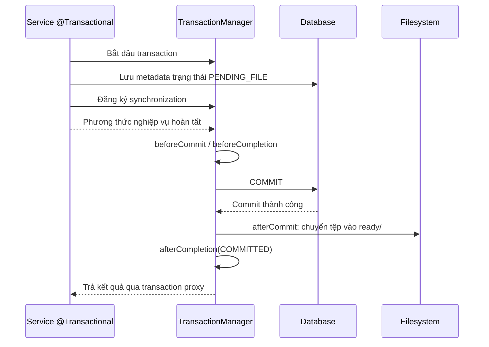
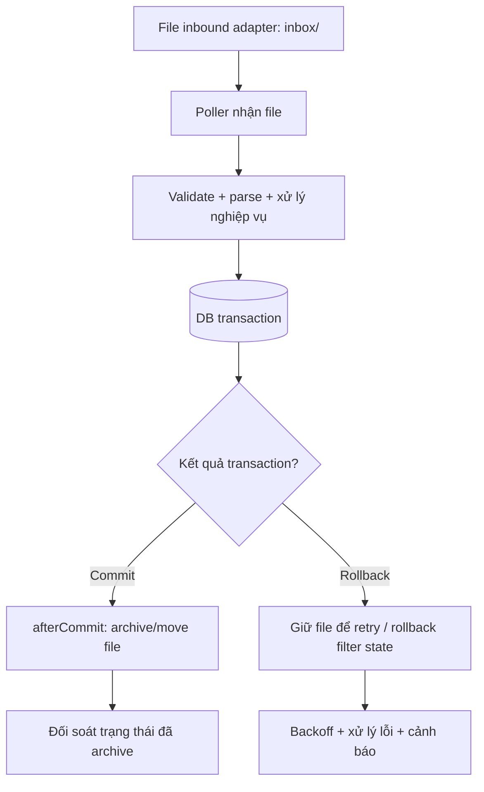

# Transaction synchronization và thao tác tệp sau commit

Một luồng tích hợp Spring Boot thường phải thực hiện cả **thao tác có giao dịch**, như cập nhật PostgreSQL hoặc MongoDB, và **thao tác không tham gia giao dịch đó**, như di chuyển tệp, đổi tên tệp, ghi object storage hoặc gọi một hệ thống ngoài. Thứ tự thực hiện rất quan trọng: nếu chuyển tệp vào thư mục đã xử lý trước khi cơ sở dữ liệu commit, nhưng commit thất bại, ứng dụng có thể mất khả năng xử lý lại. Ngược lại, nếu commit thành công rồi thao tác tệp lỗi, dữ liệu và tệp có thể tạm thời ở hai trạng thái khác nhau.

**Transaction synchronization** là cơ chế cho phép gắn hành động với các mốc trong vòng đời giao dịch Spring, đặc biệt là **sau commit** (`afterCommit`) và **sau rollback** (`afterCompletion` với trạng thái rollback). Cơ chế này giúp sắp thứ tự thao tác, nhưng **không biến filesystem và database thành một giao dịch nguyên tử**.

Bài học tập trung vào cách áp dụng transaction synchronization trong Spring Boot và Spring Integration, thiết kế trạng thái có thể phục hồi, kiểm thử lỗi sau commit, xử lý tệp an toàn và quan sát các luồng tích hợp thực tế.

## 1. Mục tiêu học tập và tình huống mở đầu

Sau bài học, bạn có thể:

- Phân biệt transaction của database với thao tác tệp, broker, cache hoặc HTTP ngoài transaction.
- Hiểu vòng đời `TransactionSynchronization` và ý nghĩa của `beforeCommit`, `afterCommit`, `afterCompletion`.
- Lựa chọn giữa đăng ký `TransactionSynchronization` trực tiếp và `@TransactionalEventListener`.
- Thiết kế quy trình **stage tệp → lưu trạng thái → commit DB → publish/move tệp → cập nhật trạng thái**.
- Xử lý tình huống rollback, lỗi I/O, crash giữa commit và callback, trùng lặp và retry.
- Vận dụng Spring Integration poller/transaction synchronization khi nhận hoặc xuất tệp.
- Xây dựng integration test thực sự chứng minh thứ tự commit, rollback, idempotency và phục hồi.

### Ví dụ xuyên suốt

Một dịch vụ nhận tệp dữ liệu đơn hàng từ thư mục `incoming/` hoặc qua HTTP upload:

1. Đưa nội dung nhận được vào thư mục `staging/`.
2. Ghi metadata và trạng thái xử lý tệp vào database.
3. Sau khi transaction của database **commit thành công**, chuyển tệp từ `staging/` sang `ready/`.
4. Đánh dấu bản ghi là `READY`; một adapter Spring Integration hoặc worker tiếp theo mới xử lý tệp đã sẵn sàng.

Nếu bước 3 xảy ra trước commit, worker khác có thể thấy tệp trong `ready/` trong khi bản ghi database chưa tồn tại. Nếu callback sau commit lỗi, bản ghi phải còn đủ thông tin để hệ thống thử lại.

## 2. Vì sao `@Transactional` không rollback được thao tác tệp?

Trong Spring, `@Transactional` thường điều khiển một `PlatformTransactionManager` và các resource tham gia transaction, ví dụ kết nối JDBC. Các lệnh `Files.move(...)`, `Files.delete(...)` hay `Files.copy(...)` không tự tham gia transaction JDBC.

Ví dụ không an toàn:

```java
@Transactional
public void process(Path incoming, Path ready) throws IOException {
    orderRepository.save(new OrderRecord(...));
    Files.move(incoming, ready);
    // Một lỗi ở cuối phương thức có thể khiến DB rollback.
    // Tệp đã di chuyển vẫn nằm ở ready/.
    validateFinalState();
}
```

Ở đây, transaction database có thể bị rollback nhưng hệ thống tệp vẫn đã thay đổi. Chiều ngược lại cũng có thể xảy ra: database commit xong rồi JVM chết trước khi chương trình chuyển tệp.

| Sự kiện | Database | Filesystem | Rủi ro |
|---|---|---|---|
| Move tệp trước, DB rollback | Không có metadata đã commit | Tệp đã sang `ready/` | Tệp mồ côi hoặc bị xử lý quá sớm |
| DB commit trước, move thành công | Metadata đã commit | Tệp ở `ready/` | Có thể tiếp tục quy trình |
| DB commit trước, move thất bại | Metadata đã commit | Tệp còn trong `staging/` | Cần retry và reconciliation |
| DB commit, JVM chết trước callback | Metadata đã commit | Tệp còn trong `staging/` | Callback không được chạy; cần cơ chế phục hồi |
| Move thành công, cập nhật trạng thái thất bại | Metadata còn `PENDING_FILE` | Tệp đã ở `ready/` | Retry phải nhận diện thao tác đã hoàn thành |

**Nguyên tắc:** transaction synchronization quản lý **thời điểm** chạy một hành động liên quan tới transaction. Để khôi phục sau crash, ứng dụng cần **trạng thái bền vững, thao tác idempotent và một cơ chế rà soát/thử lại**.

## 3. Vòng đời `TransactionSynchronization`

Spring cung cấp giao diện `org.springframework.transaction.support.TransactionSynchronization`. Khi có transaction synchronization đang hoạt động, ta có thể đăng ký callback qua `TransactionSynchronizationManager.registerSynchronization(...)`.

Các mốc chính:

| Callback | Khi nào chạy | Ứng dụng phù hợp | Điều cần tránh |
|---|---|---|---|
| `beforeCommit(boolean readOnly)` | Trước lúc transaction được commit, khi commit còn có thể thất bại | Kiểm tra/flush tài nguyên có liên hệ với transaction | Không xem đây là bằng chứng commit thành công |
| `beforeCompletion()` | Trước khi hoàn tất transaction, kể cả trong một số đường rollback | Dọn tài nguyên liên kết với transaction | Không thực hiện hành động chỉ được phép sau commit |
| `afterCommit()` | Sau khi commit được thực hiện thành công | Kích hoạt xử lý tệp, gửi tín hiệu nội bộ, ghi nhận kết quả | Không giả định tác vụ sau commit là một phần giao dịch đã commit |
| `afterCompletion(int status)` | Khi transaction đã hoàn tất; trạng thái có thể là `COMMITTED`, `ROLLED_BACK` hoặc `UNKNOWN` | Dọn staging sau rollback, giải phóng resource, metrics | Không coi `UNKNOWN` chắc chắn tương đương rollback |

Hình dung thứ tự điển hình của một transaction thành công:



Nếu DB rollback, `afterCommit()` **không chạy** và `afterCompletion(ROLLED_BACK)` là nơi có thể thử dọn tệp staging. Tuy vậy, callback cũng không phải hàng đợi bền vững: khi tiến trình chết, callback đang nằm trong bộ nhớ sẽ mất.

### Các lưu ý về vòng đời

- `TransactionSynchronizationManager` gắn synchronization vào **ngữ cảnh transaction của luồng thực thi hiện tại** đối với Spring transaction kiểu imperative. Không tự giả định ngữ cảnh này đi qua `ExecutorChannel`, `@Async` hay một thread pool khác.
- `isSynchronizationActive()` chỉ kiểm tra cơ chế synchronization đang bật. Nếu nghiệp vụ thật sự yêu cầu transaction database đang chạy, kiểm tra thêm `isActualTransactionActive()` và cấu hình transaction manager thích hợp.
- Callback chỉ chạy khi transaction **thực sự kết thúc**, thường là ở ranh giới ngoài cùng. Đặt callback trong một phương thức tham gia transaction có sẵn không có nghĩa callback chạy ngay khi phương thức đó return.
- Gọi nội bộ một phương thức `@Transactional` trong chính bean (self-invocation) thường không đi qua Spring proxy, vì vậy transaction mong đợi có thể không được tạo.
- Có thể có nhiều synchronization cùng tham gia. Nếu thứ tự giữa chúng quan trọng, cần quản lý `Ordered`/`getOrder()` hoặc cấu trúc lại luồng, thay vì trông chờ một thứ tự tình cờ.

## 4. Chọn quy tắc trạng thái bền vững cho tệp

Một thiết kế dễ phục hồi nên coi trạng thái database là **bản ghi ý định** và filesystem là **tài nguyên cần đối soát**.

| Trạng thái | Ý nghĩa | Hành động tiếp theo |
|---|---|---|
| `PENDING_FILE` | Metadata đã commit; tệp đã được stage nhưng chưa chắc đã publish vào `ready/` | Worker thử move hoặc đối soát đích |
| `READY` | Tệp đích đã được xác minh và có thể được xử lý | Chuyển sang bước xử lý tiếp theo |
| `RETRY_REQUIRED` (tùy chọn) | Lần move gần nhất lỗi, nhưng còn khả năng phục hồi | Retry có backoff, tăng attempt count |
| `FAILED_PERMANENT` (tùy chọn) | Không thể phục hồi tự động, cần can thiệp | Alert và quy trình xử lý thủ công |
| `PROCESSED` | Tệp đã được tiêu thụ thành công bởi bước sau | Lưu audit/retention theo chính sách |

Không phải dự án nào cũng cần đủ tất cả trạng thái. Điều cốt lõi là **`PENDING_FILE` phải được commit trước khi việc chuyển tệp được xem là hoàn tất**, và phải giữ lại tên staging, tên đích, checksum/size, ID nghiệp vụ, số lần thử cùng timestamp cần thiết cho retry.

Một trạng thái có thể dùng để khử trùng lặp là ID duy nhất của file job. Đừng dùng trực tiếp tên tệp do người dùng cung cấp để quyết định đường dẫn đích: trùng tên và path traversal có thể khiến ghi nhầm hoặc ghi đè dữ liệu.

### Quy ước đường dẫn

```text
data/
  staging/
    <file-id>.part
  ready/
    <file-id>.dat
  quarantine/
    <file-id>.dat
```

Hai thư mục `staging/` và `ready/` nên nằm trên **cùng filesystem** nếu thiết kế dựa vào atomic rename. Tệp phải được ghi và đóng hoàn tất trong `staging/` trước khi tạo bản ghi yêu cầu publish. Nếu dữ liệu đi qua nhiều máy ứng dụng, staging phải nằm trên shared storage phù hợp hoặc một object store bền vững; tệp chỉ có trên ổ cứng của một pod sẽ không có sẵn để pod khác retry.

## 5. Cách 1: Đăng ký `TransactionSynchronization` trực tiếp

Cách này phù hợp khi một service muốn gắn callback ngay tại nơi lập transaction. Ví dụ dưới đây là **khung triển khai**: `FileJobRepository`, `FileJob`, `FilePromotionService` và `StagingCleanup` là các thành phần nghiệp vụ của ứng dụng.

```java
import java.nio.file.Path;
import java.util.UUID;

import org.springframework.stereotype.Service;
import org.springframework.transaction.annotation.Transactional;
import org.springframework.transaction.support.TransactionSynchronization;
import org.springframework.transaction.support.TransactionSynchronizationManager;

@Service
public class FileRegistrationService {

    private final FileJobRepository repository;
    private final FilePromotionService promotionService;
    private final StagingCleanup stagingCleanup;

    public FileRegistrationService(
            FileJobRepository repository,
            FilePromotionService promotionService,
            StagingCleanup stagingCleanup) {
        this.repository = repository;
        this.promotionService = promotionService;
        this.stagingCleanup = stagingCleanup;
    }

    @Transactional
    public UUID register(Path stagedFile, String checksum) {
        if (!TransactionSynchronizationManager.isSynchronizationActive()
                || !TransactionSynchronizationManager.isActualTransactionActive()) {
            throw new IllegalStateException("Cần transaction DB đang hoạt động");
        }

        UUID id = UUID.randomUUID();
        repository.save(FileJob.pending(id, stagedFile, checksum));

        TransactionSynchronizationManager.registerSynchronization(
                new TransactionSynchronization() {
                    @Override
                    public void afterCommit() {
                        // Xử lý best effort; lỗi không làm rollback được DB.
                        promotionService.tryPromote(id);
                    }

                    @Override
                    public void afterCompletion(int status) {
                        if (status == STATUS_ROLLED_BACK) {
                            stagingCleanup.tryDelete(stagedFile);
                        }
                    }
                });

        return id;
    }
}
```

Trong ví dụ này:

1. `@Transactional` bao bọc việc lưu `FileJob` với trạng thái `PENDING_FILE`.
2. Callback `afterCommit` được gọi sau khi transaction commit thành công. `tryPromote` phải tự ghi log/metric, giữ trạng thái để retry và **không ném lỗi ra ngoài như thể database còn rollback được**.
3. Callback `afterCompletion(STATUS_ROLLED_BACK)` thử xóa tệp staging nếu dữ liệu chưa commit. Nếu cleanup lỗi, bộ dọn tệp mồ côi sẽ xử lý sau.
4. Trường hợp `STATUS_UNKNOWN` phải được đưa vào đối soát; không vội xóa dữ liệu đầu vào chỉ vì trạng thái chưa xác định.

**Cảnh báo khi truy cập database trong `afterCommit`:** Spring có thể vẫn giữ resource transaction gắn với thread đến hết giai đoạn cleanup. Một lệnh database trong callback có thể tham gia tài nguyên của transaction vừa kết thúc mà **không có commit tiếp theo**. Khi phải đọc/ghi trạng thái sau commit, hãy sử dụng một service khác với `@Transactional(propagation = Propagation.REQUIRES_NEW)` hoặc thực thi qua một cơ chế giao dịch độc lập. Tránh gọi chính phương thức `REQUIRES_NEW` trong cùng bean vì self-invocation có thể bỏ qua proxy.

Ngoài ra, nếu callback `afterCommit` ném unchecked exception, lỗi đó có thể lan tới tầng gọi sau khi database đã commit; API có thể trả lỗi và khiến phía client gửi lại yêu cầu. Vì vậy, việc chuyển tệp nên được thiết kế thành thao tác **idempotent**, có xử lý lỗi riêng và có một trạng thái đủ để xác minh kết quả thật.

## 6. Cách 2: `@TransactionalEventListener` với `AFTER_COMMIT`

Một lựa chọn gọn hơn là phát domain event trong transaction, rồi đăng ký listener theo phase. Đây là cách phù hợp khi muốn service lưu dữ liệu không chứa trực tiếp logic filesystem.

Ví dụ với Spring Boot sử dụng transaction imperative:

```java
import java.util.UUID;

public record FilePromotionRequested(UUID fileId) {}
```

```java
import java.nio.file.Path;
import java.util.UUID;

import org.springframework.context.ApplicationEventPublisher;
import org.springframework.stereotype.Service;
import org.springframework.transaction.annotation.Transactional;

@Service
public class UploadService {

    private final FileJobRepository jobs;
    private final ApplicationEventPublisher events;

    public UploadService(FileJobRepository jobs, ApplicationEventPublisher events) {
        this.jobs = jobs;
        this.events = events;
    }

    @Transactional
    public UUID accept(Path stagedPath, String sha256) {
        UUID id = UUID.randomUUID();
        jobs.save(FileJob.pending(id, stagedPath, sha256));
        events.publishEvent(new FilePromotionRequested(id));
        return id;
    }
}
```

```java
import org.springframework.stereotype.Component;
import org.springframework.transaction.event.TransactionPhase;
import org.springframework.transaction.event.TransactionalEventListener;

@Component
public class FilePromotionListener {

    private final FilePromotionService promotionService;

    public FilePromotionListener(FilePromotionService promotionService) {
        this.promotionService = promotionService;
    }

    @TransactionalEventListener(phase = TransactionPhase.AFTER_COMMIT)
    public void afterCommit(FilePromotionRequested event) {
        promotionService.tryPromote(event.fileId());
    }
}
```

`@TransactionalEventListener` mặc định chỉ xử lý sự kiện khi phát bên trong transaction phù hợp. Nếu không có transaction, event có thể bị bỏ qua trừ khi chủ động cấu hình `fallbackExecution = true`. Với nghiệp vụ “chỉ chuyển sau khi commit”, **không bật fallback một cách tùy tiện**.

Có thể bổ sung listener `AFTER_ROLLBACK` để dọn staging, nhưng event ở trên chỉ mang `fileId`. Nếu transaction rollback, bản ghi DB sẽ không tồn tại; muốn dọn staging trong callback phải mang thêm thông tin tệp staging **đã được xác thực** trong event hoặc có một registry riêng. Cũng cần dọn các tệp được stage trước khi event được publish nhưng request thất bại trước bước đó.

Các phase có thể dùng: `BEFORE_COMMIT`, `AFTER_COMMIT`, `AFTER_ROLLBACK` và `AFTER_COMPLETION`. Một lưu ý kỹ thuật: với `@TransactionalEventListener`, phase `AFTER_COMMIT` được thực thi trong giai đoạn hoàn tất transaction của listener; không nên giả định nó có cùng cơ chế lan truyền exception với việc tự override `TransactionSynchronization.afterCommit()`. Trong cả hai trường hợp, commit database đã hoàn tất nên lỗi listener **không thể undo dữ liệu đã commit**.

### Khi nào chọn cách nào?

| Tiêu chí | `TransactionSynchronization` | `@TransactionalEventListener` |
|---|---|---|
| Gắn logic sát transaction và cleanup resource | Thuận tiện, điều khiển callback trực tiếp | Cần tạo event và listener |
| Tách lớp nghiệp vụ khỏi side effect sau commit | Dễ phát sinh phụ thuộc trực tiếp | Rõ ràng hơn qua domain event |
| Chạy khi không có transaction | Phải tự kiểm tra, không thể đăng ký tùy tiện | Mặc định không gọi listener nếu thiếu transaction |
| Đảm bảo callback chạy sau khi JVM crash | **Không** | **Không** |
| Cơ chế thử lại bền vững | Cần lưu job/outbox và reconciler | Cũng cần lưu job/outbox và reconciler |

Domain event nội bộ chỉ là **tín hiệu kích hoạt nhanh**. Nó không tương đương durable message broker hoặc transactional outbox.

## 7. Triển khai thao tác tệp idempotent

Một hệ thống có khả năng retry phải xử lý được lời gọi `promote(fileId)` lặp lại. Trước mỗi lần chuyển tệp, hãy xác định trạng thái từ database và filesystem:

```text
Nếu DB = READY và tệp đích hợp lệ:
    Không làm gì thêm (idempotent success).

Nếu DB = PENDING_FILE và tệp staging tồn tại, đích chưa tồn tại:
    Xác minh đường dẫn, kích thước/checksum.
    Chuyển tệp từ staging -> ready theo cơ chế đã chọn.
    Xác minh đích; cập nhật DB = READY trong transaction mới.

Nếu DB = PENDING_FILE, staging không tồn tại nhưng đích đã tồn tại:
    Xác minh tệp đích thuộc đúng fileId và checksum.
    Nếu đúng: cập nhật DB = READY trong transaction mới.
    Nếu sai: chuyển tình huống sang xử lý xung đột/quarantine.

Nếu cả staging và đích đều không tồn tại:
    Giữ dấu vết lỗi; thử khôi phục từ nguồn nhận gốc nếu còn.
    Cảnh báo khi không thể phục hồi.
```

### 7.1. Atomic rename và giới hạn của nó

Java NIO hỗ trợ yêu cầu di chuyển nguyên tử:

```java
import java.io.IOException;
import java.nio.file.AtomicMoveNotSupportedException;
import java.nio.file.Files;
import java.nio.file.Path;
import java.nio.file.StandardCopyOption;

public void moveAtomically(Path staging, Path target) throws IOException {
    try {
        Files.move(staging, target, StandardCopyOption.ATOMIC_MOVE);
    } catch (AtomicMoveNotSupportedException ex) {
        // Không mặc định copy/move thường rồi coi như atomic.
        throw new IOException("Storage không hỗ trợ atomic rename", ex);
    }
}
```

`ATOMIC_MOVE` giúp việc đổi tên tệp xuất hiện nguyên tử khi filesystem/provider hỗ trợ, thường cần đường dẫn nguồn và đích nằm trong cùng filesystem. Nó **không** đảm bảo transaction chung với database, không tự chứng minh durability trước mất điện, và hành vi khi đích đã tồn tại có thể phụ thuộc implementation. Do đó:

- Tạo tên đích duy nhất theo `fileId`, không ghi đè tệp của yêu cầu khác.
- Kiểm tra và giới hạn đường dẫn vào thư mục được phép; không chấp nhận `../` từ input người dùng.
- Xác minh kích thước/checksum để phân biệt retry hợp lệ với tệp trùng tên sai nội dung.
- Với yêu cầu durability rất cao, xem xét thao tác flush/sync và thuộc tính lưu trữ của nền tảng, không suy luận chỉ từ việc `Files.move` đã trả về.
- Nếu phải đi qua hai filesystem, thiết kế một giao thức **copy vào tên tạm ở đích → xác minh → publish/rename tại đích → dọn nguồn**. Các bước này không còn là một thao tác nguyên tử end-to-end và cần trạng thái phục hồi riêng.

### 7.2. Cập nhật trạng thái trong transaction mới

Tách thành một bean thực sự đi qua Spring proxy:

```java
import java.util.UUID;

import org.springframework.stereotype.Service;
import org.springframework.transaction.annotation.Propagation;
import org.springframework.transaction.annotation.Transactional;

@Service
public class FileJobStateService {

    private final FileJobRepository jobs;

    public FileJobStateService(FileJobRepository jobs) {
        this.jobs = jobs;
    }

    @Transactional(propagation = Propagation.REQUIRES_NEW)
    public void markReady(UUID id) {
        FileJob job = jobs.findById(id).orElseThrow();
        job.markReady();
        jobs.save(job);
    }
}
```

`FilePromotionService` xử lý I/O và gọi `fileJobStateService.markReady(id)` sau khi xác minh tệp đích. Hai việc này không thể cam kết atomically: nếu update `READY` lỗi, lần retry sau phải nhận ra tệp đã được chuyển rồi. Điều đó giải thích vì sao phải có **idempotency và reconciler** dù đã dùng `REQUIRES_NEW`.

Không kéo transaction database dài qua thao tác copy tệp lớn chỉ để “giữ mọi thứ trong một chỗ”. Giữ transaction ngắn, lưu ý định trước, sau đó xử lý tệp ở bước riêng sẽ giảm thời gian giữ connection/lock.

## 8. Xử lý rollback, lỗi và crash tại từng ranh giới

Các tình huống cần phân biệt:

| Thời điểm xảy ra lỗi | Trạng thái có thể quan sát | Hành động phục hồi |
|---|---|---|
| Upload chưa ghi xong staging | Không có metadata hoặc staging chỉ mới có tệp dở | Xóa tệp `.part` không hợp lệ; không tạo `READY` |
| DB rollback trước commit | Không có `FileJob` đã commit | Dọn staging sau rollback; job dọn orphan xử lý trường hợp callback không chạy |
| DB commit rồi JVM chết trước `afterCommit` | `PENDING_FILE` còn trong DB; staging còn | Reconciler quét `PENDING_FILE` và gọi lại `promote` |
| `Files.move` ném exception | `PENDING_FILE`; source/target cần kiểm tra | Ghi metric/log; retry có backoff; kiểm tra nguyên nhân storage |
| Move thành công, markReady lỗi | DB vẫn `PENDING_FILE`, đích tồn tại | Xác minh fileId/checksum và markReady trong transaction mới |
| Callback được gọi lặp hoặc nhiều node cùng retry | Có nguy cơ hai worker thao tác cùng tệp | Claim job bằng optimistic locking/lease hoặc khóa phù hợp; idempotent file operation |
| Tệp đến đích nhưng downstream thất bại | `READY` hoặc trạng thái tiếp theo chưa hoàn tất | Retry downstream theo idempotency key, không giả định file promotion cần rollback |

**Một callback sau commit chạy thành công một lần không phải bằng chứng exactly-once.** Chính retry, crash recovery, nhiều node và message redelivery khiến thao tác phải được thiết kế chịu lặp.

### Retry có giới hạn

- Ghi `attemptCount`, `lastError` (đã loại dữ liệu nhạy cảm), `nextRetryAt` và thời điểm sửa đổi.
- Dùng exponential backoff với jitter và mức giới hạn; lỗi permission/path invalid thường cần phân loại khác lỗi mạng/storage tạm thời.
- Giới hạn số lần thử; đưa job sang trạng thái cần can thiệp khi hết cơ hội tự phục hồi.
- Tác vụ scan phải có cơ chế sở hữu job hoặc CAS/optimistic lock để không có nhiều worker cùng move một tệp.
- Khi cleanup tệp lỗi, cảnh báo theo tuổi tệp staging; tránh xóa tệp thuộc transaction/job còn hoạt động.

## 9. Áp dụng trong Spring Integration flow

Spring Integration cung cấp adapter đọc/ghi tệp, poller, channel và cơ chế điều phối message. Với inbound file polling, yêu cầu thường là: **chỉ chuyển file sang `archive/` sau khi business transaction đã commit**.

Luồng khái niệm:



Spring Integration có khái niệm **transaction synchronization cho poller** (ví dụ các callback sau commit/sau rollback thông qua `TransactionSynchronizationFactory` ở những phiên bản hỗ trợ). Hãy đối chiếu API Java DSL/XML tương ứng với phiên bản Spring Integration của dự án khi cấu hình. Chúng phục vụ cùng mục tiêu điều phối theo vòng đời transaction, nhưng thời điểm và ngữ cảnh gắn callback phải khớp poller/transaction manager được cấu hình.

Ba điểm cần đặc biệt chú ý:

1. **Ranh giới transaction.** Poller được cấu hình transactional không có nghĩa mọi channel và service phía sau tự động cùng một transaction. Nếu flow chuyển sang `ExecutorChannel`, thread mới thường không thừa hưởng transaction context cũ. Với asynchronous processing, lưu trạng thái durable và xử lý chuyển tệp bằng worker độc lập.
2. **Filter nhận file.** Các bộ lọc kiểu “accept once” có thể nhớ rằng tệp đã được nhận, dù xử lý sau đó rollback. Cần dùng filter/state store và cách rollback/retry phù hợp, hoặc xây dựng cơ chế quét lại có kiểm soát; đừng chỉ để file trong `inbox/` rồi mặc định adapter sẽ đọc lại.
3. **Error channel và transaction.** Một exception bị bắt và chuyển thành error message nhưng không tiếp tục propagate đến transaction boundary có thể khiến transaction commit. Hãy xác định lỗi nào cần rollback, lỗi nào cần đánh dấu trạng thái thất bại và luồng nào phải gửi vào DLQ/quarantine.

File writing adapter hoặc custom outbound handler cũng có thể tạo side effect trước commit. Nếu file đích là tín hiệu để hệ thống ngoài bắt đầu xử lý, hãy dùng staging và publish sau commit; tránh cho consumer thấy tệp viết dở hoặc dữ liệu DB chưa nhất quán.

### Đồng bộ hóa với broker hoặc HTTP

Những nguyên tắc trên áp dụng tương tự với message broker và HTTP client:

- Gửi JMS/Kafka/RabbitMQ sau commit không phải một atomic transaction chung với database; gửi có thể thất bại sau commit.
- Nếu bắt buộc không mất lệnh publish, ghi một **outbox record** cùng transaction database rồi để publisher đáng tin cậy lấy bản ghi đó sau commit. Callback chỉ được dùng để “đánh thức” publisher.
- Gọi HTTP sau commit có thể timeout dù phía nhận đã xử lý thành công; cần idempotency key hoặc cơ chế truy vấn trạng thái.
- Không cố “rollback file” để thay thế xử lý lỗi broker hoặc cache; xác định rõ hệ thống nào sở hữu trạng thái chuẩn.

## 10. Khi nào transaction synchronization chưa đủ?

Transaction synchronization phù hợp để **giảm độ trễ kích hoạt** khi các bước tương đối ngắn và có đường phục hồi độc lập. Chỉ dựa vào callback là thiếu an toàn nếu:

- JVM/pod có thể chết ngay sau DB commit.
- Thao tác tệp lớn, cần chạy lâu hoặc phải chạy trên worker khác.
- Tệp nằm ở object storage/network share có khả năng timeout hoặc trả kết quả mơ hồ.
- Hệ thống có nhiều instance và retry cần được phân phối.
- Hợp đồng nghiệp vụ yêu cầu không mất yêu cầu publish/di chuyển ngay cả trong sự cố kéo dài.

Trong các tình huống đó, dùng **durable file-job table/outbox + worker + reconciliation**. Mẫu dữ liệu có thể gồm:

```text
file_jobs
  file_id              UUID PRIMARY KEY
  source_ref           TEXT
  staging_key          TEXT
  target_key           TEXT
  sha256               TEXT
  state                PENDING_FILE | READY | RETRY_REQUIRED | ...
  attempt_count        INTEGER
  next_retry_at        TIMESTAMP
  lease_owner          TEXT
  lease_until          TIMESTAMP
  created_at           TIMESTAMP
  updated_at           TIMESTAMP
```

Worker định kỳ lấy những job cần làm, claim an toàn bằng khóa hoặc optimistic locking, thực hiện file I/O có kiểm tra checksum, rồi cập nhật trạng thái bằng transaction mới. Callback `afterCommit` có thể đánh thức worker để xử lý nhanh, nhưng **scan/reconciliation** mới bảo đảm phục hồi khi callback bị mất.

Với object storage, thay “đường dẫn filesystem” bằng object key/version/etag, và thiết kế theo ngữ nghĩa thực tế của dịch vụ lưu trữ. Không mặc định object-store “move/rename” tương đương atomic rename của local filesystem.

## 11. Kiểm thử thứ tự commit và tính phục hồi

Unit test có thể xác minh nhánh quyết định, nhưng cần integration test chạy với **transaction manager và database thật** để chứng minh thời điểm callback.

### 11.1. Bộ tình huống tối thiểu

| Bài test | Thiết lập | Assertion quan trọng |
|---|---|---|
| Commit thành công | Stage tệp, gọi service `@Transactional` từ bên ngoài proxy | Metadata commit, tệp đã sang `ready/`, trạng thái `READY` |
| Rollback trước commit | Cố tình ném unchecked exception trong service | Không có metadata đã commit; tệp không được publish |
| I/O lỗi sau commit | Làm cho `ready/` không ghi được hoặc inject một file operator báo lỗi | Metadata `PENDING_FILE` vẫn còn, callback không xóa dấu vết |
| Crash trước callback | Ghi `PENDING_FILE` với tệp staging, không gọi callback | Reconciler phát hiện job và chuyển tệp thành công |
| Crash sau move trước markReady | Tệp đã ở đích, metadata vẫn pending | Reconciler kiểm tra checksum và hoàn tất trạng thái |
| Gọi promote hai lần | Job đã `READY`, tệp đích tồn tại hợp lệ | Không ghi đè tệp khác; xử lý idempotent |
| Hai worker nhận cùng job | Cho hai runner cùng tranh lease/claim | Chỉ một xử lý chính, kết quả nhất quán |
| Async channel | Flow đổi thread sau poller | Callback gắn đúng transaction hoặc flow chuyển sang job durable |
| Filter nhận file đã đánh dấu | Xử lý thất bại sau khi inbound poll | Có thể retry tệp theo chính sách thiết kế |

### 11.2. Cạm bẫy `@Transactional` trên test

Nếu annotate **phương thức test** bằng `@Transactional` trong Spring Test, transaction thường được rollback khi kết thúc test. Khi đó `afterCommit` sẽ không chạy. Vì vậy, một bài test kiểm tra chuyển tệp sau commit nên:

- Để bản thân test **không** có `@Transactional`, gọi service `@Transactional` qua Spring proxy, sau khi lời gọi hoàn tất thì assert.
- Hoặc dùng `TestTransaction` để chủ động kết thúc transaction với commit trong bài test có transaction do Spring Test quản lý.
- Không mock toàn bộ transaction manager khi mục tiêu là xác minh callback commit.
- Với listener/event đồng bộ, assert ngay sau service commit; với worker bất đồng bộ, dùng cơ chế chờ điều kiện và timeout có giới hạn.

Một khung test thể hiện ý đồ:

```java
@SpringBootTest
class FilePromotionIT {

    @Autowired UploadService uploadService;
    @Autowired FileJobRepository jobs;
    @Autowired FilePromotionService promotionService;

    @Test
    void publishesAfterCommittedMetadata() throws Exception {
        Path staged = createStagedFileForTest();
        UUID id = uploadService.accept(staged, sha256Of(staged));

        // Không đặt @Transactional ở phương thức test:
        // transaction trong uploadService.accept() đã kết thúc.
        assertThat(jobs.findById(id)).isPresent();
        assertThat(promotionService.targetExistsAndMatches(id)).isTrue();
    }
}
```

`createStagedFileForTest`, `sha256Of` và `targetExistsAndMatches` là helper của fixture/thành phần ứng dụng; ví dụ minh họa ý tưởng kiểm thử, không phải một lớp có thể chạy độc lập. Dùng thư mục tạm và database test riêng, dọn dữ liệu sau kiểm thử. Nếu listener hoặc job chạy async, điều kiện cuối cùng phải được đợi với timeout rõ ràng.

## 12. Quan sát và vận hành flow sau commit

Để chẩn đoán, cần nối được transaction database và file operation bằng một **correlation ID/job ID**.

Nên ghi nhận:

- `fileId`, `requestId` hoặc `messageId`, trạng thái trước/sau; không log tên hoặc nội dung tệp nhạy cảm khi không cần thiết.
- Số job `PENDING_FILE`, tuổi job cũ nhất, số lần retry, thời gian từ DB commit đến `READY`.
- Lỗi phân loại: `AtomicMoveNotSupportedException`, permission denied, source missing, target conflict, checksum mismatch, storage timeout.
- Số callback được kích hoạt, số job được reconciler phục hồi, số job vào quarantine và số lần xử lý trùng đã được khử.
- Cảnh báo khi số job pending tăng nhanh, job vượt SLA, hoặc số tệp staging mồ côi cao hơn ngưỡng.
- Log theo mỗi bước với kết quả cụ thể: `db_committed`, `promotion_attempted`, `file_verified`, `status_ready`; không dùng “processed” chung cho mọi sự kiện.

**Phân biệt kết quả tại API:** khi database đã commit nhưng thao tác sau commit thất bại, hệ thống không nên thông báo như thể toàn bộ thao tác chắc chắn rollback. Tùy hợp đồng, API có thể trả ID tác vụ và trạng thái `PENDING_FILE`/`202 Accepted` để client truy vấn tiến độ. Nếu API đồng bộ buộc trả kết quả “ready”, phải xử lý thật cẩn thận trường hợp callback thất bại nhưng transaction đã commit, nhất là khi client retry.

## 13. Checklist áp dụng vào hệ thống Spring Boot Integration

- [ ] Đã xác định transaction manager và ranh giới commit thực tế; không nhầm file I/O với JDBC/JPA transaction.
- [ ] Tệp được ghi hoàn tất vào staging trước khi publish, và không xuất hiện sớm ở `ready/`.
- [ ] Metadata/trạng thái `PENDING_FILE` được lưu bền vững trước khi callback after-commit chạy.
- [ ] `afterCommit` chỉ kích hoạt hành động an toàn để retry; callback lỗi không bị hiểu nhầm thành DB rollback.
- [ ] Cleanup sau rollback là best effort, có bộ dọn staging mồ côi.
- [ ] Đã kiểm tra `TransactionSynchronizationManager` hoặc lifecycle của `@TransactionalEventListener` trên đúng transaction/thread.
- [ ] Khi ghi database sau commit, có transaction **mới** qua Spring proxy hoặc worker riêng.
- [ ] Thao tác move/copy có quy tắc path, collision, checksum và độ bền phù hợp với storage.
- [ ] Có idempotency key, cơ chế claim job và reconciliation cho crash giữa các bước.
- [ ] Spring Integration poller/filter/error channel giữ đúng khả năng retry khi downstream thất bại.
- [ ] Có integration test cho commit, rollback, lỗi I/O, retry và crash gap; test không vô tình rollback toàn bộ transaction.
- [ ] Có metric, log correlation, cảnh báo backlog và hướng dẫn xử lý job lỗi.

**Ghi nhớ:** `TransactionSynchronization` và `@TransactionalEventListener(AFTER_COMMIT)` giúp Spring Boot chạy thao tác tệp **đúng sau thời điểm commit**, nhưng không đảm bảo thao tác đó sẽ luôn được thực thi hoặc chỉ thực thi một lần. Thiết kế đáng tin cậy phải kết hợp **trạng thái bền vững, idempotent file operation, transaction mới khi cập nhật trạng thái và một worker đối soát/phục hồi**.

