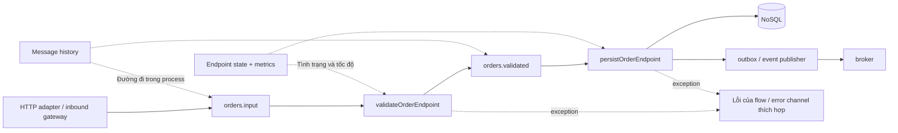

# Theo dõi message history, endpoint và số liệu xử lý

## 1. Vì sao flow cần ba lớp quan sát?

Trong ứng dụng **Spring Boot**, một đơn hàng có thể đi qua HTTP controller, bộ chuyển đổi dữ liệu, kênh nội bộ, handler ghi cơ sở dữ liệu, cache, broker và adapter của Spring Integration. Khi khách hàng báo “đã gửi nhưng chưa có kết quả”, câu hỏi không chỉ là ứng dụng có báo lỗi hay không, mà còn là:

- Message đã đi qua những channel và endpoint nào?
- Endpoint đang chạy, dừng hay bị chặn vì downstream chậm?
- Số message vào/ra, thời gian xử lý, lỗi, hàng chờ và lượt thử lại thay đổi ra sao?
- Một message đã được xử lý một lần hay bị gửi lại, phát lại hoặc xử lý trùng?

Đây là bài học thuộc chương **Lỗi và trạng thái flow** của module **SPRING_BOOT_INTEGRATION**: tổ chức tích hợp HTTP client, cơ sở dữ liệu, cache, broker và các adapter Spring Integration, đồng thời quản lý cấu hình, hợp đồng dữ liệu, giao dịch, lỗi, xử lý trùng lặp, kiểm thử và quan sát thực tế.

Ba nhóm thông tin bổ sung nhau:

| Nhóm | Câu hỏi chính | Cơ chế tiêu biểu | Giới hạn |
|---|---|---|---|
| **Message history** | “Message đã đi qua đâu?” | Header lịch sử do Spring Integration ghi khi bật tính năng. | Không phải audit log bền vững hay distributed trace xuyên dịch vụ. |
| **Endpoint/channel state** | “Thành phần nào tồn tại, đang chạy, đang nhận/đẩy dữ liệu?” | ID endpoint, Spring context, lifecycle, integration graph, thống kê channel/poller. | Trạng thái `running` không bảo đảm downstream khỏe hoặc xử lý thành công. |
| **Processing metrics và tracing** | “Bao nhiêu, mất bao lâu, lỗi ở đâu, có đang tồn đọng?” | Micrometer, Actuator, Observation/tracing, log có correlation ID, metrics nghiệp vụ. | Số liệu tổng hợp không chỉ ra đầy đủ đường đi của một message cụ thể. |

Mục tiêu là nối được **đường đi của từng message** với **sức khỏe của component** và **kết quả nghiệp vụ** mà không làm tăng quá mức chi phí lưu trữ hay làm lộ dữ liệu.

## 2. Mô hình flow minh họa

Giả sử hệ thống nhận sự kiện tạo đơn hàng từ đối tác, kiểm tra dữ liệu, ghi read model vào NoSQL và phát sự kiện đã xử lý cho broker:



Một bản ghi theo dõi tốt phải trả lời được “event `evt-42` đã được chấp nhận và xử lý ở bước nào?”. Tuy nhiên, **message header**, **Spring Integration endpoint**, **transaction** và **bản ghi nghiệp vụ** không có cùng vòng đời: việc ghi thành công vào NoSQL và việc gửi broker là hai tác động riêng, không tự trở thành một giao dịch phân tán chỉ vì nằm trong cùng một `IntegrationFlow`.

## 3. Message history là gì?

Spring Integration có hỗ trợ **message history**: khi được kích hoạt, các component tham gia theo dõi có thể ghi thông tin đường đi vào header của `Message<?>`. Mỗi entry thường mang thông tin như **component name** và **component type**; danh sách tích lũy theo các chặng đã đi qua.

Ví dụ về một lịch sử minh họa, không phải định dạng log bắt buộc:

```text
messageId=9b43...
history=[
  {name="orders.input",      type="channel"},
  {name="validateOrderEndpoint", type="endpoint"},
  {name="orders.validated",  type="channel"},
  {name="persistOrderEndpoint", type="endpoint"}
]
```

Trong Java configuration, có thể bật bằng `@EnableMessageHistory`:

```java
import org.springframework.context.annotation.Configuration;
import org.springframework.integration.config.EnableIntegration;
import org.springframework.integration.config.EnableMessageHistory;

@Configuration(proxyBeanMethods = false)
@EnableIntegration
@EnableMessageHistory
class FlowHistoryConfiguration {
}
```

Với Spring Integration 6.x trong hệ sinh thái Spring Boot 3.x, có thể đọc lịch sử từ một message như sau:

```java
import org.springframework.integration.history.MessageHistory;
import org.springframework.messaging.Message;

void logMessageHistory(Message<?> message) {
    MessageHistory history = MessageHistory.read(message);
    if (history != null) {
        log.debug("messageId={} history={}",
                message.getHeaders().getId(), history);
    }
}
```

Nếu `history == null`, có thể do chưa bật tính năng, message chưa đi qua component được instrument, component không ghi history, hoặc header đã bị mất khi tạo message mới. **Đừng suy luận “không có lịch sử” tức là “không đi qua flow”.**

### Các giới hạn cần hiểu

1. **Tồn tại trong header, không mặc định lưu bền vững.** Khi message bị giải phóng, lịch sử cũng có thể biến mất nếu không có cơ chế lưu riêng.
2. **Phạm vi chủ yếu trong Spring Integration runtime.** Đi qua HTTP, Kafka hoặc một process khác thường tạo message mới; lịch sử của process cũ không tự trở thành lịch sử xuyên hệ thống.
3. **Phụ thuộc sự bảo toàn header.** Khi biến đổi message bằng API builder, cần giữ các header cần thiết. Tạo `GenericMessage` mới chỉ có payload hoặc lọc header có thể làm mất history/correlation.
4. **History tăng theo số hop.** Với flow dài, lặp, split/aggregate hoặc traffic lớn, việc lưu history trên mọi message làm tăng chi phí memory, serialization và kích thước log.
5. **History là manh mối, không là bằng chứng thành công cuối cùng.** Một handler có thể được gọi rồi throw exception, hoặc hoàn tất nhưng giao dịch sau đó rollback; entry lịch sử không chứng minh nghiệp vụ đã commit.

Trong production, chọn phạm vi bật và chiến lược log phù hợp, tránh ghi payload/credential vào log và không tự xuất toàn bộ header sang mọi hệ thống.

## 4. Đặt tên endpoint và channel để history đọc được

Tên ổn định biến lịch sử từ chuỗi tên tự sinh khó hiểu thành dữ liệu hỗ trợ điều tra. Ví dụ flow sử dụng DSL của Spring Integration:

```java
import org.springframework.context.annotation.Bean;
import org.springframework.context.annotation.Configuration;
import org.springframework.integration.dsl.IntegrationFlow;

@Configuration(proxyBeanMethods = false)
class OrderFlowConfiguration {

    @Bean
    IntegrationFlow orderFlow(OrderSteps steps) {
        return IntegrationFlow.from("orders.input")
                .handle(steps, "validate",
                        endpoint -> endpoint.id("validateOrderEndpoint"))
                .channel("orders.validated")
                .handle(steps, "persist",
                        endpoint -> endpoint.id("persistOrderEndpoint"))
                .get();
    }
}
```

Giả sử class nghiệp vụ có hai method:

```java
import org.springframework.integration.history.MessageHistory;
import org.springframework.messaging.Message;
import org.springframework.stereotype.Component;

@Component
class OrderSteps {

    public OrderEvent validate(OrderEvent event) {
        if (event.eventId() == null || event.eventId().isBlank()) {
            throw new IllegalArgumentException("Missing eventId");
        }
        return event;
    }

    public void persist(Message<OrderEvent> message) {
        OrderEvent event = message.getPayload();
        MessageHistory history = MessageHistory.read(message);
        log.debug("eventId={} messageId={} history={}",
                event.eventId(), message.getHeaders().getId(), history);

        // Gọi repository hoặc adapter lưu dữ liệu có kiểm soát
        // về idempotency, transaction và timeout.
    }
}

record OrderEvent(String eventId, String orderId) {
}
```

Đây là ví dụ cấu trúc để minh họa tên và vị trí đọc history. Trong triển khai thật, việc ghi dữ liệu phải dùng repository/SDK thích hợp, và `OrderSteps` sẽ phụ thuộc vào các service cần thiết. Tùy phiên bản Spring Integration, tên bean sinh tự động và entry nào được ghi có thể khác; hãy kiểm tra history thực tế từ một integration test.

**Nguyên tắc đặt tên:**

- Tên phải có nghĩa nghiệp vụ, chẳng hạn `validateOrderEndpoint`, `persistOrderEndpoint`, `orders.validated`.
- Giữ ID ổn định khi refactor để dashboard, cảnh báo và runbook không bị đứt.
- Phân biệt **channel** (nơi truyền message) với **consumer endpoint/handler** (nơi xử lý); cùng một message có thể đi qua nhiều endpoint.
- Nếu thêm subscriber chỉ để xem message trên `DirectChannel`, subscriber đó có thể **cạnh tranh nhận message** với handler chính. Dùng logging interceptor, `wireTap` hoặc instrumentation phù hợp để quan sát thay vì tạo một consumer cạnh tranh ngoài ý muốn.

## 5. Message ID, correlation ID, business key và trace ID

Các ID sau phục vụ mục đích khác nhau:

| ID | Phát sinh/ý nghĩa | Có dùng để chống xử lý trùng? |
|---|---|---|
| **Message ID** (`MessageHeaders.ID`) | Nhận diện một đối tượng message trong hệ thống; khi tạo message mới, ID có thể đổi. | **Không đủ.** Một sự kiện nghiệp vụ gửi lại thường là message mới. |
| **Correlation ID** | Nối các message liên quan trong một flow, đặc biệt khi split, scatter-gather, aggregate hoặc qua bất đồng bộ. | Không mặc định; cần hợp đồng và cách tạo khóa ổn định. |
| **Business event ID / idempotency key** | Định danh sự kiện hoặc yêu cầu nghiệp vụ xuyên retry, message mới và lần giao lại từ broker. | **Có thể dùng**, nhưng phải kết hợp constraint/conditional write và quy tắc đối soát payload. |
| **Trace ID / Span ID** | Quan sát đường đi và thời gian các lời gọi xuyên dịch vụ qua hệ thống distributed tracing. | **Không.** Một lần retry hay lần xử lý khác có thể là trace khác. |

Ví dụ khi nhận `POST /order-events`, ứng dụng có thể:

1. Xác thực và chuẩn hóa `eventId` từ hợp đồng đối tác.
2. Đưa `eventId` và `correlationId` vào message headers theo quy ước nhất quán.
3. Giữ trace context theo chuẩn mà HTTP/broker instrumentation hỗ trợ.
4. Lưu trạng thái đã xử lý theo `eventId` bằng ràng buộc duy nhất hoặc thao tác ghi có điều kiện.
5. Ghi metric theo **loại kết quả**, và đưa ID cụ thể vào structured log/trace theo chính sách bảo vệ dữ liệu.

Đừng gắn `messageId`, `eventId`, `orderId` hay `traceId` làm **tag của metric**: số tổ hợp quá lớn làm bùng nổ time series. Các ID này phù hợp với log có chính sách giữ lại, trace hoặc bản ghi nghiệp vụ có kiểm soát.

## 6. Endpoint lifecycle: đang chạy không đồng nghĩa đang xử lý tốt

Spring Integration có các endpoint **message-driven** (ví dụ service activator hoặc consumer trên `SubscribableChannel`) và **polling** (ví dụ inbound channel adapter hoặc consumer trên `PollableChannel`). Việc theo dõi trạng thái cần xem mô hình thực thi:

| Loại thành phần | Cần kiểm tra | Điểm dễ hiểu nhầm |
|---|---|---|
| `DirectChannel` và handler đồng bộ | Handler có nhận lời gọi không, độ trễ xử lý, số lỗi, thread gọi có bị chặn không. | Channel không có queue nội bộ; không nên chờ có chỉ số queue length của chính `DirectChannel`. |
| `ExecutorChannel` hoặc dispatch bất đồng bộ | Tình trạng executor, active threads, hàng đợi, rejection và lỗi trong worker thread. | Caller gửi message xong chưa chắc handler downstream đã xử lý xong. |
| `QueueChannel` hoặc pollable channel | Độ sâu hàng chờ, tốc độ vào/ra, tuổi của message, capacity, consumer/poller có hoạt động không. | Queue rỗng chưa chắc khỏe; producer có thể đã dừng hoặc lỗi upstream. |
| Inbound/outbound adapter và poller | `isRunning()` nếu endpoint hỗ trợ lifecycle, lịch poll, lần chạy gần nhất, số lỗi/timeout. | `running=true` không bảo đảm poller lấy được dữ liệu hoặc endpoint ngoài đang sẵn sàng. |
| Broker listener / HTTP gateway | Trạng thái listener/container, lag, retry, DLQ, timeout và số lượt nhận. | Broker acknowledgement hoặc HTTP 2xx không luôn tương ứng với hoàn thành nghiệp vụ end-to-end. |

Một số endpoint triển khai `Lifecycle` hoặc `SmartLifecycle` của Spring, hỗ trợ `start()`, `stop()` và `isRunning()`. Tuy nhiên, không được giả định mọi handler/channel đều có cùng vòng đời.

Đối với endpoint có bean name ổn định, có thể kiểm tra trạng thái khi kiểu bean phù hợp:

```java
import org.springframework.beans.factory.ListableBeanFactory;
import org.springframework.context.Lifecycle;

void inspectLifecycle(ListableBeanFactory beanFactory, String beanName) {
    Object bean = beanFactory.getBean(beanName);
    if (bean instanceof Lifecycle lifecycle) {
        log.info("endpoint={} running={}", beanName, lifecycle.isRunning());
    } else {
        log.info("component={} hasNoLifecycleState", beanName);
    }
}
```

Không sử dụng `isRunning()` làm health check duy nhất. Một poller có thể đang chạy nhưng nhận lỗi xác thực liên tục, một handler có thể running nhưng kẹt ở HTTP client connection pool, hoặc consumer broker có thể chưa bắt kịp dữ liệu.

### Integration graph và quan sát cấu trúc

Trong ứng dụng có Spring Integration và Actuator phù hợp, endpoint `integrationgraph` (khi khả dụng và được bật/cho phép truy cập) giúp xem các node, channel, handler và liên kết trong flow. Đường dẫn thường dùng là `/actuator/integrationgraph` khi áp dụng base path mặc định.

Graph hữu ích để xác định **có những thành phần nào và được nối ra sao**. Nó không tự cung cấp toàn bộ message history theo từng request, không thay thế distributed tracing và cũng không bảo đảm tất cả node đang xử lý thành công. Hãy kiểm tra cấu hình Actuator, version, endpoint availability/exposure và chính sách bảo mật trước khi dùng; chỉ mở endpoint quản trị cho đối tượng được phép.

## 7. Số liệu xử lý: những metric thực sự có ích

Trong Spring Boot có thể kết hợp **Actuator + Micrometer** với các số liệu mà Spring Integration, HTTP client, broker và datastore hỗ trợ. Tên meter tích hợp và tập tag cụ thể thay đổi theo phiên bản, cấu hình quản lý và loại component; cần kiểm tra trên `MeterRegistry` hoặc `/actuator/metrics` thực tế.

Các nhóm quan sát cần thiết:

| Nhóm | Metric / tín hiệu nên có | Câu hỏi trả lời |
|---|---|---|
| **Throughput** | Số message vào/ra theo flow/endpoint và kết quả, tốc độ xử lý thành công. | Luồng đang nhận và hoàn thành bao nhiêu công việc mỗi giây? |
| **Latency** | Thời gian handler, chặng HTTP/DB/broker và tổng xử lý; p50/p95/p99. | Độ trễ tăng ở chặng nào? |
| **Error** | Lỗi theo nhóm (validation, timeout, downstream 4xx/5xx, deserialization, conflict), tỷ lệ retry và dead-letter. | Lỗi đến từ dữ liệu, hạ tầng hay trạng thái nghiệp vụ? |
| **Queue/backlog** | Queue depth, age of oldest message, consumer lag, số poller thất bại. | Công việc tồn đọng có tiếp tục tăng? |
| **Resources** | Thread, executor queue, JDBC/HTTP connection pool, CPU/memory, rate-limit. | Thành phần nào đang bị bão hòa? |
| **Correctness** | Số duplicate hợp lệ, idempotency conflict, lần bù trừ, giao dịch thất bại. | Các bước có hoàn thành đúng, không lặp tác động không? |

Không chỉ đếm message “đã gửi vào channel”. Với một `ExecutorChannel` hoặc broker, gửi thành công có thể chỉ đồng nghĩa đã **nhận vào hàng đợi**, trong khi xử lý cuối vẫn thất bại. Đặt metric tại điểm hoàn thành nghiệp vụ, bên cạnh metric tại điểm tiếp nhận.

### Ví dụ đo thời gian và kết quả ở handler

Với Micrometer, một handler nghiệp vụ có thể tự ghi metric rõ nghĩa mà không phụ thuộc vào tên meter tự động:

```java
import io.micrometer.core.instrument.MeterRegistry;
import io.micrometer.core.instrument.Timer;
import org.springframework.stereotype.Component;

@Component
class ObservedOrderWriter {
    private final MeterRegistry registry;
    private final OrderRepository repository;

    ObservedOrderWriter(MeterRegistry registry, OrderRepository repository) {
        this.registry = registry;
        this.repository = repository;
    }

    public void persist(OrderEvent event) {
        Timer.Sample sample = Timer.start(registry);
        String outcome = "success";
        try {
            repository.save(event);
        } catch (RuntimeException ex) {
            outcome = "failure";
            throw ex; // Giữ nguyên ngữ nghĩa lỗi cho flow xử lý.
        } finally {
            sample.stop(Timer.builder("integration.order.persist.duration")
                    .description("Duration of order persistence in seconds")
                    .tag("flow", "order")
                    .tag("outcome", outcome)
                    .register(registry));
        }
    }
}
```

`OrderRepository` ở đây là abstraction nghiệp vụ do ứng dụng định nghĩa; thay bằng adapter JPA/NoSQL thực tế. Đoạn code tính cả lỗi trong thời gian xử lý của method, nhưng **success của `save` không nhất thiết đồng nghĩa giao dịch đã commit**, đặc biệt khi transaction commit diễn ra sau khi method trả về. Hãy đặt metric “completed” ở ranh giới xác nhận nghiệp vụ tương ứng.

Nếu cần số lượng theo loại kết quả, có thể thêm Counter ở điểm xác định kết quả cuối; tránh đếm một lần ở handler và một lần ở adapter dẫn tới double counting. Tag nên có tập giá trị nhỏ, ví dụ `flow=order`, `stage=persist`, `outcome=success|failure`, `error_kind=timeout|validation|conflict|other`.

## 8. Phân biệt flow đồng bộ và bất đồng bộ khi có lỗi

Không có một “error channel tự động” chung cho mọi exception trong mọi cách gọi:

| Tình huống | Điều thường xảy ra | Điểm theo dõi phù hợp |
|---|---|---|
| `DirectChannel` gọi handler đồng bộ | Exception thường truyền ngược trên thread gửi, có thể bị bọc thành `MessagingException`. | Caller/gateway, failed message, error mapping và trace của HTTP request. |
| Polling inbound adapter | Lỗi trong vòng poll được error handler của scheduler/poller xử lý theo cấu hình; có thể gửi `ErrorMessage` đến error channel. | Poll failures, error channel, lần poll cuối, độ trễ/độ sâu backlog. |
| `ExecutorChannel` hoặc component async | Exception xảy ra ở thread worker; caller ban đầu có thể đã hoàn thành gửi. Việc chuyển lỗi đến error channel tùy component và cấu hình. | Error flow phù hợp, executor rejection, retry, DLQ và correlation ID. |
| Message đi qua Kafka/RabbitMQ | Ack/retry/redelivery/DLQ do listener container, broker, converter và cấu hình vận hành quyết định. | Offset/ack, consumer lag, retry attempts, duplicate và DLQ. |
| Tác vụ qua HTTP bên ngoài | Timeout, phản hồi lỗi hoặc kết quả không chắc chắn khi mất kết nối. | Client metrics, request ID, nghiệp vụ đã commit hay chưa, cơ chế đối soát. |

Trong Spring Integration, `ErrorMessage` có payload là một `Throwable`. Khi nguyên nhân là `MessagingException`, có thể lấy message thất bại để phục vụ điều tra:

```java
import org.springframework.integration.annotation.ServiceActivator;
import org.springframework.messaging.Message;
import org.springframework.messaging.MessagingException;
import org.springframework.messaging.support.ErrorMessage;
import org.springframework.stereotype.Component;

@Component
class FlowErrorObserver {

    @ServiceActivator(inputChannel = "orders.errors")
    public void onError(ErrorMessage errorMessage) {
        Throwable error = errorMessage.getPayload();
        Message<?> failedMessage =
                error instanceof MessagingException messagingException
                        ? messagingException.getFailedMessage() : null;

        log.warn("flow=order errorType={} failedMessageId={}",
                error.getClass().getSimpleName(),
                failedMessage == null
                        ? "unknown" : failedMessage.getHeaders().getId());

        // Phân loại và ghi metric; quyết định retry/DLQ dựa trên
        // quy tắc của hệ thống, không tự nuốt mọi lỗi.
    }
}
```

Ví dụ giả định ứng dụng đã tạo/định tuyến `orders.errors` phù hợp và component phát `ErrorMessage` vào channel đó; riêng annotation này **không khiến exception của tất cả handler tự chạy vào `orders.errors`**. Nếu dùng flow đồng bộ, cần quyết định trả lỗi về caller, chuyển lỗi, hay thực hiện recovery; không cấu hình cả hai tùy tiện khiến lỗi bị ghi nhận hai lần.

Trong log và metric lỗi, phân loại nguyên nhân bằng cause chain, trạng thái downstream và business context; không gộp lỗi timeout, trùng message, validation và permission denied vào một nhóm “integration error”.

## 9. Dùng message history, log và distributed tracing cùng nhau

Một cách phân công trách nhiệm:

```mermaid
sequenceDiagram
    participant H as HTTP ingress
    participant C as Spring Integration channel
    participant V as Validation handler
    participant P as Persistence adapter
    participant B as Broker publisher
    H->>C: Message (eventId, correlationId, trace context)
    Note over C,V: Message history ghi các hop được theo dõi
    C->>V: validate
    V->>P: persist
    P-->>V: persisted / exception
    V->>B: publish (khi thiết kế cho phép)
    Note over H,B: Tracing ghi span, latency, error xuyên các chặng đã instrument
    Note over H,B: Metrics tổng hợp volume/latency/error; log giữ các ID để tìm từng sự kiện
```

| Cần tìm | Công cụ phù hợp nhất | Thao tác |
|---|---|---|
| “Message này đã đi qua channel nào?” | Message history trong cùng process, log đã chọn lọc. | Tìm theo event/correlation ID và đọc các entry lịch sử còn sẵn. |
| “Gọi HTTP từ service A đến service B mất bao lâu?” | Distributed tracing/Observation, HTTP client metrics. | Xem trace, span và latency của từng chặng. |
| “Tại sao 5 phút gần đây consumer chậm?” | Metrics backlog, throughput, latency, hệ thống hạ tầng. | So sánh queue age/lag với thời gian handler và lỗi downstream. |
| “Sự kiện bị xử lý trùng chưa?” | Idempotency store, database constraint và log nghiệp vụ. | Kiểm tra event ID, bản ghi kết quả và chính sách retry/redelivery. |
| “Endpoint hiện có chạy không?” | Context/lifecycle, integration graph và health chủ động. | Kiểm tra running state, poller, listener và phép đo xử lý gần nhất. |

Nếu dùng Micrometer Tracing/OpenTelemetry, phải bảo đảm propagation qua các boundary được hỗ trợ và thêm instrumentation phù hợp khi dùng adapter/custom SDK. Một trace có thể bị phân đoạn tại bước HTTP/broker nếu header context không được chuyển tiếp. **Message history không tự thay thế W3C `traceparent`**, và trace ID không thay thế business event ID.

### Structured logging nên ghi gì?

Một log phục vụ điều tra có thể có:

```json
{
  "event": "integration.order.persist",
  "flow": "order",
  "endpoint": "persistOrderEndpoint",
  "eventId": "evt-42",
  "correlationId": "corr-91",
  "traceId": "trace-from-observation-context",
  "outcome": "success",
  "elapsedMs": 37
}
```

Đây là schema log gợi ý; các giá trị là minh họa. Cần lấy `traceId` từ context của tracing library, không tự chế chuỗi có vẻ giống trace ID. Với dữ liệu khách hàng, đặt chính sách ẩn danh, masking, retention và quyền truy cập; tránh đưa payload đầy đủ, token và các trường nhạy cảm vào message history hoặc log debug.

## 10. Quan sát state của một nghiệp vụ nhiều chặng

Message history cho biết đường đi **trong runtime**, nhưng không đủ để khẳng định kết quả khi flow qua database, cache và broker. Với tích hợp quan trọng, ứng dụng nên có **business processing state** bền vững theo `eventId`:

| Trạng thái minh họa | Ý nghĩa | Tín hiệu cần theo dõi |
|---|---|---|
| `RECEIVED` | Đầu vào được chấp nhận theo hợp đồng, đã ghi nhận an toàn nếu hệ thống cam kết. | Số event mới, validation failures. |
| `VALIDATED` | Dữ liệu hợp lệ, sẵn sàng xử lý. | Thời gian kiểm tra, schema/version failures. |
| `PERSISTED` | Tác động lưu trữ đã được xác nhận theo semantics giao dịch thực tế. | Số write success, conflicts, DB latency. |
| `PUBLISH_PENDING` | Kết quả lưu đã có nhưng vẫn chờ chuyển sự kiện ra broker. | Backlog outbox, oldest pending age. |
| `PUBLISHED` | Broker xác nhận theo mức bảo đảm của producer. | Publish retries, broker errors, lag downstream. |
| `FAILED_RETRYABLE` / `FAILED_TERMINAL` | Được phân loại để retry hoặc xử lý thủ công. | Retry attempts, DLQ, cảnh báo các case quá tuổi. |

Đây là **state machine do nghiệp vụ định nghĩa**, không phải enum có sẵn của Spring Integration. Tên và thứ tự trạng thái phụ thuộc hợp đồng và cách triển khai. Không cần mọi hệ thống đều có tất cả trạng thái, nhưng phải phân biệt “đã chấp nhận vào flow”, “đã ghi dữ liệu”, “đã phát broker” và “consumer đã xử lý”.

### Ví dụ vì sao endpoint khỏe nhưng kết quả không đúng

Hệ thống nhận `evt-42`, handler lưu NoSQL thành công, sau đó gọi Kafka producer nhưng bị timeout. Sau restart, đối tác gửi lại `evt-42`:

- Message history của **hai lần nhận** có thể trông tương tự nhau; mỗi lần có message ID khác.
- Endpoint vẫn có thể `running=true`, số message nhận vẫn tăng.
- Không có idempotency, hệ thống có thể ghi hoặc phát tác động hai lần.
- Với một bản ghi state theo `eventId` và cơ chế outbox/stream phù hợp, ứng dụng có thể biết tác động nào đã được xác nhận, phần nào còn pending và cách thử lại an toàn.

Đây là lý do dashboard phải có **chỉ số đúng đắn nghiệp vụ** bên cạnh thông tin kỹ thuật của Spring Integration.

## 11. Kịch bản kiểm thử tích hợp quan sát flow

Chỉ kiểm tra happy path chưa đủ. Một bộ kiểm thử hữu ích cần chứng minh các tín hiệu thật sự thể hiện đúng đường đi và lỗi:

| Kịch bản | Kích thích | Điều cần khẳng định |
|---|---|---|
| **Happy path** | Gửi `OrderEvent` hợp lệ qua input channel. | Handler hoàn thành; history có các component đã được theo dõi; metric success tăng đúng một lần. |
| **Validation error** | Thiếu `eventId` hoặc payload sai hợp đồng. | Lỗi đến đúng caller/error flow theo thiết kế; không có ghi DB; metric validation failure tăng. |
| **Downstream timeout** | Database/HTTP adapter chậm hoặc ngắt mạng. | Phân loại được timeout; latency/metric phản ánh lỗi; retry chỉ thực hiện nếu an toàn. |
| **Async worker failure** | Cho handler trong executor throw exception. | Caller không bị coi là đã xử lý cuối cùng; quan sát được error channel/DLQ hoặc cơ chế recovery tương ứng. |
| **Duplicate delivery** | Gửi lại cùng business event ID. | Không nhân đôi side effect; có metric duplicate hoặc conflict theo quy tắc. |
| **Restart hoặc poller dừng** | Dừng poller/listener rồi khởi động lại. | Quan sát lifecycle, backlog/lag tăng đúng khi dừng và giảm khi chạy lại. |
| **Header transformation** | Biến đổi payload qua message builder/custom transformer. | Correlation ID và header cần thiết được giữ; history vẫn có ý nghĩa hoặc mất header được phát hiện. |
| **Multi-instance** | Hai instance nhận cùng event hoặc nhiều partition. | Trace/log có thể nối chặng; idempotency dựa trên kho dùng chung, không phụ thuộc bộ nhớ một instance. |

### Gợi ý kiểm thử message history

1. Bật `@EnableMessageHistory` cho test context của flow cần quan sát.
2. Đặt tên input channel và endpoint ổn định; dùng một stub handler lưu `Message<?>` đã nhận.
3. Gửi message qua input thật của flow và đọc `MessageHistory.read(capturedMessage)`.
4. Kiểm tra các component mong đợi xuất hiện theo đường đi có cấu hình; không khẳng định một số lượng entry cố định nếu framework tạo thêm bridge/implicit channel.
5. Lặp lại với transformer tùy chỉnh, split, aggregate và async boundary để phát hiện nơi header bị mất.

Để kiểm thử metric, dùng test `MeterRegistry` (ví dụ `SimpleMeterRegistry`) rồi xác minh counter/timer của **điểm hoàn thành** thay đổi, đồng thời kiểm tra số lần thực hiện side effect. Nếu dữ liệu đi qua broker/NoSQL thật, nên có integration test với môi trường cô lập hoặc Testcontainers phù hợp; mock đơn thuần khó phát hiện redelivery và transaction boundary.

## 12. Quy trình điều tra khi flow “không chạy”

Giả sử đối tác báo đã gửi 5.000 sự kiện nhưng phía báo cáo chỉ thấy 4.600:

1. **Xác minh hợp đồng đầu vào:** có đúng 5.000 sự kiện được HTTP/broker ingress chấp nhận? So thời gian, event ID và thông tin ack.
2. **Tìm chặng dừng:** xem integration graph/endpoint names, history của một vài sự kiện đại diện, log theo correlation ID và trace khi có.
3. **Đo throughput và backlog:** số vào/ra ở từng chặng, queue age/consumer lag, số retry/DLQ. Nếu message chờ lâu, xem worker và downstream capacity.
4. **Đối chiếu lỗi:** phân loại validation, transport timeout, constraint conflict, parse error và broker publish failure; xem error channel và các handler tương ứng.
5. **Kiểm tra lifecycle:** poller/listener còn running, có thực sự poll/consume gần đây, executor có quá tải hoặc rejected task hay không.
6. **Xác nhận trạng thái nghiệp vụ:** kiểm tra `eventId` của 400 event “thiếu”, phân biệt rejected, pending, duplicate hợp lệ, đã persist nhưng chưa publish, hay mất hoàn toàn.
7. **Khắc phục và chứng minh:** giải quyết nguyên nhân, chạy lại theo idempotency, đo backlog giảm, error rate ổn định và số bản ghi hoàn thành khớp hợp đồng.

Không kết luận “mất 400 message” chỉ bằng chênh lệch hai counter: số sự kiện hợp lệ, duplicate, reject và thời điểm lấy số đo có thể khác nhau. Cần xác định **cùng một định nghĩa thành công** và cùng khoảng thời gian trước khi so sánh.

## 13. Những sai lầm thường gặp

| Sai lầm | Hậu quả | Cách cải thiện |
|---|---|---|
| Chỉ bật debug log payload mà không có event/correlation ID. | Log nhiều nhưng không nối được các chặng; dễ lộ dữ liệu. | Structured logging theo ID và loại kết quả; hạn chế payload. |
| Xem message history là audit log bền vững. | Không truy lại được sự kiện sau restart hoặc qua process khác. | Dùng state/event store, trace và log theo retention; history dùng để gỡ lỗi đường đi trong runtime. |
| Dùng message ID để chống xử lý trùng. | Redelivery tạo message mới và lặp side effect. | Business event ID + unique constraint/conditional write + xử lý xung đột. |
| Gọi `isRunning()` để khẳng định flow khỏe. | Poller/listener có thể chạy nhưng không đọc được dữ liệu hoặc không hoàn tất. | Kết hợp last-success, lag, throughput, error và phép kiểm nghiệp vụ. |
| Cho subscriber quan sát vào `DirectChannel`. | Subscriber giành message của handler chính. | Dùng wire tap/interceptor/metric đúng cách, kiểm soát chi phí quan sát. |
| Gắn order ID hoặc message ID vào tag metric. | Cardinality bùng nổ, dashboard và hệ lưu trữ metric quá tải. | Dùng tag cố định/ít giá trị; ID chi tiết nằm trong log/trace. |
| Coi lỗi async như lỗi synchronous trả về caller. | API báo thành công trong khi worker bị lỗi và message chưa hoàn tất. | Xác định acknowledgement boundary và error/retry/DLQ cho async flow. |
| Đếm `channel.send()` là nghiệp vụ đã thành công. | Dashboard che giấu lỗi cuối pipeline. | Ghi metric tại điểm commit/phát xác nhận và trạng thái cuối theo event ID. |
| Bật toàn bộ message history mãi mãi không đo chi phí. | Header/log tăng, memory/serialization overhead lớn. | Bật có chủ đích, sampling/log chọn lọc, kiểm thử tải. |

## 14. Checklist vận hành

- [ ] Channel, handler, endpoint và flow có ID ổn định, mang ý nghĩa dễ tra cứu.
- [ ] Có kế hoạch bật message history, đọc `MessageHistory.read(...)` và kiểm tra header qua các phép transform/split/aggregate.
- [ ] Có business event ID/idempotency key, correlation ID và trace context rõ ràng; không đánh đồng các ID.
- [ ] Biết endpoint nào có lifecycle, poller/listener nào cần giám sát và cách xem integration graph.
- [ ] Có metrics throughput, latency, error, backlog/lag, retry/DLQ và xử lý trùng theo từng chặng quan trọng.
- [ ] Phân biệt accepted/sent với completed/committed; có processing state bền vững khi quy trình yêu cầu.
- [ ] Error flow đồng bộ, bất đồng bộ và broker redelivery được cấu hình và kiểm thử riêng.
- [ ] Log/trace/metric có correlation nhất quán, hạn chế nhãn cardinality cao và bảo vệ dữ liệu nhạy cảm.
- [ ] Có integration test kiểm tra đường đi thực tế, trạng thái endpoint và phản ứng khi chậm, lỗi, gửi lặp hoặc restart.
- [ ] Dashboard, cảnh báo và runbook gắn với tín hiệu có thể hành động, ví dụ queue age quá ngưỡng, DLQ tăng hoặc completion latency vượt SLO.

**Ghi nhớ:** Message history giúp biết **message đã đi qua đâu**; trạng thái endpoint cho biết **thành phần có đang hoạt động theo lifecycle**; metrics và tracing cho biết **hệ thống đang xử lý nhanh, chậm hay lỗi ở đâu**. Muốn khẳng định một luồng tích hợp hoàn tất chính xác, cần thêm hợp đồng dữ liệu, trạng thái nghiệp vụ, idempotency và cơ chế xử lý giao dịch/lỗi thích hợp.
