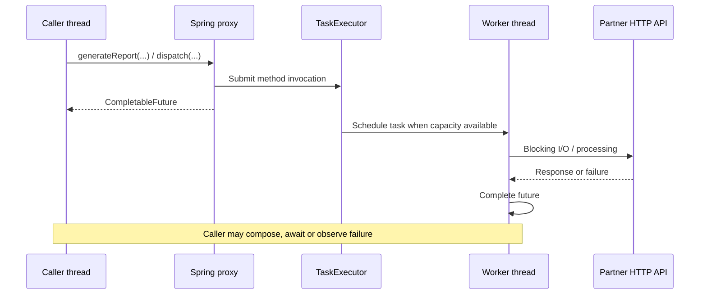
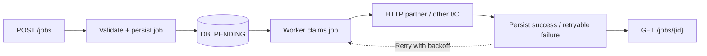

# @Async, @EnableAsync và tác vụ chạy ngoài luồng gọi

> **Chương:** Tác vụ bất đồng bộ  
> **Module:** `SPRING_BOOT_INTEGRATION` — tích hợp hệ thống qua HTTP client, cơ sở dữ liệu, cache, broker thông điệp và adapter Spring Integration. Bài tập trung vào cấu hình, hợp đồng, giao dịch, lỗi, xử lý trùng lặp, kiểm thử và quan sát.

## 1. Bài toán: chuyển công việc khỏi luồng gọi

Giả sử API Spring Boot tiếp nhận yêu cầu gửi trạng thái vận đơn đến hệ thống đối tác. Lời gọi HTTP ra ngoài có thể mất vài giây. Nếu controller dùng một HTTP client đồng bộ và chờ kết quả, luồng servlet phục vụ request sẽ bị giữ lại trong toàn bộ thời gian chờ I/O. Khi nhiều request đến cùng lúc, số luồng khả dụng có thể giảm mạnh.

`@Async` là cách Spring thực thi phương thức trên **executor** thay vì ngay trên luồng gọi. Nó phù hợp với những công việc cần tách khỏi luồng hiện tại trong **cùng tiến trình ứng dụng**: gọi API blocking, gửi thông báo phụ trợ, xây báo cáo ngắn, chuẩn bị dữ liệu hoặc xử lý một phần luồng tích hợp.

Hai mục tiêu thường được gọi chung là “xử lý bất đồng bộ” nhưng cần tách biệt:

- **Không giữ luồng gọi:** method chạy trên worker thread, caller tiếp tục làm việc hoặc giữ một future để nhận kết quả. `@Async` giải quyết nhu cầu này khi được cấu hình đúng.
- **Ghi nhận yêu cầu bền vững:** hệ thống cam kết xử lý công việc sau khi ứng dụng restart hoặc crash. `@Async` **không tự bảo đảm** điều này vì queue và công việc đang chạy thường nằm trong bộ nhớ của tiến trình.

Mục tiêu của bài:

1. Hiểu cách `@EnableAsync`, `@Async`, proxy Spring và `TaskExecutor` phối hợp.
2. Cấu hình executor có giới hạn để một đối tác chậm không làm cạn luồng của hệ thống.
3. Dùng `CompletableFuture` để nhận kết quả, xử lý lỗi và nối công việc.
4. Nhận biết self-invocation, ranh giới transaction, dữ liệu thread-local và timeout.
5. Chọn `@Async` hay job queue/broker/outbox theo yêu cầu tin cậy của từng luồng tích hợp.
6. Kiểm thử và giám sát tác vụ theo **kết quả nghiệp vụ**, thay vì coi submit thành công là hoàn tất.

## 2. Cơ chế @EnableAsync và @Async

### 2.1. Bật hỗ trợ bất đồng bộ với @EnableAsync

`@EnableAsync` bật hạ tầng intercept các lời gọi đến phương thức được đánh dấu `@Async`. Trong cấu hình phổ biến, Spring dùng **proxy** quanh bean được container quản lý. Proxy nhận lời gọi từ bean khác và gửi phần thực thi sang executor.

```java
import org.springframework.boot.SpringApplication;
import org.springframework.boot.autoconfigure.SpringBootApplication;
import org.springframework.scheduling.annotation.EnableAsync;

@SpringBootApplication
@EnableAsync
public class IntegrationApplication {

    public static void main(String[] args) {
        SpringApplication.run(IntegrationApplication.class, args);
    }
}
```

Bạn cũng có thể đặt `@EnableAsync` trên một `@Configuration`. Nếu chưa bật hỗ trợ async, chỉ thêm `@Async` lên method không đủ để chuyển phương thức sang worker thread.

### 2.2. @Async đánh dấu công việc chạy trên executor

```java
import java.util.concurrent.CompletableFuture;
import org.springframework.scheduling.annotation.Async;
import org.springframework.stereotype.Service;

@Service
public class ReportTaskService {

    @Async("integrationExecutor")
    public CompletableFuture<String> generateReport(String reportId) {
        String location = buildReport(reportId);
        return CompletableFuture.completedFuture(location);
    }

    private String buildReport(String reportId) {
        // Minh họa: thay bằng công việc tính toán hoặc I/O thực tế.
        return "/reports/" + reportId + ".csv";
    }
}
```

Khi một bean khác gọi `reportTaskService.generateReport("r-42")` **qua proxy Spring**, caller nhận một `CompletableFuture<String>`. Nội dung `buildReport` được chạy trên worker thread của `integrationExecutor`. Lời gọi trên thread caller không cần đợi tác vụ hoàn thành trừ khi nó chủ động chờ bằng `get()`, `join()` hoặc cơ chế tương đương.

Có một chi tiết dễ nhầm: method được chú thích `@Async` vẫn khai báo trả `CompletableFuture.completedFuture(location)`. Future đã hoàn thành này biểu diễn kết quả mà **worker vừa tính xong bên trong method**; proxy Spring cung cấp future bất đồng bộ cho caller. Không cần gọi thêm `CompletableFuture.supplyAsync(...)` trong method đã dùng `@Async`, vì cách đó thường tạo thêm một tầng lập lịch không cần thiết.

### 2.3. Một lời gọi được thực thi ra sao?



`@Async` chỉ chuyển công việc sang một thread khác. Nó **không tự biến** JDBC hoặc HTTP client blocking thành non-blocking I/O. Worker có thể vẫn phải chờ database hoặc API đối tác. Nếu executor hết năng lực nhận thêm tác vụ, lệnh submit có thể bị từ chối trước khi method chạy.

| Thành phần | Trách nhiệm |
|---|---|
| `@EnableAsync` | Bật hỗ trợ asynchronous method invocation trong Spring context. |
| `@Async` | Chỉ ra method cần được intercept và có thể chọn tên executor. |
| Spring proxy | Chặn lời gọi từ bên ngoài bean rồi chuyển sang executor. |
| `TaskExecutor` / `Executor` | Quản lý thread, hàng đợi, lịch thực thi và hành vi khi quá tải. |
| `CompletableFuture<T>` | Đại diện cho kết quả/lỗi có thể đến sau của một lời gọi bất đồng bộ. |

## 3. Cấu hình ThreadPoolTaskExecutor có giới hạn

Đối với luồng tích hợp, nên đặt tên và giới hạn executor rõ ràng. Một đối tác HTTP bị chậm có thể giữ nhiều worker; nếu mọi tác vụ cùng dùng chung pool không được kiểm soát, các công việc khác có thể chịu ảnh hưởng.

```java
import java.util.concurrent.ThreadPoolExecutor;
import org.springframework.context.annotation.Bean;
import org.springframework.context.annotation.Configuration;
import org.springframework.scheduling.concurrent.ThreadPoolTaskExecutor;

@Configuration
public class IntegrationAsyncConfig {

    @Bean("integrationExecutor")
    public ThreadPoolTaskExecutor integrationExecutor() {
        ThreadPoolTaskExecutor executor = new ThreadPoolTaskExecutor();

        executor.setCorePoolSize(4);
        executor.setMaxPoolSize(12);
        executor.setQueueCapacity(100);
        executor.setKeepAliveSeconds(60);
        executor.setThreadNamePrefix("integration-task-");
        executor.setRejectedExecutionHandler(
            new ThreadPoolExecutor.AbortPolicy()
        );

        executor.setWaitForTasksToCompleteOnShutdown(true);
        executor.setAwaitTerminationSeconds(30);
        executor.initialize();
        return executor;
    }
}
```

Ý nghĩa các cấu hình:

- `corePoolSize = 4`: số lượng thread lõi được pool duy trì khi có công việc.
- `maxPoolSize = 12`: ngưỡng tối đa số thread trong pool.
- `queueCapacity = 100`: giới hạn tác vụ được xếp hàng chờ.
- `AbortPolicy`: từ chối tác vụ khi không còn khả năng nhận. Caller cần xử lý đúng tình huống đó.
- `threadNamePrefix`: giúp nhận diện worker trong log và thread dump.
- `setWaitForTasksToCompleteOnShutdown` và `setAwaitTerminationSeconds`: hỗ trợ quá trình shutdown có kiểm soát; **không** bảo đảm công việc sống qua crash hay kill đột ngột.

Với cơ chế `ThreadPoolExecutor`, khi đã đủ core thread, công việc thường được đưa vào queue trước khi pool tăng vượt core (nếu queue đã đầy và vẫn còn chỗ tới max). Vì vậy, một queue quá lớn có thể khiến nhiều tác vụ chờ dù `maxPoolSize` đã tăng. Pool/queue quá lớn lại có thể làm database, HTTP client hoặc đối tác chịu quá tải.

Các giá trị `4 / 12 / 100` chỉ phục vụ minh họa. Số thực tế cần xác định từ lưu lượng, thời gian chờ I/O, giới hạn kết nối và số instance triển khai.

### 3.1. Chọn executor bằng qualifier

```java
@Async("integrationExecutor")
public CompletableFuture<String> exportAsync(String exportId) {
    // ...
}
```

Chuỗi `integrationExecutor` phải tham chiếu được tới bean executor trong context. Nếu dựa vào executor mặc định, cách lựa chọn bean và default capacity phụ thuộc vào cấu hình/phiên bản Spring. Với hệ thống cần quản lý tải rõ, dùng bean executor có tên sẽ dễ điều tra và giám sát hơn.

### 3.2. Tính sơ bộ concurrency

Trong hệ thống ổn định, định luật Little cho một ước lượng ban đầu:

```text
Số công việc đồng thời ≈ lưu lượng công việc/giây × thời gian xử lý trung bình (giây)
```

Ví dụ nhận 20 tác vụ mỗi giây và mỗi tác vụ mất trung bình 0,5 giây, số tác vụ đồng thời trung bình vào khoảng 10. Nếu đối tác chậm lên 5 giây, cùng lưu lượng tương ứng khoảng 100 tác vụ đồng thời. Pool giới hạn thấp hơn sẽ tạo hàng đợi và cuối cùng có thể reject.

Đây chỉ là ước tính để bắt đầu capacity planning, không phải bảo đảm. Cần đo phân phối latency, đột biến lưu lượng, timeout, retry và tổng số instance. Nếu có 8 instance, mỗi instance 12 worker, cụm có thể tạo đến khoảng 96 thao tác cùng lúc, vượt quota của đối tác dù mỗi instance vẫn khỏe.

## 4. Ví dụ tích hợp HTTP đối tác bằng @Async

Giả sử hệ thống dùng **Spring MVC + RestClient đồng bộ** để gửi trạng thái vận đơn. Mục tiêu của `@Async` là đưa lời gọi HTTP blocking ra khỏi servlet thread.

### 4.1. Định nghĩa DTO và HTTP client

```java
public record PartnerRequest(
    String deliveryId,
    String orderId,
    String status
) {}

public record PartnerReceipt(
    String partnerReference,
    String acceptedStatus
) {}
```

Cấu hình client qua Spring Bean:

```java
import org.springframework.beans.factory.annotation.Value;
import org.springframework.context.annotation.Bean;
import org.springframework.context.annotation.Configuration;
import org.springframework.web.client.RestClient;

@Configuration
public class PartnerHttpConfig {

    @Bean
    public RestClient partnerRestClient(
            RestClient.Builder builder,
            @Value("${partner.base-url}") String baseUrl) {

        return builder.baseUrl(baseUrl).build();
    }
}
```

```yaml
partner:
  base-url: https://partner.example.test
```

Địa chỉ trên chỉ là ví dụ. Trong hệ thống thực, cần cấu hình timeout kết nối và đọc tại request factory/HTTP client, cơ chế xác thực, giới hạn kết nối và quản lý credential qua secret. Không log token hay payload nhạy cảm.

### 4.2. Service chạy HTTP call trên worker thread

```java
import java.util.concurrent.CompletableFuture;
import org.springframework.scheduling.annotation.Async;
import org.springframework.stereotype.Service;
import org.springframework.web.client.RestClient;

@Service
public class PartnerDispatchService {

    private final RestClient partnerRestClient;

    public PartnerDispatchService(RestClient partnerRestClient) {
        this.partnerRestClient = partnerRestClient;
    }

    @Async("integrationExecutor")
    public CompletableFuture<PartnerReceipt> dispatch(PartnerRequest request) {
        PartnerReceipt receipt = partnerRestClient.post()
            .uri("/deliveries")
            .body(request)
            .retrieve()
            .body(PartnerReceipt.class);

        if (receipt == null) {
            throw new IllegalStateException("Partner returned an empty receipt");
        }

        return CompletableFuture.completedFuture(receipt);
    }
}
```

Lời gọi `RestClient` là blocking; nó sử dụng worker thread trong khi chờ đối tác. Spring proxy trả một future cho caller. Nếu HTTP hoặc xử lý response thất bại, future hoàn tất ngoại lệ.

### 4.3. Controller Spring MVC trả response sau khi có kết quả

```java
import java.util.concurrent.CompletableFuture;
import org.springframework.http.ResponseEntity;
import org.springframework.web.bind.annotation.PostMapping;
import org.springframework.web.bind.annotation.RequestBody;
import org.springframework.web.bind.annotation.RequestMapping;
import org.springframework.web.bind.annotation.RestController;

@RestController
@RequestMapping("/partner-sync")
public class PartnerSyncController {

    private final PartnerDispatchService dispatchService;

    public PartnerSyncController(PartnerDispatchService dispatchService) {
        this.dispatchService = dispatchService;
    }

    @PostMapping
    public CompletableFuture<ResponseEntity<PartnerReceipt>> send(
            @RequestBody PartnerRequest request) {

        return dispatchService.dispatch(request)
            .thenApply(ResponseEntity::ok);
    }
}
```

Spring MVC có thể dùng `CompletableFuture` để xử lý kết quả request bất đồng bộ: luồng servlet ban đầu được giải phóng trong lúc chờ, nhưng **HTTP client vẫn chưa nhận response cuối cùng** cho đến khi tác vụ hoàn thành. Nếu future lỗi, phải cấu hình cách ánh xạ lỗi HTTP và logging đúng hợp đồng (ví dụ `@ControllerAdvice`).

Đây khác với endpoint trả ngay `202 Accepted`. Một API `202` đáng tin cậy thường phải lưu job vào database/queue trước khi xác nhận và có `jobId` để truy vấn trạng thái. Gọi `dispatch(...)` rồi lập tức trả `202` mà không lưu bền vững chỉ có nghĩa “đã thử lập lịch trong tiến trình”; crash có thể khiến công việc mất hoàn toàn.

### 4.4. WebFlux và WebClient

Nếu luồng dùng Spring WebFlux và `WebClient` non-blocking, phần lớn trường hợp nên compose `Mono`/`Flux` thay vì thêm `@Async`:

```java
public Mono<PartnerReceipt> dispatchReactive(PartnerRequest request) {
    return webClient.post()
        .uri("/deliveries")
        .bodyValue(request)
        .retrieve()
        .bodyToMono(PartnerReceipt.class);
}
```

Với một thư viện blocking bắt buộc tồn tại trong pipeline Reactor, có thể cô lập nó bằng scheduler phù hợp như `Schedulers.boundedElastic()`, đồng thời giới hạn concurrency. `@Async` không tự chuyển driver JDBC thành reactive, không bảo đảm tăng throughput và không thay thế cơ chế backpressure.

## 5. Kiểu trả về, lỗi và timeout

Các kiểu trả về thông dụng được `@Async` hỗ trợ là `void`, `Future<T>` và `CompletableFuture<T>`. Trong các tác vụ cần biết kết quả và xử lý lỗi, `CompletableFuture<T>` thường là lựa chọn rõ ràng nhất.

### 5.1. Theo dõi kết quả của CompletableFuture

```java
CompletableFuture<PartnerReceipt> future =
    partnerDispatchService.dispatch(request);

future.whenComplete((receipt, failure) -> {
    if (failure != null) {
        recordFailure(request.deliveryId(), failure);
    } else {
        recordSuccess(request.deliveryId(), receipt);
    }
});
```

`recordFailure`/`recordSuccess` là các thao tác nghiệp vụ tự định nghĩa; trong hệ thống production, cập nhật trạng thái cần tính đến idempotency và tính bền vững của chính bước ghi kết quả.

| API | Công dụng | Lưu ý |
|---|---|---|
| `thenApply(fn)` | Biến đổi giá trị khi thành công | Không tự tạo luồng riêng |
| `thenCompose(fn)` | Nối một bước trả `CompletionStage` | Tránh future lồng nhau |
| `handle((value, error) -> ...)` | Xử lý cả thành công lẫn thất bại | Có thể chuyển lỗi thành giá trị |
| `exceptionally(fn)` | Tạo fallback cho lỗi | Dùng sai có thể che lỗi thật |
| `whenComplete(fn)` | Quan sát thành công/lỗi | Không mặc định chuyển lỗi thành thành công |
| `get()` / `join()` | Chờ kết quả | Chặn thread đang gọi |

Nếu method `@Async` ném lỗi, future sẽ hoàn tất ngoại lệ. `get()` thường bọc bằng `ExecutionException`, `join()` có thể bọc bằng `CompletionException`; cần truy ngược nguyên nhân để phân loại network error, validation, timeout hoặc business rejection.

### 5.2. Vì sao cần cân nhắc @Async void?

```java
@Async("integrationExecutor")
public void refreshCache(String cacheKey) {
    refreshCacheEntry(cacheKey);
}
```

Với kiểu trả `void`, caller không có future để biết tác vụ thành công hay thất bại. Lỗi xuất hiện trong worker không quay về stack của caller. Spring có `AsyncUncaughtExceptionHandler` để xử lý lỗi này.

```java
import java.lang.reflect.Method;
import org.slf4j.Logger;
import org.slf4j.LoggerFactory;
import org.springframework.aop.interceptor.AsyncUncaughtExceptionHandler;
import org.springframework.context.annotation.Configuration;
import org.springframework.scheduling.annotation.AsyncConfigurer;

@Configuration
public class AsyncErrorConfig implements AsyncConfigurer {

    private static final Logger log =
        LoggerFactory.getLogger(AsyncErrorConfig.class);

    @Override
    public AsyncUncaughtExceptionHandler getAsyncUncaughtExceptionHandler() {
        return (Throwable error, Method method, Object... params) ->
            log.error("Async method {} failed", method.getName(), error);
    }
}
```

Handler trên ghi log lỗi cho method async trả `void`, nhưng **không tạo retry, trạng thái bền vững hay ACK cho broker**. Không log toàn bộ tham số nếu chứa dữ liệu riêng tư hoặc bí mật.

### 5.3. Timeout trên future không hủy side effect

```java
CompletableFuture<PartnerReceipt> result =
    partnerDispatchService.dispatch(request)
        .orTimeout(5, java.util.concurrent.TimeUnit.SECONDS);
```

`orTimeout` làm future kết thúc theo trạng thái lỗi khi quá hạn; nó **không bảo đảm** ngắt lời gọi HTTP đang chạy, hủy transaction của đối tác hoặc đảo ngược hành động đã thực hiện. Cần timeout phía HTTP/database và cơ chế truy vấn lại trạng thái nếu không biết request đã được thực thi hay chưa.

## 6. Các lỗi proxy thường gặp

### 6.1. Self-invocation không kích hoạt @Async

Trong chế độ proxy thông dụng, chỉ lời gọi **đi qua Spring proxy** mới bị intercept.

```java
import org.springframework.scheduling.annotation.Async;
import org.springframework.stereotype.Service;

@Service
public class BadImportService {

    public void startImport(String fileId) {
        importInBackground(fileId); // this.importInBackground(fileId)
    }

    @Async("integrationExecutor")
    public void importInBackground(String fileId) {
        // Chạy trực tiếp khi gọi từ startImport trong cùng bean.
    }
}
```

Lời gọi nội bộ `this.importInBackground(...)` không đi qua proxy. Cách sửa đơn giản và dễ kiểm tra là tách tác vụ sang **bean khác**:

```java
@Service
public class ImportTaskService {

    @Async("integrationExecutor")
    public CompletableFuture<Void> importFile(String fileId) {
        performImport(fileId);
        return CompletableFuture.completedFuture(null);
    }

    private void performImport(String fileId) {
        // Thực hiện import.
    }
}

@Service
public class ImportCoordinator {

    private final ImportTaskService taskService;

    public ImportCoordinator(ImportTaskService taskService) {
        this.taskService = taskService;
    }

    public CompletableFuture<Void> startImport(String fileId) {
        return taskService.importFile(fileId); // Gọi qua Spring bean proxy
    }
}
```

Không nên phụ thuộc vào việc inject chính bean vào nó chỉ để gọi vòng qua proxy; tách trách nhiệm rõ ràng giúp dễ bảo trì.

### 6.2. Các điều kiện khác

| Triệu chứng | Nguyên nhân thường gặp | Cách xử lý |
|---|---|---|
| Method chạy cùng thread caller | Chưa có `@EnableAsync`, self-invocation, hoặc object tạo bằng `new` | Bật async, gọi qua Spring-managed bean |
| `@Async` trên private method không có hiệu lực | Proxy không thể intercept theo cách mong muốn | Đặt public method trên bean khác |
| Không tìm thấy executor | Qualifier sai hoặc bean không tồn tại | Khai báo bean executor đúng tên |
| Kiểu trả về không phù hợp | `@Async` chỉ hỗ trợ các kiểu return cho phép | Dùng `void`, `Future` hoặc `CompletableFuture` |
| Lúc async, lúc không | Một code path gọi qua proxy, đường khác gọi `this` | Rà soát caller, viết integration test |
| Không thấy lỗi | Future bị bỏ quên, hoặc method `void` | Bắt lỗi, log, metric và lưu trạng thái |
| Task bị từ chối | Executor queue/pool đầy | Hạn chế nhận, báo lỗi và retry phù hợp |

Một số phương thức `final` hoặc class/method không thể được proxy intercept cũng có thể gây hạn chế, phụ thuộc proxy được dùng. Spring có chế độ AspectJ với khả năng weaving khác nhưng cần cấu hình riêng; không nên giả định ứng dụng mặc định dùng AspectJ.

## 7. Transaction không tự truyền qua worker thread

Với JDBC và cách quản lý transaction đồng bộ phổ biến của Spring, context giao dịch gắn với thread qua `ThreadLocal`. Chuyển việc sang executor không tự chuyển transaction ở caller sang worker.

Ví dụ dễ gây lỗi:

```java
@Transactional
public void createOrder(Order order) {
    orderRepository.save(order);
    partnerDispatchService.dispatch(toPartnerRequest(order));
    // Tại đây transaction có thể chưa commit.
}
```

Worker có thể gọi HTTP đối tác trước khi dữ liệu đơn được commit. Nếu transaction tạo đơn rollback sau đó, đối tác vẫn có thể đã nhận lệnh; database và đối tác bị lệch trạng thái. Nếu worker đọc lại database, nó có thể không thấy dữ liệu chưa commit.

### 7.1. Tạo transaction tại bước nghiệp vụ chạy trên worker

```java
@Service
public class OrderStatusWriter {

    @Transactional
    public void markDispatched(String orderId, String partnerReference) {
        // Ghi trạng thái vận đơn và mã tham chiếu vào database.
    }
}

@Service
public class DispatchWorker {

    private final PartnerGateway gateway;
    private final OrderStatusWriter statusWriter;

    public DispatchWorker(PartnerGateway gateway,
                          OrderStatusWriter statusWriter) {
        this.gateway = gateway;
        this.statusWriter = statusWriter;
    }

    @Async("integrationExecutor")
    public CompletableFuture<Void> dispatch(String orderId) {
        PartnerReceipt receipt = gateway.send(orderId);
        statusWriter.markDispatched(orderId, receipt.partnerReference());
        return CompletableFuture.completedFuture(null);
    }
}
```

`PartnerGateway` là adapter HTTP do ứng dụng định nghĩa. Method `markDispatched` được gọi qua Spring bean proxy nên có thể có **transaction riêng** trên worker thread. Đây vẫn không phải giao dịch nguyên tử giữa HTTP đối tác và database.

Không nên mặc định kết hợp `@Transactional` và `@Async` trên một method sẽ kế thừa transaction của caller; hành vi còn liên quan đến thứ tự advice và transaction manager. Tách ranh giới async và transaction qua các bean rõ trách nhiệm thường dễ kiểm thử hơn.

### 7.2. Kích hoạt sau khi commit

Nếu chỉ cần tránh chạy trước lúc dữ liệu được commit, có thể phát Spring application event trong transaction và dùng listener `AFTER_COMMIT`:

```java
import org.springframework.stereotype.Component;
import org.springframework.transaction.event.TransactionPhase;
import org.springframework.transaction.event.TransactionalEventListener;

public record OrderCommitted(String orderId) {}

@Component
public class OrderCommittedListener {

    private final DispatchWorker worker;

    public OrderCommittedListener(DispatchWorker worker) {
        this.worker = worker;
    }

    @TransactionalEventListener(phase = TransactionPhase.AFTER_COMMIT)
    public void afterCommit(OrderCommitted event) {
        worker.dispatch(event.orderId());
    }
}
```

Sự kiện `OrderCommitted` cần được publish trong transaction bằng `ApplicationEventPublisher`. Listener gọi worker qua bean đã inject nên `@Async` có hiệu lực theo cơ chế proxy. Trong ví dụ này không cần gắn thêm `@Async` cho listener.

**Giới hạn quan trọng:** `AFTER_COMMIT` giải quyết thứ tự theo commit, nhưng event và task vẫn có thể mất khi process chết giữa lúc commit DB và lúc worker chạy. Với yêu cầu đảm bảo xử lý, cần job table hoặc transactional outbox.

## 8. @Async có thay thế broker, job queue hoặc scheduler không?

Không. Những cơ chế này phục vụ các nhu cầu có phần giao nhau nhưng mức cam kết khác nhau.

| Giải pháp | Điểm mạnh | Giới hạn |
|---|---|---|
| Gọi đồng bộ | Đơn giản, nhận lỗi tức thời | Giữ thread caller trong thời gian chờ |
| `@Async` + executor | Dễ tách việc sang thread khác trong cùng process | Không bền vững sau crash, không tự retry/chia tải giữa instance |
| `CompletableFuture.supplyAsync` | Chủ động điều khiển composition | Phải tự quản lý executor/context/exception |
| WebClient + Reactor | I/O non-blocking phù hợp WebFlux | Cần pipeline reactive đúng và driver hỗ trợ |
| Job table + worker | Có trạng thái, retry, phục hồi sau restart | Cần claim/lock job và quản lý deadline |
| Broker (Kafka/RabbitMQ/JMS) | Tách producer–consumer, hàng đợi/routing/delivery theo cấu hình | Vẫn cần idempotency, DLQ/DLT và quan sát |
| Transactional outbox | Ghi nghiệp vụ và ý định publish trong một DB transaction | Relay có thể gửi lặp, consumer phải dedup |

`@Async` và broker có thể phối hợp, nhưng đừng ACK message trước khi công việc quan trọng đã hoàn tất hoặc được ghi bền vững. Nếu listener nhận Kafka record, lập tức gửi sang executor rồi ACK, process crash có thể làm mất task ngay cả khi offset đã commit.

### 8.1. Thiết kế API trả 202 với job bền vững



API chỉ nên khẳng định tiếp nhận theo hợp đồng sau khi job được lưu thành công. Worker cần cơ chế claim an toàn giữa nhiều instance, timeout lease/khôi phục job mắc kẹt, retry có giới hạn và trạng thái để đối soát.

Nếu cập nhật nghiệp vụ và phát event đến broker, **transactional outbox** cho phép ghi trạng thái nghiệp vụ cùng bản ghi ý định publish trong một DB transaction; một relay xuất bản sau đó. Relay có thể gửi lặp, nên consumer phải xử lý idempotency.

## 9. Retry, xử lý trùng và lỗi không chắc chắn

`@Async` chỉ cung cấp thực thi bất đồng bộ; **nó không tự retry** khi HTTP 503, database timeout hoặc broker tạm thời không kết nối được.

Một chính sách retry hữu ích cần phân biệt:

- **Lỗi tạm thời:** mất kết nối, 503, timeout, rate limit; thường có thể retry với exponential backoff và jitter.
- **Lỗi cố định:** dữ liệu không hợp lệ, không có quyền, vi phạm contract; không nên retry vô hạn.
- **Lỗi không chắc kết quả:** đối tác có thể đã nhận và xử lý yêu cầu nhưng response bị mất. Cần kiểm tra trạng thái hoặc retry với idempotency key.

Ví dụ command tạo vận đơn có `deliveryId = "del-42"`. Nếu API của đối tác hỗ trợ idempotency key, gửi **cùng một key** khi retry cùng ý định nghiệp vụ. Nếu không, tìm cách truy vấn trạng thái vận đơn trước khi gửi lại. Không tạo key mới cho mỗi lần transport retry.

Với consumer broker, key dedup thường là `commandId` hoặc `eventId` ổn định theo nghiệp vụ. `correlationId` dùng truy vết toàn luồng; không phải khóa dedup cho mọi event của một quy trình.

### 9.1. Cancellation và shutdown

Hủy `CompletableFuture` hoặc request HTTP bị ngắt **không mặc nhiên** dừng HTTP request đang chạy trên worker, rollback DB hay xóa tác động đã thực hiện ở đối tác. Shutdown với thời hạn chờ cũng không chứng minh tất cả công việc trong RAM đã được hoàn thành. Tác vụ bắt buộc phải hoàn tất cần lưu trạng thái để phục hồi hoặc đối soát.

## 10. Context, bảo mật và tracing qua nhiều thread

Một số dữ liệu được gắn với thread caller không tự xuất hiện ở worker:

| Ngữ cảnh | Rủi ro | Hướng xử lý |
|---|---|---|
| Transaction JDBC | Worker không cùng transaction với caller | Transaction riêng; start sau commit hoặc outbox |
| `ThreadLocal` tùy chỉnh | Thiếu dữ liệu, dùng nhầm dữ liệu cũ | Truyền tham số rõ, dùng decorator có cleanup |
| SLF4J MDC | Log worker thiếu correlation ID | Context propagation hoặc `TaskDecorator` |
| Spring Security `SecurityContext` | Worker không có user context request | Truyền thông tin tối thiểu hoặc dùng integration phù hợp |
| Request-scoped bean | Request đã kết thúc khi worker truy cập | Chuyển dữ liệu cần thiết thành DTO trước khi submit |
| Tracing span | Mất liên kết request → worker | Kiểm tra instrumentation/propagation của ứng dụng |

### 10.1. TaskDecorator copy MDC có kiểm soát

```java
import java.util.Map;
import org.slf4j.MDC;
import org.springframework.core.task.TaskDecorator;

public class MdcCopyTaskDecorator implements TaskDecorator {

    @Override
    public Runnable decorate(Runnable runnable) {
        Map<String, String> captured = MDC.getCopyOfContextMap();

        return () -> {
            Map<String, String> previous = MDC.getCopyOfContextMap();
            try {
                if (captured == null) {
                    MDC.clear();
                } else {
                    MDC.setContextMap(captured);
                }
                runnable.run();
            } finally {
                if (previous == null) {
                    MDC.clear();
                } else {
                    MDC.setContextMap(previous);
                }
            }
        };
    }
}
```

Nếu sử dụng decorator này, thêm `executor.setTaskDecorator(new MdcCopyTaskDecorator())` trong cấu hình executor. Nó chỉ xử lý MDC, **không tự nhân bản transaction hoặc security context**. Với tracing và Spring Security, ưu tiên cơ chế propagation chính thức phù hợp phiên bản; tránh truyền credential hoặc toàn bộ HTTP headers sang công việc dài hạn.

## 11. Quan sát pool và xử lý quá tải

Tối thiểu nên đo:

- `active thread count`, `pool size`, `queue depth`, số task được submit/hoàn tất/từ chối;
- thời gian task **đợi trong queue** và thời gian **thực thi**;
- độ trễ HTTP đối tác, timeout, tỷ lệ lỗi phân loại theo nguyên nhân;
- số job `PENDING`, `RETRYING`, `FAILED` và tuổi job cũ nhất khi dùng job queue;
- số lần retry/dedup, rate limit, kết quả nghiệp vụ cuối;
- `jobId`, `correlationId`, trace/span và tên executor trong log.

Spring Boot Actuator và Micrometer có thể hỗ trợ metrics executor và HTTP client theo bean/instrumentation/phiên bản. Không giả định metric queue wait hoặc rejected count được xuất sẵn trong mọi cấu hình; cần kiểm chứng số liệu thực tế và bổ sung instrumentation nếu thiếu.

**Chính sách quá tải phải được thiết kế trước.** Khi pool đầy và queue đầy, `AbortPolicy` từ chối việc submit. Ứng dụng có thể giảm tốc độ tiếp nhận, trả phản hồi phù hợp với hợp đồng hoặc ghi task vào job queue bền vững để xử lý sau. `CallerRunsPolicy` có thể ép thread submit tự chạy task, nhưng khi đó thread HTTP sẽ bị giữ lại, trái với mục tiêu tách I/O blocking khỏi request.

Không nên giải quyết mọi lỗi bằng tăng kích thước pool. Pool lớn hơn có thể làm nghẽn kết nối tới database, HTTP đối tác hoặc broker; cần xem tổng số thread/connection của **toàn cụm**.

## 12. Kiểm thử @Async và luồng tích hợp

Kiểm thử cần chạy qua Spring context thật để bảo đảm lời gọi đã đi qua proxy. Test chỉ gọi method rồi so sánh kết quả chưa đủ chứng minh method thực sự chạy ở thread khác.

```java
import static org.assertj.core.api.Assertions.assertThat;

import java.util.concurrent.TimeUnit;
import org.junit.jupiter.api.Test;
import org.springframework.beans.factory.annotation.Autowired;
import org.springframework.boot.test.context.SpringBootTest;

@SpringBootTest
class ReportTaskServiceTest {

    @Autowired
    private ReportTaskService reportTaskService;

    @Test
    void generatesReport() throws Exception {
        String result = reportTaskService
            .generateReport("r-42")
            .get(5, TimeUnit.SECONDS);

        assertThat(result).isEqualTo("/reports/r-42.csv");
    }
}
```

Đoạn trên kiểm tra kết quả qua bean thật; để xác minh **đúng thread riêng**, dùng fixture test ghi `Thread.currentThread()` vào kết quả hoặc một probe rồi so sánh với caller thread, thay vì dựa vào `Thread.sleep(...)`. Ngoài ra, nên kiểm tra cả failure và quá tải.

| Ca kiểm thử | Điều cần xác minh |
|---|---|
| Gọi bean có `@Async` | Method thực thi qua executor đã chỉ định |
| Self-invocation | Đường gọi trong cùng bean không được proxy intercept trong chế độ mặc định |
| HTTP đối tác lỗi/timeout | Future hoàn tất ngoại lệ; lỗi được phân loại và quan sát |
| Executor đầy | Reject được xử lý, không ngầm đánh dấu công việc đã xong |
| Transaction caller rollback | Worker không phụ thuộc trạng thái chưa commit |
| Crash sau DB commit | Job/outbox phục hồi được nếu nghiệp vụ yêu cầu bền vững |
| Retry cùng command ID | Không nhân đôi tác động tạo vận đơn/thanh toán |
| Nhiều worker/instance | Job claim/dedup và giới hạn tải hoạt động đúng |
| Shutdown có backlog | Không báo hoàn thành cho task chưa được xử lý |
| Trace/log xuyên thread | Correlation ID và job ID gắn đúng tới kết quả |

Sử dụng HTTP mock server cho lỗi đối tác và database/broker phù hợp (có thể qua Testcontainers) để kiểm tra retry, dedup, transaction và tính nhất quán thực tế. STEP 4 tập trung soạn kiến thức, chưa thực hiện vòng Content QA chuyên môn hoặc chạy kiểm thử dự án.

## 13. Những ngộ nhận thường gây lỗi

| Ngộ nhận | Hiểu đúng |
|---|---|
| “Gắn `@Async` là method luôn chạy trên thread khác.” | Cần `@EnableAsync`, bean proxy và lời gọi đi qua proxy. |
| “Method gọi từ cùng class vẫn async.” | Self-invocation thường bỏ qua proxy. |
| “`@Async` tăng tốc mọi lời gọi.” | Nó chuyển chỗ chờ I/O; database/đối tác vẫn có giới hạn. |
| “`@Async void` sẽ báo lỗi về caller.” | Caller không có future; cần handler hoặc trạng thái riêng. |
| “`get()` ngay sau khi submit vẫn không chặn.” | `get()` và `join()` chờ kết quả, có thể block thread hiện tại. |
| “`@Transactional` ở caller được kế thừa.” | Worker thread có transaction context riêng. |
| “Gắn `@Async` vào listener bảo đảm event không mất.” | Event và task in-memory có thể mất khi crash. |
| “Trả `202` nghĩa là công việc đã chắc chắn được xử lý.” | Cần contract rõ và lưu bền vững để bảo đảm xử lý sau. |
| “Timeout future sẽ hủy việc ở đối tác.” | Side effect có thể đã xảy ra; cần idempotency/reconciliation. |
| “Executor queue giống broker queue.” | Queue trong executor là cấu trúc RAM, không phải lưu trữ bền vững. |

## 14. Checklist thiết kế

Khi xây dựng một tác vụ bất đồng bộ trong `SPRING_BOOT_INTEGRATION`, hãy trả lời:

1. **Công việc có được phép mất khi tiến trình chết không?** Nếu không, dùng job table/outbox/broker trước khi xác nhận.
2. **Caller cần kết quả hay chỉ cần job ID?** Chọn `CompletableFuture` trả response sau khi xong hoặc `202` với trạng thái bền vững.
3. **Method có đi qua Spring proxy không?** Kiểm tra `@EnableAsync`, Spring bean, tên executor và self-invocation.
4. **Executor giới hạn được chưa?** Có core/max thread, queue, rejection và giới hạn tổng tải nhiều instance?
5. **Transaction ở đâu?** Có trường hợp worker chạy trước commit hoặc gửi HTTP thành công rồi DB rollback?
6. **Retry có an toàn không?** Có phân loại lỗi, timeout thật ở client, idempotency key và đối soát trạng thái không chắc chắn?
7. **Context cần gì?** Truyền ID và dữ liệu tối thiểu, bảo đảm MDC/tracing đúng, tránh rò security context.
8. **Có quan sát kết quả thật không?** Có metric, log, callback, trạng thái job và test cho lỗi/crash/retry?

### Ghi nhớ

- `@EnableAsync` bật cơ chế, `@Async` đánh dấu phương thức, **executor** điều khiển nơi và khả năng chạy.
- `CompletableFuture` giúp nhận kết quả hoặc lỗi; `void` chỉ phù hợp khi đã có đường quan sát lỗi khác.
- Thread worker không tự mang theo transaction, request scope và mọi thread-bound context của caller.
- `@Async` là cơ chế **thực thi ngoài luồng gọi trong tiến trình**, không phải hàng đợi công việc bền vững.
- Với tích hợp HTTP, database, cache, broker và adapter Spring Integration, độ tin cậy còn phụ thuộc vào **hợp đồng dữ liệu, idempotency, timeout, retry, giao dịch, trạng thái và observability**.

Bản chất của `@Async` là tách công việc ra khỏi thread gọi; chọn nó khi phù hợp với kiến trúc và mức cam kết của nghiệp vụ. Những công việc xuyên hệ thống bắt buộc không được mất cần được kết hợp với lưu bền vững, cơ chế phân phối và kiểm soát lỗi rõ ràng.
