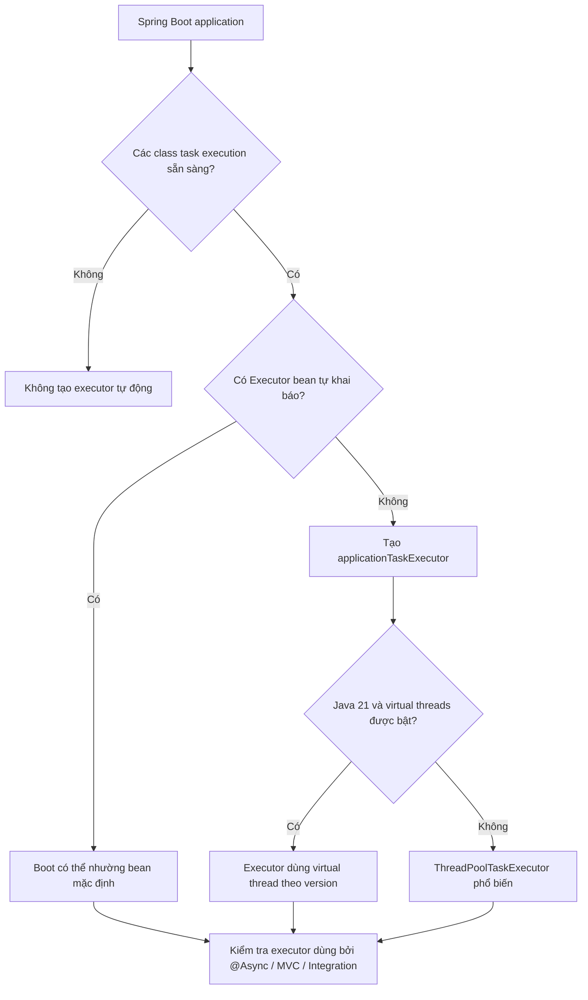
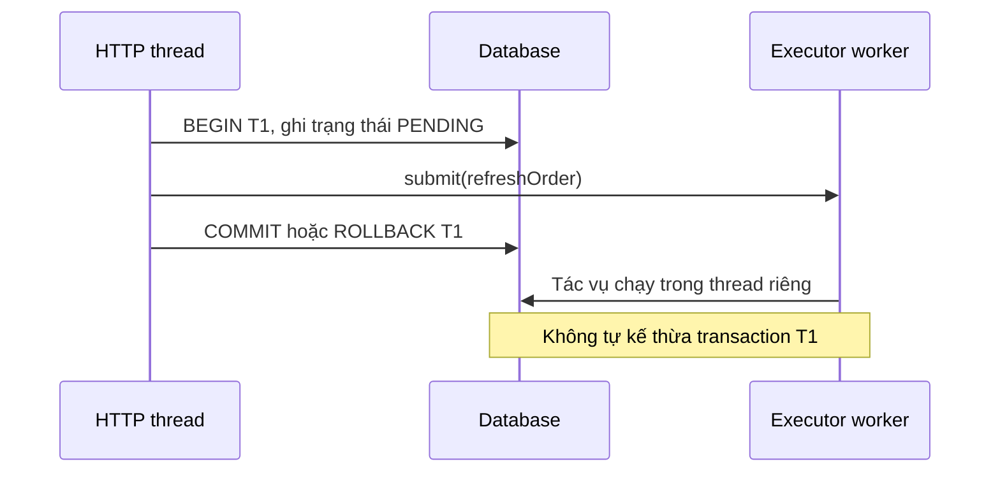
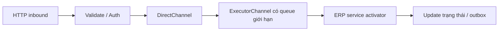

# TaskExecutor, AsyncTaskExecutor và cấu hình tự động của Boot

## 1. Vì sao luồng tích hợp cần quản lý tác vụ bất đồng bộ?

Một ứng dụng Spring Boot có thể nhận HTTP request, truy vấn cơ sở dữ liệu, gọi ERP qua REST/SOAP, gửi sự kiện lên Kafka hoặc RabbitMQ và cập nhật cache Redis. Có những công việc không cần giữ thread của người gọi: chuẩn bị báo cáo, đồng bộ dữ liệu phụ, gửi thông báo hoặc xử lý một nhóm tác vụ độc lập. Khi chuyển chúng sang thread khác, ứng dụng có thể giải phóng caller sớm hơn và kiểm soát riêng tài nguyên dành cho công việc chậm.

Tuy nhiên, **chuyển sang bất đồng bộ không tự làm tác vụ chạy nhanh hơn, bền vững hơn hoặc an toàn hơn**. Nếu mỗi request tự tạo thread, số tác vụ chờ có thể tăng vô hạn. Nếu đẩy lệnh tạo thanh toán sang một executor trong RAM rồi trả HTTP 202, ứng dụng có thể chết trước khi task chạy và làm mất lệnh. Nếu một transaction database đang mở trên thread gốc, tác vụ chạy trên thread khác không tự tham gia transaction đó.

Trong module **`SPRING_BOOT_INTEGRATION`**, việc tổ chức tích hợp qua HTTP client, cơ sở dữ liệu, cache, broker thông điệp và các adapter Spring Integration luôn đi kèm quản lý cấu hình, hợp đồng dữ liệu, giao dịch, lỗi, trùng lặp, kiểm thử và quan sát. `TaskExecutor` và `AsyncTaskExecutor` là các thành phần thực thi giúp **đặt ranh giới bất đồng bộ trong cùng tiến trình**, còn độ bền của công việc và tính nhất quán xuyên hệ thống vẫn cần thiết kế riêng.

**Tình huống xuyên suốt:** dịch vụ `order-integration` nhận yêu cầu tra cứu và bổ sung trạng thái ERP. Ta muốn giới hạn tối đa 12 cuộc gọi ERP đồng thời trên một instance, không làm đầy thread phục vụ HTTP khi ERP chậm, đo được hàng đợi và từ chối tác vụ quá tải theo chính sách rõ ràng.

Sau bài học, bạn có thể:

- Phân biệt Java `Executor`, Spring `TaskExecutor`, `AsyncTaskExecutor`, `ThreadPoolTaskExecutor` và `SimpleAsyncTaskExecutor`.
- Hiểu khi nào Spring Boot tạo bean executor mặc định và khi nào cấu hình do ứng dụng khai báo làm Boot nhường quyền.
- Cấu hình thread pool, queue, rejection, shutdown, `@Async` và lựa chọn executor theo dependency.
- Xử lý kết quả, exception, timeout, transaction và context khi tác vụ chạy ở thread khác.
- Chọn giữa executor trong RAM, broker, outbox và Spring Batch theo độ bền và khả năng phục hồi.
- Kiểm thử và quan sát saturation, rejected tasks, throughput và độ trễ thực tế.

## 2. Từ Java `Executor` đến Spring `AsyncTaskExecutor`

API nền tảng của Java là `java.util.concurrent.Executor`:

```java
public interface Executor {
    void execute(Runnable command);
}
```

Gọi `execute` nghĩa là **giao một nhiệm vụ để executor thực thi**; nó không mặc nhiên bảo đảm tác vụ chạy trên thread mới hay được lưu bền. Một executor có thể chạy ngay trên thread caller, đưa task vào pool hoặc từ chối vì quá tải.

Spring cung cấp hai abstraction liên quan:

| API | Quan hệ và chức năng | Hình thức sử dụng |
|---|---|---|
| `Executor` của JDK | Hợp đồng gửi `Runnable`. | `execute(task)`. |
| `TaskExecutor` | Spring abstraction mở rộng `Executor`, tích hợp hệ sinh thái Spring. | `execute(task)`. |
| `AsyncTaskExecutor` | Mở rộng `TaskExecutor` để hỗ trợ gửi task và lấy `Future`/`CompletableFuture` theo phiên bản Spring. | `submit(Callable<T>)`, `submitCompletable(...)` khi API hỗ trợ. |
| `ExecutorService` của JDK | Executor có lifecycle, submit, shutdown và quản lý future. | `submit(...)`, `shutdown()`. |
| `ThreadPoolTaskExecutor` | Implementation Spring trên `ThreadPoolExecutor`; hỗ trợ cấu hình pool, queue, decorator và lifecycle. | Phù hợp blocking tasks cần pool hữu hạn. |
| `SimpleAsyncTaskExecutor` | Khởi tạo thread cho mỗi tác vụ; có thể dùng virtual thread trong môi trường hỗ trợ. | Không dùng pool tái sử dụng thread; phải giới hạn concurrency khi cần. |

`TaskExecutor` không đồng nghĩa với `@Async`. Ta có thể inject và gọi executor trực tiếp mà không bật `@EnableAsync`:

```java
import org.springframework.core.task.TaskExecutor;
import org.springframework.beans.factory.annotation.Qualifier;
import org.springframework.stereotype.Service;

@Service
public class OrderRefreshDispatcher {
    private final TaskExecutor erpExecutor;
    private final OrderRefreshWorker worker;

    public OrderRefreshDispatcher(
            @Qualifier("erpExecutor") TaskExecutor erpExecutor,
            OrderRefreshWorker worker) {
        this.erpExecutor = erpExecutor;
        this.worker = worker;
    }

    public void dispatch(String orderId) {
        erpExecutor.execute(() -> worker.refresh(orderId));
    }
}
```

`OrderRefreshWorker` là service do ứng dụng định nghĩa. Lệnh `dispatch` ở trên không cung cấp cơ chế lưu bền hoặc Future để caller biết thành công/thất bại; nếu `execute` từ chối, ngoại lệ có thể phát sinh ngay tại bước giao task. Với công việc phải bảo đảm không mất, thiết kế này cần một **bản ghi công việc bền vững** hoặc sử dụng broker/queue thích hợp.

### `execute`, `submit` và kết quả

`Runnable` không có return value; `Callable<T>` trả về giá trị hoặc ném exception. Với implementation có hỗ trợ `AsyncTaskExecutor`, có thể gọi:

```java
Future<String> future = asyncTaskExecutor.submit(() -> {
    return partnerClient.fetchStatus("order-42");
});

String status = future.get(); // Chặn thread caller cho đến khi có kết quả.
```

Gọi `get()` ngay lập tức có thể biến một luồng bất đồng bộ thành chờ đồng bộ. Dùng Future khi cần phối hợp kết quả, nhưng tránh đẩy Future vào queue rồi làm nghẽn toàn bộ thread pool vì các task cùng chờ nhau.

## 3. Các implementation thường gặp và đánh đổi

| Implementation | Cách thực thi | Phù hợp | Rủi ro cần quản lý |
|---|---|---|---|
| `SyncTaskExecutor` | Chạy task ngay trên thread caller. | Test đồng bộ, tác vụ nhỏ cần giữ thứ tự. | Không tạo ranh giới bất đồng bộ. |
| `SimpleAsyncTaskExecutor` | Tạo một thread mới cho mỗi task thay vì dùng pool. | Cần thread riêng, virtual thread hoặc trường hợp ít task. | Nếu không giới hạn, task/thread có thể tăng cùng lưu lượng đến. |
| `ThreadPoolTaskExecutor` | Tái sử dụng platform threads, có queue, core/max size. | Blocking JDBC, HTTP/SOAP, tác vụ có giới hạn concurrency. | Unbounded queue, thread starvation, rejection khi đầy. |
| `ConcurrentTaskExecutor` | Adapter bọc một `Executor` có sẵn. | Tích hợp executor JDK/được quản lý bên ngoài. | Chính sách queue/shutdown phụ thuộc executor được bọc. |
| `VirtualThreadTaskExecutor` (nếu phiên bản hỗ trợ) | Tạo virtual thread cho mỗi task. | Nhiều thao tác blocking theo mô hình thread-per-request/task. | Không thay quota connection, CPU hay giới hạn upstream. |

Lưu ý `ThreadPoolTaskExecutor` là một Spring bean quản lý vòng đời, thường là lựa chọn trực tiếp khi cần cấu hình chuyên biệt theo tích hợp. Không tạo `new Thread(...)` hoặc một pool mới cho mỗi HTTP request vì sẽ làm mất khả năng dùng chung, đo metric và đóng pool có kiểm soát.

## 4. Spring Boot tự cấu hình executor trong trường hợp nào?

Trong các phiên bản Spring Boot 3.x phổ biến, **`TaskExecutionAutoConfiguration`** cấu hình hạ tầng thực thi tác vụ khi có những class cần thiết trên classpath và các điều kiện bean tương ứng thỏa mãn. Bean ứng dụng mặc định thường mang tên **`applicationTaskExecutor`**, loại `ThreadPoolTaskExecutor` trong cấu hình platform threads thông thường.

Các điều kiện/ngoại lệ cần hiểu:

1. **Classpath:** các API executor của Spring phải khả dụng. Spring Boot và các starter liên quan thường đã có `spring-core`; hạ tầng async web/JDBC tùy dependency.
2. **Bean người dùng:** nếu ứng dụng đã khai báo `Executor`, nhiều phiên bản Boot sẽ **back off** đối với executor mặc định. Chính sách có thể có lựa chọn ép cấu hình trong phiên bản mới; phải đọc condition report và tài liệu ứng với version thực tế.
3. **Tên và loại bean:** có một bean `Executor` chưa chắc đã đáp ứng yêu cầu của mọi thành phần. Ví dụ một số tích hợp Spring MVC async cần `AsyncTaskExecutor` và bean `applicationTaskExecutor` mang tên/loại phù hợp.
4. **Virtual threads:** với Spring Boot 3.2+ trên Java 21, đặt `spring.threads.virtual.enabled=true` có thể khiến executor tự cấu hình sử dụng `SimpleAsyncTaskExecutor` với virtual threads thay vì pool platform threads; hành vi chính xác phụ thuộc version và cấu hình.
5. **`@Async`:** executor tồn tại **không tự kích hoạt** việc intercept method có `@Async`. Cần bật xử lý bất đồng bộ bằng `@EnableAsync` hoặc cấu hình tương đương.

Sơ đồ tư duy:



Đây là **sơ đồ định hướng**. Để biết điều kiện nào thực sự trúng hoặc không trúng, xem `Condition Evaluation Report` của phiên bản đang chạy, đặc biệt khi có custom executor, virtual threads hoặc nhiều auto-configuration.

### 4.1. Auto-configuration không đồng nghĩa tự chuyển mọi lời gọi sang async

Một controller gọi `erpClient.getStatus()` thông thường vẫn chạy theo cách mà client và controller được viết. Thêm starter hoặc có `applicationTaskExecutor` không biến lời gọi JDBC/HTTP blocking thành non-blocking, cũng không tự chuyển sang background. Một đoạn code phải **giao việc cho executor**, gọi qua `@Async` proxy, hoặc sử dụng cơ chế async của stack liên quan thì mới có ranh giới thực thi khác.

### 4.2. Kết nối với MVC, WebFlux, GraphQL và các thành phần khác

Nhiều thành phần có thể tìm một application executor, nhưng quy tắc lựa chọn không giống nhau ở mọi framework/version. Khi thêm `@Bean("erpExecutor")`, hãy kiểm tra xem ứng dụng còn cần một `applicationTaskExecutor` riêng cho những công việc framework hay không. Một pool chuyên để gọi ERP không nên bị framework tái sử dụng ngẫu nhiên cho mọi tác vụ khác.

Trong hệ thống có nhiều executor, **đặt tên và dùng `@Qualifier`/`@Async("...")` rõ ràng**, thay vì dựa vào bean mặc định thay đổi theo số lượng bean.

## 5. Cấu hình mặc định và thuộc tính `spring.task.execution`

Các thuộc tính Boot thường gặp với **thread-pool task execution**:

```yaml
spring:
  task:
    execution:
      thread-name-prefix: app-task-
      pool:
        core-size: 8
        max-size: 16
        queue-capacity: 64
        keep-alive: 60s
        allow-core-thread-timeout: true
      shutdown:
        await-termination: true
        await-termination-period: 20s
```

Các thuộc tính minh họa cho Spring Boot 3.x và cần đối chiếu với cấu hình metadata của version thực tế. Những thuộc tính này điều chỉnh **executor tự cấu hình bằng cơ chế tương ứng**; chúng không nhất thiết áp dụng cho `ThreadPoolTaskExecutor` do bạn tự tạo và cấu hình hoàn toàn độc lập.

Ý nghĩa:

| Thuộc tính | Điều chỉnh | Điểm dễ nhầm |
|---|---|---|
| `core-size` | Số platform threads lõi giữ trong pool. | Không phải số task tối đa được nhận. |
| `max-size` | Số platform threads tối đa khi cần mở rộng. | Với queue rất lớn, pool có thể không mở rộng vượt core trong thời gian dài. |
| `queue-capacity` | Số task chờ khi core threads bận. | Queue vô hạn có thể làm độ trễ/RAM tăng mà chưa xuất hiện rejection. |
| `keep-alive` | Thời gian thread dư thừa chờ trước khi kết thúc. | Không phải timeout cho HTTP/JDBC call bên trong task. |
| `allow-core-thread-timeout` | Cho phép core threads rảnh ngừng hoạt động. | Tác động đặc tính tạo lại thread lúc tải tăng. |
| `thread-name-prefix` | Dễ tìm thread trong log/thread dump. | Không mang theo correlation ID hay security context. |
| `shutdown.await-termination` | Chờ task khi ứng dụng dừng theo cơ chế tương ứng. | Không bảo đảm task sống sót khi container bị kill đột ngột. |

**Quan hệ quan trọng của `ThreadPoolExecutor`:** khi đủ core threads, task mới thường được đưa vào queue trước; nếu queue đầy pool mới tăng dần tới `max-size`. Khi cả queue và max threads đều đầy, executor từ chối task. Nếu queue-capacity đặt vô hạn, `max-size` có thể gần như không được sử dụng. Không chỉ tăng `max-size` mà bỏ qua queue.

## 6. Tạo một executor chuyên dụng cho ERP

Khi ứng dụng có công việc nền đọc DB và công việc gọi ERP tương đối chậm, nên **tách pool theo dependency hoặc loại việc** để ERP bị chậm không chiếm hết worker của công việc khác.

Ví dụ tạo executor có queue hữu hạn:

```java
import java.util.concurrent.ThreadPoolExecutor;
import org.springframework.context.annotation.Bean;
import org.springframework.context.annotation.Configuration;
import org.springframework.scheduling.annotation.EnableAsync;
import org.springframework.scheduling.concurrent.ThreadPoolTaskExecutor;

@Configuration
@EnableAsync
public class IntegrationAsyncConfiguration {

    @Bean("erpExecutor")
    public ThreadPoolTaskExecutor erpExecutor() {
        ThreadPoolTaskExecutor executor = new ThreadPoolTaskExecutor();
        executor.setThreadNamePrefix("erp-async-");
        executor.setCorePoolSize(6);
        executor.setMaxPoolSize(12);
        executor.setQueueCapacity(24);
        executor.setKeepAliveSeconds(60);
        executor.setRejectedExecutionHandler(
                new ThreadPoolExecutor.AbortPolicy());
        executor.setWaitForTasksToCompleteOnShutdown(true);
        executor.setAwaitTerminationSeconds(20);
        return executor;
    }
}
```

Spring quản lý lifecycle của `ThreadPoolTaskExecutor` được tạo bằng `@Bean`, gồm initialization và shutdown theo context. Không tự gọi `initialize()` thêm một lần khi Spring đang quản lý lifecycle thông thường. Con số `6/12/24` chỉ minh họa cách giới hạn tài nguyên, cần đo tải, tốc độ ERP, quota toàn hệ thống và số replica trước khi dùng production.

### 6.1. Mức tải thực tế còn phụ thuộc các giới hạn khác

Với 12 worker threads, executor có thể có **12 tác vụ đang chạy** và **24 tác vụ đang chờ**; sau đó task mới có thể bị từ chối theo cấu hình. Nhưng nếu mỗi task tạo thêm các lời gọi bất đồng bộ, số outbound calls có thể lớn hơn 12. Nếu cần bảo đảm tối đa 12 HTTP requests tới ERP, dùng thêm **semaphore bulkhead** hoặc cơ chế giới hạn in-flight ngay tại client adapter.

Một executor có 12 threads cũng không chứng minh upstream ERP chịu được 12 lời gọi đồng thời *mỗi replica*. Nếu có 5 replica, tải tiềm năng là **60 lời gọi đồng thời** chỉ từ pool này. Quota ERP phải được phân bổ trên toàn deployment và các dịch vụ khác cùng dùng ERP.

### 6.2. Khi queue đầy thì chuyện gì xảy ra?

Với `AbortPolicy`, task bị từ chối; `ThreadPoolTaskExecutor` có thể chuyển trường hợp này thành `TaskRejectedException` của Spring. Caller phải xử lý rõ:

- Với việc đọc có thể bỏ qua hoặc refresh sau, có thể trả lỗi quá tải/fallback hợp lệ.
- Với command cần thực hiện chắc chắn, phải có **durable queue/outbox** trước khi coi yêu cầu đã được tiếp nhận.
- `CallerRunsPolicy` cho phép caller tự chạy task khi pool đầy trong một số tình huống, qua đó tạo backpressure; nhưng có thể giữ HTTP/consumer thread rất lâu và làm thay đổi latency. Không dùng mà không đo hậu quả.
- Không dùng chính sách bỏ task im lặng như `DiscardPolicy` cho nghiệp vụ yêu cầu bảo đảm xử lý.

## 7. Dùng `@Async` đúng ranh giới Spring proxy

`@Async` là cách khai báo một method cần được thực hiện qua asynchronous interceptor của Spring. Khi đã bật `@EnableAsync`, Spring thường tạo proxy cho bean có method phù hợp.

Ví dụ:

```java
import java.util.concurrent.CompletableFuture;
import org.springframework.scheduling.annotation.Async;
import org.springframework.stereotype.Service;

@Service
public class ErpStatusWorker {

    private final ErpStatusClient erpClient;

    public ErpStatusWorker(ErpStatusClient erpClient) {
        this.erpClient = erpClient;
    }

    @Async("erpExecutor")
    public CompletableFuture<ErpStatus> fetchStatus(String orderId) {
        ErpStatus status = erpClient.fetchStatus(orderId);
        return CompletableFuture.completedFuture(status);
    }
}
```

`ErpStatusClient` và `ErpStatus` là kiểu ứng dụng tự định nghĩa. Sau khi lời gọi qua proxy được giao cho `erpExecutor`, phần thân method chạy trong worker thread; `completedFuture` là giá trị return từ target method để Spring kết nối tới Future của caller.

Ở service gọi:

```java
@Service
public class OrderStatusService {

    private final ErpStatusWorker worker;

    public OrderStatusService(ErpStatusWorker worker) {
        this.worker = worker;
    }

    public CompletableFuture<ErpStatus> fetchAsync(String orderId) {
        return worker.fetchStatus(orderId);
    }
}
```

Nếu caller gọi `join()`/`get()` ngay sau `fetchAsync`, caller vẫn chờ đến khi hoàn tất. Muốn giảm latency đầu-cuối, chỉ tạo fan-out song song khi các bước **thực sự độc lập**, giữ giới hạn đồng thời và gộp lỗi có kiểm soát. Nếu chỉ chuyển một tác vụ blocking sang thread khác rồi chờ ngay, hệ thống có thể tăng overhead mà không có lợi ích rõ ràng.

### 7.1. Self-invocation làm `@Async` không hoạt động

```java
@Service
class MisleadingService {

    public void handle() {
        refresh(); // Gọi qua this, thường bỏ qua @Async proxy.
    }

    @Async("erpExecutor")
    public void refresh() {
        // Có thể chạy ngay trong thread gọi handle().
    }
}
```

Giải pháp đơn giản: đặt `refresh()` trong bean khác và inject bean đó vào caller, hoặc sử dụng một executor có chủ đích. `@Async` trên method không được proxy intercept, lời gọi từ constructor hoặc một instance tạo bằng `new` sẽ không có hành vi như kỳ vọng. Đối với proxy-based setup, public method trên Spring bean được gọi từ bean khác dễ kiểm soát nhất.

### 7.2. Giá trị trả về hợp lệ và lỗi

Các return type thông dụng của `@Async` là `void`, `Future<T>` hoặc `CompletableFuture<T>`. Method trả `CompletableFuture<T>` có thể biểu thị thành công hoặc exception cho caller theo dõi.

```java
worker.fetchStatus(orderId)
    .orTimeout(700, TimeUnit.MILLISECONDS)
    .whenComplete((status, failure) -> {
        if (failure != null) {
            log.warn("ERP status refresh failed: orderId={}", orderId, failure);
            return;
        }
        consumeStatus(status);
    });
```

`orTimeout` làm Future hoàn thành lỗi nếu thời gian chờ vượt giới hạn; nó **không bảo đảm** JDBC query, HTTP request hoặc remote side effect phía sau đã bị dừng. Cần timeout ở HTTP client, deadline nghiệp vụ và cancellation strategy của từng operation.

Với `@Async void`, exception không có Future để caller quan sát. Có thể cấu hình `AsyncUncaughtExceptionHandler` qua `AsyncConfigurer` để ghi nhận/sự kiện cảnh báo; tránh dùng `void` cho một công việc quan trọng mà không có cơ chế ghi trạng thái và retry. Đặc biệt, **exception bị mất theo dõi không được biến thành “task thành công” trong nghiệp vụ**.

## 8. Cấu hình Spring Boot tự động và custom executor cùng tồn tại

Khi thêm một bean `erpExecutor` kiểu `ThreadPoolTaskExecutor`, Boot có thể back off executor mặc định vì đã tìm thấy bean `Executor`. Nếu Spring MVC async, GraphQL, WebSocket hoặc framework khác cần `applicationTaskExecutor`, cần kiểm tra nhu cầu từng thành phần và bổ sung bean phù hợp.

Một cách tổ chức rõ ràng:

```text
applicationTaskExecutor  -> framework/common async workloads
erpExecutor              -> ERP outbound calls
reportExecutor           -> báo cáo nền
eventExecutor            -> nội bộ điều phối event ngắn
```

Nếu cần Boot tiếp tục tạo `applicationTaskExecutor` cùng custom executors, một số phiên bản hỗ trợ chế độ cấu hình riêng; tên property và hành vi cần được xác nhận theo phiên bản Boot đang sử dụng. Một lựa chọn khác là **tự khai báo bean tên `applicationTaskExecutor` đúng loại** với pool và lifecycle quản lý rõ ràng.

Đừng tạo nhiều executor chỉ để chia tên mà không có số liệu về tải: mỗi pool tiêu thụ thread, memory và connection gián tiếp; số lượng pool cũng làm tăng độ khó vận hành. Mục tiêu tách biệt là **cách ly các loại việc có latency/quota khác nhau**.

### Bật debug để xem kết quả auto-configuration

Có thể chạy trong môi trường phát triển:

```bash
java -jar integration-app.jar --debug
```

Tìm `TaskExecutionAutoConfiguration` trong `Condition Evaluation Report`. Kiểm tra bean `applicationTaskExecutor`, tên các executor tự khai báo, `@EnableAsync` và quyết định lựa chọn của framework. Không suy luận rằng vì task chạy trong thread `task-1` thì chắc chắn pool đã được giới hạn; cần kiểm tra bean và metric thật.

## 9. Sizing thread pool, queue và deadline theo dependency

Có thể ước lượng số công việc đang phục vụ bằng định luật Little trong trạng thái ổn định:

```text
Average in-flight concurrency ≈ throughput (task/s) × average service time (s)
```

Ví dụ ERP nhận 25 truy vấn/giây, thời gian xử lý trung bình 0,24 giây thì số request đang phục vụ trung bình xấp xỉ **6**. Nếu latency tăng lên 1,2 giây mà tốc độ gửi vẫn 25/s, nhu cầu in-flight trung bình có thể đạt **30**. Giữ nguyên lượng việc đến, queue sẽ tăng nếu worker/bulkhead giới hạn dưới mức này; đó có thể là chủ đích để bảo vệ ERP, nhưng caller phải nhận phản hồi rõ khi quá tải.

**Không chọn pool size bằng giá trị trung bình duy nhất.** Cần xem burst, p95/p99 latency, CPU, thời gian đợi DB/HTTP, fan-out, retry và quota hệ thống downstream. Với tác vụ CPU-bound, tăng thread vượt xa CPU cores có thể giảm throughput do context switching. Với blocking I/O, nhiều thread hơn có thể hữu ích đến khi đụng giới hạn connection/quota.

Ví dụ bảng ngân sách **minh họa**:

| Loại việc | Worker tối đa/instance | Hàng đợi | Deadline mỗi attempt | Hướng bảo vệ |
|---|---:|---:|---|---|
| ERP query (blocking HTTP) | 12 | 24 | 500 ms | Bulkhead outbound, giới hạn retry. |
| Đồng bộ đơn từ DB | 4 | 100 | Theo chunk và transaction | Trang dữ liệu cố định, checkpoint/idempotency. |
| Chạy tính toán báo cáo | 2 | 8 | Theo từng job | Job ID và cơ chế theo dõi trạng thái. |
| Notification không bắt buộc tức thời | Không quyết định bằng thread pool đơn thuần | Lưu bền bằng broker/outbox | Theo hợp đồng gửi | Retry, DLQ, đối soát. |

Tất cả số liệu là ví dụ, không phải mặc định Spring Boot. Queue ngắn khiến overload lộ rõ hơn, queue dài hơn có thể hấp thụ burst nhưng làm **thời gian chờ** tăng; mục tiêu là lựa chọn có căn cứ từ SLO và tải thực tế.

### 9.1. Thời gian chờ trong queue phải tính vào deadline

Giả sử API còn 800 ms, task đã chờ 650 ms trong queue, mà HTTP client lại được cấu hình timeout 500 ms từ lúc bắt đầu call: dù call tuân timeout riêng, request có thể vượt deadline chung.

Một worker nên kiểm tra thời gian còn lại **trước khi thực thi side effect**. Với request có deadline do caller cung cấp, tính thời gian bằng đồng hồ đơn điệu trong cùng process và truyền deadline/context có kiểm soát sang worker. Nếu task đã quá hạn, không khởi tạo thêm remote call vô ích.

Queue tasks trong RAM có thể tiếp tục chạy sau khi client đã đóng kết nối. Cần quyết định có hủy task chỉ đọc được phép hủy hay tiếp tục một workflow đã ghi nhận bền vững. Không đánh đồng hủy Future với rollback một request đã gửi ra ngoài.

### 9.2. Đừng để retry nhân tải lên pool

Nếu mỗi tác vụ lỗi được retry ba lần ở caller, HTTP client và worker, số attempt có thể nhân lên qua nhiều lớp. Thiết kế **một nơi chịu trách nhiệm retry**, có backoff, jitter, số lần và tổng timeout, và chỉ retry operation idempotent hoặc có request ID chống trùng. Với lệnh ghi có timeout không rõ kết quả, cần tra cứu/đối soát trước khi gửi lại.

## 10. Async không tự lan truyền transaction và ThreadLocal

Trong Spring transaction imperative thông thường, `@Transactional` gắn tài nguyên JDBC với context/thread thực thi. Giao việc cho executor sẽ chuyển sang thread khác: **transaction của caller không tự chuyển theo**.



Nếu worker cần thay đổi DB bằng transaction, định nghĩa **ranh giới transaction mới trong worker**, thường bằng cách gọi method `@Transactional` trên một Spring bean khác:

```java
@Service
class OrderWriteService {
    @Transactional
    public void markRefreshCompleted(String orderId) {
        // JDBC/JPA update có transaction riêng cho lượt gọi này.
    }
}

@Service
class OrderRefreshWorker {
    private final OrderWriteService orderWriteService;

    public OrderRefreshWorker(OrderWriteService orderWriteService) {
        this.orderWriteService = orderWriteService;
    }

    @Async("erpExecutor")
    public CompletableFuture<Void> finish(String orderId) {
        orderWriteService.markRefreshCompleted(orderId);
        return CompletableFuture.completedFuture(null);
    }
}
```

Đây là ví dụ kỹ thuật. Với một công việc quan trọng, không nên ghi `PENDING` và enqueue vào bộ nhớ như hai bước tách rời rồi báo đã chấp nhận vĩnh viễn: nếu app crash giữa hai bước, task mất. Sử dụng **transactional outbox/DB job record** và dispatcher có khả năng khởi động lại khi yêu cầu độ bền.

### 10.1. MDC, trace, security và request context

Các dữ liệu thường lưu trong `ThreadLocal` như logging MDC, `SecurityContextHolder` hoặc request-scoped state **không mặc nhiên xuất hiện trong worker thread**. Đặc biệt, ThreadLocal trên thread được tái sử dụng còn có nguy cơ rò rỉ ngữ cảnh task trước nếu không được xóa.

Có thể dùng `TaskDecorator` để capture và restore **những ngữ cảnh thật sự cần thiết** khi task được gửi, ví dụ correlation ID hoặc observation context. Với Spring Framework 6.1+, `ContextPropagatingTaskDecorator` có thể tích hợp cơ chế context propagation khi cấu hình các dependency tương ứng. Với Spring Security, cân nhắc `DelegatingSecurityContextAsyncTaskExecutor` hoặc truyền identity tối thiểu qua tham số và xác thực lại ở ranh giới nghiệp vụ.

Không copy toàn bộ HTTP request, session, token hoặc security credentials sang background worker chỉ vì tiện. **Truyền business ID và correlation ID** rõ ràng thường dễ kiểm toán và ít rủi ro hơn.

## 11. Virtual threads và `spring.threads.virtual.enabled`

Virtual threads của Java 21 giúp chạy nhiều tác vụ blocking theo phong cách một thread cho mỗi task với chi phí thread thấp hơn platform threads trong nhiều tình huống I/O. Trong các phiên bản Spring Boot có hỗ trợ:

```yaml
spring:
  threads:
    virtual:
      enabled: true
```

Khi được kích hoạt với JDK phù hợp, một số bean executor/scheduler do Boot auto-configure có thể chuyển sang implementation sử dụng virtual threads. Cần đối chiếu **phiên bản Java, Spring Boot và bean thực tế**, đặc biệt khi ứng dụng đã có custom executor thì thuộc tính trên không tự chuyển mọi bean do ứng dụng tạo sang virtual thread.

**Virtual threads không làm mất giới hạn tài nguyên bên ngoài**: 10.000 virtual threads đồng thời gọi database vẫn cần JDBC connections, CPU, network, quota downstream và bộ nhớ chứa kết quả. Nếu upstream chỉ chịu 30 request đồng thời, vẫn phải có **bulkhead, connection pool, rate limit và timeout**. Virtual threads cũng không phù hợp để giải quyết công việc CPU-bound kéo dài theo cách tăng vô hạn concurrency.

Các điểm vận hành cần kiểm tra:

- Driver/thư viện có thao tác blocking hoặc lock làm pin virtual thread trong một số trường hợp không?
- Có task/thread-local state tiêu thụ nhiều bộ nhớ khi nhân lên hàng nghìn task?
- Có ràng buộc concurrency ở dependency thay vì lấy số thread làm quota?
- Lifecycle ứng dụng có cần giữ JVM sống khi chỉ còn virtual threads daemon? Với scheduler/worker nền, kiểm tra thiết lập keep-alive phù hợp với version Boot.

Không kết luận rằng bật virtual threads giúp pipeline JDBC/WebClient trở thành **reactive/non-blocking**; đó là hai mô hình khác nhau.

## 12. Spring Integration: executor thay đổi ranh giới flow

Spring Integration có thể kết nối HTTP, JDBC, JMS, AMQP, Kafka adapter, channel và service activator thành một luồng. Chọn channel đồng bộ hay bất đồng bộ tác động trực tiếp đến thread, transaction, exception và acknowledgment.

| Thành phần | Hành vi thường gặp | Điều phải kiểm soát |
|---|---|---|
| `DirectChannel` | Gọi subscriber trên thread của sender. | Downstream chậm giữ caller; lỗi có thể lan trực tiếp lên stack gọi. |
| `ExecutorChannel` | Giao xử lý message sang `TaskExecutor`. | Queue/rejection, đổi thread, mất transaction/thread-local của caller. |
| `QueueChannel` | Lưu message trong queue có khả năng chặn/giới hạn theo cấu hình. | Bound/timeout khi gửi, durability và consumer/poller. |
| Poller với `TaskExecutor` | Phân phối công việc polling/handler theo cấu hình. | `maxMessagesPerPoll`, scheduling, concurrency, thông điệp xử lý lại. |
| HTTP outbound adapter | Có thể thực hiện I/O đồng bộ trong handler. | Pool, timeout, bulkhead và idempotency theo operation. |

Một flow điển hình:



Khi `DirectChannel` chuyển sang `ExecutorChannel`, lời gọi sender có thể hoàn tất trước khi handler cuối chạy xong. Do đó, một HTTP endpoint không nên trả “đã xử lý thành công” khi mới chỉ enqueue task trong process. Với nghiệp vụ cần acknowledgment sau commit, hãy ghi công việc vào storage bền vững, rồi chuyển giao cho worker; khi dùng broker phải rõ thời điểm ack và cơ chế xử lý redelivery.

**ExecutorChannel không tự biến message queue thành bền vững.** Nếu ứng dụng restart và message chỉ nằm trong RAM, message có thể mất. Với message cần bảo đảm xử lý, cần lưu bền ở broker, outbox hoặc repository thích hợp.

## 13. Kafka, RabbitMQ và `@Async`: tránh nhân concurrency ngoài kiểm soát

Một Kafka listener thường đã có thread/concurrency do listener container quản lý. Nếu trong listener lại gọi `@Async` rồi **commit offset trước khi task thực sự hoàn tất**, message có thể được xem là đã xử lý trong khi thao tác DB/ERP chưa thành công. Khi app dừng giữa chừng, task mất và broker không giao lại như mong đợi.

Với RabbitMQ, ack trước khi worker hoàn tất cũng tạo lỗ hổng tương tự. Nếu task lỗi, cần cơ chế ghi nhận, retry/DLQ và liên kết event ID với trạng thái xử lý.

Quy tắc thiết kế:

1. Xác định **điểm hoàn thành nghiệp vụ**: đã ghi DB, đã gửi broker, hay đã xác nhận bởi ERP?
2. Không ack/commit chỉ vì `executor.execute(...)` đã nhận task; việc này chỉ xác nhận task được nhận vào executor nội bộ.
3. Giới hạn in-flight task, đặc biệt khi một consumer thread giao nhiều tác vụ cho executor.
4. Dùng idempotency key/unique constraint khi broker giao lại cùng event.
5. Khi cần tốc độ và khả năng phục hồi độc lập, ưu tiên consumer concurrency của broker hoặc worker bền vững thay vì liên tục tạo tác vụ RAM.

Nếu sử dụng sự kiện bất đồng bộ phát từ transaction đang mở, cần lưu ý thời điểm handler chạy so với database commit và khả năng mất message khi process chết. Các sự kiện yêu cầu giao tin cậy nên dựa vào outbox/durable broker.

## 14. Executor trong RAM, scheduler, broker và Spring Batch khác nhau ra sao?

| Nhu cầu | Lựa chọn cân nhắc | Ghi chú |
|---|---|---|
| Chạy hàm ngắn trong cùng app, chấp nhận mất khi process chết | `TaskExecutor`/`@Async`. | Cần bounded queue và quan sát lỗi. |
| Tác vụ chạy vào thời điểm hoặc chu kỳ cụ thể | `@Scheduled` + scheduler phù hợp. | Scheduler quyết định khi nào chạy; executor quyết định ở đâu/chạy đồng thời ra sao. |
| Công việc phải sống sót qua restart, có nhiều worker | Broker/durable queue hoặc bảng công việc. | Ack, retry, DLQ, idempotency, checkpoint. |
| Xử lý khối lượng lớn theo lô, checkpoint/restart | Spring Batch. | JobRepository, JobParameters và chunk transaction. |
| Cập nhật DB rồi đảm bảo phát event | Transactional outbox. | Dispatcher có thể gửi lại; consumer cần idempotency. |
| Luồng đồng bộ cần latency thấp, không có lý do tách thread | Gọi trực tiếp. | Ít overhead; có timeout và transaction ranh giới rõ. |

`@Async` không phải bộ lập lịch. `@Scheduled` có thể kích hoạt một method chạy nền nhưng lịch chạy và số lần chạy song song là cấu hình riêng của scheduler. Khi scheduler khởi phát công việc dài, cần ngăn đợt mới chồng lên đợt cũ nếu nghiệp vụ không cho phép; ở nhiều replica còn cần cơ chế điều phối toàn cục.

## 15. Tắt ứng dụng và xử lý tác vụ đang dở

Khi Spring Boot dừng để deploy hoặc scale-in, executor có thể được yêu cầu dừng nhận task, hoàn tất hoặc chờ các task đang chạy theo cấu hình. `waitForTasksToCompleteOnShutdown` và `awaitTerminationSeconds` giúp **graceful shutdown có giới hạn**, nhưng không bảo đảm hoàn thành khi container nhận SIGKILL, hết termination grace period hoặc mất máy chủ.

Cần phân loại tác vụ:

- **Task có thể bỏ:** cho phép hủy khi shutdown, caller sẽ thử lại nếu cần.
- **Task đang chạy có side effect bên ngoài:** phải xác định trạng thái khi dừng, timeout/cancel và cơ chế đối soát.
- **Task cần chắc chắn hoàn tất:** lưu yêu cầu ở DB/broker, worker chỉ giữ một bản thực thi tạm thời; sau restart có thể nhận lại công việc.
- **Task có checkpoint:** ghi progress/checkpoint đủ nhỏ và không đánh dấu hoàn tất trước khi side effect đã được xác nhận theo hợp đồng.

Một executor được shutdown sạch chỉ là một phần của vận hành đúng. Với lệnh tạo đơn, sau khi timeout hoặc process dừng vẫn có thể tồn tại trạng thái “ERP đã tạo nhưng app chưa nhận được response”; đây là bài toán idempotency và đối soát, không giải quyết được bằng tăng shutdown timeout.

## 16. Kiểm thử `@Async` và executor

Đừng chỉ unit-test một method có annotation bằng cách gọi trực tiếp trên object được tạo bằng `new`. Cách đó không đi qua Spring proxy và không chứng minh asynchronous interception đang hoạt động.

Các trường hợp kiểm thử có giá trị:

| Bài test | Điều cần chứng minh |
|---|---|
| Context chứa bean executor đúng tên | `@Async("erpExecutor")` dùng đúng bean, không nhầm default executor. |
| Gọi qua Spring proxy | Method thực sự chạy qua executor mong đợi; không self-invocation. |
| Exception trong `CompletableFuture` | Caller ghi nhận lỗi và không coi task thành công. |
| Queue và pool đầy | Task bị reject/fallback theo chính sách; không âm thầm mất việc. |
| Thời gian chờ | Deadline tính cả queue và call; task quá hạn không phát side effect. |
| Transaction boundary | Worker dùng transaction riêng khi cần; DB commit/rollback theo hợp đồng. |
| Context | Correlation ID được truyền đúng, MDC được xóa/restore sau task. |
| Shutdown/restart | Công việc bền vững được khôi phục; task trong RAM có xử lý mất mát theo hợp đồng. |
| Consumer broker giao task async | Không ack trước commit nếu message cần được xử lý chắc chắn. |

Đối với kiểm thử concurrency, dùng `CountDownLatch` hoặc barrier có timeout để tạo tình huống cạnh tranh **xác định**. Không dựa vào `Thread.sleep(...)` để hy vọng task chạy đúng thứ tự. Nếu thay executor bằng `SyncTaskExecutor` trong unit test, hãy nhớ nó thay đổi semantics: không còn chuyển thread, vì vậy vẫn cần integration test riêng cho hành vi async thực sự.

Thử nghiệm tải cần sử dụng ERP stub chậm hoặc fault injection để kiểm tra queue bound, số in-flight thực tế và thời gian từ lúc task được giao đến khi có kết quả. Chỉ kiểm tra “gọi `@Async` trả về nhanh” không đủ để chứng minh ứng dụng chịu tải được.

## 17. Quan sát và xử lý sự cố executor

Trong production, nên quan sát **từng executor và từng dependency** thay vì chỉ nhìn CPU/JVM threads tổng:

| Tín hiệu | Ý nghĩa | Dấu hiệu cần điều tra |
|---|---|---|
| Active threads | Worker thực sự đang chạy task. | Chạm max lâu, throughput không tăng. |
| Pool size/core/max | Độ rộng pool hiện tại và cấu hình. | Pool không mở rộng vì queue quá lớn. |
| Queue depth/capacity | Task đang chờ được thực thi. | Queue tăng liên tục, job quá deadline. |
| Rejected submissions | Task bị từ chối vì quá tải/shutdown. | Tỷ lệ reject tăng, có thể đang bảo vệ downstream. |
| Time in queue | Thời gian từ submit đến thực thi. | Nhiều task “chưa bắt đầu” đã hết SLA. |
| Execution duration | Thời gian xử lý thực tế. | ERP/DB latency tăng hoặc lock. |
| Future completion outcomes | Thành công, lỗi, timeout, cancellation. | Nhiều exception chưa được xử lý. |
| HTTP/JDBC pool | Connection active/pending, acquisition timeout. | Tăng worker nhưng thiếu connection, làm chờ kéo dài. |
| Broker/outbox backlog | Khối lượng việc còn phải xử lý bền vững. | Worker đang chậm hoặc ack sai. |

Spring Boot Actuator/Micrometer và instrumentation phù hợp có thể đưa ra metric của một số executor; tên metric, cách auto-bind và mức thông tin phụ thuộc version/loại executor. Có thể instrument `ThreadPoolTaskExecutor` hoặc executor bên dưới để quan sát queue và active count, bổ sung metric cho **queue wait** và **task outcome** ở tầng ứng dụng. Tránh dùng `orderId` hoặc `correlationId` làm metric tag vì cardinality cao; dùng tên operation/dependency ổn định như `erp.status.refresh`.

Trace/log có thể ghi `operation`, `executorName`, `submittedAt`, `startedAt`, `finishedAt`, `attempt`, `correlationId` và loại lỗi đã chuẩn hóa. Không log token, HTTP payload nhạy cảm, toàn bộ message broker hoặc thông tin khách hàng chỉ để truy vết task.

### Runbook khi queue tăng nhanh

1. Kiểm tra executor nào tăng queue và active threads có chạm max không.
2. Tách thời gian **chờ queue** khỏi **thời gian chạy**, xem upstream HTTP/DB/broker có chậm không.
3. Xác định số task được submit từ HTTP, scheduler, broker, Spring Integration và retry.
4. Nếu downstream quá tải, giảm concurrency ở nguồn phát/batch; giữ rejection/backpressure có kiểm soát.
5. Nếu chỉ là burst ngắn và upstream còn capacity, đánh giá queue/pool size dựa trên số liệu thực, không tăng vô hạn.
6. Kiểm tra task timeout/rejected có được ghi trạng thái đúng, caller nhận lỗi đúng và task cần bền vững có thể chạy lại.
7. Khi phục hồi, theo dõi backlog, retry storm, transaction ngoài hệ thống và công việc có kết quả chưa xác định.

## 18. Những lỗi thiết kế thường gặp

| Lỗi | Hậu quả | Hướng khắc phục |
|---|---|---|
| Tưởng `@Async` chạy khi tự gọi method trong cùng bean | Method có thể chạy đồng bộ. | Gọi qua Spring proxy của bean khác hoặc inject executor. |
| Có custom executor rồi tin Boot vẫn luôn tạo `applicationTaskExecutor` | Framework khác có thể thiếu executor mong đợi. | Xem condition report, tạo bean đúng tên/loại khi cần. |
| Đặt `max-size=100` nhưng queue vô hạn | Pool thường chỉ chạy tới core threads, queue ngày càng dài. | Giới hạn queue và sizing dựa trên nhu cầu. |
| Enqueue task trong RAM rồi trả HTTP 202 cho công việc bắt buộc | Crash làm mất tác vụ. | Lưu DB job/outbox hoặc durable broker trước khi xác nhận. |
| Ack Kafka/Rabbit sau `execute()` | Broker xem message hoàn thành trước side effect. | Ack theo kết quả bền vững, idempotency và retry. |
| Chờ `future.get()` ngay cho mỗi task | Caller vẫn block, không có lợi ích latency. | Chỉ async khi thật sự cần fan-out, background hoặc isolation. |
| Không quan sát exception từ task `void` | Lỗi xảy ra ngoài request và không được xử lý. | Future, async exception handler, status store. |
| Cho rằng `@Transactional` của caller đi cùng thread worker | Ghi DB ngoài transaction dự kiến. | Boundary riêng trong worker qua bean proxy. |
| Copy ThreadLocal tùy tiện qua pool | Rò rỉ identity/MDC giữa công việc. | TaskDecorator có restore/clear, truyền context tối thiểu. |
| Bật virtual threads rồi bỏ connection/bulkhead limit | Downstream bão hòa, pending requests tăng. | Giữ quota, timeout và in-flight bounds. |
| Retry mọi timeout của lệnh ghi ERP | Tạo side effect trùng hoặc kết quả không xác định. | Idempotency key, kiểm tra trạng thái và đối soát. |
| Tăng thread pool khi DB chậm vì lock | Tăng concurrent lock wait, làm sự cố nặng hơn. | Xử lý transaction/query/lock và giới hạn tải nguồn. |

## 19. Checklist triển khai `TaskExecutor` trong Spring Boot

- [ ] Xác nhận phiên bản Boot/Spring và implementation executor thực tế trong application context.
- [ ] Xác định có cần `@EnableAsync`, `@Async` hay chỉ gọi `TaskExecutor.execute(...)`.
- [ ] Dùng tên và `@Qualifier` rõ ràng khi có nhiều executors; kiểm tra `applicationTaskExecutor` cho framework.
- [ ] Có giới hạn core/max threads, bounded queue, rejection handler và chính sách overload rõ ràng.
- [ ] Tính số worker trên **mọi replica** và quota từng ERP, database, cache/broker.
- [ ] Có timeout cho HTTP/JDBC, overall deadline tính cả queue và retry, không nhầm cancellation với rollback.
- [ ] Có Future/CompletableFuture hoặc cơ chế ghi trạng thái để không mất exception.
- [ ] Gọi `@Async` qua proxy; tránh self-invocation và tạo bean bằng `new`.
- [ ] Định nghĩa transaction riêng ở worker; không dựa vào transaction/ThreadLocal của caller.
- [ ] Truyền correlation ID, trace/security context tối thiểu, restore/clear đúng cách.
- [ ] Phân loại tác vụ có thể mất trong RAM và tác vụ bắt buộc phải bền vững.
- [ ] Nếu nhận message từ broker, thiết kế ack, retry, DLQ và idempotency trước khi thêm executor.
- [ ] Có graceful shutdown phù hợp nhưng vẫn có cơ chế phục hồi sau crash.
- [ ] Kiểm thử rejection, timeout, async exception, concurrency và restart với dữ liệu thật.
- [ ] Theo dõi pool active, queue wait, rejection, task outcomes, connection pending và outbox backlog.

## 20. Tổng kết

**`TaskExecutor` là abstraction để giao việc thực thi; `AsyncTaskExecutor` bổ sung các hình thức gửi task có kết quả; `ThreadPoolTaskExecutor` là lựa chọn quen thuộc khi cần pool platform threads có queue và chính sách giới hạn.** Spring Boot có thể tự cấu hình `applicationTaskExecutor` khi điều kiện classpath/bean phù hợp; việc khai báo custom executor, kích hoạt virtual threads hoặc sử dụng `@EnableAsync` làm thay đổi cách lựa chọn executor và phải được kiểm tra theo phiên bản thực tế.

Trong **SPRING_BOOT_INTEGRATION**, cấu hình executor đúng luôn đi cùng deadline, connection pool, isolation của dependency, transaction boundary, xử lý lỗi, idempotency, kiểm thử và quan sát. Bất đồng bộ trong process giúp phân phối tài nguyên và cách ly việc chậm; đối với quy trình không được mất, hãy kết hợp DB/outbox, broker bền vững hoặc Spring Batch để có khả năng khôi phục khi ứng dụng dừng hoặc thông điệp được giao lại.
