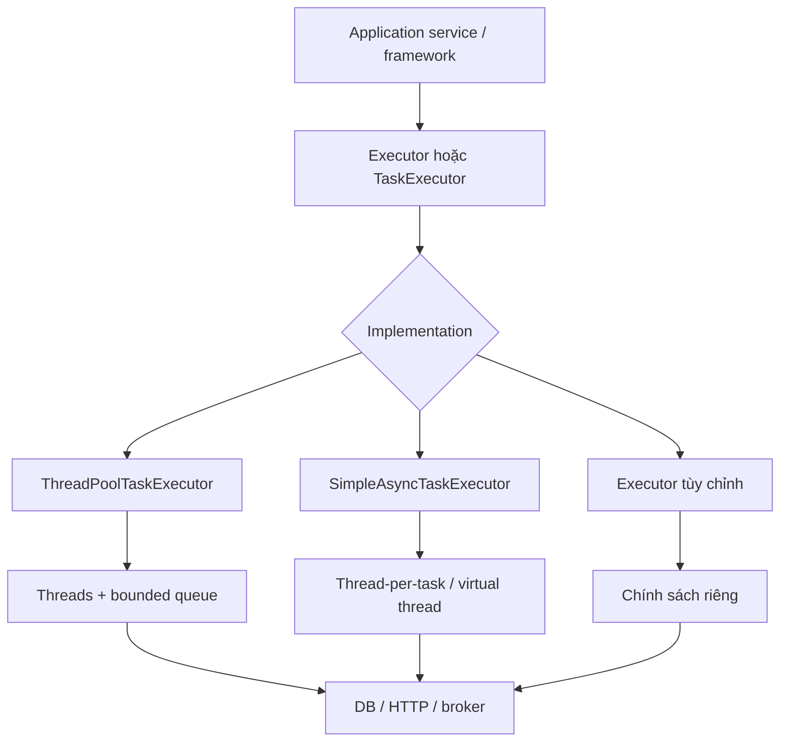
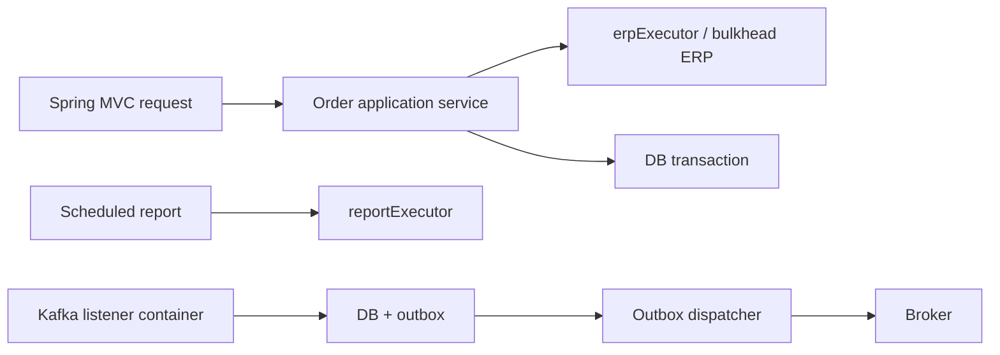
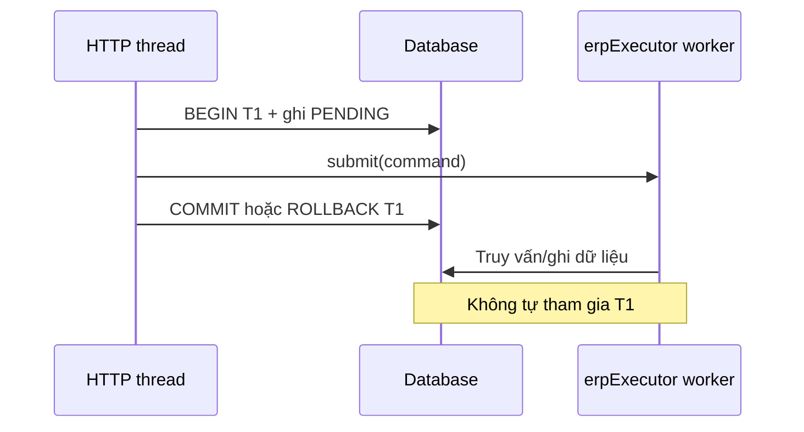

# `spring.task.execution.*` và lựa chọn executor

## 1. Bài toán: cấu hình bất đồng bộ không chỉ là tăng số thread

Một ứng dụng Spring Boot tích hợp hệ thống thường nhận HTTP request, đọc cơ sở dữ liệu, gọi ERP qua HTTP/SOAP, truy cập Redis, xử lý Kafka/RabbitMQ hoặc chuyển thông điệp qua Spring Integration. Một số công việc có thể chạy sau khi caller đã nhận response; một số khác phải được thực hiện trong chính luồng xử lý và trả kết quả ngay. Nếu không kiểm soát, các công việc chậm có thể chiếm toàn bộ thread, làm connection pool cạn hoặc tạo queue tăng vô hạn.

Trong module **`SPRING_BOOT_INTEGRATION`**, nhóm cấu hình **`spring.task.execution.*`** giúp điều khiển executor mà Spring Boot tự cấu hình; các lựa chọn executor quyết định **công việc chạy trên thread nào, có queue hay không, khi quá tải sẽ phản ứng thế nào, và framework nào sử dụng pool đó**. Những quyết định này liên quan trực tiếp đến cấu hình kết nối, hợp đồng dữ liệu, giao dịch, lỗi, xử lý trùng lặp, kiểm thử và quan sát.

Ví dụ xuyên suốt: dịch vụ `order-integration` có ba loại việc:

- HTTP MVC request cần kiểm tra trạng thái đơn từ ERP trong giới hạn latency.
- Tác vụ `@Async` tạo báo cáo hoặc làm mới dữ liệu tổng hợp.
- Kafka listener đồng bộ kết quả ERP về database với yêu cầu **không làm mất message**.

Có nên cho cả ba dùng chung một executor `task-` mặc định? Có thể trong demo nhỏ, nhưng khi ERP chậm, báo cáo dài và Kafka nhiều message, việc gom tải sẽ gây ảnh hưởng chéo. Học cách **chọn executor theo workload và ranh giới nghiệp vụ** quan trọng hơn việc chỉ biết đặt `core-size`.

Mục tiêu bài học:

1. Hiểu chính xác các property `spring.task.execution.*`, đặc biệt những thuộc tính điều chỉnh thread pool, queue và shutdown.
2. Nắm điều kiện Boot tạo `applicationTaskExecutor`, ảnh hưởng của bean executor tự khai báo và khác biệt giữa framework integrations.
3. Chọn executor cho `@Async`, Spring MVC async, Spring Integration, tác vụ blocking, CPU-bound và Java virtual threads.
4. Thiết kế queue bounded, rejection/backpressure, timeout, transaction, context và khả năng phục hồi qua restart.
5. Kiểm thử thực tế lựa chọn executor, metric saturation và hành vi khi quá tải.

## 2. Từ `Executor` của Java đến executor của Spring

Các API cần phân biệt:

| Thành phần | Ý nghĩa chính | Ghi chú vận hành |
|---|---|---|
| `java.util.concurrent.Executor` | Hợp đồng `execute(Runnable)`; giao task để thực thi. | Không nhất thiết có queue hoặc tạo thread mới. |
| `ExecutorService` | Java executor có submit, Future và shutdown. | Lifecycle do nơi tạo/quản lý chịu trách nhiệm. |
| `TaskExecutor` | Spring abstraction mở rộng `Executor`. | Dùng chung với hạ tầng task và integration. |
| `AsyncTaskExecutor` | Spring extension hỗ trợ submit và các API Future tương ứng. | Là hợp đồng được một số framework async yêu cầu. |
| `ThreadPoolTaskExecutor` | Spring bean dựa trên `ThreadPoolExecutor`, có core/max/queue/lifecycle. | Phù hợp nhiều tác vụ blocking có giới hạn. |
| `SimpleAsyncTaskExecutor` | Khởi tạo thread riêng cho mỗi task, không tái sử dụng pool. | Có thể dùng virtual threads; cần giới hạn concurrency. |
| `SyncTaskExecutor` | Chạy trên caller thread. | Hữu ích cho test nhưng không thật sự async. |

Đường đi thường gặp:



**Executor không phải message broker.** `execute(...)` chỉ gửi một `Runnable` vào cơ chế thực thi trong JVM; nếu tác vụ chỉ nằm trong RAM rồi process chết, ứng dụng không có bảo đảm chạy lại. `@Async` cũng không tự thêm tính bền vững, idempotency hay transaction phân tán.

## 3. Boot quản lý executor mặc định như thế nào?

Trong nhiều phiên bản Spring Boot 3.x, **Task Execution Auto-Configuration** tạo bean executor mặc định tên **`applicationTaskExecutor`** khi các điều kiện classpath và bean thích hợp thỏa mãn. Trong chế độ platform threads thông thường, bean này thường là `ThreadPoolTaskExecutor`; khi bật virtual threads trên Java/Boot hỗ trợ, kiểu executor tự tạo có thể khác.

Có ba lớp cần kiểm tra riêng:

1. **Bean auto-configuration:** Boot có thật sự tạo `applicationTaskExecutor` không?
2. **Executor selection:** `@Async`, Spring MVC hay một integration framework có chọn đúng bean đó không?
3. **Property binding:** các thuộc tính `spring.task.execution.*` có áp lên **bean đang thực thi tác vụ** hay chỉ áp lên một builder/bean khác?

Nếu application khai báo một bean `Executor` riêng, Boot có thể nhường quyền cấu hình executor mặc định tùy version và mode. Nếu có nhiều bean, framework có thể không tìm được một ứng viên duy nhất. Ngược lại, một `applicationTaskExecutor` tồn tại **không tự động chuyển lời gọi đồng bộ thành async**; cần `@Async` đã được kích hoạt, sử dụng `TaskExecutor.execute(...)` hoặc một cơ chế async thực tế.

### 3.1. Cách kiểm tra trong application thật

Trong môi trường phát triển có thể bật Condition Evaluation Report:

```bash
java -jar order-integration.jar --debug
```

Kiểm tra điều kiện của task execution auto-configuration và các bean sau:

- `applicationTaskExecutor` có tồn tại không? Kiểu thực tế là gì?
- Có `taskExecutor`, `erpExecutor`, `reportExecutor` hoặc bean `Executor` nào khác không?
- Có `@EnableAsync` hoặc cấu hình `AsyncConfigurer` không?
- Spring MVC, WebFlux/GraphQL, Spring Integration và listener container dùng executor nào?
- Các property đã bind vào đúng executor hay bị custom bean thay thế?

**Lưu ý về phiên bản:** tên bean, điều kiện auto-configuration và các mode cấu hình có thể thay đổi giữa Spring Boot 3.2, 3.3, 3.4, 3.5 và các thế hệ sau. Khi triển khai, đối chiếu metadata configuration của **phiên bản đang dùng**, không dựa vào một đoạn cấu hình ở dự án khác.

## 4. Các thuộc tính `spring.task.execution.*` thường gặp

Ví dụ `application.yml` cho **executor được Boot tự cấu hình bằng platform threads**:

```yaml
spring:
  task:
    execution:
      thread-name-prefix: integration-task-
      pool:
        core-size: 6
        max-size: 12
        queue-capacity: 40
        keep-alive: 45s
        allow-core-thread-timeout: true
      shutdown:
        await-termination: true
        await-termination-period: 20s
```

Các con số **chỉ là ví dụ minh họa**, không phải khuyến nghị cấu hình production. Ý nghĩa:

| Property | Tác động mong muốn | Không nên hiểu là |
|---|---|---|
| `spring.task.execution.thread-name-prefix` | Tiền tố tên thread phục vụ thread dump/log. | Truyền trace ID hoặc business context. |
| `spring.task.execution.pool.core-size` | Số platform threads lõi của pool. | Giới hạn số task tổng cộng trong hệ thống. |
| `spring.task.execution.pool.max-size` | Số worker threads tối đa khi pool cần tăng. | Luôn được sử dụng hết ngay khi tải tăng. |
| `spring.task.execution.pool.queue-capacity` | Số task được phép đợi trong queue, nếu dùng pool với queue hữu hạn. | Timeout chờ queue hoặc hạn mức trên mọi replica. |
| `spring.task.execution.pool.keep-alive` | Khoảng chờ trước khi thu hồi worker dư thừa. | Timeout của HTTP/JDBC đang chạy trong worker. |
| `spring.task.execution.pool.allow-core-thread-timeout` | Cho phép cả core worker rảnh bị thu hồi khi phù hợp. | Tự xử lý task bị treo hoặc hung thread. |
| `spring.task.execution.shutdown.await-termination` | Có chờ thời hạn hoàn tất khi context shutdown hay không. | Bảo đảm task sống sót sau crash/SIGKILL. |
| `spring.task.execution.shutdown.await-termination-period` | Ngân sách chờ shutdown. | Deadline của một request nghiệp vụ. |

Các property này được Boot sử dụng để cấu hình **executor của cơ chế auto-configuration tương ứng**. Chúng **không mặc nhiên áp dụng** cho `@Bean ThreadPoolTaskExecutor erpExecutor()` mà bạn đã tự tạo và set thuộc tính riêng. Nếu hệ thống chỉ dùng `erpExecutor` tùy chỉnh, chỉnh `spring.task.execution.pool.max-size` mà không thay bean đó có thể **không làm hành vi thay đổi**.

### 4.1. Kiểm tra default, không sao chép con số từ phiên bản khác

Các phiên bản Boot có default cho core size, queue capacity, timeout và shutdown; đừng giả định chúng luôn hữu hạn hoặc bằng thông số ví dụ. Một queue capacity rất lớn sẽ khiến pool ưu tiên xếp hàng thay vì tăng threads đến max. Vì vậy bản cấu hình production nên **chủ động khai báo queue-capacity và max-size** sau khi đã tính tải và SLO.

### 4.2. Cấu hình dưới dạng properties file

```properties
spring.task.execution.thread-name-prefix=integration-task-
spring.task.execution.pool.core-size=6
spring.task.execution.pool.max-size=12
spring.task.execution.pool.queue-capacity=40
spring.task.execution.pool.keep-alive=45s
spring.task.execution.pool.allow-core-thread-timeout=true
spring.task.execution.shutdown.await-termination=true
spring.task.execution.shutdown.await-termination-period=20s
```

Không khai báo cùng một thuộc tính ở nhiều nơi mà quên thứ tự ưu tiên property source (profile, environment variable, config server, command line). Nếu production bất ngờ có 200 workers, kiểm tra cấu hình đã được bind và bean thực tế thay vì chỉ đọc `application.yml` trong source.

## 5. Điều ít người để ý: core, max và queue tương tác ra sao?

`ThreadPoolTaskExecutor` thường dựa trên cơ chế của `ThreadPoolExecutor`:

1. Khi số worker đang có thấp hơn **core-size**, executor có thể tạo thêm worker cho task đến.
2. Khi đã đạt core, task mới thường được đưa vào **queue**.
3. Khi queue đầy và pool còn thấp hơn **max-size**, executor mới tăng worker tới max.
4. Khi queue đầy và max workers đang bận, task gửi mới bị **rejected** theo handler.

Ví dụ `core=4`, `max=10`, `queue=20`, giả sử tất cả task đều chậm và chưa có cái nào kết thúc:

| Số task gửi vào (xấp xỉ) | Trạng thái |
|---|---|
| 1–4 | Pool có thể tăng tới 4 worker. |
| 5–24 | 4 worker chạy, tối đa 20 task chờ. |
| 25–30 | Queue đầy, pool có thể tăng từ 5 tới 10 worker. |
| Từ 31 trở đi | Nếu chưa có task nào kết thúc, sẽ bị từ chối. |

Bảng mô tả logic phổ biến để hình dung; kết quả chính xác phụ thuộc thời điểm task hoàn tất, loại queue và rejection handler. **Nếu queue không giới hạn, `max-size` gần như không giúp tăng concurrency sau core** vì executor có thể tiếp tục đưa task vào queue.

### 5.1. Khi `queue-capacity = 0`

Một pool có capacity 0 có thể dùng cơ chế handoff trực tiếp như `SynchronousQueue`: task không có chỗ chờ, nên executor có xu hướng tăng worker tới max rồi từ chối khi bão hòa. Điều này phù hợp với workload muốn **backpressure ngay**, nhưng không phù hợp khi cần hấp thụ burst ngắn và request caller có thể dễ dàng retry thành cơn bão.

### 5.2. Queue hữu hạn không đồng nghĩa deadline hữu hạn

Một task có thể đã chờ trong queue 900 ms rồi mới được chạy. Nếu khi chạy HTTP client mới bắt đầu tính timeout 500 ms, tổng thời gian từ lúc submit có thể quá 1,4 giây. Hãy đo **queue wait** và **execution time** riêng, đồng thời kiểm tra **deadline còn lại trước khi bắt đầu task**.

## 6. Sizing executor theo loại công việc và từng dependency

Một ước lượng ban đầu dựa trên Little's Law:

```text
Concurrency trung bình ≈ Throughput (task/giây) × Service time (giây)
```

Ví dụ request ERP đến trung bình 20 task/giây, mỗi lần gọi mất 0,30 giây: số request ERP đang xử lý trung bình xấp xỉ 6. Nếu ERP chậm lên 1,2 giây mà tốc độ đến vẫn 20/giây, nhu cầu in-flight tăng tới 24. Nếu ERP chỉ cho phép 12 concurrent requests, **không** tăng pool lên 24 để chạy nhanh hơn; cần bulkhead/rejection/queue có giới hạn hoặc giảm tốc độ đầu vào.

Một sơ đồ phân tách tải:



Nên phân biệt ba workload:

| Workload | Ràng buộc chính | Lựa chọn điển hình |
|---|---|---|
| CPU-bound: tính toán JSON lớn, mã hóa, tổng hợp số liệu | Số CPU cores, context switching và memory. | Pool nhỏ có giới hạn theo CPU, không tăng vô hạn. |
| Blocking I/O: JDBC, HTTP/SOAP truyền thống | Thread bị giữ khi chờ, quota connection/remote. | Pool bounded hoặc virtual thread kèm bulkhead. |
| Long-running/durable: đồng bộ đơn, publish outbox, batch | Restart, retry, ack, checkpoint, ordering. | Broker/DB job/Spring Batch; executor chỉ là tài nguyên chạy worker. |

### 6.1. Tổng capacity phải tính theo số replica

Nếu có 5 replica và `erpExecutor.maxPoolSize=12`, hệ thống có thể thực hiện **tối đa khoảng 60 task đồng thời** ở lớp executor đó, chưa kể client khác. Nếu ERP chỉ cấp quota 30 request đồng thời cho toàn ứng dụng, pool mỗi replica không được chọn đơn lẻ. Cần giới hạn **in-flight HTTP calls thực tế** và quan sát cả rolling deployment khi tạm thời có thêm replica.

### 6.2. Executor không thay thế connection pool

Ví dụ có 12 worker và Hikari pool chỉ có 8 connections: nếu mỗi worker giữ transaction qua HTTP chậm, nhiều thread sẽ đợi connection. Ngược lại, HTTP client pool có 5 connections thì 12 worker có thể chủ yếu xếp hàng xin socket. Chọn kích thước executor theo **ngân sách connection, timeout và concurrency của dependency**, không chỉ CPU.

## 7. Có custom `Executor` bean: Boot có tiếp tục tạo default không?

Một ứng dụng có thể định nghĩa:

```java
@Bean("erpExecutor")
ThreadPoolTaskExecutor erpExecutor() {
    ThreadPoolTaskExecutor executor = new ThreadPoolTaskExecutor();
    executor.setThreadNamePrefix("erp-");
    executor.setCorePoolSize(4);
    executor.setMaxPoolSize(12);
    executor.setQueueCapacity(24);
    return executor;
}
```

Ở một số cấu hình Boot 3.x phổ biến, sự tồn tại của bean kiểu `Executor` do ứng dụng khai báo khiến auto-configuration **back off** và không tạo `applicationTaskExecutor` như bạn tưởng. Hậu quả có thể là:

- `@Async` mặc định chuyển sang pool không mong đợi hoặc không chọn được ứng viên duy nhất.
- Framework như Spring MVC async không còn tìm thấy application executor đúng tên/loại.
- `spring.task.execution.pool.*` không điều khiển `erpExecutor` tự tạo.
- Một số tác vụ vô tình dùng chung ERP pool dù chúng không gọi ERP.

**Không nên phỏng đoán** từ mỗi class Java. Kiểm tra context thực tế, bean names/types và Condition Evaluation Report.

### 7.1. `spring.task.execution.mode` trong các phiên bản hỗ trợ

Một số thế hệ Spring Boot mới cung cấp cách chỉ định chế độ task execution, chẳng hạn **`spring.task.execution.mode=force`**, để yêu cầu Boot tiếp tục cấu hình application task executor ngay cả khi có `Executor` bean tự khai báo theo điều kiện được phiên bản hỗ trợ.

```yaml
spring:
  task:
    execution:
      mode: force
```

**Cảnh báo tương thích:** không coi property `mode` là có mặt ở mọi Boot 3.x hoặc mọi thế hệ. Phải xác nhận version hiện tại có hỗ trợ giá trị đó, và kiểm tra cách nó ảnh hưởng lựa chọn executor của các framework; nếu version không có property, dùng cấu hình bean tường minh thay vì kỳ vọng một property không được nhận.

### 7.2. Phương án minh bạch: tự khai báo đủ executor theo nhu cầu

Nếu ứng dụng cần cả application executor lẫn pool ERP, tạo **hai bean có tên rõ ràng**:

```java
import java.util.concurrent.ThreadPoolExecutor;
import org.springframework.context.annotation.Bean;
import org.springframework.context.annotation.Configuration;
import org.springframework.scheduling.concurrent.ThreadPoolTaskExecutor;

@Configuration
public class AsyncExecutorConfiguration {

    @Bean("applicationTaskExecutor")
    ThreadPoolTaskExecutor applicationTaskExecutor() {
        ThreadPoolTaskExecutor executor = new ThreadPoolTaskExecutor();
        executor.setThreadNamePrefix("app-");
        executor.setCorePoolSize(8);
        executor.setMaxPoolSize(16);
        executor.setQueueCapacity(64);
        executor.setRejectedExecutionHandler(
                new ThreadPoolExecutor.AbortPolicy());
        return executor;
    }

    @Bean("erpExecutor")
    ThreadPoolTaskExecutor erpExecutor() {
        ThreadPoolTaskExecutor executor = new ThreadPoolTaskExecutor();
        executor.setThreadNamePrefix("erp-");
        executor.setCorePoolSize(4);
        executor.setMaxPoolSize(12);
        executor.setQueueCapacity(24);
        executor.setRejectedExecutionHandler(
                new ThreadPoolExecutor.AbortPolicy());
        return executor;
    }
}
```

Khi các executor là Spring beans, Spring quản lý initialization và shutdown lifecycle thường gặp. **Không cần gọi `initialize()` thủ công cho cùng bean khi để Spring quản lý như ví dụ.**

Vì có hai bean `TaskExecutor`, các method `@Async` không có qualifier có thể trở nên mơ hồ. Cấu hình rõ `@Async("erpExecutor")` cho tác vụ ERP và `@Async("applicationTaskExecutor")` cho tác vụ chung hoặc cung cấp `AsyncConfigurer` có chủ đích.

## 8. Lựa chọn executor cho `@Async`

`@Async` chỉ có hiệu lực khi Spring được cấu hình xử lý asynchronous methods, thường bằng `@EnableAsync`, và lời gọi đi qua Spring proxy.

```java
import org.springframework.context.annotation.Configuration;
import org.springframework.scheduling.annotation.EnableAsync;

@Configuration
@EnableAsync
public class AsyncSupportConfiguration {
}
```

Ví dụ chọn executor theo tên:

```java
import java.util.concurrent.CompletableFuture;
import org.springframework.scheduling.annotation.Async;
import org.springframework.stereotype.Service;

@Service
public class ErpStatusWorker {
    private final ErpClient erpClient;

    public ErpStatusWorker(ErpClient erpClient) {
        this.erpClient = erpClient;
    }

    @Async("erpExecutor")
    public CompletableFuture<OrderStatus> fetchStatus(String orderId) {
        OrderStatus response = erpClient.fetchStatus(orderId);
        return CompletableFuture.completedFuture(response);
    }
}
```

`ErpClient` và `OrderStatus` là các kiểu ứng dụng tự định nghĩa. Phần thân method chạy trên `erpExecutor` khi annotation được intercept đúng; việc trả `completedFuture` ở target method là cách Spring nối kết kết quả với Future caller.

Khi `@Async` **không chỉ định tên**, Spring thường ưu tiên executor được cung cấp qua `AsyncConfigurer#getAsyncExecutor()`, hoặc tìm một `TaskExecutor` phù hợp, hoặc một `Executor` có tên `taskExecutor` theo quy tắc framework. Quy tắc fallback và điều kiện uniqueness phụ thuộc cấu hình Spring. Một bean `applicationTaskExecutor` **không đồng nghĩa tự động là lựa chọn duy nhất** khi ứng dụng còn nhiều executor.

**Khuyến nghị:** với workload có SLA/quota khác nhau, khai báo qualifier rõ trên `@Async`; với mặc định toàn ứng dụng, định nghĩa một chính sách rõ và xác minh bằng integration test.

### 8.1. `AsyncConfigurer` khi muốn đặt mặc định có chủ đích

```java
import java.util.concurrent.Executor;
import org.springframework.beans.factory.annotation.Qualifier;
import org.springframework.context.annotation.Configuration;
import org.springframework.scheduling.annotation.AsyncConfigurer;
import org.springframework.scheduling.annotation.EnableAsync;

@Configuration
@EnableAsync
public class AsyncDefaultConfiguration implements AsyncConfigurer {

    private final Executor defaultExecutor;

    public AsyncDefaultConfiguration(
            @Qualifier("applicationTaskExecutor") Executor defaultExecutor) {
        this.defaultExecutor = defaultExecutor;
    }

    @Override
    public Executor getAsyncExecutor() {
        return defaultExecutor;
    }
}
```

Đây là **một lựa chọn**, không bắt buộc nếu `@Async("beanName")` đã được khai báo đầy đủ. Đừng tạo nhiều `AsyncConfigurer` không rõ thứ tự. Khi áp dụng ví dụ này, đảm bảo `applicationTaskExecutor` thực sự tồn tại và không có cấu hình `@EnableAsync` khác gây mâu thuẫn.

### 8.2. Self-invocation: phương thức có annotation vẫn chạy đồng bộ

```java
@Service
class ReportService {

    public void generate() {
        runInBackground(); // this.runInBackground(), không đi qua @Async proxy.
    }

    @Async("applicationTaskExecutor")
    public void runInBackground() {
        // Có thể chạy đồng bộ trên caller thread.
    }
}
```

Ở proxy mode phổ biến, phải gọi `runInBackground()` qua **bean proxy từ Spring context**; cách đơn giản là tách worker sang bean khác, inject vào caller. Gọi method từ constructor hoặc tự tạo instance bằng `new` cũng không bảo đảm interception.

`@Async void` không có Future để caller nhận exception. Với công việc quan trọng, dùng `CompletableFuture<T>`, trạng thái job hoặc cấu hình `AsyncUncaughtExceptionHandler`. Dù handler ghi log đầy đủ, nó cũng không thay thế durable retry nếu task bị mất khi JVM dừng.

## 9. Spring MVC async, WebFlux và executor hạ tầng

Không phải tất cả framework đều áp cùng quy tắc chọn executor như `@Async`:

| Hệ thống | Điều phải kiểm tra |
|---|---|
| **`@Async`** | `@EnableAsync`, qualifier, `AsyncConfigurer`, bean `taskExecutor`/unique `TaskExecutor`. |
| **Spring MVC async** | Executor cho xử lý request async, đặc biệt khi controller trả `Callable` hoặc cơ chế tương đương; nhiều thế hệ Boot trông đợi `applicationTaskExecutor` kiểu `AsyncTaskExecutor`. |
| **Spring WebFlux** | Reactor event loop là mô hình khác; phần blocking execution khi framework hỗ trợ có yêu cầu executor riêng. |
| **Spring GraphQL** | Cơ chế execution/handling có thể tìm một executor thích hợp tùy cấu hình và version. |
| **Spring Integration** | `ExecutorChannel`/poller thường dùng executor **được cấu hình trực tiếp**, không tự nhận một bean bất kỳ vì nó tồn tại. |
| **Kafka/RabbitMQ listener** | Listener container quản lý concurrency và thread riêng; không suy ra từ `spring.task.execution.pool.*`. |

Do đó, một bean `Executor` có tên `erpExecutor` không bảo đảm Spring MVC tự chọn nó, và `spring.task.execution.pool.max-size` không phải thiết lập concurrency của Kafka listener.

### 9.1. Vì sao tên `applicationTaskExecutor` quan trọng?

Các thành phần framework có thể tìm bean **đúng tên và loại** khi cấu hình executor. Vì vậy, nếu bạn thay executor mặc định, một bean tên `applicationTaskExecutor` kiểu `AsyncTaskExecutor` có thể cần được giữ lại. Không đặt tên `applicationTaskExecutor` cho một pool chuyên dùng ERP nếu MVC async hay workload framework không được phép bị ERP chiếm threads.

### 9.2. Tránh block Reactor event loop

`WebClient` là reactive HTTP client; Spring JDBC và `RestClient` đồng bộ là blocking. Không đặt một lời gọi JDBC blocking trực tiếp trên Netty event loop. Nếu bắt buộc gọi blocking API từ một luồng reactive, phải chuyển nó sang scheduler/executor thích hợp như `Schedulers.boundedElastic()` hoặc adapter có cơ chế bounded concurrency, không tin rằng Boot TaskExecutor tự khắc phục việc block.

Đồng thời, **không** gọi `.block()` trên event loop chỉ để đợi một `WebClient` result. Bất đồng bộ bằng `@Async` và reactive execution là hai mô hình khác nhau; kết hợp chúng mà không hiểu thread/context sẽ làm tracing và transaction khó kiểm soát.

## 10. Lựa chọn `ThreadPoolTaskExecutor` hay virtual threads?

Từ Java 21 và Spring Boot có hỗ trợ, có thể bật:

```yaml
spring:
  threads:
    virtual:
      enabled: true
```

Với những phiên bản Boot 3.2+ phù hợp, application executor được Boot tự cấu hình có thể sử dụng `SimpleAsyncTaskExecutor` với **virtual threads** thay vì một `ThreadPoolTaskExecutor` platform-thread thông thường. Cần kiểm tra bean thực tế và version. Khi đó, **`spring.task.execution.pool.core-size/max-size/queue-capacity` không nên được coi là đang giới hạn số virtual threads**, vì mô hình thread-per-task khác thread pool.

| Tiêu chí | Bounded platform thread pool | Virtual-thread-per-task |
|---|---|---|
| Thread reuse | Tái sử dụng worker platform threads. | Virtual thread mới cho mỗi task, chi phí thread thấp trong nhiều tình huống blocking. |
| Concurrency bound | Pool và bounded queue có thể đặt giới hạn trực tiếp. | Phải chủ động dùng semaphore/bulkhead/quota nếu cần hạn chế in-flight. |
| Blocking I/O | Một platform thread có thể bị giữ trong lúc chờ. | Virtual threads thường tiết kiệm tài nguyên hơn cho nhiều blocking operations hỗ trợ tốt. |
| CPU-bound | Giới hạn theo CPU thường hợp lý. | Không làm CPU cores tăng hoặc tự giúp tác vụ CPU-bound nhanh hơn. |
| Resource bên ngoài | Vẫn phải giới hạn JDBC/HTTP connections. | **Cũng phải giới hạn** JDBC/HTTP connections và quota đối tác. |
| Lifecycle | Pool queue/shutdown theo cấu hình. | Không áp mọi property `pool.*` của Boot vào mô hình không có pool. |

Virtual threads không làm cho PostgreSQL có vô hạn connection hay ERP chịu được vô hạn concurrent calls. Nếu có 10.000 virtual threads cùng chờ lấy Hikari connection, hệ thống vẫn quá tải; cần xét backpressure từ khi nhận yêu cầu.

Các điểm riêng phải test: pinning theo JDK/library version, ThreadLocal/MDC footprint, blocking APIs hỗ trợ virtual threads, shutdown và việc JVM còn sống khi chỉ có daemon virtual threads. Nếu xử lý công việc nền bắt buộc phải tồn tại, dùng durable queue/outbox chứ không dựa vào vòng đời virtual thread.

## 11. Từ thread pool sang bulkhead và admission control

Một executor bounded không phải lúc nào cũng là đúng giới hạn cho API đối tác. Một task ERP có thể fan-out thành ba HTTP calls; 12 workers có thể tạo 36 lời gọi đồng thời nếu code chạy song song bên trong mỗi task. Muốn giới hạn ERP 12 in-flight HTTP calls, dùng **bulkhead ngay trên client adapter**, không chỉ pool size.

Ví dụ đơn giản bằng semaphore, không giữ permit lâu hơn cuộc gọi:

```java
import java.util.concurrent.Semaphore;
import java.util.concurrent.TimeUnit;

public final class ErpBulkhead {
    private final Semaphore permits = new Semaphore(12);

    public <T> T call(java.util.concurrent.Callable<T> action)
            throws Exception {
        if (!permits.tryAcquire(100, TimeUnit.MILLISECONDS)) {
            throw new IllegalStateException("ERP concurrency exhausted");
        }
        try {
            return action.call();
        } finally {
            permits.release();
        }
    }
}
```

Đây là **ví dụ cục bộ mỗi instance**, không phải quota phân tán. Trong production, lỗi hết permit nên được phân loại thành overload/rejection; nếu dùng Resilience4j Bulkhead hoặc rate limiter, cần thống nhất vị trí đo metric, timeout và retry. Không sử dụng `Semaphore` instance mới mỗi lần gọi, vì như vậy giới hạn không có tác dụng.

### 11.1. Chính sách rejection

Khi `ThreadPoolTaskExecutor` bão hòa, có thể phát sinh `TaskRejectedException` từ Spring. Những handler phổ biến:

| Handler | Phản ứng | Rủi ro |
|---|---|---|
| `AbortPolicy` | Từ chối task bằng exception. | Caller phải trả lỗi/backpressure đúng, không làm mất command đã cam kết. |
| `CallerRunsPolicy` | Caller thực thi task khi overload trong các điều kiện thông thường. | Làm block HTTP/Kafka thread, thay đổi latency và transaction context. |
| `DiscardPolicy` | Bỏ task mà không báo lỗi trực tiếp. | Nguy hiểm với mọi lệnh nghiệp vụ phải thực thi. |
| `DiscardOldestPolicy` | Loại task cũ nhất rồi thử lại. | Có thể làm mất/đảo thứ tự công việc mà không có cơ chế đối soát. |

Đối với `order-integration`, thường nên chọn **rejection rõ ràng** và upstream backpressure; đối với công việc phải bền vững, ghi yêu cầu vào DB/broker **trước** rồi worker mới nhận. `CallerRunsPolicy` có thể có ích để giảm tốc producer, nhưng phải kiểm thử vì caller có thể là thread listener giữ acknowledgment/transaction.

## 12. Timeout, queue wait và retry budget phải đi cùng executor

Một task có thể trải qua nhiều pha:

```text
HTTP inbound
  -> validate/request deadline
  -> submit to executor
  -> queue wait
  -> acquire bulkhead
  -> acquire HTTP connection
  -> connect/TLS
  -> receive/parse ERP response
  -> update DB/outbox
  -> complete Future / respond
```

Chọn timeout `RestClient` 800 ms nhưng cho task đợi 2 giây trong queue có thể vi phạm SLO 1 giây trước khi gửi request. Vì vậy:

1. Ghi lại thời điểm submit và deadline còn lại.
2. Khi task bắt đầu, kiểm tra deadline trước khi thực hiện side effect mới.
3. Giới hạn queue wait, bulkhead acquire, HTTP connect/read và transaction phù hợp.
4. Retry **trong ngân sách còn lại** với số lần và backoff rõ ràng.
5. Với lệnh ghi, read timeout có thể xảy ra **sau khi bên ERP đã commit**; không tự retry không có idempotency key/đối soát.

`CompletableFuture.orTimeout(...)` hoặc `get(timeout, unit)` có thể giới hạn thời gian **caller chờ**; chúng không đảm bảo remote request, JDBC transaction hoặc side effect đã bị hủy. `cancel(true)` cũng không thể rollback một thanh toán đã tạo thành công tại ERP.

### 12.1. Tránh nested Future deadlock/starvation

Nếu tất cả workers trong một pool gửi subtask vào **chính pool đó**, rồi `get()` chờ kết quả, có thể xảy ra thread starvation: mọi worker đang chờ subtask trong queue nhưng không còn worker rảnh để chạy subtask. Dùng mô hình compositional async không block, pool riêng khi thật cần, hoặc viết lại workflow để tránh dependency vòng trong cùng executor.

## 13. Exception và cách caller nhận kết quả

`@Async` chấp nhận các kiểu return phổ biến như `void`, `Future<T>`, `CompletableFuture<T>`. Ví dụ:

```java
CompletableFuture<OrderStatus> result = worker.fetchStatus("O-42");

result.whenComplete((value, failure) -> {
    if (failure != null) {
        recordFailure("erp-status", failure);
    } else {
        consumeStatus(value);
    }
});
```

`recordFailure` và `consumeStatus` là phương thức nghiệp vụ giả định. `whenComplete` có thể chạy trong thread hoàn tất Future, nên callback dài hoặc blocking có thể giữ worker; nếu cần chuyển executor, cân nhắc `whenCompleteAsync(..., executor)` và chính sách tải riêng.

Với `@Async void`, exception sẽ không xuất hiện ở return value của caller; nếu cần có thể cấu hình `AsyncUncaughtExceptionHandler`, nhưng phải có metric/alert và policy phục hồi. Không cho rằng đã log stack trace là công việc được thực hiện thành công.

Nếu submit trực tiếp `TaskExecutor.execute(...)`, caller cũng không có Future; cần chủ động bắt exception bên trong task hoặc dùng API `AsyncTaskExecutor.submit(...)`/`CompletableFuture` phù hợp. Bất kỳ hình thức nào cũng cần xác định **ai sở hữu failure và retry**.

## 14. Transaction không tự đi theo executor

Đối với Spring JDBC/JPA imperative, `@Transactional` thường gắn tài nguyên transaction với thread hiện tại. Khi executor chạy task trên thread khác, **transaction của HTTP thread không tự chuyển sang worker thread**.



Nếu worker cần thao tác atomic DB, tạo transaction mới trong worker bằng một Spring bean được proxy intercept:

```java
@Service
class OrderWriteService {

    private final OrderRepository repository;

    OrderWriteService(OrderRepository repository) {
        this.repository = repository;
    }

    @Transactional
    public void markSynchronized(String orderId) {
        repository.markSynchronized(orderId);
    }
}

@Service
class SyncWorker {

    private final OrderWriteService writes;

    SyncWorker(OrderWriteService writes) {
        this.writes = writes;
    }

    @Async("erpExecutor")
    public CompletableFuture<Void> complete(String orderId) {
        writes.markSynchronized(orderId);
        return CompletableFuture.completedFuture(null);
    }
}
```

Ví dụ giả định import và domain repository tương ứng. `OrderWriteService` là bean riêng nên `markSynchronized` được gọi qua proxy thông thường. Nếu gọi `this.markSynchronized()` trong cùng bean, `@Transactional` có thể không được áp. Không bọc remote HTTP chậm trong một transaction DB dài: giữ Hikari connection và database locks làm giảm capacity khi ERP chậm.

## 15. ThreadLocal, MDC, tracing và security context

Khi chuyển task sang worker thread, các dữ liệu lưu trong `ThreadLocal` như MDC, request context, Spring Security context hoặc transaction state không tự đi theo một cách an toàn. Thread pool tái sử dụng threads, nên giữ nhầm context của request trước thậm chí nguy hiểm hơn thiếu context.

Giải pháp cần theo loại dữ liệu:

| Context | Cách xử lý phù hợp |
|---|---|
| Business ID, request ID | Truyền qua tham số hoặc event payload rõ ràng. |
| Trace/observation context | Sử dụng context propagation/`TaskDecorator` tương thích framework. |
| MDC | Capture/restore có `try/finally` để không rò rỉ sang task sau. |
| Security identity | Chỉ truyền thông tin tối thiểu, có thể dùng delegation executor của Spring Security khi cần. |
| JDBC transaction | Không copy ThreadLocal; tạo transaction đúng ranh giới worker. |
| HTTP request/session | Không giữ reference sang background worker sau khi request kết thúc. |

Ở Spring Framework có `TaskDecorator` và những cơ chế context propagation phù hợp khi dependency/version hỗ trợ. Đừng copy cả `SecurityContext` hoặc credentials sang mọi task nếu nghiệp vụ chỉ cần `tenantId` và `correlationId`. Việc chuyển security context phải có review bảo mật và cleanup khi task hoàn tất.

## 16. Spring Integration và điều phối message qua executor

Trong Spring Integration, chọn loại channel thay đổi execution semantics:

| Thành phần | Hành vi thường gặp | Ranh giới cần chú ý |
|---|---|---|
| `DirectChannel` | Handler chạy trên thread sender. | Có thể chia sẻ transaction caller; downstream chậm giữ caller. |
| `ExecutorChannel` | Giao message handling sang executor đã cấu hình. | Thay đổi thread/transaction context, có queue/rejection. |
| `QueueChannel` | Đưa message vào queue, poller nhận sau. | Giới hạn capacity, persistence/durability và timeout. |
| Poller có executor | Chạy công việc polling/handling theo cấu hình. | Cần kiểm soát concurrency và số message mỗi lần poll. |
| HTTP outbound adapter/service activator | Gọi dependency tùy client đồng bộ/bất đồng bộ. | HTTP timeout, bulkhead, retry và idempotency. |

Ví dụ `ExecutorChannel` có queue trong RAM **không phải durable broker**. Nếu sender hoàn tất sau khi enqueue mà JVM chết trước khi handler chạy, task có thể mất. Do đó, với command cần chắc chắn thực hiện, trước hết phải lưu yêu cầu bền vững (database outbox/job table hoặc broker), sau đó executor mới là tầng thực thi.

`spring.task.execution.pool.max-size` không tự quyết định executor cho mọi `ExecutorChannel`; nên cấu hình bean `erpExecutor` rõ ràng cho channel hoặc poller và xác định policy khi rejected. Nếu channel giữ một transaction context từ sender theo giả định cũ, chuyển sang `ExecutorChannel` có thể khiến commit/ack thay đổi; phải test toàn bộ flow.

## 17. Kafka/RabbitMQ và ranh giới acknowledgment

Kafka listener container và RabbitMQ listener container thường có cơ chế concurrency, ack, prefetch và lifecycle riêng. Chúng **không tự lấy số threads** từ `spring.task.execution.pool.core-size`.

Một lỗi nguy hiểm:

```java
@KafkaListener(topics = "order-paid")
void consume(OrderPaidEvent event) {
    erpExecutor.execute(() -> processAndSave(event));
    // Listener trả về trước khi task thực sự xử lý/commit.
}
```

Nếu container commit offset/ack dựa trên việc listener hoàn thành, message có thể được xem là đã xử lý **trước** khi worker cập nhật DB, khiến crash làm mất công việc. Đây chỉ là ví dụ phản mẫu; actual ack/commit phụ thuộc configuration container. Hướng thiết kế:

- Xác định thế nào là **hoàn tất**: đã ghi DB, đã lưu durable job, hay ERP đã xác nhận?
- Nếu cần trả về sớm, ghi một bản ghi DB/outbox **trước** khi ack và xử lý phần còn lại ở worker có thể restart.
- Nếu ack sau xử lý, cần phối hợp completion và error với listener framework đúng cách, không giả định Future sẽ tự được container chờ.
- Dùng unique business key/idempotency để chịu redelivery khi DB commit nhưng ack lỗi.
- Giới hạn số message in-flight để task queue không tăng vô hạn khi ERP chậm.

Tăng `erpExecutor.max-size` không giải quyết tắc nghẽn nếu Kafka partition count, database pool, ERP quota hoặc checkpoint là nút thắt thật.

## 18. Task trong RAM, durable queue, outbox và Spring Batch

| Nhu cầu | Giải pháp cần cân nhắc | Vì sao |
|---|---|---|
| Tính toán ngắn, chấp nhận mất khi JVM chết | `@Async`/`TaskExecutor`. | Nhanh, đơn giản, có giới hạn resource. |
| Tác vụ chạy theo lịch | `@Scheduled`/TaskScheduler phù hợp. | Phân biệt **khi nào chạy** với executor **chạy ở đâu**. |
| Công việc phải sống qua restart và scale-out | Broker/durable queue hoặc bảng job. | Có ack, retry, ownership, checkpoint. |
| DB commit rồi đảm bảo phát sự kiện | Transactional outbox. | Không mất ý định phát khi broker tạm lỗi. |
| Xử lý lô lớn, restart/skip/retry theo chunk | Spring Batch. | JobRepository và chunk transaction. |
| Workflow nhiều bước qua ERP/broker | Saga/state machine + idempotency/đối soát. | Local executor không tạo distributed transaction. |

Nếu HTTP API trả **202 Accepted** khi mới có `executor.execute(task)` thành công trong bộ nhớ, cần nói rõ hợp đồng chấp nhận rủi ro mất tác vụ. Với thao tác thanh toán/đơn hàng bắt buộc phải thực thi, chỉ trả trạng thái đã tiếp nhận sau khi có bản ghi durable phù hợp.

### 18.1. Graceful shutdown không thay crash recovery

`spring.task.execution.shutdown.await-termination=true` có thể giúp process chờ task khi shutdown bình thường, nhưng orchestration có thể hết termination grace period hoặc gặp SIGKILL. Tác vụ đang gọi ERP có thể đã tạo side effect rồi client bị ngắt; phải có cách tra cứu kết quả theo request ID. Không dựa vào tăng shutdown timeout để thay thế recovery.

## 19. Testing: chứng minh executor được chọn đúng

Một unit test gọi trực tiếp method có `@Async` trên object tạo bằng `new` không đi qua Spring proxy, nên không chứng minh cấu hình executor hoạt động. Cần test context thật và phân biệt hai mục tiêu:

1. **Wiring:** bean nào tồn tại và `@Async` có dùng đúng executor không?
2. **Behavior:** queue bounded, rejection, deadline, transaction, context và shutdown có đúng dưới tải không?

Ví dụ integration test có chủ đích kiểm tra tên thread, giả định đã có bean `erpExecutor` với prefix `erp-` và `@EnableAsync`:

```java
import java.util.concurrent.CompletableFuture;
import java.util.concurrent.TimeUnit;
import org.junit.jupiter.api.Test;
import org.springframework.beans.factory.annotation.Autowired;
import org.springframework.boot.test.context.SpringBootTest;
import org.springframework.scheduling.annotation.Async;
import org.springframework.stereotype.Service;
import static org.assertj.core.api.Assertions.assertThat;

@Service
class ExecutorProbe {
    @Async("erpExecutor")
    public CompletableFuture<String> captureThreadName() {
        return CompletableFuture.completedFuture(
                Thread.currentThread().getName());
    }
}

@SpringBootTest
class ExecutorWiringTest {

    @Autowired ExecutorProbe probe;

    @Test
    void asyncMethodRunsOnErpExecutor() throws Exception {
        String name = probe.captureThreadName()
                .get(2, TimeUnit.SECONDS);
        assertThat(name).startsWith("erp-");
    }
}
```

Đây là ví dụ cần các test dependencies và configuration được khai báo ở phần trước. Nếu ứng dụng bật virtual threads, tên thread thực tế có thể khác theo executor; test phải đặt kỳ vọng phù hợp bean **được kiểm tra**, không dựa vào một tên mặc định chung.

### 19.1. Ma trận kiểm thử khi có thay đổi cấu hình

| Thử nghiệm | Điều cần chứng minh |
|---|---|
| Context chỉ dùng Boot-managed executor | `applicationTaskExecutor` tồn tại và nhận `spring.task.execution.*` như thiết kế. |
| Có custom `erpExecutor` | Không làm mất executor framework cần; `@Async` chọn đúng bean. |
| Pool core/max/queue nhỏ | Thấy tăng worker, xếp hàng và rejection đúng quy tắc. |
| Không có `@EnableAsync` hoặc self-invocation | Phát hiện method không chạy async như giả định. |
| Exception từ `CompletableFuture` | Caller/metric nhận failure; task không bị coi là thành công. |
| ERP chậm/timeout | Queue không tăng vô hạn, các workload khác vẫn hoạt động. |
| Hikari/HTTP pool nhỏ hơn executor | Quan sát pending acquisition và giới hạn in-flight thực tế. |
| Async transaction | Worker commit/rollback trong transaction riêng phù hợp. |
| ThreadLocal/tracing | Context đúng, không rò rỉ identity/MDC sang task tiếp theo. |
| Broker consumer | Không ack sớm nếu nghiệp vụ chưa được lưu bền vững. |
| Virtual threads bật | Property pool không được diễn giải sai; bulkhead/quota vẫn hoạt động. |
| Restart giữa lúc task chạy | Durable task phục hồi, task RAM mất theo đúng hợp đồng. |

Với test concurrency, dùng `CountDownLatch` hoặc barrier có timeout, không dựa vào `Thread.sleep` để cố tạo race. Khi đo executor selection, chạy qua Spring proxy và một bean có thật trong context, không chỉ assert tên bean.

## 20. Metrics và vận hành executor

Những tín hiệu nên có cho **mỗi executor** và **mỗi dependency**:

| Tín hiệu | Câu hỏi trả lời |
|---|---|
| `active threads`, `pool size`, `core/max` | Có đang dùng hết workers không? |
| `queue depth/capacity` | Công việc chờ bao lâu, có vượt deadline không? |
| `rejected tasks` | Có overload và phản hồi ra upstream đúng không? |
| `submit-to-start delay` | Thời gian queue wait có lớn hơn thời gian chạy không? |
| `execution duration` | Task chậm vì ERP/JDBC hay vì CPU? |
| `success/failure/timeout/cancel` | Task có thực sự hoàn tất theo hợp đồng không? |
| HTTP pool pending/active, Hikari pool pending | Worker có bị nghẽn do kết nối bên dưới không? |
| Kafka lag/Rabbit unacked/outbox backlog | Công việc bền vững có đang tích tụ không? |
| Retry attempts và circuit-breaker/bulkhead state | Retry đang cứu hay làm bão tải phụ thuộc? |

Spring Boot Actuator/Micrometer có thể instrument một số executor khi loại bean và meter binder phù hợp; **tên metric và mức auto-bind phụ thuộc version**. Nếu telemetry thiếu `queue wait` hoặc outcome nghiệp vụ, bổ sung metric ở adapter/worker thay vì mặc định mọi thông số đều sẵn có.

Không dùng `orderId`, `customerId`, `requestId` làm metric tags vì cardinality cao. Dùng tên executor/operation/dependency ổn định, ví dụ `executor=erp`, `operation=erp-status`, `outcome=success|timeout|rejected`. Correlation ID nên nằm trong trace/log đã được quản lý quyền truy cập.

### 20.1. Runbook khi queue tăng đột biến

1. Xác định executor tăng queue và số active workers có chạm max không.
2. Tách **thời gian chờ queue** với **thời gian thực thi task**.
3. Kiểm tra downstream ERP/DB, connection pool, lock wait và rate limiter.
4. Kiểm tra thay đổi traffic, burst, số replica, retry và fan-out.
5. Nếu downstream đang quá tải, giới hạn producer/concurrency và giữ rejection rõ thay vì tăng pool mù quáng.
6. Xác nhận task bị reject có báo lỗi hoặc đã lưu bền vững; không âm thầm mất nghiệp vụ.
7. Sau phục hồi, theo dõi backlog, task quá hạn, thao tác ghi có kết quả chưa xác định và cơ chế đối soát.

## 21. Các nhầm lẫn thường gặp

| Nhầm lẫn | Thực tế |
|---|---|
| “`spring.task.execution.pool.max-size=100` nghĩa là có 100 workers.” | Queue có thể giữ task trước khi pool tăng vượt core. |
| “Tạo `erpExecutor` rồi `spring.task.execution.*` sẽ tự áp lên bean ấy.” | Property của Boot auto-config không tự bind lên mọi custom bean. |
| “Có `applicationTaskExecutor` nghĩa là `@Async` hoạt động.” | Cần `@EnableAsync` và lời gọi qua proxy. |
| “Chỉ cần một bean `Executor`, mọi framework dùng nó.” | MVC async, WebFlux, Integration, Kafka listener có quy tắc lựa chọn riêng. |
| “`@Async` mặc định luôn chọn `applicationTaskExecutor`.” | Có `AsyncConfigurer`, unique bean/named fallback và nhiều bean gây ambiguity. |
| “Bật virtual threads thì property `pool.*` giới hạn số tasks.” | Virtual-thread-per-task không có cùng semantics với platform-thread pool. |
| “Timeout ở `Future` hủy lệnh HTTP và rollback ERP.” | Caller có thể ngừng chờ trong khi remote side effect đã xảy ra. |
| “Queue bounded đảm bảo không mất công việc.” | Queue trong RAM vẫn mất khi process chết. |
| “Transaction của HTTP thread đi theo `ExecutorChannel`.” | Không tự lan truyền sang worker thread khác. |
| “Kafka listener submit async xong có thể ack.” | Ack phải dựa trên hợp đồng bền vững, không chỉ queue trong process. |
| “Tăng threads sẽ xử lý được DB lock/ERP chậm.” | Có thể tăng contention và làm quá tải upstream. |
| “Đã gọi `@Async` nên tracing tự liền mạch.” | Cần context propagation qua async boundary. |

## 22. Checklist chọn và cấu hình executor trong ứng dụng tích hợp

- [ ] Xác nhận Spring Boot/Spring Framework/JDK đang dùng và bean executor thực tế trong context.
- [ ] Biết `applicationTaskExecutor` có được Boot tạo hay custom `Executor` đã làm auto-config back off.
- [ ] Nếu dùng `spring.task.execution.mode`, xác minh property và giá trị được hỗ trợ ở phiên bản triển khai.
- [ ] Phân loại workload: CPU-bound, blocking I/O, background best effort, hay durable workflow.
- [ ] Chọn tên và `@Qualifier`/`@Async("...")` rõ ràng cho các executor khác nhau.
- [ ] Đảm bảo Spring MVC/framework có bean đúng tên/loại; không dùng ERP pool làm default ngẫu nhiên.
- [ ] Bật `@EnableAsync` khi dùng `@Async`; test lời gọi qua Spring proxy và self-invocation.
- [ ] Cấu hình core/max, queue capacity hữu hạn, keep-alive và shutdown theo SLO.
- [ ] Có chính sách rejected submissions và backpressure; không im lặng bỏ command.
- [ ] Tính concurrency theo nhiều replica và quota thực của DB/ERP/Redis/broker.
- [ ] Có HTTP/JDBC timeout, queue wait timeout, deadline đầu-cuối và retry budget.
- [ ] Với virtual threads, giới hạn in-flight bằng bulkhead/semaphore, không chỉ pool properties.
- [ ] Không block Reactor event loop bằng JDBC/`RestClient` hoặc `WebClient.block()`.
- [ ] Bảo đảm worker có transaction boundary riêng; không truyền transaction ThreadLocal.
- [ ] Truyền/clear tracing, MDC và security context theo chính sách tối thiểu.
- [ ] Với Kafka/RabbitMQ, ack sau bước bền vững theo hợp đồng, có redelivery idempotent.
- [ ] Với job không được mất, dùng durable queue, outbox hoặc Spring Batch; không chỉ `@Async`.
- [ ] Test queue saturation, failure, retry, restart, graceful shutdown, context và transaction.
- [ ] Có metrics active/queued/rejected/latency và runbook phân biệt overload với downstream failure.

## 23. Kết luận

**`spring.task.execution.*` là công cụ cấu hình executor được Spring Boot quản lý, không phải cấu hình toàn cục có hiệu lực với mọi `Executor` hoặc mọi integration framework.** `core-size`, `max-size` và `queue-capacity` quyết định cách một bounded platform-thread pool tiếp nhận tải; custom beans, executor selection của `@Async` và các framework integrations quyết định công việc thực sự chạy ở đâu. Với virtual threads, không thể diễn giải `pool.*` như giới hạn concurrency cũ.

Trong **SPRING_BOOT_INTEGRATION**, lựa chọn executor đúng phải bắt đầu từ **quota dependency, deadline, transaction boundary, khả năng mất việc, message acknowledgment và quan sát**. Dùng pool riêng khi các workload cần cách ly, giữ queue/rejection minh bạch, và đặt công việc quan trọng trong durable infrastructure để có thể phục hồi sau lỗi. Khi đó bất đồng bộ mới là một phần của thiết kế hệ thống tin cậy, không chỉ là cú pháp `@Async`.
