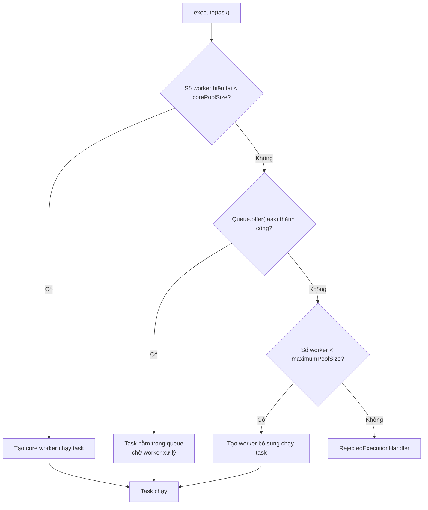
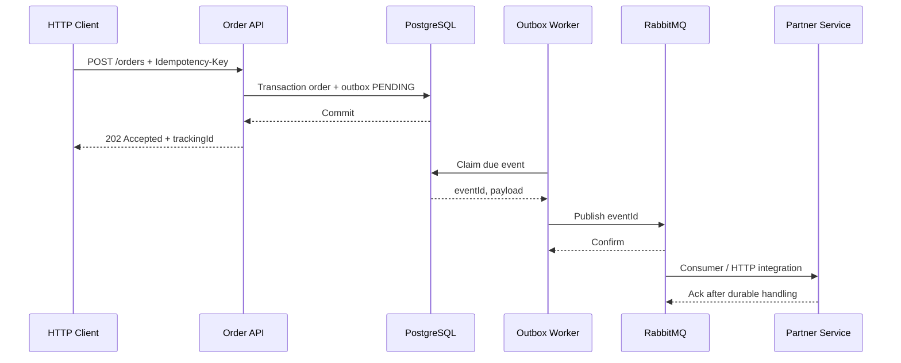
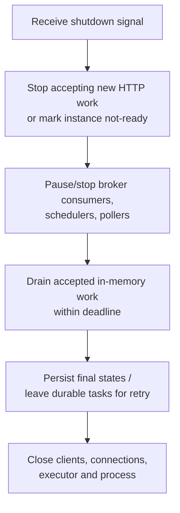
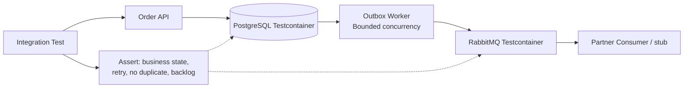

# Giới hạn số luồng, hàng đợi và chiến lược từ chối

## 1. Vấn đề thực tế: tác vụ bất đồng bộ không có nghĩa là vô hạn tài nguyên

Trong module **SPRING_BOOT_INTEGRATION**, một dịch vụ Spring Boot thường nhận HTTP request, gọi REST API đối tác, ghi PostgreSQL, đọc cache Redis hoặc xử lý sự kiện từ RabbitMQ/Kafka. Một số công việc chậm có thể được chuyển sang một executor để thread nhận request không phải chờ toàn bộ thao tác.

Ví dụ dịch vụ xử lý sự kiện `order.paid`:

1. Nhận webhook/thông điệp thanh toán.
2. Kiểm tra hợp đồng dữ liệu và chống trùng `eventId`.
3. Ghi đơn hàng và ý định gọi hệ thống vận chuyển.
4. Giao tác vụ gọi HTTP cho một worker pool.
5. Cập nhật trạng thái/đối soát khi đối tác trả kết quả.

Cách viết đơn giản là gọi method `@Async`. Nhưng nếu nhận **nhiều tác vụ hơn tốc độ xử lý**, số thread và số tác vụ chờ có thể tăng đến mức gây hết memory, pool connection, file descriptors hoặc nghẽn toàn bộ downstream.

**Tư tưởng quan trọng:** executor là một cơ chế **lập lịch thực thi trong tiến trình**, không phải kho công việc bền vững. Một worker pool production cần xác định rõ:

- **Số thread hoạt động**: có thể chạy bao nhiêu thao tác đồng thời?
- **Hàng đợi**: cho phép bao nhiêu tác vụ chờ và đợi tối đa bao lâu?
- **Chiến lược từ chối**: phải làm gì khi tất cả thread và hàng đợi đều đầy?
- **Backpressure/admission control**: phản hồi thế nào cho nơi tạo tác vụ để không tiếp tục nhận công việc quá khả năng?
- **Durability**: công việc đã được chấp nhận có tồn tại sau restart/crash hay không?
- **Observability**: có đo được active threads, queue depth, rejected tasks và độ trễ chờ không?

Bài học này tập trung vào **giới hạn số luồng, hàng đợi và chiến lược từ chối** của Java `ThreadPoolExecutor`, Spring `ThreadPoolTaskExecutor` và Spring Boot `@Async`, sau đó mở rộng sang broker, database, HTTP client, timeout và idempotency.

### Mục tiêu

Sau khi học, bạn có thể:

- Giải thích chính xác mối quan hệ giữa `corePoolSize`, `maxPoolSize`, `queueCapacity` và `keepAliveSeconds`.
- Cấu hình một `ThreadPoolTaskExecutor` có giới hạn, được dùng tường minh bởi `@Async`.
- So sánh `AbortPolicy`, `CallerRunsPolicy`, `DiscardPolicy`, `DiscardOldestPolicy` và custom rejection handler.
- Thiết kế phản ứng khi hệ thống quá tải mà không âm thầm làm mất nghiệp vụ.
- Kiểm thử trạng thái saturation, rejection, shutdown, timeout và tính bền vững của công việc.
- Tránh nhầm `@Async` với giao việc qua broker/outbox trong hệ thống tích hợp.

> Các ví dụ dùng Java 17+, Spring Boot 3.x, Spring Framework 6.x và Java concurrency API. Tên properties, bean selection và virtual thread behavior có thể khác theo phiên bản Spring Boot mới; hãy đối chiếu tài liệu của bản đang chạy trước khi áp dụng. Các con số cấu hình minh họa, **không** phải khuyến nghị chung cho mọi ứng dụng.

## 2. Đồng bộ, bất đồng bộ và giao việc bền vững là ba chuyện khác nhau

Xét một lời gọi tới đối tác vận chuyển mất 500 ms.

**Cách đồng bộ:**

```text
HTTP request thread
    |
    +-- validate --> DB --> call carrier API (500 ms) --> response
    |
    +-- thread bận cho đến khi tất cả hoàn tất
```

**Cách @Async với pool trong JVM:**

```text
HTTP request thread
    |
    +-- validate --> executor.submit(task) --> response
                            |
                            +-- queue (memory) --> worker --> call carrier
```

**Cách giao việc bền vững qua database/broker:**

```text
HTTP request
    |
    +-- transaction: persist order + outbox
    |                  |
    +-- 202 / tracking id
                       |
                outbox publisher
                       |
                   RabbitMQ
                       |
                consumer (bounded concurrency)
                       |
                call carrier / update state
```

Cả hai ví dụ sau đều có xử lý bất đồng bộ, nhưng độ tin cậy khác nhau:

| Thuộc tính | Executor trong JVM | Broker/outbox bền vững |
| --- | --- | --- |
| Công việc đang chờ nằm ở đâu? | Trong bộ nhớ ứng dụng | Database hoặc broker được cấu hình durability |
| Còn khi process bị kill/crash? | Không được bảo đảm | Có thể phục hồi theo cơ chế lưu trữ và ack |
| Có API rejection khi quá tải? | Có, từ executor | Có, ở producer/consumer capacity và quota |
| Có bảo đảm exactly-once effect? | Không | Không tự động; cần idempotency |
| Kiểm soát concurrency? | Số worker threads | Consumer concurrency, prefetch, worker pool, rate limit |
| Phù hợp | Công việc ngắn/chấp nhận mất khi crash hoặc đã có durable source | Các nhiệm vụ nghiệp vụ bắt buộc không được mất |

**Không trả HTTP 202 “đã nhận để xử lý” chỉ vì `@Async` chạy không ném lỗi** nếu hợp đồng hứa tác vụ sẽ được hoàn tất/khôi phục sau crash. Khi đó cần ghi nhận intent bền vững và tracking state trước khi trả 202.

## 3. Mô hình tải: arrival rate, service rate và backlog

Giả sử trung bình có \(\lambda\) tác vụ/giây tới hệ thống và mỗi worker xử lý được \(\mu\) tác vụ/giây. Nếu có \(N\) worker hữu hiệu, công suất xử lý gần đúng là \(N\mu\) tác vụ/giây khi không bị giới hạn bởi các tài nguyên khác.

- Khi **tốc độ đến thấp hơn tốc độ xử lý** và tải đủ ổn định, backlog có cơ hội giảm về mức thấp.
- Khi **tốc độ đến cao hơn tốc độ xử lý**, công việc chờ tăng. Một queue vô hạn che tình trạng quá tải bằng latency tăng dần.
- Một queue **hữu hạn** buộc hệ thống bộc lộ thời điểm đã hết khả năng nhận thêm, để caller/backpressure/retry policy hành động.
- Một pool lớn không giúp nhiều nếu bottleneck thật là API đối tác chỉ cho phép 20 request đồng thời hoặc PostgreSQL có 10 JDBC connections.

Ví dụ minh họa: 8 workers, mỗi tác vụ blocking HTTP mất 200 ms → công suất lý tưởng khoảng 40 tác vụ/giây. Nếu đầu vào duy trì 60 tác vụ/giây, backlog tăng khoảng 20 tác vụ/giây, **nếu thời gian xử lý, concurrency và network không thay đổi**. Đó là ví dụ trực giác, không phải benchmark; khi pool/thread blocking contention xuất hiện, throughput có thể thấp hơn nữa.

### Vì sao latency xấu trước khi xuất hiện lỗi?

Một task có thể thực thi đúng sau khi chờ 30 giây trong queue, nhưng business deadline của request đã hết từ 5 giây trước. Khi queue quá sâu:

- HTTP caller timeout rồi retry, tạo thêm tải.
- Event bị trễ khiến dữ liệu graph/cache stale.
- Token, phiên kết nối hoặc thời hạn giao vận hết hiệu lực trước khi worker chạy.
- Queue chiếm memory, đặc biệt khi lambda giữ reference tới DTO/payload lớn.
- Shutdown khó drain hết tác vụ, làm tăng khả năng mất công việc.

**Queue capacity là một chính sách về độ trễ và memory**, không chỉ con số để tránh exception.

## 4. ThreadPoolExecutor: cách Java chọn thread hoặc queue

Java `java.util.concurrent.ThreadPoolExecutor` thực hiện cơ chế admission cơ bản. Với executor đang `RUNNING`, khi một `execute()` mới đến:



Sơ đồ là mô tả **nguyên tắc**, không bao gồm các nhánh race/shutdown mà `ThreadPoolExecutor` cần kiểm tra lại sau khi queue offer.

**Điểm thường bị hiểu sai:** khi đã có `corePoolSize` workers, executor **thường thử đưa task vào queue trước khi tăng tới `maximumPoolSize`**. Nếu queue chưa đầy, pool có thể giữ nguyên ở mức core dù max lớn.

Một số thay đổi về queue có thể làm hành vi khác nhau rõ rệt:

- Queue **rất lớn/unbounded**: pool thường khó tăng vượt core, còn latency có thể tích tụ.
- Queue **hữu hạn**: sau khi đầy, executor mới dùng các thread bổ sung đến max.
- `SynchronousQueue` (handoff, không lưu phần tử chờ): nếu không có worker rảnh, executor có thể phải tăng thread hoặc reject sớm.

Đừng diễn giải `maxPoolSize = 100` là “sẽ chạy 100 tasks ngay khi nhiều task đến” khi `queueCapacity = 100000`.

## 5. Ý nghĩa chính xác của core, max, queue, keep-alive

| Thuộc tính | Tác động | Thực tế cần nhớ |
| --- | --- | --- |
| `corePoolSize` | Mục tiêu số worker cốt lõi khi có đủ task | Không mặc nhiên khởi tạo tất cả khi startup |
| `maxPoolSize` | Giới hạn số worker tối đa cho executor | Với queue dài, có thể hiếm khi chạm tới |
| `queueCapacity` | Số task được phép chờ trong queue | Không bao gồm task đang chạy |
| `keepAliveSeconds` | Thời gian worker nhàn rỗi trên core có thể bị thu hồi | Core threads thường không timeout trừ khi cấu hình cho phép |
| `allowCoreThreadTimeOut` | Cho phép core workers nhàn rỗi được thu hồi | Có thể giảm footprint khi tải thấp; cần đo warm-up |
| `RejectedExecutionHandler` | Cách xử lý khi task không được executor tiếp nhận | Có thể throw, chạy trên caller, discard hoặc policy custom |
| `threadNamePrefix` | Tên worker threads | Hữu ích cho log/thread dump/diagnostics |

Điều kiện cấu hình cơ bản: `corePoolSize >= 0`, `maximumPoolSize > 0` và `maximumPoolSize >= corePoolSize`. Queue capacity và keep-alive phải được đặt theo API hỗ trợ.

Với `ThreadPoolTaskExecutor`, `queueCapacity > 0` thường dùng `LinkedBlockingQueue` hữu hạn, còn `queueCapacity <= 0` thường dùng `SynchronousQueue` để giao trực tiếp task cho worker. Đây là behavior của Spring executor, không phải property tồn tại trong mọi `Executor` implementation.

### Worker count không đồng nghĩa downstream capacity

Một task có thể giữ:

- Một HTTP connection từ pool.
- Một JDBC connection.
- Một Redis connection hoặc nhiều RPCs.
- Một semaphore slot của đối tác.
- Một lease trên outbox record.

Nếu `maxPoolSize=64` nhưng partner API chỉ cho phép 10 concurrent requests, 64 worker có thể biến thành 64 request bị rate-limit, đồng thời tăng retry backlog. Giới hạn worker phải phối hợp với **hạn mức tài nguyên bên dưới**.

## 6. Ví dụ số học: core=4, max=8, queue=10

Giả sử mọi task đều blocking lâu đủ để quan sát và không có task nào hoàn thành trong quá trình submit:

| Task được gửi vào | Kết quả điển hình |
| --- | --- |
| #1–#4 | Tạo 4 core workers, task chạy |
| #5–#14 | Đưa 10 task vào queue |
| #15–#18 | Queue đầy, tạo thêm 4 workers, tổng 8 chạy |
| #19 trở đi | Pool đã max và queue đầy → rejection policy |

Tại thời điểm bão hòa, executor có thể giữ **8 task đang chạy + 10 task chờ**. Đó là một mô hình quan sát tĩnh, không phải lời bảo đảm thứ tự tuyệt đối khi workers hoàn thành hoặc nhiều submitters chạy đồng thời.

**Giới hạn 18 task là mức in-flight tương đối của executor**, không phải tổng business work của ứng dụng. HTTP requests chờ ở server connector, RabbitMQ messages unacked, tasks trong scheduler khác và records outbox trong database đều tồn tại ngoài hàng đợi này.

### Một cấu hình có vẻ mạnh nhưng yếu

```text
corePoolSize=4
maxPoolSize=64
queueCapacity=100000
```

Khi task đến, executor thường dành queue trước. Có thể hầu hết thời gian bạn chỉ có 4 workers trong khi 50.000 tasks chờ, vì queue chưa đầy để kích hoạt thêm worker. Muốn điều chỉnh latency/thông lượng phải xét **cả** core, max, queue và demand, không chỉ tăng max.

## 7. Cấu hình Spring Boot tự động: spring.task.execution.*

Spring Boot cung cấp nhóm cấu hình task execution khi auto-configuration của nó được áp dụng. Ví dụ `application.yml`:

```yaml
spring:
  task:
    execution:
      thread-name-prefix: integration-
      pool:
        core-size: 8
        max-size: 16
        queue-capacity: 100
        keep-alive: 30s
        allow-core-thread-timeout: false
      shutdown:
        await-termination: true
        await-termination-period: 30s
```

Ý nghĩa:

- `core-size`, `max-size`, `queue-capacity` điều chỉnh executor dạng pool mà Boot tự cấu hình khi điều kiện phù hợp.
- `thread-name-prefix` giúp phân biệt các thread làm integration với HTTP server/DB pool.
- Shutdown wait hỗ trợ chờ task hoàn tất trong một khoảng thời gian, nhưng **không đảm bảo task sống sót sau process kill**.
- Với Spring Boot 3.2+ chạy Java 21 và bật virtual threads, loại executor auto-configured có thể thay đổi; một số pool properties **không còn điều khiển** executor như khi dùng platform-thread pool.
- Nếu bạn tự tạo nhiều `Executor`/`TaskExecutor` beans, Bean selection và auto-configuration có thể khác; không giả định YAML trên điều khiển mọi custom executors.

**Quan trọng:** thuộc tính này không thay thế timeout HTTP/JDBC, RabbitMQ listener concurrency hay rate limit của downstream. Một service có thể có nhiều executor độc lập do các thư viện tạo riêng.

### Khi nào không nên chỉ dựa vào executor mặc định?

Khi module có những công việc khác SLA, ví dụ gửi email, đẩy dữ liệu sang carrier, tính toán CPU và refresh cache, nên cân nhắc **named executors** khác nhau với queue/rejection/metrics riêng. Một pool dùng chung có thể bị tác vụ carrier treo lấp đầy, khiến email hoặc chính các tác vụ recovery cũng không chạy được.

## 8. Khai báo ThreadPoolTaskExecutor có giới hạn rõ ràng

Một cấu hình độc lập cho nghiệp vụ gọi API đối tác:

```java
import java.util.concurrent.ThreadPoolExecutor;

import org.springframework.context.annotation.Bean;
import org.springframework.context.annotation.Configuration;
import org.springframework.scheduling.annotation.EnableAsync;
import org.springframework.scheduling.concurrent.ThreadPoolTaskExecutor;

@Configuration(proxyBeanMethods = false)
@EnableAsync
public class IntegrationAsyncConfiguration {

    @Bean("integrationTaskExecutor")
    ThreadPoolTaskExecutor integrationTaskExecutor() {
        ThreadPoolTaskExecutor executor = new ThreadPoolTaskExecutor();

        executor.setCorePoolSize(8);
        executor.setMaxPoolSize(16);
        executor.setQueueCapacity(64);
        executor.setKeepAliveSeconds(30);
        executor.setThreadNamePrefix("integration-worker-");
        executor.setAllowCoreThreadTimeOut(false);

        // Fail fast: do not silently drop business work.
        executor.setRejectedExecutionHandler(
            new ThreadPoolExecutor.AbortPolicy()
        );

        executor.setWaitForTasksToCompleteOnShutdown(true);
        executor.setAwaitTerminationSeconds(30);
        executor.initialize();
        return executor;
    }
}
```

**Đây là custom bean**, vì vậy giá trị bên trong method quyết định cấu hình của bean đó; **không mặc định áp dụng** các khóa `spring.task.execution.pool.*` cho nó. Nếu muốn externalize, dùng `@ConfigurationProperties` riêng hoặc build thông qua factory/builder đã được Boot cấu hình tương thích; phải xác minh kết quả cuối.

`@EnableAsync` kích hoạt Spring async annotation infrastructure. `ThreadPoolTaskExecutor` triển khai Spring `AsyncTaskExecutor` và ủy quyền xử lý cho Java `ThreadPoolExecutor`.

Khi production có nhiều pools, đặt **bean name cố định** và chỉ định ở method `@Async("integrationTaskExecutor")`. Việc tạo một executor có tên bất kỳ **không tự khiến mọi `@Async` sử dụng nó**.

### Vì sao dùng AbortPolicy ở ví dụ?

Vì một nhiệm vụ tích hợp như “gọi đối tác giao hàng” không được im lặng bỏ qua. `AbortPolicy` ném lỗi khi không tiếp nhận được task, cho phép caller quyết định trả 503, giữ outbox `PENDING` hoặc giảm tốc độ tiêu thụ.

Chiến lược khác có thể phù hợp với workload khác, nhưng phải được lựa chọn rõ và kiểm thử.

## 9. Sử dụng executor bằng @Async và CompletableFuture

Ví dụ business adapter gửi yêu cầu tới đối tác:

```java
public record CarrierResult(
    String orderId,
    String partnerReference
) {}
```

```java
import java.util.concurrent.CompletableFuture;

import org.springframework.scheduling.annotation.Async;
import org.springframework.stereotype.Service;

@Service
public class CarrierDispatchService {

    private final CarrierHttpGateway carrierGateway;

    public CarrierDispatchService(CarrierHttpGateway carrierGateway) {
        this.carrierGateway = carrierGateway;
    }

    @Async("integrationTaskExecutor")
    public CompletableFuture<CarrierResult> dispatch(String orderId) {
        // Gateway is assumed to be a blocking HTTP adapter
        // with bounded connect/read timeouts.
        CarrierResult result = carrierGateway.createShipment(orderId);
        return CompletableFuture.completedFuture(result);
    }
}
```

`CarrierHttpGateway` là adapter do dự án định nghĩa, không phải class có sẵn trong Spring Boot. Ví dụ trên giả định gateway dùng HTTP client đồng bộ như `RestClient` hoặc cơ chế blocking được kiểm soát. Nếu gateway đã là `WebClient` nonblocking trả `Mono<T>`, không nên quấn `block()` vào pool chỉ để tạo cảm giác bất đồng bộ.

Trong `@Async`, proxy của Spring giao method invocation cho executor. Method thực thi trên worker có thể trả một `CompletableFuture.completedFuture(result)`; proxy trả một future đại diện cho công việc bất đồng bộ tới caller.

Một caller có thể xử lý kết quả:

```java
CompletableFuture<CarrierResult> future =
    carrierDispatchService.dispatch("ORD-501");

future.whenComplete((result, error) -> {
    if (error != null) {
        // Record failure/reconciliation; never hide it.
    } else {
        // Record successful outcome.
    }
});
```

**Cẩn thận:** callback `whenComplete` này cũng nằm trong bộ nhớ process. Nếu application bị kill, callback không tự chạy lại. Với nhiệm vụ phải hoàn tất sau crash, lưu workflow state/outbox và có worker phục hồi độc lập.

### Khi rejection xảy ra ở đâu?

Với proxy `@Async`, nếu executor từ chối trước khi task được tiếp nhận, caller có thể nhận `TaskRejectedException`/`RejectedExecutionException` **ngay tại lúc gọi method**, thay vì một lỗi được đóng vào future. Hành vi chính xác phụ thuộc interceptor/executor. Đừng chỉ thêm `future.exceptionally(...)` rồi cho rằng mọi trường hợp task không được nhận đều đã xử lý.

## 10. Điều kiện để @Async thực sự bất đồng bộ

Một số lỗi cấu hình không liên quan pool sizing:

1. Chưa bật `@EnableAsync` hoặc async infrastructure không được tạo.
2. Method `@Async` được gọi **nội bộ cùng bean** bằng `this.method()`; với proxy mode phổ biến, lời gọi không qua proxy nên không được intercept.
3. Bean không do Spring quản lý (bị `new` thủ công), khiến annotation không có hiệu lực.
4. Executor qualifier sai, bean `integrationTaskExecutor` không tồn tại.
5. Method `@Async` trả kiểu không được async interceptor hỗ trợ, hoặc exception bị nuốt.
6. Thread affinity/transaction context được giả định là “tự sao chép” từ caller qua worker.

Ví dụ không đúng:

```java
@Service
class WrongAsyncService {

    public void doWork() {
        this.sendLater(); // self-invocation: bypasses Spring async proxy
    }

    @Async("integrationTaskExecutor")
    public void sendLater() {
        // May run synchronously when called through this.sendLater().
    }
}
```

Giải pháp thường là chuyển `sendLater()` sang một bean khác và inject bean đó qua Spring; hoặc tách trách nhiệm business và dispatch theo cấu trúc rõ ràng. Không dùng `new Thread(...)` để né annotation nếu bạn cần quản lý pool, lifecycle và metrics.

## 11. Queue: chọn kích thước dựa trên độ trễ cho phép

Queue có thể giúp hấp thụ **burst ngắn**, nhưng nếu producer duy trì tốc độ cao hơn consumer, hàng đợi chỉ trì hoãn việc phát hiện quá tải.

Giả sử downstream có thể xử lý trung bình 40 task/giây, một burst 100 task đến cùng lúc và không có task khác. Queue 60 có thể giúp nhận burst nếu đủ worker và chưa có backlog. Nhưng nếu hệ thống nhận 60 task/giây liên tục, queue sẽ đầy sau một thời gian; cần **admission control** hoặc tăng công suất thực, không chỉ tăng queue.

Các yếu tố chọn queue:

| Yếu tố | Câu hỏi |
| --- | --- |
| SLA | Task có còn giá trị nếu chờ 5 giây, 30 giây hay 10 phút? |
| Arrival burst | Burst lớn nhất đo được trong vài giây là bao nhiêu? |
| Service time | p50/p95/p99 của một task có độ lệch lớn không? |
| Memory | Một task queued giữ bao nhiêu dữ liệu/closures/resources? |
| Work priority | Task cảnh báo/khẩn cấp có được vượt task thường không? |
| Retries | Retry có được tính vào capacity và deadline không? |
| Durability | Có chấp nhận mất tất cả task queued khi process crash không? |

Với executor nội bộ, queue thường **chỉ chứa references tới `Runnable/Callable`** và những dữ liệu mà closure giữ lại. Một task giữ object graph rất lớn có thể tốn memory hơn nhiều so với kích thước queue gợi ý.

**Không dùng queueCapacity lớn để che vấn đề thiếu backpressure**, đặc biệt khi API đối tác có rate limit hoặc kết nối tới PostgreSQL bị giới hạn.

## 12. Các kiểu queue thường gặp

| Queue trong Java | Đặc điểm | Ảnh hưởng đến pool |
| --- | --- | --- |
| `LinkedBlockingQueue` hữu hạn | FIFO thông thường, có capacity | Sau core workers, queue trước; đầy mới tăng tới max |
| `LinkedBlockingQueue` gần vô hạn | Dễ tích tụ nhiều task chờ | maxPoolSize thường khó phát huy |
| `ArrayBlockingQueue` hữu hạn | Mảng cố định, chi phí memory dễ dự đoán | Có backpressure rõ khi đầy; dùng custom executor khi cần |
| `SynchronousQueue` | Không lưu task chờ; chuyển trực tiếp cho worker | Khi không có worker sẵn sàng, phải tạo worker hoặc reject |
| `PriorityBlockingQueue` | Sắp xếp theo priority; thường unbounded theo `offer` | Có nguy cơ starvation; cần bounded design riêng |
| Broker queue | Lưu ngoài tiến trình, có ack/redelivery | Làm việc với consumer concurrency và prefetch, không phải Java task queue |

Trong `ThreadPoolTaskExecutor` mặc định, capacity dương dùng `LinkedBlockingQueue`, capacity bằng 0 dùng `SynchronousQueue`. Nếu ứng dụng thật sự cần `ArrayBlockingQueue` với memory footprint/ordering đặc thù, có thể phải tùy biến cách tạo queue hoặc trực tiếp dùng `ThreadPoolExecutor`, nhưng hãy cân nhắc tính tương thích với lifecycle của Spring.

### SynchronousQueue không đồng nghĩa “pool vô hạn”

Ví dụ:

```text
core=4, max=8, queueCapacity=0
```

Khi 4 core workers đang bận, task mới có thể thúc executor tăng worker tới 8; sau đó những task đồng thời không được handoff sẽ bị reject. Đây là cơ chế **giới hạn concurrency bằng số threads**, không có hàng đợi chờ; có thể phù hợp với công việc có deadline ngắn và caller biết retry.

## 13. Chiến lược từ chối: bốn policy có sẵn của Java

Khi pool/queue không nhận thêm task hoặc executor đang shutdown, `ThreadPoolExecutor` gọi `RejectedExecutionHandler`. Java cung cấp bốn policy tiêu biểu:

| Policy | Hành vi khi không nhận task | Phù hợp | Rủi ro |
| --- | --- | --- | --- |
| `AbortPolicy` | Ném `RejectedExecutionException` | Business work cần tín hiệu overload rõ | Caller phải handle; retry storm nếu xử lý sai |
| `CallerRunsPolicy` | Thực thi task trên thread gọi `execute()` khi executor còn chạy | Backpressure tự nhiên cho caller phù hợp | Có thể block HTTP event loop/consumer, kéo dài transaction; khi shutdown có thể bỏ task |
| `DiscardPolicy` | Bỏ task mà không báo lỗi | Chỉ với dữ liệu hoàn toàn có thể mất | Làm mất business task âm thầm |
| `DiscardOldestPolicy` | Bỏ task đầu queue rồi thử submit lại | Một số workload “newer wins” có kiểm soát | Mất task cũ; không phù hợp nghiệp vụ hoặc queue không FIFO |

**Không có policy nào tự tạo durability.** Khi process chết, những task đã ở queue hoặc chạy dở đều có thể mất. Chọn policy là bước về **admission control** chứ không phải bảo đảm giao nhận.

### AbortPolicy là mặc định an toàn để nhìn thấy overload

Với xử lý payment, order, inventory hoặc shipment, một lỗi từ chối có thể được đưa lên caller để:

- Trả 503 với `Retry-After` hợp lệ khi endpoint đang quá tải.
- Giữ outbox `PENDING` để worker khác xử lý sau.
- Nack/requeue broker message theo chính sách có giới hạn, hoặc giảm consumer concurrency.
- Alert theo `rejected_task_count` và queue depth.

Từ chối rõ ràng tốt hơn âm thầm nhận rồi không bao giờ thực hiện.

## 14. AbortPolicy: mapping overload ở ranh giới HTTP

Giả sử một endpoint chỉ điều phối công việc không bền vững. Nếu pool đầy, việc gọi `@Async` có thể bị từ chối ngay. Ở ranh giới HTTP, có thể chuyển rejection thành response an toàn:

```java
import org.springframework.core.task.TaskRejectedException;
import org.springframework.http.HttpStatus;
import org.springframework.http.ProblemDetail;
import org.springframework.web.bind.annotation.ExceptionHandler;
import org.springframework.web.bind.annotation.RestControllerAdvice;

@RestControllerAdvice
class AsyncOverloadAdvice {

    @ExceptionHandler(TaskRejectedException.class)
    ProblemDetail taskRejected(TaskRejectedException ex) {
        ProblemDetail problem =
            ProblemDetail.forStatus(HttpStatus.SERVICE_UNAVAILABLE);
        problem.setTitle("Service temporarily overloaded");
        problem.setDetail("Không thể tiếp nhận thêm tác vụ lúc này.");
        return problem;
    }
}
```

`TaskRejectedException` là exception Spring TaskExecutor có thể phát; nếu bạn submit trực tiếp vào Java executor hoặc adapter khác, có thể gặp `RejectedExecutionException`. Cần map đúng API thực tế. Một số hệ thống dùng **429** cho quota/rate limit phía client, còn **503** cho service capacity bị quá tải; đây là **quyết định hợp đồng API**, không phải một phép ánh xạ bắt buộc.

**Quan trọng:** nếu request đã ghi transaction bền vững thì một rejection của executor **không nhất thiết có nghĩa tác vụ bị mất**; có thể record vẫn `PENDING`. Khi trả 503/202 hoặc lỗi khác, response phải phản ánh đúng trạng thái commit và contract idempotency, tránh khiến client tạo một order thứ hai khi retry.

### Cần đưa overload vào metrics

Chỉ catch exception và trả 503 chưa đủ; phải đo vì sao pool đầy, tốc độ rejection, queue wait, downstream latency, số requests đang đến và tỷ lệ retry. Nếu không, hệ thống có thể luôn quá tải nhưng nhìn trên dashboard chỉ thấy “503 tăng”.

## 15. CallerRunsPolicy: backpressure bằng chính caller thread

`CallerRunsPolicy` khi executor **đang chạy** mà không nhận được task sẽ gọi `run()` trên **thread vừa submit**. Tác dụng trực giác: producer bị chậm lại, giảm tốc độ tạo thêm task.

```java
executor.setRejectedExecutionHandler(
    new ThreadPoolExecutor.CallerRunsPolicy()
);
```

Có thể phù hợp khi:

- Producer là một **background worker** được thiết kế chịu blocking.
- Một batch import đọc records rồi submit vào pool.
- Caller và worker cùng thuộc workload, không có SLA HTTP nghiêm ngặt.
- Task đủ nhỏ và không chứa side effect làm thay đổi ngữ nghĩa transaction khi chạy cùng thread.

Nhưng **không an toàn để chọn mặc định** cho mọi luồng:

1. Trong **Reactor Netty/WebFlux event loop**, CallerRuns có thể chạy blocking HTTP/JDBC ngay trên event-loop thread, làm nghẽn nhiều connections.
2. Trong **Servlet HTTP request thread**, request có thể bất ngờ mất hàng giây thay vì trả nhanh, gây timeout/caller retry.
3. Trong **RabbitMQ listener thread**, nó có thể chặn ack và consumer throughput; ảnh hưởng prefetch/unacked.
4. Trong method **`@Transactional`**, task có thể chạy ngay trên caller thread và nhìn thấy transaction/thread context khác khi pool chưa đầy, gây behavior không nhất quán.
5. Khi executor **đã shutdown**, implementation chuẩn `CallerRunsPolicy` **không chạy task** và có thể bỏ nó mà không ném exception.

Đặc biệt, một method `@Async` có thể chạy trên caller thread khi `CallerRunsPolicy` được kích hoạt, phá kỳ vọng “không blocking”. Vì vậy chỉ dùng policy này khi **caller được phép bị làm chậm** và đã test đầy đủ overload/shutdown.

## 16. DiscardPolicy: im lặng mất công việc

`DiscardPolicy` bỏ task bị reject và **không** thông báo cho caller.

```java
executor.setRejectedExecutionHandler(
    new ThreadPoolExecutor.DiscardPolicy()
);
```

Trong hệ thống tích hợp, nó thường là lựa chọn nguy hiểm nhất:

- HTTP controller có thể trả Accepted dù task chưa chạy.
- `CompletableFuture` có thể không bao giờ hoàn tất nếu submission bị bỏ và không có tín hiệu tương ứng.
- Không có exception để kích hoạt retry/outbox recovery.
- Dữ liệu nghiệp vụ bị bỏ qua mà metrics chỉ phản ánh một số request không xử lý, nếu có đo.

Trường hợp cân nhắc được là các tác vụ **best-effort, có thể mất vô điều kiện**, ví dụ cập nhật một telemetry sample không quan trọng đã được quan sát từ nguồn khác. Ngay cả ở đó, cần metric đếm tác vụ bị discard và tài liệu hóa mức dữ liệu cho phép mất.

**Không dùng DiscardPolicy cho thanh toán, giao hàng, gửi email giao dịch, đồng bộ cache bắt buộc hay xử lý event cần ack.**

## 17. DiscardOldestPolicy: bỏ tác vụ cũ không có nghĩa là an toàn

`DiscardOldestPolicy` cố gắng lấy và bỏ task ở **đầu hàng đợi**, sau đó submit lại task mới:

```java
executor.setRejectedExecutionHandler(
    new ThreadPoolExecutor.DiscardOldestPolicy()
);
```

Những rủi ro:

- Một business event cũ có thể chưa được xử lý nhưng bị xóa để nhường chỗ cho event mới.
- Nếu các event phải theo **thứ tự**, việc bỏ phần đầu có thể làm workflow hỏng nghiêm trọng.
- Với priority queue, phần tử đầu có thể là công việc ưu tiên cao nhất, không phải “cũ nhất”.
- Khi queue không có capacity hoặc rejection tiếp diễn, retry submission có thể thất bại lặp lại; phải xem behavior theo implementation và version.
- Khi executor shutdown, task có thể bị bỏ mà không có tín hiệu rõ.

**Đừng dùng “newer wins” cho business events** trừ khi một hợp đồng đặc biệt định nghĩa chính xác event supersession. Ví dụ tác vụ cập nhật UI thumbnail từ bản mới có thể thay bản cũ, nhưng ngay cả ở đó nên thiết kế **coalescing theo key/version** chứ không bỏ tùy ý task đầu queue.

Nếu nghiệp vụ yêu cầu xử lý lệnh theo thứ tự, dùng broker partition/key, database sequence hoặc model actor/serial executor có durable state và retry phù hợp.

## 18. Custom rejection handler: đếm, phân loại và phản hồi có kiểm soát

Một chính sách custom có thể đưa ra error có code riêng, tăng metric và phát tín hiệu throttle. Ví dụ minh họa dùng interface Java:

```java
import java.util.concurrent.RejectedExecutionException;
import java.util.concurrent.RejectedExecutionHandler;
import java.util.concurrent.ThreadPoolExecutor;
import java.util.concurrent.atomic.LongAdder;

public final class CountingRejectHandler
        implements RejectedExecutionHandler {

    private final LongAdder rejected = new LongAdder();

    @Override
    public void rejectedExecution(
            Runnable task, ThreadPoolExecutor executor) {
        rejected.increment();
        throw new RejectedExecutionException(
            "integration executor saturated or shutting down"
        );
    }

    public long rejectionCount() {
        return rejected.sum();
    }
}
```

Nguyên lý là `rejectedExecution` nhận một `Runnable` và executor đang từ chối. Mã minh họa dùng `LongAdder` để tránh contention khi nhiều submitters. Production nên xuất metric với tags cardinality thấp thay vì chỉ giữ counter nội bộ.

**Quy tắc thiết kế handler:**

1. Không gọi lại `executor.execute(task)` vô hạn khi pool vẫn đầy.
2. Không block lâu trong rejection callback của một HTTP event loop.
3. Không cố lưu trực tiếp một `Runnable` chưa serialize vào database: runnable có thể giữ secrets, references và không thể replay sau crash.
4. Không nuốt exception cho công việc nghiệp vụ bắt buộc.
5. Đảm bảo handler phản hồi khác nhau khi **quá tải** và khi **shutdown** nếu caller cần quyết định khác.
6. Nếu cần buffer bền vững, lưu **command/event có schema** vào outbox/broker và để một worker khác submit sau.

Custom handler là một **cơ chế tín hiệu**, không phải nơi thực thi toàn bộ quy trình recovery.

## 19. Tại sao queue đầy là một tín hiệu tốt?

Khi queue hữu hạn và pool hết chỗ, bạn có một tín hiệu rằng **sức chứa hiện tại không đáp ứng tốc độ nhận việc**. Đây là cơ hội để:

- Giảm tốc ở producer HTTP hoặc broker consumer.
- Trả lỗi có thể retry với backoff; công khai SLA.
- Giữ event ở durable source thay vì lấy ra rồi ôm trong JVM.
- Giảm prefetch hoặc số consumer chạy song song.
- Tăng capacity nếu load test cho thấy CPU/network/DB đủ sức.
- Scale-out workers theo backlog/lag khi hệ thống hỗ trợ.
- Chặn workload ít quan trọng để bảo vệ nhiệm vụ cần SLA cao.

**Cần phân biệt admission rejection với execution failure.** Một tác vụ đã được executor chấp nhận vẫn có thể lỗi HTTP 503, timeout hoặc transaction rollback sau khi chạy. Vì vậy cần theo dõi riêng:

```text
submitted -> rejected
          \
           accepted -> queued -> running -> succeeded
                                     \-----> failed/retry
                                     \-----> cancelled/unknown
```

Không thể suy task đã thành công chỉ từ việc `execute()` không ném exception hoặc `Future` được tạo.

## 20. Backpressure đúng chỗ: HTTP request, broker, Reactor

Mỗi nguồn task có cách điều tiết khác nhau:

| Nguồn | Công cụ giảm áp lực | Lưu ý |
| --- | --- | --- |
| HTTP API | 429/503, concurrency limit, rate limiter, admission policy | Caller cần idempotency và retry có giới hạn |
| RabbitMQ listener | Consumer concurrency, prefetch, manual ack, requeue/DLQ policy | Đừng ack trước khi công việc được lưu/hoàn tất theo hợp đồng |
| Kafka consumer | Poll/processing concurrency, pause/resume, commit offset và partition ownership | Không coi queue executor là bền vững để commit offset sớm |
| Scheduled job | Job overlap policy, lock/leader election, chunking, checkpoint | Không để mỗi tick tạo thêm task vô hạn |
| Reactor `Flux` | Demand, `flatMap(..., concurrency)`, bounded buffers | Không `subscribe()` rồi quên lifecycle/error |
| Batch importer | Bounded executor/queue, batching, semaphore | CallerRuns chỉ khi producer thread được phép block |

### Ví dụ Reactor giới hạn concurrent HTTP calls

```java
Flux<CarrierResult> results = Flux.fromIterable(commands)
    .flatMap(
        command -> carrierWebClient.dispatch(command),
        8 // maximum number of subscribed inner publishers
    );
```

`commands` và `carrierWebClient` là abstraction do ứng dụng định nghĩa; ví dụ trên dùng async nonblocking WebClient. Tham số `8` giới hạn **concurrency của inner publishers trong `flatMap`**, không thay thế connection-pool limits, HTTP timeouts hoặc total workload backlog. Nó cũng không tự đảm bảo kết quả được lưu hoặc replay sau crash.

Nếu upstream là broker, phải phối hợp Reactive demand với ack/consumer flow; đừng tưởng một `Flux` luôn tạo backpressure tới mọi broker/client khi adapter có buffer riêng.

## 21. Đồng bộ giới hạn concurrency với connection pools và downstream quotas

Một mô hình ước lượng để bắt đầu tuning:

| Tài nguyên | Ví dụ | Hệ quả nếu executor quá lớn |
| --- | --- | --- |
| HikariCP | 10 JDBC connections | Workers xếp hàng chờ DB, tăng latency/timeout |
| HTTP pool | 20 outbound connections | Queue chờ acquire, giữ threads vô ích |
| Carrier API | 15 concurrent requests/tenant | 429/503, retry storm, có thể bị throttle |
| Redis | Giới hạn connections/throughput | Cache lookup tăng latency, impact các API khác |
| RabbitMQ listener | 20 unacked prefetch/consumer | Quá nhiều event nhận khỏi broker trước khi đủ công suất xử lý |
| CPU | 8 effective cores | Với CPU-bound tasks, nhiều platform threads tạo context switching |

**Một executor riêng không phải một semaphore bảo vệ mỗi dependency.** Nếu cùng pool gọi 3 downstream khác nhau, tổng concurrency 16 có thể dồn cả 16 vào một đối tác chỉ chịu được 5. Khi đó cân nhắc:

- Pool riêng theo workload/đối tác.
- Rate limiter và bulkhead/semaphore theo downstream.
- Connection pool/timing policy riêng cho HTTP/JDBC.
- Hàng đợi bền vững với consumer worker có concurrency riêng.
- Tách priority class để công việc quan trọng không bị batch job chiếm hết.

Đừng tạo một pool khổng lồ chỉ vì database có connection pool lớn. Đo throughput/latency/queue wait và thất bại thật rồi mới điều chỉnh.

## 22. @Async và transaction: khác thread là khác transaction context

Spring transaction thường được gắn với **thread** thông qua transaction manager. Khi một `@Transactional` method gọi `@Async` qua proxy, tác vụ async chạy ở thread khác và **không tự kế thừa transaction của caller**.

Ví dụ nguy hiểm:

```java
@Transactional
public void completeOrder(Order order) {
    orderRepository.save(order);
    carrierDispatchService.dispatch(order.getId());
    // Transaction may not have committed yet.
}
```

Nếu worker chạy sớm, nó có thể:

- Đọc database trước khi `orderRepository.save` commit.
- Gọi đối tác thành công trong khi DB transaction sau đó rollback.
- Mất công việc khi app crash sau commit nhưng trước khi async handler chạy.
- Chạy trong transaction khác hoặc không có transaction, tùy annotation và service worker.

Một method `@Async` **có thể tự mở transaction riêng** nếu được gọi đúng qua Spring proxy với transaction advice phù hợp, nhưng đó vẫn là một transaction **khác** với caller.

### Vì sao @TransactionalEventListener(AFTER_COMMIT) chưa đủ?

`@TransactionalEventListener(phase = TransactionPhase.AFTER_COMMIT)` có thể trì hoãn callback cho tới sau commit, giải quyết một phần vấn đề đọc dữ liệu quá sớm. Tuy nhiên, event/listener còn ở **bộ nhớ JVM**; nếu process crash sau commit nhưng trước khi event được xử lý bền vững, công việc vẫn có thể mất. Không lấy nó làm giải pháp thay outbox cho nghiệp vụ cần giao nhận chắc chắn.

## 23. Transactional outbox: chấp nhận công việc bền vững trước khi dispatch

Khi một request phải bảo đảm tác vụ vẫn còn sau restart, lưu **business state + outbox intent** trong cùng database transaction:



Một bảng outbox có thể lưu:

```sql
CREATE TABLE outbox_event (
    event_id VARCHAR(120) PRIMARY KEY,
    event_type VARCHAR(80) NOT NULL,
    payload_json TEXT NOT NULL,
    status VARCHAR(24) NOT NULL,
    attempt_count INTEGER NOT NULL DEFAULT 0,
    next_attempt_at TIMESTAMPTZ,
    created_at TIMESTAMPTZ NOT NULL DEFAULT CURRENT_TIMESTAMP
);

CREATE INDEX idx_outbox_due
  ON outbox_event(status, next_attempt_at, created_at);
```

Đây là schema minh họa cần bổ sung lease/claim, retention, constraints, indexes và migration theo môi trường thực. Worker chỉ lấy lượng công việc **phù hợp capacity**; nếu pool reject, giữ trạng thái PENDING/RETRY chứ không đánh dấu SENT. Nếu publish thành công nhưng mất confirm, worker có thể gửi lại và consumer **phải idempotent** theo event ID.

**Executor có thể được dùng bên trong outbox worker**, nhưng không phải nơi lưu truth của công việc. Khi JVM chết, durable outbox/broker vẫn còn record để worker khác phục hồi.

## 24. Ack/nack với RabbitMQ và nguy cơ giao việc rồi mất

Một anti-pattern:

```text
RabbitMQ delivers message
    -> listener submits @Async task
    -> listener returns / ack message
    -> JVM crashes before async task runs
    -> message already acknowledged -> business work lost
```

Khi consumer nhận event bắt buộc xử lý, không ack chỉ vì tác vụ được đưa vào executor in-memory. Có một số hướng thiết kế:

1. **Xử lý ngay trong listener** với concurrency giới hạn; ack sau khi business transaction hoàn tất.
2. **Giao vào durable inbox/outbox** trong transaction phù hợp rồi ack khi intent đã được commit; worker xử lý sau.
3. **Dùng broker làm queue chính**, giới hạn prefetch/concurrency và không tạo thêm một queue JVM sâu phía sau listener.
4. Nếu xử lý async và ack sau, phải quản lý listener/channel thread affinity, manual ack API và ordering đúng theo loại broker/adapter; không tự ack từ bất kỳ thread nào mà không hiểu ràng buộc client.

Đối với Kafka, việc commit offset trước khi task async hoàn tất có rủi ro tương tự. Cách xử lý phụ thuộc partition ordering, consumer poll loop và policy commit, không áp dụng máy móc quy tắc RabbitMQ ack cho Kafka.

## 25. Lỗi thực thi: void @Async, Future và ExceptionHandler

Có ba thời điểm khác nhau:

- **Submission rejected**: task chưa được executor chấp nhận.
- **Execution failed**: worker đã bắt đầu nhưng ném exception.
- **Cancellation/timeout**: caller dừng chờ, nhưng worker/remote side effect có thể vẫn chạy.

Với method `@Async` trả `CompletableFuture<T>`, lỗi worker thường được phản ánh qua future. Caller phải **quan sát** future và xử lý business state, tránh để lỗi chỉ nằm trong log.

Với method `@Async` trả `void`, không có future cho caller; Spring có cơ chế `AsyncUncaughtExceptionHandler` để nhận uncaught exceptions. Nó **không tự retry hoặc ghi lại durable work**.

Ví dụ cấu hình handler:

```java
import java.lang.reflect.Method;
import java.util.concurrent.Executor;

import org.springframework.context.annotation.Configuration;
import org.springframework.scheduling.annotation.AsyncConfigurer;
import org.springframework.aop.interceptor.AsyncUncaughtExceptionHandler;

@Configuration(proxyBeanMethods = false)
class AsyncErrorConfiguration implements AsyncConfigurer {

    private final Executor integrationTaskExecutor;

    AsyncErrorConfiguration(
            @org.springframework.beans.factory.annotation.Qualifier(
                "integrationTaskExecutor"
            ) Executor integrationTaskExecutor) {
        this.integrationTaskExecutor = integrationTaskExecutor;
    }

    @Override
    public Executor getAsyncExecutor() {
        return integrationTaskExecutor;
    }

    @Override
    public AsyncUncaughtExceptionHandler
            getAsyncUncaughtExceptionHandler() {
        return (ex, method, params) -> {
            // Emit safe metrics/logging; do not log PII/raw params.
            // For durable tasks, update persisted attempt/result state.
        };
    }
}
```

`AsyncConfigurer` là cách xác định executor mặc định và handler cho async void. Nếu `@Async("integrationTaskExecutor")` có qualifier, nó sử dụng bean tương ứng; `getAsyncExecutor()` phục vụ lựa chọn mặc định. Đoạn handler minh họa điểm gắn quan sát, **chưa phải hệ thống retry/durability hoàn chỉnh**.

Không để exception handler tự gọi lại cùng method vô hạn khi downstream đang hỏng. Retry phải có deadline, max attempts, backoff và idempotency key.

## 26. Timeout và cancel: đã hết chờ không nghĩa task đã dừng

Ví dụ:

```java
CompletableFuture<CarrierResult> future =
    carrierDispatchService.dispatch(orderId);

CarrierResult result = future
    .orTimeout(5, TimeUnit.SECONDS)
    .join();
```

Ở đây `orderId`, `carrierDispatchService` và import `TimeUnit` do ứng dụng cung cấp. `orTimeout` có thể hoàn tất future với timeout, nhưng **không bảo đảm** tác vụ underlying đã bị ngắt và HTTP request/DB operation thật đã hủy. Tương tự, `cancel(true)` không đảm bảo mọi I/O bên ngoài bị rollback.

Trong Spring Boot Integration cần phân biệt:

| Timeout | Cần cấu hình ở đâu | Mục tiêu |
| --- | --- | --- |
| Queue wait timeout | Admission/deadline policy | Task cũ quá hạn không nên chạy vô nghĩa |
| Executor submission timeout | Caller/admission | Không block vô hạn khi pool đã đầy |
| HTTP connect/read timeout | HTTP client | Không giữ worker vô hạn vì network |
| JDBC connection timeout | DataSource pool | Không chờ connection quá ngân sách |
| Future wait timeout | Caller `CompletableFuture` | Caller không chờ quá lâu |
| Workflow deadline | Business/application | Bao gồm retry, backoff, durable state |

Đừng chỉ đặt timeout ở `CompletableFuture.join()` rồi cho rằng mỗi HTTP call bên trong đã có deadline. Nếu worker thực hiện `RestClient` blocking và không có read timeout, thread có thể bị giữ rất lâu dù caller đã ngừng chờ.

Với lệnh có side effect, timeout tạo **trạng thái chưa chắc chắn**. Ghi lại idempotency key và reconciliation state; đừng mặc nhiên retry bằng command ID mới.

## 27. Shutdown và graceful drain

Khi application nhận SIGTERM để rolling deployment, một executor có thể còn tasks đang chạy và đang chờ. `ThreadPoolTaskExecutor` hỗ trợ một số tùy chọn shutdown, ví dụ:

```java
executor.setWaitForTasksToCompleteOnShutdown(true);
executor.setAwaitTerminationSeconds(30);
```

Mục đích là cố gắng cho các công việc đã được nhận hoàn tất trước khi process kết thúc. Tuy nhiên:

- Kubernetes/systemd/container runtime có thể **kill** process khi hết thời gian grace period.
- Một task bị treo HTTP I/O có thể không hoàn tất trong 30 giây.
- Các nguồn ingress khác (HTTP, broker listeners, scheduled pollers) cần ngừng nhận việc đúng thứ tự.
- Một task đang chạy có thể có side effect ở đối tác nhưng chưa ghi kết quả khi process chết.
- `CallerRunsPolicy` hoặc `DiscardPolicy` có behavior đặc biệt khi executor đã shutdown; không dựa vào chúng để giữ work.
- Các thuộc tính shutdown/rejection behavior cụ thể có thể thay đổi theo Spring Framework version; cần kiểm thử signal shutdown và lifecycle production.

### Trình tự triển khai an toàn hơn



Không thể luôn kiểm soát thứ tự tuyệt đối trong mọi framework/container; mục tiêu thiết kế là **bất kỳ công việc nào chưa hoàn thành đều có thể phát lại từ durable source** khi cần. Graceful drain giúp giảm lỗi, nhưng không thay thế durability.

## 28. Virtual threads: không còn pool platform-thread nghĩa là hết cần giới hạn?

Từ Java 21 và các bản Spring Boot hỗ trợ, có thể bật virtual threads:

```yaml
spring:
  threads:
    virtual:
      enabled: true
```

Virtual threads giảm chi phí cho nhiều tác vụ **blocking I/O** so với một platform thread cho mỗi tác vụ. Nhưng điều đó **không biến** downstream thành vô hạn:

- Database vẫn có connection pool và transaction limit.
- Carrier API vẫn có quota/concurrency limit.
- CPU vẫn hữu hạn.
- Memory, payload, socket và network đều hữu hạn.
- Một số thư viện/blocking operations có thể gây pinning hoặc behavior không đạt kỳ vọng.
- Queue/bulkhead/backpressure vẫn cần được thiết kế ở cấp **tài nguyên và business workload**.

Khi dùng virtual threads, Spring Boot có thể auto-configure executor khác platform-thread `ThreadPoolTaskExecutor`, nên cấu hình `spring.task.execution.pool.core-size/max-size` có thể không điều khiển số virtual tasks như bạn tưởng.

Một công cụ khác có thể là `Semaphore` hoặc bulkhead để giới hạn số request đồng thời tới một đối tác:

```java
import java.util.concurrent.Semaphore;
import java.util.concurrent.TimeUnit;

public final class CarrierBulkhead {

    private final Semaphore slots = new Semaphore(12);

    public <T> T call(Callable<T> action) throws Exception {
        if (!slots.tryAcquire(200, TimeUnit.MILLISECONDS)) {
            throw new IllegalStateException(
                "Carrier concurrency limit reached"
            );
        }
        try {
            return action.call();
        } finally {
            slots.release();
        }
    }
}
```

Ví dụ cần import `java.util.concurrent.Callable`. `Semaphore` giới hạn **12 cuộc gọi đồng thời** qua wrapper này, không tạo durable queue. Thời hạn chờ 200 ms chỉ mang tính minh họa; production phải điều chỉnh theo SLO, interrupt handling và policy exception. Nếu có nhiều service instances, semaphore trong JVM chỉ giới hạn **mỗi instance**, không phải quota toàn cluster.

## 29. Đo đạc Executor: active, pool, queue, rejection

Spring `ThreadPoolTaskExecutor` có thể cung cấp số liệu runtime như pool size, active count và queue size. Chẳng hạn một thành phần chẩn đoán **chỉ đọc**:

```java
import org.springframework.beans.factory.annotation.Qualifier;
import org.springframework.scheduling.concurrent.ThreadPoolTaskExecutor;
import org.springframework.stereotype.Component;

@Component
class IntegrationPoolSnapshot {

    private final ThreadPoolTaskExecutor executor;

    IntegrationPoolSnapshot(
            @Qualifier("integrationTaskExecutor")
            ThreadPoolTaskExecutor executor) {
        this.executor = executor;
    }

    public PoolState current() {
        return new PoolState(
            executor.getPoolSize(),
            executor.getActiveCount(),
            executor.getThreadPoolExecutor().getQueue().size(),
            executor.getThreadPoolExecutor()
                    .getQueue().remainingCapacity()
        );
    }

    record PoolState(
        int poolSize,
        int activeCount,
        int queued,
        int remainingCapacity
    ) {}
}
```

Những con số được lấy **ở nhiều thời điểm gần nhau**, không phải snapshot nguyên tử tuyệt đối. `getThreadPoolExecutor()` cần executor đã initialize. Metrics trong ứng dụng thật thường dùng Micrometer/Actuator với `ExecutorServiceMetrics` hoặc binder/tích hợp phù hợp, tùy Spring Boot version và bean.

Những biểu đồ quan trọng:

| Metric | Phản ánh | Cảnh báo đáng quan tâm |
| --- | --- | --- |
| Active thread count | Số workers đang bận | Duy trì sát max lâu |
| Pool size | Số workers được tạo | Max không tăng dù queue dài |
| Queue depth/capacity | Độ dài backlog nội bộ | Queue gần đầy kéo dài |
| Rejected tasks | Số job không được nhận | Bất kỳ spike nào với business work |
| Queue wait time | Thời gian từ submit đến start | p95/p99 vượt deadline |
| Task execution time | Thời gian worker thực thi | Downstream chậm, lock, timeout |
| Success/failure/timeout | Outcome của nhiệm vụ | Retry tăng nhưng success không tăng |
| HTTP/JDBC pool wait | Saturation của phụ thuộc | Executor không phải bottleneck duy nhất |
| Durable backlog age | Tuổi bản ghi outbox/message | SLA business bị vi phạm |

**Metric labels nên có cardinality thấp** như executor name, operation type, outcome; không gắn `eventId`, `orderId` hoặc URL chứa user ID làm metric label. IDs phục vụ trace/log có kiểm soát.

## 30. Thread names, MDC và context propagation

Task `@Async` chạy ở thread khác nên những giá trị lưu trong `ThreadLocal` của caller **không mặc nhiên có ở worker**: MDC, request-scoped data, security context và transaction context.

Một `TaskDecorator` có thể hỗ trợ chuyển một phần context quan sát. Ví dụ với SLF4J MDC:

```java
import java.util.Map;

import org.slf4j.MDC;
import org.springframework.core.task.TaskDecorator;

public class MdcCopyTaskDecorator implements TaskDecorator {

    @Override
    public Runnable decorate(Runnable task) {
        Map<String, String> captured = MDC.getCopyOfContextMap();

        return () -> {
            Map<String, String> previous =
                MDC.getCopyOfContextMap();
            try {
                if (captured == null) {
                    MDC.clear();
                } else {
                    MDC.setContextMap(captured);
                }
                task.run();
            } finally {
                if (previous == null) {
                    MDC.clear();
                } else {
                    MDC.setContextMap(previous);
                }
            }
        };
    }
}
```

Gắn ở executor khi có dependency phù hợp:

```java
executor.setTaskDecorator(new MdcCopyTaskDecorator());
```

**Lưu ý:** decorator này chỉ copy MDC; nó **không copy Spring transaction** và không tự bảo đảm propagation của Spring Security `SecurityContext`, Reactor Context hay distributed trace. Với security/tracing, dùng cơ chế propagation tương thích của Spring/Micrometer hoặc `DelegatingSecurityContextAsyncTaskExecutor` khi phù hợp.

Không bao giờ copy toàn bộ request object, authorization header hoặc secrets vào executor queue chỉ để “giữ context”. Hãy truyền **business correlation ID** và dữ liệu cần thiết một cách tường minh.

## 31. Kiểm thử saturation và AbortPolicy có xác định

Một integration/component test executor nên **chủ động làm đầy pool + queue**, sau đó assert rejection. Không viết test phụ thuộc timing ngẫu nhiên.

Ví dụ dùng JUnit Jupiter và AssertJ:

```java
import static org.assertj.core.api.Assertions.assertThat;
import static org.assertj.core.api.Assertions.assertThatThrownBy;

import java.util.concurrent.CountDownLatch;
import java.util.concurrent.TimeUnit;

import org.junit.jupiter.api.Test;
import org.springframework.core.task.TaskRejectedException;
import org.springframework.scheduling.concurrent.ThreadPoolTaskExecutor;

class ThreadPoolTaskExecutorTest {

    @Test
    void rejectsWhenWorkerAndQueueAreFull() throws Exception {
        ThreadPoolTaskExecutor executor =
            new ThreadPoolTaskExecutor();
        executor.setCorePoolSize(1);
        executor.setMaxPoolSize(1);
        executor.setQueueCapacity(1);
        executor.setThreadNamePrefix("test-integration-");
        executor.initialize();

        CountDownLatch workerStarted = new CountDownLatch(1);
        CountDownLatch releaseWorker = new CountDownLatch(1);

        try {
            executor.execute(() -> {
                workerStarted.countDown();
                try {
                    releaseWorker.await(5, TimeUnit.SECONDS);
                } catch (InterruptedException ex) {
                    Thread.currentThread().interrupt();
                }
            });

            assertThat(workerStarted.await(2, TimeUnit.SECONDS))
                .isTrue();

            executor.execute(() -> {
                // Occupies the single queued slot until worker releases.
            });

            assertThat(executor.getThreadPoolExecutor()
                    .getQueue().size())
                .isEqualTo(1);

            assertThatThrownBy(() ->
                executor.execute(() -> {
                    // Must not be accepted.
                })
            ).isInstanceOf(TaskRejectedException.class);
        } finally {
            releaseWorker.countDown();
            executor.shutdown();
        }
    }
}
```

**Test này xác minh:** với core=max=1 và queue=1, worker đầu đang bận, queue đã đầy thì submit tiếp bị reject theo default `AbortPolicy` của `ThreadPoolTaskExecutor`.

**Test này chưa xác minh:** HTTP controller mapping, transaction, độ bền của task, idempotency hoặc RabbitMQ ack. Những trường hợp đó cần integration tests riêng.

Lưu ý `CountDownLatch` và `try/finally` giúp worker được giải phóng dù assert thất bại. Không dùng `Thread.sleep(5000)` để đoán worker đã nhận task. Nếu chạy test trong máy CI quá chậm, có thể điều chỉnh deadline test nhưng không làm phụ thuộc vào trạng thái môi trường ngẫu nhiên.

## 32. Test CallerRunsPolicy và hành vi shutdown

Một bài test khác nên khống chế thread đầu và queue, rồi submit task thứ ba dưới `CallerRunsPolicy`. Assert rằng:

- Task thứ ba chạy trên **thread submitter** khi executor vẫn hoạt động và bão hòa.
- Thread submitter bị chặn trong thời gian task chạy.
- Task đầu/queue vẫn được giải phóng sau khi test kết thúc.
- Sau `shutdown`, **không** giả định CallerRuns tiếp nhận mọi task mới.

Viết test có latch và timeout, không dùng sleep tùy ý. Khi chạy trong môi trường WebFlux, đặc biệt cần test rằng policy không vô tình thực thi blocking I/O trên event loop.

Với `DiscardPolicy` hoặc `DiscardOldestPolicy`, test quan trọng là **task nào bị bỏ**, caller có nhận tín hiệu không, future có hoàn tất không và business contract có chấp nhận mất công việc không. Đối với sự kiện bắt buộc phải xử lý, test đúng thường nên chứng minh **không dùng các policy đó**.

## 33. Integration test: HTTP → database → outbox → broker

Một bài test đầy đủ cho luồng tích hợp nên kiểm tra **cả overload** chứ không chỉ kiểm tra task chạy thành công:



Các kịch bản:

1. **Bình thường:** một request ghi order + outbox; worker publish; consumer xử lý; trạng thái hoàn tất.
2. **Pool đầy:** tạo workload vượt giới hạn; executor reject nhưng outbox còn `PENDING`/`RETRY`, không mất record.
3. **Broker unavailable:** worker không đánh dấu SENT trước confirm; event được retry có backoff.
4. **Consumer crash:** redelivery cùng `eventId` không tạo hai business effects.
5. **HTTP downstream timeout:** worker lưu trạng thái `UNKNOWN/RECONCILE` thay vì gửi lệnh mới với idempotency key khác.
6. **Graceful shutdown:** ingress dừng, các tasks có thể drain, work chưa xong còn durable.
7. **Forced kill:** restart vẫn thấy outbox pending và tiếp tục thực hiện.
8. **Burst:** queue depth/rejections/latency không vượt thiết kế; request/consumer nhận tín hiệu quá tải đúng.
9. **Multi-replica:** claim/lease hoặc optimistic locking ngăn hai worker cùng xử lý record không cần thiết; replay vẫn idempotent.
10. **Version change:** một record cũ trong outbox được worker mới đọc đúng hợp đồng hoặc được quarantine.

Dùng Testcontainers hoặc broker/database cô lập để kiểm tra ranh giới thật khi cần. Một unit test mock repository và RabbitTemplate **không chứng minh** unique constraint, transaction commit hoặc publisher confirm.

Với hệ thống asynchronous, dùng eventual assertions có deadline (ví dụ Awaitility) thay vì assert ngay sau khi submit hoặc tăng sleep cho đến khi test “đỡ flaky”.

## 34. Điều chỉnh cấu hình theo loại workload

Không có một pool size tốt cho mọi bài toán.

### CPU-bound

Ví dụ hash, nén dữ liệu, xử lý JSON rất lớn hoặc thuật toán tối ưu:

- Tăng thread quá số cores hữu hiệu có thể gây context switching.
- Queue ngắn và reject/limit work khi quá tải thường dễ bảo vệ latency.
- Batch size và cách chia task có thể quan trọng hơn việc thêm threads.
- CPU-bound work nên được tách khỏi những pool chủ yếu chờ HTTP/DB.

### Blocking I/O-bound

Ví dụ gọi HTTP đối tác, JDBC operations hoặc file I/O:

- Nhiều task có thể chờ network nên concurrency có thể lớn hơn số CPU cores.
- Nhưng phải bị giới hạn bởi HTTP connection pools, database connections, remote quotas và memory.
- Bắt buộc có connect/read timeouts và end-to-end deadline.
- Retry làm tăng lưu lượng và thời gian chiếm worker; không tăng số attempt vô hạn.

### Scheduled/periodic tasks

Ví dụ poll outbox mỗi giây:

- Không cho mỗi lần schedule submit một lô mới khi lô trước chưa xong.
- Dùng checkpoint/claim/lease để nhiều pods không gửi trùng dữ liệu.
- Đo backlog age và số lần job overlap/misfire.
- Nếu backlog tăng, cân nhắc broker/worker pipeline hoặc điều tiết số records claimed.

### Mixed workloads

Nếu email gửi chậm chiếm toàn pool thì một tác vụ đối soát đơn hàng khẩn cấp có thể bị đói. Tách executors theo **SLA và downstream** có thể hữu ích hơn việc dùng một global pool cỡ lớn. Tuy nhiên, quá nhiều pools cũng tạo chi phí cấu hình/điều phối; cần đánh giá kiến trúc thực.

## 35. Sai lầm thường gặp và cách sửa

| Anti-pattern | Hậu quả | Cách sửa |
| --- | --- | --- |
| Queue vô hạn, tăng maxPoolSize rồi tưởng đã scale | Max ít được dùng, queue wait tăng | Bounded queue + load test theo core/max |
| `@Async` cho mọi task mà không theo dõi result | Lỗi worker mất dấu | CompletableFuture/handler + durable workflow state |
| Trả HTTP 202 ngay sau submit in-memory | Process crash làm mất job đã hứa | Persist intent/outbox trước response |
| `CallerRunsPolicy` trên WebFlux event loop | Block event loop | Abort/admission, bulkhead hoặc nonblocking flow |
| `DiscardPolicy` cho order/email giao dịch | Mất task không tín hiệu | Abort + retry/durable source |
| `DiscardOldestPolicy` cho broker events | Bỏ message cũ, sai ordering | Broker/outbox + explicit supersession policy |
| Listener ack ngay khi `@Async` được submit | Crash trước execute làm mất event | Ack sau durable acceptance/business completion |
| Retry mọi exception sau rejection | Retry storm, DB/partner overload | Backoff, jitter, circuit breaker, rate limit |
| Tăng pool nhưng Hikari vẫn 10 connections | Threads chờ DB, latency cao | Điều chỉnh theo tài nguyên thực |
| Không cấu hình HTTP read timeout | Worker có thể treo lâu | Per-attempt timeout + deadline |
| Cho rằng timeout đã rollback HTTP side effect | Giao dịch remote có thể đã commit | Idempotency key + reconciliation |
| Gọi `@Async` qua `this.method()` | Annotation bị bỏ qua proxy | Gọi qua bean Spring khác |
| Nghĩ transaction cha tự lan sang worker | Đọc uncommitted/stale data | Explicit transaction/outbox |
| Dùng virtual threads rồi bỏ concurrency limits | Saturation chuyển xuống DB/HTTP | Semaphore/bulkhead + rate limit |
| Dùng metrics labels theo orderId | Cardinality rất cao | Tags nhỏ + tracing cho IDs |
| Chỉ test context startup | Không phát hiện saturation/rejection | Deterministic latch tests + integration scenarios |

## 36. Tình huống tổng hợp: đối tác giao hàng chậm và pool luôn đầy

Một dịch vụ Spring Boot nhận `POST /shipments`, ghi yêu cầu vào PostgreSQL và gọi `Carrier API`. Nhóm ban đầu cấu hình:

```yaml
spring:
  task:
    execution:
      pool:
        core-size: 8
        max-size: 100
        queue-capacity: 50000
```

Giờ cao điểm có 2.000 requests trong 30 giây. Carrier API thường mất 2 giây, quota 10 concurrent requests. Đội quan sát: active workers chỉ khoảng core, queue tăng, latency vượt deadline; khi app restart, nhiều yêu cầu chưa thực hiện nhưng caller đã nhận 202.

### Phân tích theo từng bước

**Bước 1 — Chẩn đoán queue-first behavior.** Với `queueCapacity=50000`, executor thường đưa task vào queue trước khi tăng workers lên 100. Vì vậy `max-size=100` không có tác dụng như nhóm nghĩ. Tăng max mà giữ queue quá lớn không sửa nguyên nhân.

**Bước 2 — Xem quota thật.** Carrier chỉ cho phép 10 concurrent calls. Chạy 100 workers gửi HTTP cùng lúc có thể bị 429/503 và gây retry storm. Cần bounded concurrency/rate limiter theo Carrier, không chỉ tuning executor.

**Bước 3 — Chọn queue hữu hạn.** Ví dụ dành cho worker process nội bộ có thể bắt đầu với `core=8`, `max=12`, `queue=32`, rồi benchmark theo p95/p99 latency. **Không** chọn số này làm cấu hình cuối nếu chưa đo và chưa phối hợp với quota 10.

**Bước 4 — Không trả 202 giả.** HTTP service phải ghi yêu cầu + outbox `PENDING` commit trước khi trả tracking ID. Worker xử lý sau; một executor đầy không làm mất job đã persist.

**Bước 5 — Abort và giảm tải.** Dùng AbortPolicy cho pool; nếu worker submit bị reject, giữ outbox pending và reschedule có backoff. Không Discard. Nếu chưa có durable intent, trả response overload minh bạch thay vì hứa thành công.

**Bước 6 — Bảo vệ tính đúng đắn khi timeout.** Mỗi shipment command có idempotency key ổn định. Sau timeout, tra cứu trạng thái ở Carrier hoặc chờ reconciliation, không tạo command ID mới vô điều kiện.

**Bước 7 — Tách workload.** Email thông báo và tính toán CPU dùng executor/queue riêng, tránh làm nghẽn giao hàng.

**Bước 8 — Kiểm thử quá tải.** Dùng latches để saturate executor; integration test Postgres/RabbitMQ cho durable recovery; mock HTTP server tạo 429/503/timeout.

**Bước 9 — Quan sát.** Bổ sung queue depth, queue wait, active threads, rejections, HTTP p99, Carrier rate limits, outbox age và number of shipments actually confirmed.

**Kết luận:** vấn đề không được giải quyết bằng một con số `max-size`. Cần **bounded concurrency + bounded queue + rejection policy + durable business acceptance + retry/idempotency + metrics**.

## 37. Checklist trước khi phát hành

- [ ] Xác định công việc có được mất khi JVM crash hay không; nếu không, có broker/outbox/inbox bền vững.
- [ ] Biết rõ tốc độ đến, thời gian xử lý, SLA và quota của từng downstream.
- [ ] `corePoolSize`, `maxPoolSize`, `queueCapacity` và `keepAliveSeconds` được chọn bằng số liệu, không bằng phỏng đoán.
- [ ] Queue capacity hữu hạn hoặc có cơ chế admission control khác; không phụ thuộc vào queue vô hạn.
- [ ] Chọn rejection policy có chủ đích; business work không bị discard âm thầm.
- [ ] `CallerRunsPolicy` chỉ khi caller được phép block và behavior shutdown đã được test.
- [ ] `@Async` chạy qua Spring proxy, executor qualifier đúng, lỗi được quan sát.
- [ ] Không giả định @Async kế thừa DB transaction/security context/trace tự động.
- [ ] HTTP/JDBC timeout, semaphore/bulkhead, retry/backoff/jitter và overall deadline được cấu hình.
- [ ] Có phân biệt submission rejection, execution failure, timeout, cancel và outcome chưa chắc chắn.
- [ ] Với RabbitMQ/Kafka, không ack/commit trước durable acceptance hoặc business completion.
- [ ] Sự kiện có idempotency key và consumer chống side effect trùng khi redelivery.
- [ ] Shutdown có stop-ingress và drain theo deadline; work chưa xong có khả năng replay.
- [ ] Virtual threads nếu dùng không làm mất giới hạn downstream concurrency.
- [ ] Metrics có pool size, active workers, queue depth, rejected count, queue wait p95/p99 và durable backlog age.
- [ ] Có test deterministic cho saturation/rejection, test integration cho recovery/crash/duplicate/overload.
- [ ] Cấu hình `spring.task.execution.*` và tên bean tùy chỉnh đã được đối chiếu với Spring Boot version thật.

**Ghi nhớ:** `ThreadPoolTaskExecutor` không tự chạy tối đa `maxPoolSize` khi queue còn chỗ: sau core threads, executor thường **xếp hàng trước rồi mới tạo thêm workers**. Một hệ thống tích hợp đáng tin cậy cần **giới hạn số luồng, hàng đợi và cách từ chối minh bạch**, đồng thời giữ công việc quan trọng trong **durable broker/outbox** thay vì phụ thuộc vào bộ nhớ `@Async`. Transaction, retry, idempotency, monitoring và kiểm thử quá tải là một phần của thiết kế, không phải phần bổ sung sau khi hệ thống gặp sự cố.

## Tài liệu tham khảo

- [Spring Framework Reference – Task Execution and Scheduling](https://docs.spring.io/spring-framework/reference/integration/scheduling.html): task execution, `@Async`, `@EnableAsync`, `ThreadPoolTaskExecutor` và scheduling.
- [Spring Framework Javadoc – ThreadPoolTaskExecutor](https://docs.spring.io/spring-framework/docs/current/javadoc-api/org/springframework/scheduling/concurrent/ThreadPoolTaskExecutor.html): pool/queue, rejection và lifecycle.
- [Spring Boot Reference – Task Execution and Scheduling](https://docs.spring.io/spring-boot/reference/features/task-execution-and-scheduling.html): tự cấu hình executor, pool properties và virtual threads theo version.
- [Java SE Javadoc – ThreadPoolExecutor](https://docs.oracle.com/en/java/javase/21/docs/api/java.base/java/util/concurrent/ThreadPoolExecutor.html): quy tắc thread creation/queue/rejection và bốn rejection policies.
- [Java SE Javadoc – CompletableFuture](https://docs.oracle.com/en/java/javase/21/docs/api/java.base/java/util/concurrent/CompletableFuture.html): completion, exception, cancellation và timeout.
- [Spring AMQP Reference](https://docs.spring.io/spring-amqp/reference/): listener concurrency, acknowledgments và redelivery khi tích hợp RabbitMQ.
- [Project Reactor Reference – Backpressure](https://projectreactor.io/docs/core/release/reference/coreFeatures/flux.html): reactive streams, concurrency và điều tiết demand.

Tài liệu hiện hành có thể phản ánh phiên bản Spring mới hơn trong dự án. Khi triển khai thật, hãy đối chiếu version của Spring Boot, Spring Framework và Java (đặc biệt khi bật virtual threads), kiểm tra hành vi shutdown/rejection và thử nghiệm tải với những downstream limits thực tế.
