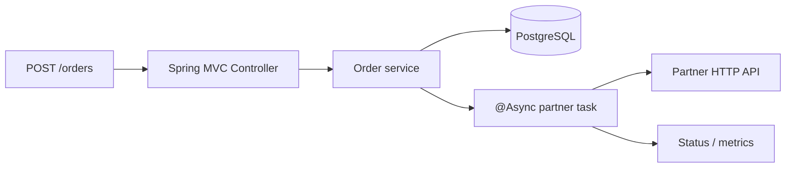
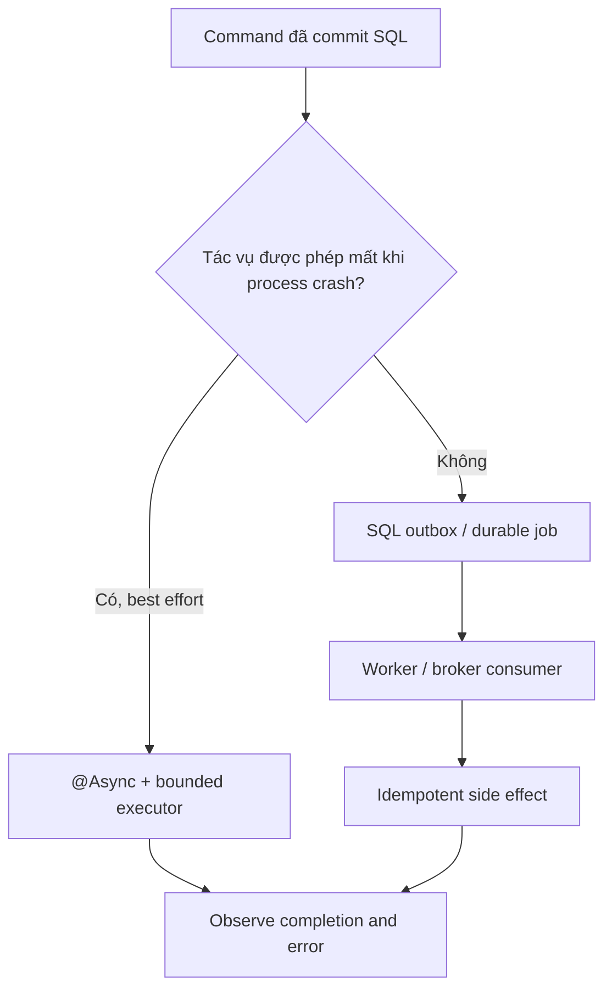
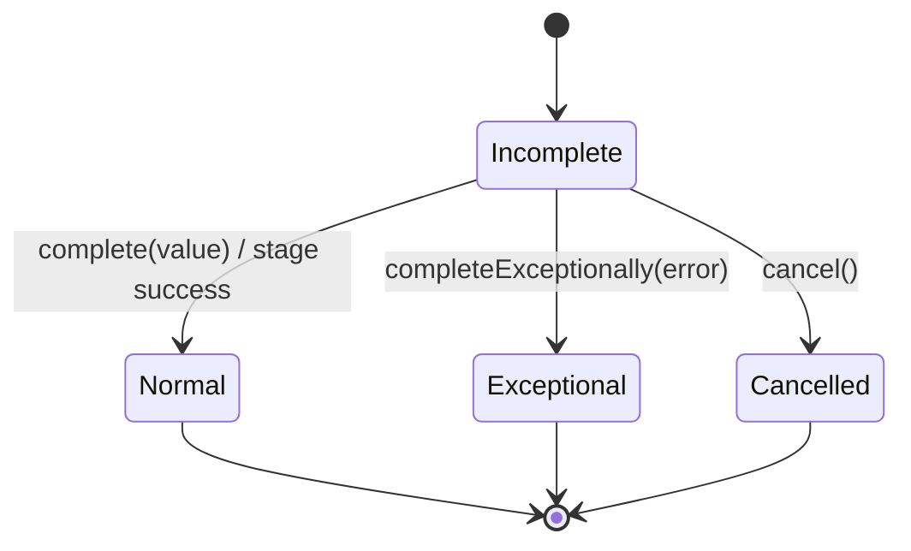
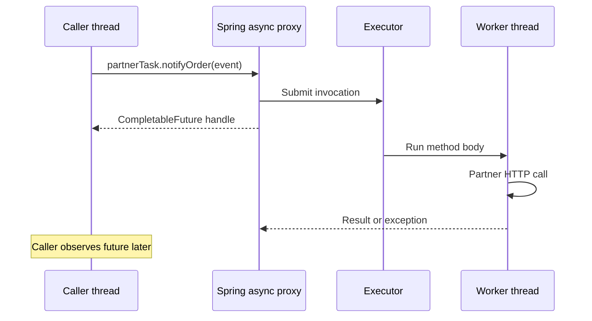
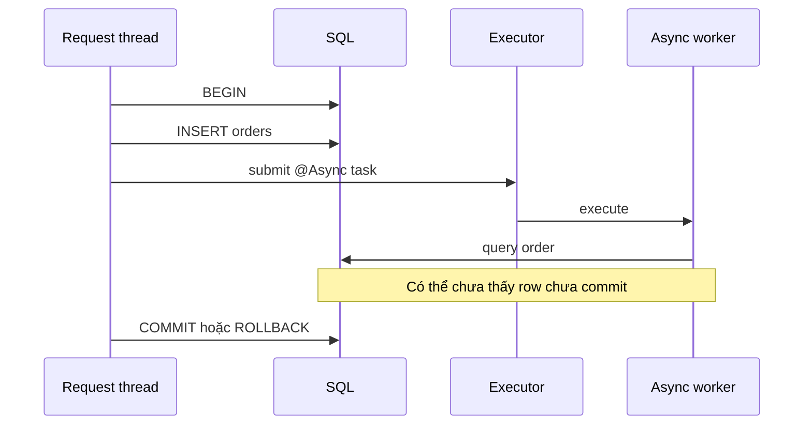

# CompletableFuture, ngoại lệ và AsyncUncaughtExceptionHandler

Trong một ứng dụng Spring Boot tích hợp nhiều hệ thống, HTTP request có thể kích hoạt một công việc mất vài giây: gọi dịch vụ tồn kho, ghi kết quả vào SQL, cập nhật cache hoặc gửi sự kiện tới message broker. Để không giữ thread xử lý request cho tới khi tác vụ kết thúc, nhóm phát triển thường thêm `@Async` và đổi kiểu trả về thành `CompletableFuture<T>`.

Thay đổi tưởng như đơn giản ấy làm nảy sinh ba câu hỏi quan trọng:

1. **Ai thực sự thực thi tác vụ?** Thread pool của Spring, `ForkJoinPool.commonPool()` hay thread gọi?
2. **Exception xuất hiện ở đâu?** Ngay lúc submit task, trong `CompletableFuture`, ở callback hay trong `AsyncUncaughtExceptionHandler`?
3. **Điều gì được bảo đảm sau khi HTTP request trả về?** Một `CompletableFuture` có thể hoàn tất trong bộ nhớ, nhưng không phải durable job queue; khi JVM chết, công việc chưa lưu bền vững có thể biến mất.

Bài này thuộc chương **Tác vụ bất đồng bộ** của module **SPRING_BOOT_INTEGRATION**. Module tổ chức tích hợp Spring Boot qua HTTP client, cơ sở dữ liệu, cache, broker thông điệp và các adapter Spring Integration, với trọng tâm về **cấu hình, hợp đồng dữ liệu, giao dịch, lỗi, xử lý trùng lặp, kiểm thử và quan sát**. Vì vậy, chúng ta sẽ phân tích `CompletableFuture` như một công cụ điều phối trong tiến trình, đồng thời xác định ranh giới của nó so với transaction SQL, outbox, message acknowledgment và idempotency.

> **Phạm vi:** Ví dụ chính dùng Java 17+, Spring Framework 6.x và Spring Boot 3.x, với `@EnableAsync`, `ThreadPoolTaskExecutor` và `CompletableFuture`. Các chi tiết Boot task executor, virtual threads Java 21+ và cơ chế tự cấu hình có thể khác giữa Boot 3.2, 3.5 và 4.x. Những lựa chọn thread pool, timeout và retry trong bài là số liệu minh họa, không phải cấu hình production dùng chung.

## 1. Mục tiêu học tập

Sau bài này, bạn có thể:

1. Phân biệt **tác vụ bất đồng bộ**, **non-blocking I/O**, **concurrency** và **durable background processing**.
2. Giải thích `CompletableFuture` hoàn tất bình thường, hoàn tất lỗi hoặc bị hủy như thế nào.
3. Dùng `@Async` đúng cách với `void`, `Future<T>` và `CompletableFuture<T>`.
4. Hiểu vì sao `AsyncUncaughtExceptionHandler` xử lý lỗi của **`@Async void`**, nhưng không phải nơi tập trung mọi lỗi của `CompletableFuture`.
5. Sử dụng `thenApply`, `thenCompose`, `thenCombine`, `allOf`, `handle`, `exceptionally` và `whenComplete` có chủ đích.
6. Phân biệt `CompletionException`, `ExecutionException`, `CancellationException`, `TimeoutException` và lỗi submit `TaskRejectedException`.
7. Cấu hình executor có giới hạn queue, concurrency, rejection policy và graceful shutdown.
8. Xác định ranh giới Spring proxy, thread-local context và `@Transactional` khi chuyển thread.
9. Thiết kế timeout, retry, circuit breaker, idempotency và error reporting khi gọi HTTP/SQL/broker.
10. Kiểm thử success/error/timeout/rejection mà không dựa chủ yếu vào `Thread.sleep`.

## 2. Tình huống: nhận đơn hàng và gọi đối tác

Một đơn hàng được tạo qua HTTP; sau khi ghi SQL, ứng dụng muốn gửi yêu cầu đồng bộ trạng thái tới một đối tác:



Giả sử client HTTP có thể chậm hoặc trả 429/503. Nếu mỗi request đợi đồng bộ 15 giây, số request đang xử lý tăng lên và dễ cạn thread/connection pool.

Một cách tiếp cận:

```java
CompletableFuture<PartnerReceipt> future =
        partnerTask.notifyOrder(orderEvent);
```

Câu lệnh này trả về một **handle tới kết quả tương lai**, không nhất thiết trả về `PartnerReceipt` ngay. Nhưng nếu ứng dụng chỉ bỏ qua `future` và trả `201 Created`, có thể không ai biết việc đồng bộ đã thất bại.

### 2.1. Phân biệt ba hợp đồng

| Điều đã xảy ra | Có thể khẳng định gì? | Không được suy luận |
| --- | --- | --- |
| HTTP command được nhận | Server đã parse/validate request tới mức hiện tại | Database đã commit |
| SQL transaction commit | Business state đã được lưu bền vững | Async HTTP task chắc chắn sẽ chạy |
| `CompletableFuture` hoàn tất thành công | Đoạn code tương ứng trả kết quả thành công | Đối tác đã commit side effect bền vững nếu API không bảo đảm |
| `CompletableFuture` hoàn tất lỗi | Tác vụ/callback báo lỗi | External side effect chắc chắn chưa xảy ra |
| Client nhận HTTP `202 Accepted` | Operation được nhận theo contract API | Tự có durable queue nếu chỉ dùng `@Async` |

Một hệ thống quan trọng cần ghi **operation ID + trạng thái bền vững** hoặc dùng outbox/broker để công việc còn có thể phục hồi sau restart.

## 3. Asynchronous không tự đồng nghĩa non-blocking

### 3.1. Blocking work trong worker thread

Ví dụ:

```java
@Async("integrationExecutor")
public CompletableFuture<String> fetchPartner() {
    String response = blockingRestClientCall(); // Worker thread chờ I/O.
    return CompletableFuture.completedFuture(response);
}
```

Đối với caller, method trả về không chờ I/O. Nhưng **worker thread vẫn bị chặn** trong lúc HTTP client blocking. Đó là **asynchronous execution bằng thread pool**, không phải non-blocking I/O end-to-end.

### 3.2. Non-blocking I/O

`WebClient` dùng một stack reactive có thể biểu diễn kết quả qua `Mono<T>`, với thread model khác:

```java
Mono<PartnerReceipt> response =
        webClient.post()
                .uri("/orders")
                .bodyValue(event)
                .retrieve()
                .bodyToMono(PartnerReceipt.class);
```

Điều này không có nghĩa mọi thao tác trước/sau đều non-blocking: gọi `block()`, JDBC truyền thống hoặc serializer blocking trong reactive chain vẫn có thể chặn thread.

### 3.3. Durable job processing

`@Async`/`CompletableFuture` thường chỉ điều phối **công việc trong JVM hiện tại**. Với tác vụ không được phép mất, hãy dùng job table/outbox, broker hoặc workflow engine phù hợp.



## 4. CompletableFuture là gì?

`CompletableFuture<T>` thực thi cả hai vai trò:

- `Future<T>`: biểu diễn một kết quả chưa sẵn sàng, có thể chờ bằng `get()`.
- `CompletionStage<T>`: gắn các bước biến đổi, kết hợp hoặc xử lý lỗi khi kết quả sẵn sàng.

Một `CompletableFuture` thường ở một trong các trạng thái logic:



`Cancelled` về mặt API là một kiểu **exceptional completion** với `CancellationException`. Một future đã hoàn tất không thể đổi kết quả bằng `complete` lần nữa theo cách thông thường.

### 4.1. Tạo các future đơn giản

```java
CompletableFuture<String> success =
        CompletableFuture.completedFuture("ACCEPTED");

CompletableFuture<String> failure =
        CompletableFuture.failedFuture(
                new IllegalStateException("Partner không sẵn sàng"));

CompletableFuture<String> pending =
        new CompletableFuture<>();

pending.complete("READY");
```

`completedFuture` và `failedFuture` tạo kết quả **đã hoàn tất**, không tự chạy một tác vụ ở thread khác.

### 4.2. Chạy supplier trên executor

```java
CompletableFuture<PartnerReceipt> future =
        CompletableFuture.supplyAsync(
                () -> gateway.send(orderEvent),
                integrationExecutor);
```

Lúc này supplier được submit tới `integrationExecutor`, và exception ném ra trong supplier sẽ khiến future hoàn tất lỗi. Caller cần **quan sát future** để biết kết quả.

### 4.3. Nếu không truyền executor

```java
CompletableFuture<PartnerReceipt> future =
        CompletableFuture.supplyAsync(
                () -> gateway.send(orderEvent));
```

Thông thường, các async methods không truyền executor dùng `ForkJoinPool.commonPool()` hoặc cơ chế mặc định được JDK mô tả. **Nó không mặc nhiên dùng Spring Boot `applicationTaskExecutor` hay executor dành riêng cho integration.**

Rủi ro:

- Không có concurrency budget riêng cho đối tác.
- Khó phân biệt pool nào đang gây nghẽn.
- Thread naming/tracing/MDC có thể khác với Spring-managed executor.
- Một đoạn code vô tình chạy blocking JDBC/HTTP trên common pool, ảnh hưởng tác vụ khác.

Trong luồng tích hợp có giới hạn downstream rõ ràng, nên truyền **executor do ứng dụng quản lý**.

## 5. @Async của Spring thực sự làm gì?

`@Async` là interception/AOP do Spring quản lý. Khi một bean method được gọi **qua Spring proxy**, interceptor submit phần thực thi method xuống executor đã chọn, rồi trả về theo kiểu đã khai báo.



Điều kiện:

1. Có `@EnableAsync` hoặc cơ chế kích hoạt asynchronous method execution phù hợp.
2. Method nằm trên **Spring-managed bean**.
3. Lời gọi đi qua **proxy**, không phải `this.method()` trong cùng bean.
4. Method return type được hỗ trợ.
5. Executor được chọn hoặc default executor có sẵn.
6. Không bị giới hạn proxy như private/final method.

### 5.1. Bật @EnableAsync

```java
package com.example.integration.async;

import org.springframework.context.annotation.Configuration;
import org.springframework.scheduling.annotation.EnableAsync;

@Configuration
@EnableAsync
public class AsyncEnablement {
}
```

Bật `@EnableAsync` không tự biến mọi method thành async. Chỉ method được annotate phù hợp và được gọi đúng đường proxy mới được intercept.

### 5.2. Self-invocation không đi qua proxy

Sai:

```java
@Service
public class OrderService {

    public void createOrder(OrderEvent event) {
        persist(event);
        notifyPartnerAsync(event); // Gọi qua this, không qua proxy.
    }

    @Async("integrationExecutor")
    public void notifyPartnerAsync(OrderEvent event) {
        callPartner(event);
    }
}
```

Lời gọi `notifyPartnerAsync` từ cùng class thông thường chạy như method Java trực tiếp; annotation không phát huy theo **proxy mode**.

Đúng hơn:

```java
@Service
public class OrderService {

    private final PartnerAsyncTask partnerAsyncTask;

    public OrderService(PartnerAsyncTask partnerAsyncTask) {
        this.partnerAsyncTask = partnerAsyncTask;
    }

    public void submit(OrderEvent event) {
        partnerAsyncTask.notifyOrder(event); // Gọi qua Spring bean.
    }
}
```

Với thiết kế này, `PartnerAsyncTask` là một bean riêng có `@Async` ở method public phù hợp. Việc **không giữ returned future** vẫn là vấn đề riêng phải xử lý.

### 5.3. Private, final và tạo object bằng new

Không mong `@Async` hoạt động khi:

- Dùng `private` method không thể được proxy override/intercept theo mô hình thông thường.
- Dùng `final` method hoặc final class với cơ chế proxy không hỗ trợ intercept nó.
- Tạo object bằng `new PartnerAsyncTask()`, nằm ngoài Spring container.
- Gọi method annotated từ `@PostConstruct` một cách trông chờ interception trước khi proxy/lifecycle sẵn sàng.
- Gọi từ chính object bằng `this`.

Nếu muốn thay đổi cơ chế intercept, Spring có một số lựa chọn AOP/AspectJ, nhưng đừng dùng chúng chỉ để chữa thiết kế tự gọi method khi có thể tách bean rõ ràng.

## 6. Chọn Executor: cấu hình bounded ThreadPoolTaskExecutor

### 6.1. Một executor riêng cho HTTP integration

```java
package com.example.integration.async;

import java.util.concurrent.ThreadPoolExecutor;

import org.springframework.context.annotation.Bean;
import org.springframework.context.annotation.Configuration;
import org.springframework.scheduling.concurrent.ThreadPoolTaskExecutor;

@Configuration(proxyBeanMethods = false)
public class IntegrationExecutorConfiguration {

    @Bean("integrationExecutor")
    ThreadPoolTaskExecutor integrationExecutor() {
        ThreadPoolTaskExecutor executor = new ThreadPoolTaskExecutor();

        executor.setThreadNamePrefix("partner-async-");
        executor.setCorePoolSize(4);
        executor.setMaxPoolSize(12);
        executor.setQueueCapacity(100);
        executor.setKeepAliveSeconds(60);

        executor.setRejectedExecutionHandler(
                new ThreadPoolExecutor.AbortPolicy());

        executor.setWaitForTasksToCompleteOnShutdown(true);
        executor.setAwaitTerminationSeconds(30);

        return executor;
    }
}
```

Đây là cấu hình **minh họa**. Giá trị 4/12/100/30 phải được thiết kế theo throughput, thời gian xử lý, số connection HTTP/SQL và quota của đối tác.

### 6.2. Core/max/queue phối hợp ra sao?

Với `ThreadPoolTaskExecutor` dựa trên `ThreadPoolExecutor`, một mô hình phổ biến:

1. Khi số worker nhỏ hơn `corePoolSize`, tạo core worker.
2. Khi core workers đã bận, task có thể vào queue.
3. Khi queue đầy, pool có thể tăng worker tới `maxPoolSize`.
4. Khi đạt max và queue đầy, task bị **rejected** theo policy.

```text
corePoolSize = 4
maxPoolSize  = 12
queueCapacity = 100

Task mới
  -> có core slot? chạy
  -> còn queue? xếp hàng
  -> queue đầy & còn worker slots? tăng thread
  -> queue đầy & đã tới max? reject
```

**Bẫy:** Nếu queue gần như vô hạn, maxPoolSize có thể hiếm khi được sử dụng; đổi maxPoolSize không nhất thiết tăng throughput. Nhưng tăng pool không phải luôn tốt: 100 thread blocking HTTP có thể khiến đối tác 429, database pool cạn và latency tăng.

### 6.3. Không lặng lẽ bỏ task khi queue đầy

`AbortPolicy` giúp làm lỗi submit hiển thị thay vì âm thầm mất công việc. Trong Spring, rejection có thể được chuyển thành `TaskRejectedException` hoặc exception liên quan do adapter/executor sử dụng.

**Quan trọng:** Lỗi submit xảy ra **trước khi async method body thực thi**, nên không mặc định đi vào `AsyncUncaughtExceptionHandler`.

Nếu cần nhận mọi yêu cầu nhưng pool đã đầy, nên có **durable queue/job table** hoặc cơ chế HTTP backpressure; không dùng queue JVM vô hạn.

### 6.4. Cẩn trọng với CallerRunsPolicy

`CallerRunsPolicy` có thể chạy task trên **thread gọi** nếu pool bão hòa. Điều đó thay đổi:

- Latency HTTP request.
- Thread-local context.
- Transaction boundary.
- Message acknowledgment timing trong Kafka/JMS/Rabbit/Pulsar listener.
- Khả năng deadlock/reentrancy của code.

Không dùng policy này chỉ để “không mất task” nếu chưa phân tích tác động; nó **không tạo durability**.

## 7. Executor mặc định của Spring Boot và điểm dễ bất ngờ

Khi có các điều kiện phù hợp, Spring Boot có thể tự tạo `AsyncTaskExecutor` cho task execution, thường với bean `applicationTaskExecutor` và `ThreadPoolTaskExecutor` trong mô hình platform threads. Tuy nhiên, việc thêm một bean `Executor` khác có thể làm auto-configuration **back off** hoặc làm thay đổi cơ chế chọn executor.

Trong Spring Boot 3.5 và các bản mới, tài liệu còn mô tả các cách ưu tiên/force task execution theo properties; **không suy luận mọi Boot 3.x có cùng property**. Với Java 21+ và virtual threads được bật theo đúng Boot version, loại executor mặc định cũng có thể thay đổi.

### 7.1. Chọn executor bằng @Async qualifier

```java
@Async("integrationExecutor")
public CompletableFuture<PartnerReceipt> notifyOrder(OrderEvent event) {
    PartnerReceipt receipt = gateway.send(event);
    return CompletableFuture.completedFuture(receipt);
}
```

Cách này rõ ràng hơn việc trông chờ một `Executor` tình cờ được chọn khi ứng dụng có nhiều executor dành cho HTTP, batch và messaging.

### 7.2. spring.task.execution.* có tác dụng khi nào?

Ví dụ với **Boot-managed executor** ở nhánh hỗ trợ:

```yaml
spring:
  task:
    execution:
      thread-name-prefix: "app-async-"
      pool:
        core-size: 4
        max-size: 12
        queue-capacity: 100
        keep-alive: 60s
```

Các property này điều khiển **executor mà Boot tự cấu hình**, không mặc định bind vào `@Bean("integrationExecutor") new ThreadPoolTaskExecutor()` tự tạo ở phần 6.

Không cộng cơ học cả cấu hình YAML và bean Java rồi kỳ vọng Spring áp cả hai. Nếu tự tạo bean và muốn bind property, dùng builder hoặc `@ConfigurationProperties` phù hợp với phiên bản đang chạy, có test effective config.

### 7.3. Virtual threads không thay concurrency limits

Java 21+ virtual threads giúp giảm chi phí giữ thread khi thực hiện nhiều tác vụ blocking I/O phù hợp, nhưng **không làm đối tác HTTP, Redis, PostgreSQL hay Kafka broker có năng lực vô hạn**. Vẫn cần semaphore/rate limiter, HTTP connection pool limits, backpressure và retry budget.

Đặc biệt, không sao chép các thông số core/max/queue của platform thread pool và mặc định cho rằng chúng áp dụng y hệt lên `SimpleAsyncTaskExecutor`/virtual-thread strategy.

## 8. Ba kiểu trả về quan trọng của @Async

| Kiểu return | Caller nhận gì? | Lỗi trong method đi đâu? |
| --- | --- | --- |
| `void` | Không có handle kết quả | `AsyncUncaughtExceptionHandler` khi lỗi không được catch |
| `Future<T>` | Future để gọi `get` hoặc kiểm tra trạng thái | Future giữ exception; `get` thường ném `ExecutionException` |
| `CompletableFuture<T>` | Future và chain `CompletionStage` | Exceptional completion, xử lý qua `handle`/`exceptionally`/`whenComplete` |
| `CompletionStage<T>` thuần | Không phải signature `@Async` được hỗ trợ đồng nhất ở mọi Spring version | Nên dùng `CompletableFuture<T>` tường minh nếu sử dụng Spring `@Async` |

### 8.1. @Async void

```java
@Async("integrationExecutor")
public void refreshBestEffortCache(String key) {
    cacheRefresher.refresh(key); // Có thể ném RuntimeException.
}
```

Nếu `refresh` ném exception không được catch, Spring sẽ đưa exception tới `AsyncUncaughtExceptionHandler` phù hợp. Caller không có future để chờ hay quyết định success/failure.

**Chỉ dùng mẫu này cho công việc thực sự best effort**, chẳng hạn refresh cache có TTL/rebuild path. Không dùng cho cập nhật trạng thái thanh toán, gửi sự kiện bắt buộc hoặc audit không được mất.

### 8.2. @Async Future<T>

```java
@Async("integrationExecutor")
public Future<PartnerReceipt> sendLegacy(OrderEvent event) {
    PartnerReceipt receipt = gateway.send(event);
    return CompletableFuture.completedFuture(receipt);
}
```

Trong mô hình Spring `@Async`, method implementation tạo một `Future` đại diện kết quả thực thi, còn proxy cung cấp handle cho caller. Với `Future` thuần, caller cần `get` hoặc cơ chế khác để quan sát; nó ít linh hoạt hơn `CompletableFuture`.

### 8.3. @Async CompletableFuture<T>

```java
@Async("integrationExecutor")
public CompletableFuture<PartnerReceipt> send(OrderEvent event) {
    PartnerReceipt receipt = gateway.send(event);
    return CompletableFuture.completedFuture(receipt);
}
```

**Tại sao bên trong trả completedFuture dù đang chạy async?** Spring proxy đã submit lời gọi method sang executor. Method body chạy trong worker; sau khi business code kết thúc, nó trả một future đã hoàn tất để interceptor truyền kết quả đến future mà caller nhận.

Không cần bọc thêm:

```java
@Async("integrationExecutor")
public CompletableFuture<PartnerReceipt> sendBadly(OrderEvent event) {
    return CompletableFuture.supplyAsync(
            () -> gateway.send(event)); // Lại đưa sang commonPool.
}
```

Đây là **double scheduling** không cần thiết: task ban đầu đã qua Spring executor, phần business lại bị chuyển sang pool khác mà không kiểm soát. Có trường hợp cần compose các tác vụ async độc lập, nhưng phải chọn executor và boundary có chủ đích.

## 9. Ví dụ Spring Boot: service trả CompletableFuture

### 9.1. Hợp đồng và gateway

Giả sử định nghĩa event và kết quả:

```java
package com.example.integration.partner;

public record OrderEvent(
        String eventId,
        String orderId,
        long amountMinor,
        String currency
) {}

public record PartnerReceipt(
        String operationId,
        String status
) {}
```

Gateway cho HTTP blocking:

```java
package com.example.integration.partner;

import org.springframework.beans.factory.annotation.Value;
import org.springframework.stereotype.Component;
import org.springframework.web.client.RestClient;

@Component
public class PartnerGateway {

    private final RestClient restClient;

    public PartnerGateway(
            RestClient.Builder builder,
            @Value("${integration.partner.base-url}") String baseUrl) {
        this.restClient = builder.baseUrl(baseUrl).build();
    }

    public PartnerReceipt send(OrderEvent event) {
        return restClient.post()
                .uri("/orders")
                .header("Idempotency-Key", event.eventId())
                .body(event)
                .retrieve()
                .body(PartnerReceipt.class);
    }
}
```

Đoạn này dùng `RestClient` (Spring Framework 6.1+/Boot 3.2+) cho HTTP blocking. `RestClient.Builder` được Spring Boot cung cấp nếu auto-configuration phù hợp. Production phải có timeout, TLS, auth, response validation và lựa chọn retry phù hợp từng đối tác.

### 9.2. Worker @Async

```java
package com.example.integration.partner;

import java.util.concurrent.CompletableFuture;

import org.springframework.scheduling.annotation.Async;
import org.springframework.stereotype.Service;

@Service
public class PartnerAsyncTask {

    private final PartnerGateway gateway;

    public PartnerAsyncTask(PartnerGateway gateway) {
        this.gateway = gateway;
    }

    @Async("integrationExecutor")
    public CompletableFuture<PartnerReceipt> notifyOrder(
            OrderEvent event) {

        PartnerReceipt receipt = gateway.send(event);

        if (receipt == null || receipt.operationId() == null) {
            throw new IllegalStateException(
                    "Partner response thiếu operationId");
        }

        return CompletableFuture.completedFuture(receipt);
    }
}
```

Nếu `gateway.send` hoặc validation ném exception, caller sẽ nhận **exceptional CompletableFuture** qua Spring interceptor, không phải `AsyncUncaughtExceptionHandler` dành cho `void`.

### 9.3. Caller phải quyết định cách quan sát

```java
CompletableFuture<PartnerReceipt> future =
        partnerAsyncTask.notifyOrder(event);

future.whenComplete((receipt, error) -> {
    if (error != null) {
        logger.error("Partner operation failed, eventId={}",
                event.eventId(), error);
    } else {
        logger.info("Partner accepted, operationId={}",
                receipt.operationId());
    }
});
```

`logger` là một SLF4J logger của component gọi; snippet được đặt trong method có `event` và `partnerAsyncTask`. **Logging không biến tác vụ thành bền vững**: nếu kết quả cần để đối soát, phải ghi operation state vào SQL hoặc một durable workflow, với exception handling và transaction riêng.

## 10. Hành vi của thenApply, thenCompose và thenCombine

### 10.1. thenApply: biến đổi một kết quả

```java
CompletableFuture<String> status =
        partnerAsyncTask.notifyOrder(event)
                .thenApply(PartnerReceipt::status);
```

`thenApply` chạy khi upstream success; callback có thể chạy trong thread hoàn tất upstream hoặc thread gọi nếu upstream đã hoàn thành. **Không cam kết một thread cố định** nếu không dùng biến thể Async với executor.

### 10.2. thenCompose: nối thêm một công việc async

Giả sử `auditTask.recordAsync(...)` trả `CompletableFuture<AuditResult>`:

```java
CompletableFuture<AuditResult> workflow =
        partnerAsyncTask.notifyOrder(event)
                .thenCompose(receipt ->
                        auditTask.recordAsync(
                                event.eventId(), receipt.operationId()));
```

`thenCompose` flatten:

```text
CompletableFuture<CompletableFuture<AuditResult>>
              ↓ thenCompose
CompletableFuture<AuditResult>
```

Nếu callback trả một future lỗi, toàn chain lỗi. **Không đồng nghĩa hai tác vụ cùng một transaction**: mỗi task có thể chạy trên thread, datasource hoặc hệ thống độc lập.

### 10.3. thenCombine: ghép hai kết quả độc lập

```java
CompletableFuture<PartnerReceipt> partner =
        partnerAsyncTask.notifyOrder(event);

CompletableFuture<InventoryStatus> inventory =
        inventoryTask.checkAsync(event.orderId());

CompletableFuture<OrderCheck> combined =
        partner.thenCombine(inventory,
                (receipt, stock) -> new OrderCheck(
                        receipt.status(), stock.available()));
```

Với dữ liệu business như trên, `InventoryStatus` và `OrderCheck` là DTO do ứng dụng định nghĩa. Chỉ dùng `thenCombine` nếu hai tác vụ thực sự có thể chạy độc lập và kết quả cần cả hai.

Nếu một branch thất bại, combined future hoàn tất lỗi theo semantics của `CompletableFuture`; branch khác **không tự động bị cancel** hoặc rollback.

## 11. allOf, anyOf và những hiểu lầm thường gặp

### 11.1. allOf không tự trả danh sách kết quả

```java
List<CompletableFuture<PartnerReceipt>> futures =
        events.stream()
                .map(partnerAsyncTask::notifyOrder)
                .toList();

CompletableFuture<Void> all =
        CompletableFuture.allOf(
                futures.toArray(CompletableFuture[]::new));

CompletableFuture<List<PartnerReceipt>> results =
        all.thenApply(ignored ->
                futures.stream()
                        .map(CompletableFuture::join)
                        .toList());
```

`allOf` hoàn tất khi các futures thành phần hoàn tất; nếu một hoặc nhiều futures lỗi, kết quả kết hợp cũng có thể lỗi. Nó không cung cấp danh sách thành công/thất bại từng phần: muốn tổng hợp **per-item outcome**, mỗi future cần được chuyển về một kiểu kết quả có trạng thái rõ trước khi `allOf`.

**Rủi ro của code ví dụ:** Tạo một future cho mọi event trong một collection cực lớn có thể làm queue/task count bùng nổ. Dùng batch, semaphore hoặc durable worker queue có backpressure.

### 11.2. anyOf không hủy các nhánh còn lại

```java
CompletableFuture<Object> firstCompleted =
        CompletableFuture.anyOf(futureA, futureB);
```

`anyOf` hoàn tất theo **một future kết thúc đầu tiên**, có thể là thành công **hoặc lỗi**. Nó không có nghĩa “lấy thành công đầu tiên”, cũng không tự hủy công việc còn lại.

Nếu cả hai đều gọi external APIs có side effect, `anyOf` có thể làm **cả hai tác dụng phụ xảy ra**, dù caller chỉ quan sát một kết quả.

### 11.3. allOf không phải distributed transaction

`allOf` chỉ hợp kết quả trong JVM. Nó không commit/rollback SQL, JMS, Kafka, RabbitMQ hay HTTP transactions cùng nhau. Nếu cần consistency xuyên resource, dùng outbox, idempotency, saga hoặc transaction coordinator phù hợp.

## 12. Hoàn tất bình thường, lỗi và bị hủy

### 12.1. Normal completion

```java
CompletableFuture<String> future =
        CompletableFuture.completedFuture("OK");

String value = future.join(); // "OK"
```

### 12.2. Exceptional completion

```java
CompletableFuture<String> future =
        CompletableFuture.failedFuture(
                new IllegalArgumentException("Invalid event"));

boolean failed = future.isCompletedExceptionally(); // true
```

`isCompletedExceptionally()` chỉ cho biết future đã lỗi/hủy theo contract, **không nói nguyên nhân**, không quyết định lỗi có retry được và không tự ghi log.

### 12.3. Hủy future

```java
CompletableFuture<String> future = new CompletableFuture<>();
future.cancel(true);
```

Với `CompletableFuture` chuẩn, tham số `mayInterruptIfRunning` không đảm bảo interrupt tác vụ đang thực thi; theo Java API, cancellation hoàn tất future lỗi với `CancellationException` và **không dùng interrupt để kiểm soát công việc** theo cách nhiều người kỳ vọng từ `FutureTask`.

**Hệ quả:** Với HTTP POST đã gửi, việc gọi `cancel(true)` không chứng minh đối tác chưa nhận yêu cầu. Retry chỉ an toàn khi có business operation ID/idempotency hoặc reconciliation.

## 13. get() và join(): exception bị bọc ra sao?

### 13.1. get() là API Future

```java
try {
    PartnerReceipt receipt =
            future.get(3, TimeUnit.SECONDS);
} catch (TimeoutException ex) {
    // Caller không đợi thêm: tác vụ gốc có thể vẫn chạy.
} catch (ExecutionException ex) {
    Throwable root = ex.getCause();
    // Lỗi từ tác vụ/callback.
} catch (InterruptedException ex) {
    Thread.currentThread().interrupt();
    // Hủy chờ theo policy; không mặc định hủy external side effect.
}
```

`get` có checked exceptions, còn `get(timeout, unit)` thêm `TimeoutException`. Timeout của **lệnh chờ** không đồng nghĩa cancel underlying future.

### 13.2. join() là API tiện dụng

```java
try {
    PartnerReceipt receipt = future.join();
} catch (CompletionException ex) {
    Throwable root = ex.getCause();
    // Phân loại lỗi.
} catch (CancellationException ex) {
    // Future bị cancel.
}
```

`join` không yêu cầu khai báo `ExecutionException` checked; nó thường bọc lỗi trong `CompletionException`. Đừng dùng `join()` không timeout ở HTTP request thread hoặc event-loop thread khi chưa xác định deadline và capacity.

### 13.3. Bảng ngoại lệ

| Exception | Thường phát sinh ở đâu? | Ý nghĩa |
| --- | --- | --- |
| `CompletionException` | `join()` hoặc chain stage | Wrapper cho lỗi của completion stage |
| `ExecutionException` | `Future.get()` | Checked wrapper cho tác vụ lỗi |
| `CancellationException` | Future bị cancel; join/get hoặc callback | Future không còn kết quả thành công |
| `TimeoutException` | `get(timeout)` hoặc `orTimeout`-driven completion | Deadline/chờ quá hạn theo API tương ứng |
| `InterruptedException` | Thread đang `get`/`sleep`/blocking wait bị interrupt | Cần khôi phục interrupt flag khi phù hợp |
| `TaskRejectedException` | Spring executor từ chối submit | Task có thể chưa vào executor, lỗi có thể xuất hiện ngay ở caller |
| `RestClientResponseException` | HTTP client nhận 4xx/5xx | Cần phân loại theo status và operation |
| `DataAccessException` | Spring JDBC/SQL | Không đồng nghĩa broker/HTTP cũng rollback |

## 14. Phân biệt exception gốc và wrapper

Khi quyết định retry, không nên kiểm tra bằng:

```java
if (error instanceof CompletionException) {
    // retry tất cả?
}
```

`CompletionException` chỉ là wrapper. Một helper thông thường:

```java
static Throwable unwrapCompletion(Throwable error) {
    Throwable current = error;

    while ((current instanceof CompletionException
            || current instanceof ExecutionException)
            && current.getCause() != null) {
        current = current.getCause();
    }

    return current;
}
```

Các import:

```java
import java.util.concurrent.CompletionException;
import java.util.concurrent.ExecutionException;
```

**Chú ý:** Không unwrap vô hạn mọi `getCause()`; có những exception wrappers mang semantic riêng. Trong logging, giữ cả stacktrace của wrapper nếu cần debug chain, nhưng phân loại dựa trên root cause đã được hiểu đúng. Với `CancellationException`, `TimeoutException` hoặc `TaskRejectedException`, policies có thể khác nhau đáng kể.

## 15. exceptionally: phục hồi một lỗi thành giá trị

`exceptionally` nhận exception và trả một **giá trị thay thế** nếu upstream lỗi:

```java
CompletableFuture<PartnerReceipt> recovered =
        partnerAsyncTask.notifyOrder(event)
                .exceptionally(error -> {
                    Throwable cause = unwrapCompletion(error);
                    logger.warn("Partner failed, eventId={}, type={}",
                            event.eventId(),
                            cause.getClass().getSimpleName());

                    return new PartnerReceipt(
                            event.eventId(), "UNKNOWN");
                });
```

Đoạn này dùng các biến/logger từ caller. `recovered` có thể **hoàn tất thành công** với `UNKNOWN` dù partner thực sự không sẵn sàng.

### 15.1. Bẫy: “nuốt” lỗi bằng giá trị giả

Nếu `UNKNOWN` được interpret như `ACCEPTED`, hệ thống có thể làm sai nghiệp vụ. Nên thiết kế type riêng:

```java
sealed interface PartnerOutcome
        permits PartnerSucceeded, PartnerFailed {}

record PartnerSucceeded(PartnerReceipt receipt)
        implements PartnerOutcome {}

record PartnerFailed(String category, boolean retryable)
        implements PartnerOutcome {}
```

Khi đó caller phải xử lý hai trạng thái tường minh, không đánh đồng fallback với thành công.

### 15.2. exceptionally không phải retry

`exceptionally` thường **chuyển lỗi thành một giá trị**, chứ không tự chạy lại upstream. Nếu callback gọi lại external service, đó là một retry do bạn lập trình và phải có backoff, deadline, idempotency và giới hạn attempts.

## 16. handle: cả thành công lẫn thất bại đều được ánh xạ

`handle` nhận cả result và error; một trong hai thường có giá trị tùy completion:

```java
CompletableFuture<PartnerOutcome> outcome =
        partnerAsyncTask.notifyOrder(event)
                .handle((receipt, error) -> {
                    if (error == null) {
                        return new PartnerSucceeded(receipt);
                    }

                    Throwable cause = unwrapCompletion(error);
                    return new PartnerFailed(
                            classify(cause),
                            isRetryable(cause));
                });
```

`classify(...)` và `isRetryable(...)` là hai hàm **chính sách do ứng dụng triển khai**; không có API mặc định áp dụng chính xác cho mọi partner.

**Điểm quan trọng:** Future sau `handle` được coi là successful nếu callback trả bình thường, kể cả khi nó trả một `PartnerFailed`. Điều này có thể đúng nếu downstream chấp nhận outcome type, nhưng sai nếu downstream chỉ kiểm `future.isCompletedExceptionally()`.

### 16.1. Thực hiện validation trên kết quả success

```java
CompletableFuture<PartnerOutcome> outcome =
        partnerAsyncTask.notifyOrder(event)
                .handle((receipt, error) -> {
                    if (error != null) {
                        return new PartnerFailed("REMOTE_FAILURE", true);
                    }
                    if (receipt == null || receipt.status() == null) {
                        return new PartnerFailed(
                                "INVALID_RESPONSE", false);
                    }
                    return new PartnerSucceeded(receipt);
                });
```

Một HTTP 200 kèm response contract sai cũng là **integration failure**, dù CompletableFuture upstream hoàn tất bình thường.

## 17. whenComplete: quan sát mà không cố ý đổi kết quả

`whenComplete` phù hợp để ghi log/metrics/trace khi một stage kết thúc:

```java
CompletableFuture<PartnerReceipt> observed =
        partnerAsyncTask.notifyOrder(event)
                .whenComplete((receipt, error) -> {
                    if (error != null) {
                        logger.error(
                                "Partner call failed eventId={}",
                                event.eventId(), error);
                    } else {
                        logger.info(
                                "Partner call OK eventId={}",
                                event.eventId());
                    }
                });
```

Khác `exceptionally`/`handle`, callback `whenComplete` **không trả một giá trị kết quả thay thế**; stage tiếp tục biểu diễn result hoặc error tương ứng theo semantics Java.

Tuy nhiên, nếu callback `whenComplete` **tự ném exception**, kết quả của stage phụ thuộc trạng thái upstream và quy tắc `CompletableFuture`; exception callback có thể khiến một upstream thành công trở thành stage lỗi.

### 17.1. Không dùng whenComplete như durable status update tự động

Gọi `repository.updateStatus(...)` trong `whenComplete` tạo ra một **SQL side effect mới**, có thể thất bại. Nếu không kiểm soát transaction/exception, ứng dụng có thể báo task completed nhưng không biết SQL status đã commit chưa.

Với operation quan trọng, nên có job state machine (PENDING/RUNNING/RETRY/DONE/FAILED) và transaction/lease tương ứng, không chỉ một log callback.

### 17.2. So sánh ba API

| API | Nhận success? | Nhận failure? | Có tạo kết quả mới? | Tình huống |
| --- | --- | --- | --- | --- |
| `exceptionally` | Không, với dạng thông thường | Có | Có, cùng type với upstream | Fallback hoặc map exception thành giá trị |
| `handle` | Có | Có | Có, có thể đổi type | Outcome classification |
| `whenComplete` | Có | Có | Không chủ đích thay result | Log, metrics, tracing |
| `thenApply` | Có | Không | Có | Transform thành công |
| `thenCompose` | Có | Không | Có qua future khác | Kết nối chuỗi async |
| `exceptionallyCompose` | Không theo đường success | Có | Có qua fallback future | Recovery bất đồng bộ |

## 18. exceptionallyCompose: fallback bất đồng bộ

Từ những phiên bản Java hiện đại (có trong Java 17), `exceptionallyCompose` cho phép chuyển failure sang một **future khác**, ví dụ yêu cầu trạng thái thay vì retry mù:

```java
CompletableFuture<PartnerReceipt> safe =
        partnerAsyncTask.notifyOrder(event)
                .exceptionallyCompose(error -> {
                    Throwable cause = unwrapCompletion(error);

                    if (cause instanceof PartnerTimeoutException) {
                        return partnerStatusTask
                                .lookupByOperationId(event.eventId());
                    }

                    return CompletableFuture.failedFuture(cause);
                });
```

`PartnerTimeoutException` và `partnerStatusTask.lookupByOperationId` là ví dụ do hệ thống triển khai. Tư tưởng quan trọng: khi request có side effect **timeout**, đôi khi phải **hỏi trạng thái operation ID cũ** trước khi quyết định gửi lại.

Không dùng fallback để đổi từ một partner lỗi sang partner khác nếu nghiệp vụ không cho phép duplicate side effect hoặc chưa có reconciliation policy.

## 19. Async continuation chạy ở thread nào?

### 19.1. Không có hậu tố Async

```java
future.thenApply(receipt -> enrich(receipt));
```

Callback có thể chạy trên thread **hoàn tất future**, hoặc thread đăng ký callback nếu upstream đã hoàn tất, theo implementation semantics. Không hứa đó là HTTP request thread hay integration worker thread.

### 19.2. Có hậu tố Async nhưng không chỉ định executor

```java
future.thenApplyAsync(receipt -> enrich(receipt));
```

Thông thường callback dùng default asynchronous execution facility của `CompletableFuture`, **không tự dùng Spring `@Async` executor**.

### 19.3. Có hậu tố Async với executor

```java
future.thenApplyAsync(
        receipt -> enrich(receipt),
        integrationExecutor);
```

Đây là cách chỉ định rõ nơi chạy. Cần biết:

- Callback mới có thể bị `TaskRejectedException` khi pool bão hòa.
- Callback lỗi sẽ làm dependent stage lỗi.
- Chuyển thread làm mất nhiều thread-local contexts nếu không propagation phù hợp.
- Nếu pool chỉ có một thread và một task đang `join` future chờ một task khác trên cùng pool, có thể gây **thread starvation/deadlock**.

### 19.4. Không chặn trong callback nếu không cần

Một anti-pattern:

```java
future.thenApply(receipt ->
        anotherAsyncTask.run(receipt).join());
```

Thread chạy callback sẽ đợi công việc khác; nếu cùng một bounded pool và capacity nhỏ, có thể tạo dependency cycle. Dùng `thenCompose` khi task sau đã trả `CompletableFuture`.

## 20. AsyncUncaughtExceptionHandler: đúng vai trò, đúng phạm vi

### 20.1. Handler này làm gì?

`AsyncUncaughtExceptionHandler` là một chiến lược của Spring cho exception **không được bắt** từ method thực thi qua `@Async` mà **không có Future return type**, điển hình là `void`.

Trong Spring, interface có method:

```java
void handleUncaughtException(
        Throwable ex,
        Method method,
        Object... params);
```

Handler nhận:

- `ex`: exception được ném ra.
- `method`: method bất đồng bộ gặp lỗi.
- `params`: tham số dùng khi gọi.

**Handler không biến method void thành Future**, không có kênh trả result về caller và không tự retry/rollback toàn bộ distributed workflow.

### 20.2. Cấu hình với AsyncConfigurer

```java
package com.example.integration.async;

import org.slf4j.Logger;
import org.slf4j.LoggerFactory;

import org.springframework.aop.interceptor.AsyncUncaughtExceptionHandler;
import org.springframework.context.annotation.Configuration;
import org.springframework.scheduling.annotation.AsyncConfigurer;
import org.springframework.scheduling.annotation.EnableAsync;

@Configuration
@EnableAsync
public class AsyncExceptionConfiguration implements AsyncConfigurer {

    private static final Logger log =
            LoggerFactory.getLogger(AsyncExceptionConfiguration.class);

    @Override
    public AsyncUncaughtExceptionHandler
            getAsyncUncaughtExceptionHandler() {

        return (exception, method, params) -> {
            log.error(
                    "Unhandled @Async void exception method={} type={}",
                    method.getName(),
                    exception.getClass().getSimpleName(),
                    exception);
        };
    }
}
```

Cấu hình này chỉ quy định uncaught handler. Những method `@Async("integrationExecutor")` vẫn chọn executor theo tên bean; nếu ứng dụng có method `@Async` không chỉ định executor, cần xác nhận **default executor** được chọn qua Spring Boot/`AsyncConfigurer` như mong đợi.

**Không log toàn bộ `params` tùy tiện**: có thể chứa bearer token, dữ liệu khách hàng, nội dung thanh toán hoặc payload PII.

### 20.3. Method void gây lỗi

```java
@Service
public class BestEffortCacheRefreshTask {

    private final CacheRefreshGateway gateway;

    public BestEffortCacheRefreshTask(CacheRefreshGateway gateway) {
        this.gateway = gateway;
    }

    @Async("integrationExecutor")
    public void refresh(String cacheKey) {
        gateway.refresh(cacheKey);
    }
}
```

`CacheRefreshGateway` do ứng dụng triển khai. Nếu `gateway.refresh` ném runtime exception và method không catch, handler được cấu hình có thể ghi log lỗi. Caller đã nhận `void` nên không biết công việc thất bại qua return value.

### 20.4. Không có retry tự động

Muốn retry phải thiết kế riêng, ví dụ một **durable retry job**:

```text
cache-refresh requested
    |
    v
persist task (nếu cần durability)
    |
    v
worker attempts / records failure category
    |
    +-- transient: backoff + retry
    +-- permanent: BLOCKED / alarm
```

Đừng viết `while(true)` trong `AsyncUncaughtExceptionHandler` để gửi lại mọi exception; handler thiếu contract, deadline, operation ID và quyền quyết định retry nghiệp vụ.

## 21. AsyncUncaughtExceptionHandler KHÔNG bắt những lỗi nào?

| Trường hợp | Có thuộc phạm vi handler? | Cách xử lý đúng |
| --- | --- | --- |
| `@Async void` ném exception không được catch | **Có**, khi interception phù hợp | Handler log/alert, hoặc chuyển durable failure workflow |
| `@Async CompletableFuture<T>` ném exception | **Không** | Observe exceptional future |
| `@Async Future<T>` ném exception | **Không** | `Future.get`/result monitoring |
| `CompletableFuture.supplyAsync(...)` lỗi | **Không**, không qua @Async void | Future exceptional completion |
| `thenApply/thenCompose` callback ném exception | **Không** | Observe dependent future |
| Executor reject task trước khi chạy method | **Không bảo đảm** | Catch/report `TaskRejectedException` tại submit boundary |
| Lỗi HTTP/SQL bên trong method đã được catch và nuốt | **Không** | Đừng nuốt lỗi; return outcome có trạng thái |
| Lỗi do `@Scheduled` method ném | **Không mặc định cùng handler** | Scheduler/ErrorHandler riêng |
| Lỗi trong Kafka/JMS/Pulsar listener | **Không mặc định** | Broker/container error handling và ack/DLQ |
| Lỗi từ Spring Integration `errorChannel` | **Không mặc định** | Message handling/error flow |
| Exception từ controller trước lúc gọi @Async | **Không** | MVC/global exception handling |
| JVM process bị kill trước khi task chạy | **Không** | Durable outbox/job persistence |

**Bài học quan trọng nhất:** Đừng đăng ký một `AsyncUncaughtExceptionHandler` rồi coi như đã có “global async exception handler” cho toàn bộ Spring application.

## 22. Vì sao dùng @Async void cho nghiệp vụ quan trọng là nguy hiểm?

Giả sử:

```java
@Async("integrationExecutor")
public void chargePayment(PaymentCommand command) {
    paymentClient.charge(command);
}
```

Rủi ro:

- Caller không nhận success/failure.
- Nếu submit bị reject có thể không có fallback business.
- Process chết khi task còn trong queue → chưa có durable record để replay.
- Timeout không biết external payment đã charge chưa.
- Handler chỉ ghi log, không cập nhật được reliable operation state.
- Retry vô điều kiện có thể charge hai lần.

Đối với payment, stock reservation, shipping hoặc sự kiện tích hợp bắt buộc, ưu tiên:

1. Lưu **operationId/idempotency key** ổn định.
2. Ghi business intent trong SQL cùng transaction khi cần.
3. Dùng outbox/durable queue.
4. Worker xử lý và lưu trạng thái.
5. Khi timeout, query/reconcile trạng thái external system.
6. Dùng retry có budget và manual recovery.

`CompletableFuture` vẫn hữu ích để **điều phối một attempt** của worker, nhưng không tự tạo workflow durability.

## 23. Timeout: get(timeout) khác orTimeout và HTTP client timeout

### 23.1. get(timeout) chỉ giới hạn thời gian đợi

```java
try {
    PartnerReceipt receipt =
            future.get(2, TimeUnit.SECONDS);
} catch (TimeoutException ex) {
    // Caller dừng chờ.
    // Tác vụ/call HTTP vẫn có thể đang chạy.
}
```

`future` có thể hoàn tất bình thường sau đó. Timeout này không tự hủy socket, SQL statement hay external action.

### 23.2. orTimeout làm future hoàn tất lỗi

```java
CompletableFuture<PartnerReceipt> timed =
        partnerAsyncTask.notifyOrder(event)
                .orTimeout(4, TimeUnit.SECONDS);
```

Nếu quá hạn, future có thể hoàn tất lỗi với `TimeoutException`. **`orTimeout` trả về chính CompletableFuture đang được gọi** và có thể thay đổi outcome của nó; đây không phải “một bản sao chờ riêng” độc lập.

Nó cũng không đảm bảo ngắt tác vụ blocking đang chạy trong HTTP client.

### 23.3. completeOnTimeout dùng giá trị thay thế

```java
CompletableFuture<PartnerOutcome> timed =
        longRunningOutcome
                .completeOnTimeout(
                        new PartnerFailed("TIMEOUT", true),
                        4, TimeUnit.SECONDS);
```

Tương tự, `completeOnTimeout` thay đổi future gốc để hoàn tất **thành công với fallback** khi timeout. Nếu caller chỉ kiểm `isCompletedExceptionally()`, nó có thể không biết timeout xảy ra.

### 23.4. Timeout phải được cấu hình từ ngoài vào trong

Một chiến lược có thể là:

| Lớp | Mục tiêu |
| --- | --- |
| HTTP connect timeout | Không treo vô hạn khi không kết nối được |
| HTTP response/read timeout | Giới hạn chờ partner |
| Connection-pool acquisition timeout | Không chờ socket pool mãi |
| SQL statement/transaction timeout | Giới hạn JDBC operations |
| Async stage deadline | Không chờ kết quả lâu hơn SLA caller |
| Retry budget | Tổng thời gian các attempts có giới hạn |
| HTTP request deadline | Trả response trong SLA đã công bố |
| Durable job TTL | Xác định khi operation cần manual review |

**Ví dụ:** Nếu async stage deadline 3 giây nhưng HTTP client read timeout 60 giây, future có thể báo timeout trong khi worker còn giữ connection 57 giây nữa. Cần đồng bộ các timeout và capacity.

## 24. Cancellation, interrupt và unknown outcome

Một client bấm “Cancel”, caller gọi:

```java
future.cancel(true);
```

Điều đó thường chỉ đổi trạng thái của `CompletableFuture`. Nó không chắc dừng một HTTP POST đã gửi, một SQL transaction đang chờ DB hoặc một producer gửi message trên broker.

Nếu operation có side effect, phải phân biệt:

- **Cancel yêu cầu chờ**: caller không quan tâm kết quả nữa.
- **Cancel computation**: worker thật sự dừng trước khi side effect.
- **Compensate business effect**: hệ thống thực hiện hủy/hoàn tác theo nghiệp vụ.
- **Unknown outcome**: có thể đã thực hiện, cần query/reconcile.

### 24.1. Ví dụ nguy cơ trùng

```text
T0: gửi POST /reservations với operationId=R-100
T1: future timeout ở T0+3s
T2: caller retry POST với operationId=R-101
T3: đối tác tạo cả hai reservation
```

Nếu retry cùng **R-100** và đối tác cung cấp idempotency contract đáng tin, rủi ro duplicate giảm đáng kể. Nếu đối tác không hỗ trợ, cần status lookup/dedup ledger hoặc reconciliation; `CompletableFuture` không giải quyết vấn đề này.

## 25. Retry: phân loại lỗi trước khi lặp

### 25.1. Bảng quyết định

| Lỗi | Có nên retry? | Lý do |
| --- | --- | --- |
| HTTP 503/429 | Thường có thể, nếu theo rate limit và deadline | Transient/downstream throttling |
| HTTP 400 schema invalid | Thường không | Permanent contract failure |
| HTTP 401/403 | Không retry storm | Auth/authorization cần sửa |
| Network timeout | Có thể, **nếu idempotent hoặc có reconciliation** | Outcome có thể không rõ |
| SQL deadlock/lock timeout | Có thể với transaction boundary phù hợp | Có thể cần retry whole transaction |
| Unique constraint duplicate key | Thường kiểm tra idempotency thay vì retry | Business key có thể đã xử lý |
| Executor rejected | Cần backpressure/durable retry | Pool hoặc queue bão hòa |
| Cancellation | Không coi như broker chưa nhận | Kết quả external có thể chưa rõ |
| Schema decode error | Thường không retry y nguyên | Cần quarantine/correction |

### 25.2. Không retry trong @Async method một cách vô hạn

Sai:

```java
@Async("integrationExecutor")
public CompletableFuture<String> publish() {
    while (true) {
        try {
            return CompletableFuture.completedFuture(sendEvent());
        } catch (RuntimeException ignored) {
            // Lặp vô hạn, chiếm worker thread.
        }
    }
}
```

Tác vụ này có thể giữ worker mãi, tạo retry storm và không bảo đảm idempotency.

### 25.3. Retry có giới hạn và backoff

Một giải pháp production có thể sử dụng Spring Retry/Resilience4j hoặc durable job scheduler. Chính sách tối thiểu:

- Giới hạn số attempts, elapsed time và toàn bộ deadline.
- Exponential backoff + jitter.
- Tôn trọng `Retry-After` cho 429 khi thích hợp.
- Không dùng thread `sleep` dài trên một pool nhỏ nếu có thể schedule retry riêng.
- Giữ `eventId`/`operationId` ổn định qua retries.
- Quan sát số retries, success-after-retry, permanent failures.
- Có DLQ/manual repair cho task không thể tự phục hồi.

**Không gửi message vào broker rồi retry ở mức async API mà không xét broker producer acknowledgement**: một lần gửi có thể đã được broker nhận dù caller timeout.

## 26. Transaction boundary: @Transactional không chạy xuyên thread

### 26.1. Một transaction thường gắn với thread

Spring transaction cho JDBC/JPA phổ biến dựa vào thread-bound transaction context. Nếu controller/service đang trong `@Transactional` rồi gọi `@Async`, worker thread **không tự kế thừa transaction của caller**.



Nếu worker chạy trước khi SQL commit, nó có thể không thấy order hoặc nhìn state khác theo isolation. Nếu SQL rollback nhưng worker đã gửi HTTP/broker message, sẽ có **phantom event**.

### 26.2. @Transactional trên worker tạo transaction riêng

```java
@Service
public class ProjectionWorker {

    @Async("integrationExecutor")
    @Transactional
    public CompletableFuture<Void> updateProjection(OrderEvent event) {
        jdbc.update(
                "UPDATE order_projection SET state = ? WHERE order_id = ?",
                "CREATED", event.orderId());

        return CompletableFuture.completedFuture(null);
    }
}
```

Đoạn này có thể tạo **transaction SQL mới trên worker thread** nếu cả hai interceptors áp dụng đúng, nhưng không biến transaction của caller và worker thành một transaction duy nhất. Khi nhiều annotation/proxy/advice cùng tham gia, cần integration test xác nhận transaction boundary.

### 26.3. After-commit callback có giải quyết durability?

`@TransactionalEventListener(phase = AFTER_COMMIT)` giúp tránh khởi chạy side effect trước commit khi listener được gọi đúng phase. Nhưng nếu process chết **sau SQL commit và trước khi task được submit/publish**, sự kiện trong bộ nhớ có thể mất.

Với yêu cầu **SQL commit ⇒ event cuối cùng phải được gửi**, dùng **Transactional Outbox**:

```text
@Transactional command:
  INSERT orders
  INSERT outbox(eventId, JSON, READY)
COMMIT

Reliable worker:
  read/claim outbox
  publish broker
  mark PUBLISHED after confirmation
  retry idempotently
```

Không tự dùng `@Async` như một replacement cho outbox.

## 27. SQL–HTTP–broker: lỗi bất đồng bộ cần được phân ranh giới

### 27.1. SQL đã commit, HTTP thất bại

`CompletableFuture` sẽ biểu diễn lỗi của HTTP attempt. SQL transaction **không tự rollback** chỉ vì async future exceptional sau đó. Cần lưu status `PENDING_PARTNER`/`RETRY`, operationId và đối soát.

### 27.2. Broker đã nhận, future báo timeout

Kafka/Rabbit/Pulsar/JMS producer API có semantics khác nhau. Nếu broker đã nhận event mà stage hoàn tất lỗi do timeout/network, retry có thể gửi lại cùng business event.

Dùng stable `eventId` và **consumer inbox/idempotent handler**, không dựa vào “mỗi future chỉ send một lần”.

### 27.3. Consumer ack trước khi task hoàn tất

Sai:

```java
@KafkaListener(topics = "orders")
public void onMessage(OrderEvent event) {
    partnerAsyncTask.notifyOrder(event);
    // Listener trả về ngay; container có thể ack/commit offset.
}
```

Nếu container auto-ack/commit offset sau khi listener method return, task HTTP async có thể vẫn chưa hoàn tất. Khi task fail sau đó, Kafka không tự biết để redeliver event.

Muốn an toàn:

- Xử lý đồng bộ tới điểm bàn giao bền vững **trước ack**.
- Hoặc ghi **durable job/outbox** rồi ack message sau SQL commit.
- Hoặc dùng cơ chế async acknowledgment chính thức của broker listener/container nếu version/framework hỗ trợ và đã test kỹ, không chỉ return future tùy ý.

### 27.4. Spring Integration async channel cũng có điểm bàn giao

`ExecutorChannel` hoặc các channel bất đồng bộ có thể tách handler khỏi thread nhận inbound message. Lỗi có thể vào `errorChannel` hoặc handler tương ứng theo flow. **Không mặc định `AsyncUncaughtExceptionHandler` của Spring @Async xử lý chúng.**

Khi tích hợp Spring Integration cần biết message acknowledgment, errorChannel, transaction propagation và điểm chuyển sang async channel.

## 28. Executor rejection là lỗi riêng, không phải future exception thông thường

### 28.1. Khi nào task bị reject?

Executor nhận quá nhiều tasks:

```text
4 core threads bận
100 queued tasks
12 max threads bận
task thứ tiếp theo -> reject
```

Với `@Async` proxy, lỗi submit có thể xảy ra **đồng bộ ngay tại lời gọi method**. Nếu code chỉ gắn `future.exceptionally(...)` sau khi gọi, nó có thể không nhận được future để gắn handler.

### 28.2. Bọc submit boundary

```java
CompletableFuture<PartnerReceipt> future;

try {
    future = partnerAsyncTask.notifyOrder(event);
} catch (TaskRejectedException ex) {
    // Không có task thành công trong executor.
    // Chuyển sang durable retry, 503/429 hoặc policy phù hợp.
    throw new IntegrationOverloadedException(
            "Partner executor đã đầy", ex);
}

future.whenComplete((receipt, error) -> {
    if (error != null) {
        recordFailure(event.eventId(), unwrapCompletion(error));
    }
});
```

Các type `IntegrationOverloadedException` và `recordFailure` do ứng dụng triển khai. `TaskRejectedException` thuộc `org.springframework.core.task`. Không trả thành công nếu task đã bị reject mà không có cơ chế nhận việc bền vững thay thế.

### 28.3. Không dùng queue vô hạn để tránh rejection

Queue quá lớn chỉ biến lỗi quá tải thành độ trễ chờ rất lâu, tăng bộ nhớ và có thể làm toàn ứng dụng out-of-memory. Dùng bounded concurrency, backpressure, rate limiting và durable job queue khi workload không thể bỏ.

## 29. Graceful shutdown: task in-flight đi đâu?

### 29.1. Điều chỉnh shutdown

Trong `ThreadPoolTaskExecutor` có thể dùng:

```java
executor.setWaitForTasksToCompleteOnShutdown(true);
executor.setAwaitTerminationSeconds(30);
```

Điều này giúp quá trình shutdown chờ một khoảng thời gian hoặc xử lý task theo policy. Nhưng không bảo đảm mọi công việc hoàn tất trước khi Kubernetes/VM gửi force-kill hoặc khi process crash đột ngột.

### 29.2. Shutdown không thay durable queue

Nếu JVM đang giữ 100 task trong memory queue mà bị kill:

- Không còn Java future để khôi phục sau restart.
- Handler không được gọi cho những task chưa chạy.
- Không có mặc định auto-replay.
- Nếu external operation đã chạy nhưng result chưa persist, outcome có thể không rõ.

Dùng SQL job table/outbox hoặc broker khi cần giữ công việc. Graceful shutdown chỉ là **tăng khả năng hoàn tất**, không phải bảo đảm tuyệt đối.

### 29.3. Đối với integration listener

Trước shutdown:

1. Dừng nhận traffic/consumer mới theo readiness/consumer lifecycle.
2. Chờ những work items đã được nhận theo giới hạn.
3. Bảo đảm tasks chưa xong vẫn có durable job state.
4. Commit/ack broker chỉ sau điểm bảo đảm cần thiết.
5. Đảm bảo retries có thể tiếp tục sau restart.

Đừng tự đóng Spring-managed executor từ một business method khi vẫn còn các callers khác đang dùng.

## 30. ThreadLocal, MDC, SecurityContext và tracing

### 30.1. Thread-bound context không tự đi qua @Async

Thường gặp:

- SLF4J MDC traceId/correlationId.
- Spring Security `SecurityContextHolder` theo thread.
- JDBC/JPA transaction resources.
- Request attributes/locale.
- Micrometer tracing/observation context.

Vì `@Async` chuyển sang thread khác, **đừng mặc định những context đó tồn tại**.

### 30.2. TaskDecorator cho MDC

Một ví dụ tự chứa:

```java
import java.util.Map;

import org.slf4j.MDC;
import org.springframework.core.task.TaskDecorator;

@Bean
TaskDecorator mdcTaskDecorator() {
    return task -> {
        Map<String, String> captured = MDC.getCopyOfContextMap();

        return () -> {
            Map<String, String> before = MDC.getCopyOfContextMap();

            try {
                if (captured == null) {
                    MDC.clear();
                } else {
                    MDC.setContextMap(captured);
                }

                task.run();
            } finally {
                if (before == null) {
                    MDC.clear();
                } else {
                    MDC.setContextMap(before);
                }
            }
        };
    };
}
```

Gắn vào `ThreadPoolTaskExecutor`:

```java
@Bean("integrationExecutor")
ThreadPoolTaskExecutor integrationExecutor(
        TaskDecorator mdcTaskDecorator) {
    ThreadPoolTaskExecutor executor = new ThreadPoolTaskExecutor();
    executor.setCorePoolSize(4);
    executor.setMaxPoolSize(12);
    executor.setQueueCapacity(100);
    executor.setTaskDecorator(mdcTaskDecorator);
    return executor;
}
```

Đây là ví dụ **MDC-only**; đặt trong Spring `@Configuration` phù hợp. Không dùng nó để copy `SecurityContext`/transaction context bằng cách tương tự một cách mù quáng.

### 30.3. SecurityContext cần chính sách riêng

Có thể cân nhắc integration với Spring Security `DelegatingSecurityContextAsyncTaskExecutor` hoặc cơ chế context propagation chính thức, nhưng phải kiểm tra:

- Ai được phép thực hiện job sau khi HTTP request kết thúc?
- Identity sử dụng là end-user, service principal hay delegated authorization?
- Có để lại identity của user A trên thread tái sử dụng cho user B không?
- Có ghi hoặc cache JWT/credential ngoài thời gian được phép không?
- Có muốn job tiếp tục khi access token đã hết hạn không?

Nhiều background jobs nên dùng **service identity với quyền tối thiểu** và lưu tenant/actor identifiers cho audit, thay vì phụ thuộc request-local `SecurityContext`.

### 30.4. Tracing context

Dùng Micrometer Observation/Tracing và context-propagation được framework hỗ trợ thay vì tự copy mọi thread-local. Test trace từ HTTP ingress sang HTTP egress/SQL/broker, đặc biệt ở callback `thenApplyAsync` dùng executor khác.

## 31. Observability cho CompletableFuture và @Async

| Metric/tín hiệu | Điều cần quan sát |
| --- | --- |
| Active threads | Executor có đang bão hòa không? |
| Pool size / maximum | Có tăng tới giới hạn không? |
| Queue depth / remaining capacity | Tasks đang chờ bao nhiêu? |
| Rejection count | Có mất khả năng nhận việc không? |
| Submitted / completed / failed count | Tỷ lệ hoàn tất |
| Task queue wait duration | Mất bao lâu trước khi bắt đầu chạy? |
| Task execution duration | Worker làm việc mất bao lâu? |
| Timeout count by operation | Partner nào vượt deadline? |
| Exception category | HTTP 503, validation, SQL timeout, auth... |
| Retry count / DLQ count | Workload không thể hoàn thành? |
| Oldest durable pending job age | Công việc bị kẹt lâu không? |
| Broker redelivery / inbox duplicate | Retry/ack có nhân đôi side effect? |

Spring Boot Actuator/Micrometer có thể hỗ trợ một số executor metrics khi bean được instrument đúng. Không mặc định **mọi CompletableFuture chain/callback** đều tự được đo. Với custom executor cần xác minh binder/observation hiện diện và metrics hoạt động.

### 31.1. Log có cấu trúc

```text
operation=partner-notify-order
eventId=evt-1009
orderId=ord-177
executor=integrationExecutor
attempt=2
phase=CALL_REMOTE
outcome=FAILED
errorCategory=HTTP_503
elapsedMs=2140
correlationId=trace-9db1
```

Không log raw token/password hoặc toàn bộ payload chứa PII. Đặt `eventId` trong logs/traces có kiểm soát, **không** làm metric label có cardinality vô hạn.

### 31.2. Mọi future quan trọng cần một owner quan sát

Một quy tắc review hữu ích:

> Nếu method trả `CompletableFuture<T>`, hãy chỉ rõ lớp nào là **owner** của việc observe completion, phân loại failure và quyết định status/retry.

Không nên có chain `sendAsync(...);` bị bỏ qua và không ai quan sát. Nếu background status quan trọng, owner nên là một durable worker workflow thay vì chỉ controller.

## 32. Kiểm thử CompletableFuture thuần Java

### 32.1. Test exceptional completion

```java
import static org.junit.jupiter.api.Assertions.*;

import java.util.concurrent.CompletableFuture;
import java.util.concurrent.CompletionException;

import org.junit.jupiter.api.Test;

class CompletableFutureErrorTest {

    @Test
    void joinWrapsFailure() {
        CompletableFuture<String> future =
                CompletableFuture.failedFuture(
                        new IllegalArgumentException("bad event"));

        CompletionException thrown = assertThrows(
                CompletionException.class,
                future::join);

        assertInstanceOf(
                IllegalArgumentException.class,
                thrown.getCause());
    }

    @Test
    void exceptionallyConvertsFailureToResult() {
        CompletableFuture<String> recovered =
                CompletableFuture.<String>failedFuture(
                        new IllegalStateException("remote down"))
                        .exceptionally(ex -> "UNKNOWN");

        assertEquals("UNKNOWN", recovered.join());
        assertFalse(recovered.isCompletedExceptionally());
    }
}
```

**Điểm test thứ hai chứng minh:** Recovery trả giá trị thành công làm mất trạng thái exceptional completion ở stage đã recover. Nếu nghiệp vụ phải phân biệt lỗi, return type nên chứa trạng thái tường minh.

### 32.2. Test handle và whenComplete

```java
@Test
void whenCompleteObservesWithoutRecovering() {
    AtomicBoolean observed = new AtomicBoolean(false);

    CompletableFuture<String> future =
            CompletableFuture.<String>failedFuture(
                    new IllegalStateException("boom"))
                    .whenComplete((value, error) ->
                            observed.set(error != null));

    assertTrue(observed.get());
    assertThrows(CompletionException.class, future::join);
}
```

Import `java.util.concurrent.atomic.AtomicBoolean`. Nếu callback `whenComplete` ném exception riêng, test behavior đó tách biệt.

### 32.3. Test timeout không cần chờ dài

```java
@Test
void timeoutCompletesFutureExceptionally() {
    CompletableFuture<String> neverCompletes =
            new CompletableFuture<>();

    neverCompletes.orTimeout(30, TimeUnit.MILLISECONDS);

    assertThrows(
            ExecutionException.class,
            () -> neverCompletes.get(2, TimeUnit.SECONDS));
}
```

Imports `TimeUnit` và `ExecutionException`. 30 ms là timeout rất ngắn và có thể nhạy với CI tải nặng; ở test production nên có khoảng thời gian bảo vệ và assert root cause `TimeoutException`. Không dùng `Thread.sleep` dài làm cơ sở chính cho tính đúng đắn.

## 33. Kiểm thử Spring @Async thật

### 33.1. Không new đối tượng khi test proxy

Sai nếu muốn test `@Async`:

```java
PartnerAsyncTask task = new PartnerAsyncTask(gateway);
task.notifyOrder(event); // Không phải Spring proxy.
```

Đúng: lấy bean từ Spring application context và gọi qua bean đã được container wrap.

```java
@SpringBootTest
class PartnerAsyncTaskIT {

    @Autowired
    PartnerAsyncTask task;

    @Test
    void failureIsVisibleOnFuture() throws Exception {
        // Gateway trong test profile được cấu hình để trả lỗi.
        CompletableFuture<PartnerReceipt> future =
                task.notifyOrder(testEvent());

        ExecutionException thrown = assertThrows(
                ExecutionException.class,
                () -> future.get(3, TimeUnit.SECONDS));

        assertNotNull(thrown.getCause());
    }
}
```

`testEvent()` và gateway stub là test fixtures do dự án định nghĩa. Ví dụ này minh họa **điểm quan sát**, không phải một test hoàn chỉnh khi thiếu cấu hình stub.

### 33.2. Test AsyncUncaughtExceptionHandler của @Async void

Dùng một task void cố tình ném:

```java
@Service
public class FailingVoidTask {

    @Async("integrationExecutor")
    public void runAndFail() {
        throw new IllegalStateException("test-async-void");
    }
}
```

Trong test context, cung cấp `AsyncConfigurer` có `getAsyncUncaughtExceptionHandler()` ghi exception vào một `BlockingQueue<Throwable>` thread-safe do test quản lý. Test gọi `FailingVoidTask` từ bean injected rồi `poll(timeout)`:

```java
task.runAndFail();

Throwable caught =
        capturedErrors.poll(3, TimeUnit.SECONDS);

assertNotNull(caught);
assertEquals("test-async-void", caught.getMessage());
```

`capturedErrors` là queue test đã inject/configure, không phải Spring bean mặc định. Cách này tốt hơn `Thread.sleep(100)` rồi hy vọng handler đã chạy. Đồng thời nên test **future-returning method** lỗi nhưng **không** đưa lỗi vào handler void, thay vào đó exceptional future được quan sát.

### 33.3. Test task rejection

Test executor nhỏ có thể dùng `CountDownLatch`:

```java
ThreadPoolTaskExecutor pool = new ThreadPoolTaskExecutor();
pool.setCorePoolSize(1);
pool.setMaxPoolSize(1);
pool.setQueueCapacity(1);
pool.setRejectedExecutionHandler(
        new ThreadPoolExecutor.AbortPolicy());
pool.initialize();

CountDownLatch release = new CountDownLatch(1);

try {
    pool.execute(() -> await(release)); // Worker đang bận.
    pool.execute(() -> {});             // Queue đầy.

    assertThrows(TaskRejectedException.class,
            () -> pool.execute(() -> {}));
} finally {
    release.countDown();
    pool.shutdown();
}
```

`await(release)` là helper test bắt `InterruptedException`/restore interrupt flag; không phải API có sẵn. Để test chắc chắn, dùng latch xác nhận worker đã bắt đầu trước khi submit tiếp, không dựa vào scheduling may rủi. Test này chỉ minh họa rejection của executor, không chứng minh `@Async` đã chọn đúng bean; cần một Spring integration test riêng nếu thay đổi wiring.

### 33.4. Test transaction/context boundary

Trên PostgreSQL Testcontainers:

1. Caller mở transaction và INSERT row chưa commit.
2. Caller gọi async worker qua proxy, worker dùng một datasource connection khác.
3. Assert worker không được phép dựa vào row chưa commit (theo isolation đã cấu hình).
4. Cho caller rollback; kiểm tra async side effect không tự rollback theo.
5. Thay thiết kế bằng outbox/after-commit/durable job rồi test failure window.

Đừng dùng H2 in-memory làm bằng chứng cho transaction isolation của PostgreSQL production.

## 34. Test lỗi HTTP/SQL/broker xuyên toàn luồng

Một ma trận quan trọng cho hệ thống Orders → Partner:

| Kịch bản | Kỳ vọng |
| --- | --- |
| Partner 200 + response hợp lệ | Future success; status hợp lệ |
| Partner 200 nhưng thiếu operationId | Future exceptional hoặc typed failure |
| Partner 429 + Retry-After | Backoff/rate limiting, không retry vô hạn |
| Partner 400 contract invalid | Không retry tự động |
| Connect timeout | Phân loại transient, dùng stable operation ID |
| Response timeout sau POST | Unknown outcome, query/reconcile |
| Executor queue đầy | Rejection hiện rõ, không báo accepted nhầm |
| Caller cancel future | Không mặc định external side effect dừng |
| SQL commit rồi process crash trước @Async | Durable outbox giữ intent nếu nghiệp vụ bắt buộc |
| Broker ack rồi relay crash | Consumer chống trùng theo eventId |
| Consumer gọi @Async rồi auto-ack | Test chứng minh có thể mất work, đổi sang durable handoff |
| Retry cùng eventId | Không nhân đôi SQL/HTTP side effect |
| Two callbacks fail khác nhau | Lỗi tương ứng được quan sát, không lẫn root cause |
| MDC tracing khi chuyển thread | Correlation ID được truyền/clear đúng |
| Spring context shutdown khi queue còn tasks | Durable tasks có khả năng resume |

### 34.1. Những công cụ kiểm thử có ích

- **JUnit 5**: assert exceptional completion và timeout.
- **Mockito/mock HTTP server**: mô phỏng status/body/timeout mà không gọi partner thật.
- **Testcontainers PostgreSQL**: commit/rollback, unique constraints, outbox/inbox.
- **Testcontainers broker**: producer acknowledgment, redelivery, DLQ.
- **CountDownLatch/BlockingQueue**: đồng bộ test có điều kiện thay vì sleep ngẫu nhiên.
- **Micrometer Test/Observation assertions** khi framework/version phù hợp: kiểm tra metrics/traces.
- **Integration fault injection**: crash sau SQL commit hoặc sau broker send nhưng trước status update.

Không chạy test fault injection có thao tác phá hủy trên môi trường production.

## 35. Bảng chẩn đoán lỗi thường gặp

| Triệu chứng | Nguyên nhân khả dĩ | Cách kiểm tra |
| --- | --- | --- |
| `@Async` chạy đồng bộ | Self-invocation, thiếu `@EnableAsync`, object tự `new` | Test thread name/proxy call |
| `AsyncUncaughtExceptionHandler` không được gọi | Method trả `CompletableFuture`/`Future` hoặc đã catch lỗi | Observe future, kiểm tra return type |
| Method Future fail nhưng controller vẫn trả OK | Caller bỏ qua future | Đặt owner completion/status |
| `CompletionException` che lỗi gốc | `join` wrap exception | `getCause`/helper unwrap |
| `ExecutionException` khi `get` | Upstream stage lỗi | Phân loại cause |
| Task rejected | Executor pool/queue bão hòa | Queue depth, rejection metrics |
| Tăng maxPoolSize không tăng throughput | Queue unbounded hoặc downstream bottleneck | Queue capacity, HTTP/SQL pool |
| Future timeout nhưng HTTP vẫn tạo reservation | Timeout không cancel external side effect | Operation ID, reconciliation |
| Callback chạy ở commonPool | `thenApplyAsync` không chỉ định executor | Explicit executor + thread tracing |
| Deadlock/thread starvation | Worker `join` task khác cùng pool nhỏ | `thenCompose`, pool design |
| Transaction caller rollback nhưng HTTP đã gọi | Async worker thread độc lập | Outbox/transaction boundary |
| Consumer ack trước async work | Listener return trước khi work kết thúc | Durable handoff trước ack |
| Tracing ID mất | ThreadLocal không propagate | TaskDecorator/context propagation |
| User A SecurityContext xuất hiện ở user B | Context không clear/copy sai | Delegating security executor, tests |
| Shutdown mất tasks | In-memory queue không durable | SQL job/outbox/broker |
| Log có exception nhưng không có retry | Handler chỉ quan sát | Job state machine và retry policy |
| Retry gây duplicate payment | Không có idempotency key | Operation ID giữ ổn định |
| Future success nhưng response contract sai | Không validate kết quả | Contract validation stage |

### 35.1. Quy trình debug theo thứ tự

1. Method có được gọi **qua Spring proxy** không?
2. `@EnableAsync` đã có và executor qualifier đúng không?
3. Task có bị reject trước khi chạy không?
4. Method return `void` hay `Future/CompletableFuture`?
5. Exception xảy ra ở method body hay callback stage?
6. Caller có quan sát future cuối của chain không?
7. Exception đã bị `exceptionally`/`handle` chuyển thành fallback không?
8. Timeout chỉ dừng chờ hay đã cấu hình network deadline thực?
9. Worker có transaction/context khác caller không?
10. Side effect HTTP/SQL/broker đã xảy ra trước khi báo lỗi chưa?
11. Có operation ID/idempotency và durable retry state không?
12. Metrics/logs/traces cho thấy saturation, backlog hay contract failure?

## 36. Checklist trước khi đưa @Async vào production

- [ ] Biết rõ tác vụ **best effort** hay **durable**.
- [ ] Không dùng `@Async void` cho side effect bắt buộc nếu không có durable workflow khác.
- [ ] Có `@EnableAsync` và lời gọi qua Spring-managed proxy.
- [ ] Method public và return type được `@Async` hỗ trợ.
- [ ] Chỉ định executor rõ bằng `@Async("integrationExecutor")` khi có nhiều pools.
- [ ] Executor có core/max/queue giới hạn và rejection policy tường minh.
- [ ] Không mặc định các property `spring.task.execution.*` bind vào custom executor.
- [ ] Mọi `CompletableFuture` quan trọng có owner quan sát completion.
- [ ] Phân biệt `exceptionally` (recover), `handle` (map), `whenComplete` (observe).
- [ ] Không quên observe **dependent future** sau callback.
- [ ] Lỗi `@Async void` có `AsyncUncaughtExceptionHandler` phù hợp, không log secrets/PII.
- [ ] Task rejection được xử lý tại submit boundary.
- [ ] Timeout của future, HTTP client, SQL và retry budget phù hợp.
- [ ] Không coi cancel/timeouts là chứng cứ external operation chưa xảy ra.
- [ ] Retry có budget, jitter, idempotency key và reconciliation.
- [ ] `@Transactional` không bị hiểu sai thành transaction xuyên thread.
- [ ] Có outbox/job table cho SQL commit → side effect bắt buộc.
- [ ] Broker message chỉ ack sau khi bàn giao bền vững.
- [ ] Không dùng commonPool cho blocking integration mà không có capacity budget.
- [ ] Có bảo vệ MDC/tracing/SecurityContext và clear context đúng.
- [ ] Có graceful shutdown và durable recovery plan.
- [ ] Có metrics pool/queue/rejection/errors/timeouts/backlog.
- [ ] Có unit test future errors, test handler void, rejection và integration tests.
- [ ] Có fault-injection test crash/duplicate/unknown outcome.
- [ ] Có runbook quá tải, retry failure, DLQ và manual reconciliation.

## 37. Câu hỏi tự kiểm tra

1. Vì sao `CompletableFuture` không phải một durable queue?
2. `completedFuture(...)` có tự chạy task trên thread khác không?
3. `supplyAsync(...)` không truyền executor thường chạy ở đâu?
4. `@Async` cần những điều kiện gì để interception xảy ra?
5. Tại sao self-invocation bằng `this.method()` có thể làm `@Async` chạy đồng bộ?
6. Những kiểu trả về nào được Spring `@Async` hỗ trợ nhất quán?
7. Vì sao một `@Async` method thực thi blocking code vẫn trả `completedFuture(...)`?
8. `AsyncUncaughtExceptionHandler` xử lý return type nào?
9. Nếu `@Async CompletableFuture` ném `IllegalStateException`, caller quan sát bằng cách nào?
10. Lỗi `TaskRejectedException` có chắc được gửi tới `AsyncUncaughtExceptionHandler` không?
11. `get` và `join` bọc exception khác nhau như thế nào?
12. Khi nào `CompletionException` chỉ là wrapper?
13. `exceptionally` khác `whenComplete` ở điều gì?
14. `handle` có thể biến một exceptional future thành successful stage không?
15. `thenApply` khác `thenCompose` khi callback trả future?
16. `thenApplyAsync` không truyền executor có dùng Boot integrationExecutor không?
17. `allOf` có trả danh sách kết quả và tự hủy các task còn lại khi một task fail không?
18. `anyOf` có đợi thành công đầu tiên và cancel các nhánh thua không?
19. Vì sao `join` trong callback của cùng bounded pool có thể dẫn tới starvation?
20. `get(timeout)` có làm network operation ngừng thực thi không?
21. `orTimeout` và `completeOnTimeout` có tác động lên original future không?
22. `cancel(true)` trên `CompletableFuture` có luôn interrupt worker thread không?
23. Khi POST partner timeout, tại sao cần operation ID ổn định?
24. Khi nào retry HTTP 503 là hợp lý, và khi nào 400 không nên retry?
25. Vì sao tăng `maxPoolSize` có thể không giúp khi queue capacity rất lớn?
26. `CallerRunsPolicy` có thể phá transaction/ack timing thế nào?
27. `@Transactional` trên caller có tự áp dụng trong worker thread không?
28. `@TransactionalEventListener(AFTER_COMMIT)` có loại bỏ crash window giữa SQL và broker không?
29. Tại sao listener Kafka/JMS/Pulsar không nên fire-and-forget `@Async` rồi ack?
30. MDC/SecurityContext/tracing truyền sang async thread như thế nào?
31. Kiểm thử `@Async` bằng object được `new` có khác inject Spring bean không?
32. Vì sao log lỗi trong handler không chứng minh task đã được retry hoặc phục hồi?

### Bài tập thực hành

Thiết kế Spring Boot service nhận `CreateOrder`, lưu PostgreSQL và đồng bộ với một đối tác HTTP, đồng thời publish `OrderCreated` cho broker:

1. Tạo `OrderEvent` với `eventId` và `orderId` ổn định.
2. Cấu hình `ThreadPoolTaskExecutor` tên `integrationExecutor` với queue hữu hạn.
3. Viết `PartnerAsyncTask.notifyOrder(...)` trả `CompletableFuture<PartnerReceipt>`.
4. Viết `@Async void` cho một best-effort cache refresh, cấu hình `AsyncUncaughtExceptionHandler` và kiểm tra log/metric lỗi.
5. Viết test chứng minh method CompletableFuture lỗi **không** gọi handler void mà future completed exceptionally.
6. Thử `whenComplete`, `handle` và `exceptionally`; quan sát sự khác nhau về result/error của downstream stage.
7. Thử `thenCompose` để gọi status lookup sau timeout mà không chặn worker.
8. Dùng mock HTTP server trả 200, 400, 429, 503, invalid body và response timeout.
9. Dùng idempotency key cho POST và kiểm thử retry trùng operation ID không nhân đôi side effect.
10. Tạo test pool 1 thread, queue 1 task; xác nhận rejection được báo đúng.
11. Thử self-invocation và so với gọi qua Spring proxy.
12. Trong transaction SQL chưa commit, gọi async worker rồi rollback; kiểm tra side effect ngoài không tự rollback.
13. Thay bằng SQL outbox + reliable relay cho event bắt buộc.
14. Viết consumer nhận broker message, commit inbox/operation state trước khi ack.
15. Giả lập broker ack rồi process crash trước khi đánh dấu published; gửi lại cùng eventId và kiểm tra consumer chống trùng.
16. Thử `orTimeout` và xác minh external request có thể vẫn hoàn thành sau khi future timeout.
17. Truyền MDC correlationId qua executor và test thread reuse không làm lộ dữ liệu.
18. Kiểm thử shutdown khi queue còn task; chứng minh graceful shutdown khác durable recovery.
19. Đo executor active/queue/rejection, future failure, HTTP timeout và oldest pending outbox/job age.
20. Viết runbook cho pool bão hòa, external API outage và unknown side-effect outcome.

**Tiêu chí hoàn thành:** Tất cả futures quan trọng được quan sát; lỗi của `@Async void` được handler tiếp nhận mà không nhầm với future exceptions; executor có backpressure; timeouts/retry không tạo side effect trùng; giao dịch SQL và broker acknowledgment có ranh giới rõ; và công việc bắt buộc không mất khi service restart.

## 38. Ghi nhớ

- **`CompletableFuture` là handle kết quả và composition trong JVM**, không phải job queue bền vững.
- **Spring `@Async` chạy qua proxy**, cần `@EnableAsync`, bean/method phù hợp và executor được chọn rõ.
- **`@Async void`: exception chưa bắt đi tới `AsyncUncaughtExceptionHandler`; `@Async Future/CompletableFuture`: lỗi đi vào future**, caller phải quan sát.
- **`exceptionally` phục hồi thành giá trị, `handle` map cả success/failure, `whenComplete` chủ yếu quan sát**, không tự retry.
- **`get`/`join` bọc lỗi khác nhau**, cần unwrap/phân loại lỗi gốc thay vì retry mọi `CompletionException`.
- **`orTimeout`, `completeOnTimeout`, `cancel` không tự bảo đảm external operation bị hủy**.
- **Bounded executor + rejection handling + backpressure** quan trọng hơn tăng vô hạn số thread/queue.
- **Callback async, thread-local context và transaction không tự đi qua ranh giới thread**; cần thiết kế rõ.
- **Async HTTP/SQL/broker là các tài nguyên khác nhau**; `@Transactional` không tự tạo atomic distributed transaction.
- **Outbox/inbox, operation ID, retry budget và reconciliation** là lớp bổ sung cần thiết cho integration bền vững.
- **Kiểm thử failure, timeout, saturation, restart và observability** mới chứng minh luồng hoạt động an toàn, không chỉ happy path.

### Tài liệu tham khảo chính thức

1. [Spring Framework 6.2 — Task Execution and Scheduling](https://docs.spring.io/spring-framework/reference/6.2/integration/scheduling.html)
2. [Spring Framework — @Async](https://docs.spring.io/spring-framework/reference/integration/scheduling.html#scheduling-annotation-support-async)
3. [Spring Framework — AsyncUncaughtExceptionHandler API](https://docs.spring.io/spring-framework/docs/6.2.12/javadoc-api/org/springframework/aop/interceptor/AsyncUncaughtExceptionHandler.html)
4. [Spring Framework — AsyncConfigurer API](https://docs.spring.io/spring-framework/docs/current/javadoc-api/org/springframework/scheduling/annotation/AsyncConfigurer.html)
5. [Spring Boot 3.5 — Task Execution and Scheduling](https://docs.spring.io/spring-boot/3.5/reference/features/task-execution-and-scheduling.html)
6. [Spring Boot — Task Execution and Scheduling](https://docs.spring.io/spring-boot/reference/features/task-execution-and-scheduling.html)
7. [Java 17 — CompletableFuture API](https://docs.oracle.com/en/java/javase/17/docs/api/java.base/java/util/concurrent/CompletableFuture.html)
8. [Java 17 — CompletionStage API](https://docs.oracle.com/en/java/javase/17/docs/api/java.base/java/util/concurrent/CompletionStage.html)
9. [Spring Framework — Declarative Transaction Management](https://docs.spring.io/spring-framework/reference/data-access/transaction/declarative.html)
10. [Spring Boot — Actuator Metrics](https://docs.spring.io/spring-boot/reference/actuator/metrics.html)
11. [Spring Boot — Testcontainers](https://docs.spring.io/spring-boot/reference/testing/testcontainers.html)
12. [Spring Integration — Error Handling](https://docs.spring.io/spring-integration/reference/error-handling.html)

**Kết luận:** `CompletableFuture` và Spring `@Async` giúp tách thời điểm gọi khỏi thời điểm nhận kết quả, nhưng cũng đòi hỏi **một chủ thể quan sát completion và xử lý lỗi**. `AsyncUncaughtExceptionHandler` chỉ xử lý trường hợp uncaught exception của những method `@Async` không có Future return, điển hình là `void`; nó không thay thế `handle`/`exceptionally`/`whenComplete`. Muốn luồng Spring Boot tích hợp HTTP, SQL và broker đáng tin cậy, hãy kết hợp executor có giới hạn, timeout/retry có idempotency, transaction boundary rõ, outbox/inbox cho công việc bền vững và kiểm thử mọi failure window thay vì coi “chạy bất đồng bộ” là đồng nghĩa “đã xử lý an toàn”.
