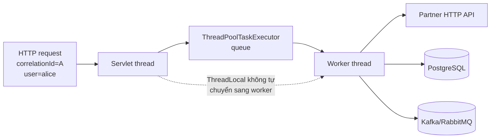
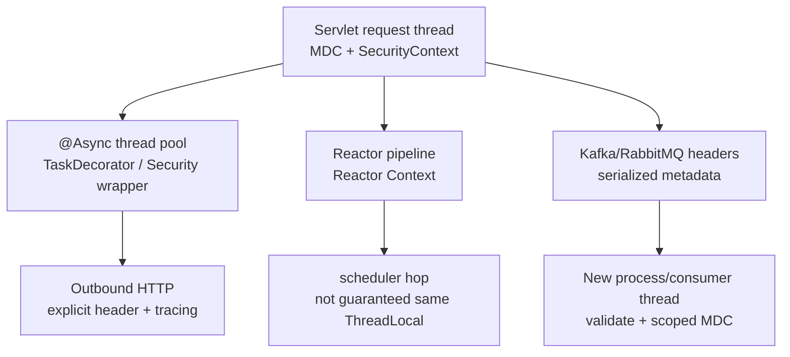
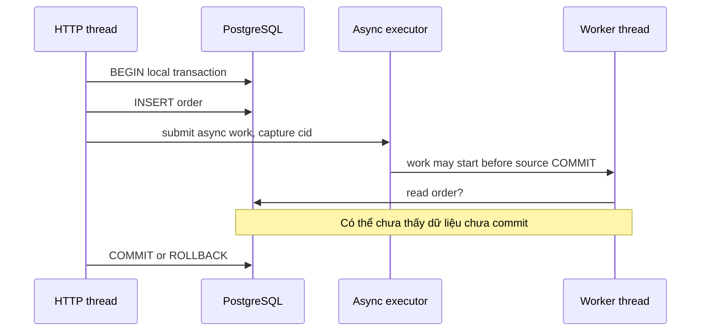
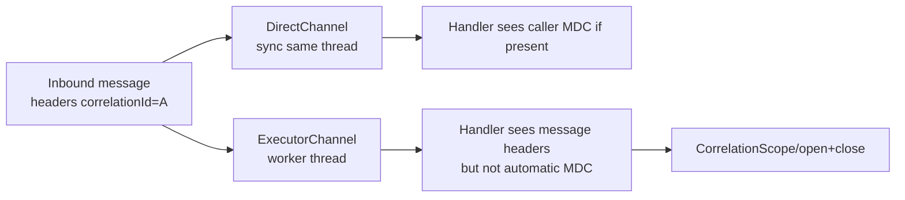
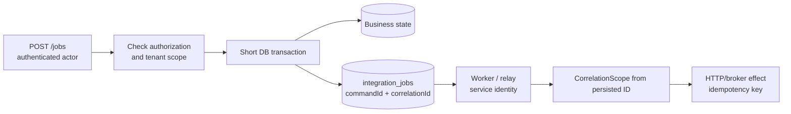

# Truyền mã tương quan, MDC hoặc SecurityContext khi cần

## 1. Vấn đề: tác vụ vẫn chạy, nhưng không còn biết thuộc request nào

Một ứng dụng Spring Boot nhận `POST /orders`, ghi đơn hàng vào PostgreSQL, gửi một thông báo tới đối tác qua HTTP và phát sự kiện lên Kafka. Để giảm độ trễ, developer chuyển bước gọi HTTP sang `@Async`. Sau khi triển khai, log của controller có `correlationId=req-8e5a`, nhưng log của tác vụ bất đồng bộ không còn mã này. Khi kiểm tra lỗi gọi đối tác, người vận hành không thể nối log giữa request, worker, HTTP client và broker.

Một biến thể nguy hiểm hơn xảy ra nếu method async đọc:

```java
Authentication auth =
    SecurityContextHolder.getContext().getAuthentication();
```

Trong request thread, `auth` thường có thể là người dùng đã được xác thực; ở thread pool khác, nó có thể là `null` hoặc một context không phù hợp. Nếu developer bật `MODE_INHERITABLETHREADLOCAL` hoặc tự set một context rồi quên clear, worker threads tái sử dụng có thể mang **dữ liệu của request trước**, gây sai log hoặc sai phân quyền.



**Ý chính:** Truyền context không đơn giản là chép toàn bộ `ThreadLocal`. Phải xác định thông tin nào có ý nghĩa ở boundary nào, truyền bao lâu, ai được phép tin thông tin đó, và ai có trách nhiệm **khôi phục/xóa context sau mỗi tác vụ**.

Bài thuộc chương **Tác vụ bất đồng bộ** của module **SPRING_BOOT_INTEGRATION**. Module này tổ chức tích hợp hệ thống trong Spring Boot qua HTTP client, cơ sở dữ liệu, cache, message broker và Spring Integration adapters; trọng tâm gồm cấu hình, hợp đồng dữ liệu, giao dịch, lỗi, xử lý trùng lặp, kiểm thử và quan sát luồng thực tế. Truyền correlation context và security context ở đây phục vụ **khả năng truy vết lẫn bảo mật giữa những ranh giới tích hợp**.

**Mục tiêu học tập:**

1. Phân biệt correlation ID, trace ID/span ID, message/event ID và business command ID.
2. Hiểu `ThreadLocal`, SLF4J MDC và Spring Security `SecurityContextHolder` trong servlet thread, `@Async`, worker pool và Reactor.
3. Cấu hình `TaskDecorator` để capture/restore MDC an toàn khi dùng `ThreadPoolTaskExecutor`.
4. Dùng `DelegatingSecurityContextAsyncTaskExecutor` khi *thực sự* phải truyền security identity tới một task ngắn.
5. Phân biệt truyền context **vào task** với truyền **qua HTTP/Kafka/RabbitMQ headers**.
6. Hiểu Micrometer Context Propagation, tracing/observation và Reactor `Context` không tương đương một ThreadLocal toàn cục.
7. Giữ đúng transaction boundary, ACK/offset commit, retry/idempotency khi tác vụ chạy ngoài request thread.
8. Không lộ access token, credentials, PII hay quyền đặc biệt qua MDC/logs/broker headers.
9. Kiểm thử chống cross-request context leakage khi worker thread được tái sử dụng.
10. Thiết kế logging, metrics, cảnh báo và runbook khi trace bị đứt hoặc auth bị sai ngữ cảnh.

> **Phạm vi phiên bản:** Ví dụ Java dùng Java 17+, Spring Boot 3.x, Spring Framework 6.x, Spring Security 6.x, SLF4J 2.x, Logback, Spring Kafka/Rabbit tương thích BOM. API `ContextPropagatingTaskDecorator` cần Spring Framework 6.1+ và tích hợp Micrometer Context Propagation thích hợp. Ở Spring Boot 4.x/Spring Framework 7.x hay với Java 21 virtual threads, kiểm tra đúng contract và dependency đang chạy. Những đoạn dùng `@Async` minh họa ứng dụng servlet/imperative; WebFlux/Reactor có cơ chế context riêng.

## 2. Mã nào dùng để làm gì?

Không dùng một chuỗi “traceId” thay thế mọi loại identity. Các mã có vòng đời và ý nghĩa khác nhau:

| Loại | Mục đích | Vòng đời/nguồn chân lý | Có phải quyền? |
| --- | --- | --- | --- |
| **Correlation ID** | Nối các logs/actions của cùng một logical request/workflow. | Có thể được cấp ở gateway, application hoặc message source; đi qua boundaries được kiểm soát. | **Không**. |
| **Trace ID** | Liên kết các spans của một distributed trace. | Tracing system (OpenTelemetry/Micrometer Tracing); theo trace context propagators. | **Không**. |
| **Span ID** | Một đoạn công việc trong trace. | Được tạo cho mỗi span; thay đổi qua client/server/broker boundaries. | **Không**. |
| **Request ID** | Nhận diện một lượt HTTP request cụ thể. | Server/gateway. | **Không**. |
| **Message/event ID** | Nhận diện một logical event để deduplicate. | Producer/business outbox; phải ổn định khi republish. | **Không**. |
| **Command/idempotency key** | Nhận diện một logical business intent qua retries. | Business command/provider contract. | **Không**. |
| **User/tenant ID** | Chủ thể và phạm vi nghiệp vụ. | Authentication/authorization đã được kiểm chứng. | Chỉ có ý nghĩa quyền khi đã **xác thực và kiểm tra policy**. |
| **SecurityContext** | Authentication cùng các thông tin security liên quan trong runtime. | Spring Security, phụ thuộc request/session/token và propagation strategy. | **Có thể ảnh hưởng quyền**, phải xử lý thận trọng. |

### 2.1. Correlation ID không phải trace ID

Một logical command `reserve-order-42` có thể được retry sau 10 phút bằng một HTTP request mới và distributed trace mới. Có thể giữ **correlation ID/command ID ổn định** để nối các lần xử lý, trong khi `traceId` mới được tạo cho trace mới. Không sửa thủ công traceId/spanId trong MDC để “buộc” nhiều retries thành một trace.

```text
commandId = confirm-order-42-7
correlationId = corr-A42

HTTP attempt #1: traceId = T1, spanId = S1 -> 504
Kafka message:   eventId = E42, traceId = T2 (tracing policy)
HTTP attempt #2: traceId = T3, spanId = S3 -> 200

Business identity/correlation có thể cùng nhau;
trace topology và span identifiers phải tuân tracer.
```

Một số hệ thống dùng correlation ID = request ID vì không có long-running workflow; điều đó có thể phù hợp **nếu contract ghi rõ**. Nhưng khi có Kafka retries, outbox và batch reconciliation, cần định nghĩa rõ mã nào ổn định qua các lần phát lại.

### 2.2. Vì sao không dùng correlation ID làm authorization?

Header `X-Correlation-ID: admin-user-1` có thể do caller bên ngoài tự gửi. Nó chỉ là metadata phục vụ quan sát. **Không** dùng ID này để suy ra `Authentication`, `tenantId`, `ROLE_ADMIN`, billing account hoặc danh tính người gửi. Ngược lại, thông tin từ JWT/session cũng không nên tự động được gắn hết vào MDC vì có thể làm lộ dữ liệu.

## 3. ThreadLocal, MDC và SecurityContextHolder: cùng thread mới thấy được

### 3.1. MDC thực chất lưu gì?

SLF4J MDC (Mapped Diagnostic Context) cho phép log appenders truy cập một map các cặp key/value gắn với **execution thread hiện tại**, khi logging backend hỗ trợ:

```java
import org.slf4j.MDC;

MDC.put("correlationId", "corr-123456");
try {
    log.info("Calling warehouse");
} finally {
    MDC.remove("correlationId");
}
```

Với Logback cấu hình JSON hoặc log pattern, `correlationId` có thể được đưa vào mỗi log record cùng thread. Tuy nhiên MDC **không phải** distributed context store hoặc business database. Một `CompletableFuture` dùng thread khác không tự nhận map này nếu không có propagation mechanism.

### 3.2. SecurityContextHolder mặc định theo thread

Ở Spring Security servlet stack, mặc định `SecurityContextHolder` thường dùng strategy dựa trên `ThreadLocal`. Spring Security web filters xác định/lưu/clear context theo lifecycle của request. Từ thread đã xác thực:

```java
import org.springframework.security.core.Authentication;
import org.springframework.security.core.context.SecurityContextHolder;

Authentication authentication =
    SecurityContextHolder.getContext().getAuthentication();
```

Khi code được chạy trên worker thread:

```text
Servlet-thread-1:
  MDC.correlationId = corr-A
  SecurityContext = alice

worker-pool-7:
  MDC.correlationId = ?          // thường chưa có
  SecurityContext = ?            // thường chưa có
```

**Đừng** kết luận worker “anonymous” là một bug bảo mật cần sửa bằng việc truyền user context mọi nơi. Nhiều background jobs **đúng ra phải chạy bằng service identity riêng**, không impersonate HTTP caller.

### 3.3. Vì sao không bật MODE_INHERITABLETHREADLOCAL như một cách sửa chung?

```java
// KHÔNG khuyến nghị như giải pháp mặc định cho pooled workers.
SecurityContextHolder.setStrategyName(
    SecurityContextHolder.MODE_INHERITABLETHREADLOCAL
);
```

`InheritableThreadLocal` copy/inherit value khi **thread con được tạo**, không phải tại mỗi lần task được submit. Worker pool threads sống lâu và được tái sử dụng cho nhiều requests, nên một identity kế thừa từ lúc pool tạo thread có thể không phù hợp với task sau. Đồng thời nó làm khó thu hồi/clear context và dễ tạo cross-request security leakage.

Ngay cả khi Java 21 virtual threads được tạo per task, inherit-context behavior cũng không nên thay thế chính sách capture/restore rõ ràng; việc truyền token/Authentication nhạy cảm vẫn cần được cân nhắc theo trust boundary.

### 3.4. Mỗi boundary thay đổi context semantics



**Rule of thumb:** `ThreadLocal` propagation giải quyết boundary **trong cùng JVM** với task scheduling được kiểm soát; HTTP/message headers giải quyết boundary **giữa services/processes**; tracing propagation giải quyết distributed trace context; authorization vẫn cần xác minh tại mỗi trust boundary.

## 4. Hợp đồng truyền context nên có allowlist

Trước khi cấu hình decorator, quyết định rõ:

| Field | Truyền tới `@Async` task? | Truyền qua HTTP/message headers? | Lưu vào logs? |
| --- | --- | --- | --- |
| `correlationId` | Có, nếu giúp nối log với request. | Có, sau validation và theo contract. | Có, bounded format. |
| `traceparent`/trace state | Qua tracing instrumentation; không tự copy MDC. | Qua standard propagators nếu enabled. | Tracer quản lý, không log raw baggage vô tội vạ. |
| `eventId`/`commandId` | Có, nếu task thuộc logical event/command. | Có trong event schema/header được định nghĩa. | Có khi policy cho phép. |
| `tenantId` | Chỉ nếu lấy từ authenticated context và cần cho công việc. | Chỉ trên trusted contract, downstream **phải verify**. | Có thể log mã đã sanitize theo privacy policy. |
| `Authentication`/`SecurityContext` | **Chỉ khi thật sự cần** delegation trong tác vụ ngắn. | Không serialize raw Spring object; dùng token/service auth đúng. | Không log credentials/access tokens. |
| HTTP Authorization/Cookie | Không tự động chép qua worker. | Chỉ theo explicit downstream auth design; không blanket forward. | **Không**. |
| Request body/PII | Không nhét vào MDC. | Chỉ qua business contract với data minimization. | Không log mặc định. |

**Hai nguyên tắc:** (1) Chỉ capture fields đủ cho mục đích hợp lệ; (2) mọi context phải có **lifecycle owner** để restore/clear, nhất là khi thread được tái sử dụng.

## 5. HTTP ingress: cấp correlation ID và dọn MDC trong finally

Với Spring MVC/Servlet, có thể cấp một mã tương quan cho mỗi inbound HTTP request bằng `OncePerRequestFilter`. Ví dụ này nhận một incoming header nếu cú pháp hợp lệ; nếu không, tạo mã mới.

```java
// CorrelationIdFilter.java
package com.example.integration.async;

import java.io.IOException;
import java.util.Map;
import java.util.UUID;
import jakarta.servlet.FilterChain;
import jakarta.servlet.ServletException;
import jakarta.servlet.http.HttpServletRequest;
import jakarta.servlet.http.HttpServletResponse;
import org.slf4j.MDC;
import org.springframework.stereotype.Component;
import org.springframework.web.filter.OncePerRequestFilter;

@Component
public class CorrelationIdFilter extends OncePerRequestFilter {
    public static final String HEADER = "X-Correlation-ID";
    public static final String MDC_KEY = "correlationId";

    @Override
    protected void doFilterInternal(
        HttpServletRequest request,
        HttpServletResponse response,
        FilterChain chain
    ) throws ServletException, IOException {
        String incoming = request.getHeader(HEADER);
        String correlationId = valid(incoming)
            ? incoming
            : UUID.randomUUID().toString();

        Map<String, String> previous =
            MDC.getCopyOfContextMap();
        try {
            MDC.put(MDC_KEY, correlationId);
            response.setHeader(HEADER, correlationId);
            chain.doFilter(request, response);
        } finally {
            MDC.clear();
            if (previous != null) {
                MDC.setContextMap(previous);
            }
        }
    }

    private static boolean valid(String candidate) {
        return candidate != null
            && candidate.matches("[A-Za-z0-9_-]{8,64}");
    }
}
```

**Điều đúng ở ví dụ:**

- Header có giới hạn độ dài và alphabet, giảm nguy cơ log injection/giá trị quá lớn.
- Nếu không có mã hợp lệ, server tạo UUID; không dùng nguyên header chứa ký tự CR/LF.
- `finally` phục hồi map trước đó, không để `correlationId` dính sang HTTP request khác trong servlet thread pool.
- Application có thể echo mã trở lại client để tiện support; **mã không phải bằng chứng xác thực**.

**Nhưng cần giới hạn rõ:** Một header có format hợp lệ vẫn do caller tự khai, có thể cố tình trùng với ID khác. Với hệ thống cần mã nội bộ không thể giả mạo, luôn cấp một `internalRequestId` mới ở trusted edge và lưu incoming correlation như metadata phụ sau khi kiểm tra. Không dựa vào `X-Correlation-ID` để truy cập dữ liệu của request khác.

### 5.1. Logging pattern ví dụ

Nếu dùng Logback trong một cấu hình logging thuộc dự án:

```text
%d{ISO8601} %-5level [%thread] [cid=%X{correlationId}] %logger - %msg%n
```

Đây là một **pattern ý tưởng**, không phải cấu hình Boot mặc định. Trong production nên ưu tiên structured JSON logging nếu logging stack hỗ trợ, và không đưa secrets/PII/raw request body vào MDC. Với Micrometer Tracing, `traceId`/`spanId` có thể do tracing integration quản lý riêng; đừng overwrite chúng trong filter.

### 5.2. Servlet async dispatch có vòng đời riêng

`OncePerRequestFilter` và asynchronous servlet dispatch (`Callable`, `DeferredResult`, streaming) cần xử lý cẩn thận: một request có thể chạy trên nhiều dispatch threads. Ví dụ filter trên giải quyết phạm vi **dispatch mà filter thực sự chạy**; không bảo đảm automatic MDC propagation tới `@Async`, servlet worker callbacks hoặc WebFlux. Nếu endpoint dùng Servlet async processing, kiểm tra `shouldNotFilterAsyncDispatch()`/filter mapping và tích hợp MVC async interceptors/tracing phù hợp. Không giữ MDC trên một thread chờ cho đến khi async result hoàn thành.

## 6. Truyền MDC qua ThreadPoolTaskExecutor bằng TaskDecorator

`TaskDecorator` là interface trong Spring Core để bọc `Runnable` của executor. Khi task được submit, decorator có thể snapshot MDC của submitting thread, rồi khôi phục nó ở worker khi `run()` được gọi.

**Chìa khóa:** snapshot ở thời điểm **submit**, không phải trong worker khi task bắt đầu. Đồng thời phải khôi phục **MDC cũ của worker**, vì thread đó có thể chạy task kế tiếp ngay sau khi task này kết thúc.

### 6.1. Cấu hình MdcTaskDecorator an toàn

```java
// MdcTaskDecorator.java
package com.example.integration.async;

import java.util.Map;
import org.slf4j.MDC;
import org.springframework.core.task.TaskDecorator;

public final class MdcTaskDecorator implements TaskDecorator {

    @Override
    public Runnable decorate(Runnable task) {
        // Capture ở submitting thread.
        Map<String, String> captured =
            MDC.getCopyOfContextMap();

        return () -> {
            // Worker thread có thể đã có MDC từ infrastructure.
            Map<String, String> previous =
                MDC.getCopyOfContextMap();
            try {
                MDC.clear();
                if (captured != null) {
                    MDC.setContextMap(captured);
                }
                task.run();
            } finally {
                // Luôn restore, kể cả exception/cancellation.
                MDC.clear();
                if (previous != null) {
                    MDC.setContextMap(previous);
                }
            }
        };
    }
}
```

**Tại sao không chỉ gọi `MDC.put("correlationId", value)`?** Vì request thread có thể đang có `traceId`, `spanId`, `operation` và các fields đã được allowlist. Task cần snapshot có kiểm soát; nhưng copy **toàn bộ MDC** chỉ an toàn nếu ứng dụng đã bảo đảm MDC chỉ chứa logging-safe fields. Ở hệ thống nhiều team, có thể cần decorator capture **một số keys cụ thể** thay vì copy toàn map để tránh đưa PII/secret vào worker.

**Tại sao phải restore `previous` thay vì chỉ `MDC.clear()`?** Một executor có thể chạy nested tasks hoặc infrastructure setup MDC ở worker trước khi user task chạy. Phục hồi snapshot cũ tránh phá context của outer scope. Ngược lại, không restore thì context task A có thể rò sang B.

### 6.2. Cảnh báo: TaskDecorator không phải exception handler

Với `submit(Callable)` hoặc `CompletableFuture`, executor có thể bọc task vào `FutureTask` hoặc runnable khác; exception có thể được giữ trong future thay vì ném trực tiếp ra wrapper. Không dùng `TaskDecorator` để thay `AsyncUncaughtExceptionHandler`, xử lý `CompletionException` hoặc business error channel.

### 6.3. Queue wait và stale context

```text
t=0: request Alice submit task (MDC cid=A)
t=1: HTTP request kết thúc, servlet MDC được clear
t=5: worker mới thực thi task với snapshot cid=A
```

Đây là hoạt động bình thường của capture/restore: task vẫn có mã tương quan của công việc đã tạo ra nó. Nhưng `SecurityContext` mang quyền của user ở t=0 có thể **không còn hợp lệ** ở t=5 nếu session/token đã bị thu hồi. Vì vậy **MDC có thể truyền rộng hơn SecurityContext**, còn authorization sensitive operations cần xác minh lại.

## 7. Tạo executor riêng, queue có giới hạn và bật @EnableAsync

Spring `@Async` chuyển invocation sang một executor theo cấu hình. Một hệ thống có thể dùng nhiều executors: một cho notification I/O, một cho CPU computation, một cho tác vụ ngắn cần user context. Không nên dùng một global executor không giới hạn cho mọi luồng.

### 7.1. Executor chỉ truyền logging context

```java
// AsyncTaskConfiguration.java
package com.example.integration.async;

import java.util.concurrent.ThreadPoolExecutor;
import org.springframework.context.annotation.Bean;
import org.springframework.context.annotation.Configuration;
import org.springframework.scheduling.annotation.EnableAsync;
import org.springframework.scheduling.concurrent.ThreadPoolTaskExecutor;

@Configuration(proxyBeanMethods = false)
@EnableAsync
public class AsyncTaskConfiguration {

    @Bean(name = "notificationExecutor")
    public ThreadPoolTaskExecutor notificationExecutor() {
        ThreadPoolTaskExecutor executor =
            new ThreadPoolTaskExecutor();

        executor.setCorePoolSize(4);
        executor.setMaxPoolSize(8);
        executor.setQueueCapacity(100);
        executor.setThreadNamePrefix("notify-");
        executor.setTaskDecorator(new MdcTaskDecorator());
        executor.setRejectedExecutionHandler(
            new ThreadPoolExecutor.AbortPolicy()
        );
        executor.setWaitForTasksToCompleteOnShutdown(false);
        // Spring gọi afterPropertiesSet()/destroy() khi quản lý bean.
        return executor;
    }
}
```

Các con số 4/8/100 chỉ để minh họa, không phải thông số chuẩn. Đặt theo workload, latency upstream, JDBC/HTTP pool capacity và số application replicas. Với `ThreadPoolTaskExecutor`, queue có capacity lớn có thể làm pool khó mở rộng quá core threads trước khi queue đầy; hiểu chính xác policy của Java `ThreadPoolExecutor` và load-test nếu max threads > core là một mục tiêu.

**Về lifecycle:** Spring thường quản lý shutdown cho `ThreadPoolTaskExecutor` bean. Việc gọi `initialize()` và `destroyMethod="shutdown"` trong ví dụ nhấn mạnh resource ownership; khi dự án dùng bean lifecycle defaults/Boot task execution auto-configuration, kiểm tra để không đăng ký hai destroy callbacks gây nhầm hoặc tự đóng shared executor giữa chừng.

### 7.2. @Async method gọi service khác

```java
// NotificationAsyncService.java
package com.example.integration.async;

import java.util.concurrent.CompletableFuture;
import org.slf4j.Logger;
import org.slf4j.LoggerFactory;
import org.slf4j.MDC;
import org.springframework.scheduling.annotation.Async;
import org.springframework.stereotype.Service;

@Service
public class NotificationAsyncService {
    private static final Logger log =
        LoggerFactory.getLogger(NotificationAsyncService.class);

    private final NotificationSender sender;

    public NotificationAsyncService(
        NotificationSender sender
    ) {
        this.sender = sender;
    }

    @Async("notificationExecutor")
    public CompletableFuture<SendResult> sendAsync(
        NotificationCommand command
    ) {
        log.info(
            "notification started commandId={}, cid={}",
            command.commandId(),
            MDC.get("correlationId")
        );

        // synchronous work diễn ra trên executor thread.
        SendResult result = sender.send(command);
        return CompletableFuture.completedFuture(result);
    }
}
```

```java
// NotificationCommand.java
package com.example.integration.async;

public record NotificationCommand(
    String commandId,
    String tenantId,
    String notificationId,
    String correlationId
) {}
```

```java
// SendResult.java
package com.example.integration.async;

public record SendResult(
    String providerMessageId,
    boolean accepted
) {}
```

```java
// NotificationSender.java
package com.example.integration.async;

public interface NotificationSender {
    SendResult send(NotificationCommand command);
}
```

**Quan trọng:** `NotificationSender` là interface của ứng dụng, phải được implement qua provider HTTP client, retry/deadline/idempotency. `CompletableFuture.completedFuture(...)` không có nghĩa work chạy synchronously trên request thread: `@Async` proxy đã dispatch method sang executor. Nhưng nếu gọi method qua `this.sendAsync(...)` hoặc gọi trực tiếp instance không đi qua Spring proxy, `@Async` không được kích hoạt.

Một error từ `sender.send(...)` khiến returned `CompletableFuture` của proxy hoàn thành exceptionally, nhưng không bảo đảm caller chờ/observe kết quả. Nếu caller fire-and-forget và trả HTTP 202, phải có **durable job/outbox** trước khi coi công việc đã được nhận.

### 7.3. Sử dụng từ application service

```java
// Ví dụ fragment trong một Spring-managed service.
NotificationCommand cmd = new NotificationCommand(
    businessCommandId,
    authenticatedTenantId,
    notificationId,
    MDC.get("correlationId")
);

CompletableFuture<SendResult> future =
    notificationAsyncService.sendAsync(cmd);

future.whenComplete((result, error) -> {
    // Callback có thể chạy ở một thread khác.
    // Dùng commandId/correlationId từ cmd;
    // KHÔNG mặc định MDC hoặc SecurityContext có ở đây.
    if (error != null) {
        auditFailure(cmd.commandId(), error);
    }
});
```

Đây là fragment, `businessCommandId` và `authenticatedTenantId` phải đến từ business/verified principal context, `notificationAsyncService` là bean được inject, `auditFailure(...)` là method application. Không gọi callback ở đây để publish remote error chứa sensitive stacktrace. Trong production, persist job status/retry intent nếu cần crash recovery.

### 7.4. Queue rejection là failure thật

Khi `queueCapacity=100` và max worker threads đang bận, submit có thể bị từ chối. Với Spring, lỗi có thể được bọc thành `TaskRejectedException`. Không nuốt lỗi rồi trả HTTP `202 Accepted` nếu công việc mới chỉ nằm trong queue JVM hoặc thậm chí chưa enqueue được.

Nếu việc mất notification là chấp nhận được theo business contract, có thể trả best-effort response rõ ràng; nếu không, ghi durable outbox/job trước rồi worker executor chỉ là optimization. Cần metrics queue depth, active threads, rejection count, oldest queue age và backpressure.

## 8. Truyền SecurityContext khi thực sự cần delegation

`SecurityContextHolder` thường không có authentication khi task chạy trên thread khác. Spring Security cung cấp các wrappers như `DelegatingSecurityContextRunnable`, `DelegatingSecurityContextExecutor` và `DelegatingSecurityContextAsyncTaskExecutor` để thiết lập/restoring security context quanh work.

**Chọn security propagation dựa trên quyền nghiệp vụ**, không phải vì “muốn mọi log giống request”.

### 8.1. Nguyên lý của DelegatingSecurityContext

```text
Caller thread:
  Authentication = alice (ROLE_ORDER_VIEW)
  submit task
      |
      v
Security wrapper captures context at submission
      |
      v
Worker thread:
  install captured context
  execute task
  clear/restore context in finally
```

Với constructor không truyền một `SecurityContext` cố định, wrapper thông thường capture context hiện tại **tại thời điểm submit task**. Nếu constructor được truyền một context cố định, tất cả tasks có thể dùng cùng fixed identity; điều này có thể phù hợp cho một service identity có kiểm soát nhưng **nguy hiểm** nếu vô tình cố định context của user đầu tiên.

### 8.2. Tạo executor có cả MDC và SecurityContext

Ta có thể dùng raw `ThreadPoolTaskExecutor` được cấu hình `MdcTaskDecorator`, sau đó bọc bằng Security executor:

```java
// AuthorizedAsyncExecutorConfiguration.java
package com.example.integration.async;

import java.util.concurrent.ThreadPoolExecutor;
import org.springframework.beans.factory.annotation.Qualifier;
import org.springframework.context.annotation.Bean;
import org.springframework.context.annotation.Configuration;
import org.springframework.core.task.AsyncTaskExecutor;
import org.springframework.scheduling.concurrent.ThreadPoolTaskExecutor;
import org.springframework.security.task.DelegatingSecurityContextAsyncTaskExecutor;

@Configuration(proxyBeanMethods = false)
public class AuthorizedAsyncExecutorConfiguration {

    @Bean(name = "authorizedWorkerPool")
    ThreadPoolTaskExecutor authorizedWorkerPool() {
        ThreadPoolTaskExecutor pool =
            new ThreadPoolTaskExecutor();
        pool.setCorePoolSize(2);
        pool.setMaxPoolSize(4);
        pool.setQueueCapacity(32);
        pool.setThreadNamePrefix("authorized-");
        pool.setTaskDecorator(new MdcTaskDecorator());
        pool.setRejectedExecutionHandler(
            new ThreadPoolExecutor.AbortPolicy()
        );
        // Spring quản lý khởi tạo và shutdown bean.
        return pool;
    }

    @Bean("authorizedAsyncExecutor")
    AsyncTaskExecutor authorizedAsyncExecutor(
        @Qualifier("authorizedWorkerPool")
        ThreadPoolTaskExecutor pool
    ) {
        return new DelegatingSecurityContextAsyncTaskExecutor(pool);
    }
}
```

Đoạn class trên tách raw pool và wrapper để tránh circular bean injection. `@Async("authorizedAsyncExecutor")` sẽ submit vào wrapper; wrapper capture SecurityContext còn pool's TaskDecorator capture MDC. **Việc này không tự động đồng bộ context qua arbitrary `CompletableFuture.thenApplyAsync(...)` hoặc custom ExecutorService khác** nếu continuation không dùng wrapper được kiểm soát.

### 8.3. Authorized asynchronous lookup minh họa

```java
// AuthorizedPreviewService.java
package com.example.integration.async;

import java.util.concurrent.CompletableFuture;
import org.springframework.security.core.Authentication;
import org.springframework.security.core.context.SecurityContextHolder;
import org.springframework.scheduling.annotation.Async;
import org.springframework.stereotype.Service;

@Service
public class AuthorizedPreviewService {
    private final OrderPreviewReader reader;

    public AuthorizedPreviewService(
        OrderPreviewReader reader
    ) {
        this.reader = reader;
    }

    @Async("authorizedAsyncExecutor")
    public CompletableFuture<OrderPreview> readMyPreview(
        String orderId
    ) {
        Authentication authentication =
            SecurityContextHolder
                .getContext()
                .getAuthentication();

        if (authentication == null
            || !authentication.isAuthenticated()) {
            throw new SecurityException(
                "Authenticated user required"
            );
        }

        // reader PHẢI kiểm tra order ownership/tenant
        // và quyền trên dữ liệu thật; không chỉ dựa vào tên user.
        OrderPreview view =
            reader.readAuthorized(authentication, orderId);

        return CompletableFuture.completedFuture(view);
    }
}
```

```java
// OrderPreview.java
package com.example.integration.async;

public record OrderPreview(
    String orderId,
    String status
) {}
```

```java
// OrderPreviewReader.java
package com.example.integration.async;

import org.springframework.security.core.Authentication;

public interface OrderPreviewReader {
    OrderPreview readAuthorized(
        Authentication authenticatedUser,
        String orderId
    );
}
```

**Cảnh báo:** Propagation không phải một security proof. `Authentication.isAuthenticated()` không thay ownership/tenant/permission checks; các implementation dùng `AnonymousAuthenticationToken` có thể biểu diễn trạng thái theo security filter khác. Production dùng authoritative principal type, token validation, policy engine hoặc `@PreAuthorize` kết hợp business service checks; với lâu hơn request lifetime nên revalidate authorization tại thời điểm thực thi.

### 8.4. Vì sao không gửi nguyên SecurityContext vào queue/broker?

Spring `SecurityContext` có thể giữ `Authentication`, credentials, principal objects và authorities gắn với phiên bản security library. Serialize toàn bộ object này vào Kafka, Redis hoặc outbox sẽ:

- Làm lộ access token/password/claims nếu authentication chứa chúng.
- Đưa implementation detail của Spring Security vào event schema.
- Tạo một snapshot quyền có thể stale sau revocation.
- Khiến downstream tin một object không được xác thực lại.
- Khó kiểm soát retention/PII/access logs trong broker.

Nếu durable job cần biết ai đã yêu cầu, lưu **actor ID, tenant, command ID, authorization decision/audit reference** theo business contract và kiểm tra quyền thích hợp ở lúc thực hiện. Worker dùng service identity với least privilege, không dùng raw HTTP user's SecurityContext kéo dài hàng giờ.

### 8.5. Không dùng fixed SecurityContext vô ý

```java
// CẢNH BÁO: đừng capture user Alice một lần ở startup
// rồi áp cùng context cho tất cả tasks của nhiều users.
SecurityContext fixed =
    SecurityContextHolder.getContext();
```

Một wrapper với constructor nhận `fixed` có thể làm tất cả submissions chạy dưới identity đó. Chỉ dùng explicit fixed service identity nếu security architecture cố ý và có review; với nhiều end-users, cần per-submission context hoặc tốt hơn là explicit audited business authorization.

## 9. Dùng MDC, SecurityContext và trace context cùng nhau: chúng độc lập

```text
Inbound POST /orders
  MDC correlationId = corr-123
  SecurityContext = user Alice
  Observation/trace = trace T, span S
        |
        +-- @Async notification:
             - MDC via TaskDecorator
             - SecurityContext only if required
             - Tracing via observation/Micrometer instrumentation
        |
        +-- Kafka publish:
             - correlationId/eventId as explicit headers/data
             - traceparent via tracing propagator
             - NO serialized SecurityContext
```

**Không** mặc định cả ba cơ chế được bật cùng nhau. `MdcTaskDecorator` chỉ thao tác MDC. `DelegatingSecurityContextAsyncTaskExecutor` chỉ giải quyết Spring Security context quanh task. Micrometer/OTel tracing có propagation riêng; chép key `traceId` vào MDC **không tạo một active span hoặc correct parent-child relationship**.

### 9.1. Điều gì xảy ra khi thiếu một trong ba?

| Thiếu | Triệu chứng | Phương án |
| --- | --- | --- |
| Correlation ID/MDC | Worker logs không nối được inbound request. | Scoped MDC decorator hoặc explicit command ID. |
| Active observation context | Distributed trace bị đứt dù có cùng correlation string. | Tracing instrumentation/context propagation registry. |
| SecurityContext khi logic cần | `Authentication` null/anonymous trong worker. | Delegating wrapper hoặc truyền verified business identity và reauthorize. |
| Correct cleanup | Request B log `cid=A` hoặc auth Alice trong worker B. | try/finally restore + thread reuse tests. |
| Durable handoff | HTTP trả 202 nhưng worker task mất khi crash. | DB job/outbox/queue, ACK sau durable acceptance. |

### 9.2. Khi nào KHÔNG truyền SecurityContext?

- Tác vụ batch hằng đêm, scheduler, định kỳ kiểm tra outbox.
- Outbox relay đã được nhận vào durable queue sau transaction commit.
- Consumer Kafka/Rabbit nhận event từ service khác: dùng service-to-service identity, ACL và payload validation, không giả lập end-user context bằng header tự khai.
- Reconciliation/repair job cần quyền quản trị hạn chế, độc lập request origin.
- CPU computation thuần từ dữ liệu đã kiểm chứng và không cần authorization ở thread thực thi.

Đối với các tác vụ này, correlation/event/command ID vẫn hữu ích; SecurityContext người dùng có thể **không phù hợp và gây tăng quyền**.

## 10. Micrometer Context Propagation: cơ chế tổng quát nhưng không tự copy mọi ThreadLocal

Trong Spring Framework 6.1+, `ContextPropagatingTaskDecorator` dùng Micrometer Context Propagation để capture/restore những values được đăng ký bằng `ThreadLocalAccessor` hoặc các context accessors tương thích. Điều này hữu ích khi ứng dụng đã dùng Micrometer Tracing/Observation và muốn giữ trace/span context qua executor boundaries.

```java
// Alternative cho custom MDC TaskDecorator, Spring Framework 6.1+.
import org.springframework.core.task.support.ContextPropagatingTaskDecorator;
import org.springframework.scheduling.concurrent.ThreadPoolTaskExecutor;

ThreadPoolTaskExecutor executor = new ThreadPoolTaskExecutor();
executor.setCorePoolSize(4);
executor.setMaxPoolSize(8);
executor.setQueueCapacity(100);
executor.setThreadNamePrefix("observed-");
executor.setTaskDecorator(
    new ContextPropagatingTaskDecorator()
);
// Khi là Spring @Bean, lifecycle khởi tạo executor.
```

Đây là **alternative** cho `MdcTaskDecorator` ở mục 6, không cần tạo thêm một executor nếu chỉ muốn chuyển chiến lược. Những giới hạn quan trọng:

- Chỉ values có **registered accessors** mới được capture/restore. Không giả định arbitrary MDC key hoặc SecurityContext tự động có.
- Nếu cần MDC, phải xác nhận logging/tracing stack đã đăng ký accessor hoặc đăng ký accessor được review theo API Micrometer version đang dùng.
- Nếu cần Spring Security context, dùng mechanism Spring Security hỗ trợ hoặc accessor chuyên biệt có security review; không copy raw Authentication vào registry tùy tiện.
- Capture/restore có overhead; đo với tasks ngắn hoặc throughput lớn.
- Không tự tạo durable jobs, không commit DB thay bạn và không gửi context qua Kafka/HTTP headers.

### 10.1. “MDC có traceId” chưa chắc có active tracing span

Micrometer Tracing có thể thêm `traceId`/`spanId` vào MDC. Nếu chỉ copy hai strings, log của worker trông như thuộc trace cũ, nhưng chưa chắc có active observation/span để instrumentation tạo child span đúng parent.

```text
MDC traceId = abc123
Active tracer span = null

=> Log có chuỗi abc123;
   distributed trace không tự có parent-child edges.
```

Giải quyết bằng đúng tracer context propagation, không chỉ sao chép chuỗi. Kiểm thử trace topology và outgoing `traceparent`, không chỉ snapshot log JSON.

### 10.2. Dependencies minh họa

```xml
<dependency>
    <groupId>org.springframework.boot</groupId>
    <artifactId>spring-boot-starter-actuator</artifactId>
</dependency>
<dependency>
    <groupId>io.micrometer</groupId>
    <artifactId>micrometer-tracing-bridge-otel</artifactId>
</dependency>
<dependency>
    <groupId>io.micrometer</groupId>
    <artifactId>context-propagation</artifactId>
</dependency>
```

Đây là **dependency sketch**, không phải production distributed tracing stack hoàn chỉnh: để xuất traces cần exporter/endpoint/credentials được cấu hình và version phù hợp BOM. Spring Boot instrumentation phụ thuộc việc dùng **auto-configured HTTP clients** và observation-enabled components. Nếu tự new client/builder, executor riêng hay publish broker bằng thư viện ngoài, trace propagation có thể không được áp dụng.

### 10.3. Không trộn MDC copy với tracing baggage thiếu kiểm soát

W3C baggage headers có thể chứa dữ liệu user/tenant do bên ngoài khai báo. Nếu application thêm mọi baggage field vào log, có thể lộ PII hoặc bị tấn công cardinality/size. Chỉ propagate allowlisted keys theo tracing policy, giới hạn length và domain trust, không đặt bearer token/password vào baggage.

## 11. Reactor Context khác ThreadLocal

Với WebFlux và Reactor `Mono`/`Flux`, một pipeline có thể chuyển qua nhiều scheduler threads. Reactor có cấu trúc **Context theo subscriber**, không đồng nhất với ThreadLocal của servlet request.

### 11.1. Context theo subscription

```java
import reactor.core.publisher.Mono;
import reactor.util.context.Context;

Mono<String> lookup = Mono.deferContextual(view ->
    Mono.just(view.getOrDefault(
        "correlationId", "missing"
    ))
);

Mono<String> result = lookup.contextWrite(
    Context.of("correlationId", "corr-123456")
);
```

Khi subscribe `result`, `deferContextual` đọc value trong Reactor subscriber Context, không giả định đang ở HTTP thread gốc. `contextWrite` cung cấp values theo hướng propagation của Reactor operator chain; vị trí operator quyết định đoạn nào thấy value.

**Không** dựa vào MDC ở một Reactor callback sau scheduler hop:

```java
// CẢNH BÁO: ThreadLocal không bền qua scheduler hops.
String cid = MDC.get("correlationId");
return remoteCall
    .publishOn(Schedulers.parallel())
    .doOnNext(item -> log.info(
        "cid={}", MDC.get("correlationId")
    ));
```

MDC trong `doOnNext` có thể null/không đúng nếu thiếu propagation bridge. Nếu `cid` được capture từ request thread, dùng immutable value này trong lambda có thể đủ cho logging, nhưng không tự tạo distributed tracing span.

### 11.2. Automatic context propagation của Reactor

Project Reactor tích hợp Micrometer Context Propagation và có chế độ như `Hooks.enableAutomaticContextPropagation()` khi accessors được đăng ký. Nó **không** có nghĩa user-defined ThreadLocals tự được mang qua mọi Scheduler/Executor/foreign callbacks.

Nếu bật tự động:

1. Kiểm tra dependency `io.micrometer:context-propagation` và accessors phù hợp.
2. Đọc phạm vi tác dụng theo Reactor version; hook thường ảnh hưởng subscriptions mới sau khi bật.
3. Xác minh lifecycle khi cancel/error/complete.
4. Test cross-subscriber leakage với hai concurrent streams.
5. Đo overhead context capture/restore với high-throughput flows.

Tránh bật thêm nhiều manual wrappers chồng nhau, gây mất keys hoặc restore sai thứ tự. Chọn một propagation strategy có owner.

### 11.3. Spring Security reactive dùng ReactiveSecurityContextHolder

Trong WebFlux security, authentication context thường ở Reactor Context:

```java
import org.springframework.security.core.context.ReactiveSecurityContextHolder;
import reactor.core.publisher.Mono;

Mono<String> currentUserName() {
    return ReactiveSecurityContextHolder.getContext()
        .map(ctx -> ctx.getAuthentication().getName());
}
```

Đây là fragment; nếu không có authentication, publisher có thể empty và service phải áp default-deny/authorization policy. Không chuyển WebFlux service sang đọc `SecurityContextHolder.getContext()` trên Netty thread và tin rằng nó chứa identity của mọi subscriber.

### 11.4. JDBC và Reactor context không có transaction propagation tự động

`Mono.fromCallable(() -> repository.findById(id))` trên `Schedulers.boundedElastic()` có thể cô lập JDBC blocking I/O nhưng **không chuyển JPA transaction của servlet thread**. Transactional service cần được gọi qua Spring proxy trong worker. MDC accessor không làm `EntityManager` thread-safe; không copy transaction resource sang Reactor Context.

## 12. CompletableFuture, ExecutorService và @Async không cùng boundary

### 12.1. CompletableFuture common pool không dùng executor Spring

```java
// Dễ mất MDC và SecurityContext:
CompletableFuture.supplyAsync(() -> doWork());
```

Không truyền executor thì asynchronous stage thường dùng `ForkJoinPool.commonPool()` hoặc default execution facility. Nó **không** mặc nhiên đi qua `notificationExecutor`/`authorizedAsyncExecutor` của Spring.

```java
CompletableFuture<SendResult> future =
    CompletableFuture.supplyAsync(
        () -> sender.send(command),
        notificationExecutor
    );
```

Ở đây `notificationExecutor` phải là bean/Executor đã cấu hình, `command` là immutable DTO. Nếu cần user security, cân nhắc wrapper thích hợp; nếu không cần, dùng MDC-only executor.

### 12.2. Continuation có thể chạy trên thread khác

```java
future.thenApplyAsync(result -> {
    // Có thể chạy trên commonPool nếu không truyền executor.
    return transform(result);
});
```

Các operators `thenApply`, `thenApplyAsync`, `whenComplete` và `handle` có scheduling rules khác nhau. Callback có thể chạy trên worker hoàn thành stage trước, submitting thread hoặc common pool. Không dựa vào ThreadLocal nếu chưa thiết kế boundary; dùng explicit DTO hoặc executor wrapper và tests.

**Tinh tế:** Nếu callback submit một task **sau khi original SecurityContext wrapper đã clear**, việc bọc executor không bảo đảm nó capture lại user identity ban đầu. Với security-sensitive callbacks, truyền verified identity/authorization decision explicit hoặc wrap toàn pipeline tại boundary được kiểm soát.

### 12.3. @Async self-invocation không đi qua proxy

```java
@Service
class WrongService {
    public void handle() {
        this.sendAsync(); // không qua Spring proxy
    }

    @Async("notificationExecutor")
    public void sendAsync() {
        // Có thể chạy ngay trên caller thread.
    }
}
```

Tách `@Async` method sang Spring bean khác và inject nó. Một method gọi trực tiếp qua `new MyService()` cũng không được intercept. Kiểm tra thread identity bằng integration test.

### 12.4. @Async void và xử lý exception

Với `@Async void`, caller không có `Future` để nhận exception. Spring có `AsyncUncaughtExceptionHandler` cho uncaught exceptions của async void methods nếu cấu hình đúng, nhưng handler **không thay durable retry**. Với kết quả cần xác nhận, ưu tiên `CompletableFuture<T>`, persist job status khi cần crash recovery.

```text
HTTP returns 202
 -> in-memory @Async task scheduled
 -> process crashes before task starts
 -> notification lost (unless durable intent recorded)
```

Không gọi queue trong `ThreadPoolTaskExecutor` là broker durable; nó chỉ nằm trong heap JVM.

## 13. Transaction boundary: correlation truyền được, JDBC transaction thì không

Spring `@Transactional` imperative thông thường dùng ThreadLocal-bound resources và transaction synchronization. Khi `@Async` chạy trên thread khác, transaction của HTTP caller **không được copy** cùng MDC.



### 13.1. Vì sao @Async bên trong @Transactional nguy hiểm?

```java
// Anti-pattern: callback có thể chạy trước DB commit.
@Transactional
public void createOrder(CreateOrder command) {
    repository.save(order);
    notificationAsyncService.sendAsync(notification);
    // DB commit khi transactional method kết thúc.
}
```

Worker có thể chạy trước DB commit và query không thấy order; nếu caller rollback, worker đã gửi notification về một order không tồn tại. `MDC`/`SecurityContext` propagation không tạo transaction synchronization.

### 13.2. Best-effort callback sau commit

`@TransactionalEventListener(phase = TransactionPhase.AFTER_COMMIT)` có thể dùng cho callback **sau local DB commit**, nhưng listener in-memory không bền qua process crash. Nếu thêm `@Async`, lại tạo thread boundary; cần xác định context nào còn ở thread dispatch event.

```text
DB commit -> AFTER_COMMIT callback -> @Async queue
                                   -> process crash
                                   -> task lost
```

Với business critical event, dùng **transactional outbox**: ghi event/job intent cùng DB transaction, rồi relay/worker dùng `eventId/commandId/correlationId` đã lưu. Khi relay chạy sau vài phút, không copy raw SecurityContext của request cũ.

### 13.3. Transactional writer bean riêng trong worker

```java
// Fragment: @Async worker gọi Spring-managed service khác.
@Async("notificationExecutor")
public CompletableFuture<WorkResult> processAsync(
    WorkCommand command
) {
    WorkResult result =
        transactionalWriter.apply(command);
    // Bean khác có @Transactional đã commit khi method return.
    return CompletableFuture.completedFuture(result);
}
```

`WorkResult`, `WorkCommand` và `transactionalWriter` là types/members do ứng dụng định nghĩa. Không dùng `this.apply(...)` nếu cần transaction proxy. Nếu work còn HTTP side effect, DB transaction chỉ bao local database operations; external effects cần idempotency/outbox/saga.

### 13.4. ThreadLocal transaction không phải thứ nên “propagate”

Không viết decorator copy `TransactionSynchronizationManager`, `EntityManager` hay Hibernate `Session` từ request thread sang worker. Chúng không được thiết kế để được share tùy tiện giữa concurrent threads, có thể tạo inconsistent flush/commit, connection misuse hoặc race condition. Async task phải mở **transaction riêng** qua service method khi cần.

## 14. Tác vụ theo lịch, job dài và virtual threads

### 14.1. @Scheduled không có HTTP caller SecurityContext

```text
Scheduler execution:
  jobId = recon-2026-11-21-01
  correlationId = job_recon_2026_11_21_01
  principal = service identity with bounded permissions
```

Tạo correlation scope mới mỗi lần job chạy, không mong `MDC` hoặc user SecurityContext từ request trước. Nếu job lấy dữ liệu từ outbox/queue, lấy `eventId` và `correlationId` từ durable record sau validation, không đọc một global mutable variable.

### 14.2. Virtual threads không thay context contract

Java 21 virtual threads giúp scale nhiều blocking operations trong một số use cases, nhưng không làm MDC hoặc Spring Security context tự được truyền giữa **mọi** scheduler callback/executor boundary. ThreadLocal có thể hoạt động trong từng virtual thread theo Java semantics, song capture/cleanup, credentials, authorization và context size vẫn cần kiểm soát. Không dùng `InheritableThreadLocal` để truyền user principal cho jobs lâu dài.

Spring Boot 3.2+ có hỗ trợ virtual threads trong một số executor/scheduler configurations, nhưng behavior phụ thuộc Boot/JDK version và bean overrides. Xác minh thread identity/MDC propagation trong tests sau khi bật property `spring.threads.virtual.enabled=true`; không suy từ property rằng custom `TaskDecorator` đã được áp vào mọi task.

### 14.3. Multiple executors và task ownership

```text
notificationExecutor    -> MDC only, bounded I/O
authorizedAsyncExecutor -> MDC + SecurityContext only for short work
outboxRelayExecutor     -> MDC from persisted event, service identity
cpuExecutor             -> immutable DTO, no user SecurityContext
```

Mỗi pool có size/queue/deadline/rejection policy riêng. Một decorator trên `notificationExecutor` **không tự chạy** cho `@Scheduled` scheduler, Kafka listener threads, Reactor schedulers hoặc `Executors.newFixedThreadPool(...)` của thư viện thứ ba.

### 14.4. Task chạy lâu không nên giữ quyền lúc submit

Giả sử user Alice yêu cầu export ở 9:00 và tác vụ thực thi lúc 13:00. Nếu lúc 10:00 Alice bị thu hồi quyền đọc dữ liệu, một snapshot SecurityContext lúc 9:00 có thể vẫn chứa `ROLE_EXPORT`. Đối với job lâu dài:

- Persist job owner/tenant, requested operation và authorization audit reference.
- Xác định policy cần **re-authorize at execution** hay authorization snapshot đã được approve; không giả định một cách mặc định.
- Worker chạy dưới service principal least-privilege và có tenant-aware queries.
- Nếu quyền đã thu hồi, chuyển job thành `CANCELLED/REQUIRES_APPROVAL` theo business policy.
- Không lưu bearer tokens dài hạn hoặc serialized Spring Authentication trong outbox/job payload.

## 15. Thiết kế CorrelationScope dùng lại cho listener và scheduler

HTTP filter quản lý MDC cho inbound servlet request, nhưng Kafka/Rabbit listener và scheduled worker không chạy dưới HTTP filter. Một scoped helper giúp tránh quên `finally`.

```java
// CorrelationScope.java
package com.example.integration.async;

import java.util.Map;
import java.util.UUID;
import org.slf4j.MDC;

public final class CorrelationScope
    implements AutoCloseable {

    private final Map<String, String> previous;
    private boolean closed;

    private CorrelationScope(String correlationId) {
        previous = MDC.getCopyOfContextMap();
        MDC.put(
            "correlationId",
            normalizeOrCreate(correlationId)
        );
    }

    public static CorrelationScope open(String correlationId) {
        return new CorrelationScope(correlationId);
    }

    private static String normalizeOrCreate(String id) {
        if (id != null
            && id.matches("[A-Za-z0-9_-]{8,64}")) {
            return id;
        }
        return UUID.randomUUID().toString();
    }

    @Override
    public void close() {
        if (!closed) {
            closed = true;
            MDC.clear();
            if (previous != null) {
                MDC.setContextMap(previous);
            }
        }
    }
}
```

Sử dụng:

```java
try (CorrelationScope ignored =
         CorrelationScope.open(command.correlationId())) {
    log.info("Processing commandId={}", command.commandId());
    // Business processing ...
}
```

Nếu worker đã có tracing MDC khác, helper giữ previous map và khôi phục nó khi thoát scope. Ví dụ chỉ thêm `correlationId`, không cố sửa tracer-owned `traceId/spanId`. Đối với untrusted message headers, có thể thay `normalizeOrCreate` bằng một allowlist stricter, generate own internal ID và lưu original inbound ID dưới field riêng nếu compliance policy yêu cầu.

### 15.1. Một điểm tinh tế: decorator và CorrelationScope lồng nhau

Nếu HTTP request `cid=A` submit task có TaskDecorator snapshot `A`, còn command trong task có persisted `correlationId=B`, `CorrelationScope.open(B)` sẽ tạm thay correlationId và restore A sau khi đóng. Đây là behavior **đúng theo nested scopes**, nhưng cũng là dấu hiệu thiết kế cần xác định cái nào là authority: request trace mới hay logical business correlation. Với durable commands, ưu tiên persisted correlation trong command và không giả định worker có HTTP MDC.

## 16. Outbound HTTP: truyền mã qua header và tracing chuẩn

MDC chỉ tồn tại trong process hiện tại; muốn hệ thống downstream nối logs cần header/trace propagator qua HTTP.

### 16.1. WebClient với explicit correlation ID

```java
// InventoryHttpClient.java
package com.example.integration.async;

import org.springframework.beans.factory.annotation.Qualifier;
import org.springframework.stereotype.Component;
import org.springframework.web.reactive.function.client.WebClient;
import reactor.core.publisher.Mono;

@Component
public class InventoryHttpClient {
    private final WebClient client;

    public InventoryHttpClient(
        @Qualifier("inventoryWebClient") WebClient client
    ) {
        this.client = client;
    }

    public Mono<InventoryResponse> lookup(
        String sku,
        String correlationId
    ) {
        if (correlationId == null
            || !correlationId.matches("[A-Za-z0-9_-]{8,64}")) {
            return Mono.error(
                new IllegalArgumentException(
                    "Invalid correlation ID"
                )
            );
        }

        return client.get()
            .uri("/api/v1/inventory/{sku}", sku)
            .header("X-Correlation-ID", correlationId)
            .retrieve()
            .bodyToMono(InventoryResponse.class);
    }
}
```

```java
// InventoryResponse.java
package com.example.integration.async;

public record InventoryResponse(
    String sku,
    long available
) {}
```

Method nhận `correlationId` explicit từ trusted application DTO/scope, **không lấy MDC ở một reactive callback bất kỳ**. Nó chỉ đưa một business-safe correlation value qua HTTP; downstream phải validate, và không được dùng header này để authorize.

Đối với `RestClient` (blocking), áp tương tự `.header("X-Correlation-ID", command.correlationId())`. Với client instrumentation Micrometer Tracing đã được cấu hình, W3C `traceparent`/`tracestate` được tracer quản lý theo active span; đừng tạo thủ công span IDs hoặc sao chép một inbound traceparent bị hỏng.

### 16.2. Retry và correlation semantics

Nếu HTTP client retry cùng logical GET/POST, giữ `commandId` và correlation ID theo contract, nhưng tracing có thể tạo **child spans cho mỗi attempt**. Với side-effecting POST, caller cần stable provider idempotency key và status inquiry khi response mất. Correlation ID **không thể thay idempotency key** trừ khi hợp đồng provider định nghĩa rõ duy nhất/hành vi lưu kết quả.

### 16.3. Header là dữ liệu, không là identity

Một attacker có thể tự gửi `X-Correlation-ID` giả. Downstream gateway chỉ nên coi nó là data sau validation và access-log controls. Authentication/service identity qua mTLS/OAuth2/JWT/managed identity có xác minh độc lập. Không cho phép `X-Tenant-ID` hay `X-User-ID` từ untrusted caller override verified token claims.

## 17. Kafka: truyền context bằng record headers, không bằng ThreadLocal

Kafka producer và consumer có thể ở process khác, JVM khác, thậm chí chạy sau nhiều giờ. MDC của HTTP thread không tồn tại qua broker. Các metadata cần thiết phải nằm trong event schema/header **rõ ràng**, đi kèm với event ID và contract version.

### 17.1. Producer dùng custom correlation header

```java
// KafkaEventPublisher.java
package com.example.integration.async;

import java.nio.charset.StandardCharsets;
import org.apache.kafka.clients.producer.ProducerRecord;
import org.springframework.kafka.core.KafkaTemplate;
import org.springframework.stereotype.Component;

@Component
public class KafkaEventPublisher {
    private static final String CORRELATION_HEADER =
        "x-correlation-id";

    private final KafkaTemplate<String, String> kafka;

    public KafkaEventPublisher(
        KafkaTemplate<String, String> kafka
    ) {
        this.kafka = kafka;
    }

    public void publish(String aggregateKey,
                        String jsonPayload,
                        String correlationId) {
        if (correlationId == null
            || !correlationId.matches("[A-Za-z0-9_-]{8,64}")) {
            throw new IllegalArgumentException(
                "Invalid correlation ID"
            );
        }

        ProducerRecord<String, String> record =
            new ProducerRecord<>(
                "orders.events.v1",
                aggregateKey,
                jsonPayload
            );
        record.headers().add(
            CORRELATION_HEADER,
            correlationId.getBytes(StandardCharsets.UTF_8)
        );

        // send() là asynchronous; completion/ACK cần được
        // theo dõi riêng theo delivery contract.
        kafka.send(record);
    }
}
```

**Quan trọng:** method này chỉ minh họa header. Nó **không phải một reliable event publisher hoàn chỉnh** vì đã bỏ qua future send outcome. Một caller không được mark outbox row `PUBLISHED` chỉ vì `kafka.send(record)` trả future thành công về mặt lập lịch. Cần quan sát broker ACK, failure/retry, transactional ID và event idempotency theo contract.

`traceparent`/`baggage` nên do tracing instrumentation/propagators quản lý khi bật; custom `x-correlation-id` dùng để giữ logical correlation ID. Không tự override các Kafka headers mà tracing library sở hữu, và không đưa raw Spring Security context vào record.

### 17.2. Consumer tạo một MDC scope từ header đã validate

```java
// OrderEventConsumer.java
package com.example.integration.async;

import java.nio.charset.StandardCharsets;
import org.apache.kafka.clients.consumer.ConsumerRecord;
import org.apache.kafka.common.header.Header;
import org.slf4j.Logger;
import org.slf4j.LoggerFactory;
import org.springframework.kafka.annotation.KafkaListener;
import org.springframework.kafka.support.Acknowledgment;
import org.springframework.stereotype.Component;

@Component
public class OrderEventConsumer {
    private static final Logger log =
        LoggerFactory.getLogger(OrderEventConsumer.class);

    private final OrderEventWriter writer;

    public OrderEventConsumer(OrderEventWriter writer) {
        this.writer = writer;
    }

    @KafkaListener(
        topics = "orders.events.v1",
        groupId = "orders-integration"
    )
    public void onMessage(
        ConsumerRecord<String, String> record,
        Acknowledgment acknowledgment
    ) {
        Header header = record.headers()
            .lastHeader("x-correlation-id");
        String raw = (header == null || header.value() == null)
            ? null
            : new String(
                header.value(),
                StandardCharsets.UTF_8
            );

        try (CorrelationScope ignored =
                 CorrelationScope.open(raw)) {
            log.info(
                "Handling Kafka message partition={} offset={}",
                record.partition(),
                record.offset()
            );

            // Bean riêng @Transactional commit DB trước ACK.
            writer.apply(record.key(), record.value());

            acknowledgment.acknowledge();
        }
    }
}
```

```java
// OrderEventWriter.java — application-specific port
package com.example.integration.async;

public interface OrderEventWriter {
    void apply(String aggregateKey, String jsonEvent);
}
```

Phải cấu hình listener/container với **manual acknowledgment mode** nếu dùng `Acknowledgment` parameter; ví dụ:

```yaml
spring:
  kafka:
    consumer:
      enable-auto-commit: false
    listener:
      ack-mode: manual_immediate
```

`OrderEventWriter` ở ví dụ là contract; implementation nên là Spring-managed transactional service có inbox/event ID uniqueness và domain validation, **không chỉ dựa vào Kafka offset** để dedup. Với container Kafka transactional processing (EOS), ACK/offset semantics khác; ví dụ manual ACK này không dùng để thay cấu hình Kafka transaction container.

### 17.3. Vì sao try-with-resources quanh listener quan trọng?

Kafka listener threads thường được tái sử dụng để xử lý hàng nghìn records. Nếu record A mang `cid=A` còn record B không có header, một `MDC.put` không được clear sẽ làm B log nhầm `cid=A`. `CorrelationScope.close()` restore state trong `finally` kể cả khi deserializer/writer throw sau khi vào scope.

Nếu deserialization xảy ra **trước** khi listener được gọi, exception handler/deserializer logging cũng cần thiết kế correlation theo record/header hoặc broker metadata. Trong ví dụ, `writer.apply()` nhận raw JSON, nên lỗi parse trong writer nằm trong scope; với `@KafkaListener(OrderEvent event)` auto-deserialization có thể fail trước listener, cần handling riêng ở Kafka consumer error handler/DLT.

### 17.4. Tracing span và message correlation không cùng vòng đời

Một Kafka consumer có thể receive event thuộc trace khác request hiện tại. Micrometer instrumentation có thể tạo consumer span được liên kết (link) hoặc child span theo tracer/instrumentation policy. Correlation ID giúp operator nối business workflow, còn trace topology nên do tracer quyết định. Không giả định Kafka record `x-correlation-id` là W3C traceparent.

### 17.5. Không ACK khi chỉ submit vào in-memory executor

```text
Kafka record delivered
 -> listener calls @Async worker
 -> listener ACKs immediately
 -> process crashes before worker applies DB state
 -> message LOST from processing workflow
```

Nếu cần async processing:

1. **Cách an toàn phổ biến:** listener thực hiện durable DB inbox/job/outbox handoff trong transaction, commit rồi ACK; worker xử lý durable job sau.
2. Hoặc dùng container/ack handling được thiết kế cho async completion với thread/concurrency/ordering policy phù hợp, có test crash windows; không đơn giản gọi `CompletableFuture.runAsync(...)` rồi ACK.
3. Nếu job chỉ best-effort, ghi rõ rằng `ACK` sau enqueue in-memory cho phép loss.

Context propagation không làm in-memory queue bền vững.

## 18. RabbitMQ: correlation property/header và manual ACK

RabbitMQ có message properties như `correlationId` và application headers, khác với Spring Integration `MessageHeaders` trong JVM. Chọn mapping rõ giữa wire properties và logging context.

### 18.1. Consumer lấy correlation property trong scope

```java
// RabbitNotificationListener.java
package com.example.integration.async;

import org.slf4j.Logger;
import org.slf4j.LoggerFactory;
import org.springframework.amqp.core.Message;
import org.springframework.amqp.rabbit.annotation.RabbitListener;
import org.springframework.stereotype.Component;

@Component
public class RabbitNotificationListener {
    private static final Logger log =
        LoggerFactory.getLogger(
            RabbitNotificationListener.class
        );

    private final NotificationEventHandler handler;

    public RabbitNotificationListener(
        NotificationEventHandler handler
    ) {
        this.handler = handler;
    }

    @RabbitListener(queues = "notifications.events")
    public void onMessage(Message message) {
        String correlationId =
            message.getMessageProperties().getCorrelationId();

        try (CorrelationScope ignored =
                 CorrelationScope.open(correlationId)) {
            log.info("Received notification event");
            handler.handle(message.getBody());
        }
    }
}
```

```java
// NotificationEventHandler.java
package com.example.integration.async;

public interface NotificationEventHandler {
    void handle(byte[] messagePayload);
}
```

Ví dụ sử dụng container acknowledgment policy mặc định/được cấu hình; nếu handler throw, container error handler quyết định retry/requeue/DLX. **Không** coi method không ném exception là đủ nếu nó chỉ enqueue một `@Async` task mà chưa có durable completion.

### 18.2. Manual ACK nếu cần

Với `acknowledge-mode: manual`, listener có thể dùng `Channel.basicAck(deliveryTag, false)` **sau** khi transactional handler đã commit, và `basicNack/basicReject` theo retry/DLX policy nếu thất bại. `deliveryTag` chỉ có nghĩa trong channel, **không** phải stable event ID. Nếu DB commit rồi ACK mất, RabbitMQ redeliver; consumer inbox/idempotency vẫn bắt buộc cho critical effects.

```yaml
spring:
  rabbitmq:
    listener:
      simple:
        acknowledge-mode: manual
        prefetch: 20
```

Đây là một **alternative listener policy**; nếu bật manual, code listener ở mục 18.1 phải được mở rộng để ACK/NACK đúng. Không copy YAML manual vào app rồi để listener không ACK, vì có thể làm message giữ ở trạng thái unacked tới khi connection đóng.

### 18.3. Rabbit publisher correlation không phải producer confirm

`MessageProperties.correlationId` giúp nối request/response hoặc business logs; `publisher confirms/returns` cho biết broker đã xử lý publish/routing tới mức nào theo cấu hình. Correlation ID **không chứng minh** event đã được publish, consumer đã ACK hay DB đã commit. Nếu cần durable publication, theo dõi publisher confirm và thiết kế outbox.

## 19. Spring Integration: MessageHeaders và channel thread boundary

Spring Integration flows dùng `Message<?>` có headers. Một message có thể mang `correlationId` qua channels trong JVM mà không cần MDC. Nhưng **message header tồn tại** không có nghĩa nó đã được đưa vào worker ThreadLocal.

### 19.1. Message builder có correlation header

```java
import org.springframework.messaging.Message;
import org.springframework.messaging.support.MessageBuilder;

Message<NotificationCommand> message =
    MessageBuilder.withPayload(command)
        .setHeader(
            "correlationId",
            command.correlationId()
        )
        .setHeader("commandId", command.commandId())
        .build();
```

Spring Integration sử dụng các standard/custom message headers, trong đó một số built-in correlation headers có ý nghĩa đặc biệt với aggregator/resequencer. Ở đây sử dụng custom `correlationId` với contract rõ; không suy rằng `IntegrationMessageHeaderAccessor.CORRELATION_ID` và custom `X-Correlation-ID` là cùng giá trị trong mọi flows.

### 19.2. DirectChannel và ExecutorChannel



`DirectChannel` thường dispatch đồng bộ trong caller thread, do đó current MDC/imperative transaction có thể vẫn nằm trong call stack nếu đã set. `ExecutorChannel` chuyển sang thread khác; nó không tự truyền ThreadLocal hoặc local transaction, mặc dù `MessageHeaders` vẫn đi theo message. Để handler logs có correlation ID, có thể:

- Dùng decorator trên **executor thực tế** của ExecutorChannel, hoặc
- Extract header tại handler và dùng `CorrelationScope.open(...)` quanh work.

Khi flow qua broker adapter hoặc durable queue, context phải được serialize/khôi phục lại ở endpoint, không chỉ dựa vào same JVM TaskDecorator. Không gửi Spring SecurityContext như một custom message header serialized cho broker.

### 19.3. Handler dùng scoped logging

```java
import org.springframework.messaging.Message;

public void handle(Message<NotificationCommand> message) {
    Object header = message.getHeaders().get("correlationId");
    String correlationId =
        (header instanceof String value) ? value : null;

    try (CorrelationScope ignored =
             CorrelationScope.open(correlationId)) {
        handlerService.process(message.getPayload());
    }
}
```

Code là method fragment cần `handlerService` được inject. Nếu handler dùng `@ServiceActivator`, bảo đảm handler callback được thực thi dưới đúng scope. Nếu dùng `ExecutorChannel` với custom ThreadPoolTaskExecutor, cần phân biệt nó với executor dành riêng cho `@Async`; trang trí một pool không tự áp dụng lên pool khác.

### 19.4. ErrorChannel và async failures

Một exception phát sinh sau thread boundary có thể không propagate về synchronous sender. Spring Integration có các error channel/error handling behaviors theo endpoint type/poller/channel; muốn correlation trong error handling, giữ custom correlation/header trong error message, hoặc gắn `eventId/commandId` vào durable error/parking record. Không giả định logging MDC ở thread xử lý lỗi được thừa hưởng từ task gốc.

## 20. Tác vụ bền vững: lưu correlation metadata, không lưu raw context

Một `@Async` task được xếp trong memory queue có thể bị mất khi process crash. Nếu business yêu cầu “đã nhận yêu cầu thì phải xử lý cuối cùng”, cần durable job/outbox/broker. Correlation ID vẫn nên gắn với **logical work record** để được khôi phục qua restart.

### 20.1. Durable work item schema

```sql
CREATE TABLE integration_jobs (
    job_id VARCHAR(160) PRIMARY KEY,
    command_id VARCHAR(160) NOT NULL UNIQUE,
    tenant_id VARCHAR(80) NOT NULL,
    requested_by VARCHAR(160),
    correlation_id VARCHAR(64) NOT NULL,
    job_type VARCHAR(80) NOT NULL,
    payload_json TEXT NOT NULL,
    status VARCHAR(24) NOT NULL DEFAULT 'PENDING',
    attempts INTEGER NOT NULL DEFAULT 0,
    next_attempt_at TIMESTAMPTZ,
    created_at TIMESTAMPTZ NOT NULL DEFAULT CURRENT_TIMESTAMP,
    updated_at TIMESTAMPTZ NOT NULL DEFAULT CURRENT_TIMESTAMP,
    CHECK (status IN (
        'PENDING', 'CLAIMED', 'SUCCEEDED',
        'FAILED', 'REQUIRES_RECONCILIATION'
    ))
);

CREATE INDEX idx_jobs_state_due
    ON integration_jobs(status, next_attempt_at, created_at);
```

Đây là schema **minh họa**, production cần thêm lease owner/lease expiry/heartbeat, payload fingerprint, idempotent transition constraints, retention, encryption và job concurrency controls. `requested_by` chỉ là actor ID/audit data, **không phải một serialized Authentication object hay tự cấp quyền**.

### 20.2. Request nhận lệnh trong transaction



Trong local transaction, lưu business state và job intent cùng nhau. Chỉ sau khi commit thành công mới trả `202 Accepted` như một lời hứa đã **durably accepted**. Nếu API trả 202 ngay sau `@Async` enqueue nhưng chưa ghi durable state thì có cửa sổ mất việc.

### 20.3. Worker đọc persisted context

```java
// Fragment trong background worker.
void process(DurableJob job) {
    try (CorrelationScope ignored =
             CorrelationScope.open(job.correlationId())) {
        log.info("Processing durable job id={}", job.jobId());

        // Validate schema/tenant/authorization policy.
        // Dùng service identity least-privilege.
        // Dùng commandId làm idempotency key khi provider cho phép.
        partnerCommandService.execute(job);
    }
}
```

`DurableJob` và `partnerCommandService` là types/bean do ứng dụng định nghĩa. Nếu một event replay sau 30 ngày, vẫn có `correlationId`/`commandId` ổn định để tra audit; **không** có nghĩa user token cũ còn hợp lệ hoặc worker phải impersonate user đó.

### 20.4. Correlation vs idempotency vs trace

```text
jobId:         job-42-run-1       (durable job identity)
commandId:     confirm-order-42   (business intent; unique)
correlationId: order-42-flow      (log/search correlation)
traceId:       runtime trace per processing attempt
eventId:       order-paid-42-v3   (published event logical identity)
```

Có thể có nhiều trace IDs khi job retry; vẫn giữ stable command/event IDs. Nếu provider trả HTTP timeout sau khi đã ghi effect, job state có thể là `REQUIRES_RECONCILIATION` đến khi inquiry xác nhận. Đừng thay command ID mỗi attempt, và đừng coi logging correlation là proof provider đã deduplicate.

## 21. Retry, backpressure và cancellation: context có thể đúng nhưng công việc vẫn sai

### 21.1. Retry trong cùng task

Nếu một `@Async` worker gọi remote HTTP với retry:

```text
submit job corr-A
  -> HTTP attempt #1: timeout after request sent
  -> backoff
  -> HTTP attempt #2: maybe duplicate side effect
  -> result / UNKNOWN_OUTCOME
```

MDC có `corr-A` giúp trace attempts, **không** bảo đảm idempotency. Với write commands, dùng stable provider idempotency key và status inquiry. Với GET có thể retry bounded theo SLO, nhưng quá nhiều retries sẽ giữ executor threads/pending queue, gây saturation.

### 21.2. Retry xảy ra trên scheduler khác

Nếu `CompletableFuture.handleAsync(... )` hoặc Reactor `retryWhen(...)` chuyển thread, context propagation có thể khác giữa attempts. Correlation should be part of immutable work command hoặc Reactor Context, không chỉ MDC ở “thread hiện tại”. Tracing instrumentation phải nối spans/links đúng; không sửa trace IDs bằng tay.

### 21.3. Cancellation không rollback remote side effect

```text
CompletableFuture cancelled
 / Mono timeout
 / HTTP caller disconnected
        |
        +-- local operation may stop or continue
        +-- remote HTTP call may already have committed
        +-- database transaction has its own lifecycle
```

Chuyển context và cancel async result không biến distributed resources thành một transaction chung. Nếu business command nhạy cảm (payment/shipment), cần durable state, idempotency và reconciliation.

### 21.4. Thread pools cần giới hạn

```text
maxPoolSize=8
queueCapacity=100
avg task duration=2s
incoming rate=20 tasks/s

capacity service ~8/2 = 4 tasks/s (rough estimate)
backlog grows ~16 tasks/s before any scaling
```

Khi backlog tăng, task có correlation ID cũ vẫn được log chính xác sau vài phút, nhưng **business snapshot/auth decision** có thể stale. Ưu tiên queue bounded, metrics về pending age, timeout/deadline và durable scheduler thay vì kéo dài `@Async` queue vô hạn.

### 21.5. Executor shutdown/redeploy

Tùy `setWaitForTasksToCompleteOnShutdown(...)`, shutdown timeout và orchestration, pool có thể chờ hoàn thành tasks hoặc hủy tasks còn lại; không có guarantee giống durable broker. Khi application redeploy, phải phân loại:

- Best-effort tasks có thể mất theo contract.
- Durable jobs được resume/reclaim qua lease/visibility timeout.
- In-flight remote side effect có thể đã thực hiện, cần idempotency inquiry.
- Không giữ stale SecurityContext/credentials qua restart.

## 22. Không truyền user credentials qua downstream request trừ khi có hợp đồng rõ ràng

Một anti-pattern:

```java
// SAI: lấy raw token từ Authentication rồi gửi mọi đối tác.
String bearer = (String) authentication.getCredentials();
webClient.get()
    .header("Authorization", "Bearer " + bearer)
    .retrieve();
```

Không phải mọi `Authentication.getCredentials()` đều chứa String token, có thể đã bị erased hoặc chứa sensitive data. Gửi token của user tới đối tác không cùng audience là lỗi bảo mật nghiêm trọng. Các lựa chọn an toàn hơn phụ thuộc kiến trúc:

- **Service-to-service client credentials** với scope/permission tối thiểu cho remote API.
- **OAuth2 token exchange/on-behalf-of** chỉ khi identity provider, scopes, audience và downstream contract hỗ trợ thực.
- **Request-scoped delegation** với hạn chế lifespan và explicit consent/policy nếu cần.
- **Durable jobs** dùng service identity, actor ID/audit record và policy được kiểm tra lại, không lưu user bearer token trong queue.

### 22.1. Tenant ID đi kèm request cũng phải được kiểm chứng

Nếu một command DTO mang `tenantId` được tạo từ verified principal, worker vẫn phải giới hạn DB queries theo tenant. Nếu nhận message từ broker ngoài trust boundary, không tin `tenantId` tự khai mà chưa xác thực producer/ACL/schema và áp business authorization. Correlation ID chỉ là metadata nối logs, không bảo vệ tenant isolation.

### 22.2. Principal name trong MDC?

Một số hệ thống log `principalId` để điều tra. Nếu cần:

- Sử dụng opaque/internal ID, không full name/email/password/token.
- Kiểm tra chính sách privacy và retention.
- Hạn chế fields trong MDC allowlist và bên nhận logs.
- Không dùng `principalId` trong metrics tags có cardinality lớn.
- Log security decision/category khi thật sự cần audit, không log entire Authentication object.

MDC là **logging context**, không phải nơi giữ nguồn chân lý của quyền truy cập.

## 23. Failure matrix: mất context và sai ranh giới nghiệp vụ

| Kịch bản | Correlation/MDC | Security/transaction | Hậu quả và cách xử lý |
| --- | --- | --- | --- |
| `@Async` chạy trên worker pool không decorator | Worker log không có cid. | Không tự có SecurityContext. | TaskDecorator hoặc explicit command metadata. |
| Dùng `MODE_INHERITABLETHREADLOCAL` trên pooled threads | Có thể inherit sai một lần. | Identity có thể stale/sai user. | Per-submission wrapper hoặc reauthorize. |
| Task A quên clear MDC | Worker B có thể log cid=A. | Có thể log sai tenant/user. | try/finally restore; thread reuse test. |
| Chỉ copy MDC traceId | Log có traceId string. | Active tracer context có thể thiếu. | Micrometer/OTel context propagators. |
| `CompletableFuture.supplyAsync` không truyền executor | Common pool khác context. | SecurityContext null. | Explicit controlled executor. |
| `thenApplyAsync` không truyền executor | Continuation có thể mất context. | Không kế thừa transaction. | Explicit metadata/appropriate executor. |
| `@Async` self-invocation | Có vẻ MDC đúng vì vẫn ở caller thread. | @Async proxy không kích hoạt. | Split bean và test thread identity. |
| `@Transactional` submit async trước commit | cid có thể truyền đúng. | Worker đọc dữ liệu chưa commit/đã rollback. | Outbox/durable handoff sau commit. |
| HTTP trả 202 ngay sau in-memory enqueue | cid có thể ghi trong log. | Task không durable. | Persist job intent trước 202. |
| Kafka ACK sau enqueue volatile task | Header context còn trong task. | Work có thể mất sau process crash. | Durable inbox/job trước ACK. |
| Kafka listener quên clear MDC | Record B log cid của A. | Cross-message log pollution. | Scoped MDC per record. |
| Rabbit correlationId coi là authorization | Log có ID hợp lệ. | Message source có thể giả mạo. | Producer auth, ACL, policy validation. |
| Kafka raw SecurityContext serialized | Metadata mang credentials/roles cũ. | Lộ secrets/stale rights. | Stable actor ID + service identity. |
| Reactor scheduler hop | Reactor Context có thể còn. | ThreadLocal MDC/SecurityContext có thể mất. | Reactor Context + registered propagation. |
| Retry POST sau timeout với key mới | Logs vẫn cùng correlation ID. | Duplicate remote side effect. | Stable idempotency key/inquiry. |
| User bị revoke sau khi submit durable job | Job có actor ID cũ. | Authorization snapshot có thể stale. | Execution-time authorization policy. |
| Servlet async redispatch không quản lý scope | Một dispatch thiếu MDC. | Request authorization lifecycle riêng. | Async filter/interceptor/tracing integration. |
| Executor queue đầy bị reject | Không có worker log. | Work chưa được nhận durable. | Fail request hoặc durable enqueue, metrics. |

**Thông điệp:** Truy vết đầy đủ không chứng minh business state đúng hoặc bảo mật đúng. Cần phân biệt correlation correctness, authorization correctness và transactional/delivery correctness.

## 24. Kiểm thử MDC propagation và chống rò rỉ khi reuse thread

Một unit test chỉ assert worker nhìn thấy `correlationId` là chưa đủ. Test phải chứng minh **sau khi task A hoàn tất, task B không còn thấy context của A**, kể cả khi cả hai dùng cùng một worker thread.

### 24.1. Dependencies

```xml
<dependency>
    <groupId>org.springframework.boot</groupId>
    <artifactId>spring-boot-starter-test</artifactId>
    <scope>test</scope>
</dependency>
<dependency>
    <groupId>org.springframework.boot</groupId>
    <artifactId>spring-boot-starter-logging</artifactId>
    <scope>test</scope>
</dependency>
```

Trong Spring Boot starter thường đã có Logback qua logging starter; chỉ cần dependency thứ hai nếu project/test runtime thực sự thiếu logging MDC adapter. `slf4j` API có thể cung cấp MDC no-op khi backend không hỗ trợ; test cần Logback hoặc adapter đã được cấu hình rõ.

### 24.2. JUnit test: task A có CID, B không bị nhiễm

```java
// MdcTaskDecoratorTest.java
package com.example.integration.async;

import static org.junit.jupiter.api.Assertions.*;

import java.util.concurrent.CompletableFuture;
import java.util.concurrent.TimeUnit;
import org.junit.jupiter.api.Test;
import org.slf4j.MDC;
import org.springframework.scheduling.concurrent.ThreadPoolTaskExecutor;

class MdcTaskDecoratorTest {

    @Test
    void propagatesAndClearsContextBetweenTasks()
        throws Exception {

        ThreadPoolTaskExecutor pool =
            new ThreadPoolTaskExecutor();
        pool.setCorePoolSize(1);
        pool.setMaxPoolSize(1);
        pool.setQueueCapacity(2);
        pool.setTaskDecorator(new MdcTaskDecorator());
        pool.initialize();

        try {
            MDC.put("correlationId", "corr-request-A");

            String a = CompletableFuture.supplyAsync(
                () -> MDC.get("correlationId"),
                pool
            ).get(2, TimeUnit.SECONDS);

            assertEquals("corr-request-A", a);

            // New request B không có correlation ID.
            MDC.remove("correlationId");

            String b = CompletableFuture.supplyAsync(
                () -> MDC.get("correlationId"),
                pool
            ).get(2, TimeUnit.SECONDS);

            assertNull(
                b,
                "Worker reused by B must not keep A's MDC"
            );
        } finally {
            MDC.clear();
            pool.shutdown();
        }
    }
}
```

Vì `corePoolSize=maxPoolSize=1`, hai tasks được thực thi bởi một worker pool với một slot thực thi; test xác minh propagation từ submit thread và không leak sang task kế tiếp. Một test bổ sung có thể capture `Thread.currentThread().getName()` để assert cả hai tasks dùng cùng worker, nhưng test không nên phụ thuộc vào JVM thread name tuyệt đối.

### 24.3. JUnit test: restore worker context cũ

```java
import static org.junit.jupiter.api.Assertions.*;
import org.slf4j.MDC;

MdcTaskDecorator decorator = new MdcTaskDecorator();

MDC.put("correlationId", "corr-task-A");
Runnable wrapped = decorator.decorate(
    () -> assertEquals(
        "corr-task-A",
        MDC.get("correlationId")
    )
);

// Giả lập worker đã có context trước khi chạy wrapped.
MDC.put("correlationId", "corr-worker-before");
wrapped.run();

assertEquals(
    "corr-worker-before",
    MDC.get("correlationId")
);
MDC.clear();
```

Đây là test fragment, không phải class Java độc lập. Nó xác minh `finally` **khôi phục** previous MDC, thay vì luôn xóa sạch context của outer scope. Trong JUnit thực, dùng `try/finally` hoặc `@AfterEach` để cleanup ngay cả khi assertion fail.

### 24.4. Exception path cũng phải clear

```java
MDC.put("correlationId", "corr-throws");
Runnable wrapped = decorator.decorate(
    () -> {
        throw new IllegalStateException("test failure");
    }
);
MDC.put("correlationId", "corr-previous");

assertThrows(
    IllegalStateException.class,
    wrapped::run
);
assertEquals(
    "corr-previous",
    MDC.get("correlationId")
);
MDC.clear();
```

Nếu muốn test exception khi task qua `CompletableFuture`, phải assert `ExecutionException`/`CompletionException` ở future, vì wrapper có thể không ném exception trực tiếp ra submitting thread.

### 24.5. Test nhiều concurrent callers

Thiết kế integration test có hai caller threads, mỗi caller đặt CID khác nhau và submit vào pool. Dùng `CountDownLatch` để chặn tasks overlap trước khi đọc MDC:

```text
Caller A: MDC cid=A -> submit task A
Caller B: MDC cid=B -> submit task B

Workers: A reads cid=A, B reads cid=B
Both tasks exit

Submit task C without MDC
Expected: cid=null/absent, not A or B
```

Đừng dùng `Thread.sleep(...)` để giả lập concurrency hoặc assert chỉ dựa vào thứ tự scheduler ngẫu nhiên. CountDownLatch/barrier tạo các cửa sổ kiểm thử kiểm soát được. Thực thi mỗi task trong timeout bounded, đóng pool cuối test để CI không treo.

## 25. Kiểm thử SecurityContext wrapper: đúng caller, không rò sang task sau

### 25.1. JUnit test với DelegatingSecurityContextAsyncTaskExecutor

```java
// SecurityContextExecutorTest.java
package com.example.integration.async;

import static org.junit.jupiter.api.Assertions.*;

import java.util.concurrent.CompletableFuture;
import java.util.concurrent.TimeUnit;
import org.junit.jupiter.api.Test;
import org.springframework.core.task.AsyncTaskExecutor;
import org.springframework.scheduling.concurrent.ThreadPoolTaskExecutor;
import org.springframework.security.authentication.TestingAuthenticationToken;
import org.springframework.security.core.Authentication;
import org.springframework.security.core.context.SecurityContext;
import org.springframework.security.core.context.SecurityContextHolder;
import org.springframework.security.task.DelegatingSecurityContextAsyncTaskExecutor;

class SecurityContextExecutorTest {

    @Test
    void capturesUserAtSubmissionAndClearsWorker()
        throws Exception {

        ThreadPoolTaskExecutor pool =
            new ThreadPoolTaskExecutor();
        pool.setCorePoolSize(1);
        pool.setMaxPoolSize(1);
        pool.setQueueCapacity(2);
        pool.initialize();

        AsyncTaskExecutor secured =
            new DelegatingSecurityContextAsyncTaskExecutor(
                pool
            );

        try {
            SecurityContext alice =
                SecurityContextHolder.createEmptyContext();
            alice.setAuthentication(
                new TestingAuthenticationToken(
                    "alice", "not-used", "ROLE_USER"
                )
            );
            SecurityContextHolder.setContext(alice);

            String userName = CompletableFuture.supplyAsync(
                () -> SecurityContextHolder
                    .getContext()
                    .getAuthentication()
                    .getName(),
                secured
            ).get(2, TimeUnit.SECONDS);

            assertEquals("alice", userName);

            SecurityContextHolder.clearContext();

            Authentication onNextTask =
                CompletableFuture.supplyAsync(
                    () -> SecurityContextHolder
                        .getContext()
                        .getAuthentication(),
                    secured
                ).get(2, TimeUnit.SECONDS);

            assertNull(
                onNextTask,
                "Worker must not reuse Alice's authentication"
            );
        } finally {
            SecurityContextHolder.clearContext();
            pool.shutdown();
        }
    }
}
```

Test này dùng Spring Security testing authentication object, **không chứng minh authorization policy nghiệp vụ**. Nó chỉ kiểm tra capture/clear quanh hai executions. Thực tế `DelegatingSecurityContextAsyncTaskExecutor` có thể bọc các tasks theo constructor và security context strategy; cần xác minh cùng phiên bản Spring Security đang sử dụng.

### 25.2. Test khác để bắt nhầm fixed context

Tạo hai caller contexts:

```text
Caller A: Authentication alice
  -> submit task A -> worker sees alice

Caller B: Authentication bob
  -> submit task B -> worker sees bob

Caller C: no Authentication
  -> submit task C -> worker sees no user
```

Nếu cả ba tasks đều thấy Alice, rất có thể wrapper được tạo với một **fixed SecurityContext** không phù hợp, hoặc worker không restore context. Không dùng test “chỉ Alice một lần” để tuyên bố security propagation an toàn cho multi-user system.

### 25.3. Test revoke/expiry của một long-running job

Nếu job được submit khi Alice có `ORDER_EXPORT`, sau đó role bị thu hồi trước khi worker thực hiện, test phải phản ánh **business authorization policy**:

1. Job record có actor ID, tenant ID, requested operation, createdAt, command ID.
2. Worker chạy bằng service identity có giới hạn.
3. Worker rechecks authorization nếu policy yêu cầu current permissions.
4. Job bị reject/park nếu không còn quyền.
5. Không lưu user bearer token hoặc raw `SecurityContext` để tái sử dụng nhiều ngày.

Đây là security integration test khác với việc kiểm tra `SecurityContextHolder` có Authentication trên worker thread.

## 26. Integration tests: HTTP, Kafka, Rabbit và Reactor

| Boundary | Positive case | Negative/failure case |
| --- | --- | --- |
| MVC filter | Request có CID hợp lệ → response echo/header/log đúng. | Header quá dài/CRLF → thay mã mới; request tiếp theo không thấy mã cũ. |
| `@Async` MDC decorator | Task A nhận CID A. | Task B thiếu CID không bị leak A; exception path restore. |
| `@Async` Security wrapper | User Alice/Bob đúng ở từng task. | Caller anonymous không inherit Alice; fixed context regression. |
| `CompletableFuture` | Explicit executor giữ context theo contract. | Common pool không được giả định tự truyền MDC/SecurityContext. |
| WebFlux/Reactor | `deferContextual` thấy correlationId qua scheduler hop. | MDC ThreadLocal không được xem là nguồn duy nhất; concurrent subscribers không nhiễm nhau. |
| WebClient/RestClient | Outbound `X-Correlation-ID` được validate/forward. | Không cho header làm authorization hoặc log tokens. |
| Kafka | Producer header → consumer scope → logs/work đúng ID. | Header thiếu/invalid có generated internal ID; record B không leak A. |
| Kafka ACK | Writer commit DB rồi ACK, correlation vẫn có. | Crash sau DB commit trước ACK → redelivery idempotent. |
| Rabbit | Correlation property vào scoped MDC. | Poison message/DLX/requeue vẫn có audit ID, không leak. |
| Spring Integration ExecutorChannel | Header còn sau async dispatch. | MDC không tự có nếu chưa set/decorate; tx không tự propagate. |
| Durable job | Persisted correlationId qua restart/replay. | Replayed job không có raw user credentials/SecurityContext cũ. |
| Security revocation | Current authorization được kiểm tra theo policy. | Job không chạy privileged action dựa trên stale role. |

### 26.1. HTTP integration test

Với Spring Boot MVC/MockMvc hoặc real HTTP test server:

```http
POST /orders HTTP/1.1
X-Correlation-ID: corr-order-42
Content-Type: application/json

{"orderNumber":"ORD-42"}
```

Kỳ vọng response có `X-Correlation-ID: corr-order-42`; task async được thực thi với tương quan thích hợp; error response vẫn có mã nếu filter chạy. Lặp lại với `X-Correlation-ID` chứa CRLF/control characters hoặc dài hơn 64 ký tự, đảm bảo reject/replace và không dùng raw value trong log lines.

**Kiểm chứng sâu hơn:** dùng in-memory Logback test appender (không phải `System.out.println`) để đọc MDC map từ `ILoggingEvent.getMDCPropertyMap()`. Assert log của task A có `correlationId=A`, B có B, không có leaking tokens/Authorization values. Không phụ thuộc logging text pattern duy nhất nếu dự án dùng JSON appender.

### 26.2. Kafka broker integration test

Với embedded Kafka/Testcontainers Kafka phù hợp:

1. Publish event E42 kèm header `x-correlation-id=corr-E42`.
2. Consumer xử lý bằng `CorrelationScope`, ghi log/audit có CID.
3. Gửi event E43 thiếu header; đảm bảo CID mới được cấp hoặc field được xử lý theo contract.
4. Consumer reuse thread không thấy `corr-E42` ở event E43.
5. Inject database failure; xác minh error handler/DLT record giữ eventId/correlationId hoặc audit link cần thiết.
6. Crash sau DB commit trước ACK; khi redelivery, inbox ngăn duplicate business effect và CID vẫn dùng được để điều tra.

Không đánh dấu test thành công chỉ vì `@KafkaListener` chạy; phải assert **DB effect và offset/retry semantics**.

### 26.3. RabbitMQ integration test

Dùng RabbitMQ test broker/queue có DLX theo cấu hình:

1. Publish message với `MessageProperties.correlationId`.
2. Consumer log đúng CID và handler commit đúng business effect.
3. Handler throw trong một message poison, theo dõi retry/DLX.
4. Message kế tiếp không có cid vẫn không chứa MDC của message trước.
5. Với manual ACK, kiểm tra ACK sau durable commit, NACK/parking policy và redelivery.

### 26.4. Reactor test

```java
import static org.junit.jupiter.api.Assertions.*;
import org.junit.jupiter.api.Test;
import reactor.core.publisher.Mono;
import reactor.core.scheduler.Schedulers;
import reactor.test.StepVerifier;
import reactor.util.context.Context;

@Test
void reactorContextSurvivesSchedulerHop() {
    Mono<String> source = Mono.deferContextual(view ->
            Mono.just(view.get("correlationId"))
        )
        .publishOn(Schedulers.parallel())
        .contextWrite(Context.of(
            "correlationId", "corr-reactive-42"
        ));

    StepVerifier.create(source)
        .expectNext("corr-reactive-42")
        .verifyComplete();
}
```

Đây là method test fragment; cần imports tương ứng. Test kiểm tra Reactor Context, **không tự chứng minh MDC logback đã được bridge hoặc Spring Security authentication được propagated**. Có thể tạo hai concurrent subscriptions với khác Context values để test isolation.

## 27. Observability: xem cả trace continuity lẫn executor capacity

Context propagation chỉ có giá trị nếu người vận hành quan sát được luồng công việc khi có lỗi, đồng thời tránh tạo metric cardinality/PII leak.

### 27.1. Các tín hiệu vận hành

| Chỉ số/tín hiệu | Nguồn gợi ý | Giải đáp |
| --- | --- | --- |
| Async executor active threads | ThreadPoolTaskExecutor/ThreadPoolExecutor metrics | Pool có bão hòa không? |
| Async queue depth/capacity | Executor instrumentation | Có backlog chờ worker không? |
| Task rejection count | Submission error handler/metrics | Công việc có bị reject thay vì chờ? |
| Task wait time (submit→start) | Custom bounded metric | Context snapshot đã chờ bao lâu; data/authorization có stale? |
| Task run time and error rate | Observation/custom timers | Upstream HTTP/DB có chậm không? |
| In-flight tasks by operation | Custom gauges/timers | Nên giảm concurrency/bulkhead hay tăng capacity? |
| Log correlationId coverage | Structured log analysis | Bao nhiêu tasks mất CID? |
| Trace span continuity | OTel/Micrometer exported traces | Parent-child/links có đúng qua async và broker? |
| Missing authentication in guarded task | Security/audit events | Có executor/wrapper sai hoặc unauthenticated caller? |
| Executor cross-context leak test | CI regression tests | Worker B có thấy user/CID của A không? |
| Kafka/Rabbit delivery/retry/DLT | Broker/listener metrics | Context header có còn qua retry/parking không? |
| Durable jobs oldest pending age | DB/custom metrics | Job có bị kẹt dù HTTP trả 202 không? |
| Outbox publish failures and age | Relay metrics | Intent đã commit nhưng event chưa tới broker? |
| Idempotent duplicate prevented | Inbox/business metrics | Redelivery có được xử lý an toàn không? |

Spring Boot Actuator/Micrometer có thể cung cấp metrics cho executor theo binding/auto-configuration thực tế, nhưng **không đảm bảo** tự có `async_correlation_missing_count`, `worker_security_context_leak_count` hoặc `job_oldest_pending_age`. Các metric nghiệp vụ cần instrumentation/test có chủ đích.

### 27.2. Đừng dùng correlationId làm metric label

```text
GOOD:
  executor=notification
  operation=send-notification
  outcome=REJECTED
  dependency=mail-provider

BAD:
  correlationId=corr-2d9a...  (millions unique)
  userEmail=alice@example.org
  bearerToken=eyJ...
```

Correlation ID phù hợp **structured logs/traces** với access control và retention, không phù hợp metric tags cardinality cao. Nếu cần trích xuất log theo tenant, dùng privacy-safe audit/search index và role-based access, không gắn từng tenant thật thành Prometheus labels một cách tùy tiện.

### 27.3. Log mẫu có context nhưng không lộ secrets

```json
{
  "timestamp": "2026-11-21T07:00:00Z",
  "level": "INFO",
  "service": "order-service",
  "operation": "notify-shipping",
  "correlationId": "corr-order-42",
  "commandId": "confirm-order-42",
  "thread": "notify-3",
  "attempt": 2,
  "outcome": "REMOTE_TIMEOUT"
}
```

Đây là schema minh họa, **không phải Logback/Actuator output mặc định**. Không log full `Authentication`, JWT, Authorization headers, SQL bind values chứa PII hoặc nguyên message payload. Trace IDs nếu có nên do tracer thêm qua structured logging integration, không tự tạo ngẫu nhiên trong mọi log line.

### 27.4. Alert phải phản ánh công việc bị mất hoặc quá hạn

Ví dụ điều kiện ở mức thiết kế:

```text
async_executor_rejections_total tăng
AND durable_queue_fallback_absent

OR durable_jobs_oldest_pending_age > job_processing_slo

OR kafka_consumer_lag_age > event_freshness_slo

OR missing_correlation_id_rate > instrumentation_threshold

OR security_context_cross_user_leak_test = FAILED
```

Đây **không phải PromQL chạy ngay**. Ngưỡng lấy từ SLO và telemetry thực. Cần ưu tiên alert về **mất tác vụ/dữ liệu** hơn một vài log thiếu CID không quan trọng; nhưng security context leakage cần xử lý như incident nghiêm trọng, không chỉ log warning.

## 28. Runbook: khi mất correlation ID hoặc sai SecurityContext

### 28.1. Worker logs không có CID

1. Xác định đường gọi: MVC `@Async`, `CompletableFuture`, Reactor scheduler, Kafka listener, Rabbit listener hay Spring Integration ExecutorChannel.
2. Xác định **executor thực tế**; có đi qua `notificationExecutor`/`authorizedAsyncExecutor` không?
3. Kiểm tra `@EnableAsync` và method có được gọi qua Spring proxy thay vì self-invocation không.
4. Kiểm tra `MdcTaskDecorator` capture tại submission hay code đang đọc MDC trong worker.
5. Với Reactor, kiểm tra `Context` và Micrometer accessors, không chỉ `MDC.get()`.
6. Với broker, kiểm tra custom header có được producer ghi, consumer parse/validate và scope có chạy không.
7. Nếu có CID trên HTTP ingress nhưng không ở outbound HTTP, kiểm tra header propagation logic, WebClient builder/tracing instrumentation.
8. Thêm regression test thread reuse/concurrent callbacks, không chữa bằng global static `currentCorrelationId`.

**Không** sửa bằng `MDC.put("correlationId", "unknown")` trong mọi method; nó có thể che luồng bị đứt. Khi không có trusted external context, generate internal ID và ghi rõ source/missing metadata.

### 28.2. Worker A và B có cùng CID dù độc lập

1. Kiểm tra `try/finally`/`CorrelationScope.close()` có chạy cả exception/cancel không.
2. Xem có code `MDC.put` ở worker mà không clear hay không.
3. Kiểm tra decorator có capture reference mutable thay vì snapshot Map không.
4. Kiểm tra ThreadLocal inheritable/global/static variables.
5. Chạy test `corePoolSize=1` A→B, sau đó concurrency test A/B overlap.
6. Nếu header đến từ caller, phân biệt **caller cố tình gửi cùng ID** với true MDC leakage.
7. Kiểm tra log backend pattern/parser và tracing Baggage injection trước khi kết luận.

Nếu có PII/tenant logs bị gán sai identity, coi đây là security/privacy incident; đừng chỉ sửa dashboard label.

### 28.3. @Async method không thấy authenticated user

1. Xác định có **thật sự cần** user SecurityContext trong worker không; với durable job, dùng service identity + actor metadata.
2. Nếu tác vụ ngắn cần authorization, kiểm tra `@Async("authorizedAsyncExecutor")` đã chọn đúng wrapper chưa.
3. Đọc Spring Security config/version, caller authentication và thread execution identity.
4. Kiểm tra invocation qua Spring proxy và không gọi từ constructor/self method.
5. Nếu WebFlux, dùng `ReactiveSecurityContextHolder` và Reactor Context, không dựa vào servlet ThreadLocal.
6. Nếu authentication stale/expired, kiểm tra policy reauthorization và token/session lifecycle.
7. Không bật `MODE_INHERITABLETHREADLOCAL` toàn ứng dụng để chữa pooled executor.
8. Test Alice/Bob/anonymous trong một single-thread pool; xác minh không bị fixed context.

### 28.4. Có SecurityContext của user khác trên worker

1. **Dừng hoặc cô lập** những tác vụ có thể truy cập dữ liệu/quyền nhạy cảm theo incident process.
2. Chặn lộ dữ liệu/side effects bằng default-deny và rollback/reconciliation có kiểm soát.
3. Kiểm tra custom wrappers có clear/restore `SecurityContextHolder` trong `finally` không.
4. Kiểm tra shared `SecurityContext` object mutable, fixed context constructor, `InheritableThreadLocal`, global static variables.
5. Kiểm tra application method có dùng `@PreAuthorize` nhưng thực thi ngoài Spring proxy không.
6. So sánh current principals với authoritative source, không chỉ name string.
7. Tạo regression test đồng thời và thread reuse, xác minh không chuyển tenant data trái quyền.
8. Rà audit logs, data exposure và xử lý theo privacy/security policy.

**Không** tiếp tục cho quyền cao vì “context thiếu”. Việc propagation lỗi phải dẫn tới deny/degrade an toàn, không tới bypass authorization.

### 28.5. HTTP 202 nhưng notification không đến

1. Xác minh 202 nghĩa là **durable acceptance** hay best-effort scheduling theo API contract.
2. Kiểm tra task rejection, executor queue và application restart/shutdown.
3. Kiểm tra persisted job/outbox row có tồn tại không.
4. Kiểm tra retry attempts, provider send results, unknown remote outcomes và idempotency key.
5. Kiểm tra transaction commit/rollback và whether @Async dispatched trước DB commit.
6. Nếu Kafka/Rabbit, kiểm tra broker publish confirm/ACK, consumer offset, DLT/parking.
7. Correlation ID giúp tìm log, nhưng **không** thay thế job state/ledger để khẳng định một lần business effect.
8. Replay bằng stable command/event IDs, không tự phát lệnh khác ID.

### 28.6. Sau deployment, traces bị gãy ở async boundary

1. So sánh dependencies Micrometer Tracing/OTel, context-propagation và Spring Framework versions.
2. Kiểm tra TaskDecorator nào đang cài trên executor **thực**, có bị override bởi config khác không.
3. Kiểm tra ContextRegistry accessors; traceId trong MDC không đồng nghĩa active span.
4. Kiểm tra auto-configured WebClient/RestClient/Kafka factories có bị thay bằng manually constructed clients không.
5. Kiểm tra Reactor automatic propagation và subscriber Context nếu có scheduler hops.
6. Kiểm tra trace sampling/exporter/collector connectivity và log trace correlation config.
7. Test một request end-to-end qua HTTP→@Async→HTTP/Kafka, kiểm tra span parent-child/link semantics.
8. Không sửa raw W3C `traceparent` chỉ để ép dashboard gộp các traces khác nhau.

## 29. Những sai lầm phổ biến

| Sai lầm | Vì sao nguy hiểm | Cách sửa |
| --- | --- | --- |
| Dùng correlation ID làm tenant/user identity | Header có thể bị giả mạo. | Authorization từ verified principal. |
| Đặt JWT/access token vào MDC | Lộ credential qua log storage. | Chỉ log safe IDs/categories. |
| Chỉ set MDC trong MVC filter | Async worker vẫn thiếu context. | TaskDecorator/explicit metadata. |
| Không restore MDC sau request/task | Cross-request logs bị trộn. | try/finally với previous map. |
| Đặt MDC trong worker mà không có scope | Reused threads giữ stale CID. | `CorrelationScope`. |
| Dùng một static variable currentCorrelationId | Race giữa nhiều requests. | Thread/task/message scoped metadata. |
| Dùng `MODE_INHERITABLETHREADLOCAL` cho pooled workers | Identity được inherit khi tạo thread, không phải mỗi task. | DelegatingSecurityContext wrapper khi cần. |
| Copy nguyên SecurityContext vào Kafka/Rabbit | Credentials/roles stale, schema leak. | Actor ID + service identity, reauthorize. |
| Copy whole MDC không có allowlist | PII/tracing baggage lộ qua worker/log. | Capture chỉ approved fields. |
| Tự đặt `traceId` string trong MDC rồi coi là propagated span | Trace graph bị đứt. | Tracer context propagation. |
| Tưởng `ContextPropagatingTaskDecorator` copy mọi custom ThreadLocal | Missing accessor dẫn tới missing context. | Register/test accessors có review. |
| Dùng `SecurityContextHolder` ở WebFlux callback | Reactive auth context có thể ở Reactor Context. | `ReactiveSecurityContextHolder`. |
| Tạo `CompletableFuture.supplyAsync` không explicit executor | Chạy common pool không có decorator. | Controlled executor hoặc explicit immutable DTO. |
| `@Async` self-invocation | Method chạy synchronous, metrics/context test đánh lừa. | Gọi qua Spring bean proxy. |
| Dùng `@Async void` cho critical job không quản lý exception | Fail im lặng hoặc mất việc. | Future + durable job state/alert. |
| @Transactional caller submit async trước commit | Worker thấy dữ liệu chưa commit hoặc side effect trước rollback. | Outbox/durable post-commit processing. |
| Trả HTTP 202 sau enqueue in-memory task | Process crash gây loss. | Persist intent trước 202. |
| Kafka ACK sau khi gọi @Async, không chờ durable effect | Message có thể mất khỏi business workflow. | Durable inbox/job rồi ACK. |
| Rabbit property correlationId được coi là publisher confirm | Không chứng minh broker/consumer effect. | Publish confirm + consumer ledger. |
| Nhiều code tự set/clear traceId/spanId | Dễ phá active tracing scope. | Một tracer owner và registered propagators. |
| Tự chuyển HTTP Authorization của user tới mọi downstream | Lộ token sai audience/scope. | Service auth/token exchange có policy. |
| Chạy long-lived job với context quyền của user lúc submit | Revoked role có thể vẫn được dùng. | Execution-time auth hoặc approved snapshot policy. |
| Set executor queue vô hạn để tránh rejection | Backlog stale, memory và deadline hỏng. | Bounded queue, backpressure/durable scheduler. |
| Dùng CID làm idempotency key mà provider không cam kết | Duplicate remote side effect khi retry. | Stable business command ID + provider contract. |
| Dùng CID làm metric tag | Cardinality explosion. | Dùng operation/outcome tags; CID ở logs. |
| Gắn MessageHeaders nhưng nghĩ MDC tự được set | ExecutorChannel handler log thiếu ID. | Extract header + scope/decorator. |
| Đọc User/tenant từ Kafka header mà không auth nguồn | Cross-tenant processing. | Broker ACL, verified producer, business authorization. |

## 30. Checklist thiết kế context propagation trước production

### 30.1. Định nghĩa hợp đồng metadata

1. **Phân biệt identity:** correlationId, traceId/spanId, eventId, commandId, tenantId và actorId có mục đích riêng.
2. **Owner của correlation ID:** gateway/app/broker source nào cấp, định dạng và độ dài tối đa.
3. **Không dùng CID làm security proof:** identity/tenant từ authentication hoặc trusted policy, không từ client header.
4. **Data minimization:** MDC/header baggage chỉ chứa approved keys, không JWT, cookies, passwords hay raw PII.
5. **Trace standards:** W3C trace context/OTel do tracing instrumentation quản lý, không tự fabricate spans.

### 30.2. @Async và thread pool

6. **Tạo executor có tên rõ:** `@Async("notificationExecutor")`/`@Async("authorizedAsyncExecutor")`.
7. **Bật @EnableAsync và proxy invocation:** không dùng self-invocation hoặc object tự `new`.
8. **MDC TaskDecorator:** capture at submission; restore previous worker map trong `finally`.
9. **SecurityContext propagation:** chỉ bật cho short-lived tasks cần quyền user; sử dụng Spring Security wrapper.
10. **Không InheritableThreadLocal mặc định:** đặc biệt với reused pooled threads.
11. **Không copy transaction resource:** JPA EntityManager/JDBC transaction không thread-safe/portable qua async.
12. **Giới hạn tài nguyên:** core/max pool, queue, rejections, backlog age, deadlines.
13. **Không mất exception:** futures/completion monitoring/AsyncUncaughtExceptionHandler, error taxonomy.
14. **Cancellation:** cancel future không chứng minh remote side effect đã rollback.

### 30.3. Reactive và integrations

15. **Reactor Context:** dùng `deferContextual`/`contextWrite` và registered propagation bridge khi cần ThreadLocal.
16. **Reactive auth:** `ReactiveSecurityContextHolder`, không mặc định dùng servlet SecurityContextHolder.
17. **CompletableFuture:** explicit executor hoặc immutable context fields; chú ý callback continuation.
18. **Outbound HTTP:** forward correlation ID có validation, distributed tracing via propagators, downstream independently authorizes.
19. **Kafka:** custom headers/event IDs + consumer scoped MDC; manual ACK sau durable completion.
20. **RabbitMQ:** message correlation property hoặc validated custom header; correct ACK/NACK/DLX.
21. **Spring Integration:** message headers đi qua channels, nhưng ExecutorChannel không tự mang ThreadLocal/transaction.
22. **Scheduler:** tạo job correlation mới, service principal, không giữ HTTP caller context.
23. **Durable jobs:** lưu immutable command/event metadata, không lưu serialized SecurityContext/credentials.
24. **Retries:** stable idempotency key, provider inquiry, timeout/unknown-outcome policies.

### 30.4. Security, tests và vận hành

25. **Caller revocation:** chọn execution-time reauthorization hoặc snapshot policy có phê duyệt cho long-lived jobs.
26. **Test thread reuse:** A→B trên một worker, B không thấy MDC/Auth của A.
27. **Test concurrency:** Alice/Bob/anonymous và CID A/B không chồng.
28. **Test exception path:** context được restore khi task throw/cancel.
29. **Test broker boundary:** correlation header được restore/clear mỗi record, DLT/replay giữ metadata cần thiết.
30. **Test tracing:** parent-child/link relationship và exporter/collector, không chỉ MDC string.
31. **Metrics:** queue/active/rejections, missing correlation, job pending age, inbox duplicates, tracing continuity.
32. **Runbook:** biết phân biệt loss of context, loss of job, stale authority và lost/duplicate business effect.

## 31. Bài tập thực hành

### Bài A — MDC propagation qua @Async

Tạo Spring Boot MVC API `POST /notifications`:

1. Filter cấp `X-Correlation-ID` và ghi MDC.
2. Service gọi `@Async("notificationExecutor")` qua Spring bean khác.
3. Worker log `commandId` và `correlationId`.
4. Test 2 requests trên cùng worker thread: A CID=A, B CID=B.
5. Test request B không có header, đảm bảo không inherit A.
6. Cố ý throw exception trong task A, xác minh MDC được restore.

**Yêu cầu nộp:** Java code, async executor wiring, các assertions và mô tả vì sao `try/finally` quan trọng hơn chỉ `MDC.put`.

### Bài B — SecurityContext đúng chỗ, đúng thời điểm

Tạo `AuthorizedPreviewService`:

1. User Alice có quyền xem order A, user Bob không có.
2. Executor có `DelegatingSecurityContextAsyncTaskExecutor`.
3. Test Alice/Bob/anonymous sau khi cùng worker được tái sử dụng.
4. Chứng minh service vẫn kiểm tra tenant/order ownership, không chỉ `isAuthenticated()`.
5. Thử fixed SecurityContext vô ý capture Alice rồi thấy test B thất bại.
6. Đổi thành durable export job và thiết kế reauthorization khi permission đã bị revoke.

**Yêu cầu nộp:** Test security context, data authorization test và giải thích vì sao không lưu full Authentication vào Redis/DB job.

### Bài C — Micrometer và trace continuity

Cấu hình một REST endpoint → @Async worker → outbound WebClient:

1. Bật observation/tracing với exporter phù hợp môi trường test.
2. Xác định khi nào `MdcTaskDecorator` đủ cho correlation log nhưng chưa đủ active tracing context.
3. Thử `ContextPropagatingTaskDecorator` với accessors được đăng ký.
4. Kiểm tra outgoing W3C traceparent và span relationship bằng collector/test exporter.
5. Test nhiều concurrent requests và ensure no trace context leakage.
6. Đánh giá overhead so với custom MDC-only decorator.

**Yêu cầu nộp:** screenshots/trace graph hoặc structured evidence, không chỉ dòng log có cùng traceId.

### Bài D — Kafka correlation và durable ACK

Tạo producer/consumer:

1. Producer publish event `OrderPaid(eventId=E42)` với `x-correlation-id=C42`.
2. Consumer lấy header, vào `CorrelationScope`, ghi DB effect trong một transaction.
3. Chỉ ACK Kafka sau khi DB commit.
4. Gửi event E43 không có header, không được log nhầm C42.
5. Crash consumer sau DB commit trước ACK, restart để redeliver E42.
6. Dùng inbox event ID để chỉ một business effect, giữ correlation E42 khi replay.
7. Thử publish cùng event ID nhưng payload khác và xử lý như contract violation.

**Yêu cầu nộp:** logs theo CID, inbox rows, offset/redelivery tests và failure matrix.

### Bài E — Spring Integration ExecutorChannel và ErrorChannel

Tạo flow inbound message với headers `correlationId/commandId`:

1. Handler A chạy qua DirectChannel, handler B qua ExecutorChannel.
2. Quan sát header còn nhưng MDC của B có thể thiếu.
3. Thêm TaskDecorator cho executor hoặc CorrelationScope trong handler B.
4. Cố ý gây lỗi và gửi tới ErrorChannel/quarantine.
5. Bảo đảm error record vẫn có event/command ID để operator replay.
6. Xác nhận DB transaction không tự chuyển qua ExecutorChannel.

**Yêu cầu nộp:** sequence diagram mô tả boundaries và test fail/restore context.

### Bài F — Reactive Context và bảo mật

Trong WebFlux:

1. Tạo hai concurrent `Mono`, mỗi subscriber có correlationId khác nhau.
2. Dùng `contextWrite`/`deferContextual` để đọc đúng giá trị qua scheduler hop.
3. Thử đọc `MDC.get("correlationId")` trực tiếp ở `publishOn` để thấy assumption không an toàn.
4. Bật Micrometer Context Propagation nếu cần bridge logging context.
5. Dùng `ReactiveSecurityContextHolder` cho auth; không dùng servlet ThreadLocal như nguồn chân lý.
6. Đặt cancellation test để đảm bảo không lộ context khi cancel một stream.

**Yêu cầu nộp:** test `StepVerifier` và giải thích sự khác biệt giữa subscriber Context và ThreadLocal.

### Bài G — Durable job và quyền đã thu hồi

Một API `POST /exports` trả 202 rồi job chạy sau 4 giờ:

1. Ghi durable job ID/commandId/correlationId/actorId/tenantId.
2. Không lưu JWT hoặc SecurityContext đã serialized.
3. Dùng service principal để thực thi job với query tenant-aware.
4. Giả lập actor bị revoke quyền sau khi submit.
5. Áp execution-time reauthorization policy hoặc approved snapshot policy.
6. Restart worker, replay job theo cùng command ID và correlation ID.
7. Test crash/unknown remote outcome không tạo duplicate export.

**Yêu cầu nộp:** schema job, runbook replay và threat-model permission staleness.

### Bài H — Load và observability

Tạo 1.000 notification jobs trong 10 giây với executor có pool 8 threads, queue 100:

1. Đo active threads/pending/rejections/queue wait time.
2. Gắn correlation ID để tìm logs từng job.
3. Không dùng CID làm Micrometer metric tag.
4. Thử một upstream HTTP client timeout dài làm queue bão hòa.
5. Đánh giá `202 Accepted` có còn đúng nếu enqueue bị reject.
6. Chuyển sang durable outbox/job để chống loss khi deploy.
7. Đo p95 job completion age và số duplicate prevented khi retry.

**Yêu cầu nộp:** metrics, load-test table, giới hạn tài nguyên và đề xuất capacity theo SLO.

## 32. Câu hỏi tự kiểm tra

1. Correlation ID khác traceId, spanId và eventId ở mục đích nào?
2. Vì sao `X-Correlation-ID` không thể dùng để xác định user/tenant/role?
3. MDC của SLF4J thường gắn với execution thread hay một request object được shared toàn process?
4. ThreadPoolTaskExecutor có tự truyền MDC vào worker theo mặc định không?
5. Vì sao `TaskDecorator` phải capture MDC tại thời điểm task submit?
6. Tại sao phải restore worker MDC cũ trong `finally`?
7. Khi task throw exception hoặc bị cancel, làm sao đảm bảo không leak context?
8. Vì sao `MODE_INHERITABLETHREADLOCAL` không phù hợp làm default cho pooled threads?
9. `SecurityContextHolder` có tự mang Authentication từ servlet thread sang `@Async` worker không?
10. `DelegatingSecurityContextAsyncTaskExecutor` giải quyết boundary nào?
11. Constructor nhận fixed SecurityContext có thể tạo lỗi gì nếu dùng cho nhiều end-users?
12. Vì sao chỉ `authentication.isAuthenticated()` không đủ kiểm tra user được đọc order nào?
13. Khi nào tác vụ nên dùng service identity thay vì caller SecurityContext?
14. Tại sao không serialize Spring SecurityContext sang Kafka/Redis?
15. Một user bị revoke lúc job đang chờ 4 giờ tạo ra bài toán authorization gì?
16. Có được copy JPA EntityManager/JDBC transaction sang worker qua TaskDecorator không?
17. Nếu `@Transactional` caller submit @Async trước commit, worker có chắc thấy row mới không?
18. `@TransactionalEventListener(AFTER_COMMIT)` có phải durable outbox không?
19. `@Async("notificationExecutor")` có chạy async nếu gọi bằng `this.sendAsync()` không?
20. Vì sao `CompletableFuture.supplyAsync()` không explicit executor dễ mất context?
21. `thenApplyAsync()` và `thenApply()` có đảm bảo cùng thread không?
22. `@Async void` phát exception thì caller có nhận một Future để xử lý không?
23. Vì sao `ContextPropagatingTaskDecorator` cần registered accessors?
24. Copy `traceId` string vào MDC có tạo active tracing span không?
25. Reactor Context khác ThreadLocal MDC ở lifecycle và propagation hướng nào?
26. Trong WebFlux, vì sao nên dùng `ReactiveSecurityContextHolder`?
27. Một outbound WebClient nên nhận correlation ID explicit hay đọc MDC ở bất kỳ callback scheduler nào?
28. W3C `traceparent` do hệ thống nào nên tạo/quản lý?
29. Kafka record header `x-correlation-id` có tự trở thành MDC khi listener chạy không?
30. Kafka ACK sau in-memory enqueue nhưng trước DB commit gây rủi ro nào?
31. RabbitMQ `correlationId` có chứng minh publisher confirm hoặc consumer DB commit không?
32. Spring Integration ExecutorChannel giữ message headers có nghĩa còn cùng JDBC transaction không?
33. Khi event được replay sau 7 ngày, có nên sử dụng user JWT từ lúc phát event không?
34. Vì sao retry remote POST sau read timeout cần idempotency key/inquiry?
35. Một CID được dùng làm metric label có thể gây vấn đề gì?
36. Những phép thử nào phát hiện A→B SecurityContext leakage trên cùng worker thread?
37. Vì sao test MDC trên một task duy nhất chưa đủ?
38. Khi structured logs có đúng traceId nhưng trace graph bị gãy, cần kiểm tra gì?
39. Mã tương quan của durable job nên lấy từ đâu khi process restart?
40. Nếu worker pool bị reject, API có được trả 202 durable accepted không?
41. Virtual threads có tự động chuyển SecurityContext của một HTTP caller sang mọi task không?
42. Một servlet async redispatch có thể bỏ qua MDC filter scope ban đầu như thế nào?
43. Tại sao không copy raw Authorization header xuống downstream nếu token audience/scope không phù hợp?
44. Nếu client header có CRLF hoặc dài hàng MB, application nên làm gì?
45. Khi broker event thiếu correlation header, xử lý thế nào để không lấy nhầm MDC của event trước?
46. Vì sao phải đo queue age bên cạnh executor active threads?
47. Một trace sampling rate thấp có nghĩa application đã mất correlation metadata chưa?
48. Nếu event có eventId ổn định nhưng correlationId thay sau retry, điều đó ảnh hưởng chẩn đoán gì?
49. Một adapter Spring Integration có TaskDecorator có tự áp dụng cho Kafka listener container khác pool không?
50. Những bằng chứng nào cho thấy propagation vừa đúng về logging vừa an toàn về authorization và business delivery?

## 33. Tài liệu tham khảo

- [Spring Framework — Task Execution and Scheduling](https://docs.spring.io/spring-framework/reference/integration/scheduling.html): `@Async`, `@EnableAsync`, executors, scheduling, proxy và exception handling.
- [Spring Framework — ThreadPoolTaskExecutor Javadoc](https://docs.spring.io/spring-framework/docs/current/javadoc-api/org/springframework/scheduling/concurrent/ThreadPoolTaskExecutor.html): core/max pool size, queue capacity, TaskDecorator và lifecycle.
- [Spring Framework — TaskDecorator Javadoc](https://docs.spring.io/spring-framework/docs/current/javadoc-api/org/springframework/core/task/TaskDecorator.html): bọc Runnable và hành vi với future tasks.
- [Spring Framework — ContextPropagatingTaskDecorator Javadoc](https://docs.spring.io/spring-framework/docs/current/javadoc-api/org/springframework/core/task/support/ContextPropagatingTaskDecorator.html): Micrometer context snapshot propagation.
- [Spring Security — Concurrency Support](https://docs.spring.io/spring-security/reference/features/integrations/concurrency.html): DelegatingSecurityContextRunnable/Executor và security context management.
- [Spring Security — SecurityContextHolder](https://docs.spring.io/spring-security/reference/servlet/authentication/architecture.html): Authentication/SecurityContextHolder và thread-local context.
- [Spring Security — Reactive Authentication](https://docs.spring.io/spring-security/reference/reactive/authentication/index.html): ReactiveSecurityContextHolder và Reactor Context.
- [Spring Boot — Task Execution and Scheduling](https://docs.spring.io/spring-boot/reference/features/task-execution-and-scheduling.html): Boot executor autoconfiguration, thread pools, virtual thread options.
- [Spring Boot — Actuator and Observability](https://docs.spring.io/spring-boot/reference/actuator/observability.html): Micrometer Observation, Tracing và instrumentation.
- [Micrometer — Context Propagation](https://docs.micrometer.io/context-propagation/reference/): ContextRegistry, ThreadLocalAccessor, ContextSnapshot.
- [Micrometer — Tracing](https://docs.micrometer.io/tracing/reference/): spans, tracing bridges và propagation.
- [Project Reactor — Context](https://projectreactor.io/docs/core/release/reference/advancedFeatures/context.html): Subscriber Context và operator semantics.
- [Project Reactor — Context Propagation](https://projectreactor.io/docs/core/release/reference/advanced-contextPropagation.html): integration với Micrometer Context Propagation và automatic propagation mode.
- [SLF4J — MDC](https://www.slf4j.org/manual.html#mdc): MDC API và logging integration.
- [Logback — MDC](https://logback.qos.ch/manual/mdc.html): MDC property map, layout conversion words và thread-local behavior.
- [OpenTelemetry — Context](https://opentelemetry.io/docs/concepts/context-propagation/): distributed context, tracing propagation và trust boundaries.
- [W3C — Trace Context](https://www.w3.org/TR/trace-context/): `traceparent`/`tracestate` propagation semantics.
- [W3C — Baggage](https://www.w3.org/TR/baggage/): baggage headers, security/privacy considerations.
- [Spring Framework — Declarative Transaction Management](https://docs.spring.io/spring-framework/reference/data-access/transaction/declarative.html): transaction proxies và thread-bound resources.
- [Spring for Apache Kafka — Reference](https://docs.spring.io/spring-kafka/reference/): record headers, listener acknowledgment, error handling, observability.
- [Spring AMQP — Reference](https://docs.spring.io/spring-amqp/reference/): RabbitMQ message properties, listener containers, ACK/NACK.
- [Spring Integration — Message Channels](https://docs.spring.io/spring-integration/reference/channel.html): DirectChannel, ExecutorChannel và handoff semantics.
- [Spring Integration — Error Handling](https://docs.spring.io/spring-integration/reference/error-handling.html): ErrorChannel, ErrorMessage và flow error boundaries.
- [Testcontainers — Kafka Module](https://java.testcontainers.org/modules/kafka/): message header/redelivery integration tests.
- [Testcontainers — RabbitMQ Module](https://java.testcontainers.org/modules/rabbitmq/): Rabbit broker tests và ACK/DLX semantics.
- [OWASP — Logging Cheat Sheet](https://cheatsheetseries.owasp.org/cheatsheets/Logging_Cheat_Sheet.html): event attributes, sensitive data exclusion, log injection và trust.
- [OWASP — Authorization Cheat Sheet](https://cheatsheetseries.owasp.org/cheatsheets/Authorization_Cheat_Sheet.html): deny by default, least privilege, policy enforcement.

**Ghi nhớ:** Correlation ID giúp nối logs; MDC giúp logging code ở một execution scope thấy mã đó; SecurityContext mang thông tin authentication có tác động tới quyền. Ba thứ **không hoán đổi cho nhau**. Với `@Async`, hãy capture/restore context có chọn lọc; với HTTP/message boundaries, truyền metadata theo hợp đồng; với durable jobs, lưu identifiers thay vì raw credentials; và ở mọi trường hợp, kiểm thử **không rò context**, **không mất task sau ACK/202**, và **không cấp quyền chỉ vì một header trông hợp lệ**.
