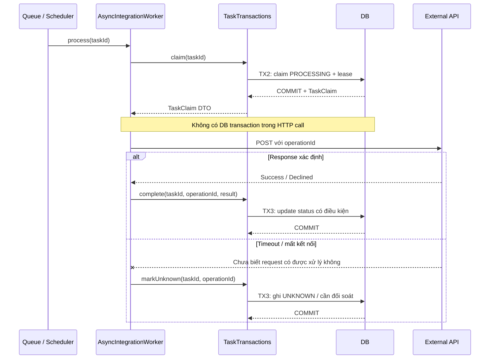
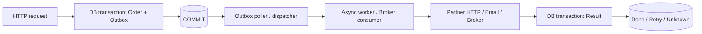

# Không giả định giao dịch hiện tại được truyền qua @Async

## 1. Bài toán: dữ liệu vừa ghi nhưng tác vụ bất đồng bộ chưa đọc được

Trong module **SPRING_BOOT_INTEGRATION**, một ứng dụng Spring Boot thường ghi dữ liệu vào cơ sở dữ liệu rồi kích hoạt công việc có I/O: gọi HTTP API, cập nhật cache, gửi email, đăng sự kiện sang broker hoặc chạy một adapter của Spring Integration. Để giảm thời gian phản hồi HTTP, lập trình viên có thể chuyển phần công việc phía sau sang phương thức đánh dấu `@Async`.

Ví dụ người dùng tạo đơn hàng; phương thức quản lý đơn hàng nằm trong transaction, rồi gọi một worker bất đồng bộ để gửi email xác nhận:

```java
@Service
public class OrderApplicationService {
    private final OrderRepository orders;
    private final EmailWorker emailWorker;

    public OrderApplicationService(OrderRepository orders,
                                   EmailWorker emailWorker) {
        this.orders = orders;
        this.emailWorker = emailWorker;
    }

    @Transactional
    public UUID createOrder(CreateOrderCommand command) {
        Order order = orders.save(Order.from(command));

        // Có thể được lên lịch trước khi transaction hiện tại commit!
        emailWorker.sendConfirmation(order.getId());
        return order.getId();
    }
}

@Service
public class EmailWorker {
    private final OrderRepository orders;
    private final EmailSender sender;

    public EmailWorker(OrderRepository orders, EmailSender sender) {
        this.orders = orders;
        this.sender = sender;
    }

    @Async("integrationExecutor")
    public void sendConfirmation(UUID orderId) {
        Order order = orders.findById(orderId).orElseThrow();
        sender.send(order.getEmail(), order.getId());
    }
}
```

Đoạn code giả định ứng dụng có `@EnableAsync` và một `Executor` mang tên `integrationExecutor`. `Order`, repository, command và email sender là các kiểu nghiệp vụ minh họa.

Vấn đề: **lúc `sendConfirmation()` bắt đầu chạy, transaction trong `createOrder()` chưa chắc đã commit**. Trong môi trường DB sử dụng cách ly phổ biến như `READ COMMITTED`, truy vấn trên một transaction/kết nối khác thường không thấy hàng vừa tạo nhưng chưa commit. Worker có thể ném “không tìm thấy đơn hàng”, dù request HTTP ban đầu sắp trả về thành công.

Một tình huống khác còn nguy hiểm hơn: worker nhận được thông tin đã truyền trực tiếp, gửi email thành công, sau đó transaction tạo đơn hàng rollback. Người dùng nhận thông báo cho một đơn hàng không tồn tại. `@Async` không khiến side effect ở SMTP/API ngoài rollback cùng dữ liệu DB.

```mermaid
sequenceDiagram
    participant C as Client
    participant O as OrderService - Thread A
    participant DB as Database
    participant W as EmailWorker - Thread B
    participant E as Email API
    C->>O: POST /orders
    O->>DB: BEGIN; INSERT order
    O->>W: Gọi @Async (đưa task vào executor)
    activate W
    W->>DB: SELECT order theo ID
    DB-->>W: Có thể chưa thấy vì Thread A chưa commit
    W-->>W: NotFound hoặc quyết định sai
    deactivate W
    O->>DB: COMMIT (xảy ra sau)
    O-->>C: 201 Created
    Note over O,W: @Async không chờ và không nhận transaction của caller
```

**Quy tắc cốt lõi:** không xem lời gọi `@Async` là phần tiếp nối của transaction hiện tại. Cần thiết kế rõ *thời điểm commit*, *giao dịch độc lập trong worker* và *cách khôi phục khi tiến trình chết*.

## 2. Transaction của Spring được gắn với thread như thế nào?

Trong mô hình transaction thông dụng của Spring dành cho JDBC/JPA, `PlatformTransactionManager` sử dụng `TransactionSynchronizationManager` để gắn những tài nguyên như kết nối JDBC, `EntityManager` và thông tin transaction/synchronization với **thread đang chạy**. Một phương thức được gọi qua proxy `@Transactional` mở hoặc tham gia transaction trên thread đó, rồi commit/rollback khi phương thức kết thúc theo quy tắc quản lý transaction.

`@Async` lại là cơ chế khác: Spring intercept lời gọi qua proxy và gửi công việc đến một `Executor`. Worker thường chạy trên **thread khác**. Các ThreadLocal gắn với caller **không tự được kế thừa như một transaction đang hoạt động**.

| Thành phần | Phạm vi thường gặp | Hệ quả khi gọi `@Async` |
| --- | --- | --- |
| JDBC connection/`EntityManager` gắn transaction | Thread caller | Worker không dùng chung transaction của caller |
| `TransactionSynchronizationManager` | ThreadLocal của thread hiện tại | Trạng thái transaction của caller không được chuyển tự động |
| Persistence context của JPA | Transaction/`EntityManager` tương ứng | Entity ở caller không còn được quản lý tự động trong worker |
| `@Async`/`TaskExecutor` | Một thread từ thread pool | Công việc có thời điểm bắt đầu/kết thúc độc lập |
| `MDC`, `SecurityContext`, request context | Có thể dựa vào thread hoặc cơ chế context khác | Không giả định được truyền; cần cơ chế phù hợp và kiểm soát |
| Redis, Kafka, HTTP client | Tài nguyên/hệ thống tích hợp bên ngoài | Không cùng ACID transaction với DB chỉ vì được gọi trong một method |

Không nên suy ra rằng `@Transactional` luôn “gắn transaction” vào mọi đoạn code có tên phương thức tương ứng. Với reactive transactions, Spring có thể dựa trên Reactor context thay vì ThreadLocal; một `@Async` trả `CompletableFuture` không tự bắc cầu transaction hoặc Reactor context. Bài học này tập trung vào **Spring Boot sử dụng JDBC/JPA và lập trình đồng bộ kết hợp @Async**.

### Ba sự thật cần nhớ

1. **Caller vẫn sở hữu transaction của caller.** Thread A có thể đang trong transaction `T1`; khi lên lịch `@Async`, `T1` vẫn tiếp tục trên A cho tới khi phương thức transactional kết thúc.
2. **Worker không nhận `T1`.** Thread B thường không có transaction ngay khi bắt đầu; nó chỉ có transaction nếu một lời gọi trên B thực sự mở transaction riêng, chẳng hạn qua bean `@Transactional`.
3. **Transaction riêng của worker không làm dữ liệu chưa commit trở nên nhìn thấy được.** Một transaction `T2` trên B với `REQUIRES_NEW` hoặc propagation mặc định vẫn chịu quy tắc visibility/isolation của DB.

```text
Thread A                           Thread B (executor)
--------                           -------------------
T1: BEGIN
INSERT orders
schedule @Async  ----------------> run task
                                  T2: BEGIN nếu worker mở transaction
                                  SELECT orders (có thể chưa thấy INSERT)
                                  T2: COMMIT / ROLLBACK
T1: COMMIT
```

Nếu worker được truyền một entity JPA từ transaction A, đó không phải cách chuyển giao transaction. Entity có thể trở thành detached ngoài persistence context ban đầu; lazy-loading có thể gây `LazyInitializationException`, và dùng cùng entity giữa các thread cũng dễ phát sinh lỗi tranh chấp. Hãy truyền **ID, version và dữ liệu bất biến cần thiết**; worker mở transaction riêng, tải lại/kiểm tra dữ liệu theo trạng thái đã commit.

## 3. @Async và @Transactional: ranh giới thật nằm ở proxy

`@Async` chỉ phát huy tác dụng trong cách cấu hình proxy thông dụng nếu lời gọi đi **qua Spring-managed proxy**. `@Transactional` cũng thường được áp dụng bằng AOP proxy. Vì vậy phải hiểu vị trí đặt annotation và đường gọi thực tế.

### 3.1. Cấu hình executor có giới hạn

Ví dụ cấu hình Spring Boot:

```java
import java.util.concurrent.ThreadPoolExecutor;

import org.springframework.context.annotation.Bean;
import org.springframework.context.annotation.Configuration;
import org.springframework.scheduling.annotation.EnableAsync;
import org.springframework.scheduling.concurrent.ThreadPoolTaskExecutor;

@Configuration(proxyBeanMethods = false)
@EnableAsync
public class IntegrationAsyncConfiguration {

    @Bean(name = "integrationExecutor")
    public ThreadPoolTaskExecutor integrationExecutor() {
        ThreadPoolTaskExecutor executor = new ThreadPoolTaskExecutor();
        executor.setCorePoolSize(4);
        executor.setMaxPoolSize(8);
        executor.setQueueCapacity(200);
        executor.setThreadNamePrefix("integration-");
        executor.setRejectedExecutionHandler(
                new ThreadPoolExecutor.AbortPolicy());
        executor.initialize();
        return executor;
    }
}
```

Các giá trị pool chỉ minh họa. Cần sizing theo latency, throughput, tải downstream, memory và giới hạn connection pool. Executor có queue **không vô hạn** sẽ bảo vệ tiến trình khi downstream chậm; nhưng khi hết khả năng nhận công việc, executor có thể **reject** ngay lúc gọi `@Async`. Caller cần có chính sách phù hợp cho lỗi từ chối này.

`@EnableAsync` kích hoạt xử lý `@Async`. `@Transactional` trong ứng dụng Spring Boot có cấu hình transaction manager phù hợp hoạt động theo cơ chế transaction interception; không được suy rằng bật `@EnableAsync` làm các giao dịch tự xuất hiện hoặc được truyền qua thread.

### 3.2. Self-invocation làm @Async không chạy bất đồng bộ

Ví dụ sau dễ gây hiểu nhầm:

```java
@Service
class BrokenOrderService {

    @Transactional
    public void submit(UUID orderId) {
        // Lời gọi trực tiếp bên trong cùng object bỏ qua proxy mặc định.
        this.sendAsync(orderId);
    }

    @Async("integrationExecutor")
    public void sendAsync(UUID orderId) {
        // Có thể thực thi trên chính thread submit()!
    }
}
```

Trong proxy mode thông thường, `this.sendAsync(...)` không đi qua proxy, nên `@Async` có thể **không được áp dụng**. Khi đó method được gọi đồng bộ ngay trong transaction caller, dễ che giấu race ở môi trường phát triển.

Tương tự, một method `@Transactional` được gọi bằng `this.otherTransactionalMethod()` thường bỏ qua transaction advice nếu không qua proxy. Hãy đặt async entrypoint và các transaction method cần được intercept trong **những bean riêng**, dùng constructor injection, và test đường gọi thực tế từ Spring context.

### 3.3. Đặt @Async và @Transactional trên cùng method có được không?

Một method có thể khai báo cả hai annotation:

```java
@Async("integrationExecutor")
@Transactional
public CompletableFuture<Void> updateSomething(UUID id) {
    // Khi interceptor thực sự chạy ở worker,
    // transaction ở đây là transaction riêng của worker.
    return CompletableFuture.completedFuture(null);
}
```

Cách này **không phải cách truyền transaction của caller**. Khi được Spring AOP intercept đúng và transaction được mở trên worker thread, đó là **transaction khác**. Interceptor ordering và loại proxy có thể ảnh hưởng hành vi trong cấu hình phức tạp; đừng giả định rằng hai annotation sẽ tạo ranh giới thích hợp cho mọi luồng.

Đặc biệt nguy hiểm khi method vừa mở transaction riêng, vừa gọi HTTP/API ngoài chậm: transaction của worker có thể kéo dài trong lúc chờ mạng. Với quy trình tích hợp, rõ ràng hơn là **@Async trên orchestrator và @Transactional trên các bước DB ngắn ở bean riêng**.

## 4. Mẫu an toàn: @Async điều phối, transaction ngắn ở bean khác

Giả sử yêu cầu gửi thông báo ra hệ thống ngoài được lưu với `taskId`. Worker phải:

1. Claim công việc trong một transaction ngắn, kiểm tra có quyền xử lý và lấy dữ liệu cần thiết.
2. Sau khi transaction đó đã commit, gọi HTTP/SMTP/broker **bên ngoài DB transaction**.
3. Mở transaction mới ghi kết quả hoặc trạng thái cần đối soát.



Ví dụ code, trong đó các kiểu `TaskClaim`, `ExternalResult` và repository là thành phần nghiệp vụ do ứng dụng định nghĩa:

```java
import java.util.UUID;
import java.util.concurrent.CompletableFuture;

import org.springframework.scheduling.annotation.Async;
import org.springframework.stereotype.Service;

@Service
public class AsyncIntegrationWorker {

    private final TaskTransactions transactions;
    private final PartnerClient partnerClient;

    public AsyncIntegrationWorker(TaskTransactions transactions,
                                  PartnerClient partnerClient) {
        this.transactions = transactions;
        this.partnerClient = partnerClient;
    }

    @Async("integrationExecutor")
    public CompletableFuture<Void> process(UUID taskId) {
        // Bean khác tạo TX #1 cho worker và commit khi return.
        TaskClaim claim = transactions.claimIfReady(taskId);
        if (claim == null) {
            return CompletableFuture.completedFuture(null);
        }

        try {
            // Không chạy trong DB transaction.
            ExternalResult result = partnerClient.execute(
                    claim.operationId(), claim.payload());

            // Bean khác tạo TX #2, cập nhật có điều kiện.
            transactions.recordResult(
                    claim.taskId(), claim.operationId(), result);
        } catch (PartnerOutcomeUnknownException ex) {
            // Timeout thường không chứng minh downstream chưa xử lý.
            transactions.markUnknown(
                    claim.taskId(), claim.operationId());
        }

        return CompletableFuture.completedFuture(null);
    }
}
```

```java
import java.util.UUID;

import org.springframework.stereotype.Service;
import org.springframework.transaction.annotation.Transactional;

@Service
public class TaskTransactions {

    private final TaskRepository tasks;

    public TaskTransactions(TaskRepository tasks) {
        this.tasks = tasks;
    }

    @Transactional
    public TaskClaim claimIfReady(UUID taskId) {
        // Lưu ý: repository phải dùng conditional UPDATE/version/lock ngắn
        // để hai worker không cùng claim một task.
        return tasks.claimAndReturnSnapshot(taskId);
    }

    @Transactional
    public void recordResult(
            UUID taskId, UUID operationId, ExternalResult result) {
        tasks.updateResultIfCurrent(taskId, operationId, result);
    }

    @Transactional
    public void markUnknown(UUID taskId, UUID operationId) {
        tasks.markUnknownIfCurrent(taskId, operationId);
    }
}
```

`claimAndReturnSnapshot`, `updateResultIfCurrent` và `markUnknownIfCurrent` là **hợp đồng repository minh họa**, không phải method có sẵn của Spring Data. Bản triển khai cần có compare-and-set/trạng thái có điều kiện, optimistic locking (`@Version`) hoặc cơ chế claim có lease phù hợp.

Lợi ích ở đây **không nằm ở việc @Async tự tạo transaction**. Worker chỉ điều phối trên thread riêng; từng lời gọi đến bean `TaskTransactions` mới thiết lập transaction cục bộ. Không giữ JDBC connection/row lock xuyên suốt lời gọi HTTP. Nếu external call là read-only, việc retry có thể đơn giản hơn; nếu nó tạo side effect (thanh toán, đặt vận đơn, phát voucher), phải dùng operation ID ổn định và idempotency ở nơi xử lý thật.

**Các trường hợp phải thiết kế thêm:**

- Crash **sau khi claim, trước khi gọi partner**: task bị kẹt ở `PROCESSING`, cần lease expiry hoặc job khôi phục.
- Crash **sau khi partner thành công, trước khi ghi result**: phải đối soát hoặc retry an toàn với cùng operation ID.
- Lỗi ghi `UNKNOWN`: task không được xem là đã hoàn tất; job sửa chữa rà soát `PROCESSING` quá hạn.
- Hai worker nhận cùng task: cần claim nguyên tử; không dựa vào `@Async` hay Java `synchronized` trên một instance để bảo vệ nhiều instance.
- Response đến muộn: chỉ cập nhật nếu trạng thái và `operationId` còn hợp lệ; không cho kết quả cũ ghi đè kết quả mới.

## 5. Trật tự commit và thời điểm kích hoạt tác vụ

Ngay cả khi worker có transaction riêng, vấn đề chính của ví dụ mở đầu vẫn tồn tại: **task được lên lịch trước khi caller commit**. Phải xác định yêu cầu công việc có được phép chạy khi transaction đang mở hay không.

### 5.1. Không phát công việc phụ thuộc dữ liệu chưa commit

```text
Nguy hiểm:
  Thread A: BEGIN -> INSERT order -> @Async(orderId) -> COMMIT
  Thread B:                   SELECT order ? (có thể không thấy)

Điều mong muốn:
  Thread A: BEGIN -> INSERT order -> COMMIT
  Thread B:                             xử lý orderId
```

Tách hai phương thức theo thứ tự trên cùng một request có thể đạt được nếu **commit thực sự hoàn tất** trước khi gọi `@Async`:

```java
@Service
public class CheckoutCoordinator {
    private final OrderTransactions orderTransactions;
    private final AsyncIntegrationWorker worker;

    public CheckoutCoordinator(OrderTransactions orderTransactions,
                               AsyncIntegrationWorker worker) {
        this.orderTransactions = orderTransactions;
        this.worker = worker;
    }

    // Phương thức này KHÔNG có @Transactional.
    public UUID checkout(CheckoutCommand command) {
        UUID orderId = orderTransactions.persistOrder(command);
        // persistOrder() là method @Transactional ở bean khác;
        // commit thành công rồi method mới return.
        worker.process(orderId);
        return orderId;
    }
}
```

Cách này cho worker nhìn thấy dữ liệu đã commit **khi lời gọi persistOrder chạy qua proxy Spring và commit thành công**. Tuy nhiên có một khoảng hở:

1. Transaction DB commit thành công.
2. Ứng dụng crash hoặc executor từ chối công việc.
3. `worker.process(orderId)` chưa được lên lịch.

Đơn hàng tồn tại nhưng công việc phụ thuộc có thể **không bao giờ được thực hiện**. Vì thế đây chỉ thích hợp khi công việc là best-effort hoặc có một cơ chế quét/khôi phục độc lập.

### 5.2. Dùng @TransactionalEventListener(AFTER_COMMIT) khi tác vụ có thể mất

Để tránh worker chạy trước commit, Spring hỗ trợ event listener gắn với transaction:

```java
public record OrderCreatedEvent(UUID orderId) {}

@Service
public class OrderCommandService {
    private final OrderRepository orders;
    private final ApplicationEventPublisher events;

    public OrderCommandService(OrderRepository orders,
                               ApplicationEventPublisher events) {
        this.orders = orders;
        this.events = events;
    }

    @Transactional
    public UUID createOrder(CreateOrderCommand command) {
        Order order = orders.save(Order.from(command));
        events.publishEvent(new OrderCreatedEvent(order.getId()));
        return order.getId();
    }
}

@Component
public class OrderCreatedListener {
    private final AsyncIntegrationWorker worker;

    public OrderCreatedListener(AsyncIntegrationWorker worker) {
        this.worker = worker;
    }

    @TransactionalEventListener(
            phase = TransactionPhase.AFTER_COMMIT)
    public void onOrderCreated(OrderCreatedEvent event) {
        worker.process(event.orderId());
    }
}
```

Các import chính:

```java
import org.springframework.context.ApplicationEventPublisher;
import org.springframework.context.event.EventListener;
import org.springframework.stereotype.Component;
import org.springframework.stereotype.Service;
import org.springframework.transaction.annotation.Transactional;
import org.springframework.transaction.event.TransactionPhase;
import org.springframework.transaction.event.TransactionalEventListener;
```

Không cần `@Async` trên listener ở ví dụ này vì listener **gọi sang bean worker đã @Async**; callback chỉ thực hiện thao tác lên lịch. Có thể thêm `@Async` lên listener trong một số cấu hình, nhưng không làm nó bền vững hơn.

`@TransactionalEventListener(AFTER_COMMIT)` chỉ kích hoạt listener khi transaction đã commit; với cấu hình mặc định, event được publish **ngoài một transaction** sẽ không kích hoạt listener nếu không đặt `fallbackExecution = true`. Nếu bật fallback, phải hiểu khác biệt khi không có transaction.

**Giới hạn lớn:** đây là event **trong bộ nhớ tiến trình**. Nếu ứng dụng crash sau DB commit nhưng trước khi listener gửi công việc tới executor, tác vụ vẫn mất. Kể cả khi listener đã gửi thành công, tiến trình có thể crash khi công việc chưa xử lý. Vì thế chỉ chọn cách này khi việc mất notification không nghiêm trọng hoặc có cơ chế quét bổ sung. Đừng dùng nó như bảo đảm exactly-once hay giao dịch phân tán.

**Một chi tiết transaction:** callback `AFTER_COMMIT` có thể được gọi khi tài nguyên transaction cũ còn gắn với thread trong pha completion. Nếu listener cần ghi DB mới một cách bền vững trên chính thread đó, nên dùng transaction rõ ràng như `REQUIRES_NEW` qua bean khác; không tự giả định mọi thao tác sẽ được commit thành transaction mới. Trong ví dụ, listener chỉ lên lịch `@Async`, và việc ghi DB nằm trong các transaction riêng của worker.

### 5.3. Khi cần không mất công việc: transactional outbox

Nếu yêu cầu như “đơn hàng đã commit thì chắc chắn phải có yêu cầu phát sự kiện/gửi email/đồng bộ ERP”, dùng **transactional outbox** hoặc giải pháp lưu job bền vững tương đương.



Trong **một transaction DB**, lưu cả dữ liệu nghiệp vụ và hàng đợi công việc:

```java
@Service
public class OrderSubmissionService {
    private final OrderRepository orders;
    private final OutboxRepository outbox;

    public OrderSubmissionService(OrderRepository orders,
                                  OutboxRepository outbox) {
        this.orders = orders;
        this.outbox = outbox;
    }

    @Transactional
    public UUID submit(CreateOrderCommand command) {
        Order order = orders.save(Order.from(command));
        outbox.save(OutboxMessage.orderCreated(
                order.getId(),
                order.getIntegrationOperationId()));
        return order.getId();
    }
}
```

Sau `COMMIT`, một **poller/dispatcher** tìm outbox chưa xử lý, claim bằng transaction ngắn và giao cho worker. Khi tiến trình khởi động lại, outbox vẫn còn trong DB nên có thể tiếp tục công việc. Cần có lease/claim nguyên tử, retry/backoff và xử lý công việc quá hạn. Nếu poller đẩy việc vào executor trong bộ nhớ, **không được đánh dấu outbox là DONE ngay khi executor chấp nhận**; hoàn tất chỉ được ghi khi tác dụng phụ đã được xác nhận theo hợp đồng.

Outbox bảo đảm *yêu cầu cần xử lý được lưu cùng transaction nghiệp vụ*, không đảm bảo side effect ở hệ thống ngoài chỉ diễn ra một lần. Worker có thể crash sau khi API ngoài thành công nhưng trước khi đánh dấu outbox hoàn tất; lần xử lý tiếp theo có thể gọi lại. Vì vậy phải thiết kế **at-least-once + idempotency**, hoặc đối soát nếu nhà cung cấp không có idempotency.

## 6. @Transactional trong worker có phải REQUIRES_NEW không?

Giả sử một async worker thực thi:

```java
@Service
class AsyncAuditWorker {
    private final AuditTransactions auditTransactions;

    AsyncAuditWorker(AuditTransactions auditTransactions) {
        this.auditTransactions = auditTransactions;
    }

    @Async("integrationExecutor")
    public CompletableFuture<Void> run(UUID orderId) {
        auditTransactions.writeAudit(orderId);
        return CompletableFuture.completedFuture(null);
    }
}

@Service
class AuditTransactions {
    private final AuditRepository audits;

    AuditTransactions(AuditRepository audits) {
        this.audits = audits;
    }

    @Transactional
    public void writeAudit(UUID orderId) {
        audits.save(new AuditEntry(orderId, "ASYNC_STARTED"));
    }
}
```

Transaction của `writeAudit` **được mở trên thread của worker**, bởi lời gọi qua Spring proxy. Vì thread worker không có transaction caller được tự truyền sang, propagation mặc định `REQUIRED` thường tạo transaction mới. Việc đổi thành `REQUIRES_NEW` **không khiến method tham gia hay tách transaction của caller đang chạy trên thread khác**.

Bảng phân biệt:

| Vị trí gọi `@Transactional` | `REQUIRED` | `REQUIRES_NEW` |
| --- | --- | --- |
| Cùng thread, bên trong transaction có sẵn | Tham gia transaction hiện có | Đình chỉ transaction hiện có, tạo transaction mới theo manager |
| Thread worker chưa có transaction | Tạo transaction mới | Tạo transaction mới |
| Worker đang có transaction riêng | Tham gia transaction của worker | Tách khỏi transaction của worker và tạo transaction khác |
| Mục tiêu “đọc dữ liệu caller chưa commit” | **Không được giải quyết** | **Không được giải quyết** |

Trong một số cấu hình `JtaTransactionManager` và giao dịch phân tán đặc thù có khả năng điều phối nhiều tài nguyên, ranh giới giao dịch vẫn phải được thiết kế rõ; không nên lấy những trường hợp này làm mặc định cho JDBC/JPA với `@Async`.

`REQUIRES_NEW` còn có chi phí: nếu transaction đang hoạt động trên **cùng thread**, tài nguyên của transaction ngoài có thể vẫn bị giữ trong khi transaction con cần thêm connection. Với nhiều request đồng thời, dùng không cân nhắc có thể làm cạn pool. Khi code gọi external API, không bao toàn bộ khoảng chờ mạng bằng một transaction chỉ để “an toàn”.

## 7. Xử lý kết quả và ngoại lệ bất đồng bộ

Với `@Async`, giá trị trả về thường là `void` hoặc kiểu future được hỗ trợ, chẳng hạn `CompletableFuture<T>`. Caller không nhận exception của worker như lời gọi đồng bộ thông thường.

### 7.1. @Async trả void

```java
@Async("integrationExecutor")
public void refreshExternalSnapshot(UUID id) {
    externalGateway.refresh(id);
}
```

Nếu `externalGateway.refresh` ném exception, caller đã trở về và không thể `try/catch` theo cách đồng bộ để nhận exception phát sinh sau đó. Với method trả `void`, có thể đăng ký `AsyncUncaughtExceptionHandler` để ghi nhận lỗi không được xử lý, nhưng handler **không tự retry, không phục hồi dữ liệu và không biến task thành bền vững**. Đừng dùng `void` cho tác vụ quan trọng nếu không có bảng trạng thái/queue và cơ chế giám sát kết quả.

### 7.2. @Async trả CompletableFuture

```java
@Async("integrationExecutor")
public CompletableFuture<ExternalResult> load(UUID id) {
    ExternalResult result = externalGateway.fetch(id);
    return CompletableFuture.completedFuture(result);
}
```

Caller có thể theo dõi kết quả:

```java
CompletableFuture<ExternalResult> future = worker.load(id);

future.whenComplete((result, error) -> {
    if (error != null) {
        // Ghi log/metrics có correlation ID; cần kế hoạch recovery riêng.
        logger.warn("Async integration failed for task {}", id, error);
    }
});

// Chỉ đợi bằng join() nếu yêu cầu nghiệp vụ thực sự cần đồng bộ.
```

Spring sẽ cung cấp future đại diện cho thực thi bất đồng bộ; method có thể trả `completedFuture(...)` ở bên trong worker rồi framework chuyển kết quả về future ở phía caller. Exception trong worker thường làm future hoàn tất **exceptionally**, và `join()` sẽ có thể ném `CompletionException` bao bọc nguyên nhân.

**Không gọi `future.join()` ngay khi transaction caller đang mở** để “đợi worker đọc dữ liệu vừa lưu”: worker có thể đang chờ lock hoặc không nhìn thấy dữ liệu trước commit, còn caller lại chờ worker kết thúc trước khi commit. Điều này gây deadlock logic hoặc timeout. Nếu cần kết quả ngay, hãy cân nhắc xử lý đồng bộ ở bước hợp lý hoặc hoàn tất transaction trước khi chờ.

### 7.3. Executor rejection là một lỗi khác với lỗi của worker

Khi queue đầy hoặc executor đang shutdown, lời gọi lên lịch `@Async` có thể bị từ chối **trước khi worker bắt đầu**. Lỗi từ chối không giống exception I/O xảy ra khi worker đang gọi downstream. Với yêu cầu quan trọng, một outbox/queue bền vững giúp có đường phục hồi độc lập với trạng thái của executor.

Không dùng unbounded queue chỉ để tránh rejection: nó có thể làm tăng độ trễ vô hạn và áp lực bộ nhớ. Cần quan sát queue depth, active threads, rejection count, task age, downstream latency và trạng thái `UNKNOWN`/`RETRY`.

## 8. Context khác có thể truyền, nhưng transaction thì sao?

Một số ứng dụng cần gắn `traceId`, `tenantId`, `SecurityContext` hoặc MDC vào tác vụ để log, audit và kiểm soát quyền. Các thông tin này có thể được truyền tường minh qua DTO, hoặc dùng `TaskDecorator`/cơ chế context propagation phù hợp.

Ví dụ truyền dữ liệu nghiệp vụ tường minh:

```java
public record IntegrationCommand(
        UUID taskId,
        String tenantId,
        String correlationId,
        UUID operationId) {}

@Async("integrationExecutor")
public CompletableFuture<Void> process(IntegrationCommand command) {
    // tenantId và correlationId là dữ liệu đầu vào đã kiểm tra.
    // Transaction DB vẫn phải được tạo riêng khi gọi repository/service.
    transactions.claimForTenant(
            command.taskId(), command.tenantId(), command.operationId());
    return CompletableFuture.completedFuture(null);
}
```

Cần thẩm định authorization/tenant trên server từ nguồn đáng tin cậy; không tin một `tenantId` chỉ vì client gửi trong request. Context cho logging không thay thế thông tin bảo mật dùng để ra quyết định truy cập dữ liệu.

| Loại context | Có thể truyền qua executor? | Có thể xem là transaction caller? |
| --- | --- | --- |
| Correlation ID / MDC | Có, với decorator/propagation hoặc field DTO | **Không** |
| `SecurityContext` | Có, với executor/decorator chuyên dụng khi phù hợp | **Không** |
| Locale / request metadata | Có thể truyền chọn lọc | **Không** |
| `TransactionSynchronizationManager` của JDBC/JPA | Không nên sao chép thủ công sang thread khác | **Không** |
| `EntityManager` / JDBC connection đang thuộc transaction | Không chia sẻ tùy tiện giữa các thread | **Không** |

Đặc biệt không viết một `TaskDecorator` để sao chép `TransactionSynchronizationManager`/`EntityManager` sang worker thread nhằm “duy trì transaction”. Các tài nguyên này có quy tắc sở hữu và vòng đời; chia sẻ giữa các thread có thể gây tranh chấp kết nối, hỏng trạng thái và hành vi commit/rollback không xác định. Nếu một tác vụ cần dữ liệu, truyền ID rồi tạo một transaction mới đúng thời điểm.

## 9. Kiểm thử để chứng minh không phụ thuộc transaction caller

Một test chỉ gọi method `@Async` rồi thấy nó thực thi là chưa đủ. Cần kiểm tra **thread thực thi, trạng thái transaction và thời điểm commit**, đặc biệt ở luồng lưu DB rồi gửi thông điệp.

### 9.1. Kiểm tra trạng thái transaction của worker

Trong môi trường dùng transaction manager thông thường, có thể dùng `TransactionSynchronizationManager.isActualTransactionActive()` để ghi nhận transaction ở từng đoạn. Ví dụ:

```java
import org.springframework.transaction.support.TransactionSynchronizationManager;

boolean active =
        TransactionSynchronizationManager.isActualTransactionActive();
```

Giá trị này cho biết trạng thái transaction của **thread hiện tại** theo Spring, không thể tự dùng để khẳng định giao dịch của một thread khác đã commit. Ở phía caller trong phương thức `@Transactional`, thường là `true`; ở đầu async orchestrator không có `@Transactional`, thường là `false`; trong `TaskTransactions.claimIfReady(...)` được intercept, là `true`.

**Lưu ý thiết kế test:** không đặt `@Transactional` trên toàn bộ test method rồi mong worker đọc được hàng vừa insert bằng transaction test chưa commit. Spring Test thường rollback test transaction cuối test; worker thread vẫn có phạm vi transaction riêng và không nhìn thấy dữ liệu chưa commit. Để thử tình huống sau commit, hãy dùng `TransactionTemplate`, `TestTransaction.end()` (trong test phù hợp) hoặc chia bước với transaction thật đã commit.

### 9.2. Test có kiểm soát thứ tự thay vì sleep

Để chứng minh race trong mẫu sai, có thể dùng `CountDownLatch` để đặt các điểm đồng bộ:

```text
Thread A (transaction ghi)          Thread B (@Async)
---------------------------         -----------------------
BEGIN, INSERT order
signal "insert complete"
                                    await "insert complete"
                                    SELECT order (trước commit)
                                    ghi nhận có/không nhìn thấy
await "worker observed"
COMMIT
```

Với database thật và mức cách ly phù hợp, bài kiểm thử này có thể cho thấy worker không nhìn thấy bản ghi chưa commit. Dùng latch có timeout để tránh test bị kẹt. **Không giữ transaction chưa commit và chờ worker thực hiện ghi vào cùng dòng bị khóa**, vì test có thể deadlock do chính thiết kế kiểm thử.

Một test cho mẫu đúng nên kiểm tra:

1. Transaction tạo đơn hàng đã commit, sau đó worker mới được giao task.
2. Worker có thể đọc đơn hàng trên connection riêng.
3. External API bị delay không giữ lock/connection của transaction claim/complete.
4. Timeout không bị map nhầm thành `FAILED` nếu side effect chưa được xác minh.
5. Crash/khởi động lại sau commit vẫn khôi phục task từ outbox.
6. Hai worker claim cùng một task không tạo hai side effect ngoài ý muốn.
7. Exception/timeout trong worker được ghi nhận qua future hoặc trạng thái DB, không biến mất khỏi hệ thống quan sát.

Test có thể dùng Testcontainers cho PostgreSQL/MySQL, WireMock hoặc HTTP stub cho partner, và công cụ kiểm thử message broker nếu luồng thực sự sử dụng Kafka/RabbitMQ. Mock repository thuần Mockito không đủ để chứng minh visibility và lock của transaction thật.

### 9.3. Một số tình huống kỳ vọng

| Trường hợp | Kỳ vọng |
| --- | --- |
| Caller rollback sau khi đã gọi `@Async` | Không phát tác vụ nghiệp vụ như thể đơn hàng đã commit; outbox cùng transaction phải rollback |
| Caller commit nhưng ứng dụng crash trước khi schedule | Outbox còn bản ghi cần xử lý; worker phục hồi sau restart |
| Worker gọi HTTP thành công, ghi DB result lỗi | Task còn trạng thái cần đối soát; không tạo operation ID mới khi retry |
| Worker timeout, partner đã thực hiện request | Dùng idempotency key/truy vấn trạng thái, không mặc định FAILED |
| Worker bị executor reject | Task bền vững còn chờ, có cảnh báo/điều tiết tải |
| `@Async` bị self-invocation | Test phát hiện method thực tế chạy cùng thread; sửa đường gọi qua proxy |
| Worker dùng `REQUIRES_NEW` | Transaction riêng mở trên worker; không thấy dữ liệu chưa commit của caller |
| Trace ID/MDC vắng trên worker | Chỉ sửa cách truyền observability context; không cố truyền transaction |
| Event `AFTER_COMMIT` không được gọi khi publish ngoài transaction | Xác minh `fallbackExecution` và phạm vi transaction đúng theo hợp đồng |

## 10. Những lỗi phổ biến cần tránh

| Cách viết/tư duy | Vì sao sai | Hướng sửa |
| --- | --- | --- |
| “`@Transactional` ở caller, vậy `@Async` kế thừa transaction” | Transaction JDBC/JPA thường gắn với thread, worker là thread khác | Coi worker như một đơn vị công việc độc lập |
| Truyền JPA entity vào async method rồi truy cập lazy relation | Persistence context của caller không đi theo; entity không an toàn để chia sẻ | Truyền ID/DTO và tải lại trong transaction riêng |
| Gọi `this.asyncMethod()` trong cùng bean | Self-invocation có thể bỏ qua Spring AOP proxy | Tách bean và gọi qua proxy |
| Đặt `@Async` và `@Transactional` trên cùng method rồi gọi HTTP chậm | Worker có thể giữ transaction dài khi chờ mạng | Async orchestrator + transaction DB ngắn ở bean khác |
| Dùng `REQUIRES_NEW` trên worker để đọc hàng caller chưa commit | Isolation không cho phép tự nhiên nhìn dữ liệu chưa commit | Chỉ kích hoạt sau commit hoặc dùng outbox |
| `@TransactionalEventListener(AFTER_COMMIT)` được xem là queue bền vững | Event và công việc trong bộ nhớ có thể mất khi process crash | Transactional outbox/broker bền vững |
| Đánh dấu task DONE ngay khi gọi `worker.process(...)` | Task có thể chưa chạy, thất bại hoặc bị reject | Chỉ hoàn tất sau kết quả xác định/đối soát |
| Dùng `CompletableFuture.join()` trong transaction caller | Caller chờ worker nhưng worker cần dữ liệu commit/lock | Commit trước, hoặc thiết kế đáp ứng bất đồng bộ |
| Retry POST với operation ID mới sau timeout | Downstream có thể đã thành công, sinh side effect trùng | Dùng operation ID ổn định và idempotency/đối soát |
| Copy ThreadLocal transaction sang executor | Chia sẻ tài nguyên transaction sai vòng đời/thread | Chỉ truyền context phi-transaction phù hợp |
| Dùng queue executor vô hạn | Tích lũy task, kéo dài thời gian xử lý, tăng memory | Pool/queue có giới hạn, backpressure và cảnh báo |

## 11. Checklist trước khi đưa quy trình @Async vào production

- Chỉ rõ **transaction nào ghi dữ liệu nghiệp vụ**, transaction nào claim và cập nhật kết quả của worker.
- Xác nhận **không cần đọc dữ liệu chưa commit**; nếu cần dùng dữ liệu đã lưu, worker chỉ bắt đầu sau commit thực sự.
- Không kỳ vọng `@Async` truyền JDBC/JPA transaction, persistence context hoặc JPA managed entity sang thread khác.
- Kiểm tra lời gọi `@Async` đi qua Spring proxy và `@EnableAsync` đã hoạt động.
- Đặt method transactional được worker gọi trong bean khác và giữ DB transaction **ngắn**, bên ngoài HTTP/SMTP/broker I/O.
- Nếu tác vụ phải được thực hiện dù tiến trình crash, dùng **outbox/job table hoặc broker bền vững**, không chỉ executor in-memory hay event sau commit.
- Tạo khóa `operationId`/idempotency key ổn định; định nghĩa trạng thái `PENDING`, `PROCESSING`, `UNKNOWN`, `DONE`, `RETRY` và cách đối soát.
- Giới hạn executor, số lần retry, timeout outbound, queue depth và lease; có báo động task quá hạn hoặc liên tục lỗi.
- Truyền correlation ID và thông tin tenant cần thiết có kiểm soát; không sao chép transaction ThreadLocal.
- Test visibility/commit thật, lỗi worker, executor rejection và crash quanh mỗi lần commit; xác minh không xuất hiện side effect lặp.

**Quy tắc thực hành:** `@Async` đổi **thread thực thi và thời điểm chạy**, không vận chuyển transaction của phương thức gọi. Trong Spring Boot Integration, hãy để mỗi transaction DB bảo vệ một đoạn thay đổi dữ liệu cục bộ thật ngắn, và đặt ranh giới rõ ràng giữa **commit dữ liệu**, **lên lịch công việc bền vững**, **gọi hệ thống ngoài** và **ghi nhận kết quả**. Cách này giúp các luồng kết hợp HTTP client, DB, cache, broker thông điệp và Spring Integration adapter phục hồi an toàn khi có timeout, retry, crash và xử lý trùng lặp.

### Tài liệu tham khảo

- [Spring Framework Reference — Task Execution and Scheduling](https://docs.spring.io/spring-framework/reference/integration/scheduling.html): `@Async`, task executor và exception handling.
- [Spring Framework Reference — Declarative Transaction Management](https://docs.spring.io/spring-framework/reference/data-access/transaction/declarative.html): interceptor, propagation và ranh giới transaction.
- [Spring Framework API — TransactionSynchronizationManager](https://docs.spring.io/spring-framework/docs/current/javadoc-api/org/springframework/transaction/support/TransactionSynchronizationManager.html): tài nguyên và synchronization của thread.
- [Spring Framework Reference — Transaction-bound Events](https://docs.spring.io/spring-framework/reference/data-access/transaction/event.html): `@TransactionalEventListener` và các phase.
- [Spring Boot Reference — Task Execution and Scheduling](https://docs.spring.io/spring-boot/reference/features/task-execution-and-scheduling.html): cấu hình executor và tác vụ trong ứng dụng Boot.
