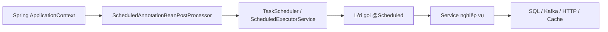
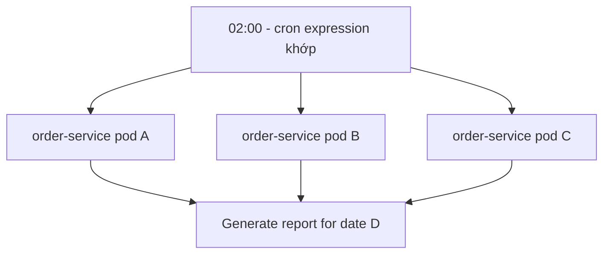
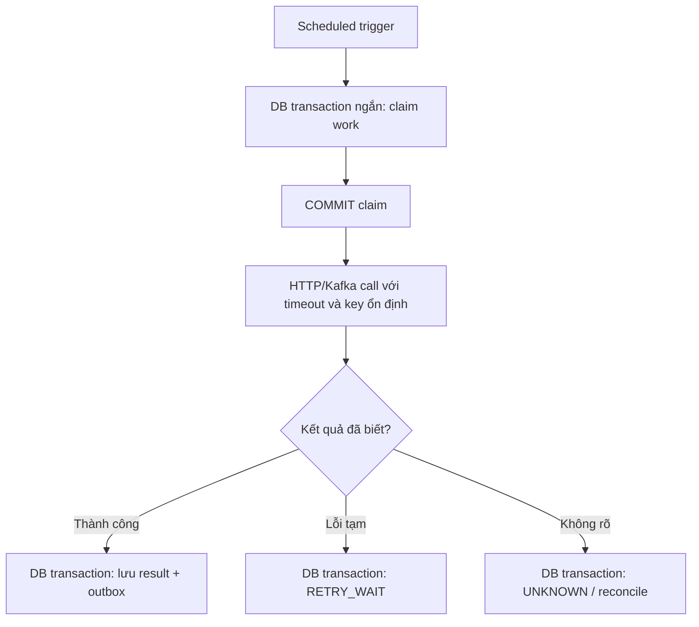

# @Scheduled, fixedRate, fixedDelay và cron

Trong một ứng dụng Spring Boot, không phải mọi công việc đều bắt đầu từ HTTP request hoặc bản tin broker. Có những việc cần tự chạy theo thời gian: lấy các bản ghi outbox chưa phát sang Kafka, đối soát giao dịch thanh toán với đối tác, làm mới cache, đánh dấu đơn hàng hết hạn, dọn dữ liệu đã qua thời gian lưu giữ hoặc tạo báo cáo cuối ngày. Spring Framework cung cấp `@Scheduled` để khai báo những công việc như vậy ngay trên một method của Spring bean.

Nhìn qua, `fixedRate`, `fixedDelay` và `cron` đều là cách “chạy định kỳ”. Nhưng chúng trả lời ba câu hỏi khác nhau:

- **`fixedRate`:** cố gắng kích hoạt theo **nhịp thời gian cố định giữa các lần bắt đầu**.
- **`fixedDelay`:** bắt đầu lần kế tiếp **sau khi lần trước hoàn tất rồi chờ thêm một khoảng**.
- **`cron`:** kích hoạt khi **đồng hồ và lịch** khớp một biểu thức.

Sự khác nhau này quyết định khả năng backlog, tần suất gọi API, cách xử lý khi một công việc chạy lâu, và liệu nhiều instance có cùng thực hiện một side effect hay không. `@Scheduled` cung cấp *cơ chế kích hoạt* trong một tiến trình Spring; nó không tự cấp phát distributed lock, không lưu durable job queue, không đảm bảo exactly-once và không tự bảo vệ một khoản thanh toán khỏi chạy trùng.

Bài thuộc chương **Tác vụ bất đồng bộ** của mô-đun **SPRING_BOOT_INTEGRATION**. Ngữ cảnh là các luồng Spring Boot tích hợp HTTP client, SQL, cache, Kafka/RabbitMQ và Spring Integration adapters, nơi cần quản lý cấu hình, hợp đồng dữ liệu, transaction, lỗi, idempotency, kiểm thử và observability. Ví dụ chủ yếu dành cho Spring Boot 3.x và Spring Framework 6.x; các hành vi có chú thích phụ thuộc phiên bản cần được xác minh với version đang dùng.

## 1. Mục tiêu học tập

Sau bài học, bạn có thể:

1. Bật Spring Scheduling và triển khai tác vụ `@Scheduled` dùng cấu hình externalized.
2. Đọc đúng thời điểm chạy của `fixedRate`, `fixedDelay`, `initialDelay` và `cron` bằng timeline cụ thể.
3. Viết biểu thức cron **sáu trường** của Spring, đặt múi giờ tường minh và xử lý ngày bị thiếu/lặp do DST.
4. Phân biệt scheduler thread, executor cho `@Async`, concurrency giữa nhiều jobs và nhiều replicas.
5. Nhận diện các trường hợp một tác vụ bị kích hoạt nhiều lần, job chạy quá lâu hoặc không được chạy khi process tắt.
6. Kết hợp scheduled job với SQL transaction, idempotency, inbox/outbox, phân quyền và HTTP/Kafka retry.
7. Lựa chọn `@Scheduled`, Quartz, broker-based workers hoặc platform scheduler theo mức độ bền vững cần thiết.
8. Kiểm thử thời gian, lỗi transient, crash/restart, multiple instances, timezone và tác vụ cần bù.

## 2. Khi nào nên dùng công việc theo lịch?

Đặt lịch là phù hợp khi hệ thống phải kiểm tra hoặc thực hiện một việc **dựa trên thời gian**. Ví dụ:

| Trường hợp | Tần suất điển hình | Điều kiện nghiệp vụ cần chú ý |
|---|---|---|
| Outbox dispatcher | Mỗi vài giây | Đã commit DB, tránh phát trùng side effect |
| Job retry tác vụ HTTP thất bại | Theo `next_attempt_at` | Giữ operation ID, backoff, deadline |
| Reconciliation với Payment API | Mỗi 1–5 phút | Kết quả timeout có thể là UNKNOWN; API lookup phải an toàn |
| Làm mới cache dẫn xuất | Mỗi khoảng xác định | Không ghi đè cache bằng dữ liệu cũ, timeout đến dependency |
| Hết hạn reservation/order | Mỗi phút hoặc gần SLA | Chỉ thay đổi row đã đến hạn, theo version/state |
| Tổng hợp báo cáo ngày | Cron lúc đầu ngày theo múi giờ nghiệp vụ | Ngày hiệu lực, chạy bù khi downtime, chốt dữ liệu |
| Cleanup bản ghi cũ | Cron giờ ít tải | Retention, phân trang, tránh lock lớn |
| Gửi lời nhắc | Theo ngày/giờ người dùng | Dedupe theo recipient + kỳ nhắc + loại thông báo |

Ví dụ, `outbox dispatcher` nên chạy lại khi còn record chưa gửi; `fixedDelay` thường giúp điều tiết tải khi broker chậm. Báo cáo “đúng 02:00 hằng ngày” là điều kiện lịch, nên dùng cron và định nghĩa timezone. Job cleanup có thể dùng một trong hai, tùy nghĩa vụ nghiệp vụ là “mỗi 24 giờ” hay “vào giờ địa phương”.

Điểm cần hỏi trước khi chọn annotation: **nếu ứng dụng tắt lúc đáng lẽ job phải chạy, có bắt buộc chạy bù không?** Với công việc không được mất, điều kiện đến hạn phải nằm trong storage bền vững hoặc bộ lập lịch có lưu trạng thái; một lời gọi `@Scheduled` thuần không ghi nhớ các lần bị bỏ qua.

## 3. Cơ chế của Spring Scheduling

Spring phát hiện các method được đánh dấu `@Scheduled` trên bean đã được container quản lý, đăng ký chúng với bộ lập lịch và gọi method theo trigger. Cần bật scheduling thông qua `@EnableScheduling` hoặc cơ chế cấu hình tương ứng.



Với Spring Boot, nếu starter và auto-configuration phù hợp, một `TaskScheduler` có thể được tạo tự động. Việc có `@Scheduled` trên class nhưng chưa bật scheduling **không tự khiến job chạy**.

### 3.1. Khởi tạo tối thiểu

```java
package example.integration.scheduling;

import org.springframework.context.annotation.Configuration;
import org.springframework.scheduling.annotation.EnableScheduling;

@Configuration(proxyBeanMethods = false)
@EnableScheduling
public class SchedulingConfiguration {
}
```

Bean chứa job:

```java
package example.integration.scheduling;

import org.springframework.scheduling.annotation.Scheduled;
import org.springframework.stereotype.Component;

@Component
public class OutboxSweepJob {

    private final OutboxDispatchService dispatchService;

    public OutboxSweepJob(OutboxDispatchService dispatchService) {
        this.dispatchService = dispatchService;
    }

    @Scheduled(
        fixedDelayString = "${integration.outbox.fixed-delay:PT5S}",
        initialDelayString = "${integration.outbox.initial-delay:PT10S}"
    )
    public void dispatch() {
        dispatchService.processDueBatch();
    }
}
```

`OutboxDispatchService` là service nghiệp vụ được ứng dụng triển khai, có trách nhiệm chọn record đến hạn, claim, publish và ghi kết quả. Annotation dùng placeholder `${...}` của Spring để nhận cấu hình từ môi trường chạy; khi đưa vào Java source, phải giữ nguyên dấu `$` trước dấu ngoặc nhọn. Giá trị `PT5S` và `PT10S` là ISO-8601 duration strings được Spring phiên bản hỗ trợ parse từ `fixedDelayString` và `initialDelayString`.

Ví dụ YAML tương ứng:

```yaml
integration:
  outbox:
    fixed-delay: PT5S
    initial-delay: PT10S
```

Không đặt mã truy cập DB, token Kafka hoặc password HTTP trong annotation. Những bí mật phải đi qua cơ chế cấp secret riêng, còn annotation chỉ tham chiếu policy thời gian.

### 3.2. Chữ ký method và bean lifecycle

Một method `@Scheduled` đồng bộ thông thường:

- Được Spring gọi mà **không truyền đối số**.
- Thường khai báo `void` và trả về khi công việc đồng bộ hoàn tất.
- Nằm trong một bean được Spring quản lý; object tạo bằng `new` thủ công không tự được scanner đăng ký lịch.
- Phải tránh giữ transaction hoặc network call vô hạn trên scheduler thread.

Spring Framework 6.1+ còn có hỗ trợ một số kiểu trả về reactive `Publisher` và Kotlin suspending functions theo yêu cầu của framework; semantics subscription/error/fixedDelay khác method `void` đồng bộ. Các ví dụ chính ở đây dùng method đồng bộ để tập trung vào thời gian, transaction và side effects.

### 3.3. Bất đồng bộ ở đâu?

`@Scheduled` nghĩa là **Spring gọi method theo lịch**, không đồng nghĩa mọi thao tác trong method chạy bất đồng bộ đối với scheduler thread. Nếu method gọi JDBC hoặc HTTP đồng bộ, thread đang thực thi job sẽ chờ đến khi công việc kết thúc.

`@Async` lại là cơ chế chuyển lời gọi đến executor. Khi phối hợp cả hai, phải kiểm tra method nào giữ trách nhiệm kết thúc thật sự, cách truyền exception và concurrency; trả về sớm có thể khiến lần chạy tiếp theo bắt đầu dù tác vụ nghiệp vụ cũ vẫn đang xử lý.

## 4. fixedRate: nhịp giữa các thời điểm bắt đầu dự kiến

`fixedRate` biểu thị khoảng thời gian giữa **các lần bắt đầu theo lịch**:

```java
@Scheduled(fixedRate = 5_000)
public void pollPartnerStatus() {
    partnerReconciliationService.pollPending();
}
```

Ở đây giá trị số mặc định thường là mili-giây (có thể dùng `timeUnit` trong phiên bản Spring hỗ trợ). Với `fixedRate = 5_000`, bộ lập lịch nhắm đến mốc `t=0, 5, 10, 15...` giây tính từ điểm bắt đầu lịch.

### 4.1. Timeline khi job nhanh hơn chu kỳ

Giả sử mỗi lần chạy mất 2 giây:

```text
fixedRate = 5 giây

t (s):  0----2    5----7    10---12   15---17
        [run1]    [run2]    [run3]    [run4]

planned starts: 0, 5, 10, 15
actual starts:  0, 5, 10, 15 (nếu scheduler đủ tài nguyên)
```

Khoảng từ lúc job 1 hoàn thành đến lúc job 2 bắt đầu là 3 giây, nhưng đó **không phải** “delay được khai báo”; nhịp 5 giây được tính theo lịch bắt đầu.

### 4.2. Khi job lâu hơn chu kỳ

Giả sử lần chạy mất 8 giây, nhưng `fixedRate` là 5 giây:

```text
fixedRate = 5 giây
run1: start 0s ---- finish 8s
run2: planned 5s, actual không sớm hơn 8s với một task tuần tự
run3: planned 10s, actual phụ thuộc completion và scheduler
```

**Không suy luận fixedRate luôn tự mở thêm một thread để chạy chồng lần trước.** Với một periodic task trên `ScheduledThreadPoolExecutor` hoặc `ThreadPoolTaskScheduler` thông thường, những lần thực thi liên tiếp của **cùng một đăng ký task** không chạy đồng thời chỉ vì thời lượng vượt chu kỳ; lần đến hạn có thể bị trễ, chạy sát nhau hoặc chịu ảnh hưởng nguồn lực scheduler. Tuy nhiên, vẫn có thể trùng tác vụ khi:

- Có nhiều bean/đăng ký `@Scheduled` cùng gọi một nghiệp vụ.
- Annotation được lặp nhiều lần trên một method.
- Method giao việc cho `@Async` hoặc executor rồi trả về trước khi công việc hoàn tất.
- Có nhiều **instance ứng dụng** cùng bật scheduling.
- Có một cơ chế retry/redelivery khác chạy cùng công việc.

Vì vậy fixedRate có thể gây sức ép khi upstream chậm dù không tự nhân thread cho cùng một registration.

### 4.3. Dùng fixedRate khi nào?

Phù hợp khi muốn kiểm tra trạng thái nhanh ở nhịp đều, thời gian chạy đã có giới hạn và hoạt động an toàn khi được gọi thường xuyên. Ví dụ làm mới một metric snapshot hoặc kiểm tra một lightweight cache. Với job có tác động tiền, gửi email hoặc gửi Kafka, vẫn phải có idempotency và giới hạn số công việc mỗi lần.

## 5. fixedDelay: chờ sau khi lần trước hoàn thành

`fixedDelay` đo khoảng thời gian **từ khi lần trước kết thúc đến khi lần tiếp theo bắt đầu**:

```java
@Scheduled(fixedDelay = 5_000)
public void dispatchOutbox() {
    outboxDispatchService.processDueBatch();
}
```

Giả sử job cần 3 giây:

```text
fixedDelay = 5 giây

t (s):  0---3     8---11     16---19
        [run1]    [run2]     [run3]

run1 finish: t=3
wait:        5 giây
run2 start:  t=8
run2 finish: t=11
wait:        5 giây
run3 start:  t=16
```

Khi job bị chậm, nhịp thực tế cũng chậm theo. Đây có thể là hành vi mong muốn khi phụ thuộc phía ngoài đang quá tải.

### 5.1. Công thức thời gian đơn giản

Với thời gian thực thi `D` và fixed delay `P`:

\[
\text{Khoảng giữa hai lần bắt đầu} \approx D + P
\]

Đây là công thức minh họa cho một job chạy tuần tự, khi scheduler không có thêm trễ do tranh chấp thread hoặc các yếu tố hệ thống khác.

### 5.2. Khi nào chọn fixedDelay?

Thích hợp với polling/cleanup/batch dispatch có thời gian chạy biến động và không cần đuổi theo các mốc bắt đầu lý tưởng. Ví dụ khi broker Kafka chậm, outbox sweep mất 20 giây rồi nghỉ thêm 5 giây; hệ thống tránh vòng lặp liên tục ngay khi vừa xử lý xong.

Một fixedDelay job **không tự giải quyết** backlog: nếu mỗi lần xử lý tối đa 100 record nhưng mỗi phút có 10.000 record mới, số tồn vẫn tăng. Phải đo throughput, batch size, pool và độ trễ.

## 6. fixedRate so với fixedDelay bằng một ví dụ

Giả sử một job chạy 4 giây, khoảng cấu hình 5 giây, lần đầu bắt đầu t=0:

| Lần chạy | `fixedRate=5s`: bắt đầu dự kiến | `fixedDelay=5s`: bắt đầu |
|---|---|---|
| 1 | 0s | 0s |
| 2 | 5s | 9s |
| 3 | 10s | 18s |
| 4 | 15s | 27s |

Nếu job mất **7 giây** thay vì 4 giây:

- `fixedRate` vẫn nhắm các mốc 0, 5, 10... nhưng thực thi thực tế bị giới hạn bởi thời lượng job và năng lực scheduler; không có bảo đảm cứ đúng 5 giây sẽ có kết quả xong.
- `fixedDelay` sẽ có các điểm bắt đầu 0, 12, 24... giây trong mô hình tuần tự lý tưởng.

Một cách lựa chọn dựa trên mục tiêu:

| Câu hỏi | Nghiêng về fixedRate | Nghiêng về fixedDelay |
|---|---|---|
| Muốn kiểm tra theo nhịp gần đều? | Có | Ít phù hợp |
| Muốn luôn nghỉ một khoảng sau xử lý? | Không phải ngữ nghĩa chính | Có |
| Tác vụ có thể chạy lâu và phụ thuộc dễ quá tải? | Cần giới hạn/đánh giá thêm | Thường dễ điều tiết hơn |
| Cần chạy vào giờ/ngày cụ thể? | Không | Không; dùng cron |
| Cần nhớ những lần bỏ lỡ lúc app tắt? | Không tự có | Không tự có |

Không nên chọn fixedRate chỉ vì nghĩ nó “nhanh hơn”, hay fixedDelay chỉ vì nghĩ nó “an toàn tuyệt đối”. Tính đúng đắn đến từ **ranh giới dữ liệu và side effects**.

## 7. cron: kích hoạt theo lịch, không theo khoảng chờ

`cron` trong Spring có dạng **sáu trường**, gồm **giây** ở đầu:

```text
┌──────── giây (0-59)
│ ┌────── phút (0-59)
│ │ ┌──── giờ (0-23)
│ │ │ ┌── ngày trong tháng (1-31 hoặc ?)
│ │ │ │ ┌ tháng (1-12 hoặc JAN-DEC)
│ │ │ │ │ ┌ thứ trong tuần (0-7 hoặc SUN-SAT; 0/7 là Chủ nhật)
│ │ │ │ │ │
* * * * * *
```

Trong Spring cron, thứ tự **khác Linux crontab năm trường**. Ví dụ một biểu thức Linux `0 2 * * *` không thể sao chép nguyên vào annotation `@Scheduled(cron=...)` rồi mong đúng nghĩa.

### 7.1. Các biểu thức thường dùng

| Cron Spring | Ý nghĩa |
|---|---|
| `0 * * * * *` | Đầu mỗi phút |
| `0 */15 * * * *` | Mỗi 15 phút, tại giây 0 |
| `0 0 * * * *` | Mỗi đầu giờ |
| `0 0 2 * * *` | 02:00 hằng ngày |
| `0 0 9 * * MON-FRI` | 09:00 từ thứ Hai đến thứ Sáu |
| `0 30 23 L * *` | 23:30 ngày cuối tháng |
| `0 0 8 ? * MON` | 08:00 mỗi thứ Hai |

Các ký tự đáng chú ý:

- `*`: mọi giá trị hợp lệ của trường.
- `*/N`: bước N trong dải hợp lệ.
- `A-B`: dải liên tục.
- `A,B`: danh sách giá trị.
- `?`: không chỉ định giá trị cụ thể cho day-of-month hoặc day-of-week ở nơi được hỗ trợ.
- `L`: “last”, có ý nghĩa theo ngữ cảnh ngày tháng/thứ trong cron của Spring.
- `#`: thứ n trong tháng, ví dụ `MON#2` là thứ Hai thứ hai.

Những ký hiệu đặc biệt và cách kết hợp phụ thuộc parser cron của Spring. Hãy kiểm tra biểu thức bằng test ở version đang dùng, nhất là cuối tháng, tháng Hai hoặc ngày lễ.

### 7.2. Ví dụ tạo báo cáo theo ngày

```java
package example.integration.scheduling;

import org.springframework.scheduling.annotation.Scheduled;
import org.springframework.stereotype.Component;

@Component
public class DailyReportTrigger {

    private final DailyReportService reportService;

    public DailyReportTrigger(DailyReportService reportService) {
        this.reportService = reportService;
    }

    @Scheduled(
        cron = "${jobs.report.cron:0 10 2 * * *}",
        zone = "${jobs.report.zone:Asia/Ho_Chi_Minh}"
    )
    public void run() {
        reportService.processDueBusinessDates();
    }
}
```

```yaml
jobs:
  report:
    cron: "0 10 2 * * *"
    zone: "Asia/Ho_Chi_Minh"
```

Method `processDueBusinessDates()` nên **tìm các kỳ báo cáo còn thiếu trong database**, thay vì mặc định ngày hiện tại và chốt một kỳ mà không kiểm tra. Ví dụ cron chạy 02:10 theo giờ Việt Nam, nhưng app có thể restart từ 02:05 đến 02:20; khi trở lại nó không được tự động gọi bù “lần 02:10” chỉ nhờ annotation.

### 7.3. Phân biệt giờ hệ thống và giờ nghiệp vụ

Nếu không khai báo `zone`, lịch cron phụ thuộc timezone mặc định của scheduler/process. Container có thể chạy UTC còn tổ chức vận hành theo `Asia/Ho_Chi_Minh`. Không nên dựa vào timezone mặc định của máy.

Ví dụ job 02:00 ở UTC và job 02:00 ở Việt Nam không cùng một thời điểm:

```text
Asia/Ho_Chi_Minh: UTC+07, không áp dụng DST tại thời điểm ví dụ
02:00 Asia/Ho_Chi_Minh = 19:00 UTC của ngày hôm trước
02:00 UTC              = 09:00 Asia/Ho_Chi_Minh cùng ngày
```

Khi định nghĩa một kỳ nghiệp vụ như `reportDate`, nên dùng `LocalDate` trong **business zone** và lưu khóa kỳ đó vào database, còn timestamp sự kiện lưu bằng `Instant`/UTC.

## 8. Cron, daylight saving time và lịch không đồng đều

Một số timezone có thay đổi giờ mùa hè (DST). Với cron chạy `02:30` hằng ngày:

- Vào ngày chuyển đồng hồ tiến lên, thời điểm 02:30 tại địa phương có thể **không tồn tại**.
- Vào ngày chuyển đồng hồ lùi, một giờ địa phương có thể **xảy ra hai lần**.
- Số giây giữa hai mốc “cùng giờ hằng ngày” không nhất thiết bằng 86.400.

Ngay cả ở khu vực không áp dụng DST, cron vẫn là lịch theo **ngày/tháng/giờ**, không phải một lời hứa durable execution. Tùy cách cron trigger và scheduler vận hành, thời điểm thực thi có thể trễ hoặc một số mốc có thể không được kích hoạt khi process không chạy.

Đối với tác vụ tài chính/báo cáo:

1. Tạo khóa nghiệp vụ như `(reportType, businessDate)`.
2. Đặt unique constraint hoặc idempotency guard để không sinh hai báo cáo cho cùng kỳ.
3. Mỗi lần cron chạy, truy vấn **các kỳ đến hạn nhưng chưa hoàn tất**.
4. Sau restart, worker có thể tiếp tục những kỳ bỏ lỡ theo ngân sách và thứ tự được xác định.
5. Kiểm thử cuối tháng, năm nhuận, thay đổi timezone và DST nếu business zone có DST.

Nếu một cron expression là “ngày cuối tháng”, phải định nghĩa nghiệp vụ xử lý tháng thiếu ngày, năm nhuận và kỳ chốt bị trễ, thay vì chỉ test một tháng thông thường.

## 9. initialDelay, timeUnit và các thuộc tính String

`initialDelay` yêu cầu trì hoãn lần bắt đầu đầu tiên của lịch dạng fixed-rate/fixed-delay. Nó có ích khi muốn tránh ứng dụng vừa khởi động đã đồng thời poll DB, warm-up cache và đẩy tải lên API ngoài.

```java
@Scheduled(initialDelay = 10_000, fixedDelay = 5_000)
public void scanDueJobs() {
    service.scan();
}
```

Trong ví dụ, lần đầu có thể bắt đầu sau khoảng 10 giây kể từ khi lịch được đăng ký, sau đó chờ 5 giây sau mỗi lần hoàn tất. Đây là **khoảng thời gian khởi động**, không phải bằng chứng DB/Kafka/HTTP dependency đã sẵn sàng. Cần health/readiness, retry và timeout ở tầng client.

### 9.1. Dùng duration có tên đơn vị

`fixedRateString`, `fixedDelayString` và `initialDelayString` hỗ trợ property placeholders và các dạng duration string mà Spring phiên bản tương ứng hỗ trợ, chẳng hạn:

```java
@Scheduled(
    fixedRateString = "${jobs.cache.refresh-rate:PT30S}",
    initialDelayString = "${jobs.cache.initial-delay:PT5S}"
)
public void refreshCache() {
    cacheRefreshService.refresh();
}
```

Nếu dùng literal số:

```java
import java.util.concurrent.TimeUnit;

@Scheduled(
    fixedRate = 30,
    initialDelay = 5,
    timeUnit = TimeUnit.SECONDS
)
public void refreshCache() {
    cacheRefreshService.refresh();
}
```

Thuộc tính `timeUnit` có ở các phiên bản Spring Framework hiện đại; trên version cũ phải dùng milli-giây hoặc string duration tương ứng. Không sao chép đoạn code mới vào Spring version chưa hỗ trợ mà bỏ qua lỗi biên dịch.

### 9.2. Không trộn nhiều trigger trong một annotation

Một `@Scheduled` thường chọn **một** trong `cron`, `fixedRate` hoặc `fixedDelay`. `initialDelay` đi với cơ chế interval, không dùng để định nghĩa “sau n giây mới áp cron” theo giả định tự tạo.

Trong Spring, `@Scheduled` là repeatable annotation ở những phiên bản hỗ trợ; nhiều `@Scheduled` trên cùng method tạo **nhiều đăng ký lịch** có thể chạy độc lập, kể cả trùng nhau. Nếu muốn một chính sách kích hoạt duy nhất, chỉ khai báo một trigger và kiểm tra số registration thực tế.

## 10. Tắt cron bằng cấu hình

Spring hỗ trợ cron disabled expression `-` trong cơ chế `@Scheduled`, thường dùng với placeholder:

```java
@Scheduled(
    cron = "${jobs.reconciliation.cron:-}",
    zone = "${jobs.reconciliation.zone:UTC}"
)
public void reconcile() {
    reconciliationService.processDue();
}
```

```yaml
# application-local.yml
jobs:
  reconciliation:
    cron: "-"
    zone: UTC
```

Khi cấu hình cron bằng `-`, trigger cron này không được đăng ký để chạy. Đây là cách hữu ích khi local environment không nên tự gọi API thanh toán thực.

**Không** giả định đặt `fixedDelayString=-` hoặc `fixedRateString=-` cũng hoạt động như disabled cron; ký hiệu này thuộc cơ chế cron. Để bật/tắt một job dạng interval theo môi trường, có thể dùng conditional bean như `@ConditionalOnProperty` hoặc tách bean/config rõ ràng, với kiểm thử điều kiện.

### 10.1. Tắt một instance không thay đổi các instance khác

Nếu deployment có ba replicas, thay `jobs.reconciliation.cron=-` chỉ ở một replica không khiến những replica còn lại dừng chạy. Configuration và deployment policy phải nhất quán; với job độc quyền cần cả cơ chế coordination/lease.

## 11. Scheduler thread pool và concurrency

Spring Boot thông thường cung cấp cơ chế tùy chỉnh scheduler, ví dụ:

```yaml
spring:
  task:
    scheduling:
      pool:
        size: 4
      thread-name-prefix: "integration-scheduler-"
      shutdown:
        await-termination: true
        await-termination-period: 30s
```

Trong cấu hình này, pool có thể chạy **các tác vụ khác nhau** song song. Không có nghĩa một registration fixedRate đơn lẻ nhất định chạy chồng lần trước. Số thread được chọn dựa trên thời gian thực thi, tần suất, lượng IO blocking, DB connections và tải API phía ngoài.

### 11.1. Pool mặc định và tác vụ chặn thread

Với cấu hình truyền thống, Spring Boot scheduler pool thường có một thread mặc định khi chưa tùy chỉnh. Một job cleanup chạy 90 giây có thể khiến job reconciliation đến hạn trong thời gian đó bị trễ dù chúng là các method khác nhau.

```text
Thread duy nhất:
00:00 -> cleanup bắt đầu
00:15 -> reconciliation đến lịch, chờ thread
01:30 -> cleanup kết thúc
01:30 -> reconciliation mới được xử lý
```

Khi tăng pool lên bốn, nhiều job có thể chạy song song, nhưng cần bảo vệ phía dependency: bốn tasks cùng ghi DB hoặc gọi API rate-limited có thể làm tăng contention.

### 11.2. Thread pool không phải distributed lock

Nếu ba pods cùng có scheduler pool size 1 thì tổng cộng vẫn có **ba scheduler độc lập**. Một job cron vào 02:00 có thể chạy ba lần. Việc giảm pool size trong từng process không giải quyết duplication giữa pods.

### 11.3. Virtual threads ảnh hưởng lựa chọn scheduler

Ở một số tổ hợp Spring Boot 3.2+/Spring Framework 6.1+ với `spring.threads.virtual.enabled=true`, auto-configuration có thể dùng `SimpleAsyncTaskScheduler` thay `ThreadPoolTaskScheduler`. Loại scheduler này có đặc điểm riêng; các task fixed-delay có thể chạy trên scheduler thread duy nhất theo cơ chế của framework, trong khi fixed-rate/cron thường được dispatch theo cách khác.

Vì vậy khi bật virtual threads, cần kiểm tra **TaskScheduler thực tế**, version, latency và concurrency của fixedDelay jobs; đừng suy luận cấu hình `spring.task.scheduling.pool.size` luôn có tác dụng như một platform-thread pool truyền thống.

## 12. @Scheduled với @Async và những tác vụ trả về sớm

Một ví dụ dễ gây bất ngờ:

```java
@Scheduled(fixedDelay = 5_000)
public void trigger() {
    asynchronousService.sendReports(); // Method @Async được gọi qua proxy.
}
```

Nếu `sendReports()` chỉ submit công việc cho executor rồi trả về ngay, `fixedDelay` được đo từ lúc **method trigger kết thúc**, chứ không từ lúc email thật sự gửi xong. Lần tiếp theo có thể submit thêm job khi lần trước vẫn chạy.

Để an toàn phải lựa chọn:

- Giữ công việc đồng bộ trong scheduled method và bounded timeout nếu muốn `fixedDelay` thực sự phản ánh completion.
- Nếu giao cho executor, phải có giới hạn queue/concurrency, tracking trạng thái bền vững, ownership/idempotency và chiến lược completion/exception.
- Với task dài hoặc cần restart recovery, dùng queue/task table và worker riêng; scheduler chỉ làm bước **claim/dispatch**.

### 12.1. @Async không tự tạo transaction xuyên thread

Spring transaction context thường gắn với thread thực thi. Nếu một `@Scheduled` method có `@Transactional` và gọi `@Async` worker, transaction của method gốc **không tự đi theo** executor thread. Đặt transaction ở service xử lý được proxy gọi trong thread cần thao tác SQL, và xác minh transaction boundaries.

### 12.2. Reactive scheduled method

Với Spring Framework 6.1+, `@Scheduled` có thể làm việc với method trả về một `Publisher` phù hợp: framework lấy Publisher theo hợp đồng và đăng ký subscriptions theo lịch. Cần kiểm tra Publisher có hỗ trợ **nhiều lần subscription**; không viết một single-use Publisher rồi kỳ vọng mọi lần chạy đều hoạt động.

Đối với reactive tasks, semantics hoàn tất và xử lý lỗi không thể suy từ `void` đồng bộ; trong một số trường hợp fixed-delay cần đợi kết thúc subscription. Chỉ lựa chọn reactive scheduling khi hiểu Reactor context, backpressure, subscription cancellation và version runtime.

## 13. Lỗi trong @Scheduled được xử lý thế nào?

Một scheduled method có thể gặp:

- SQL exception do database ngừng phục vụ.
- HTTP 429/503/timeout từ API ngoài.
- Kafka send exception hoặc timeout kết quả.
- Lỗi serialize một event.
- Bug lập trình như `NullPointerException`.
- OutOfMemoryError hoặc process bị kill.

Trong các scheduler container thông dụng, framework có cơ chế xử lý lỗi task theo scheduler/ErrorHandler và có thể tiếp tục lên lịch các lần sau khi một execution ném exception. Nhưng **không** được giả định mọi loại exception đều giữ nguyên lịch hoặc tự được retry như mong muốn; hành vi phụ thuộc scheduler, trigger, error handler và cách method được thực thi.

### 13.1. Đừng nuốt lỗi để dashboard vẫn xanh

```java
@Scheduled(fixedDelayString = "${jobs.retry.delay:PT10S}")
public void retry() {
    try {
        retryService.processDue();
    } catch (Exception ex) {
        // Sai nếu chỉ im lặng và coi job hoàn thành nghiệp vụ.
    }
}
```

Nếu là lỗi nghiệp vụ tạm thời, cần ghi state/attempt/next retry trong storage, emit metric và log có correlation ID. Nếu code bug hoặc cấu hình sai, không nên retry nóng vô tận. ErrorHandler của scheduler giúp giám sát lỗi **invocation**, không thay thế error model của từng record trong batch.

### 13.2. Không để một record lỗi chặn cả batch vĩnh viễn

Giả sử job chọn 100 outbox rows, row thứ 3 có payload không hợp lệ. Nếu mỗi lần job đều đọc từ đầu và ném exception ở row thứ 3 mà không ghi trạng thái, 97 row còn lại có thể đói xử lý.

Thiết kế:

1. Claim một batch giới hạn, mỗi row có identity và attempt count.
2. Phân loại lỗi **per record** khi các record độc lập.
3. Lỗi tạm thời được lên lịch `next_attempt_at` với backoff.
4. Lỗi vĩnh viễn chuyển quarantine/DLT hoặc manual review theo hợp đồng.
5. Các row hợp lệ tiếp tục tiến khi không phá invariant về thứ tự.

Nếu phải giữ thứ tự theo `aggregateId`, cần một chiến lược partition/claim theo key để tránh cho event sau vượt qua event trước chưa hoàn tất.

## 14. Timeout, retry và backoff với dependency

`fixedDelay=5s` không phải chính sách retry của một HTTP request cụ thể. Nó chỉ nói thời điểm method được kích hoạt lại. Trong job, mỗi thao tác vẫn cần timeout và retry budget.

| Tầng | Ví dụ giới hạn | Điều cần chú ý |
|---|---|---|
| HTTP connect timeout | 1–2 giây | Không bảo đảm toàn request hoàn tất trong ngưỡng đó |
| HTTP read/response timeout | 3–5 giây | Phải hiểu transport semantics |
| SQL statement timeout | Theo nghiệp vụ | Khác pool connection acquisition timeout |
| Kafka send/result timeout | Theo producer config | Future thành công mới phản ánh broker ack ở mức cấu hình |
| Per-record retry | Tối đa N attempts, backoff + jitter | Cùng eventId/operationId |
| Batch/run deadline | Giới hạn tổng thời gian một lần job | Giúp không làm scheduler bị chiếm vô hạn |
| Business deadline | Ví dụ chốt đối soát trong 24 giờ | Quá hạn phải có escalation |

Ví dụ một job gọi Payment API:

```text
T0  DB có payment_operation state=UNKNOWN
T1  @Scheduled thức dậy, claim operation
T2  GET /payments/by-client-reference, timeout 3s
T3  503 -> ghi RETRY_WAIT với next_attempt_at=+30s
T4  @Scheduled chạy lần sau, query các row đến hạn
T5  API trả SETTLED -> cập nhật DB và outbox trong transaction
```

Đây là luồng **truy vấn trạng thái**; nếu thay bằng `POST charge` thì phải có idempotency key và hợp đồng đối tác. Không dùng cùng một lần cron/fixedDelay làm lý do để tạo payment mới khi request cũ có thể đã thành công.

## 15. Một job không chỉ là trigger: trạng thái tác vụ cần bền vững

Spring `@Scheduled` chỉ biết **khi nào gọi method**, không tự biết một outbox row đã publish thành công, một ngày báo cáo đã chạy hay một email đã gửi. Để khôi phục sau restart, cần lưu trạng thái:

```text
@Scheduled trigger
   |
   v
Query due work từ SQL
   |
   v
Claim có giới hạn/ownership
   |
   v
Thực thi đơn vị nghiệp vụ với idempotency
   |
   v
Ghi kết quả/nextAttemptAt/outbox
   |
   v
Thả claim hoặc chuyển state DONE / RETRY_WAIT / MANUAL_REVIEW
```

Các trạng thái cơ bản có thể là:

| State | Ý nghĩa |
|---|---|
| `PENDING` | Có công việc đến hạn hoặc sắp đến hạn, chưa sở hữu |
| `IN_FLIGHT` | Một worker đã claim, có thể đang gọi dependency |
| `DONE` | Kết quả đã được xác minh và ghi bền vững |
| `RETRY_WAIT` | Lỗi tạm thời, chờ `next_attempt_at` |
| `UNKNOWN` | Side effect ngoài hệ thống có thể đã xảy ra, cần reconcile |
| `FAILED_PERMANENT` | Không thể xử lý tự động theo policy |
| `MANUAL_REVIEW` | Cần operator, evidence và owner |

Giữ `eventId` hoặc business operation ID ổn định qua mọi attempts. Với các side effect ngoài SQL (thanh toán, email, gọi HTTP), một unique row trong database **không tự ngăn đối tác xử lý trùng** nếu client gọi lại operation bằng key mới hoặc đối tác không hỗ trợ idempotency.

## 16. Ví dụ thực hành: @Scheduled quét outbox và phát Kafka

Giả sử Order Service ghi đơn hàng cùng một outbox event `OrderCreated` trong **cùng transaction PostgreSQL**. Sau khi commit, một scheduled job tìm các event chưa publish rồi gửi lên Kafka.

### 16.1. Vì sao phải có transactional outbox?

Đoạn code sau có cửa sổ mất sự kiện:

```java
@Transactional
public void createOrder(CreateOrderCommand command) {
    orderRepository.save(Order.from(command));
    kafkaTemplate.send("orders.created", command.orderId(), event);
}
```

Gửi Kafka và commit SQL không tự hợp thành một giao dịch nguyên tử. Nếu SQL commit nhưng ứng dụng crash trước khi broker nhận event, hệ thống có order nhưng không có `OrderCreated`. Nếu broker đã nhận event nhưng SQL rollback, consumer có thể xử lý order chưa thực sự tồn tại.

Thay bằng:

```text
Transaction SQL:
  INSERT orders(order_id, status, ...)
  INSERT integration_outbox(message_id, event_id, payload, state=PENDING)
COMMIT

@Scheduled job:
  claim các outbox rows PENDING/RETRY_WAIT
  publish Kafka với eventId không đổi
  đợi kết quả publish
  update row DONE hoặc RETRY_WAIT
```

Một outbox message vẫn có thể bị **phát hai lần** nếu broker đã nhận nhưng process crash trước khi update `DONE`. Consumer cần idempotency dựa trên `eventId`. Outbox bảo vệ việc **không mất ý định publish sau DB commit**, không hứa exactly-once end-to-end.

### 16.2. Schema ví dụ cho outbox

```sql
CREATE TABLE integration_outbox (
    message_id       UUID PRIMARY KEY,
    event_id         VARCHAR(160) NOT NULL UNIQUE,
    aggregate_id     VARCHAR(120) NOT NULL,
    topic            VARCHAR(160) NOT NULL,
    payload_json     JSONB NOT NULL,
    state            VARCHAR(30) NOT NULL DEFAULT 'PENDING',
    attempt_count    INTEGER NOT NULL DEFAULT 0,
    next_attempt_at  TIMESTAMPTZ NOT NULL DEFAULT now(),
    claim_token      UUID,
    lease_until      TIMESTAMPTZ,
    last_error_code  VARCHAR(100),
    created_at       TIMESTAMPTZ NOT NULL DEFAULT now(),
    updated_at       TIMESTAMPTZ NOT NULL DEFAULT now()
);

CREATE INDEX idx_outbox_due
    ON integration_outbox(state, next_attempt_at, created_at);
```

Đây là schema minh họa, cần bổ sung retention, partitioning và nghiệp vụ order cho hệ thống thật. `event_id` là logical event ID; `message_id` là định danh bản ghi outbox. `claim_token` giúp phân biệt worker đang có quyền ghi kết quả với worker đã mất lease.

### 16.3. Claim một batch bằng SQL, tránh giữ transaction trong lúc gọi Kafka

Với PostgreSQL, một cách claim nhiều dòng có thể là:

```sql
WITH due AS (
    SELECT message_id
    FROM integration_outbox
    WHERE (
        (state IN ('PENDING', 'RETRY_WAIT')
            AND next_attempt_at <= now())
        OR (state = 'IN_FLIGHT' AND lease_until < now())
    )
    ORDER BY created_at
    FOR UPDATE SKIP LOCKED
    LIMIT :batchSize
)
UPDATE integration_outbox AS o
SET state = 'IN_FLIGHT',
    claim_token = :claimToken,
    lease_until = now() + INTERVAL '45 seconds',
    attempt_count = attempt_count + 1,
    updated_at = now()
FROM due
WHERE o.message_id = due.message_id
RETURNING o.message_id, o.event_id, o.aggregate_id,
          o.topic, o.payload_json, o.claim_token;
```

Query được chạy trong **local transaction ngắn**, commit trước khi gửi Kafka. Mỗi batch size phải được giới hạn; `45 seconds` là ví dụ, cần phù hợp với thời gian publish, network timeout và chiến lược làm mới lease. `FOR UPDATE SKIP LOCKED` cho phép các workers tránh chọn cùng một row đang bị transaction khác khóa tại thời điểm claim.

Sau publish, chỉ worker còn đúng token mới được cập nhật:

```sql
UPDATE integration_outbox
SET state = 'DONE',
    lease_until = NULL,
    claim_token = NULL,
    updated_at = now()
WHERE message_id = :messageId
  AND state = 'IN_FLIGHT'
  AND claim_token = :claimToken;
```

Nếu update trả `0` row, có thể lease đã bị chuyển cho worker khác hoặc state đã đổi. Cần reconcile thay vì ghi đè. Tuy nhiên **claim token/CAS chỉ bảo vệ DB state**, không ngăn tuyệt đối cả hai workers cùng gửi Kafka khi một worker chậm quá lease; consumer vẫn phải deduplicate.

### 16.4. Scheduled trigger chỉ điều phối, service xử lý nghiệp vụ

```java
package example.integration.outbox;

import org.springframework.scheduling.annotation.Scheduled;
import org.springframework.stereotype.Component;

@Component
public class OutboxDispatchScheduler {

    private final OutboxDispatchService outboxDispatchService;

    public OutboxDispatchScheduler(
            OutboxDispatchService outboxDispatchService) {
        this.outboxDispatchService = outboxDispatchService;
    }

    @Scheduled(
        fixedDelayString = "${integration.outbox.fixed-delay:PT5S}",
        initialDelayString = "${integration.outbox.initial-delay:PT10S}"
    )
    public void dispatch() {
        outboxDispatchService.dispatchDueBatch(100);
    }
}
```

`OutboxDispatchService` là service do dự án triển khai: nó claim và commit batch, gọi producer, xử lý completion, rồi cập nhật `DONE` hoặc `RETRY_WAIT`. Nên giữ ranh giới method dễ kiểm thử. Nếu `dispatchDueBatch` trả về khi các Kafka futures còn đang gửi, fixedDelay chỉ đo thời gian **enqueue**. Lúc đó phải có tracking bền vững và giới hạn số in-flight messages; đừng giả định publish đã hoàn tất.

### 16.5. Kafka ack và outbox có hai nghĩa

Kafka producer `send()` thành công có nghĩa broker xác nhận ở mức `acks` được cấu hình. Nó **không** có nghĩa downstream consumer đã xử lý, ghi DB hay gửi invoice. Nếu hệ thống cần biết nghiệp vụ downstream hoàn thành, phải có event/reply/trạng thái riêng, kèm correlation ID và idempotency.

## 17. @Scheduled làm retry worker cho HTTP ngoài hệ thống

Không phải mọi tác vụ có thể thực hiện ngay trong transaction SQL. Giả sử một `PaymentSaga` cần đối soát trạng thái yêu cầu charge đã timeout.

Lưu record:

```text
operationId=charge:O-101:v1
state=UNKNOWN
nextAttemptAt=2026-11-21T09:00:00Z
remoteReference=<unknown>
attemptCount=2
```

Đặt job:

```java
@Scheduled(fixedDelayString = "${jobs.payment-reconcile.delay:PT30S}")
public void reconcilePayments() {
    paymentReconciliationService.reconcileDueOperations(50);
}
```

Trong `reconcileDueOperations`:

1. Chọn có giới hạn các operation `UNKNOWN`/`RETRY_WAIT` đã đến hạn.
2. Claim có ownership và commit claim transaction.
3. Gọi **GET/query trạng thái** đối tác bằng `operationId` ổn định.
4. Nếu đã thành công, lưu bằng chứng `paymentId` và chuyển nghiệp vụ tiếp.
5. Nếu đang xử lý, lên lịch truy vấn lại với backoff.
6. Nếu kết quả không thể xác định sau SLA, tạo công việc `MANUAL_REVIEW`.

Không tự động gọi `POST charge` bằng idempotency key mới mỗi lần `@Scheduled` chạy. Nếu API đối tác hỗ trợ retry cùng key và reconciliation, phải thiết kế theo chính hợp đồng đó.

### 17.1. Đặt ngưỡng thời gian tại record, không suy ra từ nhịp scheduler

`fixedDelay = 30s` không có nghĩa mỗi operation được thử lại **sau đúng 30 giây**. Worker còn phụ thuộc thời gian xử lý batch, số row, pool, restart, backpressure và số replicas. `nextAttemptAt` trong DB quyết định **khi nào operation đủ điều kiện**; scheduler chỉ đánh thức worker để tìm việc.

## 18. Nhiều replicas: một cron có thể chạy nhiều lần

Giả sử ứng dụng chạy trên Kubernetes với ba replicas:



Mỗi JVM có `ApplicationContext` và scheduler riêng. Theo mặc định, **không có global coordinator** bảo đảm chỉ một trong ba chạy. Nếu ba lần đều gửi email hoặc tạo charge, sẽ có duplicate side effects.

Các chiến lược thường dùng:

| Cách phối hợp | Phù hợp | Giới hạn |
|---|---|---|
| Chỉ bật scheduler ở một deployment riêng | Công việc đơn giản, operational control tốt | Nếu instance đó hỏng, phải có failover có chủ đích |
| Database claim/lease theo từng row | Nhiều công việc độc lập, cần scale ngang | Lease expiry/side effect ngoài DB vẫn có race |
| Distributed lock cho cả job | Báo cáo hoặc cleanup ít chạy | Lock không tự ghi tiến độ, idempotency hay bảo vệ khi worker bị pause |
| Leader election | Một instance sở hữu vai trò điều phối | Cần health/fencing, không đủ cho durable processing |
| Quartz JDBC clustered job store | Nhiều trigger/jobs, durable scheduling | Chi phí vận hành và cấu hình cao hơn |
| Platform scheduler như Kubernetes CronJob | Job batch có lifecycle độc lập | Cần xét missed runs, concurrency, retry, workload idempotency |

Chọn từ **yêu cầu kết quả** trước. Với outbox có hàng triệu rows, claim theo từng row thường linh hoạt hơn một lock khóa toàn job. Với một báo cáo cuối ngày, unique business-period key và lease/lock theo kỳ có thể đủ.

### 18.1. Distributed lock không phải “exactly once”

Giả sử pod A giữ lock, gửi email rồi bị pause. Lock hết hạn, pod B lấy lock và cũng gửi email. Sau đó pod A chạy tiếp. Cả hai đã thực hiện side effect.

Vì vậy:

- TTL của lock phải phù hợp thời gian job; cần cơ chế gia hạn nếu chạy lâu.
- Với trạng thái trong DB, dùng version/claim token hoặc fencing để kết quả worker cũ không ghi đè.
- Với side effect ngoài hệ thống, vẫn cần idempotency key hoặc API chống duplicate.
- Với email không có idempotency API đáng tin, phải lưu một **notification intent** duy nhất và thiết kế mức chấp nhận duplicate/reconciliation.

Một thư viện distributed lock như ShedLock có thể hữu ích nếu dự án chọn và cấu hình đúng, nhưng nó không làm scheduler trở thành workflow engine và không thay thế unique constraint của dữ liệu nghiệp vụ.

## 19. Idempotency cho scheduled jobs

Một tác vụ có thể chạy lại vì restart, operator trigger thủ công, cron chạy trên nhiều pods, retry sau timeout hoặc lease timeout. Do đó cần xác định **đơn vị công việc logical** và khóa không đổi.

### 19.1. Báo cáo ngày

Khóa:

```text
reportType=DAILY_SETTLEMENT
businessDate=2026-11-20
tenant=merchant-7
```

Ví dụ schema:

```sql
CREATE TABLE generated_reports (
    report_type   VARCHAR(80) NOT NULL,
    business_date DATE NOT NULL,
    tenant_id     VARCHAR(100) NOT NULL,
    state         VARCHAR(30) NOT NULL,
    lease_until   TIMESTAMPTZ,
    version       BIGINT NOT NULL DEFAULT 0,
    result_uri    TEXT,
    created_at    TIMESTAMPTZ NOT NULL DEFAULT now(),
    updated_at    TIMESTAMPTZ NOT NULL DEFAULT now(),
    PRIMARY KEY (report_type, business_date, tenant_id)
);
```

`PRIMARY KEY` chặn việc tạo **hai hàng cho cùng kỳ**, nhưng không tự bảo đảm một email có report attachment chỉ được gửi đúng một lần. Nếu ứng dụng insert `RUNNING` rồi crash, phải có lease/retry và state recovery; không coi “row đã tồn tại” là đồng nghĩa đã hoàn thành.

### 19.2. Outbox event

Khóa tốt thường là `eventId` bất biến. Nếu một row đã được Kafka publish nhưng chưa được mark `DONE`, lần tiếp theo gửi cùng event ID và consumer inbox ngăn side effect trùng.

### 19.3. Nhắc khách hàng

Khóa có thể là `(userId, notificationType, scheduledPeriod)`. Nếu người dùng thay timezone hoặc bỏ đăng ký, job phải đọc lại lựa chọn hiện tại và kiểm tra điều kiện trước khi gửi. Không dùng `correlationId` thay idempotency key: một workflow có thể có nhiều thông báo hợp lệ.

## 20. Giao dịch SQL và thời điểm commit

Một anti-pattern là bao trùm cả scheduled method bằng `@Transactional` rồi gọi Kafka/HTTP trong đó:

```java
@Scheduled(fixedDelay = 5_000)
@Transactional
public void badJob() {
    var work = repository.findDueWork();
    for (var item : work) {
        externalPaymentApi.call(item); // Chờ network trong transaction.
        repository.markDone(item.id());
    }
}
```

Điều gì có thể xảy ra?

- DB connection và lock bị giữ trong thời gian HTTP chậm.
- DB rollback không hoàn tác tác vụ Payment đã thành công.
- Crash sau Payment nhưng trước SQL commit làm record được xử lý lại.
- Khi batch lớn, transaction lock lâu và tác động tới API/request bình thường.

Thay bằng các bước:



Các transactions nên nằm trong service methods được gọi qua Spring proxy hoặc qua transaction API phù hợp, để hiểu rõ khi nào commit thực sự xảy ra. Nếu code dùng `@Transactional` trên private method hoặc self-invocation trong cùng bean, Spring AOP proxy thông thường có thể không tạo ranh giới như mong đợi.

### 20.1. Side effect và DB commit có thể bất đồng

| Thời điểm process crash | Rủi ro | Cơ chế cần có |
|---|---|---|
| Trước DB claim commit | Chưa có work được claim | Lần sau claim lại |
| Sau claim commit, trước remote call | Lease đang giữ nhưng request chưa đến | Recovery và same operation ID |
| Sau remote success, trước DB result commit | Remote đã làm, DB chưa biết | Idempotent retry/query/reconciliation |
| Sau DB result commit, trước broker publish | Event kết quả chưa gửi | Transactional outbox |
| Sau broker publish, trước outbox `DONE` | Broker nhận duplicate event | Consumer inbox/dedup |

Đó là các cửa sổ lỗi thực tế dù scheduler dùng fixedRate, fixedDelay hay cron. Chỉ thay kiểu trigger không giải quyết consistency.

## 21. Startup, readiness và thứ tự dependency

Một ứng dụng Spring Boot có thể bật scheduler trong lúc database đang migrate, Kafka chưa có metadata hoặc HTTP partner chưa sẵn. `initialDelay=10s` chỉ là một khoảng thời gian; một lần startup chậm 40 giây vẫn có thể khiến job chạy quá sớm.

Chiến lược phù hợp:

- Gắn migration vào startup lifecycle được tổ chức rõ, hoặc chạy migration job riêng trước khi mở workload.
- Dùng Actuator readiness để phản ánh các điều kiện thiết yếu; không nhầm health check với transaction nghiệp vụ.
- Trong scheduled service, xử lý `connection refused` và transient dependency failures bằng timeout/retry có giới hạn.
- Nếu job chỉ hoạt động khi một trạng thái warm-up đã đạt, dùng một **readiness gate** có kiểm soát và test race giữa gate và dependency.
- Tác vụ có side effect phải có record bền vững để không mất việc nếu startup bỏ qua một lượt.

Không nên làm một scheduled method gọi `Thread.sleep(30_000)` mỗi lần rồi đoán DB đã sẵn. Với môi trường Compose/Testcontainers, có health/wait strategy riêng, nhưng runtime outage vẫn cần phục hồi.

### 21.1. Làm gì nếu lịch đầu tiên đến trước khi app ready?

Nếu bean đã được đăng ký và trigger đến lúc dependency chưa dùng được:

1. Job kiểm tra khả năng lấy work/điều kiện thiết yếu.
2. Nếu chưa sẵn, ghi metric/lỗi thích hợp, trả hoặc lên lịch retry bằng trạng thái bền vững.
3. Không mark `DONE` khi chưa hoàn thành side effect.
4. Khi dependency ready, lần trigger sau quét các record còn đến hạn.

Với startup path chỉ một lần và có bước bắt buộc trước nhận traffic, nên dùng application lifecycle/startup task có điều phối thay vì nhồi logic đó vào cron.

## 22. Khi nào không nên chỉ dùng @Scheduled?

`@Scheduled` thích hợp cho tác vụ tương đối đơn giản, có thể kiểm soát trên mỗi instance và có dữ liệu bền vững ở tầng nghiệp vụ khi cần. Cần giải pháp khác nếu các yêu cầu vượt phạm vi đó.

| Yêu cầu | Hướng tiếp cận thường phù hợp |
|---|---|
| Một poller ngắn quét bảng đến hạn | `@Scheduled` + SQL claim/idempotency |
| Một tác vụ cron chỉ mang tính best effort | `@Scheduled(cron)` có thể đủ |
| Nhiều jobs động, pause/resume, lịch được lưu và chạy qua nhiều nodes | Quartz với JDBC job store hoặc scheduler chuyên dụng |
| Cron container chạy độc lập với HTTP service | Kubernetes CronJob hoặc platform scheduler |
| Công việc cần queue, retry theo từng item, DLQ và scale consumers | Kafka/RabbitMQ/Spring Integration worker hoặc task table |
| Saga/workflow qua nhiều ngày, chờ callbacks, compensation | Workflow engine hoặc state machine/DB worker |
| Một job phải hoàn tất cho **mỗi business period** dù app downtime | Bảng period/ledger bền vững + catch-up logic |
| Exactly-once effect ở remote API | Không có scheduler nào tự cung cấp; cần remote idempotency/reconciliation |

### 22.1. Quartz khác @Scheduled ở đâu?

Quartz có `Job`, `Trigger`, `JobStore` và các tính năng vận hành như persistent triggers, misfire handling, job identity và clustered scheduling khi cấu hình JDBC job store đúng. Nó phù hợp khi **lịch và lịch sử trigger** cần quản lý bền vững hoặc được thay đổi động.

Tuy nhiên Quartz cũng không tự bảo đảm external side effect “exactly once”; nếu job gửi payment rồi node crash, chạy lại vẫn cần business idempotency. Khi dùng clustered JDBC JobStore, phải cấu hình, giám sát và kiểm thử cluster behavior thật; chỉ thêm dependency vào Spring Boot chưa đủ.

### 22.2. Kubernetes CronJob khác @Scheduled ở đâu?

Kubernetes CronJob khởi tạo Job theo schedule với lifecycle Pod riêng; có các cấu hình như concurrency policy, deadline và retry theo khả năng platform/version. Nó không phải một **distributed transaction coordinator** và cũng có thể có lịch bị lỡ hoặc job được tạo nhiều lần theo vận hành thực tế. Job phải tự kiểm tra work/period ID bền vững và idempotent.

Nếu muốn sửa lịch không rebuild app, tách CronJob khỏi HTTP service có thể đơn giản hơn. Nhưng mỗi lần start một Pod có chi phí startup, migration/config/secret và connection warm-up cần cân nhắc.

## 23. Tắt scheduler hoặc cô lập jobs trong môi trường test

Trong integration test, một scheduler chạy nền có thể làm thay đổi dữ liệu test bất ngờ:

- Test query outbox thấy row đã bị job publish trước khi assert.
- Mock HTTP partner nhận request không thuộc test hiện tại.
- Hai tests cùng Spring context chia sẻ scheduled executions.
- Test dùng DB chung và job cleanup xóa fixtures.

Một cách kiểm soát là tạo bean job theo property:

```java
import org.springframework.boot.autoconfigure.condition.ConditionalOnProperty;
import org.springframework.scheduling.annotation.Scheduled;
import org.springframework.stereotype.Component;

@Component
@ConditionalOnProperty(
    prefix = "jobs.outbox",
    name = "enabled",
    havingValue = "true",
    matchIfMissing = false
)
public class OutboxDispatchScheduler {

    private final OutboxDispatchService service;

    public OutboxDispatchScheduler(OutboxDispatchService service) {
        this.service = service;
    }

    @Scheduled(fixedDelayString = "${jobs.outbox.delay:PT5S}")
    public void dispatch() {
        service.dispatchDueBatch(100);
    }
}
```

```yaml
# application-test.yml
jobs:
  outbox:
    enabled: false
```

Code ở đây là **một biến thể thay thế** cho job outbox của phần 16, không phải bean thứ hai cần ghép vào cùng package. Nếu dùng cả hai bean, bạn có thể vô tình có hai registrations chạy trùng. Khi test lịch, bật property trong một test context chuyên biệt; khi test logic nghiệp vụ, gọi service trực tiếp với fixture được kiểm soát.

## 24. Kiểm thử thời gian bằng Clock thay vì sleep

Lỗi phổ biến là viết test `Thread.sleep(6000)` rồi assert số lần job chạy. Các test này chậm, thiếu ổn định khi CI/GC tải cao và không chứng minh đầy đủ về hợp đồng thời gian.

Phân tách:

1. **Unit test business decision:** dựa trên `Clock` giả định, `now()`, hạn chót và dữ liệu đến hạn.
2. **Unit test cron expression:** parser `CronExpression` xác định mốc kế tiếp trong múi giờ cụ thể.
3. **Scheduling integration test:** xác nhận Spring bean/trigger đăng ký và được gọi, sử dụng điều kiện/polling timeout thay vì sleep cố định.
4. **Recovery test:** xác nhận restart/multi-instance không mất hoặc nhân side effect.

### 24.1. Inject Clock vào business service

```java
import java.time.Clock;
import java.time.Instant;
import org.springframework.stereotype.Service;

@Service
public class ReservationExpiryService {

    private final Clock clock;
    private final ReservationRepository repository;

    public ReservationExpiryService(
            Clock clock,
            ReservationRepository repository) {
        this.clock = clock;
        this.repository = repository;
    }

    public int expireDueReservations() {
        Instant now = clock.instant();
        return repository.expireReservationsDueAtOrBefore(now);
    }
}
```

Bean production:

```java
import java.time.Clock;
import org.springframework.context.annotation.Bean;
import org.springframework.context.annotation.Configuration;

@Configuration(proxyBeanMethods = false)
class ClockConfiguration {

    @Bean
    Clock clock() {
        return Clock.systemUTC();
    }
}
```

Trong test:

```java
Clock fixed = Clock.fixed(
    java.time.Instant.parse("2026-11-21T10:00:00Z"),
    java.time.ZoneOffset.UTC
);
```

Business service nên lấy thời gian từ `Clock` được inject. Với SQL queries dùng `now()` trực tiếp, cần chọn nguồn thời gian và hiểu độ lệch giữa database clock và app clock; test tích hợp để xác nhận các điều kiện đúng tại boundary.

### 24.2. Test biên hết hạn

Các case cần có:

- Record hết hạn đúng `now()` có được chọn không (`<=` hay `<`)?
- Record đến hạn sau 1 mili-giây có bị xử lý sớm không?
- Hai workers cùng hết hạn có update row một lần theo state/version không?
- Reservation được gia hạn đồng thời với expiry job thì transition nào thắng?
- App tắt suốt 10 phút và restart có quét bù mọi reservation quá hạn không?

## 25. Kiểm thử biểu thức cron

Spring Framework cung cấp `CronExpression` ở các phiên bản hiện đại:

```java
import java.time.ZoneId;
import java.time.ZonedDateTime;
import org.junit.jupiter.api.Test;
import org.springframework.scheduling.support.CronExpression;

import static org.assertj.core.api.Assertions.assertThat;

class ReportCronTest {

    @Test
    void runsAtTwoTenInVietnamBusinessZone() {
        ZoneId zone = ZoneId.of("Asia/Ho_Chi_Minh");
        CronExpression cron = CronExpression.parse("0 10 2 * * *");

        ZonedDateTime before = ZonedDateTime.of(
            2026, 11, 21, 2, 0, 0, 0, zone
        );

        ZonedDateTime next = cron.next(before);

        assertThat(next).isEqualTo(
            ZonedDateTime.of(2026, 11, 21, 2, 10, 0, 0, zone)
        );
    }
}
```

Ví dụ này kiểm tra parser và business zone, không khởi động Spring scheduler. Với timezones có DST, cần test ngày đồng hồ nhảy qua một local time hoặc lặp lại local time. Không viết một test chỉ cho ngày bình thường rồi coi cron đã đúng quanh DST.

### 25.1. Kiểm tra cron sau khi downtime

Một điều quan trọng: `CronExpression.next(...)` cho biết **mốc tiếp theo sau một thời điểm**; nó không tự lưu các executions đã mất trong production. Với báo cáo có yêu cầu catch-up, test phải tạo các `businessDate` còn thiếu rồi xác nhận service xử lý theo trạng thái DB, kể cả scheduler chỉ kích hoạt một lần sau restart.

## 26. Integration test cho scheduled job và concurrency

Một bộ kiểm thử đủ giá trị nên bao gồm:

| Kịch bản | Cách thực hiện | Điều kiện đạt |
|---|---|---|
| fixedDelay cơ bản | Job ngắn, đo thời gian từ completion đến next start | Lịch phù hợp trong sai số/điều kiện môi trường |
| fixedRate với job chậm | Job mất lâu hơn period | Không suy ra trùng chỉ từ các mốc dự kiến; đo thực thi thật |
| Scheduler một thread | Chạy một job chậm cùng job khác | Job khác có thể trễ; có metric phát hiện |
| Scheduler nhiều threads | Cho hai jobs chạy song song | Không tạo quá tải DB/HTTP và không phá invariant |
| Nhiều replicas | Khởi động hai workers trên cùng DB | Atomic claim tránh hai owner ghi result |
| Crash sau claim | Kill worker trước HTTP/Kafka | Lease/recovery xử lý lại cùng work ID |
| Crash sau remote success | Stub nhận side effect, worker mất trước DB update | Idempotent retry hoặc reconciliation |
| Kafka publish duplicate | Publish xong, chưa mark DONE | Consumer inbox chỉ thực hiện side effect một lần |
| Cron cuối tháng | Parser với tháng 2, 30/31 ngày | Đúng kỳ nghiệp vụ |
| Cron DST | Zone có DST và ngày chuyển giờ | Kết quả theo policy đã định |
| Job disabled | Test profile `enabled=false`/`cron=-` | Không có trigger ngoài ý muốn |
| Retry exhausted | Dependency liên tục 503/timeout | Chuyển MANUAL_REVIEW/DLT theo policy |
| Graceful shutdown | Dừng app khi job đang xử lý | Không mất work; recovery sau restart |

### 26.1. Đợi điều kiện, không ngủ cố định

Trong test được cấu hình thực sự bật scheduler, có thể dùng Awaitility:

```java
import static org.awaitility.Awaitility.await;
import static org.assertj.core.api.Assertions.assertThat;
import java.time.Duration;

await()
    .atMost(Duration.ofSeconds(10))
    .pollInterval(Duration.ofMillis(100))
    .untilAsserted(() ->
        assertThat(fakeJobExecutionCounter.get()).isGreaterThanOrEqualTo(1)
    );
```

`fakeJobExecutionCounter` là bộ đếm test fixture; để dùng mã cần khai báo và inject nó trong test. Đây là test chứng minh trigger có thực thi trong giới hạn, nhưng business correctness vẫn cần test transaction/idempotency riêng. Không yêu cầu test phải khớp tuyệt đối mili-giây vì scheduler và GC chịu ảnh hưởng OS.

## 27. Graceful shutdown và job đang chạy dở

Khi container bị dừng do rollout:

1. Process nhận tín hiệu shutdown.
2. Spring context bắt đầu đóng; scheduler ngừng nhận triggers mới theo lifecycle/config.
3. Job đang chạy có thể được chờ trong thời hạn shutdown nếu cấu hình.
4. Nếu không hoàn tất trước deadline, container có thể bị kill.
5. Recovery worker ở instance khác phải xử lý công việc đang `IN_FLIGHT` theo lease/idempotency.

Ví dụ cấu hình:

```yaml
spring:
  task:
    scheduling:
      shutdown:
        await-termination: true
        await-termination-period: 30s
```

Đây là chính sách dừng scheduler, **không bảo đảm mọi remote side effect đã hoàn tất**. Nếu một API call đang chờ 90 giây, container bị kill sau 30 giây thì trạng thái từ góc nhìn caller có thể chưa xác định. Phải persist intent trước đó và reconcile khi process chạy lại.

### 27.1. Không chỉ dựa vào shutdown hook

Power loss, OOM kill, node crash hoặc process bị SIGKILL có thể không cho app cơ hội chạy shutdown hook. Mọi job quan trọng phải đúng khi không có callback “cleanup khi tắt”.

### 27.2. Rebalance và scheduler

Với một Kafka consumer cùng ứng dụng, đừng giả định pod đang shutdown đã dừng mọi scheduled job cùng lúc với consumer. Lifecycle có thể có thứ tự và thời gian riêng; cross-component state phải được bảo vệ bởi DB transaction/lease và idempotency. Nếu scheduled job điều phối outbox song song với listener, cần test đặc biệt khi cả hai bị dừng giữa transactions.

## 28. Quan sát scheduling khi vận hành

Nếu chỉ log “job started” mà không đo outcome, rất khó biết vì sao outbox backlog tăng. Nên ghi các tín hiệu:

| Tín hiệu | Câu hỏi |
|---|---|
| `job_invocation_count` theo tên job | Trigger có chạy không? |
| `job_success/failure_count` | Tỷ lệ thực thi lỗi thế nào? |
| `job_duration` p50/p95/p99 | Job có dài vượt interval/deadline không? |
| `job_queue_wait` hoặc độ trễ mốc đến hạn | Scheduler thread pool có bị nghẽn không? |
| `scheduler_active_threads`/queue nếu có | Có quá nhiều jobs/async tasks không? |
| `due_work_count` | Có bao nhiêu rows đến hạn? |
| `oldest_due_work_age` | Công việc già nhất đang chờ bao lâu? |
| `records_claimed/completed/retried` | Throughput và failure của mỗi batch |
| `lease_expiry_count` | Worker có bị mất ownership vì quá thời gian không? |
| `outbox_unpublished_age` | Event sau DB commit có kẹt publish không? |
| `http_429/503/timeout` theo đối tác | Upstream có chậm hoặc rate limit không? |
| `manual_review_backlog` | Có khoản nợ xử lý chưa được giải quyết không? |

Tag metric nên là tập hữu hạn như `job=outbox-dispatch`, `result=success`, `dependency=kafka`. Không gắn `eventId`, `orderId` hoặc `correlationId` làm metric labels vì cardinality sẽ tăng theo mỗi record. Các mã cụ thể có thể nằm trong structured logs/traces phù hợp privacy policy.

### 28.1. Log một lần chạy

```text
event=scheduled_job_finished
job=outbox-dispatch
runId=bd2f...
durationMs=840
claimed=100
published=96
retryWait=4
fatalErrors=0
nextDueAgeMs=4200
instance=order-service-2
```

`runId` nhận diện **lần thực thi**, khác `eventId`/`operationId` dùng chống trùng. Có thể dùng tracing span cho từng job run, rồi link tới những publish/HTTP operations quan trọng; không nhất thiết đưa mọi record thành một span nếu batch lớn, tránh tạo telemetry quá tải.

### 28.2. Alert dựa trên tiến độ nghiệp vụ

Một job có thể được kích hoạt đúng mỗi 5 giây nhưng không xử lý được record nào do SQL permission denied. Chỉ giám sát “scheduler alive” sẽ không phát hiện. Nên alert khi **oldest due age** vượt SLA, retry backlog tăng, outbox không publish hoặc reconciliation UNKNOWN quá lâu.

## 29. Sự cố thường gặp và cách chẩn đoán

| Hiện tượng | Nguyên nhân khả dĩ | Hướng xử lý |
|---|---|---|
| `@Scheduled` không chạy | Thiếu `@EnableScheduling`, bean không được quản lý, bean bị disable/profile sai | Kiểm ApplicationContext, active profile và logs |
| Cron chạy sai giờ | Timezone default khác business zone hoặc biểu thức 5/6 trường sai | Đặt `zone`, test parser |
| fixedRate không giữ đúng nhịp | Job chậm hơn interval, scheduler bận, thread pool nghẽn | Đo duration, tối ưu/batch/điều chỉnh pool |
| fixedDelay chạy quá thường | Method chỉ submit `@Async` rồi trả về | Tracking completion và giới hạn in-flight work |
| Job chạy nhiều lần trong production | Nhiều replicas hoặc registrations | DB claim/lease, unique business key, loại duplicate registrations |
| Job dừng sau lỗi | Scheduler/error handler/version hoặc task bị hỏng | Đọc stack trace, xác minh scheduler cụ thể |
| Một record poison làm backlog đứng yên | Batch ném lỗi ở cùng row mỗi lần | Per-record retry/quarantine khi contract cho phép |
| Cron bị bỏ qua lúc deploy | Process tắt ở thời điểm trigger | Catch-up từ persisted business periods |
| Hai outbox records cùng publish | Lease expired, process crash, nhiều workers | Consumer idempotency và claim token |
| Thanh toán bị trùng | Retry với operation ID mới, đối tác không dedup | Same idempotency key và reconciliation |
| Job chỉ lỗi khi bật virtual threads | Scheduler type/cấu hình khác | Kiểm runtime scheduler/version, fixedDelay semantics |
| Database connection pool cạn | Nhiều jobs song song, transaction lâu, SQL chậm | Kiểm Hikari metrics, batch sizes, lock waits |
| Cron cuối tháng thiếu báo cáo | Không có catch-up, ngày/tháng không đều | Period ledger và reconciliation |
| Job chạy khi app chưa ready | `initialDelay` không đủ | Health/readiness, persistent work, retry |

### 29.1. Kiểm tra thứ tự trước khi sửa

Khi có lỗi, hãy xác định:

1. **Job có được đăng ký không?** Bean/scheduler thực tế đang chạy là gì?
2. **Trigger có đến hạn không?** Lịch dùng timezone nào? Cron đã được disable không?
3. **Có thread để chạy không?** Pool bị chiếm bởi job khác hay không?
4. **Method có chạy không?** Có stack trace, timeout, exception bị nuốt hoặc task async trả về sớm?
5. **Có công việc đến hạn trong database không?** `next_attempt_at`, state, lease?
6. **Có được claim không?** Lock, CAS, multiple replicas, permission SQL?
7. **Side effect có thật sự hoàn tất không?** Broker ack, API status, DB commit?
8. **Kết quả có được persist không?** Có cửa sổ crash, outbox/inbox, DLT?

Đừng xử lý mọi trường hợp bằng cách tăng số thread hoặc giảm fixedDelay. Nếu bottleneck là database lock/partner 429, làm vậy có thể gây tải xấu hơn.

## 30. Runbook: outbox backlog tăng khi Kafka không sẵn

Một incident mẫu:

```text
10:00  Kafka broker không khả dụng tạm thời.
10:01  Outbox scheduler vẫn trigger 5 giây/lần.
10:02  Các rows IN_FLIGHT timeout, chuyển RETRY_WAIT.
10:04  oldest_due_work_age tăng, alert bật.
10:05  Kafka phục hồi, producer bắt đầu publish thành công.
10:06  Worker xử lý các rows đến hạn theo batch giới hạn.
10:09  Lag về mức chấp nhận; dedup counter có thể tăng vì replay.
```

Các bước xử lý:

1. Xem metric `outbox_unpublished_age`, count theo state và error class.
2. Xác định Kafka lỗi network/auth/ACL/serialization hay broker quá tải; kiểm tra producer send confirmations.
3. Kiểm tra retry count, `next_attempt_at` và giới hạn batch để không flood broker khi hồi phục.
4. Với rows `IN_FLIGHT` quá lease, xác nhận event ID không đổi qua retry.
5. Kiểm tra consumers có inbox/idempotency, vì một phần messages có thể đã được broker nhận trước timeout.
6. Xác nhận DB outbox rows chuyển `DONE` khi có kết quả publish theo chính sách; cảnh báo nếu update CAS thất bại.
7. Khi backlog giảm, kiểm tra downstream business success, không chỉ nhìn producer send success.
8. Ghi lại nguyên nhân, khoảng mất kết nối và những events cần điều tra/DLT.

Không tự xóa outbox rows chỉ để dashboard hết backlog. Nếu cần dừng tạm job, dùng configuration/feature flag theo đúng môi trường và để dữ liệu tiếp tục nằm trong storage bền vững.

## 31. Bài tập phân tích tình huống

### Tình huống A — fixedRate 5 giây nhưng job mất 8 giây

Một developer cho rằng `@Scheduled(fixedRate=5000)` tự sinh task mới lúc t=5, trong khi lần cũ chưa xong, và dùng nhận định đó để tính throughput.

**Hướng giải:** fixedRate định nghĩa nhịp bắt đầu **dự kiến**; một periodic registration thông thường không tự chạy chồng trong cùng ScheduledThreadPoolExecutor. Actual start phụ thuộc completion và tài nguyên scheduler. Trùng side effect vẫn có thể đến từ multiple replicas, registrations hoặc `@Async`.

### Tình huống B — fixedDelay 10 giây trên method @Async

Scheduled method chỉ gọi worker `@Async` rồi trả về sau 2ms, worker chạy 2 phút. Vì sao hàng trăm jobs được submit?

**Hướng giải:** fixedDelay tính từ lúc **scheduled method kết thúc**, không tự đợi asynchronous worker. Cần queue/claim, concurrency limit, completion tracking hoặc giữ xử lý đồng bộ nếu phù hợp.

### Tình huống C — Cron Linux khác Spring

Team copy `0 2 * * *` từ Linux crontab vào `@Scheduled(cron=...)` và ứng dụng báo biểu thức không hợp lệ.

**Hướng giải:** Spring cron có **sáu trường**, thêm giây ở đầu. Viết `0 0 2 * * *` và đặt `zone` theo giờ nghiệp vụ, sau đó test.

### Tình huống D — Ba replicas gửi ba email cuối ngày

Mỗi pod đều chạy `@Scheduled(cron="0 0 23 * * *")`, kết quả mỗi khách nhận ba email.

**Hướng giải:** không có coordination mặc định. Dùng notification intent unique theo recipient + period, claim/lease hoặc scheduler độc lập; việc gửi email cần idempotency hoặc policy xử lý duplicate ngoài hệ thống.

### Tình huống E — App restart bỏ qua báo cáo ngày

Job chạy 02:10, nhưng deployment kéo dài 02:00–02:30. Khi app chạy lại, ngày hôm đó không có báo cáo.

**Hướng giải:** `@Scheduled` không lưu mốc bị lỡ. Mỗi lần trigger phải xử lý các business dates chưa hoàn thành từ bảng ledger; có unique constraint và catch-up policy.

### Tình huống F — Outbox publish thành công nhưng row vẫn PENDING

Process crash sau khi Kafka nhận event nhưng trước update `DONE`. Sau restart, job gửi lại event.

**Hướng giải:** outbox có tính at-least-once; giữ event ID ổn định và consumer inbox/idempotency để ngăn duplicate business side effect.

### Tình huống G — Payment reconciliation timeout

Job gọi `POST /charges`, nhận read timeout rồi gửi POST mới với UUID khác.

**Hướng giải:** client timeout không chứng minh remote chưa charge. Phải lưu operation ID bất biến, truy vấn trạng thái hoặc retry cùng key nếu đối tác hỗ trợ idempotency. Trường hợp không rõ cần state UNKNOWN và reconciliation/manual review.

### Tình huống H — Pool một thread khiến cleanup chặn reconciliation

Cleanup chạy 3 phút mỗi đêm; job reconciliation cần xử lý mỗi 15 giây nhưng bị trễ.

**Hướng giải:** kiểm tra scheduler implementation/pool và job duration. Có thể tách scheduler/pool hoặc giới hạn batch cleanup; tăng pool chỉ sau khi đánh giá DB connections, transaction locks và upstream quotas.

### Tình huống I — Job hết lease, worker cũ quay lại

Worker A giữ lease 45 giây rồi bị pause, worker B claim cùng row. Sau đó A nhận response và ghi `DONE` đè lên trạng thái đã được B xử lý.

**Hướng giải:** update result cần `claim_token`/version CAS để từ chối worker cũ. Với external side effects, hai workers phải dùng cùng operation ID và remote idempotency, vì DB fencing một mình không ngăn được hai HTTP requests.

### Tình huống J — Cron chạy hai lần vào ngày đổi giờ

Một business region có DST. Report task lập lịch theo giờ local bị lặp hoặc thiếu một mốc.

**Hướng giải:** định nghĩa chính xác chính sách với local day, business date, timezone và DST. Unique period ledger ngăn báo cáo trùng, catch-up xử lý kỳ chưa hoàn tất, parser test tại DST boundary.

## 32. Checklist trước khi vận hành @Scheduled

- [ ] Có `@EnableScheduling` và bean `@Scheduled` thực sự được Spring quản lý.
- [ ] Chọn `fixedRate`, `fixedDelay` hay `cron` theo mục tiêu thời gian, không suy luận sai từ tên.
- [ ] Cron có sáu trường, `zone` tường minh theo business timezone.
- [ ] Đã kiểm tra đầu tháng/cuối tháng, năm nhuận và DST nếu vùng áp dụng.
- [ ] Config interval/cron externalized, có cách disable jobs theo môi trường.
- [ ] `initialDelay` chỉ dùng cho stagger startup; dependency vẫn có readiness/retry.
- [ ] Kiểm tra `TaskScheduler` thực tế và pool size; đánh giá ảnh hưởng của virtual threads.
- [ ] Method đồng bộ/`@Async`/reactive có completion semantics được hiểu rõ.
- [ ] Job có timeout/deadline, batch giới hạn và xử lý lỗi per item khi hợp lệ.
- [ ] Tác vụ bền vững có `workId/eventId/operationId` không đổi qua retry/restart.
- [ ] SQL claim có transaction ngắn, ownership/lease và CAS/version chống worker cũ.
- [ ] External side effects có idempotency/reconciliation, đặc biệt với payment/email.
- [ ] Có outbox/inbox khi cần nối SQL transaction với broker.
- [ ] Multi-replica behavior được kiểm tra; không giả định `@Scheduled` là cluster singleton.
- [ ] Công việc bị lỡ lúc app tắt có catch-up theo persisted periods/records.
- [ ] Có graceful shutdown policy, nhưng correctness vẫn chịu được crash/SIGKILL.
- [ ] Tách migration/connection secrets/TLS và least-privilege database access khỏi logic trigger.
- [ ] Có metrics cho duration, failure, oldest due age, retry, lease expiry và manual backlog.
- [ ] Test business logic bằng injected `Clock`, cron bằng parser, recovery bằng integration tests.
- [ ] Khi scheduling yêu cầu persistent triggers/misfire policies, đã cân nhắc Quartz/platform scheduler.

## 33. Tổng kết

`@Scheduled` là một cách khai báo **khi nào Spring Boot kích hoạt một method**. Với `fixedRate`, nhịp tính theo các mốc bắt đầu dự kiến; với `fixedDelay`, nhịp tính từ khi công việc trước hoàn tất cộng khoảng chờ; với `cron`, mốc được xác định bởi biểu thức lịch sáu trường cùng múi giờ. Những lựa chọn này ảnh hưởng đến độ trễ, tần suất và tài nguyên scheduler, nhưng không thay đổi nguyên tắc xử lý lỗi của database, Kafka và HTTP.

Đối với **SPRING_BOOT_INTEGRATION**, một scheduled job đáng tin cậy cần tách **trigger** khỏi **business work**: lấy danh sách công việc đến hạn từ nguồn bền vững, claim có giới hạn, dùng transaction đúng phạm vi, xử lý side effect với idempotency, lưu kết quả và cho phép retry/reconciliation sau crash. Khi ứng dụng có nhiều replicas hoặc phải đáp ứng SLA qua downtime, bổ sung cơ chế coordination hoặc scheduler bền vững thích hợp. Kết quả nghiệp vụ đúng mới là đích đến; một cron chạy đúng giờ chưa chứng minh workflow đã hoàn thành.
