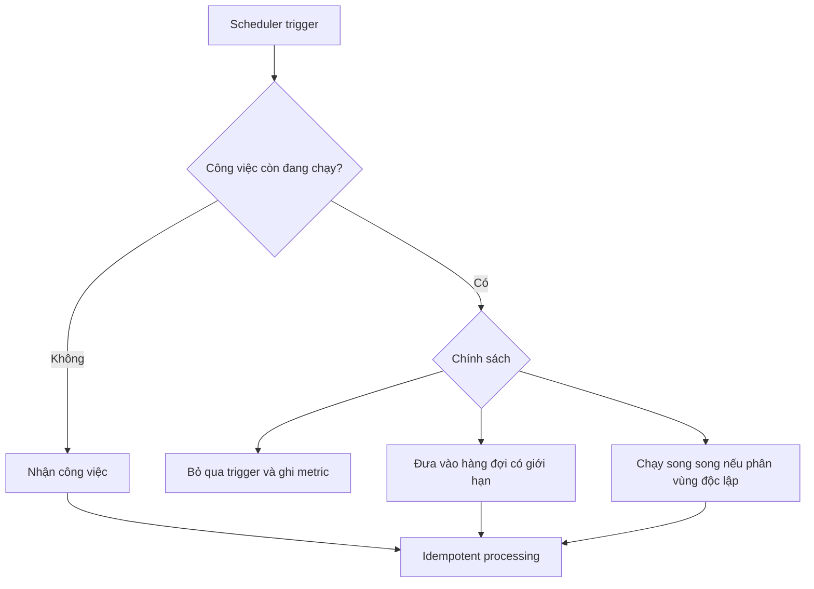
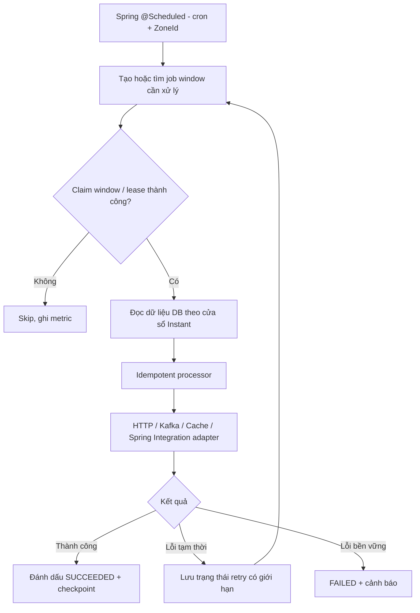

# TaskScheduler, múi giờ và tác vụ chạy chồng

## 1. Bài toán lập lịch trong tích hợp Spring Boot

Trong module **SPRING_BOOT_INTEGRATION**, các luồng tích hợp không chỉ được kích hoạt bởi HTTP request hoặc thông điệp từ broker. Một số luồng phải chạy theo thời gian: quét bản ghi outbox chưa phát Kafka, đối soát giao dịch trong cơ sở dữ liệu, làm mới cache, đồng bộ dữ liệu từ API đối tác, tải file theo lịch hoặc gom dữ liệu để gửi qua adapter Spring Integration.

Spring Framework cung cấp `TaskScheduler` và annotation `@Scheduled` để kích hoạt các công việc này. Tuy nhiên, "đã có lịch" chưa có nghĩa là tác vụ chạy đúng một lần, đúng ngày nghiệp vụ hay không chồng lên nhau. Cần tách ba quyết định:

1. **Khi nào kích hoạt?** Theo khoảng thời gian cố định, sau khi lần trước hoàn thành, hay vào giờ địa phương trong một múi giờ cụ thể.
2. **Ai được thực thi?** Một thread trong JVM, một instance Spring Boot hay duy nhất một thực thể trên toàn cụm.
3. **Một lần thực thi có ý nghĩa gì?** Quét dữ liệu còn thiếu, tạo báo cáo cho một ngày, hay phát sự kiện có thể được gửi lại an toàn.

Ví dụ: job đối soát mỗi ngày lúc 01:05 tại Việt Nam có thể chạy trong nhiều bản sao ứng dụng cùng lúc. Nếu thiếu cơ chế bảo vệ, hai bản sao cùng đọc giao dịch chưa đối soát và cùng gửi yêu cầu đến đối tác. Nếu lấy ngày bằng múi giờ JVM mặc định, báo cáo còn có thể áp vào sai ngày. Nếu job thất bại sau khi đã ghi một phần dữ liệu, lần chạy lại có nguy cơ ghi trùng.

### Kết quả cần đạt

- Biết cấu hình `TaskScheduler`, `@Scheduled` và chọn `fixedRate`, `fixedDelay` hoặc `cron` phù hợp.
- Dùng `ZoneId`, `Instant`, `Clock` và lịch biểu để xác định thời điểm chạy và cửa sổ dữ liệu; hiểu tác động của giờ mùa hè (DST).
- Nhận diện các dạng chạy chồng trong một JVM, giữa nhiều replica, sau restart và khi lock hết hạn.
- Thiết kế khóa, idempotency, timeout, retry, kiểm thử và quan sát cho công việc tích hợp có tác động thực tế.

## 2. TaskScheduler làm gì? Phân biệt trigger với xử lý

`TaskScheduler` là abstraction của Spring cho việc lên lịch thực thi `Runnable`. Các kiểu thao tác phổ biến:

| Cách lên lịch | Ý nghĩa | Trường hợp |
| --- | --- | --- |
| `schedule(task, Instant)` | Chạy một lần tại hoặc sau thời điểm tuyệt đối | Kích hoạt một lần sau thời hạn chờ |
| `schedule(task, Trigger)` | Lần chạy kế tiếp do `Trigger` tính | Lịch cron, lịch tùy chỉnh |
| `scheduleAtFixedRate(...)` | Lên lịch theo nhịp cố định | Quét trạng thái thường xuyên |
| `scheduleWithFixedDelay(...)` | Chờ một khoảng sau khi lần trước kết thúc | Polling không cần giữ nhịp tuyệt đối |
| `@Scheduled` | Khai báo lịch trên method của Spring bean | Job đơn giản trong ứng dụng |

`ThreadPoolTaskScheduler` là triển khai phổ biến dùng thread pool để chạy tác vụ theo lịch. `@Scheduled` là cách khai báo thuận tiện; nó vẫn cần hạ tầng scheduling và bean được Spring quản lý. `@EnableScheduling` kích hoạt việc xử lý annotation này.

### 2.1. Cấu hình scheduler có tên rõ ràng

Ví dụ cho ứng dụng Spring Boot sử dụng Spring Framework 6.x:

```java
import org.slf4j.Logger;
import org.slf4j.LoggerFactory;
import org.springframework.context.annotation.Bean;
import org.springframework.context.annotation.Configuration;
import org.springframework.scheduling.concurrent.ThreadPoolTaskScheduler;
import org.springframework.scheduling.annotation.EnableScheduling;

@Configuration
@EnableScheduling
public class SchedulingConfig {
    private static final Logger log =
        LoggerFactory.getLogger(SchedulingConfig.class);

    @Bean(name = "taskScheduler")
    ThreadPoolTaskScheduler taskScheduler() {
        ThreadPoolTaskScheduler scheduler = new ThreadPoolTaskScheduler();
        scheduler.setPoolSize(4);
        scheduler.setThreadNamePrefix("integration-scheduler-");
        scheduler.setWaitForTasksToCompleteOnShutdown(true);
        scheduler.setAwaitTerminationSeconds(30);
        scheduler.setErrorHandler(error ->
            log.error("Scheduled task failed: {}",
                error.getClass().getSimpleName())
        );
        return scheduler;
    }
}
```

- `setPoolSize(4)` cho phép tối đa bốn thread thực thi các tác vụ theo lịch cùng lúc trong instance này. **Nó không giới hạn số replica** của ứng dụng.
- Tên thread giúp tìm nguyên nhân trong thread dump và log.
- Cấu hình shutdown dành thời gian cho tác vụ đang chạy kết thúc; cần phối hợp với thời gian chờ kết thúc của container/orchestrator và timeout nghiệp vụ.
- Error handler giúp quan sát lỗi không được tự xử lý, nhưng không thay thế chiến lược retry và trạng thái thất bại của từng job. Log phải tránh chứa token, mật khẩu hoặc payload nhạy cảm.

Trong Spring Boot, có thể cấu hình scheduler tự động bằng `spring.task.scheduling.*` nếu không tự khai báo bean. Tùy phiên bản và cấu hình virtual threads, loại scheduler mặc định có thể khác; không dựa vào việc tăng pool size mà bỏ qua bài toán chạy trùng. Nếu tạo bean `TaskScheduler` riêng, cần hiểu bean nào được `@Scheduled` chọn khi có nhiều scheduler.

### 2.2. Dùng TaskScheduler trực tiếp

Khi phải đăng ký lịch tại runtime, có thể tạo `CronTrigger` theo `ZoneId`:

```java
import java.time.ZoneId;
import org.springframework.scheduling.TaskScheduler;
import org.springframework.scheduling.support.CronTrigger;

class RuntimeScheduleRegistry {
    private final TaskScheduler scheduler;

    RuntimeScheduleRegistry(TaskScheduler scheduler) {
        this.scheduler = scheduler;
    }

    void register(Runnable job) {
        ZoneId zone = ZoneId.of("Asia/Ho_Chi_Minh");
        scheduler.schedule(job, new CronTrigger("0 5 1 * * *", zone));
    }
}
```

`schedule(...)` trả về `ScheduledFuture<?>` (có thể là `null` nếu trigger không tạo lần chạy tiếp theo). Nếu đăng ký lại job tại runtime, cần quản lý handle và `cancel(...)` của lịch cũ. Mỗi lần gọi `register` có thể tạo **một lịch mới**; quên hủy lịch cũ là một nguyên nhân khiến cùng job chạy nhiều lần trong một instance.

## 3. fixedRate, fixedDelay và cron khác nhau thế nào?

Giả sử lần chạy đầu bắt đầu lúc 10:00:00 và mất 80 giây.

| Kiểu | Ý nghĩa | Điều xảy ra với lần chạy tiếp |
| --- | --- | --- |
| `fixedRate = 60 s` | Dự kiến kích hoạt theo nhịp 60 giây kể từ điểm bắt đầu | Tại 10:01:00 đã tới hạn; lần sau có thể bắt đầu ngay khi lần đầu kết thúc, tùy scheduler |
| `fixedDelay = 60 s` | Đợi 60 giây sau khi lần trước hoàn thành | Lần sau khoảng 10:02:20 |
| `cron = "0 * * * * *"` | Tính các thời điểm phút tròn theo lịch | Các mốc là 10:01, 10:02...; hành vi khi job chưa xong phụ thuộc scheduler/trigger |

Đừng diễn giải `fixedRate` là "chắc chắn tạo hai luồng chạy đồng thời" mỗi khi job kéo dài. Với một công việc định kỳ thông thường dùng `ThreadPoolTaskScheduler` và `ScheduledExecutorService`, các lần thực thi của **cùng một periodic task** không chạy đồng thời trên scheduler đó; lần bị trễ có thể chạy tiếp ngay khi lần trước kết thúc. Chạy chồng vẫn xảy ra khi có lịch đăng ký lặp, nhiều trigger độc lập, job được gọi thủ công, thực thi bất đồng bộ hoặc nhiều instance.

### 3.1. Khai báo bằng @Scheduled

```java
import org.springframework.scheduling.annotation.Scheduled;
import org.springframework.stereotype.Component;

@Component
class IntegrationSchedules {
    private final OutboxPublisher outboxPublisher;
    private final ReconciliationService reconciliationService;

    IntegrationSchedules(
        OutboxPublisher outboxPublisher,
        ReconciliationService reconciliationService
    ) {
        this.outboxPublisher = outboxPublisher;
        this.reconciliationService = reconciliationService;
    }

    // Chạy sau khi lần quét trước kết thúc và đã đợi thêm 30 giây.
    @Scheduled(
        fixedDelayString = "${jobs.outbox.fixed-delay-ms:30000}",
        initialDelayString = "${jobs.outbox.initial-delay-ms:10000}"
    )
    public void pollOutbox() {
        outboxPublisher.publishPendingBatch();
    }

    // 01:05 hằng ngày theo giờ Việt Nam.
    @Scheduled(
        cron = "${jobs.reconciliation.cron:0 5 1 * * *}",
        zone = "${jobs.reconciliation.zone:Asia/Ho_Chi_Minh}"
    )
    public void reconcilePreviousDay() {
        reconciliationService.reconcilePreviousBusinessDay();
    }
}
```

`OutboxPublisher` và `ReconciliationService` là các service nghiệp vụ do ứng dụng cung cấp, không phải class có sẵn của Spring. Method `@Scheduled` cần nằm trên bean được Spring quản lý; với dạng đồng bộ thông thường, method không nhận tham số và hoàn tất khi phần xử lý đồng bộ kết thúc.

**Cron của Spring dùng sáu trường:** `giây phút giờ ngày-trong-tháng tháng ngày-trong-tuần`. Biểu thức `0 5 1 * * *` nghĩa là 01:05:00 hằng ngày. Không nhầm nó với định dạng crontab Unix thường có năm trường.

### 3.2. Chọn lịch theo hành vi mong muốn

- **Quét outbox hoặc cache theo lô:** `fixedDelay` giúp chờ sau khi một đợt quét hoàn thành, tránh đuổi theo lịch khi downstream chậm. Với nhiều replica, cần phân vùng/claim work hoặc cơ chế phối hợp độc lập.
- **Đo đạc hoặc làm mới dữ liệu định kỳ:** `fixedRate` hữu ích nếu muốn nhịp gần đều và biết rõ job không kéo dài quá tải.
- **Đối soát theo ngày nghiệp vụ:** `cron` kèm `zone` biểu thị "01:05 theo giờ của thị trường"; job phải biết chính xác **ngày/cửa sổ dữ liệu** cần xử lý.
- **Lịch phức tạp, lưu trữ lâu dài, misfire hoặc cluster coordination:** cân nhắc Quartz với persistent job store hoặc nền tảng orchestration phù hợp; `TaskScheduler` thuần không phải bộ quản lý lịch bền vững giữa các lần restart.

## 4. Múi giờ: Instant để lưu thời điểm, ZoneId để hiểu lịch nghiệp vụ

Một thời điểm tuyệt đối (`Instant`) và giờ hiển thị tại địa phương (`LocalDateTime`) là hai khái niệm khác nhau. `2026-11-21T01:05:00` tự nó chưa xác định thời điểm toàn cầu nếu không có offset hoặc múi giờ; cùng chuỗi giờ địa phương có thể xảy ra ở nhiều thời điểm khác nhau.

### 4.1. Quy tắc thực hành

1. Lưu thời điểm sự kiện, checkpoint và dấu thời gian chạy bằng `Instant`/UTC hoặc một kiểu có thông tin offset chính xác theo hợp đồng dữ liệu.
2. Dùng `ZoneId` dạng IANA như `Asia/Ho_Chi_Minh`, `Europe/Berlin` thay vì mặc định JVM; tránh dùng offset cố định `+01:00` để đại diện cho vùng có DST.
3. Cấu hình `@Scheduled(zone=...)` theo **giờ mong muốn kích hoạt**, độc lập với múi giờ máy chạy.
4. Tính ngày nghiệp vụ và cửa sổ dữ liệu theo cùng `ZoneId` đã chọn, rồi chuyển ranh giới sang `Instant` để truy vấn.
5. Inject `Clock` vào logic nghiệp vụ để kiểm thử có thể cố định thời gian. Không gọi `LocalDate.now()` rải rác trong nhiều service nếu các service cần nhất quán về ngày.

Ví dụ:

```java
import java.time.Clock;
import java.time.Instant;
import java.time.LocalDate;
import java.time.ZoneId;

record TimeWindow(Instant fromInclusive, Instant toExclusive) {}

class BusinessWindowCalculator {
    private final Clock clock;
    private final ZoneId zone;

    BusinessWindowCalculator(Clock clock, ZoneId zone) {
        this.clock = clock;
        this.zone = zone;
    }

    TimeWindow previousDay() {
        LocalDate today = LocalDate.now(clock.withZone(zone));
        LocalDate businessDay = today.minusDays(1);

        return new TimeWindow(
            businessDay.atStartOfDay(zone).toInstant(),
            businessDay.plusDays(1).atStartOfDay(zone).toInstant()
        );
    }
}
```

Có thể tạo bean `Clock` mặc định bằng `Clock.systemUTC()`. Khi xử lý ngày, chọn `zone` nghiệp vụ (`Asia/Ho_Chi_Minh` chẳng hạn) bất kể JVM đang chạy UTC, Singapore hay châu Âu.

Truy vấn DB theo khoảng **nửa mở** `[fromInclusive, toExclusive)`:

```sql
SELECT *
FROM payment
WHERE created_at >= :from_inclusive
  AND created_at <  :to_exclusive;
```

Kiểu dữ liệu và quy ước timezone của cột `created_at` phải nhất quán với JDBC/ORM và DB. Không dùng `BETWEEN` với mốc "23:59:59.999" vì độ chính xác timestamp khác nhau có thể bỏ sót hoặc tính trùng bản ghi ở ranh giới ngày.

### 4.2. DST: ngày không luôn dài đúng 24 giờ

`Asia/Ho_Chi_Minh` hiện không có đổi giờ mùa hè. Nhưng nếu hệ thống phục vụ thị trường châu Âu, `Europe/Berlin` có ngày chuyển DST. Ví dụ năm 2026:

| Ngày tại Berlin | Diễn biến | Độ dài ngày từ nửa đêm tới nửa đêm tiếp theo |
| --- | --- | --- |
| 29/03/2026 | Đồng hồ chuyển từ 02:00 tới 03:00 | 23 giờ |
| 25/10/2026 | Đồng hồ lùi từ 03:00 về 02:00 | 25 giờ |
| Ngày bình thường | Không đổi DST | 24 giờ |

Cron chạy **02:30 mỗi ngày** có thể gặp giờ địa phương không tồn tại khi chuyển sang giờ mùa hè hoặc xuất hiện hai lần khi kết thúc giờ mùa hè. Chính sách bỏ qua/chạy lại và cách tính trigger phụ thuộc implementation, cấu hình, cơ chế scheduler và phiên bản. Không giả định một biểu thức cron chắc chắn tạo đúng một lần thực thi cho mỗi ngày nghiệp vụ ở mọi múi giờ.

Nếu yêu cầu là **mỗi ngày nghiệp vụ được xử lý đúng một lần về mặt kết quả**, hãy thiết kế khóa idempotency cho ngày đó, trạng thái đã xử lý, cơ chế backfill và kiểm thử cả hai ngày chuyển DST. Có thể chọn giờ không nằm trong khoảng chuyển giờ để giảm rủi ro, nhưng không thay thế kiểm soát dữ liệu.

### 4.3. Tách thời điểm kích hoạt khỏi cửa sổ công việc

Giả sử job chạy lúc 01:05 ngày 21/11/2026 ở Việt Nam để xử lý dữ liệu **ngày 20/11/2026**. Nếu scheduler bị trễ tới 03:00, nó vẫn phải xử lý ngày 20/11 nếu đó là đợt chạy đã được giao. Nếu container bị dừng qua nửa đêm và khởi động hôm sau, việc luôn lấy "hôm qua" theo đồng hồ thời điểm hiện tại có thể **bỏ mất một ngày cần xử lý**.

Vì vậy, job bền vững nên lưu/nhận **scheduled business date** hoặc `window_id` như một phần hợp đồng xử lý, thay vì chỉ tính từ `LocalDate.now()` mỗi khi chạy. Một bảng `job_windows` có thể ghi ngày/cửa sổ còn thiếu, đang chạy, thành công hoặc thất bại để phục hồi sau sự cố.

## 5. Tác vụ chạy chồng xuất hiện theo những con đường nào?

Tác vụ chạy chồng (*overlapping execution*) là hai lần thực thi cùng ảnh hưởng tới một tập dữ liệu hoặc một tài nguyên, khi lần trước chưa kết thúc hoặc chưa hoàn tất hậu quả nghiệp vụ.



| Nguồn chạy chồng | Ví dụ | Kiểm soát |
| --- | --- | --- |
| Nhiều job độc lập trong một JVM | Hai method `@Scheduled` cùng cập nhật cache hoặc hai cron áp trên một method | Phối hợp theo resource/khóa nghiệp vụ |
| Gọi thủ công ngoài scheduler | Endpoint quản trị gọi `runNow()` khi cron đang chạy | Cùng qua một service điều phối và một khóa |
| Chuyển việc sang thread khác | Method `@Scheduled` gọi `@Async` rồi trả về ngay | Theo dõi completion của công việc thực, không xem return sớm là đã xong |
| Đăng ký lịch lặp ở runtime | Khởi tạo hai `ScheduledFuture` cho cùng job | Quản lý lifecycle, hủy lịch cũ, tránh duplicate registration |
| Nhiều bản sao Spring Boot | Hai pod cùng chạy `@Scheduled` lúc 01:05 | Distributed lock, claim công việc hoặc phân vùng |
| Lock hết hạn khi job chưa xong | Instance A chạy chậm; B lấy lease hết hạn | Gia hạn lease, deadline, fencing token, idempotency |
| Retry/redelivery | Lần trước đã publish Kafka nhưng mất ACK | Deduplication/idempotency theo mã yêu cầu |
| Restart/deploy giữa chừng | Job chưa hoàn tất, instance mới khởi động | Persistent job state, recovery, checkpoint |

**Pool size = 1** chỉ tuần tự hóa các công việc được chạy trong *một* scheduler đó. Nó không khóa endpoint thủ công, thread pool khác, tiến trình khác hoặc pod khác. **Tăng pool size** có thể cải thiện thông lượng của nhiều job độc lập, nhưng không chứng minh công việc chung sẽ không chồng lên nhau.

## 6. Chống chạy chồng trong một JVM

Khi toàn bộ công việc thực thi đồng bộ bên trong một tiến trình, `AtomicBoolean` là một guard đơn giản. Nó hữu ích khi job có thể được gọi bởi cả cron và thao tác quản trị:

```java
import java.util.concurrent.atomic.AtomicBoolean;
import org.springframework.scheduling.annotation.Scheduled;
import org.springframework.stereotype.Component;

@Component
class LocalCacheRefreshJob {
    private final AtomicBoolean running = new AtomicBoolean(false);
    private final CacheRefreshService refreshService;

    LocalCacheRefreshJob(CacheRefreshService refreshService) {
        this.refreshService = refreshService;
    }

    @Scheduled(fixedDelayString = "${jobs.cache.fixed-delay-ms:60000}")
    public void scheduledRefresh() {
        refreshIfIdle();
    }

    public boolean refreshIfIdle() {
        if (!running.compareAndSet(false, true)) {
            return false; // Một đợt khác đang chạy trên chính instance này.
        }
        try {
            refreshService.refreshSynchronously();
            return true;
        } finally {
            running.set(false);
        }
    }
}
```

`CacheRefreshService` là service nghiệp vụ ví dụ. `finally` phải chạy sau **toàn bộ việc làm mới thực tế**. Nếu `refreshSynchronously()` chỉ submit sang executor rồi trả về `CompletableFuture`, guard được mở quá sớm: hai công việc đang chạy trong nền có thể chồng nhau dù `running` đã trở lại `false`. Với xử lý bất đồng bộ thật, cần giữ trạng thái tới khi future hoàn tất (bao gồm cả nhánh lỗi), hoặc đưa công việc vào một hàng đợi/worker có giới hạn rõ ràng.

Giới hạn của guard trong JVM:

- Không phối hợp với JVM/pod khác.
- Biến mất khi ứng dụng restart.
- Không làm công việc trở thành idempotent.
- Không quyết định nên bỏ qua, xếp hàng hay bù một lần kích hoạt bị từ chối.

Đối với một định kỳ `fixedDelay` đồng bộ chạy riêng trong một scheduler, việc chống chồng nội bộ có thể đã có sẵn nhờ cách scheduler lên lịch sau completion. Guard vẫn có ích khi **có thêm điểm kích hoạt khác**, nhưng không nên xem nó là cơ chế bảo vệ phân tán.

## 7. Nhiều instance: distributed lock, lease và claim công việc

Khi hai replica Spring Boot đều bật `@EnableScheduling`, thông thường **mỗi replica có lịch của riêng nó**. Nếu cùng cron, cả hai có thể kích hoạt lúc 01:05. Cần quyết định:

1. Chỉ một instance được làm toàn bộ công việc?
2. Hay nhiều instance được chia lô công việc độc lập?
3. Nếu instance giữ khóa chết giữa chừng, công việc được phục hồi như thế nào?

### 7.1. Distributed lease cho một job toàn cụm

Một cách là lưu khóa có thời hạn (*lease*) trong DB dùng chung hoặc một dịch vụ lock có bảo đảm phù hợp. Chẳng hạn bảng PostgreSQL:

```sql
CREATE TABLE scheduler_lease (
    job_name       VARCHAR(128) PRIMARY KEY,
    owner_id       VARCHAR(128),
    lease_until    TIMESTAMPTZ NOT NULL,
    generation     BIGINT NOT NULL DEFAULT 0
);
```

Mỗi tên job có sẵn một dòng trong bảng. Khi đến lịch, instance thử nhận lease bằng một thao tác có điều kiện **nguyên tử** trong DB:

```sql
UPDATE scheduler_lease
SET owner_id    = :owner_id,
    lease_until = CURRENT_TIMESTAMP + INTERVAL '5 minutes',
    generation  = generation + 1
WHERE job_name = :job_name
  AND lease_until < CURRENT_TIMESTAMP
RETURNING generation;
```

Đây là ví dụ **PostgreSQL** để minh họa cơ chế claim; không phải SQL đa hệ cơ sở dữ liệu. Cần chuẩn bị dòng ban đầu, quản lý giao dịch khi claim, thời gian chuẩn ở DB, xử lý giá trị không có hàng được trả về, gia hạn lease, thu hồi có điều kiện owner/generation và chặn quyền dùng khóa cũ. Nếu job có thể kéo dài quá năm phút thì lease phải được gia hạn an toàn hoặc chọn hạn phù hợp. Không xóa/ghi đè khóa của chủ hiện tại bằng một thao tác release thiếu điều kiện.

**Lease không bảo đảm "chỉ một tiến trình đang làm" sau khi hết hạn.** Instance A có thể bị dừng (GC pause/network delay), lease hết hạn, B nhận lease, rồi A chạy tiếp. Cả A và B lúc đó có thể gây tác động. Giải pháp cần thêm:

- **Fencing token:** số `generation` tăng sau mỗi lần claim; hệ thống ghi dữ liệu/downstream phải có cách từ chối tác động từ token cũ. Chỉ tăng số trong bảng lock nhưng không kiểm soát tại điểm ghi dữ liệu thì chưa có fencing thực.
- **Idempotency:** unique constraint, mã yêu cầu, deduplication ở DB/API/broker consumer.
- **Kiểm soát timeout và phục hồi:** biết job nào đã hoàn tất, còn dở hay cần chạy lại.

Thư viện distributed lock như ShedLock có thể hỗ trợ nhiều ứng dụng dùng chung persistent store, nhưng cần hiểu `lockAtMostFor`, `lockAtLeastFor`, trường hợp job vượt hạn lock và cách nhận diện skipped execution. Nó không tự cung cấp transaction exactly-once cho DB, Kafka hoặc API đối tác.

### 7.2. Claim từng bản ghi thay vì khóa toàn bộ batch

Với outbox hoặc task queue trong DB, có thể cho nhiều worker chạy song song **nếu chúng claim các bản ghi khác nhau**. Ví dụ, ở PostgreSQL có thể dùng transaction kết hợp `SELECT ... FOR UPDATE SKIP LOCKED` và update trạng thái claim; tiêu chí retry/lease và khôi phục bản ghi phải được thiết kế trước. Nhiều consumer group/partition của Kafka cũng phân phối message cho consumer theo cơ chế riêng; không nên tự xây một distributed cron lock để thay thế việc consumer đã được broker điều phối.

Claim từng bản ghi phù hợp khi throughput quan trọng và mỗi item xử lý độc lập. Khóa toàn job phù hợp hơn với tác vụ đòi hỏi một tiến trình tổng hợp tuần tự, ví dụ chốt sổ cuối ngày.

## 8. Idempotency và khóa nghiệp vụ: tránh phát sinh kết quả trùng

Để một job có thể được chạy lại sau crash, retry hoặc backfill mà không làm sai kết quả, cần định nghĩa **khóa idempotency** ở cấp nghiệp vụ:

| Công việc | Khóa ví dụ | Ràng buộc |
| --- | --- | --- |
| Báo cáo doanh thu hằng ngày | `(job_name, business_date, tenant_id)` | Mỗi ngày/đối tượng một kết quả có thể cập nhật an toàn |
| Gửi email nhắc thanh toán | `(invoice_id, reminder_stage)` | Không gửi trùng một đợt nhắc |
| Publish outbox | `event_id` | Event ID ổn định giữa các lần retry; consumer deduplicate theo ID |
| Đồng bộ API theo trang dữ liệu | `(source, cursor, sync_generation)` | Checkpoint theo cửa sổ hoặc thế hệ đồng bộ |
| Tải file đối tác | `(partner_id, file_id, checksum)` | Có thể nhận lại file nhưng không nhập dữ liệu hai lần |

Một bảng trạng thái có thể chứa `job_name`, `window_id`, `status` (`PENDING`, `RUNNING`, `SUCCEEDED`, `FAILED`), `attempt`, `checkpoint`, `last_error_code` và dấu thời gian. Unique constraint trên `(job_name, window_id)` ngăn tạo hai **đợt công việc logic** giống nhau.

Tuy nhiên, đánh dấu `RUNNING` trước khi làm không đủ: nếu tiến trình chết sau khi đã gửi request nhưng trước khi cập nhật `SUCCEEDED`, khi retry vẫn không biết downstream đã xử lý chưa. Cần idempotency key được **downstream** công nhận, hoặc cơ chế outbox/inbox, dedup và xác minh trạng thái. Không có scheduler nào tự bảo đảm exactly-once trên nhiều hệ thống độc lập.

### 8.1. Hợp đồng giữa scheduler và service nghiệp vụ

Thay vì service tự quyết định "hôm qua" mỗi lần gọi, hãy để orchestrator truyền một cửa sổ đã được claim:

```java
record JobWindow(String jobName,
                 String windowId,
                 java.time.Instant from,
                 java.time.Instant to) {}

interface ReconciliationProcessor {
    // Phải xử lý lặp an toàn theo windowId, có checkpoint và trạng thái rõ ràng.
    void reconcile(JobWindow window);
}
```

`windowId` có thể là `payments-2026-11-20-Asia_Ho_Chi_Minh` theo quy ước riêng của hệ thống. Tên có thể được lưu an toàn trong bảng job; thời gian truy vấn vẫn dùng `Instant` cho `from` và `to`. Khi xử lý thành công, coordinator ghi `SUCCEEDED` theo transaction/state machine thích hợp, không chỉ dựa vào việc hàm Java đã trả về.

## 9. Retry, timeout, shutdown và chạy bù (backfill)

Một job kết nối DB, cache, Kafka hoặc HTTP có thể bị lỗi tạm thời. Nhưng retry ở tầng scheduler có thể nhân thêm retry đã có trong Kafka producer, HTTP client, consumer hoặc service khác. Cần quy định ngân sách **đầu-cuối**.

| Tình huống | Chính sách phù hợp |
| --- | --- |
| Timeout tạm thời khi gọi HTTP đối tác | Retry hữu hạn với backoff/jitter nếu thao tác idempotent, deadline rõ ràng |
| DB constraint báo kết quả đã được ghi | Xem lại trạng thái theo khóa idempotency; không retry mù |
| Authentication/authorization thất bại | Báo lỗi cấu hình/quyền và dừng retry tự động |
| Broker Kafka tạm unavailable | Giữ trạng thái outbox/checkpoint để gửi lại an toàn, có giới hạn lưu và cảnh báo |
| Job vượt thời lượng kỳ vọng | Timeout theo tầng I/O, cảnh báo "running too long", xử lý lock lease |
| Ứng dụng restart trước mốc cron | Tạo/check cửa sổ thiếu từ persistent store và chạy bù có giới hạn |
| Lần trigger đến khi job đang chạy | Chọn skip, queue hay chia lô; ghi nhận số lần bị skip |

**TaskScheduler thuần không lưu lịch đã trôi qua vào DB.** Nếu ứng dụng tắt lúc 01:05, cron lúc đó có thể bị bỏ lỡ. Đối với đối soát bắt buộc theo mỗi ngày, cần một trong các cách:

- Persistent job windows và worker quét các cửa sổ `PENDING/FAILED`.
- Scheduler bền vững có persistent store, ví dụ Quartz với cơ chế misfire được cấu hình đúng.
- Job ngoài ứng dụng (Kubernetes CronJob hoặc orchestrator) chỉ phát tín hiệu, còn trạng thái nghiệp vụ/idempotency vẫn do hệ thống quản lý.

Sau deploy hoặc sự cố dài ngày, không nên tự chạy bù hàng trăm cửa sổ cùng lúc chỉ vì cron bị lỡ. Đặt giới hạn batch, concurrency, quota downstream, thứ tự dữ liệu và khả năng hủy/bắt đầu lại rõ ràng.

**Shutdown:** Khi instance nhận SIGTERM, ngừng nhận công việc mới, cho các tác vụ đang chạy hoàn thành trong deadline và ghi checkpoint trạng thái. Nếu hệ thống buộc phải dừng giữa chừng, lease và job state giúp phục hồi; chúng không thay thế logic idempotent. Không chỉ dựa vào `setWaitForTasksToCompleteOnShutdown(true)` để khẳng định Kubernetes sẽ đợi vô hạn.

## 10. Quan sát lịch và hiệu quả xử lý

Các metric/log quan trọng cần phân biệt **thời điểm dự kiến kích hoạt** với **thời điểm thực bắt đầu**, và **số lần kích hoạt** với **số cửa sổ nghiệp vụ hoàn tất**.

| Chỉ số | Mục đích |
| --- | --- |
| `scheduler.trigger.delay` | Đo thời gian job bị bắt đầu muộn so với lịch |
| `job.execution.duration` | Đo thời gian thực thi và phát hiện job chậm |
| `job.execution.result` | Thành công, thất bại, bỏ qua do lock, hủy |
| `job.pending.windows` | Số ngày/cửa sổ chưa xử lý (backlog) |
| `job.lock.acquire.failure` | Có nhiều instance tranh cùng công việc hay không |
| `job.running.age` | Cảnh báo đợt đang chạy quá lâu |
| `job.retry.count` | Retry tăng bất thường hoặc lặp lỗi cấu hình |
| `job.last.success.timestamp` | Phát hiện job đã không thành công quá lâu |

Ví dụ log theo cửa sổ nghiệp vụ:

```text
job=reconcile_payments
window_id=2026-11-20
zone=Asia/Ho_Chi_Minh
scheduled_at=2026-11-20T18:05:00Z
attempt=2
result=SUCCEEDED
duration_ms=18452
```

`scheduled_at` ở đây là 01:05 ngày 21/11/2026 theo giờ Việt Nam, biểu diễn dưới dạng UTC. Nếu `attempt=2`, đó là lần thực thi lại của cùng một `window_id`, không phải một ngày nghiệp vụ khác.

Metric tag nên dùng tên job có tập giá trị hữu hạn và result chuẩn hóa. Không đặt id khách hàng, credential, URL chứa token, toàn bộ error payload hoặc hàng triệu `window_id` làm metric label có cardinality quá cao. Có thể lưu chi tiết `window_id` ở job state/log có phân quyền; trace và log phải áp dụng masking đối với payload nhạy cảm.

## 11. Kiểm thử ngày, lịch, chạy chồng và phục hồi

### 11.1. Kiểm thử logic ngày với Clock cố định

Inject `Clock` giúp xác định đầu vào thời gian:

```java
Clock clock = Clock.fixed(
    java.time.Instant.parse("2026-11-20T18:10:00Z"),
    java.time.ZoneOffset.UTC
);

BusinessWindowCalculator calculator =
    new BusinessWindowCalculator(
        clock, java.time.ZoneId.of("Asia/Ho_Chi_Minh")
    );

TimeWindow window = calculator.previousDay();
// Hiện là 01:10 ngày 21/11 ở Việt Nam.
// Khoảng cần xử lý: [2026-11-19T17:00:00Z,
//                    2026-11-20T17:00:00Z)
```

Sử dụng `Clock.fixed` chỉ cố định phép tính thời gian **trong logic nghiệp vụ**; nó không tự điều khiển đồng hồ của `@Scheduled` hay thời điểm `TaskScheduler` thực tế kích hoạt. Kiểm thử lịch thực cần hạ tầng scheduler, kiểm soát thời gian phù hợp hoặc kiểm tra riêng `Trigger`.

### 11.2. Bộ ca kiểm thử tối thiểu

| Ca kiểm thử | Dàn dựng | Điều cần xác minh |
| --- | --- | --- |
| Cron đúng timezone | App chạy JVM UTC, cấu hình cron `Asia/Ho_Chi_Minh` | Kích hoạt theo giờ Việt Nam, không lệch theo giờ host |
| Ngày DST 23 giờ | Cửa sổ `Europe/Berlin` ngày 29/03/2026 | Hai mốc `Instant` cách nhau 23 giờ; không giả định 24 giờ |
| Ngày DST 25 giờ | Cửa sổ `Europe/Berlin` ngày 25/10/2026 | Hai mốc cách nhau 25 giờ; không trùng/thiếu dữ liệu ranh giới |
| `fixedDelay` và job chạy chậm | Job mất lâu hơn chu kỳ | Lần sau chờ sau completion đúng semantics |
| Hai trigger trong một JVM | Cron và manual run cùng lúc | Guard hoặc coordinator thực thi đúng chính sách skip/queue |
| Hai replica chung DB | Cùng nhận trigger | Chỉ một instance claim lease cho cùng job/window lúc đầu |
| Lease hết hạn giữa job | A pause lâu, B nhận lease, rồi A tiếp tục | Fencing/idempotency từ chối tác động trễ của A |
| Process crash sau khi ghi DB | Kill trước khi cập nhật trạng thái job | Retry phục hồi, không tạo bản ghi nghiệp vụ trùng |
| Kafka ACK bị mất | Publish thành công nhưng client nhận lỗi | Event ID được giữ nguyên; consumer/outbox deduplicate |
| Restart bỏ lỡ cron | Stop app qua mốc chạy rồi start | Backfill tìm được cửa sổ chưa xong |
| Downstream lỗi 401/403 | HTTP API trả lỗi quyền | Không retry vô hạn; job báo trạng thái cần can thiệp |
| Shutdown giữa công việc | Gửi SIGTERM khi job đang chạy | Stop có giới hạn, checkpoint/lease phục hồi đúng |

Với kiểm thử concurrency, không chỉ mock method gọi scheduler rồi đếm số lần vào hàm. Cần dùng **hai instance/coordinator riêng** cùng truy cập lock store, đồng bộ cho chúng tranh quyền trong một cửa sổ, rồi kiểm tra kết quả dưới DB hoặc downstream giả lập. Với chạy lại sau sự cố, đối chiếu trạng thái trước/sau crash và số bản ghi logic cuối cùng.

### 11.3. Phân biệt mức kiểm thử

- **Unit test:** tính cửa sổ thời gian, khóa idempotency, chính sách lựa chọn skip/queue và tính hợp lệ của tham số.
- **Integration test:** `@Scheduled`/`TaskScheduler`, Spring context, DB transaction, lease, quy tắc timezone, Kafka/HTTP adapter.
- **Failure test:** process crash, pod restart, mất kết nối broker, HTTP timeout, lease expired và phần việc hoàn tất một nửa.

Không nên phụ thuộc vào `Thread.sleep(...)` kéo dài trong unit test để "chứng minh cron đúng"; dùng lịch giả lập/đồng hồ cố định cho logic, test tích hợp có timeout ngắn và kiểm tra trạng thái bền vững khi cần.

## 12. Mẫu thiết kế luồng tích hợp có scheduler

Một kiến trúc đối soát vừa tránh chạy trùng, vừa có thể phục hồi:



Các ranh giới cần triển khai riêng:

- **Lịch:** Job cron xác định thời điểm nên kiểm tra các cửa sổ; một lần cron không nhất thiết đồng nghĩa với một đơn vị nghiệp vụ.
- **Điều phối:** Persistent state, claim/lease và xử lý bỏ sót; mọi entry point (cron, manual, backfill) đi qua cùng cơ chế.
- **Hợp đồng dữ liệu:** `window_id`, phạm vi `Instant`, event ID, schema và trạng thái xử lý thống nhất.
- **Giao dịch:** Outbox hoặc trạng thái tiến trình để tránh mất sự kiện giữa DB và Kafka; không giả định transaction DB bao trùm API đối tác.
- **Lỗi và retry:** Deadline, backoff, giới hạn attempt, idempotency, phân biệt lỗi tạm thời với lỗi cấu hình.
- **Quan sát:** Biết cửa sổ nào chưa xử lý, job nào đang chạy, ai đang giữ lease và tác động nào đã phát ra.

Mô hình này giúp `TaskScheduler` chỉ làm đúng vai trò kích hoạt, trong khi tính nhất quán và phục hồi được bảo đảm ở lớp điều phối và nghiệp vụ.

## 13. Checklist khi đưa lịch vào production

- [ ] Chọn đúng `fixedRate`, `fixedDelay` hoặc `cron` theo semantics của công việc.
- [ ] Khai báo `zone` bằng IANA timezone, không dựa vào múi giờ mặc định của host.
- [ ] Dùng `Instant` cho thời điểm; tính khoảng ngày nghiệp vụ bằng `ZoneId` và điều kiện nửa mở.
- [ ] Kiểm thử các ngày DST nếu phục vụ múi giờ có chuyển giờ; không giả định ngày luôn 24 giờ.
- [ ] Phân biệt điều phối trong JVM với điều phối đa instance; có phương án cho manual run, restart và duplicate registration.
- [ ] Nếu dùng lease, xác định TTL, gia hạn, owner, fencing và xử lý trường hợp lease hết hạn khi job đang làm.
- [ ] Định nghĩa `job_name/window_id`, idempotency key và trạng thái bền vững cho công việc cần chạy bù.
- [ ] Mọi adapter HTTP, DB, cache, Kafka có timeout và retry phù hợp với ngân sách đầu-cuối.
- [ ] Không phát lại tác động ghi thiếu kiểm soát; có outbox/inbox/dedup nếu nghiệp vụ cần.
- [ ] Có kiểm thử nhiều replica, restart, DST, lỗi downstream và shutdown.
- [ ] Quan sát được last success, backlog, duration, trigger delay, skipped lock và retry; log che dữ liệu nhạy cảm.

### Câu hỏi tự kiểm tra

1. Với job chạy 80 giây, `fixedRate=60s` và `fixedDelay=60s` khác nhau ra sao? Có thể kết luận `fixedRate` luôn làm cùng task chạy song song không?
2. Vì sao tăng `poolSize` của `ThreadPoolTaskScheduler` không giải quyết việc hai pod cùng chạy cron?
3. Khi cron lúc 02:30 tại `Europe/Berlin` gặp ngày đổi DST, làm cách nào bảo đảm mỗi ngày nghiệp vụ được xử lý đúng một lần về kết quả?
4. `AtomicBoolean` bảo vệ những điểm kích hoạt nào? Nếu method submit `CompletableFuture` rồi trả về, guard có còn đúng không?
5. Nếu instance A giữ lease rồi pause, lease hết hạn khiến B nhận khóa và A tiếp tục chạy, cần thêm cơ chế gì?
6. Tại sao scheduler khởi động lại không đồng nghĩa với việc mọi lần cron bị lỡ đều được tự động chạy bù?
7. Với luồng DB → outbox → Kafka, yếu tố nào giúp retry sau lỗi mạng mà không phát sinh kết quả nghiệp vụ trùng?

**Ghi nhớ:** `TaskScheduler` quyết định **thời điểm thử kích hoạt**; lịch theo `ZoneId` quyết định **giờ nghiệp vụ**; còn khóa, trạng thái bền vững và idempotency mới quyết định **ai được xử lý cửa sổ nào và điều gì xảy ra khi phải chạy lại**. Ba khía cạnh này phải được thiết kế cùng nhau cho các luồng tích hợp Spring Boot thực tế.
