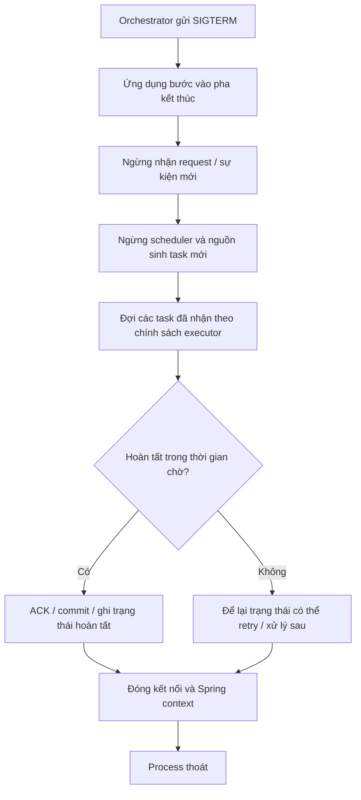
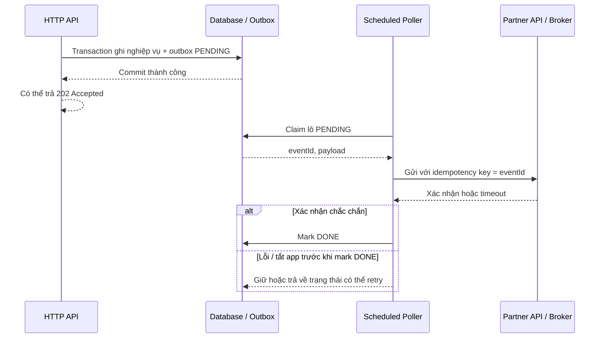

# Dừng tác vụ và thời gian chờ khi ứng dụng kết thúc

## Bối cảnh và mục tiêu

Trong **Spring Boot Integration**, một yêu cầu HTTP có thể kích hoạt `@Async` để gọi API đối tác, một tác vụ `@Scheduled` có thể quét bảng outbox để gửi message, hoặc một listener từ broker có thể đưa công việc sang thread pool để ghi cơ sở dữ liệu. Khi triển khai phiên bản mới, scale down hoặc nhận `SIGTERM`, ứng dụng cần **ngừng nhận thêm việc, xử lý phần việc đang chạy trong một khoảng thời gian có giới hạn, rồi đóng tài nguyên**. Nếu thiếu thiết kế này, request có thể được trả thành công trong khi công việc chưa thực sự hoàn tất hoặc message đã được xác nhận nhưng nghiệp vụ chưa được ghi nhận.

Chủ đề thuộc chương **Tác vụ bất đồng bộ** của module `SPRING_BOOT_INTEGRATION`, tập trung vào cách phối hợp vòng đời Spring Boot, executor, scheduler và ranh giới giao dịch/ACK của các hệ thống tích hợp.

Sau bài học, bạn có thể:

1. Phân biệt **dừng nhận việc**, **cho phép tác vụ đang chạy hoàn tất**, **hủy/từ chối tác vụ** và **chờ tối đa khi shutdown**.
2. Cấu hình shutdown cho `@Async`, `@Scheduled` trên Spring Boot và `ThreadPoolTaskExecutor`/`ThreadPoolTaskScheduler` tự tạo.
3. Tính các ngân sách thời gian giữa ứng dụng, HTTP client, broker, cơ sở dữ liệu và container orchestration.
4. Thiết kế phục hồi công việc sau restart, kiểm thử được các trạng thái hoàn tất, timeout và xử lý lại mà không gây trùng side effect.

> **Phạm vi phiên bản:** Ví dụ cấu hình dùng **Spring Boot 3.5.x / Spring Framework 6.2.x** và Java 17+ với **platform threads**. Các thuộc tính và vòng đời có thể khác trên Boot 4.x, các phiên bản Framework khác hoặc khi bật virtual threads; luôn kiểm tra dependency được resolve và loại executor thật trong application context.

## 1. “Dừng” và “chờ” là hai quyết định khác nhau

Giả sử hệ thống nhận một yêu cầu phát hành hóa đơn:

```text
HTTP POST /invoices
     |
     v
Application service --submit--> @Async / taskExecutor
                                   |
                                   v
                           Gọi HTTP đối tác
                                   |
                                   v
                           Cập nhật database
```

Tại thời điểm application context bắt đầu đóng, có thể tồn tại ba nhóm công việc:

| Trạng thái | Ý nghĩa | Câu hỏi khi shutdown |
|---|---|---|
| **Đang chạy** (*running/in-flight*) | Worker đã nhận task và đang gọi DB/HTTP/broker. | Có tiếp tục đợi kết quả không? Đợi tối đa bao lâu? Nếu bị interrupt thì có dọn dẹp đúng không? |
| **Đang xếp hàng** (*queued*) | Executor đã chấp nhận task nhưng worker chưa bắt đầu. | Cho chạy hết hàng đợi hay từ chối/hủy để được xử lý lại sau restart? |
| **Sắp được gửi vào executor** (*new submissions*) | HTTP endpoint, scheduler hoặc message listener vẫn có thể tạo task mới. | Ai đóng cửa nhận việc và điều gì xảy ra với lời gọi bị từ chối? |

Các hành động thường bị nhầm lẫn:

- **Stop intake**: không nhận nhiệm vụ mới hoặc không xác nhận rằng nhiệm vụ đã được chấp nhận. Đối với broker, đó có thể là pause/stop listener; đối với HTTP là graceful shutdown của web server và kiểm soát các producer nội bộ.
- **Drain**: cho phép công việc đã nhận hoàn tất. Phải quyết định có xử lý cả hàng đợi hay chỉ những task đang chạy.
- **Cancel/interrupt**: gửi yêu cầu hủy. Nó **không** chắc chắn dừng ngay một HTTP call, một JDBC query hoặc thread không hợp tác với interruption.
- **Await termination**: thread đóng ứng dụng chờ executor kết thúc trong khoảng thời gian tối đa. Khi hết thời gian, việc *ngừng chờ* **không đồng nghĩa** với mọi task đã bị hủy thành công.

`@Async` chỉ chuyển việc thực thi sang một `Executor`. Nó không tự cung cấp hàng đợi bền vững, retry sau process crash hoặc “exactly once”. `@Scheduled` cũng không tự ghi lại những lịch chạy bị bỏ lỡ khi ứng dụng tắt.

## 2. Trình tự shutdown và các giới hạn thực tế

Quy trình shutdown có kiểm soát nên được nhìn như một chuỗi phụ thuộc:



Đây là **trình tự logic mong muốn**; Spring không tự tạo một giao dịch bảo đảm thứ tự này giữa HTTP server, listener, executor, database và broker của mọi thư viện. Spring đóng application context theo cơ chế `SmartLifecycle`, phát `ContextClosedEvent`, dừng các bean theo phase, rồi hủy bean. Cần xác định component nào sinh task, component nào tiêu thụ task và component nào cung cấp tài nguyên mà task còn cần.

Ở container/Kubernetes, tình huống thường là:

1. Pod/container nhận tín hiệu kết thúc (thường là `SIGTERM`); deployment ngừng phân phối traffic theo cơ chế điều phối, có thể có độ trễ.
2. Spring Boot graceful shutdown ngừng nhận request mới và chờ request đang được xử lý theo ngân sách của **phase web server**.
3. Listener/scheduler/executor và các `SmartLifecycle` bean khác lần lượt dừng. Cách chúng dừng phụ thuộc phase và cấu hình.
4. Nếu hết thời gian kết thúc của orchestrator, tiến trình có thể bị buộc dừng bằng `SIGKILL`; khi đó `@PreDestroy`, `finally` và callback hủy **không được bảo đảm chạy**.

**Không dựa vào một hook duy nhất** như `@PreDestroy` để tự hoàn tất toàn bộ công việc. Hook đó có thể chạy sau khi component khác đã đóng hoặc bị cắt ngang do quá hạn; dùng cơ chế lifecycle có sẵn của executor và một trạng thái công việc bền vững để phục hồi.

## 3. Cấu hình Spring Boot cho graceful shutdown

### 3.1. Phân biệt ba nhóm timeout

| Thuộc tính | Áp dụng cho | Không có nghĩa là |
|---|---|---|
| `server.shutdown: graceful` | Web server: ngừng nhận yêu cầu mới và cho request đang xử lý hoàn tất theo lifecycle. | Chờ tất cả task `@Async` hoặc tất cả message trong broker. |
| `spring.lifecycle.timeout-per-shutdown-phase` | Thời gian tối đa cho **mỗi phase** dừng `SmartLifecycle`. | Một deadline tổng duy nhất cho toàn bộ process và mọi bean. |
| `spring.task.execution.shutdown.await-termination` + `await-termination-period` | Executor **được Boot auto-configure**, trong mô hình `ThreadPoolTaskExecutor` phù hợp. | Bảo đảm task tự tiếp tục sau restart hoặc mọi custom executor đều nhận cấu hình này. |
| `spring.task.scheduling.shutdown.await-termination` + `await-termination-period` | Scheduler được Boot auto-configure. | Lưu lịch chạy bị bỏ lỡ hoặc hoàn tất mọi lần chạy theo định kỳ trong tương lai. |

Ví dụ cấu hình minh họa một hệ thống chủ yếu chạy platform threads:

```yaml
# application.yml — Spring Boot 3.5.x, cấu hình ví dụ
server:
  shutdown: graceful

spring:
  lifecycle:
    timeout-per-shutdown-phase: 30s
  task:
    execution:
      thread-name-prefix: integration-async-
      pool:
        core-size: 4
        max-size: 8
        queue-capacity: 100
      shutdown:
        await-termination: true
        await-termination-period: 20s
    scheduling:
      pool:
        size: 2
      shutdown:
        await-termination: true
        await-termination-period: 5s
```

**Cách đọc:** Web server được yêu cầu graceful shutdown; executor được quản lý theo auto-configuration có khoảng chờ hoàn tất tối đa minh họa **20 giây**; scheduler có khoảng chờ **5 giây**. Không hiểu những số này như bảo đảm hệ thống chắc chắn tắt trong 20 hay 30 giây: `timeout-per-shutdown-phase` có thể áp dụng cho nhiều phase, các bean tự định nghĩa có logic hủy riêng, và deadline của container là một giới hạn độc lập. Các giá trị là **minh họa để học cách cấu hình**, không phải SLO được khuyến nghị cho mọi hệ thống.

> **Cần xác minh executor thật:** Khi ứng dụng tự khai báo `Executor`/`AsyncConfigurer`, Spring Boot có thể bỏ qua auto-configuration executor mặc định. `@Async("someExecutor")` dùng bean được chỉ định, nên các thuộc tính `spring.task.execution.shutdown.*` **không tự áp dụng** cho bean executor tùy chỉnh. Tương tự, không áp dụng thuộc tính scheduler tự động cho mọi scheduler được tạo bằng `new`.

### 3.2. Độ dài grace period của orchestrator

Ví dụ Kubernetes Pod đặt:

```yaml
spec:
  terminationGracePeriodSeconds: 60
```

Con số **60 giây** bao trùm thời gian từ lúc Pod bắt đầu termination cho đến khi có thể bị ép dừng, bao gồm cả hook `preStop` nếu có. Nó phải đủ cho độ trễ ngừng phân phối traffic, các phase của Spring, tác vụ đang chạy và việc đóng tài nguyên. Không lấy `20 + 5 + 30 = 55` làm phép tính luôn đúng, vì các pha có thể nối tiếp hoặc chồng lấn theo thực tế triển khai; nên đo **shutdown duration** dưới tải và dành biên an toàn.

Trong Spring Boot 3.5, graceful shutdown của web server phải được bật bằng `server.shutdown=graceful`. Không đánh đồng readiness báo `DOWN` với việc mọi listener/broker đã ngừng nhận message; kiểm chứng riêng trạng thái của từng luồng tích hợp.

## 4. Cấu hình executor tự quản lý đúng vòng đời

Nếu một ứng dụng tích hợp cần pool riêng để gửi dữ liệu cho đối tác, hãy gán tên rõ ràng để biết chính xác `@Async` đang dùng executor nào. Mẫu dưới đây dành cho **ThreadPoolTaskExecutor** của Spring Framework 6.2:

```java
import org.springframework.context.annotation.Bean;
import org.springframework.context.annotation.Configuration;
import org.springframework.scheduling.annotation.EnableAsync;
import org.springframework.scheduling.concurrent.ThreadPoolTaskExecutor;

@Configuration(proxyBeanMethods = false)
@EnableAsync
class IntegrationAsyncConfiguration {

    @Bean("integrationExecutor")
    ThreadPoolTaskExecutor integrationExecutor() {
        ThreadPoolTaskExecutor executor = new ThreadPoolTaskExecutor();
        executor.setThreadNamePrefix("integration-outbound-");
        executor.setCorePoolSize(4);
        executor.setMaxPoolSize(8);
        executor.setQueueCapacity(100);

        // Đã nhận thì cho chạy hết cả tác vụ trong queue khi destroy.
        executor.setWaitForTasksToCompleteOnShutdown(true);
        // Chờ tối đa 20 giây để các tài nguyên cần thiết chưa bị đóng.
        executor.setAwaitTerminationSeconds(20);
        return executor;
    }
}
```

Giải thích hai lệnh quan trọng:

- `setWaitForTasksToCompleteOnShutdown(true)` chọn đường shutdown kiểu `ExecutorService.shutdown()`: không cố interrupt các task đang chạy và có thể xử lý cả phần **đã nằm trong queue**. Khi giá trị này là `true`, cơ chế coordinated lifecycle stop sớm của executor bị bỏ qua, và executor xử lý việc hoàn tất tại bước destroy của nó.
- `setAwaitTerminationSeconds(20)` làm **luồng hủy bean chờ tối đa** 20 giây trước khi tiếp tục đóng các tài nguyên khác. Chỉ gọi `setWaitForTasksToCompleteOnShutdown(true)` mà không đặt await timeout có thể khiến task chạy song song với quá trình Spring đang đóng database client, HTTP client hoặc các bean phụ thuộc.

`awaitTermination` đến hạn chỉ khiến quá trình shutdown **ngừng chờ**; không phải nút “kill” chắc chắn của task. Nếu các task vẫn chạy, Spring tiếp tục hủy resource và việc sử dụng resource có thể thất bại. Ngược lại, với đường shutdown tức thì mặc định (`waitForTasksToCompleteOnShutdown=false`), executor có thể interrupt task đang chạy và loại các task chưa bắt đầu ra khỏi queue. Hãy xác định chính sách ngay từ thiết kế: **drain queue** hay **ngừng nhanh và xử lý lại từ nguồn bền vững**.

### 4.1. Ví dụ method `@Async` có kết quả quan sát được

```java
import java.util.concurrent.CompletableFuture;
import org.springframework.scheduling.annotation.Async;
import org.springframework.stereotype.Service;

record OutboundEvent(String eventId, String payload) {}

interface PartnerGateway {
    void deliver(OutboundEvent event); // kết nối HTTP có timeout riêng
}

@Service
class OutboundDeliveryService {
    private final PartnerGateway partnerGateway;

    OutboundDeliveryService(PartnerGateway partnerGateway) {
        this.partnerGateway = partnerGateway;
    }

    @Async("integrationExecutor")
    public CompletableFuture<Void> send(OutboundEvent event) {
        partnerGateway.deliver(event);
        return CompletableFuture.completedFuture(null);
    }
}
```

Với `@EnableAsync`, lời gọi từ **bean khác qua Spring proxy** được thực thi trong executor được chỉ định. Lỗi từ `PartnerGateway` làm future trả về ở caller **hoàn thành exceptional**; caller phải quan sát/xử lý trạng thái đó nếu cần thông báo hoàn tất. Nếu method trả `void`, exception bất đồng bộ không đi về caller; cần `AsyncUncaughtExceptionHandler` hoặc cơ chế quan sát/ghi trạng thái riêng. Gọi `this.send(...)` trong cùng bean theo proxy mode mặc định **không** kích hoạt `@Async`.

**Không trả HTTP 200 với ý nghĩa “đã giao thành công”** chỉ vì gọi `send()` tạo ra `CompletableFuture`. Nếu API chấp nhận công việc để xử lý sau, HTTP 202 có thể phù hợp **chỉ khi** công việc đã được lưu bền vững hoặc có hợp đồng rõ ràng về khả năng mất việc. Một future chỉ tồn tại trong RAM không đáp ứng yêu cầu phục hồi sau crash.

### 4.2. Ngừng nhận việc mới trước khi drain

Khi bật `setWaitForTasksToCompleteOnShutdown(true)`, executor có thể tiếp tục nhận task ở một phần quá trình đóng context cho đến khi thực sự bước vào destroy. Vì vậy cần đóng **nguồn sinh task** trước: web inbound, broker listener, polling job, hoặc application-level submission gate. `ThreadPoolTaskExecutor.setStrictEarlyShutdown(true)` (Spring Framework 6.1.4+) chỉ điều chỉnh tín hiệu shutdown sớm trong một số chế độ; các flag như `setWaitForTasksToCompleteOnShutdown(true)` hoặc `setAcceptTasksAfterContextClose(true)` có thể **ghi đè ý nghĩa** của nó. Không dùng đồng thời các flag mà không hiểu vòng đời của phiên bản cụ thể.

Một cổng nhận task có thể dùng trạng thái `AtomicBoolean accepting`. Khi nhận `ContextClosedEvent`, đặt `accepting=false`; code submit mới trả lỗi **từ chối có kiểm soát** hoặc để message ở broker chưa ACK. Đây chỉ là hàng rào ở tầng ứng dụng, không thay thế việc dừng container/listener. Đừng chuyển `TaskRejectedException` thành “đã xử lý thành công”; producer phải biết để retry hoặc lưu lại.

## 5. `@Scheduled` và các tác vụ lặp lại khi đóng ứng dụng

Scheduler khác executor xử lý công việc một lần: nó còn có trách nhiệm quyết định **lần thực thi kế tiếp**. Khi shutdown, ứng dụng thường cần:

1. Không bắt đầu vòng poll mới.
2. Để vòng poll đang chạy kết thúc trong một giới hạn hợp lý, hoặc có cơ chế cho lần sau lấy lại công việc chưa xong.
3. Không cố “chạy bù” mọi lịch cron/fixedRate từng bị bỏ lỡ khi ứng dụng tắt.

Với `ThreadPoolTaskScheduler`, hai policy native đáng kiểm tra là:

```java
scheduler.setContinueExistingPeriodicTasksAfterShutdownPolicy(false);
scheduler.setExecuteExistingDelayedTasksAfterShutdownPolicy(false);
```

Policy đầu tiên mặc định `false` và tránh tiếp tục vòng lặp định kỳ sau shutdown; policy thứ hai mặc định `true` ở lớp scheduler nên nếu muốn **bỏ các callback trì hoãn chưa đến hạn**, cấu hình `false` một cách chủ đích. Các flag này chỉ có ý nghĩa khi dùng scheduler/đường shutdown hỗ trợ tương ứng, không phải tùy chọn chung cho mọi implementation. Với scheduler auto-configured của Boot, hãy bắt đầu từ `spring.task.scheduling.shutdown.*` và kiểm tra behavior thực tế.

Ví dụ một job poll outbox theo lô ngắn:

```java
import org.springframework.scheduling.annotation.EnableScheduling;
import org.springframework.scheduling.annotation.Scheduled;
import org.springframework.stereotype.Component;

@Component
class OutboxPoller {
    private final OutboxDispatcher dispatcher;

    OutboxPoller(OutboxDispatcher dispatcher) {
        this.dispatcher = dispatcher;
    }

    @Scheduled(fixedDelayString = "${integration.outbox.poll-delay-ms:1000}")
    void dispatchBatch() {
        dispatcher.dispatchAtMost(50);
    }
}
```

Ứng dụng cần đặt `@EnableScheduling` trên một bean cấu hình khác để bật lịch. `dispatchAtMost(50)` là **phương thức nghiệp vụ minh họa**; việc xử lý tối đa 50 item ở mỗi vòng giúp có điểm kết thúc hữu hạn. Khi một vòng bị dừng, những item chưa hoàn tất vẫn nằm trong outbox để lần sau xử lý. Nếu công việc kéo dài 10 phút và chỉ còn 20 giây shutdown, không nên dựa vào việc scheduler sẽ hoàn thành đủ tất cả item.

### 5.1. Virtual threads làm thay đổi giả định về pool

Trên Java 21+ khi bật `spring.threads.virtual.enabled=true`, Spring Boot có thể auto-configure `SimpleAsyncTaskExecutor` và `SimpleAsyncTaskScheduler` dùng **virtual threads**; các property pool size/queue capacity dành cho `ThreadPoolTaskExecutor` hoặc `ThreadPoolTaskScheduler` có thể không còn tác dụng. Virtual threads không biến công việc thành durable task; chúng vẫn phụ thuộc vòng đời process. Cần xem thực tế executor/scheduler nào đang được bean sử dụng, chính sách termination của implementation đó và đặt timeout cho network/DB. Không sao chép kết luận “pool drain 100 queued tasks” sang `SimpleAsyncTaskExecutor` khi không có queue tương ứng.

## 6. Khi task đang chạy bị interrupt hoặc chờ quá lâu

### 6.1. Cơ chế cooperative cancellation

Đường shutdown nhanh có thể yêu cầu interrupt thread. Java không bảo đảm mọi I/O hoặc thư viện đối tác phản ứng lập tức với interruption. Với vòng lặp xử lý, cần các điểm kiểm tra rõ ràng:

```java
void processBatch(List<OutboundEvent> events) {
    for (OutboundEvent event : events) {
        if (Thread.currentThread().isInterrupted()) {
            // Dừng trước khi lấy thêm việc; item chưa xong vẫn nằm trong outbox.
            return;
        }

        deliverWithBoundedTimeout(event);
        markDeliveredAfterSuccess(event.eventId());
    }
}
```

`deliverWithBoundedTimeout` và `markDeliveredAfterSuccess` là các bước nghiệp vụ minh họa, không phải API có sẵn. Với lệnh blocking có thể ném `InterruptedException`, nguyên tắc chung là phục hồi cờ interrupt khi không ném tiếp:

```java
try {
    waitForExternalSignal();
} catch (InterruptedException ex) {
    Thread.currentThread().interrupt();
    return; // hoặc ném lỗi có ngữ nghĩa dừng an toàn
}
```

Không bắt `InterruptedException` rồi bỏ qua để tiếp tục loop vô hạn. Nếu transaction chưa commit, rollback; nếu HTTP bên ngoài đã có side effect nhưng response không về, lần xử lý tiếp theo phải dùng cùng **idempotency key** để tránh phát hành hai lần.

### 6.2. Phân biệt timeout trong từng lớp

| Timeout | Chặn điều gì? | Điều **không** được bảo đảm |
|---|---|---|
| HTTP connect/read/response timeout | Giới hạn thời gian gọi đối tác hoặc chờ response theo client sử dụng. | Không bảo đảm đối tác chưa nhận yêu cầu hoặc chưa thực hiện side effect. |
| JDBC query/transaction timeout | Giới hạn chờ query/transaction theo driver và DB. | Không đồng nghĩa toàn bộ business workflow dừng đúng hạn. |
| `future.get(5, SECONDS)` | Giới hạn thời gian **caller chờ** future. | Không tự dừng task đang chạy. |
| `CompletableFuture.orTimeout(...)` | Hoàn tất future theo lỗi timeout khi vượt hạn. | Không chắc chắn interrupt/stop phép tính hoặc I/O nền. |
| `Future.cancel(true)` | Yêu cầu hủy, có thể interrupt tùy loại future và implementation. | Không bảo đảm task hoặc side effect bên ngoài đã dừng. Riêng `CompletableFuture.cancel(...)` không dùng interrupt để điều khiển xử lý. |
| Executor `await-termination-period` | Giới hạn thời gian shutdown thread chờ pool. | Không rollback công việc, không lưu task vào nơi bền vững, không bảo đảm task đã biến mất. |
| `terminationGracePeriodSeconds` | Giới hạn grace period trước khi container có thể bị ép dừng. | Không thực thi cleanup khi `SIGKILL`; không chịu trách nhiệm retry nghiệp vụ. |

Khi tính ngân sách shutdown, phải có **deadline cho từng I/O** ngắn hơn khoảng drain còn lại. Ví dụ một call HTTP có response timeout 120 giây sẽ không có cơ hội chắc chắn hoàn thành trong executor chỉ đợi 20 giây. Tối ưu là đặt timeout ứng dụng phù hợp mục tiêu nghiệp vụ, tính đến retry/backoff có giới hạn; không đợi đến khi container sắp hết grace period mới bắt đầu gọi downstream dài hạn.

## 7. Thiết kế phục hồi sau restart: graceful shutdown không đủ để bảo đảm không mất việc

Giả sử một task đã được nhận vào `ThreadPoolTaskExecutor` nhưng process bị kill vì hết grace period. Queue trong RAM biến mất. Kể cả với `setWaitForTasksToCompleteOnShutdown(true)`, task chưa chạy cũng không tự xuất hiện lại khi ứng dụng khởi động. Nếu hệ thống cần **at-least-once** hoặc chống mất việc, phải có nguồn công việc bền vững.

### 7.1. Mẫu outbox cho công việc tạo từ HTTP/database



Một bảng công việc tối thiểu có `event_id` duy nhất, `payload`, `status` (`PENDING`/`IN_PROGRESS`/`DONE`), `attempt_count`, `next_attempt_at` và trường lease/claim nếu chạy nhiều instance. Quy trình phải có **claim nguyên tử**, **lease có thể hết hạn**, và rollback/đưa về `PENDING` cho các claim chưa hoàn tất sau crash. Nếu downstream đã nhận thành công rồi process chết trước `mark DONE`, outbox có thể gửi lại; bên nhận cần idempotency theo `event_id`.

### 7.2. Mẫu broker-driven cho Kafka/RabbitMQ/Pulsar

Với listener đọc message từ broker, nguyên tắc tương tự:

- Nếu chưa hoàn tất side effect, **không ACK/commit offset như đã xử lý xong** chỉ vì đã đưa công việc vào executor. `submit()` thành công chỉ là xếp vào queue RAM.
- Nếu quyết định ACK sau khi ghi trạng thái bền vững (ví dụ inbox/outbox), recovery phải dựa trên bảng bền vững đã ghi và cơ chế dispatcher riêng.
- Nếu ACK/offset được xác nhận sau side effect, crash giữa side effect và ACK có thể tạo **redelivery**; cần idempotency/unique constraint ở tầng dữ liệu.
- Mỗi thư viện broker có chính sách stop listener, rebalance, timeout và redelivery khác nhau. Không gán một cấu hình `spring.task.execution.shutdown.*` làm chính sách shutdown chung cho mọi listener container.

**Ví dụ lỗi thường gặp:**

```java
@KafkaListener(topics = "orders")
public void onOrder(String json) {
    integrationExecutor.execute(() -> partnerGateway.deliver(parse(json)));
    // Method trả về: container có thể xem record đã xử lý và commit offset,
    // trong khi task nền còn nằm trong RAM hoặc chưa chạy.
}
```

Ví dụ trên chỉ minh họa ranh giới xử lý; để chạy cần dependency Kafka và các component tương ứng. Hãy chọn một trong hai cách: xử lý đầy đủ trước ACK/commit, hoặc **ghi việc vào nơi bền vững trước ACK** để dispatcher khác thực hiện sau. Với message liên quan tiền, đơn hàng, tồn kho, shutdown drain chỉ hỗ trợ trải nghiệm triển khai êm hơn; khả năng xử lý lại sau crash vẫn phải là một phần của thiết kế.

## 8. Kiểm thử shutdown có thể lặp lại

Chỉ nhìn log “Spring context closed” chưa chứng minh task hoàn tất. Cần kiểm thử **thứ tự, thời gian chờ và trạng thái bền vững**. Một bộ ca kiểm thử nên có:

| Mã | Tình huống | Điều kiện pass cần quan sát |
|---|---|---|
| **S01** | 1 task chạy 1–2 giây, shutdown khi task đang chạy. | Shutdown chờ task hoàn tất trong hạn; side effect thành công chỉ một lần. |
| **S02** | 1 task chạy, nhiều task xếp hàng, shutdown ở chế độ drain queue. | Task đã chấp nhận được chạy theo chính sách, không im lặng mất việc; shutdown không vượt quá hạn orchestration. |
| **S03** | Submit task mới sau khi đóng intake. | Trả rejection/response có ngữ nghĩa retry; không trả “accepted” nếu không lưu bền. |
| **S04** | Downstream HTTP treo vượt timeout. | Worker thoát hoặc báo thất bại đúng timeout; event còn retry được; shutdown không bị treo vô hạn. |
| **S05** | Kill process bằng `SIGKILL` khi còn task RAM. | Task chưa xong được phục hồi từ outbox/broker; không phụ thuộc `@PreDestroy`. |
| **S06** | Crash ngay sau DB commit, trước ACK hoặc cập nhật outbox `DONE`. | Công việc có thể nhận lại, nhưng side effect cuối cùng không bị áp dụng hai lần nhờ idempotency. |
| **S07** | `@Scheduled` đang chạy và một lần chạy tiếp theo đến hạn. | Không sinh vòng poll mới sau khi ngừng intake; item còn lại được quét lại sau restart. |
| **S08** | Scale down một instance trong nhiều instance cùng xử lý. | Các instance còn lại tiếp tục xử lý; lease/partition/ownership không gây mất hoặc trùng side effect. |
| **S09** | Bật `spring.threads.virtual.enabled=true`. | Kiểm tra loại executor/scheduler thực tế; không giả định property pool/platform thread vẫn áp dụng. |

### 8.1. Kiểm thử `ThreadPoolTaskExecutor` chờ đúng vòng đời

Ví dụ dưới đây dùng `CountDownLatch` để điều khiển một task đang chạy và quan sát `ApplicationContext.close()`; dựa vào bean `integrationExecutor` định nghĩa ở mục 4. Đoạn kiểm thử tập trung vào shutdown, cần bổ sung import JUnit 5, concurrent utilities và Spring Context trong dự án:

```java
@Test
void waitsForRunningTaskBeforeClosingExecutor() throws Exception {
    var context = new AnnotationConfigApplicationContext(
            IntegrationAsyncConfiguration.class);
    var executor = context.getBean(
            "integrationExecutor", ThreadPoolTaskExecutor.class);

    var started = new CountDownLatch(1);
    var release = new CountDownLatch(1);
    var finished = new CountDownLatch(1);
    var closeEvent = new CountDownLatch(1);

    context.addApplicationListener(event -> {
        if (event instanceof ContextClosedEvent) closeEvent.countDown();
    });

    try {
        executor.execute(() -> {
            started.countDown();
            try {
                release.await(); // task chủ động hợp tác với shutdown test
            } catch (InterruptedException ex) {
                Thread.currentThread().interrupt();
            } finally {
                finished.countDown();
            }
        });

        assertTrue(started.await(2, TimeUnit.SECONDS));
        CompletableFuture<Void> closing = CompletableFuture.runAsync(context::close);
        assertTrue(closeEvent.await(2, TimeUnit.SECONDS));
        assertFalse(closing.isDone()); // task vẫn bị giữ bởi latch

        release.countDown();
        closing.get(5, TimeUnit.SECONDS);
        assertEquals(0, finished.getCount());
    } finally {
        release.countDown();
        context.close();
    }
}
```

Nếu thay đổi config để **không** chờ completion, test có thể thấy `close()` kết thúc khi task chưa hoàn tất, hoặc task bị interrupt. Với test hàng đợi, nên thêm `queue-capacity` nhỏ và nhiều latch để xác định task nào đã nhận, task nào bị từ chối. Dùng polling/latch có deadline thay vì `Thread.sleep()` cố định để tránh test flaky; riêng test process crash phải chạy **process độc lập** và kiểm tra dữ liệu sau khi restart, vì đóng context trong cùng JVM không mô phỏng được `SIGKILL`.

## 9. Quan sát, vận hành và các lỗi cần tránh

Để biết shutdown thực sự an toàn, đo cả tình trạng pool và tình trạng công việc nghiệp vụ:

| Chỉ số / tín hiệu | Ý nghĩa |
|---|---|
| Số task đang chạy, queued, rejected | Nhìn thấy tải tồn đọng và thời điểm ngừng intake; `ThreadPoolTaskExecutor` cung cấp các chỉ số như `activeCount`, `poolSize`, cùng thông tin queue từ `ThreadPoolExecutor` khi cần. |
| Thời gian từ `SIGTERM` tới process exit | Đối chiếu deadline container và các timeout Spring. |
| Số task thành công, lỗi, timeout, hủy | Phân biệt drain hoàn tất với task bị bỏ qua, mất kết nối hoặc bị ngắt. |
| Outbox/inbox `PENDING`, `IN_PROGRESS` quá hạn, `DONE` | Chứng minh công việc chưa xử lý vẫn nằm trong nguồn bền vững và có thể retry. |
| Broker unacked/backlog, consumer group lag, redelivery | Xác nhận các message đã nhận nhưng chưa ACK được trả về hệ thống đúng cách. |
| `eventId`, `correlationId`, `attempt`, tên executor/thread | Truy vết một event xuyên HTTP, database, cache và broker sau khi triển khai lại. |

Những sai lầm đáng tránh:

1. **Chỉ tăng timeout** để chữa mất dữ liệu. Một lần `SIGKILL`, crash hoặc mất điện vẫn bỏ qua graceful shutdown; phải có trạng thái bền vững và idempotency.
2. **Xem việc submit task là hoàn tất nghiệp vụ**. Với `@Async`, future và task queue không thay thế HTTP response/ACK đúng hợp đồng.
3. **Không giới hạn queue** rồi bật drain toàn bộ. Hàng đợi lớn có thể làm shutdown vượt quá grace period; đặt giới hạn queue, backpressure và chính sách từ chối.
4. **Chỉ đặt `await-termination` trên Boot auto-configured pool** nhưng `@Async` thực sự dùng executor tự tạo. Kiểm tra bean name và lifecycle thực tế.
5. **Dùng `CompletableFuture.orTimeout()` như cách hủy HTTP call**. Future hết hạn không bảo đảm I/O nền đã dừng; phải đặt timeout trên client/driver và xử lý idempotency.
6. **Tắt HTTP server rồi cho scheduler tiếp tục sinh công việc vô hạn**. Cần đóng mọi nguồn sinh task và xác định thứ tự dừng các adapter.
7. **Cố chạy hết mọi lịch `@Scheduled` khi shutdown**. Tác vụ định kỳ cần cơ chế lưu cursor/trạng thái riêng nếu có yêu cầu chạy bù.
8. **Quên tài nguyên downstream**. Một task “được phép chạy tiếp” không có ích nếu Spring đã đóng `DataSource`, client HTTP hoặc connection pool trước khi task kết thúc.

## 10. Quy tắc thiết kế theo loại luồng tích hợp

| Luồng | Chính sách dừng thường phù hợp | Cơ chế phục hồi bắt buộc khi cần độ tin cậy cao |
|---|---|---|
| `@Async` phục vụ email/thông báo ít quan trọng | Ngừng submit, drain trong thời gian ngắn; lỗi được log/quan sát. | Lưu job hoặc retry có giới hạn nếu không được phép mất thông báo. |
| `@Async` gọi hệ thống thanh toán/đối tác | Timeout HTTP rõ ràng, đóng intake, drain hữu hạn. | Idempotency key, outbox, tra cứu trạng thái phía đối tác khi response không chắc chắn. |
| `@Scheduled` quét dữ liệu | Dừng phát sinh vòng mới, hoàn tất từng batch nhỏ. | Cursor/checkpoint hoặc bảng công việc bền vững, claim theo lease. |
| Listener Kafka/RabbitMQ/Pulsar | Dừng listener hoặc không ACK sớm; phối hợp shutdown với công việc đang chạy. | ACK/offset theo kết quả thực, inbox/outbox, xử lý redelivery. |
| Spring Integration flow dùng `ExecutorChannel` | Xác định executor riêng, queue, rejection và lifecycle của inbound adapter. | Message store/retry/channel bền vững khi yêu cầu không mất message. |
| Tác vụ reactive `Mono`/`Flux` | Quản lý subscription/cancellation và lifecycle của Reactor scheduler/client. | Lưu trạng thái business; không suy rằng pool `spring.task.execution` quản lý mọi Reactor pipeline. |

Khi rà soát một service thực tế, hãy viết rõ trong tài liệu vận hành: **tác vụ nào còn nhận sau SIGTERM, task đã nhận nằm ở đâu, ai chờ bao lâu, hành vi khi hết hạn, và bước nào giúp khôi phục sau khi process bị kill**. Đây mới là hợp đồng shutdown hữu ích để kiểm chứng bằng thử nghiệm và điều hành deployment.

## Tài liệu tham khảo

- [Spring Boot 3.5 – Task Execution and Scheduling](https://docs.spring.io/spring-boot/3.5/reference/features/task-execution-and-scheduling.html): auto-configuration executor/scheduler, custom executor, virtual threads.
- [Spring Boot 3.5 – Common Application Properties](https://docs.spring.io/spring-boot/3.5/appendix/application-properties/index.html): `spring.task.execution.shutdown.*`, `spring.task.scheduling.shutdown.*` và các thuộc tính pool.
- [Spring Boot 3.5 – Graceful Shutdown](https://docs.spring.io/spring-boot/3.5/reference/web/graceful-shutdown.html): `server.shutdown` và `spring.lifecycle.timeout-per-shutdown-phase`.
- [Spring Framework 6.2 – ExecutorConfigurationSupport](https://docs.spring.io/spring-framework/docs/6.2.15/javadoc-api/org/springframework/scheduling/concurrent/ExecutorConfigurationSupport.html): `setWaitForTasksToCompleteOnShutdown`, `setAwaitTerminationSeconds`, `SmartLifecycle`.
- [Spring Framework 6.2 – ThreadPoolTaskExecutor](https://docs.spring.io/spring-framework/docs/6.2.15/javadoc-api/org/springframework/scheduling/concurrent/ThreadPoolTaskExecutor.html): queue, rejection và `setStrictEarlyShutdown`.
- [Spring Framework 6.2 – ThreadPoolTaskScheduler](https://docs.spring.io/spring-framework/docs/6.2.15/javadoc-api/org/springframework/scheduling/concurrent/ThreadPoolTaskScheduler.html): policy periodic và delayed tasks trong shutdown.
- [Spring Framework – Task Execution and Scheduling](https://docs.spring.io/spring-framework/reference/integration/scheduling.html): `@Async`, `@Scheduled`, return type, proxy và exception handling.
- [Kubernetes – Pod Lifecycle / Termination](https://kubernetes.io/docs/concepts/workloads/pods/pod-lifecycle/#pod-termination): SIGTERM, `preStop` và termination grace period.
