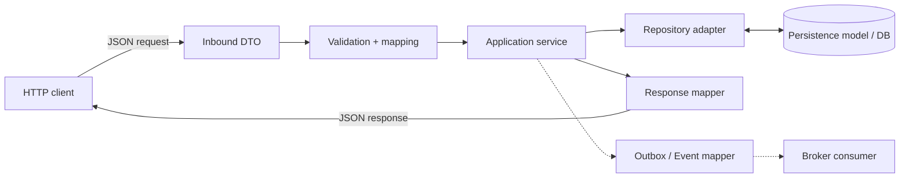
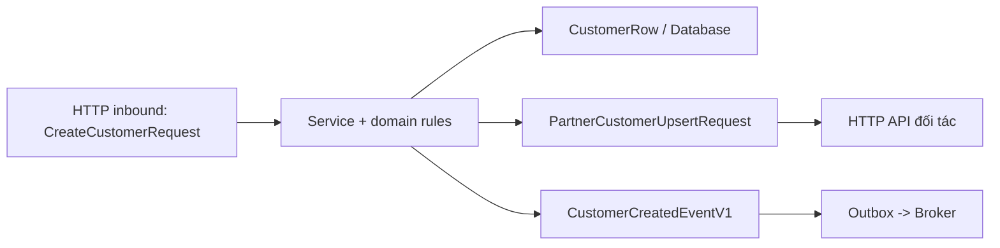

# DTO và tách mô hình trao đổi khỏi đối tượng lưu trữ nội bộ

Trong **SPRING_BOOT_INTEGRATION**, một đối tượng khách hàng có thể đi qua HTTP controller, HTTP client gọi đối tác, cơ sở dữ liệu, cache, broker thông điệp và các adapter của Spring Integration. Tuy cùng mô tả một khách hàng, mỗi ranh giới cần một **hợp đồng dữ liệu** khác nhau. Đưa nguyên đối tượng lưu trữ ra ngoài khiến thay đổi schema database có thể làm hỏng API, vô tình lộ trường nội bộ và buộc các hệ thống khác phụ thuộc vào cấu trúc triển khai của mình.

Bài thuộc chương **Hợp đồng dữ liệu** giải thích cách dùng **Data Transfer Object (DTO)** làm mô hình trao đổi, cách chuyển đổi giữa DTO và dữ liệu nội bộ, cũng như tác động của thiết kế này đến validation, phiên bản API, xử lý lỗi, chống trùng lặp, kiểm thử và quan sát luồng tích hợp.

## 1. Mục tiêu và khái niệm nền tảng

Sau bài học, bạn có thể:

- Phân biệt **DTO đầu vào**, **DTO đầu ra**, **event DTO**, **mô hình nghiệp vụ** và **mô hình lưu trữ**.
- Xác định tại sao endpoint HTTP hoặc message broker không nên trao đổi trực tiếp JPA entity hay bản ghi nội bộ.
- Thiết kế lớp ánh xạ (mapper) rõ ràng, có kiểm soát các trường được công bố.
- Đặt validation đúng vị trí: cú pháp dữ liệu ở biên, quy tắc nghiệp vụ ở service/domain, bất biến dữ liệu ở database.
- Tiến hóa hợp đồng JSON mà không ràng buộc bên ngoài vào thay đổi schema nội bộ.
- Kiểm thử ánh xạ, JSON serialization, hành vi HTTP và luồng tích hợp khi có retry hoặc giao trùng thông điệp.

**DTO** là đối tượng mang dữ liệu qua ranh giới của hệ thống hoặc giữa các lớp cần hợp đồng rõ ràng. DTO có thể là Java `record`, một lớp Java bất biến hoặc một dạng message được sinh từ schema. Nó không mặc nhiên là thực thể database, cũng không phải nơi thực thi quy tắc nghiệp vụ.

**Mô hình lưu trữ** biểu diễn cách ứng dụng lưu/đọc dữ liệu: bảng, cột, JPA entity, JDBC row, khóa ngoại, version phục vụ khóa lạc quan, trường dành riêng cho vận hành. **Mô hình nghiệp vụ** (nếu tách riêng) biểu diễn trạng thái và hành vi theo quy tắc domain. Với ứng dụng nhỏ, service có thể làm việc trực tiếp với đối tượng từ repository, nhưng hợp đồng trao đổi bên ngoài vẫn cần được định nghĩa tường minh.



Mũi tên qua biên là nơi cần hợp đồng và kiểm soát ánh xạ. Ví dụ: `CreateCustomerRequest` là cấu trúc mà người gọi được phép gửi; `CustomerRow` là dữ liệu thực sự nằm trong database; `CustomerResponse` chỉ chứa những thông tin được phép trả về.

## 2. Vì sao không dùng trực tiếp entity hoặc row làm JSON?

Giả sử bảng `customer_profile` chứa email, tên hiển thị, điểm rủi ro nội bộ, cờ xóa mềm và version cập nhật. API công khai chỉ cần ID, email, tên và ngày đăng ký. Nếu trả toàn bộ đối tượng lưu trữ, các hệ quả thường gặp là:

| Hệ quả | Ví dụ | Hướng giải quyết |
| --- | --- | --- |
| Lộ dữ liệu | `internalRiskScore`, `deleted`, thông tin kiểm soát truy cập xuất hiện trong JSON | Response DTO theo danh sách trường được phép công bố. |
| Phụ thuộc schema | Đổi tên cột hoặc quan hệ JPA dẫn đến đổi JSON ngoài ý muốn | Tách storage mapping khỏi contract mapping. |
| Ghi quá quyền (mass assignment) | Người gửi tự gắn `role`, `approved`, `internalStatus` vào request | Request DTO chỉ nhận trường người dùng được quyền thao tác. |
| Lỗi tuần tự hóa | JPA lazy proxy, quan hệ vòng hoặc truy vấn N+1 khi Jackson duyệt entity | Mapping chủ động trước khi serialize. |
| Khó tiến hóa | Một field vừa phục vụ truy vấn nội bộ, vừa bị đối tác coi là hợp đồng API | Version và chính sách tương thích của DTO độc lập. |
| Rối ngữ nghĩa | `null` trong database, JSON và lệnh cập nhật bị hiểu giống nhau | Định nghĩa rõ semantics từng trường và từng thao tác. |

`@JsonIgnore` trên entity có thể che một vài trường ở một endpoint, nhưng không giải quyết việc entity đang gánh hai trách nhiệm: lưu trữ và giao tiếp. Càng nhiều consumer, nguy cơ sửa một annotation rồi làm thay đổi những API khác càng cao. DTO riêng là ranh giới kiến trúc có thể được kiểm thử.

## 3. Ví dụ xuyên suốt: hợp đồng khách hàng qua HTTP

Ví dụ sử dụng **Java 17+**, **Spring Boot 3.x** với Jakarta Validation, Jackson và JDBC. Đối tượng lưu trữ mô phỏng một bảng PostgreSQL. Mỗi `public` top-level type trong các đoạn mã là một file Java riêng khi triển khai thực tế; phần import được lược bớt ở các ví dụ tiếp theo nếu đã rõ theo ngữ cảnh.

### 3.1. Hợp đồng nhận yêu cầu và trả kết quả

```java
import jakarta.validation.constraints.Email;
import jakarta.validation.constraints.NotBlank;
import jakarta.validation.constraints.Size;

public record CreateCustomerRequest(
        @NotBlank @Email @Size(max = 320) String email,
        @NotBlank @Size(max = 120) String displayName
) {}
```

```java
import java.time.Instant;
import java.util.UUID;

public record CustomerResponse(
        UUID id,
        String email,
        String displayName,
        Instant registeredAt
) {}
```

Hợp đồng JSON đầu vào:

```json
{
  "email": "lan@example.org",
  "displayName": "Lan Nguyễn"
}
```

Hợp đồng JSON đầu ra:

```json
{
  "id": "e398a09c-8590-4332-919f-6410748b3a70",
  "email": "lan@example.org",
  "displayName": "Lan Nguyễn",
  "registeredAt": "2026-11-21T02:30:00Z"
}
```

Ở đây `CreateCustomerRequest` không có `id`, điểm rủi ro hoặc cờ xóa. Người dùng không thể yêu cầu hệ thống tự tin vào các trường nội bộ đó qua hợp đồng HTTP. `CustomerResponse` không chứa chúng, ngay cả khi DB có thêm cột hoặc repository đọc đủ dữ liệu.

**Lưu ý về validation:** `@NotBlank`, `@Email`, `@Size` kiểm tra hình dạng và một số điều kiện đầu vào; chúng không chứng minh email tồn tại, người gửi sở hữu email hay email chưa có trong database. Với Spring MVC, dùng `@Valid` tại tham số `@RequestBody` và thêm dependency validation phù hợp (ví dụ `spring-boot-starter-validation`).

### 3.2. Dữ liệu nội bộ có hình dạng khác

```java
import java.time.Instant;
import java.util.UUID;

// Row nội bộ do adapter JDBC dựng lên; không dùng làm response HTTP.
public record CustomerRow(
        UUID id,
        String email,
        String displayName,
        int internalRiskScore,
        boolean deleted,
        Instant createdAt,
        Instant updatedAt,
        long version
) {}
```

`internalRiskScore` giúp một quy trình nội bộ đánh giá rủi ro, `deleted` phục vụ xóa mềm, `updatedAt` và `version` phục vụ đồng bộ/kiểm soát cập nhật. Các trường đó không nhất thiết xuất hiện trong bất kỳ DTO công khai nào. Nếu dự án dùng JPA, mô hình lưu trữ có thể là `@Entity`; với JDBC là row mapped từ `ResultSet`; nguyên tắc ranh giới giống nhau.

Schema minh họa cho PostgreSQL:

```sql
CREATE TABLE customer_profile (
    id                  UUID PRIMARY KEY,
    email               VARCHAR(320) NOT NULL UNIQUE,
    display_name        VARCHAR(120) NOT NULL,
    internal_risk_score INTEGER NOT NULL DEFAULT 0,
    deleted             BOOLEAN NOT NULL DEFAULT FALSE,
    created_at          TIMESTAMPTZ NOT NULL,
    updated_at          TIMESTAMPTZ NOT NULL,
    version             BIGINT NOT NULL DEFAULT 0
);
```

Đây là **schema nội bộ**, không phải tài liệu API; migration database có thể thay đổi cột, index, kiểu dữ liệu mà không làm đổi response JSON nếu mapper vẫn đáp ứng hợp đồng.

### 3.3. Mapping phải diễn đạt quyết định công bố dữ liệu

Thêm một command nội bộ giúp tách dữ liệu **đã được tiếp nhận và chuẩn hóa** khỏi DTO HTTP:

```java
public record CreateCustomerCommand(String email, String displayName) {}
```

```java
public final class CustomerContractMapper {
    private CustomerContractMapper() {}

    public static CreateCustomerCommand toCommand(CreateCustomerRequest request) {
        return new CreateCustomerCommand(
                request.email().trim(),
                request.displayName().trim());
    }

    public static CustomerResponse toResponse(CustomerRow row) {
        return new CustomerResponse(
                row.id(),
                row.email(),
                row.displayName(),
                row.createdAt());
    }
}
```

`toCommand` không nhận `id` hay `internalRiskScore`; `toResponse` **liệt kê rõ** bốn trường được phép lộ ra ngoài. Mapper là hàm thuần, dễ kiểm thử, không phụ thuộc controller, broker, transaction hay Jackson. Chỉ chuẩn hóa theo quy tắc đã được thống nhất: ví dụ, không tự động lowercase toàn bộ địa chỉ email nếu nghiệp vụ chưa quy định ngữ nghĩa so sánh email; không âm thầm đổi timezone hoặc làm tròn tiền tệ.

Không cần tạo mọi loại class chỉ để có thêm tầng. `CreateCustomerCommand` hữu ích khi cùng hành động nghiệp vụ được gọi từ HTTP, consumer hoặc scheduled job; nếu dự án chỉ có một luồng rất đơn giản, service có thể nhận các giá trị đã kiểm tra mà vẫn giữ request/response DTO tách khỏi storage.

## 4. Nối các tầng trong một ứng dụng Spring Boot

Để nhìn rõ ranh giới, ví dụ sau dùng repository JDBC đơn giản. SQL là chi tiết của adapter; mapper quyết định JSON là gì.

```java
import java.time.Instant;
import java.util.UUID;
import org.springframework.jdbc.core.namedparam.MapSqlParameterSource;
import org.springframework.jdbc.core.namedparam.NamedParameterJdbcTemplate;
import org.springframework.stereotype.Repository;

@Repository
public class CustomerJdbcRepository {
    private final NamedParameterJdbcTemplate jdbc;

    public CustomerJdbcRepository(NamedParameterJdbcTemplate jdbc) {
        this.jdbc = jdbc;
    }

    public CustomerRow insert(CreateCustomerCommand command) {
        UUID id = UUID.randomUUID();
        Instant now = Instant.now();

        var params = new MapSqlParameterSource()
                .addValue("id", id)
                .addValue("email", command.email())
                .addValue("displayName", command.displayName())
                .addValue("createdAt", now)
                .addValue("updatedAt", now);

        jdbc.update("""
                INSERT INTO customer_profile
                    (id, email, display_name, created_at, updated_at)
                VALUES
                    (:id, :email, :displayName, :createdAt, :updatedAt)
                """, params);

        return new CustomerRow(id, command.email(), command.displayName(),
                0, false, now, now, 0);
    }
}
```

Trong ví dụ này, các giá trị mặc định `0`, `false`, `0` của row khớp với default trên schema. Ứng dụng phức tạp hơn có thể đọc bản ghi vừa ghi từ database, đặc biệt khi DB có trigger, default hoặc giá trị sinh tự động cần phản ánh chính xác. `Instant.now()` được đặt ở repository để minh họa; production có thể dùng `Clock` được inject nhằm kiểm thử thời gian ổn định.

```java
import org.springframework.stereotype.Service;
import org.springframework.transaction.annotation.Transactional;

@Service
public class CustomerService {
    private final CustomerJdbcRepository repository;

    public CustomerService(CustomerJdbcRepository repository) {
        this.repository = repository;
    }

    @Transactional
    public CustomerResponse create(CreateCustomerRequest request) {
        CreateCustomerCommand command = CustomerContractMapper.toCommand(request);
        CustomerRow stored = repository.insert(command);
        return CustomerContractMapper.toResponse(stored);
    }
}
```

```java
import jakarta.validation.Valid;
import java.net.URI;
import org.springframework.http.ResponseEntity;
import org.springframework.web.bind.annotation.PostMapping;
import org.springframework.web.bind.annotation.RequestBody;
import org.springframework.web.bind.annotation.RequestMapping;
import org.springframework.web.bind.annotation.RestController;

@RestController
@RequestMapping("/api/customers")
public class CustomerController {
    private final CustomerService service;

    public CustomerController(CustomerService service) {
        this.service = service;
    }

    @PostMapping
    public ResponseEntity<CustomerResponse> create(
            @Valid @RequestBody CreateCustomerRequest request) {
        CustomerResponse response = service.create(request);
        return ResponseEntity
                .created(URI.create("/api/customers/" + response.id()))
                .body(response);
    }
}
```

Flow thực hiện:

1. Jackson chuyển JSON thành `CreateCustomerRequest`.
2. Spring MVC + Bean Validation phát hiện yêu cầu thiếu/không đúng dạng trường bắt buộc.
3. Service chuyển request thành command; repository viết theo schema nội bộ.
4. Mapper biến `CustomerRow` thành `CustomerResponse` và Jackson serialize đúng hợp đồng công khai.

Ví dụ sử dụng `@Transactional` cho đường ghi và một `DataSource`. Nếu thêm gọi HTTP đối tác hoặc publish broker bên trong service, transaction JDBC **không** tự làm các tác động ngoài database trở thành một giao dịch nguyên tử. Khi cần phát sự kiện đáng tin cậy sau ghi, cân nhắc transactional outbox: ghi dữ liệu nghiệp vụ và outbox trong cùng transaction, sau đó publisher độc lập chuyển sự kiện ra broker.

## 5. Validation ở đâu, và phản hồi lỗi như thế nào?

Để hợp đồng dữ liệu có nghĩa, phải tách ba lớp kiểm tra:

| Lớp kiểm tra | Ví dụ | Vị trí thích hợp |
| --- | --- | --- |
| Cấu trúc và kiểu dữ liệu | `email` sai định dạng, `displayName` trống/quá dài, JSON sai kiểu | DTO + Bean Validation ở HTTP/message adapter. |
| Quy tắc nghiệp vụ | Chỉ tài khoản đã xác minh được kích hoạt; một đối tác không được đổi một thuộc tính nhất định | Application service/domain, có đủ ngữ cảnh nghiệp vụ. |
| Bất biến lưu trữ | `email` không được trùng, khóa ngoại, điều kiện nhất quán khi cập nhật đồng thời | Database constraint + xử lý ngoại lệ tại adapter/service. |

Không nên chỉ dùng `existsByEmail(...)` rồi giả định `insert` sẽ thành công: hai yêu cầu đồng thời vẫn có thể vượt qua bước kiểm tra trước khi cùng ghi. Unique constraint trong database mới là tuyến bảo vệ cuối cùng. Adapter cần chuyển xung đột này thành lỗi nghiệp vụ thích hợp, ví dụ HTTP `409 Conflict` nếu email đã được sử dụng, thay vì trả stack trace hoặc SQL ra cho client.

Với Spring MVC, `@Valid @RequestBody` thường biến lỗi Bean Validation thành phản hồi `400 Bad Request`; nên thống nhất cấu trúc lỗi bằng `ProblemDetail` hoặc schema lỗi nội bộ được công bố. Một hợp đồng lỗi có thể chứa `type`, `title`, `status`, `detail`, `instance`, `code` và `correlationId`, nhưng **không** đưa nội dung truy vấn SQL, mật khẩu, dữ liệu riêng tư hoặc stack trace ra bên ngoài. Việc dịch các `DataAccessException` thành mã lỗi bên ngoài cần xem xét theo nguyên nhân: lỗi mất kết nối tạm thời khác với lỗi dữ liệu đầu vào.

**Nhận JSON không đồng nghĩa mọi trường trong JSON đều được phép dùng.** Nếu client gửi thêm `internalRiskScore` mà DTO không khai báo, hành vi từ chối hay bỏ qua trường lạ phụ thuộc cấu hình Jackson; cần chọn chính sách rõ ràng, kiểm thử nó và không dựa vào mặc định ngầm định khi làm API cho đối tác. Dù bỏ qua trường lạ, service vẫn chỉ đọc những trường được định nghĩa trong request DTO.

## 6. DTO đầu vào, đầu ra, cập nhật và dữ liệu thiếu

Không nên dùng một DTO chung cho mọi thao tác CRUD. Cùng là `Customer`, nhưng yêu cầu tạo, cập nhật một phần, truy vấn và sự kiện có ngữ nghĩa khác nhau:

| Hợp đồng | Ví dụ trường | Quy tắc |
| --- | --- | --- |
| `CreateCustomerRequest` | `email`, `displayName` | Trường bắt buộc; không cho client điền ID hoặc thuộc tính nội bộ. |
| `UpdateCustomerRequest` | Những trường được phép cập nhật | Kiểm tra quyền chỉnh sửa, phiên bản bản ghi và semantics của dữ liệu thiếu. |
| `CustomerResponse` | `id`, `email`, `displayName`, `registeredAt` | Chỉ công bố thông tin phù hợp với đối tượng gọi và chính sách dữ liệu. |
| `CustomerCreatedEventV1` | `eventId`, `customerId`, `occurredAt`, `schemaVersion` | Dành cho consumer broker; cần hợp đồng và tiến hóa độc lập với HTTP. |

Đặc biệt, với cập nhật từng phần, **field vắng mặt** và **field có giá trị `null`** có thể mang nghĩa khác nhau:

```json
{ "displayName": "Lan Mới" }
```

Thường được hiểu là chỉ sửa `displayName`.

```json
{ "displayName": null }
```

Có thể được hiểu là xóa giá trị hoặc yêu cầu không hợp lệ, tùy hợp đồng. Một `record UpdateCustomerRequest(String displayName)` đơn giản có thể mất khả năng phân biệt *vắng mặt* với *được gửi explicit null* sau deserialization. Nếu cần PATCH với semantics chính xác, hãy dùng biểu diễn có theo dõi sự hiện diện của trường (chẳng hạn `JsonNode`, wrapper phù hợp hoặc triển khai JSON Merge Patch theo RFC 7396) và kiểm thử từng trường hợp. Tránh dùng giá trị `null` như mệnh lệnh “giữ nguyên” nếu hợp đồng còn cần hỗ trợ “xóa trường”.

Các quy tắc bổ sung cần định nghĩa trong API contract: giới hạn độ dài, cho phép `null` hay không, timezone của timestamp (`Instant` phù hợp mốc thời gian tuyệt đối), định dạng ID (`UUID`/string), thứ tự collection có quan trọng không, chuẩn số tiền và đơn vị đo, cách biểu diễn enum khi có giá trị mới. `String` cho mọi trường có vẻ dễ ban đầu nhưng làm mất khả năng kiểm tra kiểu và ngữ nghĩa.

## 7. DTO khi gọi HTTP đối tác và dùng broker

Trong một luồng tích hợp, mô hình JSON của đối tác có thể khác mô hình HTTP mình công bố, và khác cả mô hình nội bộ:



Một adapter HTTP client nên có DTO riêng cho **hợp đồng của đối tác** (`PartnerCustomerUpsertRequest`, `PartnerCustomerResponse`) và một mapper chuyển giữa mô hình nội bộ với chúng. Khi đối tác đổi tên trường `full_name` thành `display_name`, tác động được giới hạn vào adapter thay vì buộc thay đổi `CustomerResponse` công khai hoặc schema DB.

Ví dụ event DTO được phát sau khi tạo khách hàng:

```java
import java.time.Instant;
import java.util.UUID;

public record CustomerCreatedEventV1(
        String eventId,
        int schemaVersion,
        UUID customerId,
        String displayName,
        Instant occurredAt
) {}
```

Event này cố ý không mang email, điểm rủi ro hay toàn bộ snapshot DB vì consumer minh họa chỉ cần biết khách hàng được tạo và tên hiển thị. Khi consumer thật sự cần một trường khác, đánh giá quyền truy cập dữ liệu, mục đích dùng, chi phí tăng payload và chính sách tiến hóa schema trước khi thêm. `eventId` được tạo **một lần** cho sự kiện logic, giữ nguyên qua các lần publish lại; consumer dùng ID ổn định đó làm khóa idempotency.

**Không dùng chung `CustomerResponse` làm body HTTP, cache entry và broker event chỉ vì ba nơi đều chứa khách hàng.** Mỗi kênh có vòng đời, chính sách tương thích, đối tượng đọc, mức bí mật và ngữ nghĩa khác nhau. Với Spring Integration, một message có thể mang DTO đã được adapter parse và validate; phần orchestration xử lý message không cần biết DTO phía database trông như thế nào.

### Chống trùng lặp và giao dịch ở biên broker

Broker có thể giao cùng message nhiều lần khi xử lý lỗi hoặc retry. DTO nên mang định danh sự kiện ổn định, nhưng chỉ có `eventId` trong JSON **chưa** tự tạo idempotency: consumer cần kiểm tra hoặc ghi dấu ID này trong kho trạng thái có constraint phù hợp, cùng transaction với tác động nghiệp vụ khi có thể. Nếu luồng vừa commit DB vừa gửi HTTP hoặc broker, phải thiết kế trạng thái retry/outbox/inbox rõ ràng; không kỳ vọng giao dịch JDBC bao phủ hệ thống ngoài.

Validation message cũng cần tách hai tình huống: payload sai hợp đồng (thường cần reject hoặc đưa vào dead-letter/quarantine có kiểm soát) và lỗi hạ tầng tạm thời (thường được retry có giới hạn và backoff). Log nên chứa `eventId`, loại event, schema version và correlation ID; không log toàn bộ payload nhạy cảm.

## 8. Version và khả năng tương thích của hợp đồng

Thay đổi tên trường trong database **không nhất thiết** làm đổi API, bởi mapper có thể giữ JSON cũ. Ngược lại, khi đổi hợp đồng JSON, cần tính đến client hoặc consumer vẫn sử dụng phiên bản trước.

| Thay đổi hợp đồng | Tác động thường gặp | Cách triển khai có kiểm soát |
| --- | --- | --- |
| Thêm field tùy chọn vào response | Consumer chỉ đọc trường cũ thường hoạt động tiếp | Mô tả mặc định, kiểm thử consumer strict và tài liệu API. |
| Thêm field bắt buộc vào request | Client cũ không gửi nên có thể lỗi | Đặt mặc định/cho phép thiếu khi chuyển tiếp hoặc phát hành phiên bản hợp đồng mới. |
| Đổi tên/xóa field hoặc đổi kiểu | Consumer cũ có thể deserialize sai | Giữ alias giai đoạn chuyển tiếp hoặc tạo version mới. |
| Đổi ngữ nghĩa field không đổi tên | Nguy hiểm vì lỗi không hiện qua schema | Định nghĩa contract version mới và migration rõ ràng. |
| Đổi cấu trúc bảng/cột nội bộ | Không nên tác động tới người dùng API | Điều chỉnh repository và mapper trong ứng dụng. |

Với HTTP, có thể version ở URL (`/v1/customers`), media type hoặc cơ chế version đã thống nhất của tổ chức. Với event broker, có thể dùng `eventType` + `schemaVersion` hay schema registry khi dùng Avro/Protobuf/JSON Schema. **Versioning không thay thế hợp đồng tương thích**: cần chính sách phát hành, thời gian chuyển tiếp, owner và cách đo consumer đang dùng version nào.

Ví dụ `@JsonProperty("customer_id")` có thể ánh xạ tên JSON khác tên component Java; nhưng một annotation không giải quyết đầy đủ việc đổi tên field đã được client sử dụng. Nếu phải chuyển tiếp, hãy kiểm thử cả JSON cũ và mới, xác định rõ trường hợp hai alias xuất hiện cùng lúc và tránh diễn giải mơ hồ.

**Quy tắc thực hành:** công bố OpenAPI hoặc schema cho các hợp đồng quan trọng; review thay đổi contract như một thay đổi tương thích hệ thống, không chỉ như một lần refactor Java.

## 9. Mapping thủ công, MapStruct và trách nhiệm của adapter

Với DTO ít field, mapper thủ công giúp nhìn rõ trường nào được đọc, chuẩn hóa hoặc công bố. Khi có hàng trăm DTO, thư viện sinh mapper như **MapStruct** có thể giảm mã lặp, nhưng cần giữ các quy tắc bảo mật và chuyển đổi đặc biệt dưới dạng cấu hình tường minh.

| Cách mapping | Ưu điểm | Rủi ro cần quản lý |
| --- | --- | --- |
| Hàm thủ công | Rõ quyết định nghiệp vụ, dễ đọc, dễ debug | Nhiều boilerplate ở hệ thống lớn. |
| MapStruct | Sinh mã lúc biên dịch, hỗ trợ kiểm tra field | Cần kiểm soát field chưa ánh xạ và phép chuyển đổi ngầm định. |
| Reflection/Bean copier tự động | Viết ít mã ban đầu | Dễ copy nhầm field nội bộ, chuyển kiểu thiếu rõ ràng và khó phát hiện thay đổi. |

Từ góc độ kiến trúc, nên tránh mapper tự gọi repository hoặc HTTP client để “lấp đầy” field. Làm như vậy khiến một lần biến đổi dữ liệu có I/O ẩn, gây truy vấn N+1, khó kiểm thử và khó điều chỉnh transaction. Service/adapter chịu trách nhiệm lấy đủ dữ liệu; mapper chịu trách nhiệm chuyển đổi đã biết.

Với dữ liệu nhạy cảm, chọn cách **allowlist field** (khai báo trường trả ra) thay vì sao chép mọi field trừ một danh sách ẩn. Khi bổ sung `riskLevel` vào `CustomerRow`, mapper cũ vẫn không đưa nó ra JSON nếu không được xem xét và sửa có chủ đích.

## 10. Cache cũng là một hợp đồng dữ liệu

Cache nằm gần nội bộ ứng dụng nhưng vẫn có hợp đồng về key, cấu trúc value, TTL, quyền truy cập và thời điểm invalidation. Cân nhắc:

- Cache `CustomerResponse` giúp endpoint đọc nhanh, nhưng key phải gắn với đối tượng gọi/tenant nếu response thay đổi theo quyền; nếu không có thể lộ dữ liệu giữa người dùng.
- Cache `CustomerRow` có thể dùng cho nhiều nhu cầu nội bộ, nhưng không có nghĩa được trả row trực tiếp ra API. Trường vừa thêm vào row cần được xử lý theo chính sách dữ liệu của cache.
- Khi thay cấu trúc value mà nhiều phiên bản ứng dụng đang hoạt động, cần version key hoặc chiến lược tương thích serializer.
- TTL không thay thế invalidation; nếu cập nhật email/tên đã commit mà cache còn dữ liệu cũ, API sẽ có hành vi không nhất quán. Xem xét invalidation sau commit và khả năng retry khi cache không sẵn sàng.

Cache thường không phải nguồn chân lý. Chỉ dùng giá trị cache để quyết định quyền hoặc trạng thái nghiệp vụ khi đã có chính sách nhất quán và làm mới phù hợp.

## 11. Kiểm thử hợp đồng dữ liệu theo các mức

Tách DTO khỏi mô hình lưu trữ chỉ có giá trị khi hợp đồng được kiểm thử, nhất là sau khi đổi cột, đổi tên field hoặc nâng cấp serializer.

| Cấp kiểm thử | Câu hỏi cần trả lời | Gợi ý |
| --- | --- | --- |
| Mapper unit test | Mọi field công khai đúng nguồn chưa? Trường nội bộ có bị rò rỉ không? | JUnit 5 cho `CustomerContractMapper`, test `null`/empty và quy tắc chuẩn hóa nếu có. |
| JSON serialization test | Tên key, kiểu dữ liệu, timestamp và trường thiếu có đúng contract không? | `@JsonTest`/Jackson test với JSON fixture hoặc snapshot có kiểm soát. |
| Controller contract test | Sai đầu vào có trả `400`? Tạo thành công có `201`, `Location`, body đúng không? | `@WebMvcTest` + MockMvc, kiểm tra status và cấu trúc body. |
| Repository integration test | SQL/DDL và chuyển kiểu có đúng database thật không? | Testcontainers PostgreSQL, chạy migration, kiểm tra unique constraint và timestamp. |
| Consumer/producer contract test | Consumer cũ đọc được event mới? Retry có giữ `eventId` không? | Schema compatibility, contract test giữa producer/consumer và test giao trùng. |

Ví dụ unit test độc lập với Spring context cho mapper:

```java
import static org.junit.jupiter.api.Assertions.assertEquals;

import java.time.Instant;
import java.util.UUID;
import org.junit.jupiter.api.Test;

class CustomerContractMapperTest {
    @Test
    void responseOnlyContainsPublicFieldsFromRow() {
        UUID id = UUID.fromString("e398a09c-8590-4332-919f-6410748b3a70");
        Instant created = Instant.parse("2026-11-21T02:30:00Z");
        CustomerRow row = new CustomerRow(
                id, "lan@example.org", "Lan Nguyễn", 95,
                false, created, created, 7);

        CustomerResponse response = CustomerContractMapper.toResponse(row);

        assertEquals(id, response.id());
        assertEquals("lan@example.org", response.email());
        assertEquals("Lan Nguyễn", response.displayName());
        assertEquals(created, response.registeredAt());
    }
}
```

Test trên khẳng định ánh xạ giá trị; để kiểm tra **JSON thực sự không có `internalRiskScore`**, cần thêm kiểm thử Jackson hoặc endpoint:

```java
// Kiểm thử ý tưởng với ObjectMapper đã cấu hình như ứng dụng:
String json = objectMapper.writeValueAsString(response);
JsonNode node = objectMapper.readTree(json);
assertFalse(node.has("internalRiskScore"));
assertFalse(node.has("deleted"));
assertEquals("Lan Nguyễn", node.get("displayName").asText());
```

Trường hợp JSON trong ví dụ này cần import `JsonNode` và assertion JUnit; `objectMapper` nên được lấy từ cấu hình Jackson thực tế trong test Spring Boot để bắt đúng chính sách tên trường, module `java.time`, serialization null và tính tương thích version.

Những tình huống nên chủ động thêm vào test suite: field mới trong row không xuất hiện ngoài ý muốn; request không chứa thông tin nội bộ; input sai trả mã lỗi ổn định; hai request cùng email kích hoạt unique constraint và lỗi nghiệp vụ thích hợp; event thiếu version hoặc có version không hỗ trợ được xử lý dự đoán trước; message lặp cùng `eventId` không gây tác động trùng; cache không làm lộ response có quyền khác nhau.

## 12. Những sai lầm phổ biến và checklist thiết kế

**Lấy entity làm DTO cho “nhanh”.** Ban đầu ít code nhưng rất dễ biến một refactor database thành breaking change API và có thể lộ quan hệ/trường nhạy cảm. Hãy tạo request/response rõ ràng ở biên.

**Dùng chung một `CustomerDto` cho tạo, cập nhật, đọc, broker và đối tác.** Mọi consumer có nhu cầu khác nhau; các trường nullable và annotation thường chồng chéo, khiến hợp đồng không thể hiện đúng quyền và ngữ nghĩa. Hãy đặt tên DTO theo hành động và kênh giao tiếp.

**Tin vào Bean Validation để bảo vệ toàn bộ nghiệp vụ.** Constraint trên request chỉ kiểm tra một phần dữ liệu đầu vào. Tính duy nhất, quyền thay đổi và điều kiện trạng thái phải được kiểm soát thêm ở service/domain và database.

**Đổi tên field JSON chỉ vì đổi tên biến Java hoặc cột SQL.** Nếu key đã được client dùng, hãy coi đó là thay đổi hợp đồng và có chiến lược tương thích/phiên bản.

**Để mapper chứa I/O hoặc logic phát sự kiện.** Mapper khó dự đoán, khó kiểm thử và có thể làm thay đổi thời gian giữ transaction. Hãy để service phối hợp các adapter; mapper chỉ biến đổi dữ liệu.

Khi review một luồng tích hợp, kiểm tra lần lượt:

1. **Người nhận là ai?** HTTP client, đối tác, consumer broker hay cache; họ thực sự cần trường nào?
2. **Dữ liệu được phép đi qua biên nào?** Có trường nhạy cảm, tenant ID, internal status, hoặc thông tin cần che/biến đổi không?
3. **Field có semantics rõ chưa?** Bắt buộc/tùy chọn, `null`/vắng mặt, thời gian, số tiền, enum, giới hạn và format?
4. **Lỗi được công bố ra sao?** Validation, conflict, upstream unavailable có schema và mã lỗi được kiểm thử không?
5. **Mapper và storage có độc lập không?** Thay cột DB có ảnh hưởng JSON? Thêm trường nội bộ có tự rò rỉ không?
6. **Hợp đồng tiến hóa thế nào?** Có schema/OpenAPI, version, chính sách tương thích và test producer–consumer không?
7. **Retry và giao trùng có an toàn không?** Event/command có định danh ổn định, xử lý idempotent và transaction/outbox phù hợp chưa?
8. **Quan sát đủ chưa?** Log/trace có correlation ID, event ID, schema version và chỉ ghi dữ liệu đã lọc không?

**Ghi nhớ:** DTO bảo vệ ranh giới giữa hệ thống trao đổi dữ liệu và cách ứng dụng lưu trữ hay xử lý dữ liệu. Trong Spring Boot, cấu trúc DTO tốt phải đi cùng mapper chủ động, validation nhiều lớp, hợp đồng có phiên bản, xử lý lỗi và kiểm thử thực tế; nhờ đó HTTP, database, cache và broker có thể tiến hóa độc lập hơn mà vẫn giữ lời hứa dữ liệu đối với các hệ thống tích hợp.
