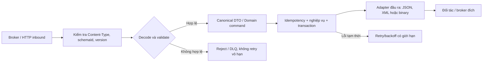

# Lựa chọn JSON, XML, dữ liệu nhị phân và schema

> **Chương:** Hợp đồng dữ liệu  
> **Phạm vi:** Trong module **SPRING_BOOT_INTEGRATION**, dịch vụ Spring Boot kết nối với hệ thống ngoài qua HTTP client, cơ sở dữ liệu, cache, broker thông điệp và các adapter của Spring Integration. Bài này hướng dẫn lựa chọn định dạng trao đổi dữ liệu và schema, kiểm soát phiên bản hợp đồng, chuyển đổi dữ liệu ở ranh giới tích hợp, xử lý lỗi, trùng lặp, kiểm thử và quan sát luồng thực tế.

## 1. Định dạng dữ liệu và hợp đồng dữ liệu không phải một

Khi một đối tác gửi sự kiện “đơn hàng đã được tạo”, hai phía phải thống nhất nhiều điều hơn việc dữ liệu được viết bằng JSON hay XML:

- **Định dạng trên đường truyền (wire format):** JSON, XML, Protobuf, Avro, hoặc byte array theo giao thức riêng.
- **Cấu trúc/schema:** trường nào có mặt, kiểu dữ liệu, có bắt buộc hay được bỏ qua, các ràng buộc và quy tắc tiến hóa.
- **Ngữ nghĩa:** `orderId` có phải duy nhất trong toàn hệ thống? `amountMinor` là số đơn vị tiền nhỏ nhất của loại tiền nào? `occurredAt` là thời điểm phát sinh hay thời điểm gửi?
- **Giao thức trao đổi:** HTTP method, Content-Type, status code; hoặc tên topic, key, header, ack/retry và thứ tự message ở broker.
- **Hành vi nghiệp vụ:** nhận message trùng thì làm gì, sự kiện nào có thể đến trễ, thay đổi trạng thái có hợp lệ không, lỗi được phản hồi ra sao.

**Một payload hợp lệ theo schema vẫn có thể sai nghiệp vụ.** Ví dụ `quantity: 5` đúng kiểu số nguyên nhưng mã hàng đã ngừng bán, hoặc `eventId` đã được xử lý từ trước.

| Khái niệm | Ví dụ | Giải quyết câu hỏi |
| --- | --- | --- |
| **Encoding/serialization** | UTF-8 JSON, XML, Protobuf binary | Biến đối tượng thành dữ liệu được truyền như thế nào? |
| **Schema** | JSON Schema, XSD, `.proto`, Avro schema | Dữ liệu có cấu trúc và kiểu nào, có hợp lệ không? |
| **API/event contract** | OpenAPI, AsyncAPI, tài liệu event | Gửi/nhận dữ liệu ở đâu, khi nào và có kết quả gì? |
| **Business invariants** | Unique order key, tổng tiền không âm | Dữ liệu hợp lệ theo quy tắc hệ thống chưa? |
| **Compatibility policy** | Đọc được payload của phiên bản cũ | Nâng cấp producer/consumer có làm đứt tích hợp không? |

## 2. So sánh JSON, XML và dữ liệu nhị phân

| Tiêu chí | JSON | XML | Nhị phân có schema (Protobuf, Avro...) |
| --- | --- | --- | --- |
| Khả năng đọc bằng mắt | Rất tốt | Tốt nhưng nhiều thẻ và namespace | Thường cần schema và công cụ giải mã |
| Dữ liệu biểu diễn | Object, array, string, number, boolean, null | Element, attribute, text, namespace, thứ tự phần tử | Trường/kiểu theo schema riêng |
| Chi phí payload | Có tên trường lặp lại, tương đối gọn | Thường nhiều ký tự cấu trúc | Thường gọn và ít overhead hơn với dữ liệu có cấu trúc |
| Schema/validation | JSON Schema, OpenAPI schema | XSD và các quy tắc XML khác | `.proto` / Avro schema; có quy tắc tiến hóa kiểu riêng |
| Tích hợp phổ biến | REST API, webhook, event đơn giản | SOAP, hệ thống doanh nghiệp/legacy, tài liệu có namespace | RPC, event streaming, khối lượng lớn, đa ngôn ngữ |
| Gỡ lỗi thủ công | Dễ | Dễ nhưng parser/namespace phức tạp | Cần tool, schema ID hoặc class được sinh |
| Điểm cần cẩn thận | Number/precision, thiếu vs null, enum/version | XXE, DTD, namespace, element order, parser complexity | Phụ thuộc schema, codec, generator, registry, field ID |

Không có định dạng nào tối ưu cho mọi luồng. **Khối lượng thực tế, kiểu dữ liệu, tương thích với đối tác và khả năng vận hành** quan trọng hơn việc chọn định dạng có benchmark nhanh nhất trong một thử nghiệm riêng lẻ.

### Khi nào chọn từng định dạng?

- **JSON:** hệ thống HTTP REST, webhook hoặc message volume vừa phải; ưu tiên khả năng tương tác rộng, dễ debug, nhiều client sẵn có.
- **XML:** đối tác đã có hợp đồng XSD/SOAP, tích hợp ngân hàng/ERP cũ, văn bản cần namespace hoặc cấu trúc XML chuẩn; nên giữ XML ở adapter nếu phần lõi ứng dụng không cần XML.
- **Protobuf:** RPC và luồng event sử dụng schema cố định, ưu tiên payload gọn, kiểu rõ, sinh code đa ngôn ngữ; quản lý field number cẩn thận.
- **Avro:** sự kiện hoặc pipeline dữ liệu cần schema evolution và trao đổi writer/reader schema, thường đi cùng registry trong hệ broker/data platform.
- **Byte array / binary file:** ảnh, PDF, dữ liệu nén hoặc định dạng thiết bị; cân nhắc truyền file/stream/object storage và metadata riêng, không mặc định nhét nhị phân thành chuỗi JSON Base64.

## 3. Chốt các quy ước dữ liệu trước khi chọn thư viện

Định dạng chỉ là một phần của hợp đồng. Các quyết định dưới đây ảnh hưởng khả năng hoạt động lâu dài:

| Đối tượng | Quy ước nên thống nhất | Lỗi thường gặp |
| --- | --- | --- |
| **ID nghiệp vụ** | String; giữ nguyên chữ hoa/thường và số 0 ở đầu nếu ID là opaque | Ép `"00042"` thành `42` rồi không tra cứu được |
| **Tiền tệ** | `amountMinor` dạng integer với currency, hoặc decimal/string quy định precision và scale | Dùng binary floating point dẫn đến sai số |
| **Thời gian** | ISO 8601/RFC 3339 có offset, thường chuẩn hóa UTC; hoặc epoch có đơn vị được ghi rõ | Không biết timestamp đang là giây hay mili-giây |
| **Enum/status** | Danh sách mã có tài liệu, chính sách xử lý mã chưa biết | Consumer dùng exhaustive switch bị lỗi khi thêm giá trị |
| **Optional/nullable** | Phân biệt vắng trường, `null` và chuỗi rỗng nếu có ý nghĩa riêng | Giải mã thành cùng một trạng thái, mất thông tin |
| **Collection** | Quy định empty list và thứ tự; có cho phép duplicate không? | Dùng set làm mất phần tử hoặc thứ tự |
| **Đơn vị đo** | Gắn đơn vị trong tên hoặc tài liệu, ví dụ `weightGrams`, `durationMs` | Hai hệ thống hiểu khác đơn vị |
| **Correlation/idempotency** | `eventId`/`requestId`, `correlationId`, khóa nghiệp vụ ổn định | Retry tạo giao dịch hai lần |
| **Giới hạn** | Kích thước payload, độ sâu nesting, độ dài string, số lượng item | Parser hoặc service bị quá tải |

Các giá trị định danh như mã tài khoản, SKU và số hóa đơn thường là **chuỗi**, dù chỉ chứa chữ số. Hãy tách **định danh** khỏi **đại lượng tính toán**.

## 4. JSON: dễ tích hợp, cần schema và quy ước chính xác

Ví dụ sự kiện JSON gửi qua HTTP hoặc broker:

```json
{
  "eventId": "evt-9237",
  "eventType": "order.created",
  "schemaVersion": 1,
  "occurredAt": "2026-11-21T03:00:00Z",
  "correlationId": "corr-20261121-9",
  "data": {
    "orderId": "ORD-00042",
    "amountMinor": 125000,
    "currency": "VND"
  }
}
```

Ở đây, `amountMinor` có nghĩa số đơn vị nhỏ nhất của đồng tiền; ý nghĩa và hệ số quy đổi cần được xác định theo mã tiền tệ. Nếu một đối tác gửi decimal lớn hoặc cần giữ số chữ số thập phân chính xác, thống nhất biểu diễn **string decimal** hoặc kiểu decimal của nền tảng, không dựa vào việc mọi client xử lý JSON number theo cùng độ chính xác.

### 4.1. JSON Schema

JSON Schema mô tả cấu trúc JSON và các ràng buộc có thể tự động kiểm tra. Ví dụ bản rút gọn theo draft 2020-12:

```json
{
  "$schema": "https://json-schema.org/draft/2020-12/schema",
  "$id": "https://contracts.example.test/order-created-v1.schema.json",
  "type": "object",
  "required": ["eventId", "eventType", "schemaVersion", "occurredAt", "data"],
  "properties": {
    "eventId": { "type": "string", "minLength": 1 },
    "eventType": { "const": "order.created" },
    "schemaVersion": { "const": 1 },
    "occurredAt": { "type": "string", "format": "date-time" },
    "correlationId": { "type": "string" },
    "data": {
      "type": "object",
      "required": ["orderId", "amountMinor", "currency"],
      "properties": {
        "orderId": { "type": "string", "minLength": 1 },
        "amountMinor": { "type": "integer", "minimum": 0 },
        "currency": { "type": "string", "pattern": "^[A-Z]{3}$" }
      },
      "additionalProperties": true
    }
  },
  "additionalProperties": true
}
```

Trong ví dụ, `additionalProperties: true` cho phép consumer chấp nhận trường mới mà nó chưa biết. Nếu chuyển thành `false` để khóa schema chặt, việc producer thêm một trường có thể khiến consumer cũ thất bại. Chọn strict/tolerant theo hợp đồng và mức rủi ro, không coi một lựa chọn là luôn đúng.

**Lưu ý:** một số thư viện JSON Schema coi `format: "date-time"` là annotation nếu không bật chế độ kiểm tra format; cần xác nhận hành vi của validator thực tế. JSON Schema cũng không thể tự kiểm tra mọi invariant, chẳng hạn “`orderId` phải tồn tại ở database” hoặc “eventId chưa từng được xử lý”.

### 4.2. Hạn chế thường gặp của JSON

JSON có số, nhưng không định nghĩa kiểu `int64` hay decimal với precision như một số hệ binary. Một số client JavaScript có giới hạn số nguyên chính xác với kiểu Number; identifier lớn nên gửi dạng string. Cũng cần thỏa thuận phân biệt trường **vắng mặt** và trường có giá trị `null`, điều kiện mặc định khi deserialize, encoding UTF-8 và cách xử lý enum chưa biết.

Các thư viện JSON có thể âm thầm bỏ field lạ hoặc báo lỗi tùy cấu hình. Sự khác nhau này ảnh hưởng trực tiếp đến tương thích khi nâng cấp producer/consumer.

## 5. XML: schema mạnh, namespace và an toàn parser quan trọng

Ví dụ thông điệp tương đương ở hệ đối tác sử dụng XML:

```xml
<?xml version="1.0" encoding="UTF-8"?>
<ord:OrderCreated xmlns:ord="urn:example:orders:v1">
    <ord:EventId>evt-9237</ord:EventId>
    <ord:OrderId>ORD-00042</ord:OrderId>
    <ord:AmountMinor>125000</ord:AmountMinor>
    <ord:Currency>VND</ord:Currency>
</ord:OrderCreated>
```

XML phân biệt element, attribute, text và namespace. Prefix `ord` có thể thay đổi mà namespace URI vẫn là cùng định danh; đừng so khớp payload chỉ bằng tiền tố chuỗi. Một số hợp đồng XSD cũng quy định thứ tự element, số lần xuất hiện và nullability rất chặt.

### 5.1. XSD định nghĩa cấu trúc

Ví dụ một XSD khớp với XML trên:

```xml
<?xml version="1.0" encoding="UTF-8"?>
<xs:schema xmlns:xs="http://www.w3.org/2001/XMLSchema"
           targetNamespace="urn:example:orders:v1"
           xmlns:ord="urn:example:orders:v1"
           elementFormDefault="qualified">
  <xs:element name="OrderCreated">
    <xs:complexType>
      <xs:sequence>
        <xs:element name="EventId" type="xs:string"/>
        <xs:element name="OrderId" type="xs:string"/>
        <xs:element name="AmountMinor" type="xs:nonNegativeInteger"/>
        <xs:element name="Currency" type="xs:string"/>
      </xs:sequence>
    </xs:complexType>
  </xs:element>
</xs:schema>
```

Nếu đối tác dùng WSDL/SOAP, ngoài XSD còn có ràng buộc về operation, binding và fault. **XSD chỉ xác nhận cấu trúc**, không thay thế toàn bộ hợp đồng SOAP hoặc giao dịch nghiệp vụ.

### 5.2. Nguy cơ bảo mật khi parse XML

Với XML do bên ngoài gửi, cấu hình parser để chặn **XXE** (XML External Entity), external DTD/entity và truy cập tài nguyên tùy ý; đặt giới hạn kích thước, độ sâu, số node và thời gian xử lý. Nếu dùng JAXB, Jackson XML hoặc DOM/SAX/StAX, cần xác minh cách stack đó cấu hình parser an toàn trong phiên bản cụ thể. Không tự tải schema/DTD từ URL không tin cậy trong lúc xử lý request.

Với hệ thống chỉ chuyển XML ở ranh giới đối tác, cách phổ biến là **deserialize XML → DTO nội bộ → validation → xử lý nghiệp vụ**, rồi serialize kết quả về XML khi trả cho đối tác. Không kéo chi tiết namespace/XSD lan khắp service domain.

## 6. Dữ liệu nhị phân: không phải một loại hợp đồng duy nhất

“Dữ liệu nhị phân” có thể là ảnh/file, một gói Protobuf/Avro có schema, hoặc byte stream theo một giao thức riêng. Chọn biểu diễn nhị phân **không tự đảm bảo** tương thích, tính toàn vẹn hoặc an toàn.

### 6.1. Protocol Buffers (Protobuf)

Protobuf mô tả message bằng `.proto` và gắn **field number** ổn định cho mỗi trường:

```proto
syntax = "proto3";

package integration.orders.v1;
option java_package = "com.example.integration.contract";
option java_multiple_files = true;

message OrderCreated {
  string event_id = 1;
  string order_id = 2;
  int64 occurred_at_epoch_millis = 3;
  int64 amount_minor = 4;
  string currency = 5;
}
```

Ứng dụng có thể sinh class Java từ `.proto` và serialize thành byte array. Các nguyên tắc cơ bản:

- Field number là một phần của hợp đồng trên wire; **không đổi số của trường đang được sử dụng** và không tái sử dụng số đã xóa. Dùng `reserved` cho số/tên đã ngừng.
- Thêm trường mới với số mới thường cho phép consumer cũ bỏ qua trường chưa biết, **nếu** ngữ nghĩa và yêu cầu bắt buộc không bị thay đổi.
- Phải phân biệt giá trị mặc định và “không được gửi”. Trong proto3, presence tùy loại trường và cách khai báo (`optional`/message field); test rõ khi nghiệp vụ cần phân biệt.
- Không chỉ vì hai trường đều là string mà có thể đổi nghĩa chúng mà vẫn coi là tương thích.

Protobuf phù hợp cho RPC như gRPC hoặc event throughput cao, nhưng cần pipeline sinh code và cơ chế quản lý schema/phiên bản. Spring Boot không tự biến mọi DTO thành Protobuf chỉ bằng cách đổi Content-Type.

### 6.2. Apache Avro

Avro thường lưu/trao đổi schema để reader biết cách giải mã dữ liệu do writer tạo. Một schema rút gọn:

```json
{
  "type": "record",
  "name": "OrderCreated",
  "namespace": "example.integration.orders",
  "fields": [
    { "name": "eventId", "type": "string" },
    { "name": "orderId", "type": "string" },
    {
      "name": "occurredAt",
      "type": { "type": "long", "logicalType": "timestamp-millis" }
    },
    { "name": "amountMinor", "type": "long" },
    { "name": "currency", "type": "string" },
    { "name": "note", "type": ["null", "string"], "default": null }
  ]
}
```

Trường `note` có giá trị mặc định `null` giúp reader mới có thể đọc bản ghi cũ thiếu trường đó theo quy tắc giải quyết schema của Avro. Tuy nhiên, tương thích còn phụ thuộc kiểu dữ liệu, union và writer/reader schema; một default **không tự làm mọi thay đổi trở nên an toàn**.

Với Kafka hoặc hệ event streaming, một **schema registry** có thể lưu schema, cấp ID/version, áp quy tắc tương thích và hỗ trợ serializer/deserializer. Registry là một thành phần triển khai bổ sung, không phải chức năng bắt buộc của mọi broker hay của Spring Boot.

### 6.3. Binary file và payload tùy biến

Ảnh, PDF hoặc file nén thường nên được truyền dưới dạng stream/file hoặc lưu ở object storage rồi gửi **reference + checksum + content type + size**. Không nhất thiết mã hóa toàn bộ file thành JSON Base64: cách đó thêm overhead và khiến phần xử lý phải giữ payload lớn trong bộ nhớ nếu tổ chức kém.

Nếu bắt buộc dùng binary tự định nghĩa, hợp đồng phải nói rõ: magic/version bytes, endian, framing, field length, compression, checksum, giới hạn kích thước, encoding string và cách báo lỗi. Định dạng binary không có schema rõ ràng thường khó nâng cấp và debug hơn JSON/XML.

## 7. Schema cho HTTP API khác schema cho message broker ra sao?

### 7.1. HTTP: Content-Type, Accept và OpenAPI

Trong HTTP, **`Content-Type`** mô tả định dạng body gửi đi; **`Accept`** diễn đạt kiểu response bên gọi chấp nhận. Ví dụ:

```http
POST /api/v1/orders HTTP/1.1
Content-Type: application/json
Accept: application/json
X-Correlation-Id: corr-20261121-9

{"externalId":"ORD-00042","amountMinor":125000,"currency":"VND"}
```

Các MIME type thường gặp:

| Payload | Content-Type thường dùng | Lưu ý |
| --- | --- | --- |
| JSON | `application/json` | Thống nhất UTF-8, không phụ thuộc vào thứ tự property |
| XML | `application/xml`, đôi khi `text/xml` theo hợp đồng | Bảo toàn namespace, charset và XSD |
| File/byte stream | `application/octet-stream` hoặc media type cụ thể (`image/png`, `application/pdf`) | Không đủ để suy ra schema hay ngữ nghĩa file |
| Protobuf/Avro | Media type được hai phía thống nhất, đôi khi loại vendor-specific | Phải kèm version/schema identifier và codec chính xác |

Nếu request body có media type không được endpoint hỗ trợ, HTTP server thường trả **415 Unsupported Media Type**; nếu không thể tạo response thuộc kiểu client chấp nhận, có thể trả **406 Not Acceptable**. Schema/validation sai thường được chuyển thành một response lỗi 4xx có cấu trúc theo hợp đồng, nhưng không phải mọi framework tự chọn cùng một status.

**OpenAPI** mô tả endpoint, method, content types, request/response schema, error response và khả năng xác thực. Nó **không tự xác nhận dữ liệu tại runtime** chỉ vì có file YAML/JSON mô tả API.

### 7.2. Event: topic, schema ID và key

Với Kafka, RabbitMQ hoặc broker khác, thông điệp thường có **destination, key/routing key, headers và payload**. Schema có thể nằm trong code, header hoặc registry, tùy giải pháp serialization.

Ví dụ một hợp đồng sự kiện nên nói rõ:

```text
Destination: orders.created
Event type: order.created
Business key: orderId
Event id: eventId
Payload format: JSON v1 (hoặc Avro/Protobuf với schema ID)
Timestamp semantics: thời điểm đơn được tạo, UTC
Delivery assumptions: có thể nhận trùng và lệch thứ tự
Consumer rule: deduplicate theo eventId; xử lý theo version/order state
Failure: retry có giới hạn, sau đó đưa sang DLQ
```

**Schema registry không thay idempotency.** Một message có schema hợp lệ vẫn có thể được broker giao lại do consumer crash sau khi ghi DB nhưng trước khi ack.

## 8. Ví dụ Spring Boot: JSON ở API boundary

Với Spring Boot 3.x, Spring MVC và Jackson, có thể khai báo controller nhận JSON. Ví dụ này minh họa phần kiểm tra cấu trúc đơn giản; service nghiệp vụ thực tế cần thêm authorization và chống xử lý trùng:

```xml
<dependencies>
    <dependency>
        <groupId>org.springframework.boot</groupId>
        <artifactId>spring-boot-starter-web</artifactId>
    </dependency>
    <dependency>
        <groupId>org.springframework.boot</groupId>
        <artifactId>spring-boot-starter-validation</artifactId>
    </dependency>
</dependencies>
```

```java
package com.example.integration.api;

import jakarta.validation.Valid;
import jakarta.validation.constraints.NotBlank;
import jakarta.validation.constraints.NotNull;
import jakarta.validation.constraints.PositiveOrZero;
import org.springframework.http.MediaType;
import org.springframework.http.ResponseEntity;
import org.springframework.web.bind.annotation.PostMapping;
import org.springframework.web.bind.annotation.RequestBody;
import org.springframework.web.bind.annotation.RequestMapping;
import org.springframework.web.bind.annotation.RestController;

@RestController
@RequestMapping("/api/v1/orders")
class OrderController {

    @PostMapping(
        consumes = MediaType.APPLICATION_JSON_VALUE,
        produces = MediaType.APPLICATION_JSON_VALUE
    )
    ResponseEntity<OrderAccepted> create(
            @Valid @RequestBody OrderCommand command) {

        // Demo về hợp đồng; hệ thống thật phải kiểm tra idempotency
        // và giao dịch trước khi tạo dữ liệu.
        return ResponseEntity.accepted().body(
                new OrderAccepted(command.externalId(), "RECEIVED")
        );
    }
}

record OrderCommand(
        @NotBlank String externalId,
        @NotNull @PositiveOrZero Long amountMinor,
        @NotBlank String currency
) {}

record OrderAccepted(String externalId, String status) {}
```

Jackson map JSON thành `OrderCommand`; Bean Validation kiểm tra các constraint annotation. **`@Valid` không đồng nghĩa với việc chạy JSON Schema validator**: nếu cần thực thi JSON Schema, phải tích hợp validator chuyên dụng hoặc sử dụng contract validation riêng. Schema cũng không thay kiểm tra nghiệp vụ, ví dụ currency hợp lệ và khóa duy nhất.

Khi gọi HTTP đối tác, `RestClient` (Spring Framework 6.1 / Spring Boot 3.2+) cho phép chỉ định media type:

```java
OrderAccepted accepted = restClient.post()
        .uri("/api/v1/orders")
        .contentType(MediaType.APPLICATION_JSON)
        .accept(MediaType.APPLICATION_JSON)
        .body(new OrderCommand("ORD-00042", 125000L, "VND"))
        .retrieve()
        .body(OrderAccepted.class);
```

Giả định `restClient` đã được cấu hình base URL, TLS/authentication và timeout phù hợp. Response `202 Accepted` của ví dụ chỉ nói yêu cầu đã được chấp nhận; client **không được suy ra** trạng thái đơn hàng đã hoàn tất nếu hợp đồng định nghĩa xử lý bất đồng bộ.

### 8.1. Cần trả XML cho đối tác?

Trong ứng dụng Spring MVC dùng Jackson, có thể bổ sung module Jackson XML khi muốn encode/decode XML phù hợp:

```xml
<dependency>
    <groupId>com.fasterxml.jackson.dataformat</groupId>
    <artifactId>jackson-dataformat-xml</artifactId>
</dependency>
```

Khi XML message converter/codec đã được cấu hình đúng, endpoint có thể khai báo `consumes = MediaType.APPLICATION_XML_VALUE` hoặc chấp nhận cả JSON/XML. Vẫn cần kiểm tra namespace, tên phần tử, collection, null/optional, parser safety và tương thích với XSD. Việc thêm dependency **không đảm bảo** DTO bất kỳ sẽ sinh XML đúng hợp đồng đối tác; nếu cần kiểm soát XML chặt, sử dụng annotation/config hoặc mapping sang DTO XML riêng và kiểm thử bằng fixture/XSD.

## 9. Áp dụng trong broker và Spring Integration

Spring Boot có thể tự cấu hình `KafkaTemplate`, listener/container và các bean liên quan khi có dependency/cấu hình thích hợp, nhưng **serializer/deserializer là một phần của hợp đồng**:

- **JSON event:** có thể dùng Jackson hoặc các JSON serializer/deserializer của Spring Kafka, cấu hình kiểu tin cậy và type mapping theo dự án.
- **Avro/Protobuf event:** cần code generator/schema/codec tương thích, có thể cần schema registry client/serializer riêng; không thể lấy byte array và giả định Kafka tự hiểu schema.
- **Spring Integration flow:** adapter nhận raw message → giải mã đúng format/version → validate → chuyển thành DTO nội bộ → xử lý hoặc chuyển tiếp → serialize theo hợp đồng đích.



**Ví dụ thực tế:** gateway nhận đơn bằng JSON v1, đối tác ERP chỉ nhận XML theo XSD, còn luồng event nội bộ chọn Avro. Thay vì để domain xử lý ba kiểu payload:

1. Adapter inbound parse JSON, kiểm tra schema và chuyển thành DTO nội bộ với `orderId`, số tiền và timestamp có ngữ nghĩa thống nhất.
2. Service kiểm tra idempotency key, lưu trạng thái và quản lý transaction DB.
3. Adapter ERP ánh xạ DTO sang XML tương thích XSD, ký/gắn header nếu đối tác yêu cầu.
4. Nếu ghi DB rồi phát event cần độ tin cậy cao, dùng transactional outbox; publisher serialize Avro với schema ID đã đăng ký trước và gửi broker.
5. Consumer deduplicate theo `eventId`, phân loại lỗi decode không phục hồi với lỗi mạng/broker tạm thời.

Ở flow này, lỗi parse do schema sai nên được xử lý như **lỗi dữ liệu không thể sửa bằng retry**, còn timeout HTTP hoặc kết nối broker đứt có thể retry nếu thao tác idempotent. Định dạng đúng không tự đảm bảo transaction xuyên các hệ thống.

## 10. Tiến hóa schema mà không làm đứt kết nối

### 10.1. Ba cách hiểu compatibility

| Chế độ | Ý nghĩa khái niệm | Tình huống |
| --- | --- | --- |
| **Backward compatibility** | **Consumer dùng schema mới** có thể đọc dữ liệu producer đã ghi theo schema cũ | Nâng consumer trước; dữ liệu lịch sử vẫn đọc được |
| **Forward compatibility** | **Consumer cũ** có thể đọc dữ liệu mới do producer sử dụng schema mới | Nâng producer trước nhưng vẫn còn consumer cũ |
| **Full compatibility** | Cả hai hướng tương thích trong giới hạn được kiểm tra | Triển khai producer/consumer không đồng thời |

Đây là định nghĩa khái niệm; registry thực tế có thể kiểm tra với **chỉ phiên bản liền trước** hoặc với toàn bộ phiên bản cũ (*transitive*). Phải xác định policy và cơ chế kiểm tra cụ thể, không chỉ dựa vào tên BACKWARD/FULL.

### 10.2. Những thay đổi thường gặp

| Thay đổi | Đánh giá ban đầu | Việc cần xác nhận |
| --- | --- | --- |
| Thêm trường JSON optional | Thường có thể giữ tương thích | Consumer cũ có chấp nhận unknown field không? |
| Thêm trường JSON bắt buộc | Có thể phá consumer/producer cũ | Default, rollout từng bước, validation policy |
| Đổi tên trường | Thường breaking | Hỗ trợ alias/đọc hai tên trong giai đoạn chuyển tiếp |
| Đổi string thành number | Thường breaking | Kiểu thực tế, precision và giá trị lịch sử |
| Thêm giá trị enum | Có nguy cơ breaking | Consumer có xử lý “unknown” không? |
| Thêm optional XML element | Có thể breaking khi XSD strict hoặc thứ tự sequence cố định | XSD, namespace, số lần xuất hiện, parser phía đối tác |
| Thêm field Protobuf số mới | Thường an toàn ở wire level | Presence, default và business meaning |
| Tái sử dụng số field Protobuf cũ | **Không an toàn** | Dùng `reserved` |
| Thêm trường Avro có default phù hợp | Thường cho phép reader mới đọc dữ liệu cũ | Writer/reader schema resolution, union/default và registry policy |
| Xóa trường đang được consumer dùng | Có thể breaking | Dữ liệu lịch sử và mọi consumer còn chạy |

**Wire compatibility khác semantic compatibility.** Một field Protobuf số mới có thể được consumer cũ bỏ qua nhưng nếu producer bắt đầu yêu cầu consumer xử lý field ấy để nghiệp vụ đúng, hệ thống vẫn không tương thích về hành vi.

### 10.3. Rollout theo nhiều phiên bản

Một chiến lược thực tế cho thay đổi `customerName` thành `buyerName`:

1. Bổ sung khả năng **đọc cả hai trường** ở consumer mới, định nghĩa ưu tiên khi cùng tồn tại.
2. Nâng cấp consumer trước; chạy contract test với fixture của phiên bản cũ và mới.
3. Producer phát thêm `buyerName` trong giai đoạn chuyển tiếp, giữ `customerName` nếu còn consumer cũ.
4. Theo dõi tỷ lệ consumer cũ còn dùng field cũ, thống nhất ngày kết thúc hỗ trợ.
5. Khi mọi consumer đã chuyển, mới bỏ field cũ và cập nhật schema/version theo quy tắc của hệ thống.

Nếu không thể phối hợp triển khai, cân nhắc **versioned endpoint** (`/api/v1` và `/api/v2`), event type mới hoặc topic mới. Không biến một event mang `schemaVersion: 2` thành format hoàn toàn khác mà vẫn yêu cầu consumer cũ tự đoán.

## 11. Quản lý schema và hợp đồng như một phần của mã nguồn

Các artifact hợp đồng nên được review, version và phát hành cùng vòng đời phần mềm:

- **HTTP:** OpenAPI và JSON Schema/XSD, cùng ví dụ request/response thành công và thất bại.
- **Binary:** `.proto` hoặc Avro schema, pipeline sinh code/serializer, quy tắc quản lý schema ID.
- **Event:** tài liệu destination, key, envelope, ordering, retention, idempotency, retry/DLQ, quyền truy cập và ownership.
- **Fixture:** payload của từng phiên bản còn được hỗ trợ, cả trường hợp invalid và boundary.
- **Compatibility gate:** CI kiểm tra schema evolution và consumer contract; thêm kiểm thử integration thật để xác nhận behavior.

Không cần lưu bản sao schema thủ công không được đồng bộ ở nhiều nơi. Chọn nguồn sự thật rõ ràng, rồi sinh tài liệu hoặc code khi công cụ hỗ trợ; với schema registry, xác định cách đồng bộ schema từ source control lên registry theo môi trường.

### Quy tắc versioning

Đặt số phiên bản ở **đúng tầng có ý nghĩa**. API v2 có thể vẫn dùng JSON; event schema version cũng có thể độc lập với version của service hoặc thư viện serialization. Dù đánh số theo major/minor hay ID registry, consumer cần biết **schema nào dùng để giải mã** mà không phụ thuộc vào việc đoán từ nội dung payload.

Đừng nhầm idempotency key với schema version: một khóa chống trùng xác định **thao tác nghiệp vụ**, còn schema version xác định **cách hiểu bytes**.

## 12. Bảo mật, lỗi và quan sát dữ liệu trao đổi

| Rủi ro | Biện pháp |
| --- | --- |
| Payload JSON/XML quá lớn hoặc quá sâu | Giới hạn request size, depth, số lượng item và thời gian parse |
| XXE, external entity, tải schema không tin cậy | Parser XML an toàn, vô hiệu hóa external access khi không cần |
| Binary/JSON deserialization không an toàn | Chỉ giải mã kiểu tin cậy, hạn chế polymorphic deserialization tùy ý |
| Dữ liệu nhạy cảm trong log/DLQ | Redact/allowlist field, mã hóa lưu trữ, RBAC, retention policy |
| Schema không tương thích ở runtime | Quarantine/DLQ có mã lỗi, không retry mãi message hỏng cấu trúc |
| Producer gửi sai encoding/schema ID | Validate Content-Type/schema ID, metric lỗi decode và cảnh báo |
| Duplicate/reorder khi broker redelivery | Event ID, version/state transition, constraint/idempotency tại nơi lưu |
| Timeout sau khi đối tác đã commit | Tra cứu trạng thái bằng business key trước retry; idempotent API |

Metrics hữu ích gồm tỷ lệ lỗi deserialize theo `format + schemaVersion + destination`, lỗi validation, latency chuyển đổi, số message đưa vào DLQ, tỷ lệ contract mismatch và thời gian xử lý end-to-end. Dùng trace/correlation ID để lần theo luồng; **không dùng orderId/eventId có cardinality rất cao làm metric tag**.

Khi lưu payload lỗi để replay, cần ghi rõ format, schema version/ID và nguồn phát. Lưu blob bytes mà không lưu cách giải mã khiến khả năng phục hồi sau nâng cấp bị giảm mạnh.

## 13. Kiểm thử hợp đồng hiệu quả

| Nhóm kiểm thử | Điều cần khẳng định |
| --- | --- |
| **Positive serialization** | DTO mã hóa/giải mã đúng JSON, XML, Protobuf hoặc Avro, đúng charset/type |
| **Schema validation** | Thiếu required field, sai kiểu, sai enum, payload quá lớn bị chặn có chủ đích |
| **Compatibility** | Consumer mới đọc payload cũ và/hoặc consumer cũ đọc payload mới theo cam kết |
| **Precision & time** | ID có 0 đầu, số tiền lớn, decimal, múi giờ, epoch millis được giữ chính xác |
| **HTTP negotiation** | `Content-Type`/`Accept` đúng; kiểm tra 415, 406 và lỗi validation |
| **Broker integration** | Serializer/deserializer, schema ID, key, headers, redelivery, DLQ chạy với broker thật |
| **XML interoperability** | Payload thật của đối tác validate được với XSD, đúng namespace/order và parser safety |
| **Negative flow** | Payload hỏng không retry vô hạn, có thông tin chẩn đoán an toàn và giữ nguyên trạng thái nghiệp vụ |
| **Idempotency** | Hai message cùng eventId hoặc cùng business key không tạo hai side effect |

Với Spring Boot, có thể dùng `@WebMvcTest`/MockMvc cho HTTP controller và `@SpringBootTest` cho luồng end-to-end; kiểm thử broker/DB theo công nghệ thật bằng Testcontainers nếu cần. **Round-trip test (serialize rồi deserialize cùng một library) chưa đủ**: producer và consumer khác ngôn ngữ/version có thể hiểu schema khác nhau. Cần fixture từ đối tác hoặc kiểm thử contract giữa hai hệ thống.

## 14. Checklist ra quyết định

Trước khi chốt định dạng cho một tích hợp, trả lời lần lượt:

1. **Ai kiểm soát hai đầu?** Nếu là đối tác legacy bắt buộc XML/XSD, ranh giới adapter phải tuân theo hợp đồng đó. Nếu tự kiểm soát cả hai đầu, có nhiều lựa chọn hơn.
2. **Dữ liệu và thông lượng có đặc tính gì?** REST JSON dễ vận hành; stream tần suất lớn có thể hưởng lợi từ binary schema, nhưng cần đo payload và CPU thật.
3. **Ai giữ schema?** Có kho nguồn sự thật, quy tắc compatibility và release process hay chưa?
4. **Kiểu dữ liệu quan trọng nào có thể bị hiểu sai?** Tiền, timestamp, ID, null/missing, enum, thứ tự.
5. **Xử lý thay đổi phiên bản ra sao?** Consumer cũ có thể còn chạy bao lâu? Có hỗ trợ đọc phiên bản cũ và các bước chuyển tiếp không?
6. **Lỗi được phân loại thế nào?** Decode/schema error thường không thể sửa bằng retry; lỗi mạng/downstream tạm thời có thể retry có điều kiện.
7. **Thông điệp có thể đến trùng không?** Luồng HTTP/broker cần idempotency, transaction và khả năng tra cứu kết quả sau timeout.
8. **Quan sát và kiểm thử thế nào?** Có biết message thất bại vì format, schema hay nghiệp vụ? Có fixture đa phiên bản và integration test thực không?

### Câu hỏi tự kiểm tra

1. Vì sao việc một JSON parse thành công không có nghĩa hai hệ thống đã tuân thủ cùng một hợp đồng dữ liệu?
2. Khi nào nên chọn XML/XSD thay vì chuyển toàn bộ API sang JSON?
3. Tại sao `amountMinor` và `currency` thường an toàn hơn việc dùng số thực dấu phẩy động cho tiền?
4. Với Protobuf, vì sao field number không được tái sử dụng sau khi xóa?
5. JSON Schema, OpenAPI và Bean Validation trong Spring Boot giải quyết những phần khác nhau nào?
6. Thêm một JSON field optional có chắc chắn backward/forward compatible trong mọi consumer không?
7. Vì sao schema registry không thể thay thế cơ chế idempotency của broker consumer?
8. Khi một hệ thống phải nhận JSON, gọi ERP XML và phát Avro event, nên đặt phần ánh xạ định dạng ở đâu?

**Ghi nhớ:** Chọn **JSON** khi cần tính phổ biến và dễ debug; chọn **XML** khi hợp đồng đối tác, namespace/XSD hoặc hệ thống kế thừa yêu cầu; chọn **binary có schema** khi cần kiểu dữ liệu rõ và trao đổi hiệu quả ở quy mô phù hợp. Dù chọn định dạng nào, hợp đồng chỉ đáng tin khi mô tả đúng ngữ nghĩa, kiểm tra compatibility, được thực thi tại ranh giới tích hợp và có xử lý rõ các trường hợp lỗi, retry, trùng lặp và thay đổi phiên bản.
