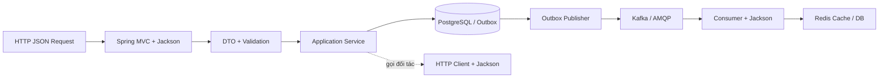

# ObjectMapper, module Jackson và cấu hình tuần tự hóa dùng chung

Trong **SPRING_BOOT_INTEGRATION**, dữ liệu JSON có thể đi qua HTTP controller, HTTP client gọi đối tác, Kafka/AMQP, Redis cache, transactional outbox và những adapter của Spring Integration. Mỗi điểm tiếp xúc có một **hợp đồng dữ liệu**: tên trường, kiểu số, cách biểu diễn thời gian, trạng thái enum, giá trị `null`, trường không nhận diện được và phiên bản thông điệp. Nếu mỗi nơi tạo một `ObjectMapper` khác nhau hoặc tự cấu hình Jackson theo cách riêng, một sự kiện có thể được ghi thành JSON hợp lệ tại nơi phát nhưng lại không thể đọc được ở nơi nhận.

Bài thuộc chương **Hợp đồng dữ liệu**, giải thích cách Spring Boot cấu hình Jackson, cách sử dụng `ObjectMapper` và các module mở rộng, cùng chiến lược **thống nhất quy tắc tuần tự hóa** mà không vô tình buộc các đối tác có hợp đồng khác nhau dùng chung một định dạng. Trọng tâm là bảo toàn dữ liệu khi truyền qua HTTP, lưu trữ, cache và broker; xác định lỗi rõ ràng; phát triển schema có kiểm soát; kiểm thử và quan sát luồng tích hợp thực tế.

> Các ví dụ Java sử dụng **Java 17+, Spring Boot 3.x và Jackson 2.x** (các package `com.fasterxml.jackson.*`). Với hệ sinh thái Boot/Jackson thế hệ khác, hãy dùng BOM và tài liệu migration đúng phiên bản trước khi sao chép API. Đây là một bài học về thiết kế hợp đồng, không phải yêu cầu mọi hệ thống phải dùng cùng một phiên bản Jackson.

## 1. Mục tiêu học tập

Sau bài học, bạn có thể:

1. Phân biệt **serialization**, **deserialization**, `ObjectMapper`, `JsonNode`, `ObjectReader`, `ObjectWriter` và Jackson module.
2. Nhận biết hạ tầng Jackson Spring Boot tự cấu hình khi dependency và điều kiện phù hợp.
3. Chọn `spring.jackson.*`, `Jackson2ObjectMapperBuilderCustomizer`, `@Bean Module` hoặc annotation trên DTO đúng phạm vi.
4. Thiết kế định dạng JSON nhất quán cho số tiền, thời gian, tên trường, enum và đối tượng Java bất biến.
5. Phân biệt chính sách hợp đồng nội bộ với HTTP API, đối tác và event broker để tránh lan truyền breaking change.
6. Kiểm thử JSON hai chiều, dữ liệu không hợp lệ, tương thích phiên bản, xử lý trùng, cache và các lỗi deserialize tại biên hệ thống.

## 2. Vì sao cần chính sách Jackson dùng chung?

Xét luồng tạo đơn hàng:



Một trường `occurredAt` có thể được serialize theo hai cách khác nhau:

```json
{"occurredAt":"2026-11-21T05:30:00Z"}
```

```json
{"occurredAt":1795239000.000000000}
```

Cả hai có thể là cách biểu diễn thời gian tùy cấu hình và loại dữ liệu, nhưng **không thay thế cho nhau khi hợp đồng chỉ chấp nhận một cách**. Tương tự, `orderId` và `order_id` khác tên JSON; `1200.50` (number) và `"1200.50"` (string) khác kiểu. Thay đổi global mapper có thể khiến HTTP response, outbox JSON và cache value bị đổi đồng thời dù không thay một DTO nào.

Mục tiêu **dùng chung** không có nghĩa “mọi định dạng JSON trên thế giới phải giống nhau”. Nó có nghĩa:

- Quy định một **chính sách mặc định trong ứng dụng**, tránh mỗi service tự `new ObjectMapper()`.
- Những hợp đồng có quy tắc khác (API đối tác `snake_case`, event version cũ, Redis cache nội bộ) được **tách và gọi tên rõ**, có mapper/codec riêng khi cần.
- Mọi thay đổi tại policy, annotation hoặc module được kiểm tra với **fixture JSON cố định** và test producer–consumer.

## 3. Các thành phần của Jackson trong Spring Boot

| Thành phần | Trách nhiệm | Khi nào dùng? |
| --- | --- | --- |
| `ObjectMapper` | Engine đọc/ghi JSON, quản lý serializer, deserializer, module và feature | Dùng làm cấu hình trung tâm hoặc inject để xử lý JSON ngoài HTTP framework. |
| `ObjectReader` | Cấu hình **đọc** theo type và feature, có thể tái sử dụng | Consumer cần parse một hợp đồng cụ thể, không muốn chỉnh mapper dùng chung. |
| `ObjectWriter` | Cấu hình **ghi** theo type và feature, có thể tái sử dụng | Publisher/outbox cần serializer nhất quán và an toàn giữa thread. |
| `JsonNode` | Mô hình cây JSON giữ cấu trúc động | Đọc envelope có nhiều phiên bản, kiểm tra trường có mặt hay vắng mặt, PATCH. |
| `Module` | Đăng ký hỗ trợ kiểu Java hoặc quy tắc serialize/deserialize mở rộng | `JavaTimeModule`, module tùy chỉnh cho value object. |
| `@JsonProperty`, `@JsonFormat`, `@JsonInclude`… | Quy tắc tại **một DTO, property hoặc type** | Cần khóa một phần hợp đồng độc lập với policy global. |
| Spring MVC JSON converter | Chuyển request/response JSON thành/ra đối tượng trong controller | HTTP inbound/outbound khi ứng dụng dùng Jackson message converter. |
| JSON serializer ở broker/cache | Chuyển DTO sang bytes và ngược lại theo cấu hình của client | Kafka, AMQP, Redis, outbox; không mặc nhiên dùng mapper của MVC. |

### Serialization và deserialization là hai hướng độc lập

**Serialization**: `CustomerResponse` → JSON → HTTP response hoặc event payload.

**Deserialization**: JSON nhận từ đối tác/broker → `CreateCustomerRequest` hoặc `OrderCreatedEventV1`.

Một policy có thể làm serialization đúng nhưng deserialization sai. Ví dụ `@JsonInclude(NON_NULL)` bỏ field `null` khi **ghi**, nhưng không ngăn phía nhận gửi field lạ hoặc giá trị `null` trong request. `FAIL_ON_UNKNOWN_PROPERTIES` tác động khi **đọc** JSON thành POJO, không ngăn mapper của bạn tự xuất ra một trường nhạy cảm.

### Java `record` và dữ liệu thời gian

Jackson 2.12+ hỗ trợ các Java records trong những cấu hình thông thường. Với `Instant`, `LocalDate`, `OffsetDateTime` và kiểu `java.time` khác, **`JavaTimeModule`** từ `jackson-datatype-jsr310` là thành phần quan trọng để đọc/ghi. Module được tìm thấy/đăng ký đúng và feature date/time được đặt phù hợp thì timestamp mới có định dạng mong muốn.

Các module khác có thể hữu ích:

| Module | Chức năng |
| --- | --- |
| `JavaTimeModule` | Hỗ trợ kiểu `java.time`; nên dùng thay vì biến ngày giờ thành chuỗi thủ công trong mọi mapper. |
| `Jdk8Module` | Hỗ trợ các kiểu JDK 8 bổ sung như `Optional` trong Jackson 2. |
| `ParameterNamesModule` | Giúp binding constructor parameter name với kiểu Java phù hợp khi có metadata. |
| `KotlinModule` | Tích hợp đặc điểm class/nullability của Kotlin nếu ứng dụng dùng Kotlin. |
| `SimpleModule` | Đăng ký serializer/deserializer tùy chỉnh của ứng dụng. |

Đừng đăng ký module “cho đầy đủ” khi không dùng kiểu tương ứng. Một module custom áp trên type dùng ở nhiều endpoint có thể đổi toàn bộ wire format của type đó. Cần hiểu phạm vi và giữ test hồi quy.

## 4. Spring Boot tự cấu hình Jackson tới đâu?

Với **Spring Boot 3.x**, khi Jackson 2 phù hợp trên classpath và không bị thay thế bởi những bean tùy chỉnh làm auto-configuration lùi lại, Boot có thể đăng ký `ObjectMapper` đã cấu hình và `Jackson2ObjectMapperBuilder`. Những customizer/property của Boot cùng module Jackson có sẵn được áp dụng trong quá trình dựng mapper. Khi dùng Spring MVC, bộ chuyển JSON của framework có thể dùng mapper đã được Boot cấu hình theo điều kiện.

`spring-boot-starter-web` thường kéo dependency JSON cần thiết qua starter tương ứng; một ứng dụng xử lý JSON không dùng MVC vẫn có thể khai báo `spring-boot-starter-json` nếu muốn phụ thuộc trực tiếp vào phần JSON. **Không cần thêm `spring-boot-starter-web` chỉ để gọi `ObjectMapper` trong batch consumer.**

| Boot/Framework có thể chuẩn bị | Ứng dụng phải định nghĩa |
| --- | --- |
| Dependencies theo starter/BOM, hạ tầng mapper/builder, module phù hợp classpath | DTO và hợp đồng JSON nào được công bố ra ngoài. |
| Cấu hình mặc định cho JSON trong web stack khi phù hợp | Tên trường, enum, null, tính tương thích phiên bản và dữ liệu nhạy cảm. |
| Đọc thuộc tính `spring.jackson.*` và các customizer | Có nên từ chối trường lạ, format timestamp và policy cho từng đối tác. |
| Kết hợp `Module` bean với mapper do builder quản lý | Serializer/deserializer tùy chỉnh, kiểm thử và phạm vi ảnh hưởng. |
| Hạ tầng HTTP client/broker/cache nếu có starter khác | Đảm bảo codec của mỗi adapter thật sự nhận mapper mong muốn. |

Trong hệ sinh thái Boot 3/Jackson 2, Boot thường vô hiệu các feature mặc định như `SerializationFeature.WRITE_DATES_AS_TIMESTAMPS` và `DeserializationFeature.FAIL_ON_UNKNOWN_PROPERTIES` đối với mapper Boot quản lý. **Không dựa vào mặc định để giữ hợp đồng lâu dài:** ghi rõ các quy tắc quan trọng trong cấu hình và test, vì một mapper tạo riêng hoặc phiên bản khác có thể hành xử khác.

Nếu bạn tự tạo:

```java
ObjectMapper adHoc = new ObjectMapper();
```

thì đối tượng này **không tự động nhận** module, timezone, customizer và policy từ Spring Boot. Có thể vì vậy cùng một DTO có kết quả khác giữa `@RestController` và code publish message. Ưu tiên **inject mapper do Spring quản lý**, hoặc tạo một mapper có mục đích rõ từ builder/config riêng đã được kiểm thử.

## 5. Cấu hình chung bằng `spring.jackson.*`

Ví dụ ứng dụng quyết định:

- `Instant` và những thời điểm tuyệt đối phải được công bố theo định dạng chuỗi ISO-8601, không phải timestamp số.
- JSON inbound của **API nội bộ yêu cầu hợp đồng chặt** sẽ từ chối field không biết.
- Thời gian và timezone được quy ước rõ; không phụ thuộc vào timezone máy chạy.

```yaml
spring:
  jackson:
    serialization:
      write-dates-as-timestamps: false
    deserialization:
      fail-on-unknown-properties: true
    time-zone: UTC
```

Đây là cấu hình **toàn cục đối với mapper được Boot dựng và quản lý phù hợp**, không tự chạm đến mọi mapper do người khác khởi tạo hoặc mọi JSON codec của Kafka/Redis. Nó cũng không thay thế validation nghiệp vụ hoặc schema validation.

Một số option bổ sung cần cân nhắc:

| Thuộc tính hoặc feature | Tác động và thận trọng |
| --- | --- |
| `spring.jackson.default-property-inclusion: non_null` | Bỏ property null khi **ghi**. Không áp dụng nếu hợp đồng cần phân biệt “null có chủ ý” với “vắng mặt”. |
| `spring.jackson.property-naming-strategy: SNAKE_CASE` | Đổi quy tắc tên trường toàn cục, có thể gây breaking change trên nhiều endpoint. |
| `spring.jackson.deserialization.fail-on-unknown-properties: true` | Từ chối field lạ khi đọc POJO; tăng kỷ luật hợp đồng nhưng có thể làm hỏng forward compatibility khi đối tác thêm trường. |
| `spring.jackson.serialization.write-dates-as-timestamps: false` | Ưu tiên date/time dạng string ở những type/module tuân feature này. Vẫn phải test format cụ thể và timezone. |
| `spring.jackson.time-zone: UTC` | Đặt timezone cho những trường hợp Jackson sử dụng timezone mặc định; không có nghĩa mọi loại ngày giờ đều đổi về UTC hoặc giữ cùng semantics. |

**Phạm vi của policy là một quyết định kiến trúc:** Với API công khai cần chấp nhận field mới của đối tác, không nhất thiết bật strict unknown fields cho tất cả inbound DTO. Có thể chọn policy chung lenient, rồi validate chặt những biên quan trọng bằng schema/DTO/reader riêng; hoặc chọn policy chung strict và **cho phép bỏ qua field lạ có chủ đích** ở hợp đồng cần tương thích tiến. Hãy ghi quyết định trong tài liệu API và kiểm thử cả hai chiều.

## 6. Mẫu DTO minh họa hợp đồng có kiểm soát

Giả sử HTTP nhận lệnh tạo đơn hàng, service lưu PostgreSQL, sau đó tạo event để phát sang broker.

### 6.1. Request DTO và response DTO

```java
import jakarta.validation.constraints.NotBlank;
import jakarta.validation.constraints.NotNull;
import jakarta.validation.constraints.Positive;
import java.math.BigDecimal;
import java.time.Instant;
import java.util.UUID;

public record CreateOrderRequest(
        @NotBlank String orderId,
        @NotBlank String customerId,
        @NotNull @Positive BigDecimal totalAmount
) {}

public record OrderResponse(
        UUID id,
        String orderId,
        String status,
        BigDecimal totalAmount,
        Instant createdAt
) {}
```

Đây là hai **hợp đồng khác nhau**. Client không được gửi `status` hay `createdAt` trong request chỉ vì DB có những cột đó. Response không xuất `internalRiskScore` hoặc `deleted` dù entity có trường nội bộ.

JSON request hợp lệ theo kiểu:

```json
{
  "orderId": "ORD-001245",
  "customerId": "CUS-0008",
  "totalAmount": 125000.50
}
```

JSON response:

```json
{
  "id": "e398a09c-8590-4332-919f-6410748b3a70",
  "orderId": "ORD-001245",
  "status": "ACCEPTED",
  "totalAmount": 125000.50,
  "createdAt": "2026-11-21T05:30:00Z"
}
```

Với tiền tệ, `BigDecimal` tránh lỗi làm tròn nhị phân khi tính toán và serialize từ `double`; nhưng vẫn phải quy định **đơn vị tiền, số chữ số thập phân, precision/scale và quy tắc làm tròn**. JSON number không mang currency; hợp đồng nên có thêm `currency` (ISO 4217) hoặc quy định cứng theo API. `BigDecimal("1.0")` và `BigDecimal("1.00")` có giá trị so sánh số học tương đương nhưng scale khác nhau; không dựa vào chuỗi JSON để xác minh số tiền nếu hợp đồng không đòi hình thức chữ số tuyệt đối.

### 6.2. Event DTO khác request/response HTTP

```java
import java.math.BigDecimal;
import java.time.Instant;
import java.util.UUID;

public record OrderAcceptedEventV1(
        String eventId,
        int schemaVersion,
        UUID orderUuid,
        String orderId,
        BigDecimal totalAmount,
        Instant occurredAt
) {}
```

`schemaVersion` giúp consumer phân biệt các phiên bản event. `eventId` là định danh **ổn định của sự kiện logic**, phải giữ nguyên khi publish lại từ outbox. Một retry không nên tự sinh `eventId` mới, vì điều đó phá khả năng nhận diện message được giao trùng.

JSON event ví dụ:

```json
{
  "eventId": "evt-order-001245",
  "schemaVersion": 1,
  "orderUuid": "e398a09c-8590-4332-919f-6410748b3a70",
  "orderId": "ORD-001245",
  "totalAmount": 125000.50,
  "occurredAt": "2026-11-21T05:30:00Z"
}
```

Event DTO không nên dùng chung với JPA entity hoặc HTTP response chỉ vì các trường tương tự nhau. Chúng có đối tượng nhận, quyền truy cập, thời hạn tương thích và nghĩa nghiệp vụ khác nhau. Nếu consumer cần một field mới, hãy thay **event contract** có kiểm soát, không công bố tự động toàn bộ database row.

## 7. Cấu hình bằng `Jackson2ObjectMapperBuilderCustomizer`

Khi `spring.jackson.*` không biểu đạt đủ nhu cầu hoặc cần gom cấu hình Java tại một nơi, có thể đăng ký **`Jackson2ObjectMapperBuilderCustomizer`**. Đây là cách mở rộng mapper do Boot tạo mà vẫn tận dụng hạ tầng Boot và các module tự phát hiện phù hợp.

```java
import com.fasterxml.jackson.databind.DeserializationFeature;
import com.fasterxml.jackson.databind.SerializationFeature;
import org.springframework.boot.autoconfigure.jackson.Jackson2ObjectMapperBuilderCustomizer;
import org.springframework.context.annotation.Bean;
import org.springframework.context.annotation.Configuration;

@Configuration(proxyBeanMethods = false)
public class JsonPolicyConfiguration {

    @Bean
    Jackson2ObjectMapperBuilderCustomizer contractJsonCustomizer() {
        return builder -> {
            builder.featuresToDisable(
                    SerializationFeature.WRITE_DATES_AS_TIMESTAMPS);
            builder.featuresToEnable(
                    DeserializationFeature.FAIL_ON_UNKNOWN_PROPERTIES);
        };
    }
}
```

Các tùy chỉnh trên cũng đã có thể đặt trong YAML ở phần trước; **không nhất thiết khai báo cả hai cách**. Nếu cùng feature được cấu hình ở nhiều nơi, thứ tự áp dụng có thể ảnh hưởng kết quả. Hãy chọn **một nguồn policy chính**, phân biệt rõ các override theo hợp đồng và dùng test kiểm tra cấu hình thực mà ứng dụng đang chạy.

**Không vội thay thế mapper của Boot bằng một bean mới chỉ để bật một feature:**

```java
// KHÔNG nên sao chép một cách máy móc chỉ để chỉnh 1-2 feature.
@Bean
ObjectMapper objectMapper() {
    return new ObjectMapper();
}
```

Khai báo `ObjectMapper` riêng có thể khiến cấu hình mặc định của Boot lùi lại hoặc không còn áp dụng theo cách mong đợi; module `java.time` và các customizer cũng có thể bị bỏ qua. Nếu thực sự cần thay toàn bộ mapper, bạn phải chủ động bảo đảm serializer, deserializer, module, feature, converter và test tương ứng. Tình huống thông thường nên dùng `spring.jackson.*`, customizer hoặc `Module` bean thay vì thay bean gốc.

### Mức độ ưu tiên của từng kiểu tùy chỉnh

| Nhu cầu | Cách phù hợp |
| --- | --- |
| Đổi format mặc định cho phần lớn JSON ứng dụng | `spring.jackson.*` hoặc một customizer tập trung. |
| Thêm hỗ trợ cho một kiểu Java dùng rộng rãi | `@Bean Module` với serializer/deserializer đã kiểm thử. |
| Pin một key hoặc định dạng chỉ trong một DTO công khai | `@JsonProperty`, `@JsonFormat` hoặc annotation tại class/field. |
| API đối tác có quy tắc riêng | DTO riêng + `ObjectReader`/`ObjectWriter` hoặc mapper/client codec được đặt tên rõ. |
| Broker event cần hợp đồng bất biến sau publish | Serializer/DTO theo schema version, fixture và consumer contract test; có thể lưu bytes outbox trước khi publish. |

## 8. Đăng ký module Jackson tùy chỉnh

Ví dụ, trong domain nội bộ một mã đơn hàng là **value object** chứ không chỉ là chuỗi:

```java
public record OrderCode(String value) {
    public OrderCode {
        if (value == null || !value.matches("ORD-[0-9]{6}")) {
            throw new IllegalArgumentException("Invalid order code");
        }
    }
}
```

Nếu hợp đồng JSON đòi `"orderId": "ORD-001245"`, bạn có thể đăng ký serializer/deserializer để không xuất mặc định hình dạng object `{"value":"ORD-001245"}`. Đây là một trong những trường hợp `SimpleModule` hữu ích.

```java
import com.fasterxml.jackson.core.JsonGenerator;
import com.fasterxml.jackson.core.JsonParser;
import com.fasterxml.jackson.core.JsonToken;
import com.fasterxml.jackson.databind.DeserializationContext;
import com.fasterxml.jackson.databind.JsonDeserializer;
import com.fasterxml.jackson.databind.JsonMappingException;
import com.fasterxml.jackson.databind.JsonSerializer;
import com.fasterxml.jackson.databind.SerializerProvider;
import java.io.IOException;

public final class OrderCodeSerializer extends JsonSerializer<OrderCode> {
    @Override
    public void serialize(
            OrderCode value,
            JsonGenerator generator,
            SerializerProvider serializers) throws IOException {
        generator.writeString(value.value());
    }
}

public final class OrderCodeDeserializer extends JsonDeserializer<OrderCode> {
    @Override
    public OrderCode deserialize(
            JsonParser parser,
            DeserializationContext context) throws IOException {
        if (!parser.hasToken(JsonToken.VALUE_STRING)) {
            throw JsonMappingException.from(
                    parser, "order code must be a JSON string");
        }
        return new OrderCode(parser.getText());
    }
}
```

```java
import com.fasterxml.jackson.databind.Module;
import com.fasterxml.jackson.databind.module.SimpleModule;
import org.springframework.context.annotation.Bean;
import org.springframework.context.annotation.Configuration;

@Configuration(proxyBeanMethods = false)
public class OrderCodeJacksonConfiguration {

    @Bean
    Module orderCodeModule() {
        var module = new SimpleModule("order-code-v1");
        module.addSerializer(OrderCode.class, new OrderCodeSerializer());
        module.addDeserializer(OrderCode.class, new OrderCodeDeserializer());
        return module;
    }
}
```

Với mapper được Boot dựng qua builder phù hợp, `Module` bean được tự động đăng ký theo cơ chế cấu hình Jackson của Boot. Hãy kiểm tra cả **ghi** và **đọc**:

```java
public record OrderEnvelope(
        String eventId,
        OrderCode orderId
) {}
```

JSON theo hợp đồng sẽ có dạng:

```json
{
  "eventId": "evt-123",
  "orderId": "ORD-001245"
}
```

Nếu thiếu module, format của `OrderCode` hoặc khả năng đọc nó có thể khác mong đợi. Nếu module được đăng ký **toàn cục**, mọi DTO dùng `OrderCode` đều chịu cùng rule; đây là điểm mạnh để bảo đảm thống nhất **và cũng là rủi ro lan truyền thay đổi**. Khi chỉ một đối tác cần dạng JSON khác, hãy tách adapter và mapper/reader thay vì âm thầm thay module chung.

Lưu ý: một validator trong constructor của `OrderCode` có thể ném `IllegalArgumentException` nếu payload không đúng quy tắc. Jackson sẽ biểu diễn thất bại đó qua luồng lỗi deserialization; ứng dụng vẫn cần phân loại thành lỗi hợp đồng hoặc poison message, chứ không retry vô hạn như lỗi mất kết nối.

## 9. Annotation để giữ ổn định hợp đồng riêng

Đối tác A có thể gửi `snake_case` trong khi API công khai của dịch vụ dùng `camelCase`. Không nên đổi `spring.jackson.property-naming-strategy` toàn cục chỉ vì một đối tác.

```java
import com.fasterxml.jackson.annotation.JsonAlias;
import com.fasterxml.jackson.annotation.JsonIgnoreProperties;
import com.fasterxml.jackson.annotation.JsonProperty;
import com.fasterxml.jackson.databind.PropertyNamingStrategies;
import com.fasterxml.jackson.databind.annotation.JsonNaming;

@JsonNaming(PropertyNamingStrategies.SnakeCaseStrategy.class)
@JsonIgnoreProperties(ignoreUnknown = true)
public record PartnerCustomerResponse(
        String externalId,
        String displayName,
        @JsonProperty("account_state") String status
) {}
```

Ví dụ JSON nhận từ đối tác:

```json
{
  "external_id": "P-1001",
  "display_name": "Khách hàng A",
  "account_state": "ACTIVE",
  "partner_revision": 7
}
```

Mapper đọc `external_id`, `display_name` và `account_state` thành ba component Java; `partner_revision` được bỏ qua **chỉ vì DTO này chủ động cho phép trường lạ**. Khi API nội bộ cần strict schema, không gắn `@JsonIgnoreProperties(ignoreUnknown = true)` theo thói quen lên mọi request.

Các annotation cần phân biệt:

| Annotation | Hành vi | Cảnh báo |
| --- | --- | --- |
| `@JsonProperty("customer_id")` | Chỉ định tên property JSON, có thể pin key hợp đồng. | Thay key có thể là breaking change dù tên biến Java không đổi. |
| `@JsonAlias({"old_name"})` | Cho phép **đọc** thêm các tên thay thế của cùng property. | Không tự xuất ra cả tên cũ và mới khi **ghi**. |
| `@JsonNaming(...)` | Đặt chiến lược đặt tên tại class. | Cẩn trọng với field đã có `@JsonProperty`. |
| `@JsonInclude(NON_NULL)` | Bỏ property null khi serialization theo phạm vi annotation. | Có thể làm mất khác biệt `null`/vắng mặt của một hợp đồng PATCH. |
| `@JsonIgnore` | Không ánh xạ một property theo cấu hình thông thường. | Không coi annotation là kiểm soát phân quyền toàn diện. |
| `@JsonFormat` | Định dạng riêng cho property/type trong những trường hợp được hỗ trợ. | Có thể xung đột với chuẩn ISO-8601 thống nhất. |
| `@JsonIgnoreProperties(ignoreUnknown = true)` | Bỏ trường lạ khi deserialization cho type. | Thuận tiện khi đối tác thêm field, nhưng cũng có thể che việc gửi sai tên trường. |

### Đổi tên trường mà không phá consumer cũ

```java
import com.fasterxml.jackson.annotation.JsonAlias;
import com.fasterxml.jackson.annotation.JsonProperty;

public record CustomerLookupRequest(
        @JsonProperty("customerId")
        @JsonAlias("legacyCustomerId")
        String customerId
) {}
```

Mapper có thể chấp nhận `legacyCustomerId` khi **đọc**, nhưng serialize theo tên chính `customerId`. Nếu hai tên cùng xuất hiện trong một JSON với giá trị khác nhau, phải có chính sách phát hiện **xung đột/mơ hồ** tại biên thay vì mặc nhiên tin thứ tự parser. Với hợp đồng quan trọng, test tình huống này hoặc chọn version mới thay cho alias.

## 10. Trường thiếu, null và PATCH phải có ngữ nghĩa rõ

Hai payload khác nhau:

```json
{"displayName":"Lan"}
```

```json
{"displayName":null}
```

Trong một endpoint cập nhật từng phần, payload thứ nhất có thể là “cập nhật tên”; payload thứ hai có thể là “xóa tên” hoặc “lỗi”, tùy hợp đồng. Trong khi đó:

```json
{}
```

có thể có nghĩa “không thay đổi trường nào”. Một Java record chỉ có `String displayName` có thể không đủ để phân biệt “field vắng mặt” và “explicit null” sau deserialization vì cả hai trở thành `null`.

Giải pháp tùy yêu cầu:

1. Đối với **PUT thay thế toàn bộ**, có thể định nghĩa request DTO bắt buộc chứa các trường phù hợp; phải mô tả cách hiểu các trường vắng mặt.
2. Đối với **PATCH**, dùng biểu diễn có theo dõi sự hiện diện của field, như `JsonNode`, một wrapper phù hợp hoặc triển khai chuẩn **JSON Merge Patch (RFC 7396)**/JSON Patch theo chính sách API.
3. Với event broker, đừng dùng `null` để âm thầm biểu đạt một lệnh xóa trừ khi event schema đã định nghĩa ngữ nghĩa đó.

Ví dụ kiểm tra trường bằng `JsonNode`:

```java
import com.fasterxml.jackson.databind.JsonNode;

public final class PartialUpdateRules {
    public static boolean shouldChangeDisplayName(JsonNode patch) {
        return patch.has("displayName");
    }

    public static boolean requestsClearDisplayName(JsonNode patch) {
        return patch.has("displayName")
                && patch.get("displayName").isNull();
    }
}
```

Code trên chỉ minh họa **phát hiện sự hiện diện**; production phải còn kiểm tra root là object, type field, quyền sửa, quy tắc null và schema của từng operation. Đừng dùng `spring.jackson.default-property-inclusion: non_null` cho những hợp đồng mà **explicit null phải được serialize**.

## 11. Những hợp đồng nào thực sự dùng mapper chung?

Một điểm dễ nhầm: **inject cùng `ObjectMapper` vào service** không có nghĩa mọi thư viện mà ứng dụng dùng sẽ tự nhận mapper đó. Từng kênh có serializer/codec riêng, và một số starter sẽ tạo mapper độc lập nếu không được cấu hình.

| Kênh | Ai chuyển JSON? | Việc cần kiểm tra |
| --- | --- | --- |
| Spring MVC HTTP inbound/outbound | Jackson HTTP message converter do Spring Web cấu hình | Converter đang dùng mapper nào, endpoint có annotation/validation riêng không? |
| `RestClient`/`RestTemplate` | HTTP message converters theo builder/client thực tế | Client có dùng builder được Boot cấu hình, hay tự tạo converter/mapper? |
| `WebClient` | HTTP codecs/`ExchangeStrategies` | Codec được Boot/custom client cấu hình ra sao, Jackson encoder/decoder có cùng policy không? |
| Kafka | Spring Kafka JSON serializer/deserializer hoặc Avro/Protobuf khác | `JsonSerializer`/`JsonDeserializer` có nhận mapper đúng; type headers, trusted packages và schema version đã rõ chưa? |
| RabbitMQ/AMQP | Jackson JSON message converter được đăng ký tại broker adapter | Converter có dùng mapper được chọn; content type và class binding có an toàn không? |
| Redis cache | `RedisSerializer` hay `CacheManager` tùy cấu hình | Kiểu value, version key, TTL, null semantics và mapper có đúng không? |
| Transactional outbox | Code serialize payload trước/lúc ghi outbox | Dữ liệu byte được lưu theo version nào; publisher có giữ nguyên payload khi retry không? |
| Spring Integration | Inbound/outbound adapter hoặc transformer cho từng giao thức | Transform giữa `Message<?>` và JSON đặt ở đâu, lỗi deserialization chuyển đến luồng nào? |

### 11.1. HTTP: MVC và HTTP client

Khi Spring MVC dùng converter của Boot theo cấu hình thông thường, JSON request/response đi qua mapper phù hợp với Boot context. Với client HTTP được dựng bằng builder do Boot cung cấp, có thể tái dùng các converter/codec đã cấu hình theo cơ chế của starter.

Nhưng nếu adapter tự tạo `RestClient.create()`, `new MappingJackson2HttpMessageConverter(new ObjectMapper())` hoặc tự cấu hình `WebClient` từ một `ExchangeStrategies` hoàn toàn khác, định dạng JSON **có thể không còn đồng nhất**. Test request gửi ra ngoài bằng mock HTTP server để xác minh bytes thực tế, không chỉ test `mapper.writeValueAsString(...)`.

Ví dụ controller chỉ nhận/trả DTO, không truyền trực tiếp database entity:

```java
import jakarta.validation.Valid;
import org.springframework.http.ResponseEntity;
import org.springframework.web.bind.annotation.PostMapping;
import org.springframework.web.bind.annotation.RequestBody;
import org.springframework.web.bind.annotation.RequestMapping;
import org.springframework.web.bind.annotation.RestController;

@RestController
@RequestMapping("/api/orders")
public class OrderController {
    private final OrderApplicationService service;

    public OrderController(OrderApplicationService service) {
        this.service = service;
    }

    @PostMapping
    public ResponseEntity<OrderResponse> create(
            @Valid @RequestBody CreateOrderRequest request) {
        return ResponseEntity.ok(service.create(request));
    }
}
```

`OrderApplicationService` là service do ứng dụng triển khai; mapper chỉ điều khiển JSON, không tự sinh transaction, unique constraint hoặc kiểm tra quyền sở hữu `customerId`.

### 11.2. Kafka: truyền mapper vào serializer có chủ đích

Trong Spring Kafka với Jackson 2, nếu dùng JSON serializer, có thể cấu hình một serializer bằng mapper đã inject:

```java
import com.fasterxml.jackson.databind.ObjectMapper;
import org.springframework.kafka.support.serializer.JsonSerializer;

public final class OrderEventSerialization {
    public static JsonSerializer<OrderAcceptedEventV1> create(
            ObjectMapper objectMapper) {
        return new JsonSerializer<OrderAcceptedEventV1>(objectMapper);
    }
}
```

Đây là **một bước cấu hình serializer**, chưa phải toàn bộ Kafka `ProducerFactory`. Ứng dụng vẫn phải gắn serializer này vào đúng producer factory/template theo phiên bản Spring Kafka đang dùng, và bảo đảm consumer dùng schema tương thích. Một `JsonSerializer` được để mặc định, một `JsonDeserializer` được đăng ký qua property, và converter HTTP là **ba vị trí cấu hình khác nhau**: không coi chúng tự động dùng cùng `ObjectMapper`.

Đừng cho JSON chứa class name Java nội bộ rồi dựa vào deserialization tùy ý để chọn type. Với event broker, nên có `eventType` và `schemaVersion` độc lập; đăng ký **danh sách event type cho phép** ở adapter, kiểm tra type headers theo chính sách trust chặt chẽ và từ chối type không hợp lệ. Với Avro/Protobuf và schema registry, serialization do công nghệ tương ứng quản lý; không nên ép toàn bộ broker payload phải đi qua Jackson JSON.

### 11.3. Redis/cache: định dạng lưu trữ là một schema riêng

Khi dùng Redis cache, value có thể là JSON, bytes theo Java serialization hoặc dạng serializer khác tùy cấu hình. Không suy ra `CacheManager` đang ghi JSON chỉ vì ứng dụng có Jackson trên classpath.

Nếu muốn cache lưu JSON, cấu hình `RedisSerializationContext.SerializationPair`/`RedisSerializer` cho loại value phù hợp, **truyền mapper hoặc codec có policy đã kiểm thử** và đặt type schema rõ ràng. Tránh JSON polymorphic deserialization không kiểm soát cho các key có thể bị nguồn không tin cậy ghi vào.

Khi thay JSON cache value từ version 1 sang version 2, các instance ứng dụng chạy song song lúc rolling deployment có thể cùng đọc/ghi key. Chiến lược an toàn có thể gồm `cache:v2:orders:{id}`, TTL, migration/fallback hoặc invalidate có kiểm soát. **TTL là hạn tồn tại dữ liệu**, không phải schema version và không thay thế kiểm tra compatibility.

### 11.4. Outbox: cố định payload cho các lần publish lại

Giả sử service tạo event rồi ghi outbox, publisher chỉ gửi sau khi DB commit. Có hai lựa chọn lưu outbox:

- **Lưu JSON payload với `eventType` và `schemaVersion`** tại thời điểm transaction nghiệp vụ. Retry sẽ gửi lại **cùng một biểu diễn** đã ghi, tránh deploy mới làm thay format của một event cũ khi nó chưa được publish.
- **Lưu dữ liệu domain và tạo JSON lúc publish**. Cách này cần xử lý chặt compatibility vì một bản deploy khác có thể serialize cùng bản ghi thành JSON khác trước khi event được gửi.

Với hệ thống cần hợp đồng ổn định và đối soát rõ, lưu payload đã version hóa là một lựa chọn thường hữu ích. Khi thiết kế idempotency fingerprint, đừng hash trực tiếp raw JSON nếu không có **canonicalization** đã quy ước: thứ tự field, spacing, Unicode normalization và biểu diễn số có thể làm hai payload tương đương có bytes khác nhau. Ưu tiên khóa nghiệp vụ ổn định hoặc dữ liệu được chuẩn hóa rõ.

## 12. Phân loại lỗi deserialize và validation

Một API nhận JSON cần trả lỗi theo nguyên nhân, không gom tất cả thành “lỗi JSON”:

| Vấn đề | Ví dụ | Xử lý phù hợp |
| --- | --- | --- |
| JSON không đúng cú pháp | Thiếu dấu ngoặc, dấu phẩy sai | Trả `400 Bad Request` hoặc mã lỗi hợp đồng đầu vào tương ứng. |
| Kiểu JSON không khớp DTO | Gửi object cho trường string, enum không hợp lệ | Lỗi deserialization có thể thành HTTP 400, message bị reject/quarantine tùy kênh. |
| Field không biết khi strict | `{"isAdmin":true}` trong request không có trường này | Từ chối rõ ràng hoặc dùng chính sách lenient theo version đã công bố. |
| Không vượt qua Bean Validation | `@NotBlank`, `@Positive`, `@Size` | Lỗi contract/validation, không retry như lỗi hạ tầng. |
| Hợp lệ về JSON nhưng sai nghiệp vụ | Order bị đóng, customer không có quyền | Xử lý trong application service/domain; có thể trả HTTP 409/422 hoặc mã phù hợp hợp đồng. |
| Vi phạm constraint database | `orderId` trùng, version cạnh tranh | Dùng unique/lock/version để bảo vệ dữ liệu, chuyển exception thành lỗi nghiệp vụ. |
| Lỗi hạ tầng | DB/broker mất kết nối, HTTP timeout | Retry có giới hạn và idempotency nếu thao tác an toàn để lặp. |

**Jackson không tự thực thi Bean Validation.** Gọi `objectMapper.readValue(...)` sẽ parse JSON và tạo DTO, nhưng không tự chạy `@NotBlank`, `@Email` hoặc các validator ở service. Với Spring MVC, dùng `@Valid @RequestBody` và dependency validation; với Kafka/AMQP/Spring Integration, adapter cần gọi validator một cách chủ động hoặc tích hợp cơ chế validation phù hợp.

Ví dụ format lỗi HTTP nên có mã ổn định và không chứa stack trace hay SQL:

```json
{
  "type": "https://api.example.org/problems/invalid-payload",
  "title": "Invalid request body",
  "status": 400,
  "code": "INVALID_JSON_CONTRACT",
  "correlationId": "req-18f3"
}
```

Có thể dùng Spring `ProblemDetail`/`@RestControllerAdvice` để thống nhất lỗi API, nhưng phải bảo đảm status và nội dung không tiết lộ giá trị trường nhạy cảm. Với event broker, payload poison không nên retry vô hạn; gửi vào DLQ/quarantine có metadata an toàn để điều tra và có quy trình phát lại sau khi sửa schema/code.

### Vì sao strict/lenient không có một đáp án đúng cho mọi nguồn?

**Strict** phù hợp khi producer và consumer cùng được kiểm soát, vi phạm field phải phát hiện sớm và hợp đồng không cho trường mở rộng. **Lenient** có thể phù hợp khi đối tác thường bổ sung field vào response mà consumer chỉ dùng tập nhỏ. Nhưng lenient cũng có thể làm một lỗi đánh máy như `orderdId` bị bỏ qua, dẫn đến một trường bắt buộc thành `null`.

Vì vậy, quyết định dựa trên **mức độ kiểm soát nguồn, khả năng phát hành độc lập và cách xác thực trường bắt buộc**. Không dùng một annotation để thay thế toàn bộ chiến lược contract compatibility.

## 13. Bảo mật và giới hạn tài nguyên khi xử lý JSON

JSON đến từ HTTP client, broker hoặc đối tác là **đầu vào không tin cậy**. Dù JSON đúng cú pháp, deserialization vẫn có thể gây lỗi tài nguyên hoặc thao túng dữ liệu nếu thiết kế không kiểm soát.

1. **Tránh mass assignment:** không deserialize trực tiếp vào JPA entity hoặc internal object có trường như `role`, `approved`, `internalStatus`. Request DTO chỉ chứa trường người gọi được phép nhập.
2. **Không bật polymorphic default typing tùy tiện cho dữ liệu không tin cậy:** cơ chế type metadata có thể làm tăng bề mặt tấn công khi cho phép chọn type Java quá rộng. Nếu phải dùng polymorphism, cấu hình danh sách subtype/`PolymorphicTypeValidator` chặt chẽ theo hợp đồng.
3. **Giới hạn kích thước và độ phức tạp:** đặt giới hạn body/message size ở web server, broker và parser; Jackson 2.15+ có cơ chế `StreamReadConstraints` cho độ sâu, chiều dài chuỗi và các giới hạn liên quan. Kiểm tra version/thư viện thực tế.
4. **Không log nguyên payload nhạy cảm:** tránh để token, email, số thẻ hoặc thông tin cá nhân vào log, metric tag hoặc error response. Chỉ ghi event type, version, correlation ID và loại lỗi khi phù hợp.
5. **Không tin type headers của broker tùy ý:** nếu JSON deserializer dùng header để tìm Java class, phải giới hạn trusted packages/types và tách eventType hợp đồng khỏi tên implementation nội bộ.
6. **Phân biệt quyền đọc với format:** việc một field được Jackson serialize không có nghĩa người nhận được quyền xem. Kiểm soát phân quyền ở service/DTO mapping và lựa chọn response theo người gọi.

`@JsonIgnore` là một phần của quyết định serialize, nhưng không thay thế chính sách bảo mật: một mapper khác, một endpoint khác hoặc serialization bằng framework khác có thể không áp cùng annotation/hợp đồng.

## 14. Dùng `ObjectReader` và `ObjectWriter` để tránh thay mapper chung

Một `ObjectMapper` được cấu hình **xong trước khi sử dụng** được thiết kế để tái sử dụng an toàn giữa các thread. Cần tránh thay đổi feature/module của cùng mapper trong quá trình ứng dụng đang nhận request, vì các serializer/deserializer có thể đã được tạo/cached và cấu hình vận hành thiếu nhất quán.

Thay vì:

```java
// Không chỉnh mapper dùng chung theo từng message!
sharedMapper.configure(
        DeserializationFeature.FAIL_ON_UNKNOWN_PROPERTIES, false);
```

hướng an toàn là tạo reader/writer được cấu hình riêng:

```java
import com.fasterxml.jackson.databind.DeserializationFeature;
import com.fasterxml.jackson.databind.ObjectMapper;
import com.fasterxml.jackson.databind.ObjectReader;
import com.fasterxml.jackson.databind.ObjectWriter;

public final class PartnerJsonCodec {
    private final ObjectReader responseReader;
    private final ObjectWriter eventWriter;

    public PartnerJsonCodec(ObjectMapper applicationMapper) {
        this.responseReader = applicationMapper
                .readerFor(PartnerCustomerResponse.class)
                .without(DeserializationFeature.FAIL_ON_UNKNOWN_PROPERTIES);
        this.eventWriter = applicationMapper
                .writerFor(OrderAcceptedEventV1.class);
    }

    public PartnerCustomerResponse readResponse(String json)
            throws java.io.IOException {
        return responseReader.readValue(json);
    }

    public String writeEvent(OrderAcceptedEventV1 event)
            throws com.fasterxml.jackson.core.JsonProcessingException {
        return eventWriter.writeValueAsString(event);
    }
}
```

`ObjectReader` và `ObjectWriter` là đối tượng cấu hình bất biến/có thể tái sử dụng trong các tình huống thông thường. Chúng cho phép tùy chỉnh theo hợp đồng mà không sửa cấu hình global. Trường hợp đối tác đòi **module hoặc naming strategy khác hoàn toàn**, có thể xây một mapper riêng **một lần khi khởi động** (chẳng hạn dựa trên cấu hình/builder phù hợp hoặc `ObjectMapper.copy()`), đặt tên và inject vào adapter đó, rồi không thay đổi nó lúc xử lý request.

Chỉ tạo mapper hoặc `readValue`/`writeValue` cho mục đích rõ, không tạo `new ObjectMapper()` lặp lại trong mỗi message vì việc dựng/cache serializer và đăng ký module có chi phí và rủi ro thiếu cấu hình.

## 15. Kiểm thử cấu hình JSON dùng chung

Muốn bảo đảm hợp đồng ổn định, **kiểm tra JSON được tạo ra và JSON có thể đọc được**, không chỉ kiểm tra Java getter. Với Spring Boot, `@JsonTest` cung cấp một test slice cho serialization/deserialization và những thành phần Jackson phù hợp. Với hợp đồng quan trọng, nên có JSON fixture cố định để phát hiện thay đổi do upgrade dependency hoặc customizer.

### 15.1. Unit/slice test với `@JsonTest`

Ví dụ sau dùng JUnit Jupiter, Jackson và Spring Boot test. Nếu test slice không tự tìm thấy các configuration class tùy chỉnh theo cấu trúc package thực tế, `@Import` giúp khai báo rõ policy/module muốn kiểm tra:

```java
import static org.junit.jupiter.api.Assertions.assertEquals;
import static org.junit.jupiter.api.Assertions.assertFalse;
import static org.junit.jupiter.api.Assertions.assertThrows;
import static org.junit.jupiter.api.Assertions.assertTrue;

import com.fasterxml.jackson.databind.JsonNode;
import com.fasterxml.jackson.databind.ObjectMapper;
import com.fasterxml.jackson.databind.exc.UnrecognizedPropertyException;
import java.math.BigDecimal;
import java.time.Instant;
import java.util.UUID;
import org.junit.jupiter.api.Test;
import org.springframework.beans.factory.annotation.Autowired;
import org.springframework.boot.test.autoconfigure.json.JsonTest;
import org.springframework.context.annotation.Import;

@JsonTest
@Import({JsonPolicyConfiguration.class, OrderCodeJacksonConfiguration.class})
class OrderJsonContractTest {

    @Autowired ObjectMapper mapper;

    @Test
    void eventSerializesInstantAndMoneyAsAgreed() throws Exception {
        var event = new OrderAcceptedEventV1(
                "evt-123", 1,
                UUID.fromString("e398a09c-8590-4332-919f-6410748b3a70"),
                "ORD-001245",
                new BigDecimal("125000.50"),
                Instant.parse("2026-11-21T05:30:00Z"));

        String json = mapper.writeValueAsString(event);
        JsonNode tree = mapper.readTree(json);

        assertEquals("2026-11-21T05:30:00Z",
                tree.get("occurredAt").asText());
        assertEquals(1, tree.get("schemaVersion").asInt());
        assertTrue(tree.get("totalAmount").isNumber());
        assertFalse(tree.has("internalRiskScore"));

        OrderAcceptedEventV1 restored =
                mapper.readValue(json, OrderAcceptedEventV1.class);
        assertEquals(event.eventId(), restored.eventId());
        assertEquals(event.totalAmount(), restored.totalAmount());
        assertEquals(event.occurredAt(), restored.occurredAt());
    }

    @Test
    void strictRequestRejectsUnexpectedProperty() {
        String json = """
                {
                  "orderId": "ORD-001245",
                  "customerId": "CUS-0008",
                  "totalAmount": 125000.50,
                  "internalRiskScore": 99
                }
                """;

        assertThrows(UnrecognizedPropertyException.class,
                () -> mapper.readValue(json, CreateOrderRequest.class));
    }

    @Test
    void customModuleWritesAndReadsOrderCodeAsString()
            throws Exception {
        var envelope = new OrderEnvelope(
                "evt-123", new OrderCode("ORD-001245"));

        String json = mapper.writeValueAsString(envelope);
        assertEquals("ORD-001245",
                mapper.readTree(json).get("orderId").asText());

        OrderEnvelope restored =
                mapper.readValue(json, OrderEnvelope.class);
        assertEquals("ORD-001245", restored.orderId().value());
    }
}
```

Test này kiểm tra **mapper trong Jackson slice**, chưa chứng minh rằng Kafka producer, Redis cache hoặc HTTP client thực tế đã sử dụng nó. Test `@JsonTest` cũng không tự chạy Bean Validation đối với `@NotBlank`/`@Positive`. Với những ranh giới đó, cần thêm integration test.

### 15.2. Test contract theo kênh và phiên bản

| Phạm vi | Test cần có | Điều được chứng minh |
| --- | --- | --- |
| DTO/`ObjectMapper` | Serialize và deserialize theo fixture, UUID, timestamp, money, enum, null, field lạ | Quy tắc Jackson trong mapper đang test phù hợp hợp đồng. |
| Spring MVC | `@WebMvcTest`/MockMvc, `@Valid`, JSON error và headers | HTTP converter, validation và lỗi JSON ở biên web. |
| HTTP outbound | Mock HTTP server kiểm tra body, header và content type | HTTP client thực đang gửi bytes theo contract. |
| Kafka/AMQP | Broker container và serializer/converter thực, consumer đọc lại event | Codec, type policy, ack/error path và payload thực tế. |
| Redis cache | Redis container, read/write, TTL, key prefix version | Cache serializer tương thích qua lần đọc và rolling deployment. |
| Outbox/publisher | Ghi payload version 1, restart publisher với code mới, publish lại | JSON đã commit không bị thay khi retry và consumer cũ đọc được. |
| End-to-end | HTTP request → DB/outbox → broker → consumer | Các bước thật phối hợp trong phạm vi đã công bố. |

Một bài test chỉ xác nhận `mapper.writeValueAsString(event)` trả JSON không lỗi là chưa đủ. Với event bền vững, hãy lưu một fixture đại diện cho schema version cũ và **đọc fixture đó bằng consumer code mới**. Với producer, kiểm tra các field đã hứa không biến mất hoặc đổi kiểu sau khi nâng cấp Jackson.

### 15.3. Ma trận các trường hợp dễ bị bỏ sót

1. **Field vắng mặt / explicit null / chuỗi rỗng:** nhất là PATCH, response tùy quyền và event cập nhật trạng thái.
2. **Field lạ:** kiểm tra strict hoặc lenient đúng theo từng contract; không dựa vào mặc định không được ghi nhận.
3. **Enum không nhận diện được:** lựa chọn từ chối, fallback hoặc chuyển version phải được định nghĩa; không tự map thành trạng thái hợp lệ bất kỳ.
4. **Ngày giờ:** `Instant` UTC, `LocalDate` không có timezone, offset trong `OffsetDateTime` và biên của ngày.
5. **Số tiền:** số lớn, scale khác, giá trị âm, số thập phân vượt giới hạn của database hoặc quy tắc nghiệp vụ.
6. **Khác biệt naming:** `camelCase` so với `snake_case`, `@JsonProperty` và alias cũ, trùng key.
7. **Dữ liệu không tin cậy:** object sâu bất thường, payload lớn, type header lạ hoặc polymorphic type không hợp lệ.
8. **Trùng event:** cùng `eventId` nhưng dữ liệu khác nhau; serialization lại không được tạo một ID mới hoặc khiến policy xử lý trùng thay đổi.
9. **Nâng cấp dependency:** các fixture quan trọng cho Jackson version mới phải được chạy trước phát hành.

Nếu dữ liệu đi qua nhiều adapter, có thể bổ sung consumer-driven contract test: producer và consumer thống nhất schema được kiểm tra độc lập, đặc biệt khi hai đội phát hành ứng dụng ở nhịp khác nhau.

## 16. Tiến hóa schema JSON và versioning

Thay đổi Java class không nhất thiết là thay đổi hợp đồng nếu mapper vẫn giữ JSON như cũ. Ngược lại, đổi `ObjectMapper` global có thể gây **breaking change trên wire** ngay cả khi DTO Java không đổi. Khi sửa policy, cần xem nó là một thay đổi ở nhiều boundary.

| Thay đổi | Tương thích thường gặp | Chính sách khuyến nghị |
| --- | --- | --- |
| Thêm field tùy chọn vào response/event | Consumer lenient thường đọc được; consumer strict có thể lỗi | Kiểm tra khả năng đọc của consumer cũ, công bố schema mới và theo dõi adoption. |
| Thêm field bắt buộc vào request | Client cũ thiếu field có thể thất bại | Có default rõ hoặc phát hành version mới; không đổi âm thầm. |
| Đổi `orderId` → `order_id` | Consumer chỉ biết tên cũ có thể hỏng | Đổi qua version hoặc adapter riêng, không bật naming strategy global tùy tiện. |
| Đổi timestamp từ ISO string sang số | Parser và semantics của client có thể hỏng | Pin format trong contract; test fixture với producer/consumer. |
| Đổi amount number thành string | Có thể gây lỗi deserialize hoặc xử lý số tiền | Xem như thay đổi schema; lên kế hoạch chuyển tiếp. |
| Xóa/đổi nghĩa enum | Consumer cũ có thể không hiểu | Dùng version, enum UNKNOWN có chính sách nếu phù hợp, không giả định backward compatibility. |
| Đổi tên cột PostgreSQL | Không nên buộc thay đổi JSON | Repository và mapper nội bộ hấp thụ thay đổi. |
| Thay khóa cache hoặc JSON value | App cũ/mới trong rolling deploy có thể không cùng đọc | Version key, migration/invalidate và TTL có kiểm soát. |

### Trường hợp mở rộng event có schema version

Producer phát `OrderAcceptedEventV1`, consumer V1 chỉ hiểu những trường đã cam kết. Nếu muốn thêm `currency` ở V2, có thể:

- Giữ V1 và phát event V2 với `eventType` hoặc `schemaVersion` khác.
- Hoặc thêm field **thật sự tùy chọn** theo chính sách backward/forward compatibility đã được thống nhất, kiểm tra consumer V1 có chấp nhận field lạ không.
- Tránh “nâng version” chỉ bằng cách đổi `@JsonProperty` hoặc global naming strategy vì consumer cũ sẽ không nhận diện hợp đồng.

Trong các hệ thống broker có nhiều consumer, số phiên bản tồn tại đồng thời có thể kéo dài hơn HTTP API; chính sách retention, replay và historical payload cần được xem xét. Outbox payload được lưu từ phiên bản trước có thể được publish sau khi hệ thống đã deploy code mới, nên reader/writer tương thích với **dữ liệu lịch sử** là yêu cầu thực tế.

### Khi nào cần JSON Schema, OpenAPI hoặc schema registry?

`ObjectMapper` là công cụ chuyển đổi Java ↔ JSON, **không phải tài liệu hợp đồng đầy đủ**. Nó không mô tả tất cả quy tắc về field bắt buộc, giá trị hợp lệ, privacy, semantics, version và quy tắc lỗi. Vì thế:

- **HTTP API:** công bố OpenAPI/JSON Schema, ví dụ request/response và mã lỗi.
- **Broker:** công bố event schema, compatibility rules, version hoặc schema registry phù hợp (JSON Schema/Avro/Protobuf tùy công nghệ).
- **Đối tác:** giữ contract fixture và test hai chiều, ghi rõ namespace thông điệp, headers và chính sách backward compatibility.
- **Cache nội bộ:** ghi version/TTL/key format đủ để rolling deployment không làm những instance khác lỗi deserialize.

## 17. Hiệu năng, bộ nhớ và quan sát JSON

Một `ObjectMapper` được tái sử dụng giúp giảm chi phí cấu hình và cache serializer/deserializer. Tuy nhiên, JSON lớn vẫn có thể gây áp lực CPU/bộ nhớ khi tạo cây `JsonNode` toàn bộ hoặc đọc hàng triệu phần tử thành một `List`.

Những nguyên tắc nên áp dụng:

1. **Tái sử dụng mapper đã cấu hình:** inject `ObjectMapper`, `ObjectReader` hoặc `ObjectWriter`; không dựng mapper trong mỗi handler message.
2. **Giới hạn payload:** đặt kích thước tối đa ở HTTP server, broker và parser; theo dõi cả JSON được nén/decompress để tránh payload nhỏ trên mạng nhưng rất lớn trong bộ nhớ.
3. **Cân nhắc streaming khi dữ liệu rất lớn:** Jackson có `JsonParser`/`JsonGenerator` cho streaming; tránh tạo cả cây JSON nếu chỉ cần xử lý lần lượt.
4. **Kiểm soát custom serializer:** không gọi database hoặc HTTP đối tác trong `JsonSerializer`/`JsonDeserializer`; chúng nên biến đổi dữ liệu có sẵn một cách dự đoán được.
5. **Đo hiệu năng đúng chỗ:** serializer chậm, HTTP body lớn, broker backlog và cache serialization đều có thể làm tăng latency của luồng tích hợp; đo phân vị và kích thước payload thay vì chỉ nhìn throughput.
6. **Không chỉnh mapper khi đang hoạt động:** cấu hình trước khi đưa bean vào sử dụng; custom per-request qua reader/writer hoặc codec chuyên biệt.

### Observability khi không muốn lộ JSON

Log/trace nên có các trường an toàn như `operation`, `eventType`, `schemaVersion`, `correlationId`, `payloadBytes`, `adapterName` và loại exception. Tránh log toàn bộ `JsonMappingException` nếu message có dữ liệu nhạy cảm; chỉ ghi một phần đường dẫn property đã lọc khi cần khoanh vùng lỗi.

Metric hữu ích: số JSON parse fail theo kênh/version, serialization latency, message size distribution, poison-message/DLQ count và event bị từ chối do schema mismatch. Đừng dùng `eventId` hoặc giá trị business field làm metric tag vì cardinality cao.

Một luồng có thể **deserialize thành công** nhưng vẫn sai nghiệp vụ. Vì vậy, kết hợp metric JSON với metric trạng thái cuối: DB commit, cache updated, outbox published, consumer processed, duplicate rejected. Quan sát JSON là một phần trong observability của hệ thống tích hợp, không thay thế nó.

## 18. Những lỗi phổ biến và cách xử lý

| Hiện tượng | Nguyên nhân thường gặp | Cách chẩn đoán |
| --- | --- | --- |
| `Instant` báo không được hỗ trợ | Mapper không có `JavaTimeModule` hoặc tạo `new ObjectMapper()` ngoài Boot | Kiểm tra bean mapper, dependency `jackson-datatype-jsr310`, đường tạo mapper thực. |
| HTTP trả ISO string, broker trả timestamp số | Kafka serializer có mapper riêng hoặc policy khác | Kiểm tra bytes thật trên broker và cấu hình serializer/consumer. |
| `UnrecognizedPropertyException` sau khi đối tác thêm field | Mapper strict toàn cục hoặc DTO thiếu chính sách tương thích | Chọn reader/DTO theo hợp đồng và bổ sung fixture version mới. |
| Field nội bộ xuất hiện trong JSON | Serialize entity trực tiếp hoặc mapping phản chiếu quá rộng | Dùng response/event DTO allowlist field được phép công bố. |
| `BigDecimal` bị làm tròn | Dữ liệu từng đi qua `double` hoặc ép kiểu không chủ ý | Đọc number vào `BigDecimal`, xác định precision/scale và test biên. |
| API đối tác dùng `snake_case` nhưng ứng dụng nhận `null` | Naming strategy mismatch hoặc trường lạ bị bỏ qua | Kiểm tra payload, `@JsonNaming`, `@JsonProperty` và strict validation. |
| Cache sau deploy không đọc được value cũ | Type/schema serializer đổi nhưng key/TTL không đổi | Version cache key, dual-read hoặc invalidate/migrate có kế hoạch. |
| Event cũ publish lại với format mới | Outbox chỉ lưu domain object, serialize vào thời điểm retry | Lưu payload version hóa hoặc version writer theo dữ liệu lịch sử. |
| Một message hỏng gây retry vô hạn | Deserialization lỗi hợp đồng bị coi như lỗi transient | Tách lỗi schema khỏi lỗi hạ tầng, dùng DLQ/quarantine và manual replay. |
| JsonNode/mapper gây tăng RAM | Payload quá lớn, dữ liệu lồng sâu, dựng cây toàn bộ | Giới hạn body/depth, dùng streaming nếu cần, đo payload size. |

## 19. Checklist khi thiết kế cấu hình Jackson dùng chung

Trước khi phát hành thay đổi `ObjectMapper`, hãy kiểm tra:

1. **Đối tượng nhận là ai?** HTTP client, HTTP đối tác, Kafka/AMQP consumer, Redis cache hay outbox replay?
2. **Hợp đồng đặt ở đâu?** OpenAPI/JSON Schema, event schema, DTO và fixture đã mô tả chính xác tên field, type, null, enum và timestamp chưa?
3. **Boot đã tạo mapper nào?** Có bean custom thay thế Boot, `new ObjectMapper()` hoặc HTTP/broker codec riêng gây khác định dạng không?
4. **Module nào cần thiết?** `JavaTimeModule`, `Jdk8Module`, module custom có được đăng ký và kiểm thử cả đọc lẫn ghi không?
5. **Global hay local?** Một thay đổi `spring.jackson.*` có ảnh hưởng nhiều endpoint không; đối tác đặc biệt đã có DTO/reader/codec riêng chưa?
6. **Lỗi có phân loại?** JSON syntax/type/unknown field, Bean Validation, lỗi nghiệp vụ và lỗi hạ tầng được xử lý khác nhau chưa?
7. **Bảo mật đã rõ?** Request DTO không chứa field ghi quá quyền, không bật polymorphism không tin cậy, có giới hạn payload/depth và redacted logging?
8. **Versioning ổn định?** Producer/consumer cũ và mới có đọc được JSON theo chính sách compatibility; outbox/cache data lịch sử được tính đến chưa?
9. **Retry và duplicate an toàn?** Event ID ổn định, schema version rõ, lỗi poison không retry vô hạn và idempotency không chỉ dựa trên raw JSON không canonicalized?
10. **Đã test đúng kênh?** `@JsonTest`, MVC, HTTP outbound, broker serializer, Redis và integration/E2E tùy rủi ro thực tế?
11. **Quan sát đủ?** Có contract error metrics, latency, payload bytes, correlation ID và thông tin nguyên nhân không lộ dữ liệu nhạy cảm?

**Ghi nhớ:** `ObjectMapper` là trung tâm của việc chuyển Java ↔ JSON, còn `Module`, annotation, `spring.jackson.*` và `Jackson2ObjectMapperBuilderCustomizer` quy định nó chuyển đổi **theo hợp đồng nào**. Trong Spring Boot, chính sách JSON nên được quản lý tập trung **nhưng không áp đặt mù quáng lên mọi đối tác và adapter**. DTO rõ ràng, codec đúng phạm vi, schema có phiên bản, kiểm thử trên payload thực tế và xử lý lỗi nhất quán là nền tảng để HTTP, database, cache, broker và Spring Integration trao đổi dữ liệu an toàn khi hệ thống tiến hóa.
