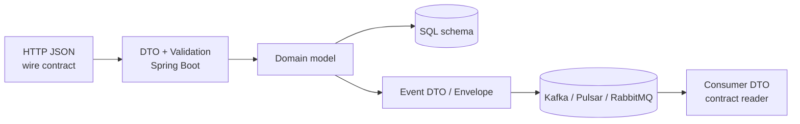
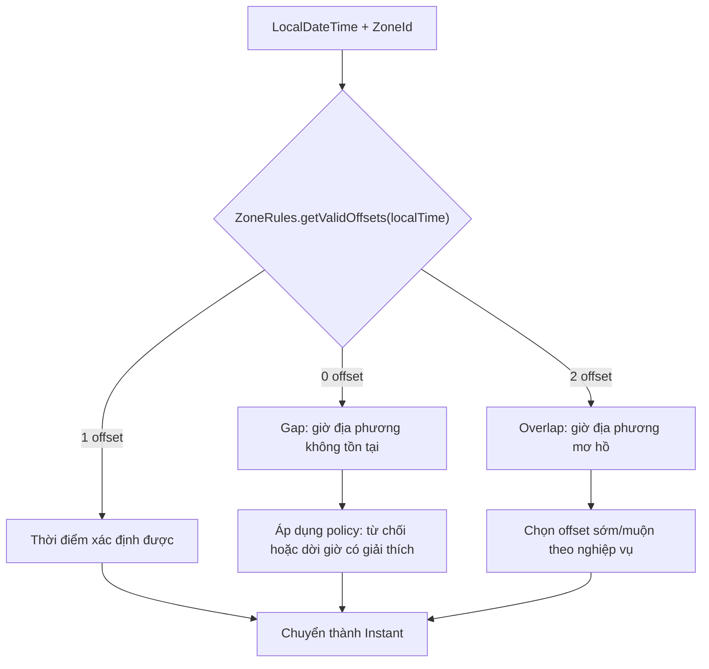
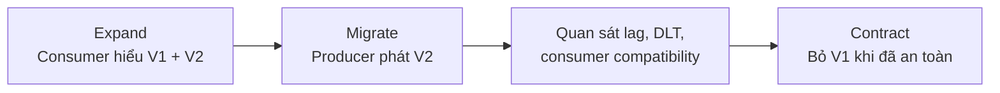

# Quy ước tên trường, ngày giờ, múi giờ, tiền tệ và giá trị null

## 1. Vì sao hợp đồng dữ liệu phải thống nhất đến từng chi tiết?

Trong module **SPRING_BOOT_INTEGRATION**, một luồng tích hợp có thể nhận JSON qua HTTP, chuyển thành Java DTO, ghi PostgreSQL, đưa một sự kiện lên Kafka, rồi để service khác lưu cache Redis hoặc gọi API đối tác. Mỗi bước đều có thể “chạy không lỗi” nhưng truyền sai **ý nghĩa dữ liệu** nếu các bên không thống nhất:

- `createdAt` là một thời điểm UTC hay chỉ là giờ địa phương của cửa hàng?
- `total` là 129.900 VND, 129.900 USD, hay số đơn vị nhỏ nhất của một loại tiền?
- `phoneNumber: null` nghĩa là khách hàng chưa khai báo, đã xóa số điện thoại hay muốn giữ giá trị cũ?
- `order_id`, `orderId`, `OrderID` là cùng một trường hay ba trường khác nhau?
- Một timestamp là `2026-11-21T09:30:00+07:00` hay `2026-11-21T09:30:00Z`? Hai chuỗi có thể biểu diễn **hai thời điểm khác nhau**.

Đây là vấn đề **data contract**: thỏa thuận về tên, kiểu, đơn vị, định dạng, tính bắt buộc, semantics và khả năng tiến hóa của dữ liệu giữa các thành phần. Tên trường đúng cú pháp không đủ nếu hai service hiểu sai ý nghĩa.

Ví dụ: API nhập số tiền bằng `double` có thể tạo sai lệch khi cộng, trong khi adapter ghi database bằng `DECIMAL` và consumer tính bằng `BigDecimal`. Một service gửi `2026-11-21 09:30` không offset, service khác có thể hiểu là UTC, khiến lịch hẹn thực tế lệch 7 giờ tại Việt Nam.

### Mục tiêu học tập

Sau bài này, bạn có thể:

1. Thiết kế quy ước **tên trường JSON/Java/SQL**, xác định đơn vị, ngữ nghĩa và trường định danh.
2. Chọn chính xác `Instant`, `LocalDate`, `LocalTime`, `LocalDateTime`, `OffsetDateTime` và `ZoneId` cho từng bài toán.
3. Dùng định dạng ISO 8601/RFC 3339 nhất quán, tránh lỗi timezone, daylight saving time (DST) và mất độ chính xác.
4. Biểu diễn tiền tệ theo ISO 4217, dùng `BigDecimal` hoặc minor units thay cho floating point.
5. Phân biệt **field absent**, JSON `null`, chuỗi rỗng, số 0 và hành vi cập nhật từng phần.
6. Áp dụng quy ước với Spring Boot/Jackson, Bean Validation, OpenAPI/JSON Schema, JDBC/JPA và event broker.
7. Viết contract tests và lập kế hoạch versioning để những thay đổi không làm sai dữ liệu ở downstream.

> **Phạm vi:** ví dụ dùng Java 17+, Spring Boot 3.x, Jackson 2.x và Jakarta Bean Validation tương thích với Spring Boot BOM. Spring Boot 4/Jackson 3 có thay đổi API và package; cần đối chiếu bản đang triển khai. Giá trị ngày, tiền và địa chỉ trong ví dụ là dữ liệu minh họa, không phải dữ liệu cá nhân hay giao dịch thật.

## 2. Một hợp đồng sự kiện rõ ràng trông như thế nào?

Giả sử `order-service` cần phát sự kiện `OrderCreatedV1` sau khi ghi đơn hàng:

```json
{
  "eventId": "evt-00124",
  "eventType": "order.created",
  "schemaVersion": 1,
  "orderId": "ORD-2408",
  "occurredAt": "2026-11-21T02:30:00Z",
  "businessDate": "2026-11-21",
  "storeTimeZone": "Asia/Ho_Chi_Minh",
  "total": {
    "currency": "VND",
    "amount": "129900"
  },
  "note": null
}
```

Đọc hợp đồng theo bảng:

| Trường | Kiểu JSON | Ngữ nghĩa | Bắt buộc? | Cho phép `null`? |
| --- | --- | --- | --- | --- |
| `eventId` | string | ID duy nhất của **sự kiện** để phát hiện trùng | Có | Không |
| `eventType` | string | Loại sự kiện ổn định theo contract | Có | Không |
| `schemaVersion` | integer | Phiên bản cấu trúc và semantics của payload | Có | Không |
| `orderId` | string | Định danh nghiệp vụ của đơn hàng | Có | Không |
| `occurredAt` | string date-time | **Thời điểm tuyệt đối** sự kiện xảy ra, dùng UTC | Có | Không |
| `businessDate` | string date | Ngày kinh doanh của cửa hàng, không phải thời điểm | Có | Không |
| `storeTimeZone` | string | Mã vùng IANA dùng để diễn giải giờ địa phương | Có nếu nghiệp vụ cần | Không |
| `total.currency` | string | Mã tiền tệ ISO 4217, ví dụ `VND` | Có | Không |
| `total.amount` | string decimal | Số tiền theo **đơn vị tiền tệ chính** như 129900 VND | Có | Không |
| `note` | string hoặc null | Ghi chú không bắt buộc, `null` nghĩa là không có ghi chú | Không | Có |

Hợp đồng còn cần quyết định kích thước tối đa, encoding, chính sách unknown fields, tính duy nhất của `eventId`, tính tương thích V1/V2, cách xử lý null và ai sở hữu schema. Đây là **quyết định liên service**, không chỉ một record Java.

### 2.1. Wire contract khác DTO và database schema



Một cột SQL tên `created_at` có thể được ánh xạ thành Java `createdAt`, rồi thành JSON `occurredAt` **nếu ý nghĩa nghiệp vụ thật sự tương ứng**. Không bắt downstream dùng cùng tên cột, cùng entity class hoặc cùng package Java. DTO và mapping layer giúp bảo vệ ranh giới đó.

## 3. Quy ước đặt tên trường

Trước khi tạo API hay topic, chọn **một quy ước thống nhất** cho wire format. Ví dụ đề xuất:

| Vị trí | Quy ước | Ví dụ |
| --- | --- | --- |
| JSON HTTP/event payload | `lowerCamelCase` | `orderId`, `occurredAt`, `totalAmount` |
| Java field/record component | `lowerCamelCase` | `orderId`, `occurredAt` |
| Java class | `UpperCamelCase` | `OrderCreatedV1`, `MoneyDto` |
| SQL column/table | `snake_case` | `order_id`, `occurred_at`, `integration_event` |
| Enum wire value | Chuỗi ổn định có tài liệu, ví dụ `PENDING` hoặc `pending` | `"pending"` |
| HTTP header | Tên header có semantics và policy rõ | `Idempotency-Key`, `X-Correlation-Id` |
| Broker topic | Naming rule thuộc hạ tầng, tách khỏi Java class | `orders.events.v1` |

Bạn **có thể chọn `snake_case` cho JSON** nếu API đã theo chuẩn đó; điều quan trọng là **không trộn hai quy ước trong cùng hợp đồng** nếu không có lý do và mapping rõ. Khi một trường đã được publish, tên đó trở thành một phần của API contract.

### 3.1. Dùng tên thể hiện ý nghĩa, không chỉ kiểu dữ liệu

| Tên mơ hồ | Tên rõ hơn | Lý do |
| --- | --- | --- |
| `date` | `businessDate`, `birthDate`, `deliveryDate` | Phân biệt loại ngày |
| `time` | `scheduledLocalTime`, `occurredAt` | Phân biệt giờ địa phương và thời điểm |
| `amount` | `total.amount`, `tax.amount`, `discount.amount` | Phân biệt ý nghĩa tiền |
| `price` | `unitPrice` + `currency` | Không bỏ đơn vị tiền |
| `timeout` | `connectTimeoutMillis` hoặc `connectTimeout` theo duration contract | Tránh nhầm đơn vị |
| `status` | `paymentStatus`, `fulfillmentStatus` | Không nhầm trạng thái các workflow |
| `id` | `eventId`, `orderId`, `partnerId` | Xác định thực thể được định danh |
| `timezone` không mô tả rõ | `storeTimeZone` | Biết vùng giờ của đối tượng nào |

Không cố đặt tất cả field thời gian bằng hậu tố `At`: `businessDate` là **một ngày** chứ không phải timestamp, còn `scheduledLocalTime` là giờ trong ngày. Tên phải phản ánh semantics.

### 3.2. ID, mã và số không luôn là một

`orderId` dạng `"000123"` không nên tự chuyển sang integer `123`, vì mất leading zeros. Mã bưu điện, mã đối tác và mã tiền tệ có thể chứa chữ, dấu và số 0 đầu; chúng là **định danh**, không phải đại lượng để cộng trừ.

Đề xuất:

- Các opaque IDs dùng `string`, không để bên nhận suy ra cấu trúc nội bộ.
- Nếu một ID thay đổi format từ UUID sang ULID, consumer vẫn đọc string và validate theo hợp đồng mới.
- Không dùng `offset` của Kafka làm `eventId`, vì publish lại cùng sự kiện ở offset khác.
- Đặt tên riêng cho correlation ID/tracing ID và business idempotency key.

### 3.3. Tên enum cũng là contract

Ví dụ:

```json
{
  "paymentStatus": "authorized"
}
```

Khi chuyển từ `authorized` sang `AUTHORISED`, kể cả nghiệp vụ “giống nhau”, đó vẫn là thay đổi wire contract. Quy định danh sách giá trị, phân biệt hoa/thường, chính sách unknown value và cách tiến hóa enum. Consumer không nên tự `valueOf` trên input chưa xác thực rồi bỏ qua exception.

### 3.4. `@JsonProperty` giữ ổn định wire name

Nếu tên Java buộc khác tên công khai:

```java
package example.integration.contract;

import com.fasterxml.jackson.annotation.JsonProperty;

public record PartnerOrderDto(
        @JsonProperty("order_id") String orderId,
        @JsonProperty("created_at") String createdAt) {
}
```

Java vẫn dùng `orderId`, trong khi JSON công khai là `order_id`. Annotation ở đây là **mapping theo hợp đồng**, không phải lý do để đổi qua lại tên trường giữa các endpoint. Khi thiết kế mới, chọn một naming strategy và cố định trong tài liệu.

## 4. Quy tắc thay đổi tên trường an toàn

Đổi `customer_id` thành `customerId` không đơn thuần là refactor nếu JSON đã được các hệ thống khác sử dụng.

Giả sử API V1 phát:

```json
{"customer_id": "C-001"}
```

API V2 muốn phát:

```json
{"customerId": "C-001"}
```

Các lựa chọn:

1. Duy trì contract V1 và thêm API/event V2 với version rõ.
2. Trong giai đoạn chuyển tiếp, consumer chấp nhận cả hai tên **nhưng phải có chính sách nếu cả hai cùng xuất hiện và khác giá trị**.
3. Dùng adapter mapping để giảm phụ thuộc tới Java field names.
4. Thêm contract test đối với các consumer hoặc đối tác quan trọng.

Không để consumer âm thầm lấy một tên tùy ý khi hai field mâu thuẫn. Lỗi nhập nhằng phải được phát hiện/cảnh báo thay vì bị che đi.

## 5. Sáu loại dữ liệu thời gian không thể thay thế cho nhau

Java Time API phân biệt nhiều khái niệm:

| Java type | Đại diện cho gì? | Ví dụ JSON | Tình huống |
| --- | --- | --- | --- |
| `Instant` | Thời điểm tuyệt đối trên UTC timeline | `"2026-11-21T02:30:00Z"` | `occurredAt`, `publishedAt`, audit event |
| `OffsetDateTime` | Ngày giờ kèm UTC offset cụ thể | `"2026-11-21T09:30:00+07:00"` | API cần giữ offset biểu diễn |
| `ZonedDateTime` | Ngày giờ gắn IANA `ZoneId`, mang quy tắc vùng giờ | Thường cần contract tách zone ID | Lịch trình cửa hàng và DST |
| `LocalDate` | Một ngày lịch, không phải thời điểm | `"2026-11-21"` | Ngày sinh, ngày kế toán, business date |
| `LocalTime` | Giờ trong ngày, không có ngày và offset | `"09:30:00"` | Giờ mở cửa thường ngày |
| `LocalDateTime` | Ngày giờ địa phương **không có timezone/offset** | `"2026-11-21T09:30:00"` | Giá trị dân sự chỉ hợp lệ khi có zone/context |

`java.util.Date` hoặc `java.sql.Timestamp` có thể vẫn xuất hiện ở code cũ/driver, nhưng API hợp đồng mới nên ưu tiên các kiểu Java Time có semantics rõ và mapping có test.

### 5.1. Quy tắc chọn type

- **Sự kiện đã xảy ra:** dùng `Instant`, serializing theo ISO 8601 UTC, ví dụ `occurredAt`.
- **Ngày kinh doanh/đặt phòng/ngày sinh:** dùng `LocalDate`; không biến thành `00:00 UTC` nếu hợp đồng chỉ cần ngày.
- **Giờ mở cửa “09:00 mỗi ngày”:** dùng `LocalTime` và **ZoneId của địa điểm**.
- **Cuộc hẹn lúc 09:00 ở New York:** cần local date-time + `America/New_York` và policy nếu rơi vào DST overlap/gap.
- **Hệ thống bên ngoài buộc giữ offset gốc:** có thể dùng `OffsetDateTime`, nhưng hiểu rằng offset `+07:00` không phải định danh vùng giờ `Asia/Ho_Chi_Minh`.

### 5.2. `Instant` và offset có thể diễn tả cùng thời điểm

Hai chuỗi sau biểu diễn **cùng một instant**:

```text
2026-11-21T09:30:00+07:00
2026-11-21T02:30:00Z
```

Nhưng:

```text
2026-11-21T09:30:00Z
```

là một thời điểm **muộn hơn 7 giờ** so với hai chuỗi đầu. Chỉ thêm chữ `Z` vào cuối local timestamp là **gán sai nghĩa**, không phải chuyển timezone.

Để chuyển đổi, dùng timezone/offset đã biết:

```java
package example.integration.time;

import java.time.Instant;
import java.time.OffsetDateTime;

public class TimeConversionExample {
    public static void main(String[] args) {
        OffsetDateTime localWithOffset =
                OffsetDateTime.parse("2026-11-21T09:30:00+07:00");

        Instant utc = localWithOffset.toInstant();

        System.out.println(utc);
        // 2026-11-21T02:30:00Z
    }
}
```

**Không dùng `LocalDateTime.now()` để làm timestamp sự kiện xuyên service** nếu sau đó serialize mà không mang zone/offset.

## 6. Định dạng timestamp chuẩn cho hợp đồng HTTP và sự kiện

Đề xuất quy ước:

| Trường | Wire format | Ví dụ |
| --- | --- | --- |
| `occurredAt` | ISO 8601/RFC 3339 date-time có offset, ưu tiên UTC `Z` | `2026-11-21T02:30:00Z` |
| `expiresAt` | Timestamp cùng quy tắc, không dùng giờ địa phương không rõ zone | `2026-11-21T02:45:00Z` |
| `businessDate` | ISO date `YYYY-MM-DD` | `2026-11-21` |
| `scheduledLocalTime` | ISO local time | `09:30:00` |
| `timeZone` | Mã IANA timezone | `Asia/Ho_Chi_Minh` |

Trong thực hành API, RFC 3339 là một dạng cụ thể hóa của biểu diễn timestamp ISO 8601 được sử dụng phổ biến. Khi chọn `format: date-time` trong OpenAPI/JSON Schema, nên quy định cụ thể offset/precision để tránh hai bên xử lý khác nhau.

### 6.1. Độ chính xác: giây, mili giây hay micro giây?

Đừng tự giả định mọi database và broker giữ được nanoseconds. Ví dụ:

```text
2026-11-21T02:30:00Z          # độ chính xác đến giây
2026-11-21T02:30:00.123Z      # mili giây
2026-11-21T02:30:00.123456Z   # micro giây
```

Hợp đồng phải quyết định:

- Có cho phép fractional seconds hay không?
- Nếu có, độ chính xác tối đa là bao nhiêu?
- Producer có được rút gọn trailing zeros?
- DB lưu với precision nào, có làm tròn hay cắt ngắn?
- Khi so sánh timestamp, dùng instant hay so sánh chuỗi?

Ví dụ, PostgreSQL `timestamp` thường hỗ trợ microsecond-level precision, trong khi `Instant` có biểu diễn nanoseconds. Ghi rồi đọc lại có thể không hoàn toàn giữ nguyên nanoseconds. Contract test phải phù hợp với precision được cam kết thay vì so sánh object theo giả định vô hạn.

### 6.2. Epoch timestamp phải có đơn vị

Các trường:

```json
{"timestamp": 1795228200}
```

và:

```json
{"timestamp": 1795228200000}
```

khác nhau về **seconds vs milliseconds** nếu dùng Unix epoch. Không để consumer đoán theo số chữ số. Nếu cần dùng epoch, tên nên rõ `occurredAtEpochMillis` hoặc schema mô tả đơn vị. Với API mới, ISO date-time string có offset thường dễ đọc và ít nhập nhằng hơn.

Không dùng `double` cho epoch nanoseconds/decimal timestamp khi cần độ chính xác cao. Dùng integer đủ phạm vi hoặc một biểu diễn có cấu trúc.

## 7. Múi giờ, UTC offset và DST: ba khái niệm khác nhau

**UTC offset** là độ lệch với UTC ở một thời điểm, ví dụ `+07:00`. **Zone ID** như `America/New_York` là tên vùng với quy tắc lịch sử và tương lai về offset/DST. **DST** làm thay đổi offset và khiến một local date-time có thể **không tồn tại hoặc xuất hiện hai lần**.



### 7.1. Ví dụ DST ở New York

Theo quy tắc múi giờ phổ biến năm 2026 tại `America/New_York`:

- **Ngày 8/3/2026 lúc 02:30 địa phương:** nằm trong **gap** khi đồng hồ nhảy lên 03:00; giờ 02:30 không tồn tại.
- **Ngày 1/11/2026 lúc 01:30 địa phương:** nằm trong **overlap** khi đồng hồ lùi; 01:30 có thể xảy ra hai lần, với offset `-04:00` hoặc `-05:00`.

Java kiểm tra trực tiếp `ZoneRules`:

```java
package example.integration.time;

import java.time.LocalDateTime;
import java.time.ZoneId;

public class DaylightSavingExample {
    public static void main(String[] args) {
        ZoneId zone = ZoneId.of("America/New_York");

        LocalDateTime gap =
                LocalDateTime.of(2026, 3, 8, 2, 30);
        LocalDateTime overlap =
                LocalDateTime.of(2026, 11, 1, 1, 30);

        System.out.println(zone.getRules().getValidOffsets(gap).size());
        // 0: giờ không tồn tại

        System.out.println(zone.getRules().getValidOffsets(overlap).size());
        // 2: giờ lặp lại
    }
}
```

Khi đặt lịch cho một cửa hàng ở vùng có DST, dữ liệu cần mang `LocalDateTime` + `ZoneId` và có policy cho hai trường hợp này. Chỉ truyền `"2026-11-01T01:30:00"` là thiếu thông tin. Chỉ lưu `"-04:00"` cũng chưa đủ nếu cần tính **lịch lặp trong tương lai**, vì offset có thể đổi theo ngày.

> **Lưu ý vận hành:** quy tắc timezone có thể được các quốc gia điều chỉnh; môi trường Java sử dụng phiên bản IANA tzdb tích hợp trong runtime. Cập nhật JDK/tzdb khi nghiệp vụ đặt lịch dài hạn cần quy tắc mới.

### 7.2. Việt Nam không dùng DST không có nghĩa mọi đối tác đều vậy

`Asia/Ho_Chi_Minh` có offset `+07:00` trong ngữ cảnh hiện đại thông thường. Nhưng đối tác logistics toàn cầu, cửa hàng xuyên biên giới hoặc khách hàng ở vùng khác có thể dùng DST. Vì vậy:

- **Audit/event timestamp:** lưu instant UTC.
- **Giờ hiển thị:** chuyển instant sang `ZoneId` của người dùng hoặc địa điểm.
- **Lịch hẹn tương lai:** lưu local schedule và zone khi cần giữ ý nghĩa “09:00 tại địa điểm”.
- **Ngày nghiệp vụ:** tính theo zone đã định nghĩa, không mặc nhiên lấy ngày UTC.

## 8. Từ HTTP JSON sang Java Time trong Spring Boot

Spring Boot 3.x với các starter JSON/web thông thường sử dụng Jackson 2 và hỗ trợ Java Time khi module liên quan có trên classpath. Dữ liệu JSON cần map vào type đúng:

```java
package example.integration.contract;

import java.time.Instant;
import java.time.LocalDate;

public record OrderCreatedV1(
        String eventId,
        String orderId,
        Instant occurredAt,
        LocalDate businessDate,
        MoneyDto total) {
}

record MoneyDto(String currency, String amount) {
}
```

Ví dụ input:

```json
{
  "eventId": "evt-00124",
  "orderId": "ORD-2408",
  "occurredAt": "2026-11-21T02:30:00Z",
  "businessDate": "2026-11-21",
  "total": {
    "currency": "VND",
    "amount": "129900"
  }
}
```

`Instant` mang thời điểm tuyệt đối, `LocalDate` mang ngày nghiệp vụ. Không map cả hai vào `java.util.Date` rồi gắn format tùy tiện.

### 8.1. Jackson serialization ổn định

Với Boot 3.x, có thể cấu hình Java Time thành chuỗi ISO thay vì timestamp numeric/array:

```yaml
spring:
  jackson:
    serialization:
      write-dates-as-timestamps: false
```

Đây là cấu hình tùy chọn giúp contract dễ đọc. Cần xác minh JavaTimeModule và ObjectMapper **thực tế được inject**; một ObjectMapper tạo thủ công không lấy toàn bộ customizations của Spring Boot.

Ví dụ unit test khi tự tạo mapper:

```java
package example.integration.contract;

import com.fasterxml.jackson.databind.ObjectMapper;
import com.fasterxml.jackson.databind.SerializationFeature;
import com.fasterxml.jackson.datatype.jsr310.JavaTimeModule;
import org.junit.jupiter.api.Test;

import java.time.Instant;
import static org.assertj.core.api.Assertions.assertThat;

class JavaTimeJsonTest {

    @Test
    void serializesInstantAsUtcString() throws Exception {
        ObjectMapper mapper = new ObjectMapper()
                .registerModule(new JavaTimeModule())
                .disable(SerializationFeature.WRITE_DATES_AS_TIMESTAMPS);

        String json = mapper.writeValueAsString(
                new Occurrence(Instant.parse("2026-11-21T02:30:00Z")));

        assertThat(mapper.readTree(json).get("occurredAt").asText())
                .isEqualTo("2026-11-21T02:30:00Z");
    }

    record Occurrence(Instant occurredAt) {
    }
}
```

Test tự tạo mapper chứng minh một cách ánh xạ cụ thể; contract test ứng dụng nên dùng `ObjectMapper` từ Spring context để bắt thay đổi `@JsonFormat` hoặc configuration chung. Với thời gian có offset gốc, hãy kiểm tra serializer cho `OffsetDateTime` riêng; không giả định nó luôn chuyển sang `Z` nếu application dùng nhiều timezone.

### 8.2. Dùng `Clock` để test thời gian

Thay vì gọi `Instant.now()` rải rác và tạo test phụ thuộc thời gian thật, inject `Clock` vào service:

```java
package example.integration.time;

import java.time.Clock;
import org.springframework.context.annotation.Bean;
import org.springframework.context.annotation.Configuration;

@Configuration(proxyBeanMethods = false)
public class ClockConfiguration {

    @Bean
    Clock applicationClock() {
        return Clock.systemUTC();
    }
}
```

```java
package example.integration.time;

import java.time.Clock;
import java.time.Instant;
import org.springframework.stereotype.Service;

@Service
public class EventTimestampService {

    private final Clock clock;

    public EventTimestampService(Clock clock) {
        this.clock = clock;
    }

    public Instant occurredAtNow() {
        return Instant.now(clock);
    }
}
```

Trong test có thể truyền `Clock.fixed(..., ZoneOffset.UTC)` để kết quả lặp lại được. `Clock.systemUTC()` đảm bảo nguồn clock dùng UTC semantics; nó không sửa đồng hồ hệ điều hành sai hoặc thay thế đồng bộ thời gian NTP của hạ tầng.

## 9. Timestamp trong SQL và cache: phải giữ đúng semantics

Mỗi database có kiểu ngày giờ và semantics khác nhau:

| Loại dữ liệu | PostgreSQL gợi ý | Java gợi ý | Cảnh báo |
| --- | --- | --- | --- |
| Thời điểm tuyệt đối | `TIMESTAMP WITH TIME ZONE` / `timestamptz` | `Instant` hoặc adapter phù hợp | PostgreSQL lưu instant, **không lưu tên timezone gốc** |
| Ngày nghiệp vụ | `DATE` | `LocalDate` | Không tự biến thành thời điểm UTC midnight |
| Giờ trong ngày | `TIME` | `LocalTime` | Không đủ để tính DST nếu thiếu ngày và zone |
| Ngày giờ địa phương | `TIMESTAMP WITHOUT TIME ZONE` | `LocalDateTime` | Không mang offset; chỉ dùng khi semantics thực sự là local |
| Mã timezone | `VARCHAR`/text | `ZoneId`/String | Lưu IANA zone ID riêng nếu cần tính quy tắc địa phương |

Ví dụ PostgreSQL:

```sql
CREATE TABLE integration_event (
    event_id VARCHAR(80) PRIMARY KEY,
    event_type VARCHAR(100) NOT NULL,
    occurred_at TIMESTAMP WITH TIME ZONE NOT NULL,
    business_date DATE,
    store_time_zone VARCHAR(80),
    payload_json JSONB NOT NULL
);
```

Một timestamp `2026-11-21T09:30:00+07:00` được quy về cùng instant với `2026-11-21T02:30:00Z`. **PostgreSQL `timestamptz` không giữ nguyên chuỗi offset hoặc tên vùng gốc**; cách hiển thị có thể phụ thuộc session timezone.

Nếu giao diện cần hiển thị “09:30 theo vùng giờ cửa hàng” hoặc một lịch hẹn còn ở tương lai, lưu thêm `store_time_zone` và dữ liệu local cần thiết. Không suy ra vùng gốc từ một instant đã lưu.

### 9.1. Khác biệt với MySQL và các driver JDBC

MySQL `TIMESTAMP` và `DATETIME` có semantics chuyển đổi timezone khác nhau; JDBC driver còn có connection/server timezone settings. Không copy SQL type và conversion assumptions giữa PostgreSQL/MySQL/Oracle chỉ vì đều có tên “timestamp”.

Với Spring JDBC/JPA:

- Chọn type DB và Java phù hợp theo đúng driver.
- Xác minh mapping của `Instant`, `OffsetDateTime` và precision round-trip.
- Kiểm thử dưới các session timezone khác nhau, không chỉ timezone trên laptop.
- Tránh `LocalDateTime.now()` cho audit timestamp xuyên hệ thống.

### 9.2. Redis TTL là duration, không phải instant

Ví dụ `expiresAt` là một **instant**, còn TTL `900 seconds` là một **duration**. Nếu cache key phải hết hạn sau 15 phút, code có thể tính duration từ `Instant.now(clock)` đến `expiresAt`, clamp chính sách khi đã hết hạn; không gửi `expiresAt` vào API TTL rồi nghĩ driver hiểu đúng đơn vị.

Khi có field `ttlMillis`, `ttlSeconds`, `expireAt`, phải ghi rõ đơn vị và semantics; tránh chỉ đặt `ttl: 900` không tài liệu.

## 10. Tiền tệ không phải một số thập phân đơn thuần

Tiền có ít nhất hai thông tin:

1. **Currency**: đơn vị tiền tệ theo ISO 4217, ví dụ `VND`, `USD`, `JPY`, `KWD`.
2. **Amount**: số lượng tiền, cùng chính sách precision, rounding và đơn vị.

Hai JSON dưới đây **không tương đương**:

```json
{"currency": "USD", "amount": "12.34"}
```

```json
{"currency": "VND", "amount": "12.34"}
```

VND và USD khác đơn vị, số chữ số phần thập phân và chính sách xử lý. Nếu chỉ có `"amount": 12.34`, consumer có thể tự đoán currency hoặc hiểu nhầm đơn vị.

### 10.1. ISO 4217 và minor units

Các ví dụ thường gặp:

| Mã | Đơn vị | Số chữ số thập phân thông dụng theo ISO 4217 |
| --- | --- | --- |
| `VND` | Đồng Việt Nam | 0 |
| `JPY` | Yên Nhật | 0 |
| `USD` | Đô la Mỹ | 2 |
| `EUR` | Euro | 2 |
| `KWD` | Dinar Kuwait | 3 |

Các số này áp dụng cho cách biểu diễn theo **đơn vị tiền chính** và chuẩn ISO ở thời điểm tương ứng. Hệ thống thanh toán thực có thể có quy tắc xử lý nội bộ/đối tác khác (ví dụ settlement, phí, điểm thưởng). Phải ghi rõ nếu contract sử dụng scale hoặc đơn vị khác chuẩn thông thường.

Với Java:

```java
import java.util.Currency;

System.out.println(Currency.getInstance("VND").getDefaultFractionDigits());
// 0
System.out.println(Currency.getInstance("USD").getDefaultFractionDigits());
// 2
```

`Currency.getDefaultFractionDigits()` còn có thể trả về giá trị âm đối với một số mã không có fractional units thông thường. Nếu currency code không hợp lệ hoặc không được nghiệp vụ hỗ trợ, **từ chối rõ ràng** thay vì mặc định thành USD/VND. Danh sách currency được chấp nhận là business policy riêng.

### 10.2. `double` không phù hợp cho số tiền chính xác

```java
System.out.println(0.1 + 0.2);
// Có thể in 0.30000000000000004
```

IEEE 754 binary floating point không biểu diễn chính xác nhiều số thập phân tài chính. Dùng `BigDecimal` với **string constructor**, không dùng `new BigDecimal(0.1)` khi cần giá trị `0.1` chính xác.

```java
import java.math.BigDecimal;

BigDecimal a = new BigDecimal("0.10");
BigDecimal b = new BigDecimal("0.20");

BigDecimal result = a.add(b);
System.out.println(result.toPlainString());
// 0.30
```

`BigDecimal` giữ giá trị thập phân nhưng vẫn cần quy ước **scale, rounding mode, currency, giới hạn và phép tính**. Chỉ dùng BigDecimal không làm phép quy đổi USD ↔ VND trở nên tự động chính xác về nghiệp vụ.

## 11. Hai chiến lược biểu diễn tiền trên wire

### 11.1. Chiến lược A — Decimal string theo đơn vị tiền chính

```json
{
  "total": {
    "currency": "USD",
    "amount": "12.34"
  }
}
```

Định nghĩa rõ:

- `currency`: ISO 4217 string.
- `amount`: chuỗi decimal **không có dấu phân tách hàng nghìn**, không dùng format theo locale, ví dụ `"1234.56"` chứ không phải `"1.234,56"`.
- Quy định có cho phép âm không, có cho phép leading zeros không, giới hạn precision/scale và việc chuẩn hóa trailing zeros.
- Consumer parse bằng `BigDecimal`, đối chiếu currency fraction digits và business constraints.

Ưu điểm: tránh rủi ro JSON number bị JavaScript hoặc trung gian xử lý bằng binary float. Nhược điểm: consumer phải parse và validate chuỗi.

### 11.2. Chiến lược B — Integer minor units

```json
{
  "total": {
    "currency": "USD",
    "minorUnits": 1234
  }
}
```

Với USD thông thường `1234` minor units = 12.34 USD. Nhưng với VND có 0 fractional digits, `1234` minor units = 1234 VND; với KWD 3 digits, `1234` minor units = 1.234 KWD.

**Không đặt field là `amount` rồi bắt consumer tự suy ra nó đang tính theo cents hay dollars.** Nếu chọn minor units, tên và documentation phải ghi rõ.

Lưu ý JSON numbers ở một số môi trường JavaScript không giữ chính xác mọi 64-bit integer lớn hơn **2^53 - 1**. Nếu amount có thể vượt phạm vi integer an toàn của consumer, cân nhắc **decimal string cho minor units** hoặc serialization hợp đồng khác với phép kiểm tra phạm vi rõ ràng.

### 11.3. Không đổi hai chiến lược ngầm trong cùng version

Từ:

```json
{"currency": "USD", "amount": "12.34"}
```

đổi thành:

```json
{"currency": "USD", "amount": 1234}
```

là thay đổi **kiểu và đơn vị** có khả năng phá vỡ consumer. Không được coi đây là tối ưu serialization không ảnh hưởng contract. Dùng version/schema mới hoặc migration được thỏa thuận.

## 12. Rounding, scale và tỷ giá phải có chính sách

Ví dụ tính tiền sau giảm giá:

```text
Đơn giá:             19.99 USD
Số lượng:            3
Giảm giá:            10%
Thuế:                tính theo luật/đối tác
```

Không thể chỉ ghi “làm tròn 2 chữ số” mà bỏ qua:

- Làm tròn **từng dòng sản phẩm** hay **cuối hóa đơn**?
- Giá đã bao gồm thuế hay chưa?
- Dùng `HALF_UP`, `HALF_EVEN` hay quy tắc khác?
- Trong tỷ giá hối đoái, rate có bao nhiêu chữ số và lấy từ nguồn nào?
- Tỷ giá có timestamp, base/quote currencies và hiệu lực từ khi nào?
- Refund có dùng tỷ giá ban đầu hay tỷ giá tại thời điểm hoàn tiền?

Ví dụ Java có chính sách làm tròn được chỉ định rõ:

```java
package example.integration.money;

import java.math.BigDecimal;
import java.math.RoundingMode;

public class MoneyCalculation {

    public static BigDecimal calculateDiscount(
            BigDecimal subtotal, BigDecimal discountRate) {

        return subtotal.multiply(discountRate)
                .setScale(2, RoundingMode.HALF_EVEN);
    }
}
```

**`HALF_EVEN` chỉ là ví dụ**, không tự đồng nghĩa chính sách tài chính của mọi quốc gia/đối tác. Nếu currency là VND (scale 0) hoặc KWD (scale 3), `setScale(2)` không còn đúng về mặt tổng quát; phải lấy **currency-specific scale** và business policy. Nhiều phép chia tiền yêu cầu chỉ định rounding để tránh `ArithmeticException` với thập phân vô hạn.

### 12.1. Validate money bằng Java

```java
package example.integration.money;

import java.math.BigDecimal;
import java.math.RoundingMode;
import java.util.Currency;
import java.util.Objects;

public record MoneyAmount(String currency, String amount) {

    public BigDecimal toValidatedDecimal() {
        Objects.requireNonNull(currency, "currency is required");
        Objects.requireNonNull(amount, "amount is required");

        if (!currency.matches("[A-Z]{3}")) {
            throw new IllegalArgumentException("Invalid currency code format");
        }

        Currency isoCurrency;
        try {
            isoCurrency = Currency.getInstance(currency);
        } catch (IllegalArgumentException ex) {
            throw new IllegalArgumentException(
                    "Unknown ISO 4217 currency", ex);
        }

        int fractionDigits = isoCurrency.getDefaultFractionDigits();
        if (fractionDigits < 0) {
            throw new IllegalArgumentException(
                    "Currency does not define standard fraction digits");
        }

        final BigDecimal decimal;
        try {
            decimal = new BigDecimal(amount);
        } catch (NumberFormatException ex) {
            throw new IllegalArgumentException(
                    "Amount must be a decimal string", ex);
        }

        if (decimal.signum() < 0) {
            throw new IllegalArgumentException(
                    "Negative amount is not supported in this contract");
        }

        try {
            // Không được làm tròn thay đổi giá trị khi validate.
            return decimal.setScale(
                    fractionDigits, RoundingMode.UNNECESSARY);
        } catch (ArithmeticException ex) {
            throw new IllegalArgumentException(
                    "Amount has unsupported fraction digits", ex);
        }
    }
}
```

Đoạn này là **validation minh họa**: cho phép non-negative amount, sử dụng mã tiền ISO theo JDK và scale mặc định. Production có thể cần giới hạn magnitude, danh sách currency hỗ trợ, kiểm tra canonical lexical format, quy tắc scale riêng và không chấp nhận scientific notation. Nếu muốn cấm `"1e3"`, cần thêm pattern trước khi tạo `BigDecimal`.

**Không sử dụng `BigDecimal.equals` như cách duy nhất so sánh giá trị tiền**: `new BigDecimal("1.0").equals(new BigDecimal("1.00"))` là `false` vì scale khác nhau, trong khi `compareTo` trả 0. Tuy vậy, việc coi hai giá trị là tương đương hay phân biệt format vẫn phải dựa vào contract.

## 13. Tiền trong SQL, broker và API: cùng một quy ước

Với PostgreSQL:

```sql
CREATE TABLE payment_amount (
    payment_id VARCHAR(80) PRIMARY KEY,
    currency CHAR(3) NOT NULL,
    amount NUMERIC(20, 4) NOT NULL,
    occurred_at TIMESTAMP WITH TIME ZONE NOT NULL
);
```

`NUMERIC(20,4)` chỉ là **định dạng lưu trữ trung gian có scale 4**, không tuyên bố mọi currency có bốn fractional digits. Ứng dụng phải áp dụng business rule per currency và quyết định có làm tròn/chuẩn hóa khi ghi không. Nếu chỉ dùng một currency hoặc một contract scale, có thể thiết kế schema chặt hơn; cần kiểm tra DB constraint và phạm vi tiền tối đa.

Trên Kafka/RabbitMQ/Pulsar:

- Serializer phải giữ nguyên decimal string hoặc minor units theo contract.
- Event cần mang currency; không dựa vào currency của database hoặc locale worker.
- Consumer có thể dùng `BigDecimal`/minor units tương ứng, không tự parse thành `double`.
- Khi schema thay đổi từ decimal string sang minor units, phải version hoặc chuẩn bị reader tương thích.
- Đối với event trùng, idempotency key và transaction quan trọng hơn việc money DTO có serialization chuẩn.

### 13.1. Locale dùng để hiển thị, không dùng để lưu wire format

Người dùng có thể xem:

```text
1.234.567 đ
$1,234.56
1 234,56 €
```

Những biểu diễn này phụ thuộc locale và quy tắc hiển thị. API nên dùng canonical representation như `"1234567"` với `"VND"`, hoặc `"1234.56"` với `"USD"`; giao diện hiển thị theo locale ở tầng presentation.

Không dùng dấu `,` và `.` trong chuỗi JSON theo format hiển thị địa phương trừ khi hợp đồng **rõ ràng** dùng một kiểu đó. Điều đó tránh nhầm `1,234` là một phẩy hai ba bốn hay một nghìn hai trăm ba mươi bốn.

## 14. Null, absent, empty và zero: năm trạng thái khác nhau

Đây là nguồn lỗi phổ biến trong HTTP PATCH, JSON events và SQL updates.

Xét field `note`:

| JSON | Ý nghĩa có thể theo hợp đồng | Có tương đương nhau không? |
| --- | --- | --- |
| Không có `note` | Producer không cung cấp trường này | **Absent** |
| `"note": null` | Có trường, nhưng không có giá trị / muốn xóa theo PATCH policy | **Null** |
| `"note": ""` | Chuỗi rỗng được cung cấp có chủ ý | Không đồng nghĩa null |
| `"note": " "` | Có một dấu cách | Không tự đồng nghĩa chuỗi rỗng |
| `"note": "Giao giờ hành chính"` | Có nội dung | Giá trị cụ thể |

Với số tiền, tương tự:

```json
{"discount": null}
```

khác:

```json
{"discount": {"currency": "USD", "amount": "0.00"}}
```

Tùy miền nghiệp vụ, **không có thông tin giảm giá** và **đã xác định mức giảm là 0** có thể mang ý nghĩa khác nhau. Không dùng `null` để đại diện đồng thời cho “không có”, “chưa biết”, “không áp dụng” và “lỗi” nếu consumer cần phân biệt.

### 14.1. Ba câu hỏi phải ghi rõ cho mỗi field

1. **Required?** Field có bắt buộc xuất hiện trong JSON không?
2. **Nullable?** Nếu xuất hiện, giá trị `null` có hợp lệ không?
3. **Default semantics?** Nếu absent, consumer dùng default, từ chối, hay giữ dữ liệu cũ?

Các tình huống:

| Bắt buộc | Cho phép null | Ý nghĩa hợp đồng |
| --- | --- | --- |
| Có | Không | Producer phải gửi field và giá trị hợp lệ |
| Có | Có | Producer phải gửi field, được phép gửi `null` |
| Không | Không | Field có thể absent; nếu hiện diện phải có giá trị hợp lệ |
| Không | Có | Field có thể absent hoặc null; cần quyết định hai trạng thái có khác nhau không |

Đây là khái niệm contract của JSON/OpenAPI/JSON Schema, không phải tính năng tự động của Java `@Nullable`. Một annotation trên Java field **không tự xác minh field đã xuất hiện trong raw JSON**.

## 15. POST, PUT và PATCH không nên dùng chung null semantics tùy tiện

Giả sử resource:

```json
{
  "customerId": "C-101",
  "displayName": "An",
  "phoneNumber": "+84901234567"
}
```

### 15.1. POST tạo mới

Ví dụ `POST /customers` có thể quy định `displayName` bắt buộc, `phoneNumber` tùy chọn. Khi `phoneNumber` absent hoặc null, **định nghĩa rõ** có khác nhau không. Với tạo mới, hai trường hợp có thể cùng nghĩa là chưa cung cấp, nhưng phải ghi vào contract.

### 15.2. PUT thay thế resource

Theo semantics HTTP thông dụng, `PUT` thể hiện trạng thái resource được thay thế theo representation gửi. Nếu sử dụng PUT như full replacement, field absent có thể dẫn đến việc bị xóa/đặt default theo contract; không nên cho phép các client gửi thiếu field rồi kỳ vọng giữ nguyên như PATCH.

Trong hệ thống cụ thể, behavior còn phụ thuộc API design. Hãy tài liệu hóa và test, không suy ra từ tên HTTP method rằng mọi thuộc tính sẽ được giữ hay xóa theo một cách.

### 15.3. JSON Merge Patch — RFC 7396

Khi endpoint chấp nhận `Content-Type: application/merge-patch+json`, semantics chuẩn:

```json
{}
```

**Không thay đổi** trường nào.

```json
{"phoneNumber": null}
```

**Xóa** thành viên `phoneNumber` khỏi object đích theo JSON Merge Patch. Nếu dữ liệu được ánh xạ sang database nullable column, API có thể thể hiện thao tác này bằng đặt `phone_number=NULL` khi mô hình resource cho phép.

```json
{"phoneNumber": ""}
```

**Đặt chuỗi rỗng**, nếu contract chấp nhận.

Quan trọng: JSON Merge Patch **không phù hợp** để mô tả mọi nghiệp vụ có ý nghĩa “đặt giá trị trường thành JSON null” bởi null trong patch có semantics xóa member. Khi cần biểu diễn chính xác cả set-null, remove và unchanged, cân nhắc JSON Patch hoặc một command DTO rõ.

### 15.4. JSON Patch — RFC 6902

JSON Patch có các thao tác tường minh:

```json
[
  {
    "op": "remove",
    "path": "/phoneNumber"
  },
  {
    "op": "replace",
    "path": "/displayName",
    "value": "An Nguyen"
  }
]
```

JSON Patch dùng `Content-Type: application/json-patch+json` và JSON Pointer cho `path`. Thao tác `remove` khác `replace` một trường thành `null` khi schema resource cho phép. Cần kiểm soát đường dẫn được phép sửa, authorization theo field và ranh giới transaction.

## 16. Jackson: absent và null có thể thành cùng một Java giá trị

Trong Jackson 2, nếu deserialize một record có reference field:

```java
public record CustomerPatchDto(String displayName, String phoneNumber) {
}
```

thì **cả JSON thiếu `phoneNumber` lẫn JSON `"phoneNumber": null` đều có thể map thành `phoneNumber == null`**, phụ thuộc cấu hình mapper và creator. Nếu API muốn phân biệt “giữ nguyên” với “xóa”, một record như vậy **chưa đủ**.

### 16.1. Đọc raw JSON bằng `JsonNode` để phân biệt

```java
package example.integration.contract;

import com.fasterxml.jackson.databind.JsonNode;
import com.fasterxml.jackson.databind.ObjectMapper;
import java.io.IOException;

public class PatchFieldReader {

    private final ObjectMapper mapper;

    public PatchFieldReader(ObjectMapper mapper) {
        this.mapper = mapper;
    }

    public FieldValue<String> readPhoneNumber(String body)
            throws IOException {
        JsonNode root = mapper.readTree(body);
        if (root == null || !root.isObject()) {
            throw new IllegalArgumentException("Expected JSON object");
        }

        if (!root.has("phoneNumber")) {
            return new FieldValue.Absent<>();
        }

        JsonNode field = root.get("phoneNumber");
        if (field.isNull()) {
            return new FieldValue.Present<>(null);
        }

        if (!field.isTextual()) {
            throw new IllegalArgumentException(
                    "phoneNumber must be string or null");
        }
        return new FieldValue.Present<>(field.textValue());
    }

    public sealed interface FieldValue<T>
            permits FieldValue.Absent, FieldValue.Present {
        record Absent<T>() implements FieldValue<T> {}
        record Present<T>(T value) implements FieldValue<T> {}
    }
}
```

Ở đây `Absent` khác `Present(null)` và `Present("")`. Đây là abstraction minh họa để thực thi **PATCH contract riêng**, chưa phải implementation đầy đủ của RFC 7396 hoặc RFC 6902. Trong dự án lớn có thể dùng nullable wrapper/field-mask type phù hợp và có serializer/deserializer được kiểm thử.

`JsonNode.has("phoneNumber")` trả true với JSON null, trong khi `hasNonNull(...)` trả false cho cả absent và null; dùng nhầm `hasNonNull` sẽ làm mất khác biệt quan trọng.

### 16.2. Primitive Java dễ che lỗi dữ liệu

Ví dụ:

```java
public record PaymentCommand(long totalMinorUnits) {
}
```

Nếu input thiếu field hoặc chứa null, một số cấu hình Jackson có thể dẫn đến giá trị mặc định `0` cho primitive hoặc lỗi tùy tùy chọn coercion/creator validation. **Không cho rằng 0 luôn nghĩa là đã gửi 0.** Nếu cần bắt buộc field:

- Sử dụng wrapper `Long` hoặc `BigDecimal` để phát hiện null theo Bean Validation.
- Cấu hình Jackson coercion/creator handling phù hợp, test cả absent lẫn explicit null.
- Xác minh requiredness ở OpenAPI/JSON Schema và tầng HTTP.

## 17. Bean Validation: kiểm tra kiểu nghiệp vụ sau deserialize

Ví dụ request DTO cho Spring MVC:

```java
package example.integration.http;

import jakarta.validation.Valid;
import jakarta.validation.constraints.NotBlank;
import jakarta.validation.constraints.NotNull;
import jakarta.validation.constraints.Pattern;

import java.time.Instant;

public record CreateOrderRequest(
        @NotBlank String orderId,
        @NotNull Instant occurredAt,
        @NotNull @Valid MoneyRequest total) {
}

record MoneyRequest(
        @NotBlank @Pattern(regexp = "[A-Z]{3}") String currency,
        @NotBlank String amount) {
}
```

Controller:

```java
package example.integration.http;

import jakarta.validation.Valid;
import org.springframework.http.HttpStatus;
import org.springframework.web.bind.annotation.PostMapping;
import org.springframework.web.bind.annotation.RequestBody;
import org.springframework.web.bind.annotation.ResponseStatus;
import org.springframework.web.bind.annotation.RestController;

@RestController
public class OrdersController {

    private final OrdersService ordersService;

    public OrdersController(OrdersService ordersService) {
        this.ordersService = ordersService;
    }

    @PostMapping("/orders")
    @ResponseStatus(HttpStatus.ACCEPTED)
    public void create(@Valid @RequestBody CreateOrderRequest request) {
        ordersService.accept(request);
    }
}
```

`OrdersService` là service ứng dụng do dự án cần cung cấp. Với `@Valid`, Spring MVC kích hoạt Jakarta Bean Validation khi validation provider được cấu hình (thường thêm `spring-boot-starter-validation`). `@NotBlank` không xác minh decimal amount theo currency, do đó cần thêm **domain validation** tương tự `MoneyAmount.toValidatedDecimal()`.

Đối với HTTP 202: chỉ dùng nếu semantics API cho phép xử lý bất đồng bộ và hệ thống **đã đạt điểm tiếp nhận được cam kết**, ví dụ ghi đơn hàng/outbox bền vững. Không trả 202 khi chỉ để request vào queue bộ nhớ rồi gọi là đã chấp nhận an toàn.

### 17.1. Dependency cần thiết

```xml
<!-- pom.xml, Boot parent/BOM quản lý version -->
<dependency>
    <groupId>org.springframework.boot</groupId>
    <artifactId>spring-boot-starter-web</artifactId>
</dependency>
<dependency>
    <groupId>org.springframework.boot</groupId>
    <artifactId>spring-boot-starter-validation</artifactId>
</dependency>
```

Nếu project chỉ là Kafka consumer hoặc integration worker không chạy MVC, có thể dùng validation service trực tiếp mà không cần web starter. Validation là ranh giới nghiệp vụ, không chỉ diễn ra khi có HTTP controller.

## 18. JSON Schema: viết contract để máy và người cùng kiểm tra

Một JSON Schema 2020-12 minh họa kiểu dữ liệu và nullability:

```json
{
  "$schema": "https://json-schema.org/draft/2020-12/schema",
  "title": "OrderCreatedV1",
  "type": "object",
  "required": [
    "eventId",
    "eventType",
    "schemaVersion",
    "orderId",
    "occurredAt",
    "businessDate",
    "total"
  ],
  "properties": {
    "eventId": {
      "type": "string",
      "minLength": 1
    },
    "eventType": {
      "const": "order.created"
    },
    "schemaVersion": {
      "const": 1
    },
    "orderId": {
      "type": "string",
      "minLength": 1
    },
    "occurredAt": {
      "type": "string",
      "format": "date-time"
    },
    "businessDate": {
      "type": "string",
      "format": "date"
    },
    "storeTimeZone": {
      "type": "string"
    },
    "total": {
      "type": "object",
      "required": ["currency", "amount"],
      "properties": {
        "currency": {
          "type": "string",
          "pattern": "^[A-Z]{3}$"
        },
        "amount": {
          "type": "string",
          "pattern": "^-?(0|[1-9][0-9]*)([.][0-9]+)?$"
        }
      }
    },
    "note": {
      "type": ["string", "null"]
    }
  }
}
```

**Giải thích kỹ:**

- `required` nghĩa là **phải xuất hiện**, không tự cấm null; muốn cấm null thì `type` phải loại null.
- `note` không có trong `required`, nên **có thể absent**; `type: ["string","null"]` cũng cho phép explicit null.
- `format: date-time` có thể được validator coi là annotation hoặc assertion tùy chế độ; hãy kiểm thử validator thật và quy định explicit UTC/offset policy.
- `currency` regex ba chữ in hoa chỉ kiểm tra **cấu trúc**, không xác nhận mã tiền có trong ISO 4217 hay được nghiệp vụ hỗ trợ.
- Pattern `amount` minh họa decimal string có dấu âm tùy chọn; nghiệp vụ non-negative phải validate riêng hoặc điều chỉnh pattern và constraints.
- Không đặt `additionalProperties: false` trên toàn bộ contract mà chưa đánh giá tương thích tiến hóa khi producer thêm field mới; đó là quyết định strictness có tác động rollout.

### 18.1. OpenAPI 3.0 và 3.1 có cách mô tả nullable khác

- **OpenAPI 3.0:** thường dùng `nullable: true` cùng schema type.
- **OpenAPI 3.1:** dựa trên JSON Schema 2020-12, có thể dùng `type: ["string","null"]` cho nullability.

Đừng copy schema trực tiếp giữa hai version mà không kiểm tra tooling; các code generators/validators có thể xử lý khác.

### 18.2. Dùng contract registry/schema files

Với nhiều producer/consumer, lưu schema có version trong repository hợp đồng hoặc schema registry phù hợp, rồi cho CI kiểm tra:

1. Producer tạo dữ liệu khớp schema đã công bố.
2. Consumer đọc được schema cũ còn tồn tại trong broker/retention.
3. Dữ liệu có null/absent và thay đổi optional fields được xử lý đúng.
4. Chuỗi timestamp và amount có đúng semantics, không chỉ đúng kiểu JSON.

Schema registry hỗ trợ quản lý wire schema, nhưng **không tự chứng minh** mọi quy tắc tiền tệ, timezone và idempotency đã đúng. Các validation liên field và contract test vẫn cần thiết.

## 19. Giao thức HTTP và thông điệp bất đồng bộ cần chung semantics

Một hệ thống có thể nhận REST request:

```json
{
  "orderId": "ORD-2408",
  "total": {
    "currency": "VND",
    "amount": "129900"
  },
  "deliveryDate": "2026-11-23"
}
```

Sau khi commit, phát event:

```json
{
  "eventId": "evt-00124",
  "eventType": "order.created",
  "schemaVersion": 1,
  "orderId": "ORD-2408",
  "occurredAt": "2026-11-21T02:30:00Z",
  "total": {
    "currency": "VND",
    "amount": "129900"
  }
}
```

Điểm khác:

- Request là **lệnh** đề nghị thay đổi trạng thái.
- Event là **sự kiện đã xảy ra** theo transaction/domain semantics.
- `deliveryDate` là một ngày nghiệp vụ, không tự biến thành `occurredAt`.
- `occurredAt` phải được tạo tại ranh giới nghiệp vụ đã xác định (ví dụ lúc transaction tạo sự kiện), không tùy tiện dùng thời điểm Kafka broker nhận message.
- Producer/consumer phải thống nhất phiên bản contract và cách parse money.

### 19.1. Type headers không thay schemaVersion

Spring Kafka JSON serializer có thể đưa Java type header vào record, nhưng **tên Java class không nên là hợp đồng liên service**. Một producer có DTO `com.shop.OrderCreated`, consumer có DTO `com.billing.OrderCreatedV1`; JSON contract có thể tương thích dù package khác nhau.

Tránh tin type header không được kiểm soát để tạo Java class bất kỳ. Ưu tiên schema/version hoặc eventType có danh sách cho phép, fixed target DTO hoặc type mapping được quản lý. Type metadata không thay validation nội dung và authorization producer.

### 19.2. Null trong event không phải luôn là thao tác cập nhật

Một **event snapshot**:

```json
{"customerPhoneNumber": null}
```

có thể nghĩa là “tại thời điểm xảy ra event, hệ thống không có số điện thoại”. Một **patch command** cùng field null có thể nghĩa là “xóa số điện thoại”. Không dùng lại cùng DTO mà bỏ qua semantics khác nhau của event/snapshot/command.

Nếu event chỉ chứa delta, cần mô tả các thao tác:

```json
{
  "eventType": "customer.phone-removed",
  "customerId": "C-101",
  "occurredAt": "2026-11-21T02:30:00Z"
}
```

Một event có tên nghiệp vụ tường minh có thể an toàn hơn việc buộc consumer suy ra thao tác xóa từ `null` ở một field không có ngữ cảnh.

## 20. Schema evolution: đừng biến “optional” thành thay đổi phá vỡ

Giả sử event V1 có:

```json
{
  "orderId": "ORD-2408",
  "total": {
    "currency": "USD",
    "amount": "12.34"
  }
}
```

Producer V2 muốn thêm `taxAmount` và thay `total.amount` thành minor units. Đây là **hai loại thay đổi khác nhau**:

| Thay đổi | Nguy cơ tương thích | Hướng xử lý |
| --- | --- | --- |
| Thêm field optional `taxAmount` | Consumer strict có thể từ chối unknown fields | Contract test với consumer cũ, rollout phù hợp |
| Đổi tên `total` → `grandTotal` | Consumer cũ đọc null/thiếu trường | Version hoặc giai đoạn hỗ trợ đồng thời |
| Đổi amount string sang integer minor units | Thay **kiểu và đơn vị** | Version contract, migration rõ |
| Chuyển `occurredAt` từ UTC string sang epoch millis | Đổi wire format/đơn vị | Version hoặc compatibility adapter |
| Chuyển `businessDate` thành timestamp | Đổi semantics ngày thành instant | Không thay ngầm, phải có chính sách |
| Đổi `note: null` thành absent | Consumer có thể phân biệt hai trạng thái | Xác minh null/absent contract |
| Thêm enum `partially_refunded` | Consumer `switch` cũ có thể không xử lý | Unknown-value strategy và contract tests |
| Đổi ý nghĩa `total` từ đã gồm thuế sang chưa gồm thuế | Schema vẫn “đúng” nhưng nghiệp vụ sai | Version semantic và phối hợp đối tác |

### 20.1. Expand → migrate → contract



Phải xét:

- Broker retention và khả năng replay event cũ.
- Có bao nhiêu service/đối tác chưa triển khai consumer mới?
- Dữ liệu trong database/cache có giữ giá trị cũ hay không?
- Có cần backfill để consumer mới hiểu dữ liệu đã lưu?
- Có thể rollback producer mà không khiến consumer mới sai dữ liệu?

Đổi wire semantics mà không có kế hoạch này có thể làm consumer nhận message thành công nhưng ghi sai tiền hoặc thời điểm, khó phát hiện hơn nhiều so với lỗi deserialize rõ ràng.

## 21. Kiểm thử hợp đồng: đủ cả hợp lệ và phản ví dụ

### 21.1. Ma trận test

| Chủ đề | Input/kịch bản | Kỳ vọng |
| --- | --- | --- |
| Naming | `orderId` vs `order_id` | Chỉ hỗ trợ tên theo version đã công bố |
| ID | `"000123"` | Không biến thành số `123` |
| UTC/offset | `09:30+07:00` vs `02:30Z` | Cùng `Instant` |
| Timestamp thiếu offset | `"2026-11-21T09:30:00"` | Từ chối nếu contract yêu cầu instant |
| DST gap | New York `2026-03-08T02:30` | Theo policy: từ chối hoặc dời có chủ ý |
| DST overlap | New York `2026-11-01T01:30` | Yêu cầu offset/policy rõ |
| Precision | Fractional seconds vượt khả năng DB | Phát hiện và xử lý chính sách |
| VND amount | `"129900"` | Hợp lệ theo scale 0 |
| USD amount | `"12.34"` | Hợp lệ theo scale 2 |
| USD fraction quá chi tiết | `"12.345"` | Từ chối hoặc xử lý theo chính sách rõ, không làm tròn ngầm |
| Unknown currency | `"ZZZ"` | Từ chối hoặc chính sách tương ứng |
| BigDecimal | `0.1+0.2` | Dùng decimal chính xác |
| Null vs absent | `{}` vs `{"note":null}` | Khác nhau nếu contract yêu cầu |
| PATCH | `{"phoneNumber":null}` merge patch | Xóa member theo RFC 7396 |
| JSON Schema | `required` với null | Validator nhận diện đúng |
| Backward compatibility | Producer V2 / Consumer V1 | Đúng theo policy hỗ trợ |
| Retry/replay | Event cùng `eventId` ở offset khác | Không tạo side effect hai lần |

### 21.2. Test instant và DST bằng JUnit

```java
package example.integration.contract;

import java.time.Instant;
import java.time.LocalDateTime;
import java.time.OffsetDateTime;
import java.time.ZoneId;
import org.junit.jupiter.api.Test;

import static org.assertj.core.api.Assertions.assertThat;

class TimeContractTest {

    @Test
    void equalInstantsCanHaveDifferentOffsetRepresentations() {
        Instant fromOffset = OffsetDateTime.parse(
                "2026-11-21T09:30:00+07:00").toInstant();

        assertThat(fromOffset)
                .isEqualTo(Instant.parse("2026-11-21T02:30:00Z"));
    }

    @Test
    void dstGapAndOverlapRequirePolicy() {
        ZoneId zone = ZoneId.of("America/New_York");

        assertThat(zone.getRules().getValidOffsets(
                LocalDateTime.of(2026, 3, 8, 2, 30)))
                .isEmpty();

        assertThat(zone.getRules().getValidOffsets(
                LocalDateTime.of(2026, 11, 1, 1, 30)))
                .hasSize(2);
    }
}
```

### 21.3. Test money và null semantics

```java
package example.integration.contract;

import com.fasterxml.jackson.databind.JsonNode;
import com.fasterxml.jackson.databind.ObjectMapper;
import example.integration.money.MoneyAmount;
import org.junit.jupiter.api.Test;

import java.math.BigDecimal;
import static org.assertj.core.api.Assertions.assertThat;
import static org.assertj.core.api.Assertions.assertThatThrownBy;

class MoneyAndNullContractTest {

    @Test
    void vndAndUsdUseTheirOwnFractionDigits() {
        assertThat(new MoneyAmount("VND", "129900")
                .toValidatedDecimal())
                .isEqualByComparingTo(new BigDecimal("129900"));

        assertThat(new MoneyAmount("USD", "12.34")
                .toValidatedDecimal())
                .isEqualByComparingTo(new BigDecimal("12.34"));

        assertThatThrownBy(() ->
                new MoneyAmount("USD", "12.345")
                        .toValidatedDecimal())
                .isInstanceOf(IllegalArgumentException.class);
    }

    @Test
    void missingFieldDiffersFromJsonNull() throws Exception {
        ObjectMapper mapper = new ObjectMapper();

        JsonNode missing = mapper.readTree("{}");
        JsonNode explicitNull = mapper.readTree(
                """
                {"note": null}
                """);

        assertThat(missing.has("note")).isFalse();
        assertThat(explicitNull.has("note")).isTrue();
        assertThat(explicitNull.get("note").isNull()).isTrue();
    }
}
```

Đây là các snippet có chủ đích minh họa; dự án cần đặt `MoneyAmount` vào package/public API có thể import theo đúng cấu trúc. Khi chạy với Spring Boot, dùng context-level ObjectMapper và thêm integration tests qua HTTP endpoint/Kafka để kiểm tra wire behavior thật.

### 21.4. Tách unit test, contract test và integration test

- **Unit test:** parse, format, rounding, zone conversion, null/absent.
- **Contract test:** producer JSON thực khớp schema; consumer hiểu version đã cam kết.
- **Integration test:** HTTP → DTO → DB → Kafka → consumer, dữ liệu được giữ đúng khi qua từng bước.
- **Migration/replay test:** dữ liệu V1 còn ở broker/database có được consumer V2 xử lý đúng không?
- **Failure test:** JSON sai, timezone thiếu offset, amount sai scale, message trùng và downstream timeout.

Không chỉ kiểm tra ứng dụng khởi động thành công. Bug dữ liệu hợp đồng thường gây sai ngữ nghĩa **mà không ném exception**, nên assertion phải so sánh giá trị nghiệp vụ cuối cùng và thời điểm thực tế.

## 22. Lỗi thực tế và cách chẩn đoán

| Triệu chứng | Nguyên nhân có thể | Kiểm tra |
| --- | --- | --- |
| Event tới chậm “7 giờ” | Service đọc giờ +07:00 như UTC hoặc thêm `Z` sai | Raw timestamp, offset, ZoneId, mapping |
| Một lịch hẹn bị lặp hoặc biến mất | LocalDateTime nằm trong DST overlap/gap | ZoneRules và policy đặt lịch |
| Giờ trong DB lệch theo server | JDBC/session timezone, SQL type không phù hợp | `timestamptz` vs timestamp, driver config, session timezone |
| 0.1 + 0.2 cho giá trị lẻ | Dùng `double` hoặc parse JSON number thiếu kiểm soát | BigDecimal/string, scale, rounding |
| 12.34 USD được hiểu là 1234 USD | Producer dùng minor units còn consumer dùng main units | Field name/schemaVersion/unit policy |
| VND có số thập phân không hợp lệ | Không validate currency fraction digits | ISO 4217 + domain validation |
| Không thể biết client muốn xóa field hay giữ nguyên | Cùng DTO map absent/null thành null | Merge Patch/JSON Patch/tri-state |
| `@NotNull` vẫn không phát hiện thiếu field trước khi xử lý | Validation không được kích hoạt hoặc đang dùng primitive/default | `@Valid`, provider, DTO type, raw JSON |
| Event đọc được nhưng consumer ghi sai total | Semantic contract khác, không version khi đổi tính thuế | Schema version, contract tests, rollout |
| Kafka redelivery làm cập nhật hai lần | Thiếu `eventId`/inbox/idempotency | Offset/ack, DB unique constraint, transaction |
| Thêm field mới khiến consumer cũ fail | Strict unknown fields/schema không tương thích | Consumer compatibility policy, schema registry |

### 22.1. Quy trình điều tra theo thứ tự

1. Xác định **wire payload thực** ở HTTP/broker, version, producer và consumer.
2. Đọc contract: tên field, type, required/nullable, đơn vị, precision, timezone, currency.
3. So sánh mapping Java/Jackson và SQL schema, xem có conversion ngầm hoặc default không.
4. Với ngày giờ, đưa dữ liệu về `Instant` nếu có thể và kiểm tra zone/offset thật.
5. Với tiền, kiểm tra currency, main/minor units, BigDecimal precision/scale và rounding.
6. Với null, kiểm tra field absent hay explicit null **trước** khi deserializer làm mất khác biệt.
7. Nếu qua broker, kiểm tra schemaVersion, replay, ack/offset và idempotency khi đã sửa.
8. Thêm test tối thiểu tái hiện lỗi và một contract regression test để ngăn tái diễn.

## 23. Bảo mật và vận hành hợp đồng dữ liệu

Một contract đúng định dạng chưa chắc an toàn. Data contracts cần giới hạn và chính sách vận hành:

- Không lấy tên field hoặc event type do người dùng kiểm soát để nạp Java class hay gọi code động.
- Kiểm tra kích thước string/JSON, số chữ số của amount và mức độ sâu object để tránh tiêu thụ tài nguyên quá mức.
- Không log đầy đủ phoneNumber, email, payment information hoặc raw payload chứa dữ liệu nhạy cảm vào telemetry.
- Với mỗi sự kiện, mang trace/correlation ID an toàn và event ID ổn định, nhưng tránh metric label có cardinality vô hạn.
- Chính sách retention, dữ liệu cá nhân và xóa dữ liệu phải được tính đến cho cả DB, cache, broker và DLT.
- Không tin currency/zone được gửi chỉ vì cú pháp hợp lệ; cần validate theo business scope/địa điểm/tenant.
- Một lỗi parse hoặc schemaVersion không hỗ trợ cần có đường lỗi/DLT/replay rõ, không ack rồi bỏ qua âm thầm.

Trong vận hành, có thể theo dõi:

| Metric/tín hiệu | Ý nghĩa |
| --- | --- |
| Contract validation failures | Producer hoặc consumer đang lệch schema/semantics |
| Timestamp parse/timezone mismatch errors | Lỗi format hoặc timezone/offset |
| Money scale/currency validation failures | Dữ liệu tiền tệ không phù hợp |
| Null/required field failures | Thiếu dữ liệu bắt buộc |
| Kafka DLT/consumer lag | Event không thể đọc hoặc lỗi nghiệp vụ |
| Idempotency duplicate count | Message được giao lại hoặc producer retry |
| Version distribution | Các schemaVersion đang thực sự được xử lý |

Phân loại lỗi giúp tránh retry vô hạn với dữ liệu không hợp lệ và tìm đúng producer gây sự cố.

## 24. Tình huống tổng hợp: đặt hàng từ Việt Nam cho khách hàng nước ngoài

**Bối cảnh:** một đơn hàng được tạo lúc 09:30 tại Việt Nam ngày 21/11/2026, thanh toán bằng USD và giao vào ngày 23/11/2026 theo giờ cửa hàng. Upstream gửi:

```json
{
  "order_id": "000123",
  "created_at": "2026-11-21 09:30",
  "currency": "USD",
  "total": 12.3,
  "delivery_date": "2026-11-23",
  "note": null
}
```

**Vấn đề:**

1. `created_at` không có offset/zone nên không thể chuyển chắc chắn sang instant.
2. `total` là JSON number, chưa nói rõ đơn vị, scale và rounding; consumer JavaScript có thể xử lý bằng binary float.
3. `order_id` chứa leading zeros phải giữ là string.
4. `delivery_date` là ngày, không phải timestamp.
5. `note:null` có nghĩa “không có ghi chú” hay “xóa ghi chú” tùy loại command/event.

**Một contract đã chuẩn hóa có thể là:**

```json
{
  "orderId": "000123",
  "occurredAt": "2026-11-21T02:30:00Z",
  "storeTimeZone": "Asia/Ho_Chi_Minh",
  "total": {
    "currency": "USD",
    "amount": "12.30"
  },
  "deliveryDate": "2026-11-23",
  "note": null
}
```

Contract mới chỉ đúng nếu service biết chắc nguồn `created_at` là giờ địa phương Việt Nam. Nếu upstream không hề công bố timezone, **không tự ý suy đoán**; cần phối hợp sửa contract đầu vào hoặc từ chối dữ liệu nhập nhằng. Việc biến 12.3 thành `"12.30"` là một quy tắc định dạng tiền USD được thống nhất, không phải phép làm tròn thay đổi giá trị. `note:null` phải được định nghĩa theo ngữ cảnh create command hay event snapshot.

### 24.1. Luồng tích hợp sau khi sửa

```text
HTTP input
  → validate field names/IDs/timezone/currency/null
  → map thành domain command
  → DB transaction: order + outbox
  → publish event (eventId/schemaVersion/UTC)
  → Kafka consumer deserialize + validate contract
  → inbox/idempotency + cập nhật nghiệp vụ
  → cache/API downstream nhận cùng semantics
```

Tất cả các hệ thống không cần cùng Java class, nhưng **phải nhất trí ý nghĩa các trường trên wire**. Đó là điểm phân biệt giữa tích hợp “thành công về giao thức” và tích hợp “đúng dữ liệu”.

## 25. Checklist chuẩn hóa data contract

1. **Tên trường:** có quy ước JSON/Java/SQL thống nhất, dùng mapping thay vì làm lộ tên entity.
2. **Ý nghĩa:** mỗi trường có mô tả business, đơn vị, phạm vi, owner và ví dụ.
3. **Định danh:** ID giữ dạng string khi opaque; eventId khác orderId, offset không phải event ID.
4. **Ngày giờ:** phân biệt instant, date, local time, scheduled local date-time.
5. **Timestamp:** chuẩn ISO/RFC 3339 với offset; ưu tiên UTC cho event/audit, precision rõ.
6. **Timezone:** IANA ZoneId cho lịch địa phương; có policy DST gap/overlap.
7. **Database:** kiểm tra SQL type, driver/session timezone và precision round-trip.
8. **Tiền tệ:** ISO 4217 code + amount theo main units decimal string hoặc minor units integer có tên rõ.
9. **Tính toán:** BigDecimal, scale, rounding, FX base/quote/effectiveAt được thống nhất.
10. **Nullability:** phân biệt required, nullable, absent, null, empty và zero.
11. **Cập nhật:** POST/PUT/PATCH semantics rõ; Merge Patch khác JSON Patch.
12. **Validation:** Jackson map đúng type, Bean Validation + business validator sau deserialize.
13. **Contract schema:** OpenAPI/JSON Schema/registry phản ánh đúng yêu cầu và khả năng tiến hóa.
14. **Broker:** eventType/schemaVersion/eventId, DLT và idempotency khi replay.
15. **Kiểm thử:** round-trip JSON/DB, timezone DST, currency scale, null/absent, V1/V2 compatibility.
16. **Vận hành:** metric lỗi contract, cảnh báo DLT, log an toàn, chủ sở hữu schema và quy trình rollout.

### Câu hỏi tự kiểm tra

**1.** Vì sao `"2026-11-21T09:30:00+07:00"` không bằng `"2026-11-21T09:30:00Z"`? Viết biểu diễn UTC đúng của timestamp đầu.

**2.** Trong hợp đồng giao hàng, `deliveryDate` nên dùng `LocalDate` hay `Instant` nếu chỉ quan tâm ngày theo lịch cửa hàng? Vì sao?

**3.** `ZoneId.of("America/New_York")` cung cấp thông tin nào mà offset `-04:00` không chứa?

**4.** VND, USD và KWD khác nhau như thế nào về số chữ số thập phân? Vì sao không nên dùng một `setScale(2)` toàn cục?

**5.** Tại sao `"amount": "12.34"` và `"minorUnits": 1234` có thể cùng giá trị USD nhưng vẫn là hai hợp đồng khác nhau?

**6.** Với JSON Merge Patch, `{}` và `{"phoneNumber":null}` có khác nhau không? Nếu muốn **đặt JSON null** mà không xóa member, nên cân nhắc phương án nào?

**7.** Tại sao một Java record `CustomerPatchDto(String phoneNumber)` không mặc định phân biệt được absent và explicit null?

**8.** Một producer thêm `taxAmount` là field optional. Vì sao consumer cũ vẫn có thể lỗi dù không cần trường mới?

**9.** Kafka consumer đã commit DB nhưng crash trước commit offset. Quy ước nào trong data contract giúp consumer chống xử lý trùng?

**10.** Một sự kiện parse JSON thành công với `total.amount="-5.00"` nhưng nghiệp vụ không cho tổng âm. Lỗi này thuộc deserialization hay business validation?

## Tài liệu tham khảo

- [Spring Boot 3.5 — JSON](https://docs.spring.io/spring-boot/3.5/reference/features/json.html): cấu hình Jackson và serialization phù hợp Spring Boot.
- [Spring Boot 3.5 — Validation](https://docs.spring.io/spring-boot/3.5/reference/io/validation.html): Bean Validation và validation infrastructure.
- [Java SE 17 — Date and Time API](https://docs.oracle.com/en/java/javase/17/docs/api/java.base/java/time/package-summary.html): `Instant`, `LocalDate`, `OffsetDateTime`, `ZoneId`, `ZoneRules`.
- [RFC 3339 — Date and Time on the Internet](https://www.rfc-editor.org/rfc/rfc3339): định dạng timestamp có offset.
- [ISO 4217 — Currency codes](https://www.iso.org/iso-4217-currency-codes.html): hệ thống mã tiền tệ và fractional units.
- [RFC 7396 — JSON Merge Patch](https://www.rfc-editor.org/rfc/rfc7396): semantics absent/null khi cập nhật một phần object.
- [RFC 6902 — JSON Patch](https://www.rfc-editor.org/rfc/rfc6902): thao tác add/remove/replace và JSON Pointer.
- [JSON Schema 2020-12](https://json-schema.org/draft/2020-12): type, required, nullability, format và schema validation.
- [Spring for Apache Kafka — Reference](https://docs.spring.io/spring-kafka/reference/): serialization, deserialization, type mapping và contract khi trao đổi event.

## Kết luận

Một data contract có chất lượng phải xác định **tên trường, loại thời gian, timezone, tiền tệ, nullability và semantics** chứ không dừng ở việc JSON có parse được hay không. Trong Spring Boot, hãy dùng DTO rõ ràng với Java Time, serializing timestamp có offset (ưu tiên UTC cho event), giữ IANA zone cho lịch địa phương, dùng BigDecimal/minor units có currency và rounding policy, đồng thời phân biệt **absent với `null`** khi cập nhật. Cuối cùng, xác thực hợp đồng qua OpenAPI/JSON Schema, Bean Validation, contract tests và kiểm thử end-to-end HTTP → database → broker → consumer. Làm như vậy sẽ giảm những lỗi tích hợp nguy hiểm nhất: dữ liệu vẫn truyền thành công nhưng người nhận diễn giải sai thời điểm, số tiền hoặc ý nghĩa của một thay đổi.
