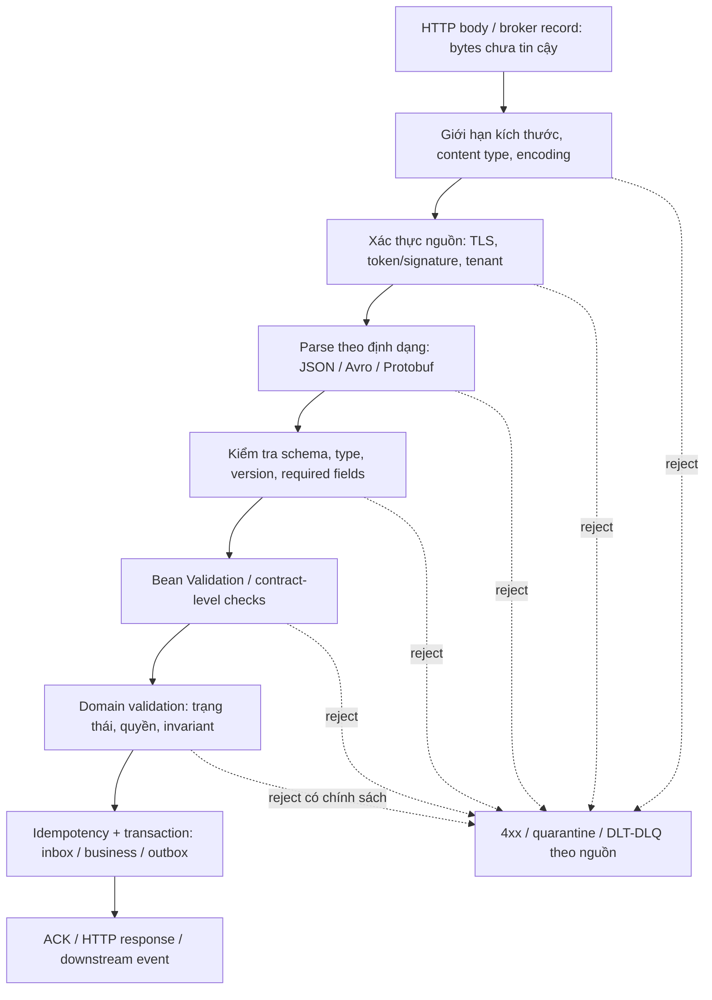
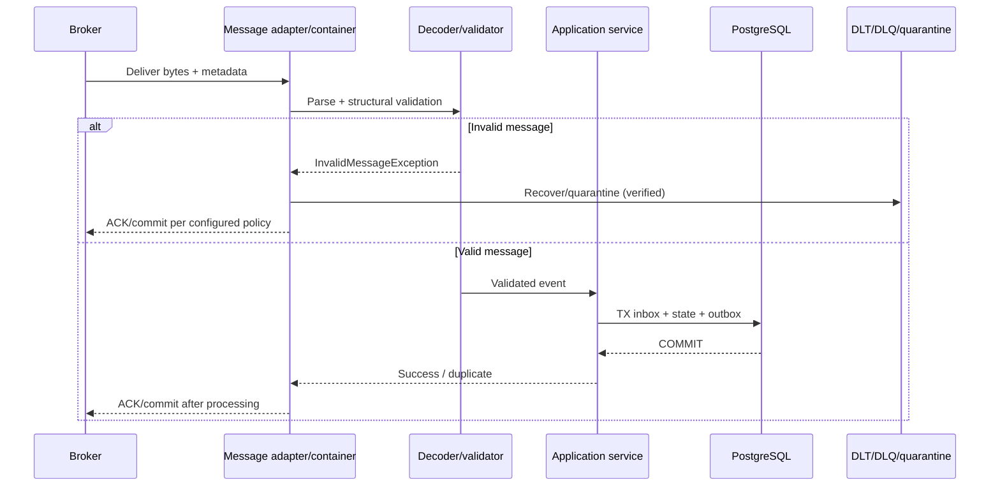
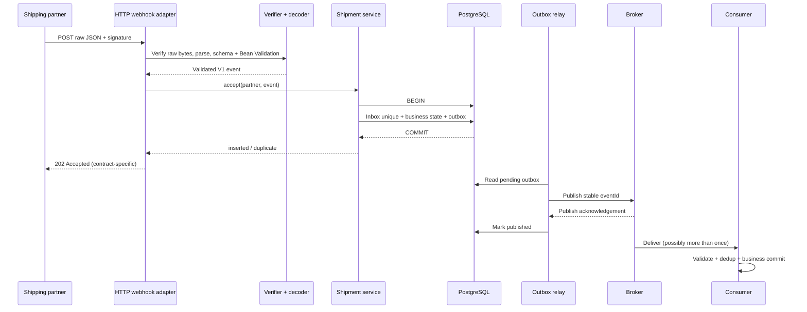

# Kiểm tra cấu trúc thông điệp trước khi thực thi nghiệp vụ

> **Chương:** Hợp đồng dữ liệu  
> **Module:** `SPRING_BOOT_INTEGRATION` — tổ chức tích hợp hệ thống trong Spring Boot qua HTTP client, cơ sở dữ liệu, cache, broker thông điệp và các adapter Spring Integration. Trọng tâm là quản lý cấu hình, hợp đồng dữ liệu, giao dịch, lỗi, chống xử lý trùng lặp, kiểm thử và quan sát luồng tích hợp thực tế.
>
> **Phạm vi ví dụ:** Java 17+, Spring Boot 3/Spring Framework 6, Jackson, Jakarta Bean Validation, PostgreSQL và các adapter nhắn tin minh họa. Tên API/property, hành vi converter và error handler phải được kiểm tra theo phiên bản thư viện dự án. Cú pháp SQL `ON CONFLICT` bên dưới dành cho PostgreSQL, không phải SQL portable cho mọi hệ quản trị.

## 1. Vì sao phải kiểm tra cấu trúc message trước khi chạy nghiệp vụ?

Giả sử dịch vụ Spring Boot nhận webhook từ hãng vận chuyển:

```json
{
  "eventId": "evt-shipping-1001",
  "eventType": "shipment.status-changed",
  "schemaVersion": 1,
  "tenantId": "shop-a",
  "occurredAt": "2026-11-21T03:20:00Z",
  "payload": {
    "shipmentId": "sh-1001",
    "status": "DELIVERED"
  }
}
```

Hệ thống phải xác minh chữ ký của đối tác, cập nhật đơn giao hàng trong PostgreSQL và ghi outbox để phát `ShipmentDelivered` sang broker. Nếu dữ liệu đi qua các bước xử lý nghiệp vụ trước khi được kiểm tra, một message lỗi có thể gây:

- `eventId` thiếu hoặc `null`: khóa chống trùng không đáng tin, cùng sự kiện bị ghi nhiều lần.
- `schemaVersion` không được hỗ trợ: consumer hiểu nhầm ý nghĩa của field.
- `payload.shipmentId` rỗng: câu update có thể tác động sai hoặc không có bản ghi.
- `status = "DELIVRED"`: lỗi chính tả enum bị chuyển thành trạng thái mặc định nguy hiểm.
- `occurredAt` không phải thời điểm hợp lệ: sai thứ tự hoặc tính toán SLA.
- JSON có hai key `eventId`: các parser khác nhau có thể chọn giá trị khác nhau.
- Payload vượt giới hạn: gây cạn RAM, thread hoặc parser CPU.
- Body không khớp chữ ký: message có thể bị sửa hoặc giả mạo trước khi tới domain.

**Nguyên tắc:** Chỉ chuyển dữ liệu sang trạng thái *được phép thực thi nghiệp vụ* sau khi vượt qua ranh giới xác thực nguồn, định dạng, cấu trúc, kiểu dữ liệu và validation phù hợp. “Jackson deserialize thành object thành công” chưa có nghĩa message an toàn hay hợp lệ.

### Mục tiêu học tập

Sau bài này, bạn có thể:

1. Phân biệt xác thực nguồn, parsing, schema validation, Bean Validation và domain validation.
2. Thiết kế envelope và payload versioned với các field bắt buộc, nullable và quy ước unknown fields.
3. Dùng Jackson và Jakarta Bean Validation cho message HTTP/webhook theo đúng ranh giới tin cậy.
4. Chọn cách kiểm tra JSON Schema/Avro/Protobuf mà không nhầm serialization với hợp đồng nghiệp vụ.
5. Xử lý message sai hợp đồng trên HTTP, Kafka, RabbitMQ và luồng Spring Integration.
6. Kết hợp kiểm tra cấu trúc với unique key, inbox/outbox, transaction và idempotency.
7. Kiểm thử cả dữ liệu tốt, dữ liệu lỗi, duplicate, poison message và nâng cấp schema.

## 2. Pipeline kiểm tra: từ bytes chưa tin cậy đến domain command

Một message bên ngoài nên đi qua nhiều lớp, mỗi lớp có trách nhiệm riêng.



| Lớp | Câu hỏi chính | Ví dụ lỗi | Chủ thể chịu trách nhiệm |
|---|---|---|---|
| **Transport và giới hạn** | Body có đúng media type, encoding, kích thước cho phép? | 12 MB thay vì giới hạn 256 KB | Gateway/web server/adapter |
| **Authenticity/authorization** | Ai gửi? Có quyền cho tenant/endpoint không? | Chữ ký HMAC sai | Security adapter |
| **Parsing** | Bytes có phải JSON hợp lệ? | Dấu ngoặc thiếu, encoding sai | Parser/MessageConverter |
| **Structural schema** | Có đúng field, type, enum, version? | `schemaVersion=99`, `payload` là string | Schema validator/deserializer |
| **Bean Validation** | DTO có thỏa constraint khai báo? | `eventId` blank, nested field thiếu | Jakarta Validation |
| **Domain validation** | Thao tác có hợp lệ trong trạng thái hiện tại? | Đơn đã hủy nhưng yêu cầu giao thành công | Application/domain service |
| **Idempotency/transaction** | Event mới hay đã xử lý? Update và outbox nguyên tử? | Hai request cùng `eventId` | DB constraint và service |
| **Delivery outcome** | Khi nào phản hồi/ACK và retry? | DB timeout trước commit | HTTP/broker adapter và policy |

Thứ tự chi tiết có thể khác theo transport và yêu cầu bảo mật; chẳng hạn việc kiểm tra giới hạn kích thước phải diễn ra **trước khi** buffer toàn bộ body, còn chữ ký webhook thường được kiểm tra trên **raw bytes trước khi parse/normalize**. Không diễn giải pipeline là mọi transport đều dùng một method duy nhất.

## 3. Hợp đồng message: envelope và payload có version

Với luồng tích hợp, nên phân biệt metadata chung của sự kiện và nội dung cụ thể.

```json
{
  "eventId": "evt-shipping-1001",
  "eventType": "shipment.status-changed",
  "schemaVersion": 1,
  "tenantId": "shop-a",
  "occurredAt": "2026-11-21T03:20:00Z",
  "correlationId": "checkout-1001",
  "payload": {
    "shipmentId": "sh-1001",
    "status": "DELIVERED"
  }
}
```

Đây là **contract do ứng dụng định nghĩa**, không phải envelope bắt buộc của Spring Boot, Kafka hoặc Spring Integration.

| Trường | Contract ví dụ | Rủi ro nếu thiếu kiểm tra |
|---|---|---|
| `eventId` | String, bắt buộc, ổn định qua retry | Không dedup được; ID xung đột |
| `eventType` | Chuỗi loại event đã cho phép | Điều hướng sai handler |
| `schemaVersion` | Số nguyên được consumer hỗ trợ | Giải mã/mapping sai contract |
| `tenantId` | String bắt buộc, xác thực với nguồn gửi | Cross-tenant update |
| `occurredAt` | Timestamp ISO 8601 có offset/UTC | Sắp xếp, SLA hoặc audit sai |
| `correlationId` | Optional theo hợp đồng | Khó trace; không thay eventId |
| `payload.shipmentId` | String bắt buộc | Không định danh được shipment |
| `payload.status` | Giá trị enum hợp lệ | Side effect sai trạng thái |

### 3.1. Event, command và reply không có cùng quy tắc

- **Event** mô tả sự thật đã xảy ra; `eventId` định danh lần phát sinh sự thật đó.
- **Command** yêu cầu một hành động; `commandId` có thể làm khóa chống thực hiện lặp.
- **Reply/response** mang kết quả tương quan theo `correlationId` hoặc request ID.

Nếu dùng `correlationId` làm khóa dedup, hai sự kiện hợp lệ trong cùng workflow có thể bị loại nhầm. Nếu dùng broker MessageId làm khóa dedup, một lần republish cùng business event có thể được coi là event mới.

### 3.2. Tên field và ý nghĩa phải được version hóa

Đổi `status = "DELIVERED"` thành `status = "DONE"` dù cùng kiểu string vẫn là thay đổi hợp đồng. Consumer không thể suy ra tính tương thích chỉ từ việc JSON parse thành công. Mỗi version cần mô tả rõ required/optional fields, kiểu, đơn vị đo, enum, ý nghĩa `null`, quy tắc unknown fields và quy trình nâng cấp.

## 4. JSON Schema: mô tả cấu trúc ngay tại ranh giới

Một cách khai báo formal contract là **JSON Schema**. Ví dụ theo draft 2020-12:

```json
{
  "$schema": "https://json-schema.org/draft/2020-12/schema",
  "type": "object",
  "required": [
    "eventId", "eventType", "schemaVersion",
    "tenantId", "occurredAt", "payload"
  ],
  "properties": {
    "eventId": {
      "type": "string",
      "minLength": 1,
      "maxLength": 160
    },
    "eventType": {
      "const": "shipment.status-changed"
    },
    "schemaVersion": {
      "const": 1
    },
    "tenantId": {
      "type": "string",
      "minLength": 1,
      "maxLength": 80
    },
    "occurredAt": {
      "type": "string",
      "format": "date-time"
    },
    "correlationId": {
      "type": "string",
      "maxLength": 160
    },
    "payload": {
      "type": "object",
      "required": ["shipmentId", "status"],
      "properties": {
        "shipmentId": {
          "type": "string",
          "minLength": 1,
          "maxLength": 160
        },
        "status": {
          "enum": ["PICKED_UP", "IN_TRANSIT", "DELIVERED", "FAILED"]
        }
      },
      "additionalProperties": false
    }
  },
  "additionalProperties": false
}
```

Schema này minh họa:

- `required` yêu cầu **property tồn tại**; nó không tự nói property bắt buộc khác `null` nếu kiểu cho phép `null`.
- `type` và `enum/const` kiểm tra kiểu và tập giá trị.
- `additionalProperties: false` **không chấp nhận field lạ**, một lựa chọn strict có hệ quả khi nâng version.
- `minLength` không tự cấm chuỗi chỉ có khoảng trắng; quy tắc `@NotBlank`/trim policy có thể bổ sung.
- `format: "date-time"` có thể là **annotation** hoặc assertion tùy validator/dialect/configuration; cần xác minh implementation có thực sự enforce format, không chỉ thấy schema có dòng đó.

**Spring Boot không tự chạy JSON Schema validator chỉ vì file schema tồn tại**. Phải chọn thư viện hỗ trợ draft phù hợp, tải schema từ nguồn được kiểm soát, compile/cache validator, chạy validate và map lỗi trong ingress adapter. Nếu contract dùng OpenAPI schema, Avro hoặc Protobuf, ngữ nghĩa validator/compatibility khác JSON Schema.

### 4.1. Schema strict hay tolerant?

Có hai hướng chính:

1. **Strict input:** từ chối unknown fields. Dễ phát hiện typo/contract drift nhưng rolling deployment có thể hỏng nếu producer thêm field khi consumer cũ còn chạy.
2. **Tolerant reader:** chấp nhận field mới mà không cần dùng. Hỗ trợ một số thay đổi additive, nhưng có thể che dữ liệu sai tên hoặc một field bảo mật quan trọng bị bỏ qua.

Không có quy tắc “luôn strict” hoặc “luôn ignore”. Chọn theo **compatibility policy** và mức độ nhạy cảm nghiệp vụ. Dù cho phép field mới, các trường bắt buộc, version, eventType và invariants vẫn phải kiểm tra.

## 5. Java DTO bất biến và Jakarta Bean Validation

Spring Boot thường dùng Jackson để chuyển JSON thành Java object, sau đó Bean Validation kiểm tra constraint ở DTO. Một contract kiểu record:

```java
package com.example.integration.contract;

import java.time.Instant;
import jakarta.validation.Valid;
import jakarta.validation.constraints.Max;
import jakarta.validation.constraints.Min;
import jakarta.validation.constraints.NotBlank;
import jakarta.validation.constraints.NotNull;
import jakarta.validation.constraints.Size;

public record ShipmentStatusChangedV1(
    @NotBlank @Size(max = 160) String eventId,
    @NotBlank String eventType,
    @NotNull @Min(1) @Max(1) Integer schemaVersion,
    @NotBlank @Size(max = 80) String tenantId,
    @NotNull Instant occurredAt,
    @Size(max = 160) String correlationId,
    @Valid @NotNull Payload payload
) {
    public record Payload(
        @NotBlank @Size(max = 160) String shipmentId,
        @NotNull ShipmentStatus status
    ) {}

    public enum ShipmentStatus {
        PICKED_UP, IN_TRANSIT, DELIVERED, FAILED
    }
}
```

Điểm cần hiểu:

- `record` tạo DTO bất biến theo cấu trúc đã khai báo; không tự kiểm tra business invariant nếu chỉ dùng record.
- `@NotBlank` khác `@NotNull`: một chuỗi `""` hoặc toàn khoảng trắng phải bị chặn khi cần nội dung.
- `@Size` ngăn chuỗi vượt giới hạn hợp đồng; không thay giới hạn raw body do server enforce.
- `Integer schemaVersion` cho phép phân biệt **thiếu** với `0` trong quá trình bind, kết hợp `@NotNull`.
- `@Valid @NotNull Payload payload` kiểm tra cả sự tồn tại của nested object và field bên trong.
- `@NotNull ShipmentStatus` chặn null; Jackson phải chuyển được chuỗi enum trước khi tới Bean Validation.
- `@NotNull Instant` chặn timestamp thiếu/null; sai định dạng thời gian có thể lỗi ở bước Jackson.

**Lưu ý:** `@NotBlank eventType` chưa bảo đảm nó bằng `shipment.status-changed`. Cần kiểm tra exact event type bằng JSON Schema, validation bổ sung hoặc so sánh ở ingress dispatcher.

### 5.1. Required không đồng nghĩa non-null trong mọi công cụ

Với Jackson deserialize vào record, một JSON thiếu field có thể dẫn tới Java `null` đối với reference type. `@NotNull` sẽ báo lỗi **nếu validation thực sự được kích hoạt**; bản thân `ObjectMapper.readValue(...)` không tự gọi Bean Validation.

Với primitive như `int` hoặc `boolean`, một trường thiếu có thể bị nhận như giá trị mặc định tùy config coercion/missing creator properties, làm mất phân biệt “không có dữ liệu” và “có giá trị 0/false”. Đối với required input, dùng boxed types hoặc cấu hình parsing strict và test thiếu field.

### 5.2. Giá trị null, chuỗi rỗng và field bị thiếu

| JSON đầu vào | Java có thể thấy | Ý nghĩa hợp đồng |
|---|---|---|
| Không có `correlationId` | `null` | Có thể cho phép nếu optional |
| `"correlationId": null` | `null` | Có thể khác “không gửi” nếu API patch |
| `"correlationId": ""` | `""` | Không tự đồng nghĩa null |
| `"schemaVersion": null` | `null` | Không hợp lệ vì required |
| `"schemaVersion": 0` | `0` | Không hợp lệ vì version không hỗ trợ |
| `"payload": null` | `null` | Không hợp lệ |
| `"payload": {}` | Payload chứa null fields | Không hợp lệ khi cascade `@Valid` |

Với webhook **event snapshot**, thường dễ chọn required fields rõ và không có ngữ nghĩa PATCH. Với API PATCH, “field thiếu” và “field có giá trị null” có thể cần hai hành động khác nhau — khi đó DTO hai trạng thái không đủ; cần representation có trạng thái hiện diện field riêng.

## 6. Bật Bean Validation thực sự trong Spring Boot

Gradle Groovy DSL minh họa:

```gradle
dependencies {
    implementation("org.springframework.boot:spring-boot-starter-web")
    implementation("org.springframework.boot:spring-boot-starter-validation")
    implementation("org.springframework.boot:spring-boot-starter-jdbc")
    runtimeOnly("org.postgresql:postgresql")

    testImplementation("org.springframework.boot:spring-boot-starter-test")
}
```

`spring-boot-starter-validation` cung cấp Bean Validation provider tương thích để các annotation `jakarta.validation.constraints.*` được thực thi. Nó khác với Spring Boot configuration processor, Swagger/OpenAPI hoặc annotation chỉ dùng tạo tài liệu.

Nếu một DTO chỉ được tạo bằng `new` hoặc Jackson `readValue` ngoài MVC pipeline, **không tự có Bean Validation**. Bạn phải gọi `Validator.validate(...)` hoặc đưa DTO qua một điểm tích hợp validation được cấu hình.

### 6.1. @Valid và @Validated

- Trong Spring MVC, `@Valid @RequestBody Payload` thường kích hoạt validation của request body sau khi deserialize, theo setup hỗ trợ của Spring Boot.
- `@Validated` có thể dùng cho validation groups và method-level validation theo cơ chế Spring.
- Trong một event consumer, không được giả định `@KafkaListener`/`@RabbitListener` hoặc custom adapter tự thực thi y hệt validation MVC nếu chưa cấu hình.
- `@Valid` ở nested field là **cascade marker**, không tự làm nested object bắt buộc: thêm `@NotNull` nếu cần.

### 6.2. Không dùng validation để quyết định “đã xử lý”

Bean Validation trả lời “giá trị đầu vào có hợp đồng chấp nhận được không?”. Nó không biết shipment đã được giao trước đó, đơn có thuộc tenant thật hay không, hoặc một event có bị replay hay không. Những kiểm tra đó thuộc application/domain service với DB state và idempotency key.

## 7. HTTP controller với @Valid @RequestBody: đường đơn giản

Với một API nội bộ đã có middleware xác thực, method MVC có thể nhận DTO trực tiếp:

```java
import com.example.integration.contract.ShipmentStatusChangedV1;
import jakarta.validation.Valid;
import org.springframework.http.HttpStatus;
import org.springframework.http.MediaType;
import org.springframework.web.bind.annotation.PostMapping;
import org.springframework.web.bind.annotation.RequestBody;
import org.springframework.web.bind.annotation.RequestMapping;
import org.springframework.web.bind.annotation.ResponseStatus;
import org.springframework.web.bind.annotation.RestController;

@RestController
@RequestMapping("/internal/shipping-events")
class InternalShipmentEventController {

    private final ShipmentIntakeService intakeService;

    InternalShipmentEventController(ShipmentIntakeService intakeService) {
        this.intakeService = intakeService;
    }

    @PostMapping(consumes = MediaType.APPLICATION_JSON_VALUE)
    @ResponseStatus(HttpStatus.ACCEPTED)
    void receive(@Valid @RequestBody ShipmentStatusChangedV1 event) {
        intakeService.acceptInternal(event);
    }
}
```

`ShipmentIntakeService` là application service do dự án triển khai. Với đoạn này:

1. Spring MVC chọn `HttpMessageConverter` theo media type.
2. Jackson parse JSON thành `ShipmentStatusChangedV1`.
3. Bean Validation kiểm tra constraint nhờ `@Valid`.
4. Chỉ khi các bước đó thành công, method controller mới được gọi.

Đây là **đường đơn giản cho API đã xác thực trước đó**. Nó không chứng minh webhook bên ngoài an toàn khi cần HMAC trên **raw request bytes**. Không dùng `@RequestBody DTO` rồi tự serialize DTO lại để kiểm tra chữ ký, vì thứ tự field, whitespace, escaping và representation có thể thay đổi.

### 7.1. Lỗi có thể xảy ra trước controller

Nếu JSON có kiểu sai hoặc timestamp không parse được, request có thể thất bại trong `HttpMessageConverter` với `HttpMessageNotReadableException`; method chưa được gọi. Nếu object được tạo nhưng thiếu `eventId`, validation có thể sinh `MethodArgumentNotValidException`.

Một `try/catch` đặt trong method controller **không bắt được mọi lỗi converter/validation đã xảy ra trước đó**. Dùng exception handling ở tầng MVC như `@RestControllerAdvice`.

## 8. Webhook ký số: kiểm tra raw body trước khi parse

Với webhook đối tác dùng HMAC, hãy giữ body gốc để xác thực chữ ký theo contract. Ví dụ wiring:

```java
import com.example.integration.contract.ShipmentStatusChangedV1;
import org.springframework.http.MediaType;
import org.springframework.http.ResponseEntity;
import org.springframework.web.bind.annotation.*;

@RestController
@RequestMapping("/webhooks/shipping")
public class ShippingWebhookController {

    private final WebhookSignatureVerifier signatureVerifier;
    private final ShipmentMessageDecoder decoder;
    private final ShipmentIntakeService intakeService;

    public ShippingWebhookController(
            WebhookSignatureVerifier signatureVerifier,
            ShipmentMessageDecoder decoder,
            ShipmentIntakeService intakeService) {
        this.signatureVerifier = signatureVerifier;
        this.decoder = decoder;
        this.intakeService = intakeService;
    }

    @PostMapping(consumes = MediaType.APPLICATION_JSON_VALUE)
    public ResponseEntity<Void> receive(
            @RequestHeader("X-Partner-Id") String partnerId,
            @RequestHeader("X-Signature") String signature,
            @RequestBody byte[] rawBody) {

        // Xác minh trên bytes gốc trước khi parse/normalize.
        signatureVerifier.verify(partnerId, signature, rawBody);

        ShipmentStatusChangedV1 event = decoder.decode(rawBody);
        intakeService.acceptFromPartner(partnerId, event, rawBody);

        return ResponseEntity.accepted().build();
    }
}
```

`WebhookSignatureVerifier`, `ShipmentMessageDecoder` và `ShipmentIntakeService` là những adapter/service do ứng dụng định nghĩa. Ví dụ không trình bày cách xây HMAC riêng vì **chữ ký phải tuân thủ chính xác thuật toán, canonicalization, header timestamp/nonce và khóa do đối tác công bố**.

**Quan trọng:** `@RequestBody byte[]` đã buffer toàn bộ body trong JVM. Muốn chống payload lớn, giới hạn **trước bước này** ở reverse proxy, gateway, container hoặc servlet filter được kiểm thử. Chỉ kiểm tra `rawBody.length` trong controller là giới hạn **quá muộn** để tránh việc request lớn đã chiếm bộ nhớ.

### 8.1. Thứ tự kiểm tra chữ ký và JSON

- Có thể kiểm tra content type và body size trước khi đọc/parse.
- Xác thực chữ ký trên **bytes gốc**, không trên JSON đã format lại.
- Kiểm tra replay timestamp/nonce và tenant đối tác theo hợp đồng.
- Chỉ sau khi xác thực mới parse và chạy schema/Bean Validation.
- Sau khi cấu trúc hợp lệ, đối chiếu `tenantId` trong payload với danh tính đã xác thực.
- Khi ghi DB, dùng khóa idempotency có phạm vi đúng, ví dụ `(partnerId, eventId)`.

Đừng tin `X-Partner-Id` chỉ vì header có mặt; nó phải được ánh xạ tới secret/quyền được cấu hình trước và đi qua signature verification đúng.

## 9. Decoder tường minh: Jackson strict reader + Validator

Nếu lấy `byte[]` trực tiếp từ controller, Kafka/Rabbit hoặc file adapter, phải chủ động gọi validation. Ví dụ decoder Spring bean cho version 1:

```java
import com.example.integration.contract.ShipmentStatusChangedV1;
import com.fasterxml.jackson.databind.DeserializationFeature;
import com.fasterxml.jackson.databind.ObjectMapper;
import com.fasterxml.jackson.databind.ObjectReader;
import jakarta.validation.ConstraintViolation;
import jakarta.validation.Validator;
import java.io.IOException;
import java.util.Set;
import org.springframework.stereotype.Component;

@Component
public class ShipmentMessageDecoder {

    private final ObjectReader reader;
    private final Validator validator;

    public ShipmentMessageDecoder(ObjectMapper objectMapper,
                                  Validator validator) {
        // Giữ cấu hình Java Time/Module của ObjectMapper do Boot cung cấp,
        // nhưng đặt chính sách unknown field riêng cho ingress này.
        this.reader = objectMapper.readerFor(ShipmentStatusChangedV1.class)
            .with(DeserializationFeature.FAIL_ON_UNKNOWN_PROPERTIES);
        this.validator = validator;
    }

    public ShipmentStatusChangedV1 decode(byte[] rawBody) {
        final ShipmentStatusChangedV1 event;
        try {
            event = reader.readValue(rawBody);
        } catch (IOException ex) {
            throw new InvalidMessageException(
                "Malformed JSON or incompatible field type", ex);
        }

        if (event == null) {
            throw new InvalidMessageException("Event object is required");
        }

        Set<ConstraintViolation<ShipmentStatusChangedV1>> errors =
            validator.validate(event);

        if (!errors.isEmpty()) {
            // Không đưa toàn bộ invalidValue/raw payload vào log/API.
            throw new InvalidMessageException(
                "Message violates the declared contract");
        }

        if (!"shipment.status-changed".equals(event.eventType())) {
            throw new InvalidMessageException("Unsupported event type");
        }
        return event;
    }
}
```

Và exception minh họa để controller/consumer phân loại rõ:

```java
public final class InvalidMessageException extends RuntimeException {
    public InvalidMessageException(String message) {
        super(message);
    }

    public InvalidMessageException(String message, Throwable cause) {
        super(message, cause);
    }
}
```

Ở đây `reader.readValue(...)` chỉ giải quyết **parse và Java type mapping**, `Validator.validate(...)` giải quyết constraint DTO, còn phép so sánh `eventType` kiểm tra contract cụ thể chưa được thể hiện bởi annotation. Nếu dùng JSON Schema validator, có thể đặt nó trước hoặc song song với bước map DTO theo policy; tránh làm hai lớp đưa ra kết quả mâu thuẫn.

### 9.1. Vì sao reader strict chỉ áp dụng cho ingress?

Spring Boot có thể cấu hình shared `ObjectMapper` cho nhiều API. Đặt `FAIL_ON_UNKNOWN_PROPERTIES` toàn cục có thể khiến những endpoint/consumer cần forward compatibility bất ngờ từ chối message. `ObjectReader` tách lựa chọn strict cho một boundary, giúp thay đổi policy có kiểm thử.

### 9.2. Duplicate JSON keys cần quyết định riêng

`FAIL_ON_UNKNOWN_PROPERTIES` **không phải** cấu hình phát hiện JSON có hai key trùng nhau. Nếu hợp đồng yêu cầu từ chối duplicate keys, bật strict duplicate detection ở parser/JsonFactory phù hợp và test trên **đúng decoder raw bytes**, hoặc dùng JSON Schema/parser stack có đảm bảo tương ứng.

Một JSON như:

```json
{
  "eventId": "evt-safe",
  "eventId": "evt-other",
  "schemaVersion": 1
}
```

không nên được chấp nhận âm thầm khi chữ ký, audit và idempotency phụ thuộc duy nhất một `eventId`. Các parser có thể chọn field đầu hoặc field cuối; chỉ một chính sách được phê duyệt và nhất quán mới tránh deserialization ambiguity.

## 10. Phân biệt schema validation và Bean Validation

Hai lớp bổ sung, không thay thế hoàn toàn nhau.

| Khía cạnh | JSON Schema | Jakarta Bean Validation |
|---|---|---|
| Input chính | JSON document/tree/stream | Java object |
| Kiểm tra required/type/shape | Rất tường minh | Tùy DTO và cách deserialize |
| Unknown properties | `additionalProperties` | Thường xử lý ở Jackson/converter |
| String length/range/enum | Có | `@Size`, `@Min`, enum và custom constraint |
| Nested validation | Schema nested/`$ref` | `@Valid` trên nested object |
| Version hóa contract | Có thể version schema artifact | Cần DTO/version dispatch |
| Quan hệ nhiều field | Có một số keyword/extension | Custom constraint hoặc `@AssertTrue` |
| Business state trong DB | Không | Không mặc nhiên |
| Runtime integration | Cần validator library | Cần Bean Validation provider và lời gọi validation |

### 10.1. Tại sao không chỉ dùng annotation Java?

Một producer không viết bằng Java cần hợp đồng độc lập với source code của consumer. JSON Schema/OpenAPI/Avro/Protobuf tạo artifact có thể dùng cho code generation, contract test và quản trị compatibility. Bean Validation thuận tiện để kiểm tra **object đã được ánh xạ trong một ứng dụng Java**.

### 10.2. Tại sao không chỉ dùng JSON Schema?

Một JSON document hợp lệ về hình dạng vẫn có thể đòi hỏi hành động trái trạng thái hiện tại: `DELIVERED` cho shipment không tồn tại, tenant không được phép hoặc event cũ hơn state version đã commit. Schema không có đầy đủ sự thật nghiệp vụ tại thời điểm xử lý. Cần application/domain validation và transaction.

## 11. Chọn quy tắc ép kiểu: đừng im lặng chuyển dữ liệu sai

Jackson và nhiều converter có thể hỗ trợ **coercion**, ví dụ chuỗi `"12"` thành số nguyên hoặc một giá trị sai kiểu thành null, tùy cấu hình/version. Một số API có thể muốn chấp nhận kiểu linh hoạt; nhiều luồng tích hợp lại cần contract chặt.

Ví dụ những giá trị khác nhau:

```json
{"schemaVersion": 1}
```

```json
{"schemaVersion": "1"}
```

```json
{"schemaVersion": true}
```

Nếu hợp đồng yêu cầu `schemaVersion` là JSON integer, chỉ trường hợp đầu là đúng. Trong môi trường quan trọng, kiểm tra cùng một **strict coercion policy** ở parser/JSON Schema và test cả kiểu sai; không cho phép converter tự chuyển rồi giả định producer luôn gửi đúng.

Tương tự, phép chuẩn hóa `trim()` có thể hợp lệ cho một mã nhập tay, nhưng không nên tự sửa `eventId` đã được dùng trong chữ ký, unique key và trace nếu contract định nghĩa nó là giá trị opaque có case/whitespace có nghĩa. Nếu cần canonicalization, định nghĩa chính xác ở contract và nhất quán giữa các bên.

### 11.1. Numeric precision

- Giá trị tiền nên biểu diễn bằng `amountMinor` kiểu integer cùng currency hoặc `BigDecimal` theo hợp đồng; tránh ép số thập phân tiền tệ sang `double`.
- Integer quá lớn có thể gây overflow hoặc deserialization error.
- SQL `NUMERIC`, JSON number và Java `BigDecimal` cần thống nhất scale/rounding.
- `0`, `null` và “field không gửi” không tự đồng nghĩa.

### 11.2. Ngày giờ

`occurredAt` nên mang offset/UTC và parse thành `Instant` nếu là thời điểm tuyệt đối. Không tự thay timestamp lỗi bằng `Instant.now()` trong decoder: hành động đó tạo **sự thật giả** cho audit và thứ tự event.

## 12. Version dispatch: chọn contract trước khi tạo DTO

Một message version 2 có thể có field mới hoặc thay đổi ý nghĩa. Nếu luôn parse vào DTO V1, consumer có thể bỏ qua field quan trọng hoặc báo lỗi sai.

Chiến lược rõ ràng:

1. Kiểm tra raw body và authenticity.
2. Parse sơ bộ envelope tối thiểu, giới hạn kích thước và độ sâu.
3. Đọc `eventType` và `schemaVersion` bằng policy chặt.
4. Chọn schema/DTO handler từ **allowlist version được hỗ trợ**.
5. Validate toàn bộ message theo version tương ứng.
6. Convert thành domain command/versioned internal model, rồi mới chạy nghiệp vụ.

Ví dụ ý tưởng dispatcher với Jackson:

```java
import com.fasterxml.jackson.databind.JsonNode;
import com.fasterxml.jackson.databind.ObjectMapper;
import java.io.IOException;
import org.springframework.stereotype.Component;

@Component
public class VersionedShipmentDecoder {

    private final ObjectMapper mapper;
    private final ShipmentMessageDecoder v1Decoder;

    public VersionedShipmentDecoder(
            ObjectMapper mapper, ShipmentMessageDecoder v1Decoder) {
        this.mapper = mapper;
        this.v1Decoder = v1Decoder;
    }

    public ShipmentStatusChangedV1 decodeSupported(byte[] raw) {
        final JsonNode root;
        try {
            root = mapper.readTree(raw);
        } catch (IOException ex) {
            throw new InvalidMessageException("Malformed JSON", ex);
        }

        if (root == null || !root.isObject()) {
            throw new InvalidMessageException("JSON object is required");
        }

        JsonNode version = root.get("schemaVersion");
        if (version == null || !version.isIntegralNumber()
                || version.intValue() != 1) {
            throw new InvalidMessageException("Unsupported schema version");
        }

        return v1Decoder.decode(raw);
    }
}
```

Ví dụ chỉ hỗ trợ V1 để thể hiện chính sách **fail closed** cho version lạ. Trong một consumer nhiều version, dispatcher trả về sealed domain command hoặc interface chung với parser V1/V2 riêng. Khi dùng dispatcher theo tree như trên, phải đồng bộ **duplicate key detection** giữa bước `readTree` và decoder cuối; không để parser sơ bộ và parser chính có ngữ nghĩa khác nhau.

### 12.1. Version không được phép dựa vào “đoán field”

Nếu thêm field `statusReason` mà không đổi version, consumer cũ có thể tiếp tục chạy nhưng bỏ qua ý nghĩa mới. Hãy định nghĩa rõ thay đổi nào tương thích, thay đổi nào cần version mới và tiến trình rolling deploy.

Một số schema registry có compatibility checks, nhưng **kiểm tra cấu trúc không đồng nghĩa tương thích ngữ nghĩa**. Đổi đơn vị thời gian từ giây sang mili giây, hoặc đổi nghĩa enum, có thể vượt qua nhiều phép kiểm tra schema mà vẫn phá nghiệp vụ.

## 13. Phân biệt structural validation, authorization và state transition

Một message hợp lệ về schema vẫn có thể chứa yêu cầu không được phép.

Ví dụ:

```json
{
  "eventId": "evt-1001",
  "eventType": "shipment.status-changed",
  "schemaVersion": 1,
  "tenantId": "shop-b",
  "occurredAt": "2026-11-21T03:20:00Z",
  "payload": {
    "shipmentId": "sh-1001",
    "status": "DELIVERED"
  }
}
```

Đối tác gửi webhook được ủy quyền cho `shop-a`, nhưng JSON khai `tenantId=shop-b`. JSON Schema và Bean Validation có thể đều cho qua. Chỉ **authorization/tenant mapping** mới xác định được điều này không hợp lệ.

Tương tự, event `DELIVERED` sau `CANCELLED` cần kiểm tra state machine hoặc aggregate version trong DB. Không nhét mọi state transition vào `ConstraintValidator` chỉ dựa trên DTO, vì validator không nên mở transaction/HTTP call mỗi lần parse. Giữ validator **thuần túy**, đưa kiểm tra phụ thuộc dữ liệu hiện hành vào application service.

### 13.1. Phân lớp lỗi để ra quyết định vận hành

- **Invalid structure:** payload không đọc được/thiếu required field → từ chối hoặc quarantine.
- **Unauthorized:** signature/tenant không hợp lệ → không xử lý, theo dõi an ninh.
- **Invalid domain state:** có thể reject vĩnh viễn hoặc cần đối soát tùy hợp đồng.
- **Transient dependency failure:** database/broker unavailable → retry có giới hạn.
- **Duplicate hợp lệ:** đã xử lý cùng event ID → no-op và trả kết quả chấp nhận được theo contract.

Đừng gom tất cả thành một `catch (Exception)` rồi retry vô hạn hoặc trả HTTP 200 giả.

## 14. Thông điệp từ broker: kiểm tra trước service nghiệp vụ

Với Kafka, RabbitMQ, Pulsar hoặc các adapter Spring Integration, luồng thường là:



**Quan trọng:** vị trí validation có thể nằm trong listener hoặc trong deserializer/converter trước listener. Với lỗi xảy ra trước listener, `try/catch` trong method listener không bao giờ được chạy. Cấu hình error handling phải kiểm tra từng tầng.

### 14.1. Không ACK poison message khi chưa có kết quả bền vững

Nếu message không thể parse và cần điều tra/reprocess, thiết kế một trong các đường:

1. Ghi nó vào DLQ/DLT/quarantine **có xác nhận bền vững**, rồi cho phép broker commit/ACK nguồn.
2. Để cơ chế recoverer/error handler của binder/container làm điều đó theo policy có kiểm thử.
3. Nếu chưa thể recover và dữ liệu quan trọng, giữ retry/cảnh báo hoặc tạm dừng consumer theo runbook, không nuốt lỗi.

Không đưa invalid message vào in-memory queue rồi ACK để “tránh poison”; pod crash có thể làm mất bằng chứng và mất khả năng đối soát.

## 15. Kafka consumer: byte[] rồi decode đúng một lần

Ví dụ với Spring Kafka, cấu hình consumer dùng byte-array deserializer để ứng dụng tự kiểm tra JSON:

```yaml
spring:
  kafka:
    consumer:
      key-deserializer: org.apache.kafka.common.serialization.StringDeserializer
      value-deserializer: org.apache.kafka.common.serialization.ByteArrayDeserializer

integration:
  shipping:
    events-topic: shipping.status-changed.v1
    consumer-group: shipping-inbox-service
```

Listener:

```java
import org.apache.kafka.clients.consumer.ConsumerRecord;
import org.springframework.kafka.annotation.KafkaListener;
import org.springframework.stereotype.Component;

@Component
public class ShippingKafkaListener {

    private final ShipmentMessageDecoder decoder;
    private final ShipmentIntakeService service;

    public ShippingKafkaListener(
            ShipmentMessageDecoder decoder,
            ShipmentIntakeService service) {
        this.decoder = decoder;
        this.service = service;
    }

    @KafkaListener(
        topics = "${integration.shipping.events-topic}",
        groupId = "${integration.shipping.consumer-group}"
    )
    public void onRecord(ConsumerRecord<String, byte[]> record) {
        ShipmentStatusChangedV1 event = decoder.decode(record.value());
        service.acceptFromKafka(record.key(), event);
    }
}
```

`ShipmentIntakeService.acceptFromKafka` là service do ứng dụng triển khai. `record.key()` không tự có nghĩa là tenant/partner hợp lệ; cần validate contract của Kafka key và đối chiếu với envelope/nguồn. Theo cơ chế listener container và error handler đã cấu hình, method trả thành công mới thường cho phép tiến độ offset được ghi nhận. Chi tiết ACK/commit, transaction và retry thay đổi theo container settings.

### 15.1. JSON deserializer lỗi trước listener

Nếu dùng `JsonDeserializer<ShipmentStatusChangedV1>` trực tiếp, lỗi deserialization có thể xảy ra trong Kafka consumer **trước** khi method được gọi. Spring Kafka có hạ tầng như `ErrorHandlingDeserializer` và `DefaultErrorHandler`/recoverer trong các phiên bản hỗ trợ để đưa lỗi sang đường xử lý phù hợp.

Cần test việc value sai JSON, schema version lạ, lỗi enum và trường thiếu; không chỉ test `onRecord` bằng cách gọi method trực tiếp. Cấu hình DLT là một quyết định transport, không tự sinh ra từ annotation `@KafkaListener`.

### 15.2. Offset không phải business transaction

Kafka offset commit và PostgreSQL transaction là hai ranh giới. Consumer có thể commit DB rồi chết trước khi offset được commit; Kafka sẽ giao lại record sau restart. Idempotency trong DB đảm bảo duplicate không gây side effect lần nữa.

Nếu code dùng `@Async` rồi trả method listener trước khi công việc được ghi bền vững, offset có thể được commit khi worker async vẫn chưa xử lý. Tránh dùng cách đó cho công việc bắt buộc đúng.

## 16. RabbitMQ và Pulsar: quy tắc giống nhau, ACK khác nhau

RabbitMQ cũng có message converter, listener container và error handling riêng. Ví dụ Spring AMQP listener nhận raw bytes:

```java
import org.springframework.amqp.rabbit.annotation.RabbitListener;
import org.springframework.stereotype.Component;

@Component
public class ShippingRabbitListener {

    private final ShipmentMessageDecoder decoder;
    private final ShipmentIntakeService service;

    public ShippingRabbitListener(
            ShipmentMessageDecoder decoder,
            ShipmentIntakeService service) {
        this.decoder = decoder;
        this.service = service;
    }

    @RabbitListener(queues = "shipping.status-changed.inbox")
    public void onMessage(byte[] rawBody) {
        ShipmentStatusChangedV1 event = decoder.decode(rawBody);
        service.acceptFromRabbit(event);
    }
}
```

Để dùng ví dụ cần **Spring AMQP starter, queue và container factory/configuration phù hợp**. Việc converter có truyền raw bytes vào method hay không phụ thuộc cách cấu hình; đừng nghĩ mọi message qua `@RabbitListener` luôn là `byte[]`.

- **Kafka:** progress thông qua offset/group và container acknowledgement.
- **RabbitMQ:** delivery acknowledgement, NACK/requeue và dead-letter exchange/queue theo topology.
- **Pulsar:** subscription cursor, ACK/NACK/redelivery/DLQ theo subscription type và consumer config.

**Không copy cấu hình Kafka DLT sang RabbitMQ hoặc Pulsar**. Dù business decoder dùng chung, error path/ACK của từng adapter phải được test với middleware thật.

### 16.1. Spring Integration flow

Spring Integration có thể nhận message qua inbound adapter, gọi transformer/validator và route lỗi:

```text
Broker inbound adapter
  -> MessageChannel
  -> Transformer: parse raw bytes
  -> Filter/Validator: contract valid?
  -> Service Activator: domain service
  -> Outbox/inbox transaction
  -> Error channel / recoverer (theo policy)
```

`MessageChannel` và `errorChannel` có thể là **cấu trúc trong JVM**, không tự tương đương một queue bền vững. Muốn lưu invalid message trước ACK, phải gắn durable store/DLT/DLQ và xác nhận kết quả recovery. Đặc biệt khi chuyển `DirectChannel` sang `ExecutorChannel`, transaction context và đường truyền exception không còn tự giống nhau.

## 17. HTTP status và response khi message sai

HTTP là giao thức request/response; với API webhook, status code cần nhất quán với hợp đồng của đối tác.

| Tình huống | Status thường cân nhắc | Lưu ý |
|---|---|---|
| JSON malformed, sai type, thiếu required field | `400 Bad Request` | Phân loại malformed và structural validation |
| Media type không hỗ trợ | `415 Unsupported Media Type` | Kiểm tra `Content-Type` |
| Payload vượt giới hạn | `413 Content Too Large` | Giới hạn ở gateway/server trước buffer |
| Không được xác thực/không đủ quyền | `401/403` tùy auth scheme | Không tiết lộ secret/signature |
| Dữ liệu hợp lệ cú pháp nhưng sai quy tắc nghiệp vụ | `422` hoặc `409` tùy API contract | Không tự xem là lỗi parsing |
| Duplicate event hợp lệ | `200/202` hoặc đáp ứng idempotent đã quy định | Không tạo side effect mới |
| Database/broker unavailable, chưa lưu bền vững | `5xx/503` phù hợp | Sender có thể retry theo policy |
| Đã lưu inbox/outbox nhưng downstream chưa hoàn tất | `202 Accepted` | Chỉ hứa đã tiếp nhận bền vững |

Không có luật rằng mọi webhook phải trả `202`, hay mọi lỗi domain phải là `422`. Một số đối tác retry chỉ theo một số HTTP status nhất định; **phản hồi phải khớp delivery contract** để tránh retry storm hoặc mất sự kiện.

### 17.1. Dùng ProblemDetail mà không rò dữ liệu

Với Spring MVC, có thể gom exception thuộc structural validation thành một lỗi có mã ổn định:

```java
import org.springframework.http.HttpStatus;
import org.springframework.http.ProblemDetail;
import org.springframework.http.ResponseEntity;
import org.springframework.http.converter.HttpMessageNotReadableException;
import org.springframework.web.bind.MethodArgumentNotValidException;
import org.springframework.web.bind.annotation.ExceptionHandler;
import org.springframework.web.bind.annotation.RestControllerAdvice;

@RestControllerAdvice
class MessageContractExceptionAdvice {

    @ExceptionHandler({
        InvalidMessageException.class,
        HttpMessageNotReadableException.class,
        MethodArgumentNotValidException.class
    })
    ResponseEntity<ProblemDetail> handleInvalidMessage(Exception ex) {
        ProblemDetail detail = ProblemDetail.forStatus(HttpStatus.BAD_REQUEST);
        detail.setTitle("Invalid message");
        detail.setDetail("Request body does not satisfy the message contract");
        detail.setProperty("code", "INVALID_MESSAGE");
        return ResponseEntity.badRequest().body(detail);
    }
}
```

Không đưa `ex.getMessage()`, raw payload, signature hoặc giá trị field nhạy cảm vào response. Một listener Kafka không tự dùng HTTP `ProblemDetail`; nó cần error classification và recoverer riêng.

## 18. Retry, poison message và quarantine

**Không phải mọi exception đều đáng retry.** Một JSON sai kiểu sẽ sai lần thứ hai nếu input không đổi. Ngược lại, một message hợp lệ có thể tạm thời không ghi được DB vì pool mất kết nối.

| Nhóm | Ví dụ | Hướng xử lý |
|---|---|---|
| **Permanent structural** | JSON sai cú pháp, `schemaVersion` không hỗ trợ | Reject hoặc quarantine/DLT; không retry vô hạn |
| **Permanent security** | Chữ ký sai, tenant không được phép | Từ chối và cảnh báo an ninh; không “sửa” payload |
| **Domain reject** | Transition không hợp lệ, ID không tồn tại theo contract | Phân loại permanent hoặc pending reconciliation |
| **Transient infrastructure** | DB timeout, broker tạm unavailable | Retry có backoff, jitter, limit và monitoring |
| **Unknown outcome** | Publish đã ghi broker nhưng producer mất ACK | Retry với stable event ID, consumer dedup |
| **Duplicate hợp lệ** | Cùng event ID đã được xử lý | No-op, ACK/response theo contract |

### 18.1. Quarantine cần một hợp đồng riêng

Bản ghi quarantine nên chứa thông tin đủ để điều tra nhưng không làm lộ dữ liệu nhạy cảm:

- Nguồn/partner/topic/partition/offset hoặc message ID kỹ thuật.
- `eventId` nếu có thể xác định an toàn, schema version được khai báo, loại lỗi, thời điểm nhận.
- Hash payload hoặc encrypted payload/reference theo chính sách bảo vệ dữ liệu.
- Lần thử, failure category và owner phụ trách.
- Trạng thái reprocess/ignored/resolved.

Nếu raw body chứa PII hoặc credential, không log hay lưu vô thời hạn chỉ để debug. Áp dụng TTL, quyền truy cập, encryption và retention policy phù hợp.

### 18.2. Khi nào ACK invalid message?

Nếu được phép loại bỏ message sai cấu trúc vĩnh viễn, cần **quyết định có kiểm toán**. Nếu cần reprocess, hãy xác nhận message đã được ghi bền vững vào nơi cách ly trước khi ACK/commit offset. Một consumer chỉ ghi log rồi return bình thường có thể làm message mất mà không thể cứu lại.

## 19. Idempotency phải dựa trên message đã được xác minh

Cùng `eventId` được gửi lại là chuyện bình thường. Nhưng trình tự xử lý có ý nghĩa:

1. Xác thực nguồn và kiểm tra cấu trúc đủ để biết eventId/tenant đáng tin.
2. Đối chiếu `(partner, eventId)` với dữ liệu đã xử lý hoặc ghi qua unique constraint.
3. Nếu event mới, áp dụng thay đổi nghiệp vụ và ghi outbox trong cùng DB transaction.
4. Nếu event đã có, trả kết quả duplicate no-op theo contract.
5. Nếu **cùng eventId nhưng nội dung khác**, phân loại collision/contract violation thay vì âm thầm chấp nhận event mới sai khác.

### 19.1. Vì sao không ghi inbox trước khi parse?

Nếu ghi một event ID tự lấy từ JSON chưa verify rồi đánh dấu đã nhận, một message sai hoặc giả mạo có thể “chiếm chỗ” ID của message đúng đến sau. Điều đó gây mất công việc hợp lệ khi code chỉ check duplicate.

Có hệ thống cần lưu mọi raw message vào **quarantine riêng** trước validation để phục vụ audit. Nhưng bản ghi chưa xác thực/không hợp lệ đó **không được coi là business inbox processed**.

### 19.2. So sánh payload khi gặp duplicate

Một unique constraint ngăn hai record cùng business key, nhưng không tự xác định hai payload có tương đương ngữ nghĩa không. Có thể lưu contract version và **digest của nội dung đã xác thực theo canonicalization được định nghĩa**, hoặc một business hash phù hợp.

Đừng vội so sánh SHA-256 của raw JSON bytes để kết luận “khác nghiệp vụ”: hai JSON khác whitespace/order key có thể biểu diễn cùng object. Ngược lại, đừng bỏ qua payload khác nội dung thực chỉ vì eventId giống. Chọn canonicalization/hợp đồng của đối tác và test collision behavior.

## 20. Transactional inbox/outbox: validation là cửa vào, không phải toàn bộ độ tin cậy

Schema PostgreSQL minh họa:

```sql
CREATE TABLE shipping_inbox (
    id BIGINT GENERATED BY DEFAULT AS IDENTITY PRIMARY KEY,
    partner VARCHAR(80) NOT NULL,
    event_id VARCHAR(160) NOT NULL,
    schema_version INTEGER NOT NULL,
    payload_json TEXT NOT NULL,
    state VARCHAR(24) NOT NULL DEFAULT 'RECEIVED',
    received_at TIMESTAMPTZ NOT NULL DEFAULT CURRENT_TIMESTAMP,
    CONSTRAINT uq_shipping_inbox_partner_event
        UNIQUE (partner, event_id)
);

CREATE TABLE shipping_outbox (
    id BIGINT GENERATED BY DEFAULT AS IDENTITY PRIMARY KEY,
    event_id VARCHAR(160) NOT NULL UNIQUE,
    topic VARCHAR(180) NOT NULL,
    payload_json TEXT NOT NULL,
    state VARCHAR(24) NOT NULL DEFAULT 'PENDING',
    created_at TIMESTAMPTZ NOT NULL DEFAULT CURRENT_TIMESTAMP
);
```

Các constraint tạo từ migration như Flyway/Liquibase. `partner` và `event_id` đều `NOT NULL` để khóa chống trùng thực sự bảo vệ nghiệp vụ; `payload_json` phải đến từ event đã được validate. Với nhiều tenant/partner, ràng buộc outbox event ID cần đúng phạm vi uniqueness, có thể là composite key nếu `eventId` không globally unique.

### 20.1. Application service sau khi message đã hợp lệ

```java
import com.fasterxml.jackson.core.JsonProcessingException;
import com.fasterxml.jackson.databind.ObjectMapper;
import org.springframework.jdbc.core.JdbcTemplate;
import org.springframework.stereotype.Service;
import org.springframework.transaction.annotation.Transactional;

@Service
public class ShipmentIntakeService {

    private final JdbcTemplate jdbc;
    private final ShippingOutboxWriter outbox;
    private final ObjectMapper mapper;

    public ShipmentIntakeService(
            JdbcTemplate jdbc,
            ShippingOutboxWriter outbox,
            ObjectMapper mapper) {
        this.jdbc = jdbc;
        this.outbox = outbox;
        this.mapper = mapper;
    }

    @Transactional
    public boolean acceptFromPartner(
            String partner,
            ShipmentStatusChangedV1 event,
            byte[] validatedRawBody) {

        // Raw body đã được xác thực và kiểm tra là JSON UTF-8 hợp lệ.
        return persistValidatedEvent(
            partner, event,
            new String(validatedRawBody, java.nio.charset.StandardCharsets.UTF_8)
        );
    }

    @Transactional
    public boolean acceptFromKafka(
            String partner, ShipmentStatusChangedV1 event) {
        // Partner/key phải được xác minh theo contract của topic/ACL.
        return persistValidatedEvent(partner, event, serializeValidated(event));
    }

    @Transactional
    public boolean acceptFromRabbit(ShipmentStatusChangedV1 event) {
        return persistValidatedEvent(
            "rabbit-shipping", event, serializeValidated(event));
    }

    @Transactional
    public void acceptInternal(ShipmentStatusChangedV1 event) {
        persistValidatedEvent("internal", event, serializeValidated(event));
    }

    private boolean persistValidatedEvent(
            String partner, ShipmentStatusChangedV1 event, String payloadJson) {
        if (partner == null || partner.isBlank()) {
            throw new InvalidMessageException("Missing source identity");
        }

        int inserted = jdbc.update(
            """
            INSERT INTO shipping_inbox (
                partner, event_id, schema_version, payload_json
            )
            VALUES (?, ?, ?, ?)
            ON CONFLICT (partner, event_id) DO NOTHING
            """,
            partner,
            event.eventId(),
            event.schemaVersion(),
            payloadJson
        );

        if (inserted == 0) {
            return false;
        }

        // Thêm state/outbox chỉ cho event mới, trong cùng transaction DB.
        outbox.prepareShipmentUpdate(partner, event);
        return true;
    }

    private String serializeValidated(ShipmentStatusChangedV1 event) {
        try {
            return mapper.writeValueAsString(event);
        } catch (JsonProcessingException ex) {
            throw new IllegalStateException("Cannot serialize validated event", ex);
        }
    }
}
```

`ShippingOutboxWriter` là adapter do ứng dụng triển khai; nó phải dùng **cùng datasource và transaction manager** để inbox, thay đổi nghiệp vụ và outbox được commit/rollback nguyên tử. Các entrypoint HTTP/Kafka/Rabbit/Internal dùng chung thao tác insert; việc xác thực danh tính nguồn và tenant vẫn phải được thực hiện ở adapter tương ứng, không chỉ nhìn vào `record.key()` hoặc JSON. Cách serialize lại DTO ở các đường broker phù hợp ví dụ lưu event đã chuẩn hóa, nhưng nếu cần giữ chính xác raw message để audit/signature thì adapter phải truyền và lưu bytes gốc theo chính sách dữ liệu.

**Lưu ý về Spring proxy:** `@Transactional` gọi từ bên ngoài qua Spring-managed bean mới theo cơ chế proxy thường áp dụng. Lời gọi nội bộ từ một method tới method cùng bean không tự tạo transaction mới theo annotation; đặt transaction tại public application service entrypoint và kiểm thử rollback thực tế.

### 20.2. Outbox không tự bảo đảm exactly-once cuối cùng

Khi outbox relay publish thành công rồi crash trước khi đánh dấu `PUBLISHED`, nó có thể phát lại. Consumer downstream cần inbox/dedup theo event ID. Không coi DB commit hoặc broker ACK là xác nhận toàn bộ business workflow đã hoàn tất.

## 21. Chuỗi xử lý an toàn từ webhook đến broker



Từng mốc phải có tên rõ:

- **Accepted:** đã qua validation và đã lưu ý định xử lý bền vững theo contract.
- **Published:** broker đã xác nhận publish theo chính sách transport.
- **Processed:** downstream đã thực hiện thay đổi nghiệp vụ và commit.
- **Reconciled:** trạng thái cuối đã được đối soát qua các hệ thống liên quan.

Một HTTP `202` ở bước Accepted **không có nghĩa** package đã được giao hoặc downstream đã chạy thành công.

### 21.1. Retry ở đúng ranh giới

- Partner có thể gửi lại HTTP khi timeout: unique constraint ngăn tạo inbox/outbox trùng.
- Outbox relay có thể publish lại khi mất ACK: giữ `eventId`.
- Broker có thể redeliver khi consumer chết trước commit offset/ACK: consumer idempotent.
- HTTP downstream có thể đã nhận request dù caller timeout: dùng idempotency key/lookup/reconciliation.

Validation ngăn message sai cấu trúc đi vào domain; **idempotency và transaction** mới ngăn message hợp lệ bị áp dụng lặp hoặc mất ý định publish.

## 22. Quản lý schema evolution và compatibility

Khi thêm `payload.deliveryProofId` ở V2:

| Thay đổi | Có thể tương thích? | Điều phải kiểm tra |
|---|---|---|
| Thêm optional field | Thường có thể nếu reader tolerant | Strict `additionalProperties: false` có từ chối không? |
| Thêm required field | Consumer cũ/new producer có thể không tương thích | Default/rollout và validation |
| Đổi tên `shipmentId` | Thường breaking | Version mới hoặc dual-write/adapter |
| Đổi `amountMinor` từ integer sang string | Breaking tùy converter | Contract test typed input |
| Thêm enum `RETURNED` | Consumer switch exhaustiveness/unknown value | Fallback policy hoặc version |
| Đổi timestamp từ giây sang mili giây | Có thể sai ngữ nghĩa dù type vẫn number | Domain contract và conversion |
| Xóa field | Breaking nếu consumer còn cần | Deprecation window |
| Đổi cấu trúc nested payload | Có thể breaking | Schema diff, tests mixed versions |

### 22.1. Phương pháp triển khai có kiểm soát

1. Publish schema/contract version mới và migration guide.
2. Tạo decoder V1/V2 tách biệt; giữ V1 nếu backlog/partner còn sử dụng.
3. Chạy consumer hỗ trợ V1/V2 trước khi producer bắt đầu phát V2 nếu cần backward-compatible rollout.
4. Contract test producer mới ↔ consumer cũ và producer cũ ↔ consumer mới.
5. Test message nằm trong DLQ/backlog nhiều ngày sau deploy.
6. Theo dõi metric unknown version/validation failure; không âm thầm “coerce” version lạ.
7. Chỉ gỡ V1 khi retention, đối tác và quy trình replay đã cho phép.

### 22.2. Contract artifact độc lập với code

JSON Schema/Avro/Protobuf/OpenAPI có thể nằm trong schema registry hoặc kho artifact có version. **Đừng tải schema tùy ý từ URL trong payload**: sẽ tạo rủi ro SSRF/supply chain và kết quả validation thay đổi ngoài kiểm soát. Chỉ dùng schema đã được build/pin/allowlist theo nguồn quản trị của tổ chức.

## 23. Giới hạn kích thước, độ sâu, số phần tử và tốc độ

Một message đúng cú pháp JSON nhưng có thể gây từ chối dịch vụ:

```json
{
  "eventId": "evt-large",
  "payload": {
    "items": []
  }
}
```

Trong thực tế `items` có thể chứa hàng triệu phần tử hoặc object nested rất sâu, dù body parse được.

Cần giới hạn ở **nhiều tầng**:

1. Gateway/reverse proxy chặn request body vượt quota trước khi JVM buffer.
2. HTTP server/container kiểm soát body size, thời gian đọc, concurrency và deadline.
3. Parser có giới hạn nesting depth/string length/number length theo khả năng phiên bản.
4. Schema có `maxItems`, `maxLength`, `maxProperties`, `maximum` phù hợp.
5. Bean Validation kiểm tra kích thước DTO/collection sau khi bind.
6. Broker consumer kiểm soát max message size, batch fetch, inflight và số worker.
7. Bảo vệ database pool, HTTP client pool và retry budget.

Không chỉ dựa vào `@Size(max=1000)` trên DTO rồi kết luận request 100 MB an toàn: server đã có thể buffer 100 MB trước khi chạy validation.

### 23.1. Bảo mật parser

- Từ chối media type/encoding ngoài contract; xác minh charset.
- Định nghĩa hành vi duplicate keys và number coercion.
- Giới hạn độ sâu JSON để tránh tiêu thụ stack/CPU.
- Không dùng Java native deserialization từ dữ liệu không tin cậy.
- Không cho dữ liệu đầu vào quyết định class name, Jackson polymorphic default typing hoặc function bean tự do.
- Không viết raw body, token hoặc signature vào log khi lỗi.
- Với XML (nếu adapter hỗ trợ), cần chống XXE và external entity resolution theo parser policy.

## 24. Khi nào chuẩn hóa dữ liệu và khi nào giữ nguyên?

Ví dụ có thể muốn chuyển `status=" delivered "` thành `DELIVERED`. Có ba khả năng:

1. Contract cho phép case-insensitive và whitespace, định nghĩa canonicalization.
2. Contract strict yêu cầu đúng enum; message trên phải bị từ chối.
3. Một adapter legacy có quy tắc mapping riêng sang internal event chuẩn.

**Không áp dụng normalization tùy tiện trước khi xác minh chữ ký.** Hãy xác thực raw bytes trước. Sau đó chỉ canonicalize field được phép theo tài liệu contract, ghi nhận version nguồn và giữ source metadata cần audit.

Một thiết kế tốt tách:

```text
PartnerSignedWebhookV1 (đúng contract đầu vào)
  → Signature verification trên raw bytes
  → JSON/schema validation
  → Partner-specific translator
  → InternalShipmentStatusChanged (contract nội bộ)
  → Domain service
```

Internal model có thể khác bên ngoài: không truyền thẳng partner DTO qua toàn bộ domain, vì đổi JSON field của đối tác sẽ làm nhiều service phải sửa.

## 25. Observability: đo message bị từ chối ở ranh giới nào

Một hệ thống chỉ có metric HTTP 400/500 sẽ khó biết vấn đề là schema, auth, duplicate hay downstream.

| Tầng | Metric/log gợi ý | Hành động |
|---|---|---|
| HTTP intake | Body rejected (size/media), signature failure, latency | Điều tra client/gateway/security |
| Decoder | Parse failure, incompatible version, unknown field | Phát hiện contract drift |
| Bean Validation | Required/blank/range violation count | Theo dõi chất lượng producer |
| Domain validation | Invalid transition, wrong tenant, missing aggregate | Điều tra dữ liệu/business workflow |
| Inbox | Inserted, duplicate, same-ID-different-payload | Phát hiện retry bình thường vs collision |
| Database | Transaction rollback, lock wait, pool exhaustion | Sửa độ tin cậy/hiệu năng |
| Outbox | Pending count, oldest pending age, retry attempts | Phát hiện publish bị chặn |
| Broker | Consumer lag, retry, DLT/DLQ, deserialize error | Phát hiện poison/backlog |
| End-to-end | Accepted → published → processed → reconciled | Xác định message dừng ở đâu |

### 25.1. Log gì để điều tra mà không lộ dữ liệu?

Nên ghi các trường như `eventType`, `schemaVersion`, source/partner, error category, event ID đã được validate và correlation ID, cùng một **hash** hoặc reference được quản lý theo policy. Không log toàn bộ raw payload, token, secret, số thẻ hoặc dữ liệu cá nhân.

Metric label không nên mang `eventId`/`correlationId` vì cardinality cao; dùng chúng trong structured logs/traces với retention và masking phù hợp.

### 25.2. Lỗi validation tăng có thể là tín hiệu nâng cấp sai

Một spike `UNSUPPORTED_SCHEMA_VERSION` sau deploy có thể do producer phát V2 trước consumer hỗ trợ. Một spike `UNKNOWN_FIELD` sau đổi schema có thể xuất hiện nếu reader strict. Cần dashboard theo version và partner để chẩn đoán nhanh thay vì chỉ tăng retry.

## 26. Unit test validation với Validator

Ví dụ test trực tiếp Bean Validation, không cần HTTP server hoặc broker:

```java
import static org.assertj.core.api.Assertions.assertThat;

import com.example.integration.contract.ShipmentStatusChangedV1;
import jakarta.validation.Validation;
import jakarta.validation.Validator;
import java.time.Instant;
import org.junit.jupiter.api.Test;

class ShipmentContractValidationTest {

    private final Validator validator =
        Validation.buildDefaultValidatorFactory().getValidator();

    @Test
    void rejectsBlankEventIdAndMissingNestedShipmentId() {
        var event = new ShipmentStatusChangedV1(
            "  ",
            "shipment.status-changed",
            1,
            "shop-a",
            Instant.parse("2026-11-21T03:20:00Z"),
            null,
            new ShipmentStatusChangedV1.Payload(
                null,
                ShipmentStatusChangedV1.ShipmentStatus.DELIVERED
            )
        );

        var violations = validator.validate(event);

        assertThat(violations)
            .extracting(v -> v.getPropertyPath().toString())
            .contains("eventId", "payload.shipmentId");
    }
}
```

Test này chứng minh **constraints trên Java object** và nested `@Valid`. Nó không kiểm tra JSON parser, unknown fields, duplicate keys, auth signature, eventType allowlist hay broker ACK. Đối với những thứ đó cần test decoder và adapter.

Với nhiều test, tạo ValidatorFactory một lần cho test class/suite và đóng khi phù hợp; ví dụ trên giữ code đơn giản.

## 27. Test decoder: malformed JSON, unknown fields, missing required

Một test decoder tạo `ObjectMapper` có Java Time support và Bean Validation provider. Trong Spring Boot, thường dễ dùng `@SpringBootTest` nhỏ hoặc test slice cấu hình bean thực, nhưng dưới đây là ý tưởng tập trung:

```java
import static org.assertj.core.api.Assertions.assertThatThrownBy;

import com.fasterxml.jackson.databind.ObjectMapper;
import com.fasterxml.jackson.datatype.jsr310.JavaTimeModule;
import jakarta.validation.Validation;
import org.junit.jupiter.api.BeforeEach;
import org.junit.jupiter.api.Test;

class ShipmentMessageDecoderTest {

    private ShipmentMessageDecoder decoder;

    @BeforeEach
    void setup() {
        ObjectMapper mapper = new ObjectMapper();
        mapper.registerModule(new JavaTimeModule());

        decoder = new ShipmentMessageDecoder(
            mapper,
            Validation.buildDefaultValidatorFactory().getValidator()
        );
    }

    @Test
    void rejectsUnknownField() {
        byte[] raw = """
            {
              "eventId":"evt-1",
              "eventType":"shipment.status-changed",
              "schemaVersion":1,
              "tenantId":"shop-a",
              "occurredAt":"2026-11-21T03:20:00Z",
              "payload":{"shipmentId":"sh-1","status":"DELIVERED"},
              "unexpected":true
            }
            """.getBytes(java.nio.charset.StandardCharsets.UTF_8);

        assertThatThrownBy(() -> decoder.decode(raw))
            .isInstanceOf(InvalidMessageException.class);
    }

    @Test
    void rejectsMissingRequiredField() {
        byte[] raw = """
            {
              "eventType":"shipment.status-changed",
              "schemaVersion":1,
              "tenantId":"shop-a",
              "occurredAt":"2026-11-21T03:20:00Z",
              "payload":{"shipmentId":"sh-1","status":"DELIVERED"}
            }
            """.getBytes(java.nio.charset.StandardCharsets.UTF_8);

        assertThatThrownBy(() -> decoder.decode(raw))
            .isInstanceOf(InvalidMessageException.class);
    }
}
```

**Lưu ý:** `JavaTimeModule` phải có dependency `jackson-datatype-jsr310` phù hợp, thường được Spring Boot JSON starter cung cấp. Nếu dùng schema validator, thêm test chính thức cho required/type/`additionalProperties`/format policy. Một test strict decoder không tự áp dụng strictness cho Spring MVC converter hoặc Kafka JsonDeserializer khác trong ứng dụng.

### 27.1. Test duplicate keys và numeric coercion

Hai test đặc biệt quan trọng nhưng hay bị bỏ sót:

- JSON có hai `eventId` khác nhau phải được xử lý theo **policy thống nhất** và có test parser cụ thể.
- `schemaVersion` là `"1"` thay vì integer phải fail nếu contract strict type; chỉ dùng `@Min/@Max` trên `Integer` mà không kiểm soát coercion có thể chưa đủ.

Không đánh dấu “PASS structural validation” chỉ vì một happy-path JSON đã deserialize được.

## 28. HTTP integration test: xác nhận lỗi bị chặn trước service

Với Spring MVC, một test qua MockMvc có thể assert malformed/invalid DTO trả 400 và service không bị gọi. Ví dụ phác thảo cấu trúc:

```java
import static org.springframework.test.web.servlet.request.MockMvcRequestBuilders.post;
import static org.springframework.test.web.servlet.result.MockMvcResultMatchers.status;
import static org.mockito.Mockito.verifyNoInteractions;

import org.junit.jupiter.api.Test;
import org.springframework.beans.factory.annotation.Autowired;
import org.springframework.boot.test.autoconfigure.web.servlet.WebMvcTest;
import org.springframework.test.context.bean.override.mockito.MockitoBean;
import org.springframework.http.MediaType;
import org.springframework.test.web.servlet.MockMvc;

@WebMvcTest(InternalShipmentEventController.class)
class ShipmentHttpContractTest {

    @Autowired MockMvc mvc;

    @MockitoBean
    ShipmentIntakeService service;

    @Test
    void rejectsInvalidRequestBeforeBusinessService() throws Exception {
        mvc.perform(post("/internal/shipping-events")
            .contentType(MediaType.APPLICATION_JSON)
            .content("""
                {"eventId":"","schemaVersion":1,"tenantId":"shop-a"}
                """))
            .andExpect(status().isBadRequest());

        verifyNoInteractions(service);
    }
}
```

**Khả năng chạy phụ thuộc version:** `@MockitoBean` là cơ chế Spring Framework 6.2+/Spring Boot tương ứng; trên Spring Boot 3.x đời cũ có `@MockBean` (deprecated ở một số nhánh). Phải dùng annotation đúng version dự án.

Test này chỉ chạy cho **internal DTO controller** ở mục 7, không thay kiểm thử raw-body signature controller ở mục 8. Với webhook ký số, integration test phải phát bytes và chữ ký đúng thuật toán đối tác, thay đổi một byte rồi xác minh bị từ chối **trước khi** service được gọi.

### 28.1. HTTP status không chứng minh DB commit

Để kiểm tra toàn tuyến, chạy DB test thật (ví dụ PostgreSQL/Testcontainers), migration và một request hợp lệ. Xác minh inbox/outbox được ghi đúng và duplicate không thêm side effect. MockMvc test chỉ kiểm tra MVC boundary, không thay integration test transaction.

## 29. Broker integration test và failure injection

Để kiểm tra đúng hành vi message adapter, cần chạy broker test phù hợp cùng database thật. Test binder/mock listener chỉ giúp kiểm tra business code, không mô phỏng đầy đủ delivery/offset/ACK của Kafka, RabbitMQ hoặc Pulsar.

### Matrix kiểm thử đề xuất

| Dữ liệu/tình huống | Kết quả mong đợi |
|---|---|
| JSON hợp lệ V1 | Decode → validate → business service |
| Field `eventId` bị thiếu | Reject/quarantine; không ghi business inbox |
| `payload` null hoặc thiếu `shipmentId` | Bean Validation reject |
| `status` không nằm trong enum | Deserialization/schema failure, không chạy nghiệp vụ |
| JSON có duplicate keys | Áp dụng strict policy thống nhất, có test |
| `schemaVersion` lạ | Không đoán mapping; quarantine/contract alert |
| Unknown field ở reader strict | Reject và metric contract drift |
| Unknown field ở reader tolerant | Chỉ chấp nhận khi policy/compatibility đã định nghĩa |
| Tenant trong payload sai nguồn gửi | Authorization reject |
| Body quá lớn/nested sâu | Chặn trước hoặc trong parser theo quota |
| Event ID trùng, payload giống | Idempotent no-op |
| Event ID trùng, payload khác | Báo conflict/contract violation |
| DB timeout khi event hợp lệ | Retry bounded; không ACK sai |
| DB commit xong, pod chết trước ACK | Broker redeliver; không lặp business side effect |
| Invalid payload được gửi sang DLT/DLQ | Recovery durable trước source ACK/offset commit |
| DLT/DLQ unavailable | Không im lặng ACK và mất dữ liệu |
| Outbox publish thành công nhưng mất ACK | Relay retry cùng event ID; consumer dedup |
| V1 và V2 chạy cùng rolling deploy | Không phá compatibility theo contract |

### 29.1. Kiểm thử crash/retry là bắt buộc nếu cần độ tin cậy

Một unit test parser không trả lời được liệu offset/ACK có bị commit trước DB transaction hay không. Test container/broker phải inject exception vào handler, tắt instance tại mốc commit và xác minh behavior sau restart. Với outbox, test publish thành công nhưng mark-published fail để bảo đảm consumer xử lý một lần.

## 30. Troubleshooting: “message đã vào broker nhưng service không nhận”

| Triệu chứng | Nguyên nhân cần kiểm tra | Gợi ý xử lý |
|---|---|---|
| HTTP 400 trước controller | Converter/Bean Validation từ chối | Kiểm tra media type, JSON và error advice |
| HTTP 415 | Sai `Content-Type` | Khớp contract, không nới bừa media type |
| Signature hợp lệ trên client nhưng server reject | Canonicalization, raw bytes, proxy encoding, header timestamp | Đối chiếu signature spec và bytes gốc |
| DTO thiếu field nhưng không fail | Chưa bật Bean Validation, thiếu `@Valid`/`@NotNull` | Kiểm tra provider và nested validation |
| Unknown field không bị chặn | Jackson mặc định/reader policy không strict | Dùng strict reader cho ingress cần strict |
| Duplicate key được chấp nhận | Chưa bật duplicate detection | Xác định strict parser policy |
| `schemaVersion:"1"` được nhận như integer | Coercion cho phép | Chặn bằng JSON Schema/strict config |
| Kafka listener không được gọi | Deserialize error trước method, topic/group sai | Xem container error handler, DLT và consumer logs |
| Consumer retry mãi cùng poison message | Không phân loại non-retryable | Quarantine/DLT và bounded policy |
| Same event gây side effect hai lần | Thiếu unique key/transaction; broker redelivery | Inbox/idempotent service |
| Duplicate bị bỏ qua dù payload khác | Chỉ so sánh eventId, không kiểm payload collision | Lưu semantic fingerprint/contract rules |
| V2 bắt đầu gây lỗi sau deploy | Contract drift/strict unknown fields | Mixed-version tests, schema rollout |
| DB commit nhưng downstream không thấy | Outbox relay lỗi/backlog | Theo dõi outbox age và publish ACK |
| HTTP 202 nhưng công việc không còn sau restart | Chỉ ghi queue RAM hoặc publish async rồi bỏ future | Ghi công việc bền vững trước response |
| Log lộ dữ liệu cá nhân | Log exception/raw payload trực tiếp | Redact, hash/reference và phân quyền |

Đừng sửa lỗi schema bằng cách tắt toàn bộ validation, bỏ `@NotNull` hoặc luôn trả ACK/HTTP 200. Những thay đổi đó có thể biến lỗi hiển thị rõ thành **mất dữ liệu im lặng**.

## 31. Lựa chọn công cụ kiểm tra theo nguồn dữ liệu

| Nguồn | Điểm bắt đầu | Bổ sung khi cần |
|---|---|---|
| Internal REST JSON không ký | `@Valid @RequestBody DTO` | Schema validator, ProblemDetail, integration tests |
| Partner webhook ký HMAC | Raw bytes + signature verifier → decoder → Bean Validation | Replay protection, schema version dispatcher, inbox/outbox |
| Kafka JSON bytes | ByteArrayDeserializer → decoder → service | Error handler/DLT, idempotency, offset recovery |
| RabbitMQ JSON message | Message converter hoặc raw-body decoder | DLX/DLQ policy, ACK/requeue tests |
| Pulsar typed schema | Schema-aware listener/converter | Contract-level validation, subscription redelivery/DLQ |
| Spring Integration file/SFTP | Inbound adapter → parser/validator → channel | Error channel, durable store, poller/checkpoint |
| Avro/Protobuf broker event | Schema-aware deserializer + registry/descriptor | Semantic validation và version compatibility |
| XML/SOAP | Secure XML parser + XSD/WSDL contract | XXE protection, namespace and SOAP fault policy |
| CSV/batch import | Parser với header/column contract và row validator | Skip/quarantine policy, Spring Batch checkpoint |

**Không chọn validation chỉ theo framework**, mà theo transport, hợp đồng dữ liệu và mức độ tin cậy của nguồn. Dù dùng Spring Integration transformer, Spring Cloud Stream function hay native listener, đầu ra của decoder chỉ nên đi vào domain sau khi đã thỏa ranh giới cấu trúc tương ứng.

## 32. Checklist trước khi triển khai ingress message

1. **Contract:** đã ghi rõ eventType, schemaVersion, required/optional/null/enum/range và đơn vị đo chưa?
2. **Source:** có xác thực sender/tenant, TLS/signature/nonce hoặc broker ACL phù hợp?
3. **Raw bytes:** nếu có chữ ký, đã verify trước parse/canonicalize và test một-byte tampering?
4. **Resource limits:** body size, JSON depth, array length, queue/pool, timeout và concurrency có giới hạn?
5. **Parser:** version, duplicate keys, unknown fields, numeric coercion và encoding có chính sách test được?
6. **Validation:** `@Valid` nested, `@NotNull`, `@NotBlank`, custom constraints và Bean Validation provider hoạt động?
7. **Version dispatch:** consumer chọn V1/V2 theo allowlist và không suy đoán schema?
8. **Security:** tenantId, eventType, partner mapping đã qua authorization ngoài structural validation?
9. **Domain:** transition/state invariant được kiểm tra đúng transaction, không đưa DB I/O vào validator tùy tiện?
10. **Error classification:** permanent/transient/duplicate/unknown outcome được phân biệt?
11. **HTTP:** 400/401/403/413/415/422/409/503 và retry contract của đối tác đã rõ?
12. **Broker:** deserialize trước listener, error handler, DLT/DLQ, ACK và offset commit đã được kiểm chứng?
13. **Idempotency:** unique key có phạm vi đúng; cùng ID khác payload được phân loại conflict?
14. **Transaction:** inbox, state và outbox trong cùng datasource/transaction manager?
15. **Durability:** không ACK/202 trước khi công việc được lưu bền vững theo contract?
16. **Compatibility:** rolling deploy producer/consumer, backlog cũ và replay từ quarantine đã test?
17. **Observability:** metric validation failures theo partner/version, inbox duplicate, outbox pending và trace ID?
18. **Privacy:** payload/raw bytes/signature được che, lưu có mục đích và retention phù hợp?
19. **Testing:** malformed, missing, null, enum, coercion, duplicate key, oversized, concurrency, crash/retry?
20. **Runbook:** ai xử lý poison message, cách replay và kiểm soát side effect khi replay?

## 33. Tự kiểm tra kiến thức

**Câu 1:** JSON parse được thành `ShipmentStatusChangedV1` có đủ để cập nhật PostgreSQL không?  
**Trả lời:** Chưa. Cần Bean Validation/schema, xác thực nguồn/tenant, quy tắc trạng thái nghiệp vụ và idempotency trước side effect.

**Câu 2:** `@Valid` trên nested `payload` có bảo đảm field payload tồn tại không?  
**Trả lời:** Không tự động. Dùng `@NotNull` để bắt buộc object, cùng `@Valid` để kiểm tra các field con.

**Câu 3:** Tại sao webhook HMAC phải xác minh trên raw bytes?  
**Trả lời:** Parse rồi serialize lại có thể thay đổi whitespace, thứ tự field hoặc escaping, tạo chữ ký khác dù object ngữ nghĩa giống nhau. Cần tuân thủ canonicalization chính xác của đối tác.

**Câu 4:** `FAIL_ON_UNKNOWN_PROPERTIES` có tự từ chối JSON chứa hai `eventId` không?  
**Trả lời:** Không. Duplicate-key detection là một chính sách parser riêng.

**Câu 5:** Khi Kafka value deserializer lỗi trước `@KafkaListener`, catch trong method có xử lý được không?  
**Trả lời:** Không. Cần error handler/deserializer/recoverer ở tầng consumer container.

**Câu 6:** Message sai schema có nên retry vô hạn không?  
**Trả lời:** Không. Đây thường là lỗi permanent; cần reject/quarantine/DLT với policy và cảnh báo rõ. Retry dành cho lỗi tạm thời.

**Câu 7:** Có thể trả HTTP `202` khi mới đưa event vào `QueueChannel` in-memory không?  
**Trả lời:** Không nếu hợp đồng hứa xử lý bền vững sau crash. Phải lưu ở nguồn durable như inbox/job/outbox hoặc broker với xác nhận phù hợp.

**Câu 8:** Cùng `eventId` nhưng payload khác có được coi là duplicate hợp lệ ngay không?  
**Trả lời:** Không nên. Cần quy tắc phát hiện collision/contract violation và đối soát; unique key chỉ là bước phân xử DB.

**Câu 9:** JSON Schema `additionalProperties:false` luôn tốt hơn ignore unknown fields?  
**Trả lời:** Không. Strict dễ phát hiện drift nhưng có thể làm rolling upgrade không tương thích; lựa chọn phải theo contract/version policy và test mixed versions.

**Câu 10:** `@Transactional` của PostgreSQL có rollback được Kafka publish hay HTTP gọi đối tác không?  
**Trả lời:** Không theo mặc định. Cần transactional outbox, idempotent consumer và reconciliation phù hợp.

**Câu 11:** `correlationId` có phải khóa chống trùng event không?  
**Trả lời:** Không. Nhiều event có thể dùng một correlation ID; dùng event/command ID ổn định với scope chính xác.

**Câu 12:** Tại sao size limit ở DTO không đủ chống payload quá lớn?  
**Trả lời:** Bean Validation thường chạy sau khi body đã được đọc/deserialized; phải có giới hạn ở gateway/server/parser trước khi cấp phát quá nhiều bộ nhớ.

---

Trong chương **Hợp đồng dữ liệu** của `SPRING_BOOT_INTEGRATION`, hãy nhớ: **kiểm tra cấu trúc thông điệp là ranh giới đầu tiên giữa bytes từ bên ngoài và logic nghiệp vụ**. Xác thực nguồn, parse, schema/version checks và Bean Validation phải diễn ra trước khi áp dụng side effect; sau đó application service tiếp tục chịu trách nhiệm authorization, state transition, unique key, transaction, inbox/outbox, retry và observability. Một message được deserialize đúng chỉ là **đủ điều kiện để xem xét thực thi nghiệp vụ**, không phải bằng chứng nghiệp vụ đã hoàn tất.
