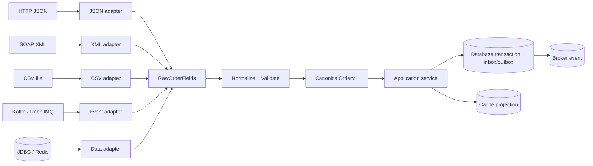
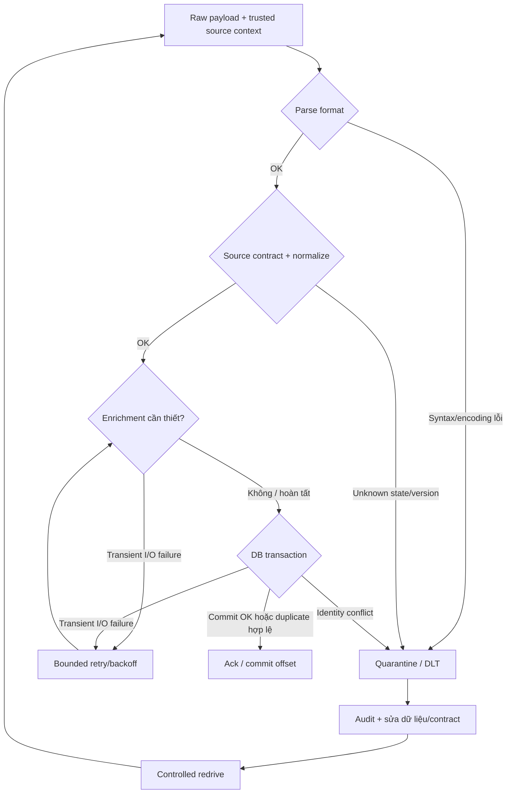

# Chuyển đổi định dạng và chuẩn hóa dữ liệu từ nhiều nguồn

Trong **SPRING_BOOT_INTEGRATION**, một đơn hàng có thể đi vào hệ thống qua REST JSON, SOAP/XML, tệp CSV, bảng cơ sở dữ liệu, message Kafka/RabbitMQ hoặc bản ghi trong Redis. Mỗi nguồn dùng tên trường, kiểu dữ liệu, múi giờ và quy ước trạng thái khác nhau. Nếu mọi service nghiệp vụ phải hiểu trực tiếp từng định dạng, chỉ một thay đổi từ đối tác cũng có thể làm sai thao tác ghi database, cache và phát sự kiện.

Giải pháp không chỉ là *deserialize* thành Java object. Ta cần một **ranh giới hợp đồng dữ liệu (data contract boundary)** để **đọc đúng định dạng → kiểm tra hợp đồng nguồn → ánh xạ sang mô hình chuẩn → chuẩn hóa ngữ nghĩa → kiểm tra bất biến → chuyển cho nghiệp vụ**. Bài thuộc chương **Hợp đồng dữ liệu**, tập trung vào toàn bộ quá trình chuyển đổi và chuẩn hóa, bao gồm cấu hình, lỗi, xử lý trùng, giao dịch, kiểm thử và quan sát trong luồng tích hợp Spring Boot thực tế.

> Các ví dụ hướng đến Java 17+, Spring Boot 3.x, Jackson 2.x, Bean Validation Jakarta và Spring Integration 6.x. Tên artifact và API cụ thể cần đồng bộ theo BOM của phiên bản Spring Boot đang chạy. Dữ liệu đơn hàng trong bài là **ví dụ hư cấu**, không phải schema hoặc endpoint của đối tác thật.

## 1. Mục tiêu học tập

Sau bài này, bạn có thể:

1. Phân biệt **serialization/deserialization**, **transformation**, **normalization**, **validation**, **enrichment** và **schema migration**.
2. Thiết kế DTO riêng cho HTTP JSON, XML, CSV và message broker, tách chúng khỏi entity lưu trữ và mô hình nghiệp vụ chuẩn.
3. Chuẩn hóa định danh, Unicode, trạng thái, mã tiền tệ, số tiền, thời gian và các giá trị thiếu mà **không tự đoán dữ liệu**.
4. Đọc JSON/XML/CSV qua Jackson và xây adapter theo từng nguồn trong Spring Boot.
5. Tổ chức các bước parse/map/validate theo một pipeline minh bạch, test được và tái sử dụng trong Spring Integration.
6. Kiểm soát compatibility giữa phiên bản hợp đồng, dữ liệu chưa biết, sai schema và luồng dead-letter/quarantine.
7. Bảo vệ tính đúng đắn khi duplicate/retry qua HTTP, DB, cache và message broker.
8. Xây bộ kiểm thử ánh xạ đa nguồn, quan sát lỗi dữ liệu và triển khai thay đổi contract an toàn.

## 2. Vì sao nhiều nguồn cùng nói về một đơn hàng nhưng không giống nhau?

Giả sử ba đối tác gửi về *cùng nội dung nghiệp vụ* “đơn hàng ORD-42 đã thanh toán 125 USD”, nhưng cấu trúc khác nhau.

**Nguồn A — HTTP JSON:**

```json
{
  "event_id": "evt-42",
  "order_id": "ORD-42",
  "customer_id": "CUS-9",
  "total": "125.00",
  "currency": "USD",
  "occurred_at": "2026-11-20T10:30:00Z",
  "status": "paid"
}
```

**Nguồn B — SOAP adapter trích XML payload:**

```xml
<PartnerOrder>
  <EventId>evt-42</EventId>
  <OrderNo>ORD-42</OrderNo>
  <CustomerCode>CUS-9</CustomerCode>
  <Amount>125.00</Amount>
  <Currency>USD</Currency>
  <OccurredAt>2026-11-20T17:30:00+07:00</OccurredAt>
  <State>SETTLED</State>
</PartnerOrder>
```

**Nguồn C — một dòng CSV:**

```csv
event_id,order_no,customer_code,amount,currency,occurred_at,state
evt-42,ORD-42,CUS-9,125.00,USD,2026-11-20T10:30:00Z,S
```

| Ý nghĩa nghiệp vụ | JSON A | XML B | CSV C | Quy ước chuẩn |
| --- | --- | --- | --- | --- |
| ID của message/event | `event_id` | `EventId` | `event_id` | `externalEventId` |
| ID đơn hàng | `order_id` | `OrderNo` | `order_no` | `externalOrderId` |
| Khách hàng | `customer_id` | `CustomerCode` | `customer_code` | `customerRef` |
| Số tiền | `total` là string | `Amount` là text | `amount` là text | `BigDecimal` đã kiểm tra scale |
| Tiền tệ | `USD` | `USD` | `USD` | Mã ISO 4217 được allowlist |
| Thời điểm | `...10:30:00Z` | `...17:30:00+07:00` | `...10:30:00Z` | `Instant` UTC |
| Trạng thái | `paid` | `SETTLED` | `S` | `PAID` trong enum nghiệp vụ |

Hai timestamp ở JSON và XML biểu diễn **cùng một thời điểm**, nhưng không phải cùng chuỗi. `"S"` của CSV có nghĩa `PAID` **chỉ khi** đặc tả nguồn C quy định như vậy; không được suy đoán chữ S luôn là “success”.

Và còn một điều quan trọng: ba nguồn có thể mô tả cùng một đơn hàng, **nhưng không mặc nhiên là cùng một sự kiện đáng tin cậy**. `externalEventId="evt-42"` chỉ duy nhất trong phạm vi mà nhà cung cấp cam kết. Khóa chống trùng thường phải kết hợp **nguồn + event ID** hoặc một business key đã được chuẩn hóa có chứng minh tương đương giữa các nguồn.

### 2.1. Pipeline chuẩn hóa đúng trách nhiệm



Luồng **không** nhằm biến mọi nguồn thành một JSON khổng lồ. Mỗi adapter chịu trách nhiệm cú pháp/hợp đồng của nguồn mình, sau đó đưa về **mô hình nội bộ nhỏ, có tên và ngữ nghĩa ổn định**. Service không cần biết `Amount`, `total` hay `amount` là tên trường từ nguồn nào.

## 3. Tách sáu công việc thường bị gọi chung là “mapping”

| Công việc | Câu hỏi cần trả lời | Ví dụ |
| --- | --- | --- |
| **Decode/deserialize** | Bytes thuộc format gì và có parse được không? | UTF-8 JSON → `JsonOrderDto`; XML → `XmlOrderDto`. |
| **Source validation** | Message có tuân theo contract nhà cung cấp không? | JSON `order_id` bắt buộc; CSV đủ cột, schema version được hỗ trợ. |
| **Transformation** | Tên/trường/cấu trúc ánh xạ ra sao? | `OrderNo` → `externalOrderId`. |
| **Normalization** | Các giá trị tương đương được biểu diễn thống nhất thế nào? | `SETTLED`, `paid`, `S` → `PAID`; offset time → UTC. |
| **Canonical validation** | Bất biến nội bộ nào phải luôn đúng? | Số tiền dương, currency hợp lệ, ID không rỗng, timestamp có offset. |
| **Enrichment** | Có cần dữ liệu ngoài message để hoàn chỉnh nghiệp vụ? | Đọc bảng mapping customer hoặc Redis cache có TTL. |

**Serialization** là hướng ngược lại khi chuẩn bị xuất dữ liệu từ Java object sang JSON/XML/Avro/Protobuf hoặc ghi document/cache. Không dùng serializer như “định nghĩa domain”: việc một Java field dễ serialize không đồng nghĩa nó được phép xuất ra mọi kênh.

**Enrichment không phải normalization thuần túy.** Normalize nên càng deterministic và không I/O càng tốt: với cùng raw input và quy tắc phiên bản, nó cho cùng output. Gọi API khách hàng hoặc database để điền email sau khi normalize là một bước riêng, có timeout/retry/consistency của nguồn enrichment.

**Schema migration/upcasting** còn khác nữa: nếu một event cũ thiếu trường mới hoặc mang cấu trúc phiên bản cũ, phải có phép chuyển đổi **được version hóa** trước khi đưa vào canonical model. Đừng tự cho mọi field mới `null` rồi bỏ qua những thay đổi semantic bắt buộc.

### 3.1. Những thứ không nên âm thầm sửa

- **Không** biến tất cả chuỗi sai trạng thái thành `UNKNOWN` rồi cho thanh toán tiếp.
- **Không** gán `Instant.now()` cho timestamp nguồn bị thiếu nếu yêu cầu order theo event time.
- **Không** parse tiền `125,00` với ngôn ngữ server JVM mặc định mà chưa biết nguồn dùng dấu phẩy thập phân hay phân tách hàng nghìn.
- **Không** chuyển `double` sang `BigDecimal` cho số tiền chính xác khi đã mất precision.
- **Không** dùng `String.trim()` và uppercase mọi ID nếu định danh phía đối tác phân biệt hoa/thường hoặc whitespace có ý nghĩa.
- **Không** tự loại bỏ duplicate bằng cache trong bộ nhớ khi consumer chạy nhiều pods.

Nếu dữ liệu không thể chuẩn hóa theo **quy tắc đã được hợp đồng thừa nhận**, hãy phân loại lỗi contract và quarantine, không “cứ đoán rồi lưu”.

## 4. Thiết kế canonical contract trước khi viết adapter

Mô hình chuẩn phải biểu diễn **ý nghĩa của hệ thống mình**, không bê nguyên entity JPA/Mongo, XML XSD hay class generated bởi gRPC vào domain. Ví dụ:

```java
import java.math.BigDecimal;
import java.time.Instant;

public record CanonicalOrderV1(
        String sourceSystem,
        String externalEventId,
        String externalOrderId,
        String customerRef,
        BigDecimal amount,
        String currency,
        Instant occurredAt,
        OrderState state,
        int schemaVersion
) {}

public enum OrderState {
    NEW, PAID, CANCELLED
}
```

Hai `public` types được đặt trong **hai file Java riêng** khi đưa vào dự án. Mô hình trên chỉ là **command/event canonical** tối giản; thực tế có thể cần tenant ID, tax, line items, rounding policy, merchant account, legal entity và provenance. Đừng gộp những khái niệm khác nhau như `receivedAt` và `occurredAt` chỉ vì cùng là `Instant`.

### 4.1. Contract của từng trường

| Trường | Quy tắc mẫu | Không được ngầm hiểu |
| --- | --- | --- |
| `sourceSystem` | Một mã nguồn ổn định do server-side adapter cấp | HTTP client không được tự chọn bất kỳ nguồn tùy ý. |
| `externalEventId` | ID event theo contract nguồn, không rỗng, độ dài giới hạn | Không tự duy nhất giữa hai nguồn khác nhau. |
| `externalOrderId` | ID đơn hàng **raw đã được kiểm tra**, chỉ biến đổi có thỏa thuận | Không lowercase/strip dấu tùy tiện. |
| `customerRef` | Khóa khách hàng hoặc mã ánh xạ, không phải hồ sơ PII | Có thể cần bảng identity mapping riêng. |
| `amount` | `BigDecimal`, không phải `double`; scale theo tiền tệ | Số tiền âm/zero chỉ hợp lệ theo loại nghiệp vụ đã định nghĩa. |
| `currency` | Mã tiền tệ được allowlist và chuẩn hóa uppercase có kiểm soát | Không mặc định mọi mã ba chữ là currency hợp lệ. |
| `occurredAt` | Thời điểm thực có offset/timezone rõ, chuẩn `Instant` | Không tự lấy thời gian máy app khi input thiếu. |
| `state` | Enum nghiệp vụ từ bảng ánh xạ **theo nguồn** | Mỗi chữ viết tắt có cùng nghĩa ở mọi hệ thống. |
| `schemaVersion` | Phiên bản hợp đồng canonical | Không dùng số này thay cho Kafka offset hay DB row version. |

### 4.2. Metadata provenance phải được giữ ở đâu?

Một ingestion pipeline thường cần thêm **transport provenance**:

```text
sourceSystem       = partner-csv
sourceContract     = partner-order-csv-v2
externalEventId    = evt-42
brokerTopic        = orders.inbound.v2 (nếu nhận từ Kafka)
brokerPartition    = 3
brokerOffset       = 9182
fileName           = exports/2026-11-20/orders.csv (nếu nhập file)
lineNumber         = 42
receivedAt         = thời điểm adapter nhận message
correlationId      = ID phục vụ trace
```

Các trường này **không phải tất cả field của canonical order**. Có thể lưu trong một `IngestionContext`/audit record tách khỏi domain payload, giới hạn retention và quyền đọc. Offset/line number giúp điều tra hoặc replay, nhưng **không tự làm khóa idempotency liên nguồn**; file có thể được tải lại dưới tên khác, Kafka partition có thể thay đổi khi repartition và cùng sự kiện nghiệp vụ có thể xuất hiện qua nhiều kênh.

### 4.3. Canonical model không phải “hợp đồng vĩnh viễn”

Canonical model cũng có phiên bản. Khi cần đổi `amount` từ “đơn vị lớn” sang “minor units”, đó có thể là **breaking semantic change** dù tên field không đổi. Hãy định nghĩa version, quy trình chuyển đổi và consumer compatibility. Nên tránh một “universal DTO” hàng trăm field null cho mọi loại message; điều đó dễ tạo ambiguity, thiếu validation và coupling giữa các workflow không liên quan.

## 5. Chuẩn hóa ngữ nghĩa: xây quy tắc trước khi viết `String.replace`

Chuẩn hóa (normalization) cần **quy tắc theo trường và theo nguồn**, không phải một hàm chung “trim, lowercase, parse, done”. Hai giá trị trông giống nhau chưa chắc tương đương theo hợp đồng.

### 5.1. Chuỗi và Unicode

| Loại dữ liệu | Quy tắc mẫu | Lưu ý |
| --- | --- | --- |
| Business ID | Giữ nguyên hoa/thường; reject khoảng trắng thừa nếu spec cấm | `ORD-A` và `ord-a` có thể là hai đơn khác nhau. |
| Tên người hiển thị | Unicode NFC, có thể chuẩn hóa whitespace theo contract | Không bỏ dấu tiếng Việt hoặc case-fold như khóa định danh tùy tiện. |
| Mã tiền tệ | Uppercase bằng `Locale.ROOT`, kiểm tra allowlist | Chỉ chấp nhận lowercase nếu source spec cho phép. |
| Enum/trạng thái nguồn | Ánh xạ explicit per-source | Không đoán `S` là `SUCCESS` hay `SHIPPED`. |
| Email | Parse/validate theo nhu cầu, giữ raw và canonical khi cần | Local-part của email có những quy tắc case/Unicode không nên suy đơn giản. |
| Số điện thoại | Chuẩn hóa E.164 nếu có country context đáng tin cậy | Không suy quốc gia chỉ theo locale của JVM. |
| Địa chỉ/đơn vị | Có thể cần mapping reference data riêng | Không gộp `kg` và `g` nếu không chuyển đổi quantity. |

Ví dụ hai chuỗi Unicode có thể **hiển thị giống** nhưng biểu diễn bằng mã code point khác. Java hỗ trợ `java.text.Normalizer`:

```java
import java.text.Normalizer;

public static String normalizeDisplayName(String value) {
    if (value == null) {
        return null;
    }
    return Normalizer.normalize(value, Normalizer.Form.NFC);
}
```

**Đừng áp hàm này vô điều kiện lên ID, chữ ký HMAC hay raw payload dùng kiểm chứng chữ ký.** Một giá trị bytes đã được ký có thể thay đổi nếu normalize trước khi verify. Đầu tiên xác minh raw representation theo giao thức, sau đó chuẩn hóa field nghiệp vụ theo policy.

### 5.2. Tiền tệ và số thập phân

Tiền **không** nên đi qua `double` để rồi chuyển lại thành `BigDecimal`. Giữ raw decimal string:

```text
"125.00" -> BigDecimal("125.00")
"125,00" -> chỉ hợp lệ nếu profile nguồn quy định decimal comma
"1,250"  -> có thể là 1250 hoặc 1.250 tùy locale; KHÔNG tự đoán
125.0    -> JSON number; phải xác định contract về precision
```

Quy tắc mẫu của bài:

1. Mỗi nguồn gửi **decimal text** dùng dấu chấm, không chứa thousands separators hay ký hiệu tiền.
2. `amount` phải lớn hơn 0 cho event tạo đơn hàng. Refund/chargeback là **loại nghiệp vụ khác**.
3. `currency` trong allowlist `USD` và `VND` của hệ thống ví dụ; quy tắc theo ISO 4217.
4. `USD` có hai chữ số thập phân mặc định, `VND` không có chữ số lẻ; không **làm tròn âm thầm** số tiền lệch scale.
5. Khi truyền sang database, JDBC dùng kiểu `NUMERIC/DECIMAL` phù hợp; khi truyền JSON, converter/serializer giữ precision đã quy định.

Ví dụ: `"125.000"` của USD có thể chuẩn hóa về `125.00` nếu chỉ có trailing zeros, nhưng `"125.005"` phải bị từ chối hoặc đi qua **quy tắc làm tròn được hợp đồng cho phép**, không tự chọn `HALF_UP`.

### 5.3. Thời điểm và timezone

`2026-11-20T10:30:00Z` và `2026-11-20T17:30:00+07:00` là **cùng một `Instant`**. Ngược lại, `2026-11-20 10:30:00` không có offset; không thể biết nó là UTC hay giờ Việt Nam nếu nguồn không nói.

| Kiểu thời gian | Có thể chuẩn hóa ngay? | Chính sách |
| --- | --- | --- |
| ISO-8601 với `Z` | Có | Parse thành `Instant`. |
| ISO-8601 có offset `+07:00` | Có | Parse thành `OffsetDateTime` rồi `toInstant()`. |
| Local date-time không timezone | **Không tự động** | Cần vùng múi giờ được cấu hình cho nguồn và xử lý DST ambiguity. |
| Epoch milliseconds | Có nếu **đơn vị được công bố** | Phân biệt milli và seconds, kiểm tra khoảng hợp lệ. |
| Ngày `2026-11-20` | Không phải thời điểm duy nhất | Dùng `LocalDate` nếu nghiệp vụ cần ngày; không ép thành UTC midnight tùy tiện. |
| Thời điểm nhận message | Khác event time | Ghi riêng `receivedAt` cho audit, không thay `occurredAt`. |

Nếu một đối tác cung cấp `Asia/Ho_Chi_Minh` trong cấu hình contract, có thể diễn giải local date-time theo vùng đó **sau khi kiểm soát dữ liệu thiếu/sai**. Với vùng có daylight saving time, một local time có thể **không tồn tại** hoặc xuất hiện hai lần; quy tắc xử lý phải được định nghĩa rõ, không chọn offset theo default JVM.

### 5.4. `null`, thiếu trường, rỗng và default

Đây là bốn tình huống khác nhau:

```json
{}
```

```json
{"customer_id": null}
```

```json
{"customer_id": ""}
```

```json
{"customer_id": "CUS-9"}
```

Với event tạo đơn hàng của ví dụ, ba trường hợp đầu **không hợp lệ**. Nhưng với PATCH cập nhật thông tin khách hàng, “thiếu trường” có thể mang nghĩa **giữ nguyên**, còn `null` có thể mang nghĩa **xóa dữ liệu**. Một Java record có trường `String` nullable không tự phân biệt **missing** với **explicit null**; với PATCH hoặc merge semantics, dùng mô hình field-presence riêng (ví dụ JsonNode/presence wrapper) và quy định rõ.

## 6. Dependencies và cấu hình Spring Boot cho ingestion đa định dạng

Tùy loại nguồn, Spring Boot cung cấp những module khác nhau. Không cần thêm mọi starter chỉ vì dự án có chữ “integration”.

```groovy
dependencies {
    // HTTP JSON request handling nếu có REST endpoint.
    implementation 'org.springframework.boot:spring-boot-starter-web'

    // Jakarta Bean Validation (@Valid, @NotBlank, @NotNull...).
    implementation 'org.springframework.boot:spring-boot-starter-validation'

    // Chỉ thêm khi đọc XML và CSV.
    implementation 'com.fasterxml.jackson.dataformat:jackson-dataformat-xml'
    implementation 'com.fasterxml.jackson.dataformat:jackson-dataformat-csv'

    // Khi dùng Spring Integration Message/Transformer/IntegrationFlow.
    implementation 'org.springframework.boot:spring-boot-starter-integration'

    testImplementation 'org.springframework.boot:spring-boot-starter-test'
}
```

Với Maven, dùng cùng artifact IDs và `dependencyManagement` từ Spring Boot BOM. Với Kafka/RabbitMQ/JDBC/Redis, thêm **starter/driver phù hợp đúng adapter** khi thực sự dùng: `spring-kafka`, `spring-boot-starter-amqp`, `spring-boot-starter-data-jdbc`/JDBC, `spring-boot-starter-data-redis`, v.v. Parser JSON/XML/CSV chỉ giải quyết **format**, không tự tạo broker consumer, transaction SQL hoặc Redis cache policy.

### 6.1. Boot auto-configuration không thay hợp đồng nguồn

| Thành phần | Boot/Jackson có thể giúp | Ứng dụng vẫn phải kiểm soát |
| --- | --- | --- |
| `ObjectMapper` JSON | Mapping JSON ↔ Java, Jackson modules theo cấu hình | Field names, unknown fields, coercion, schema/version, validation. |
| HTTP `HttpMessageConverter` | Tự parse request body theo media type hỗ trợ | Kích thước body, auth, content type, controller DTO và lỗi 400. |
| `XmlMapper`/CSV mapper | Đọc cấu trúc XML và bảng CSV khi dependency có mặt | Secure XML parser, delimiter/header/encoding/locale, schema nguồn. |
| Spring Integration | Channel, transformer, error handling, adapters | Mapping semantics, ack/rollback, idempotency, dead-letter. |
| Validation infrastructure | Chạy Jakarta Bean Validation khi được gọi đúng chỗ | Phân biệt source validation và canonical invariants. |

Khi thêm Jackson XML vào một ứng dụng có nhiều `HttpMessageConverter`, hãy xác minh **content negotiation** theo `Content-Type`; đừng dựa vào “classpath có XML mapper nên mọi HTTP input chắc chắn được xử lý đúng”. JSON events từ broker có thể dùng deserializer khác Jackson MVC; cấu hình chúng phải được kiểm tra riêng.

### 6.2. Cấu hình chính sách theo nguồn

```yaml
app:
  ingestion:
    sources:
      partner-json:
        contract-version: 1
        max-payload-bytes: 262144
      partner-xml:
        contract-version: 2
        max-payload-bytes: 262144
      partner-csv:
        contract-version: 1
        charset: UTF-8
        delimiter: ","
        max-file-bytes: 10485760
```

Đây là **namespace ứng dụng tự định nghĩa**, không phải properties được Boot tự hiểu và tự áp kích thước payload. Bạn phải tạo `@ConfigurationProperties`/validation và enforce đúng trên HTTP server, file reader, broker adapter và parser. `max-payload-bytes` giúp tránh tệp/payload quá lớn, nhưng còn cần giới hạn số dòng, độ dài field, nesting depth và tổng thời gian parse.

**Không** đặt URL đích, đường dẫn file hoặc chọn source schema từ một tham số HTTP không tin cậy mà chưa allowlist. Tham số cấu hình theo môi trường khác với dữ liệu từ caller, và phải có owner rõ ràng.

## 7. Đặt DTO riêng cho từng format: không dùng một class “đủ mọi annotation”

Một DTO nhận JSON không nên buộc phải biết tên XML `OrderNo`, định dạng CSV `order_no` và tên cột SQL `order_number`. Các lớp nguồn giữ vai trò **chuyển tải bên ngoài**, sau đó adapter map thành một intermediate object với tên field chung.

### 7.1. JSON DTO dùng Jackson

```java
import com.fasterxml.jackson.annotation.JsonProperty;

public record JsonOrderDto(
        @JsonProperty("event_id") String eventId,
        @JsonProperty("order_id") String orderId,
        @JsonProperty("customer_id") String customerId,
        @JsonProperty("total") String total,
        @JsonProperty("currency") String currency,
        @JsonProperty("occurred_at") String occurredAt,
        @JsonProperty("status") String status
) {}
```

Trong ví dụ, `total` là `String` theo contract JSON A, **không** để Jackson tự coercion mọi kiểu thành `BigDecimal`. Nếu đối tác gửi JSON number `125.005` hoặc `null` thay vì string, cần kiểm tra **chính sách deserialization**; đừng mặc định ObjectMapper của MVC và Kafka đang dùng cùng coercion settings.

### 7.2. XML DTO chỉ giữ các element cần thiết

```java
import com.fasterxml.jackson.dataformat.xml.annotation.JacksonXmlProperty;
import com.fasterxml.jackson.dataformat.xml.annotation.JacksonXmlRootElement;

@JacksonXmlRootElement(localName = "PartnerOrder")
public record XmlOrderDto(
        @JacksonXmlProperty(localName = "EventId") String eventId,
        @JacksonXmlProperty(localName = "OrderNo") String orderNo,
        @JacksonXmlProperty(localName = "CustomerCode") String customerCode,
        @JacksonXmlProperty(localName = "Amount") String amount,
        @JacksonXmlProperty(localName = "Currency") String currency,
        @JacksonXmlProperty(localName = "OccurredAt") String occurredAt,
        @JacksonXmlProperty(localName = "State") String state
) {}
```

Đây là **payload XML đã được trích từ SOAP envelope**, không phải nguyên thông điệp SOAP. Nếu endpoint thực dùng SOAP, hợp đồng còn gồm XML namespace, SOAP Header/Fault, XSD, phiên bản envelope và WS-Security. Không parse SOAP envelope thô thành `XmlOrderDto` rồi giả định đã xử lý chữ ký hoặc authentication.

### 7.3. CSV có header và nhiều dòng

CSV **không tự khai báo schema kiểu dữ liệu**. `order_no` có thể nhìn giống một số, nhưng phải giữ như string nếu leading zeros có ý nghĩa. Thêm nữa, CSV khác nhau ở delimiter, quote, escape, newline (kể cả newline trong quoted field), BOM và charset:

```csv
event_id,order_no,customer_code,amount,currency,occurred_at,state
evt-42,ORD-42,CUS-9,125.00,USD,2026-11-20T10:30:00Z,S
evt-43,"ORD,43",CUS-10,15.50,USD,2026-11-20T10:31:00Z,S
```

Đừng dùng `line.split(",")`: `"ORD,43"` vẫn chỉ là **một field**. Hãy dùng CSV parser hỗ trợ quoting và đọc records theo stream. Parser cần xác minh header bắt buộc, cột không mong muốn, số cột, duplicate header names, kích thước file và line/record number để quarantine chính xác.

## 8. Tầng adapter: giải mã nguồn rồi ánh xạ sang intermediate DTO

Ta dùng một record nội bộ chỉ chứa những **raw fields dạng text** đã được parser đọc đúng cú pháp. Record này chưa phải canonical object và chưa bảo đảm các giá trị có nghĩa.

```java
public record RawOrderFields(
        String eventId,
        String orderId,
        String customerRef,
        String amount,
        String currency,
        String occurredAt,
        String state
) {}
```

Chọn loại nguồn bằng **thông tin adapter đã được cấu hình**, không tin một `sourceSystem` tự khai báo trong payload:

```java
public enum OrderSource {
    PARTNER_JSON,
    PARTNER_XML,
    PARTNER_CSV
}
```

### 8.1. Mapping JSON, XML vào cùng hình dạng raw

```java
public final class SourceOrderMappers {
    private SourceOrderMappers() {}

    public static RawOrderFields fromJson(JsonOrderDto dto) {
        return new RawOrderFields(
                dto.eventId(), dto.orderId(), dto.customerId(),
                dto.total(), dto.currency(), dto.occurredAt(), dto.status());
    }

    public static RawOrderFields fromXml(XmlOrderDto dto) {
        return new RawOrderFields(
                dto.eventId(), dto.orderNo(), dto.customerCode(),
                dto.amount(), dto.currency(), dto.occurredAt(), dto.state());
    }
}
```

Hai hàm này chỉ **đổi tên và sắp xếp trường**. Không validate số tiền trong `fromJson` rồi lặp một quy tắc khác trong `fromXml`: mỗi nguồn nên có source validation, sau đó phần canonical normalization dùng chung những quy tắc đã được định nghĩa.

### 8.2. JSON parser với quy tắc unknown-field tường minh

```java
import com.fasterxml.jackson.core.JsonProcessingException;
import com.fasterxml.jackson.databind.DeserializationFeature;
import com.fasterxml.jackson.databind.ObjectMapper;
import com.fasterxml.jackson.databind.ObjectReader;
import org.springframework.stereotype.Component;

@Component
public final class JsonOrderAdapter {
    private final ObjectReader reader;

    public JsonOrderAdapter(ObjectMapper mapper) {
        this.reader = mapper
                .readerFor(JsonOrderDto.class)
                .with(DeserializationFeature.FAIL_ON_UNKNOWN_PROPERTIES);
    }

    public RawOrderFields decode(String payload) {
        try {
            return SourceOrderMappers.fromJson(
                    reader.readValue(payload));
        } catch (JsonProcessingException error) {
            throw new SourceDecodeException(
                    "Invalid partner JSON payload", error);
        }
    }
}
```

`FAIL_ON_UNKNOWN_PROPERTIES` là **policy ví dụ**: đối tác A v1 không được gửi field ngoài schema. Với forward-compatible contracts, có thể cho phép unknown fields và **vẫn validate những trường bắt buộc**. Đừng bật/tắt một cờ Jackson cho toàn hệ thống khi API A cần strict còn webhook B phải chịu được field bổ sung.

**Lưu ý:** unknown-field kiểm soát schema ở mức key, không tự cấm coercion như JSON number → Java `String` trong mọi cấu hình. Nếu contract đòi chính xác JSON token type, hãy thêm schema/token validation hoặc Jackson coercion policy riêng và integration test với `{"total":125.00}`, `{"total":true}`, `{"total":null}`.

### 8.3. XML parsing phải có chính sách chống XXE

XML có những khái niệm ngoài JSON: DTD, entity expansion, external entities, namespaces và XSD. Một XML parser có quyền truy cập network/file không được phép tự fetch tài nguyên ngoài chỉ vì payload chứa `DOCTYPE`.

Ví dụ helper tạo StAX parser đã **vô hiệu DTD/external entity resolution**, sau đó chuyển cho Jackson:

```java
import com.fasterxml.jackson.dataformat.xml.XmlMapper;
import java.io.StringReader;
import javax.xml.stream.XMLInputFactory;
import javax.xml.stream.XMLStreamReader;
import org.springframework.stereotype.Component;

@Component
public final class XmlOrderAdapter {
    private final XmlMapper mapper = new XmlMapper();

    public RawOrderFields decode(String xmlPayload) {
        XMLInputFactory factory = XMLInputFactory.newFactory();
        factory.setProperty(XMLInputFactory.SUPPORT_DTD, false);
        factory.setProperty(
                XMLInputFactory.IS_SUPPORTING_EXTERNAL_ENTITIES, false);

        try (StringReader input = new StringReader(xmlPayload)) {
            XMLStreamReader reader =
                    factory.createXMLStreamReader(input);
            try {
                XmlOrderDto dto = mapper.readValue(
                        reader, XmlOrderDto.class);
                return SourceOrderMappers.fromXml(dto);
            } finally {
                reader.close();
            }
        } catch (Exception error) {
            throw new SourceDecodeException(
                    "Invalid partner XML payload", error);
        }
    }
}
```

Đây là ví dụ về **đặt secure parser boundary**, không phải một lời khẳng định đủ chống mọi XML denial-of-service. Production cần enforce tổng bytes, số node/depth, thời gian parse, entity limits của provider và validate namespace/XSD khi contract yêu cầu. Nếu StAX provider không hỗ trợ một security property, **fail closed** và kiểm thử theo JDK/XML parser thực. Đối với SOAP có chữ ký hoặc WS-Security, verify chữ ký/chứng thực **trước khi chấp nhận payload nghiệp vụ**, theo thứ tự và thư viện chuyên dụng phù hợp.

### 8.4. CSV parser dùng schema header và record mapping

```java
import com.fasterxml.jackson.core.type.TypeReference;
import com.fasterxml.jackson.dataformat.csv.CsvMapper;
import com.fasterxml.jackson.dataformat.csv.CsvSchema;
import com.fasterxml.jackson.databind.MappingIterator;
import java.io.IOException;
import java.io.Reader;
import java.util.ArrayList;
import java.util.List;
import java.util.Map;

public final class CsvOrderAdapter {
    private final CsvMapper mapper = new CsvMapper();
    private final CsvSchema schema = CsvSchema.emptySchema().withHeader();

    public List<RawOrderFields> decode(Reader input, int maxRecords)
            throws IOException {

        if (maxRecords < 1 || maxRecords > 10000) {
            throw new IllegalArgumentException("Invalid CSV limit");
        }

        var reader = mapper
                .readerFor(new TypeReference<Map<String, String>>() {})
                .with(schema);

        List<RawOrderFields> orders = new ArrayList<>();

        try (MappingIterator<Map<String, String>> rows =
                     reader.readValues(input)) {
            while (rows.hasNextValue()) {
                if (orders.size() >= maxRecords) {
                    throw new SourceDecodeException(
                            "CSV record limit exceeded");
                }
                Map<String, String> row = rows.nextValue();
                orders.add(new RawOrderFields(
                        row.get("event_id"),
                        row.get("order_no"),
                        row.get("customer_code"),
                        row.get("amount"),
                        row.get("currency"),
                        row.get("occurred_at"),
                        row.get("state")));
            }
        }
        return orders;
    }
}
```

Code này minh họa **CSV quoting + header projection + record limit**. Để triển khai production, cần kiểm tra header **đủ và không trùng tên**, cột thừa/thiếu, charset/BOM, delimiter, record number, kích thước từng field; tránh gom file lớn vào `List` dù đã giới hạn. Chuyển từng record qua normalization/validation và xử lý theo batch/paging/chunk có checkpoint nếu đồng bộ file lớn. `maxRecords` giới hạn theo application policy, không thay giới hạn kích thước bytes ở stream input.

Nếu một nguồn đổi delimiter từ comma sang semicolon hoặc dùng encoding `Windows-1258`, adapter phải biết điều đó từ **source contract/config**, không tự đoán và sửa mọi tệp bằng heuristic dễ làm sai dữ liệu.

### 8.5. Exception ở ranh giới decode

```java
public class SourceDecodeException extends RuntimeException {
    public SourceDecodeException(String safeMessage) {
        super(safeMessage);
    }

    public SourceDecodeException(
            String safeMessage, Throwable cause) {
        super(safeMessage, cause);
    }
}
```

Lỗi này nghĩa là **không đọc được format/cấu trúc nguồn**; nó khác lỗi **giá trị hợp lệ về cú pháp nhưng sai semantic**. Không trả toàn raw XML/JSON/CSV, token hoặc PII trong HTTP error; exception cause chỉ được đưa vào log nội bộ với redaction và retention policy.

## 9. Một normalizer dùng chung, có quy tắc theo nguồn

Phần này biến `RawOrderFields` thành `CanonicalOrderV1` bằng các quy tắc **deterministic**. Việc ánh xạ state vẫn theo từng nguồn; money/instant/ID được kiểm tra theo canonical policy.

### 9.1. Mã Java cho normalizer

```java
import java.math.BigDecimal;
import java.math.RoundingMode;
import java.time.OffsetDateTime;
import java.time.format.DateTimeParseException;
import java.util.Currency;
import java.util.Locale;
import java.util.Map;
import java.util.Set;
import java.util.regex.Pattern;
import org.springframework.stereotype.Component;

@Component
public final class OrderNormalizer {
    private static final Pattern BUSINESS_ID =
            Pattern.compile("[A-Za-z0-9._:-]{1,128}");
    private static final Pattern DECIMAL =
            Pattern.compile("[0-9]{1,16}(?:\\.[0-9]{1,6})?");
    private static final Set<String> ALLOWED_CURRENCIES =
            Set.of("USD", "VND");

    public CanonicalOrderV1 normalize(
            OrderSource source, RawOrderFields raw) {

        if (source == null || raw == null) {
            throw new ContractViolationException("Missing source or data");
        }
        String currency = canonicalCurrency(raw.currency());
        BigDecimal amount = canonicalAmount(raw.amount(), currency);

        return new CanonicalOrderV1(
                source.name(),
                requiredBusinessId(raw.eventId(), "eventId"),
                requiredBusinessId(raw.orderId(), "orderId"),
                requiredBusinessId(raw.customerRef(), "customerRef"),
                amount,
                currency,
                canonicalInstant(raw.occurredAt()),
                canonicalState(source, raw.state()),
                1);
    }

    private static String requiredBusinessId(
            String value, String field) {
        if (value == null
                || !BUSINESS_ID.matcher(value).matches()) {
            throw new ContractViolationException(
                    "Invalid " + field);
        }
        // Giữ nguyên case/whitespace semantic, không tự trim.
        return value;
    }

    private static String canonicalCurrency(String raw) {
        if (raw == null) {
            throw new ContractViolationException("Missing currency");
        }
        String code = raw.toUpperCase(Locale.ROOT);
        if (!ALLOWED_CURRENCIES.contains(code)) {
            throw new ContractViolationException("Unsupported currency");
        }
        return code;
    }

    private static BigDecimal canonicalAmount(
            String raw, String currency) {
        if (raw == null || !DECIMAL.matcher(raw).matches()) {
            throw new ContractViolationException("Invalid amount format");
        }
        try {
            BigDecimal parsed = new BigDecimal(raw);
            if (parsed.signum() <= 0) {
                throw new ContractViolationException(
                        "Amount must be positive");
            }
            int digits = Currency.getInstance(currency)
                    .getDefaultFractionDigits();
            if (digits < 0) {
                throw new ContractViolationException(
                        "Currency has no supported fraction digits");
            }
            return parsed.setScale(digits, RoundingMode.UNNECESSARY);
        } catch (ArithmeticException error) {
            throw new ContractViolationException(
                    "Amount has unsupported fraction digits", error);
        }
    }

    private static java.time.Instant canonicalInstant(
            String raw) {
        if (raw == null) {
            throw new ContractViolationException("Missing occurredAt");
        }
        try {
            return OffsetDateTime.parse(raw).toInstant();
        } catch (DateTimeParseException error) {
            throw new ContractViolationException(
                    "Invalid occurredAt offset date-time", error);
        }
    }

    private static OrderState canonicalState(
            OrderSource source, String raw) {
        if (raw == null) {
            throw new ContractViolationException("Missing state");
        }
        return switch (source) {
            case PARTNER_JSON -> switch (raw) {
                case "new" -> OrderState.NEW;
                case "paid" -> OrderState.PAID;
                case "cancelled" -> OrderState.CANCELLED;
                default -> throw new ContractViolationException(
                        "Unknown JSON state");
            };
            case PARTNER_XML -> switch (raw) {
                case "CREATED" -> OrderState.NEW;
                case "SETTLED" -> OrderState.PAID;
                case "VOID" -> OrderState.CANCELLED;
                default -> throw new ContractViolationException(
                        "Unknown XML state");
            };
            case PARTNER_CSV -> switch (raw) {
                case "N" -> OrderState.NEW;
                case "S" -> OrderState.PAID;
                case "C" -> OrderState.CANCELLED;
                default -> throw new ContractViolationException(
                        "Unknown CSV state");
            };
        };
    }
}
```

```java
public class ContractViolationException extends RuntimeException {
    public ContractViolationException(String message) {
        super(message);
    }

    public ContractViolationException(
            String message, Throwable cause) {
        super(message, cause);
    }
}
```

**Điều được bảo đảm ở ví dụ:**

- Ba trạng thái `paid`, `SETTLED`, `S` cùng thành `OrderState.PAID` **nhờ bảng mapping được công bố**, không nhờ lowercase/substring chung.
- Hai chuỗi thời gian `10:30Z` và `17:30+07:00` cùng tạo `Instant`, không phụ thuộc timezone máy chạy Java.
- `125.00 USD` thành `BigDecimal("125.00")`; một lượng có fraction digits không được phép bị **reject**, không làm tròn ngầm.
- ID `ORD-42` giữ nguyên case; ID có whitespace, ký tự ngoài contract mẫu hoặc độ dài vượt giới hạn bị reject.
- Hàm không gọi HTTP/DB/cache, không dùng `Instant.now()` và không phụ thuộc locale/timezone mặc định, nên dễ có golden tests và replay.

**Giới hạn quan trọng:** `Currency.getDefaultFractionDigits()` là quy tắc tiền tệ tham khảo, không phải định nghĩa đầy đủ về precision, scale hoặc rounding của **mọi nghiệp vụ**. Có đối tác xử lý minor units, cryptoassets hoặc giá tính theo subunit; contract của chúng cần một `MoneyPolicy` riêng. Java `Currency` cũng phụ thuộc dữ liệu JDK; với hệ thống thanh toán cần pin/kiểm tra chính sách theo cấu hình nghiệp vụ.

### 9.2. Ví dụ chuẩn hóa ba nguồn cùng ý nghĩa

```java
RawOrderFields json = new RawOrderFields(
        "evt-42", "ORD-42", "CUS-9", "125.00", "USD",
        "2026-11-20T10:30:00Z", "paid");

RawOrderFields xml = new RawOrderFields(
        "evt-42", "ORD-42", "CUS-9", "125.00", "USD",
        "2026-11-20T17:30:00+07:00", "SETTLED");

RawOrderFields csv = new RawOrderFields(
        "evt-42", "ORD-42", "CUS-9", "125.00", "USD",
        "2026-11-20T10:30:00Z", "S");

OrderNormalizer n = new OrderNormalizer();
CanonicalOrderV1 a = n.normalize(OrderSource.PARTNER_JSON, json);
CanonicalOrderV1 b = n.normalize(OrderSource.PARTNER_XML, xml);
CanonicalOrderV1 c = n.normalize(OrderSource.PARTNER_CSV, csv);
```

Kết quả có cùng `externalOrderId`, `customerRef`, `amount`, `currency`, `occurredAt` và `state`, nhưng **`sourceSystem` khác nhau có chủ đích**. Khi hệ thống cần nhận diện cùng đơn hàng giữa nhiều nguồn, cần **quy tắc identity resolution đáng tin cậy** (ví dụ bảng ánh xạ external order IDs theo nhà cung cấp), không tự gộp vì các chuỗi trông giống nhau.

## 10. Kiểm tra dữ liệu ở hai lớp: source contract và canonical invariant

Chỉ parse thành Java record chưa có nghĩa dữ liệu hợp lệ. Có hai thời điểm kiểm tra:

1. **Source validation:** JSON A yêu cầu `order_id` có kiểu string, XML B cần `OrderNo` đúng namespace/XSD, CSV C cần header/number of columns và `state` thuộc vocab C.
2. **Canonical validation:** mọi `CanonicalOrderV1` đều có ID được phép, amount dương, currency hợp lệ, timestamp có offset và state domain đã xác định.

Với Spring Boot, Jakarta Bean Validation có thể diễn đạt những invariant đơn giản:

```java
import jakarta.validation.constraints.NotBlank;
import jakarta.validation.constraints.NotNull;
import jakarta.validation.constraints.Positive;
import java.math.BigDecimal;
import java.time.Instant;

public record ValidatedOrderCommand(
        @NotBlank String sourceSystem,
        @NotBlank String externalEventId,
        @NotBlank String externalOrderId,
        @NotNull @Positive BigDecimal amount,
        @NotNull Instant occurredAt,
        @NotNull OrderState state
) {}
```

`@Valid` trên HTTP controller chỉ chạy validation khi được tích hợp và gọi đúng lúc. Các message đến từ Kafka, RabbitMQ, file poller hoặc JDBC adapter **không tự đi qua MVC validation**. Nếu dùng một service bình thường, có thể inject `jakarta.validation.Validator` rồi gọi `validate(command)` sau normalize, phân loại violations thành lỗi contract; **không** kỳ vọng annotations tự kích hoạt cho mọi constructor call.

### 10.1. Khi nào reject, khi nào enrich, khi nào chấp nhận missing?

| Trường hợp | Hành vi gợi ý |
| --- | --- |
| `externalOrderId` thiếu | **Reject** command tạo đơn, trừ khi source contract có khóa khác đã chứng minh tương đương. |
| `currency` thiếu, nhưng hợp đồng nguồn quy định currency cố định cho mọi message | Có thể điền từ **source configuration versioned**, ghi provenance rõ. |
| `status` không biết | **Quarantine/unknown-contract**; không tự gán PAID. |
| `customerRef` hợp lệ nhưng chưa có bảng ánh xạ nội bộ | Đưa tới bước **enrichment/lookup** riêng; có thể retry/quarantine tùy policy. |
| `occurredAt` local time không offset nhưng source spec quy định timezone | Parse theo **ZoneId được cấu hình**, xử lý DST; không đoán từ JVM. |
| Tiền không khớp precision | Reject hoặc theo **rounding rule được ký kết**, không làm tròn ngầm. |
| Event đã thấy với cùng ID/payload | Trả idempotent success theo contract. |
| Cùng event ID nhưng payload khác | **Conflict**, audit và quarantine; không bỏ qua như duplicate hợp lệ. |

### 10.2. Phân loại lỗi trước khi retry

```text
DECODE_ERROR       = cú pháp JSON/XML/CSV hoặc encoding không hợp lệ
SOURCE_CONTRACT    = thiếu field, sai kiểu, sai schema version
NORMALIZE_ERROR    = mã trạng thái/tiền tệ/ngày giờ không thể chuẩn hóa
ENRICHMENT_FAILURE = HTTP/DB/cache lookup tạm thời hoặc mapping không tồn tại
PERSISTENCE_ERROR  = lỗi ghi DB, optimistic lock, unique constraint, timeout
DELIVERY_ERROR     = lỗi publish/ack/offset ở message broker
```

Các nhóm lỗi có **chính sách khác nhau**. Payload CSV sai header không trở nên đúng sau mười lần Kafka retry; trong khi PostgreSQL unavailable có thể được retry có giới hạn. Với outcome ghi DB không rõ sau timeout, cần kiểm tra business key/inbox trước khi phát lại.

## 11. Version hóa hợp đồng và schema evolution

Một hệ tích hợp ít khi có thể nâng đồng thời mọi bên. HTTP đối tác có thể trả v1 trong khi consumer Kafka đã hiểu v2, một file CSV của tháng trước vẫn lưu trên object storage và Redis còn những key được tạo từ phiên bản cache cũ.

**Đừng dùng một số phiên bản duy nhất cho mọi thứ:**

| Version | Thuộc trách nhiệm của ai? | Ví dụ |
| --- | --- | --- |
| **Source contract version** | API/file/broker producer bên ngoài | `partner-json-v1`, `partner-xml-v2`, `orders-csv-2026-11` |
| **Canonical model version** | Hệ thống tích hợp nội bộ | `CanonicalOrderV1` → `CanonicalOrderV2` |
| **Persistence schema version** | DB/migration của ứng dụng | Flyway/Liquibase migration, Mongo document schema |
| **Event contract version** | Topic/event publisher và consumer | `OrderAcceptedEventV1`, `OrderAcceptedEventV2` |
| **Cache value version** | Ứng dụng giữ Redis projection | `catalog:order:v2:...` |
| **Transport protocol version** | HTTP, SOAP, Kafka client, v.v. | Không thay thế schema payload |

### 11.1. Additive change chưa chắc luôn backward-compatible

Ví dụ JSON A v2 thêm trường `discount_code`. Nếu contract v1 cho phép unknown fields, một v1 consumer có thể bỏ qua nó. Nhưng khi v2 đổi nghĩa `total` từ “trước thuế” sang “sau thuế”, đó là **breaking semantic change** dù không đổi tên trường hoặc JSON type.

| Thay đổi | Có thể tương thích? | Phải xác minh |
| --- | --- | --- |
| Thêm optional field | Thường có thể, nếu consumers bỏ qua unknown | Unknown-field policy và default semantics. |
| Thêm enum state `PARTIALLY_PAID` | Có thể là breaking đối với exhaustive switch | Cần nâng consumer/map/quarantine. |
| Đổi `amount` từ decimal string sang integer minor units | Breaking | Scale, currency, serialization và migration. |
| Đổi format timestamp từ offset ISO sang epoch millis | Breaking nếu parser cũ không nhận | Đơn vị, timezone, precision. |
| Đổi ID từ case-sensitive sang case-insensitive | Breaking về identity/idempotency | Collision và dữ liệu trùng hiện hữu. |
| Đổi tên field hoặc xóa required field | Breaking | Upcaster/version routing. |
| Thêm cột cuối trong CSV | Phụ thuộc header policy và reader | Cột bắt buộc, thứ tự, parser có ignore extras không. |
| Thêm optional element XML | Phụ thuộc XSD/namespace/policy | Schema validation và namespace. |

### 11.2. Upcaster: chuyển bản cũ thành bản mới có chủ đích

Giả sử event v1:

```json
{
  "schemaVersion": 1,
  "orderId": "ORD-42",
  "amount": "125.00",
  "currency": "USD"
}
```

Và v2 bổ sung một field `paymentStatus` nhưng **chỉ có thể xác định trạng thái bằng dữ liệu khác**, không thể suy từ `amount`. Một upcaster không được lấp `"PAID"` cho mọi v1 event. Tùy nghiệp vụ:

- Dùng default **`UNSPECIFIED` có nghĩa rõ** nếu model v2 cho phép.
- Thực hiện một bước enrichment/lookup versioned, lưu nguồn bằng chứng.
- Hoặc giữ event v1 trong luồng riêng để consumer cũ xử lý, không ép mọi v1 vào v2 khi thiếu dữ liệu.

Ví dụ thay đổi **có thể upcast an toàn hơn**: v1 lưu số tiền decimal string và currency, v2 yêu cầu số tiền chuẩn `BigDecimal` cùng currency; quy tắc ở `OrderNormalizer` có thể áp nếu contract xác nhận v1 luôn dùng dấu chấm và decimal major units.

### 11.3. Schema Registry và schema-less payload

Avro/Protobuf/JSON Schema có thể hỗ trợ khai báo field types và compatibility checks trong broker ecosystem; nhưng **schema compatibility không chứng minh semantic compatibility**. Một Avro schema vẫn có thể đổi ý nghĩa `amount` mà không đổi kiểu `string`. Ngược lại, Kafka header `contentType=application/json` không đủ để chứng minh message tuân `OrderCreatedV2`.

Khi có schema registry hoặc version header:

1. Xác định ai sở hữu schema IDs/version và cách consumer lấy schema.
2. Chặn unknown/broken versions bằng policy rõ, không dùng “thử parse v1, lỗi thì v2”.
3. Cho phép rollout producer/consumer theo thứ tự tương thích.
4. Lưu golden payloads của nhiều versions để test replay.
5. Đừng lấy raw schema header từ caller chưa xác thực làm quyền chọn arbitrary deserializer/class.

## 12. Spring Integration transformer: đưa chuẩn hóa vào một luồng rõ ràng

Trong Spring Integration, adapter nhận HTTP/file/message và đưa payload qua **MessageChannel**. Transformer được thiết kế để thay đổi payload, ví dụ từ DTO raw sang canonical order, trong khi service activator thực hiện nghiệp vụ sau đó.

Một envelope tách dữ liệu khỏi metadata:

```java
public record RawOrderEnvelope(
        OrderSource source,
        int sourceContractVersion,
        RawOrderFields fields,
        String correlationId
) {}
```

`source` và `sourceContractVersion` **phải được adapter xác định từ connection/topic/file contract đáng tin cậy**. Nếu HTTP caller có thể tự truyền `source=PARTNER_XML` để đổi quy tắc, nó có thể làm sai status mapping hoặc bypass validation.

### 12.1. Pipeline bằng Spring Integration annotations

```java
import org.springframework.integration.annotation.Transformer;
import org.springframework.stereotype.Component;

@Component
public final class OrderNormalizationEndpoint {
    private final OrderNormalizer normalizer;

    public OrderNormalizationEndpoint(OrderNormalizer normalizer) {
        this.normalizer = normalizer;
    }

    @Transformer(
            inputChannel = "orders.raw",
            outputChannel = "orders.canonical")
    public CanonicalOrderV1 transform(RawOrderEnvelope envelope) {
        if (envelope == null || envelope.source() == null
                || envelope.fields() == null) {
            throw new ContractViolationException("Invalid order envelope");
        }
        int expectedVersion =
                envelope.source() == OrderSource.PARTNER_XML ? 2 : 1;
        if (envelope.sourceContractVersion() != expectedVersion) {
            throw new ContractViolationException(
                    "Unsupported source contract version");
        }
        return normalizer.normalize(
                envelope.source(), envelope.fields());
    }
}
```

Một cấu hình channel cơ bản:

```java
import org.springframework.context.annotation.Bean;
import org.springframework.context.annotation.Configuration;
import org.springframework.integration.channel.DirectChannel;
import org.springframework.messaging.MessageChannel;

@Configuration(proxyBeanMethods = false)
public class OrderChannelsConfiguration {
    @Bean("orders.raw")
    MessageChannel ordersRaw() {
        return new DirectChannel();
    }

    @Bean("orders.canonical")
    MessageChannel ordersCanonical() {
        return new DirectChannel();
    }
}
```

**DirectChannel** thực thi handler theo đường gọi đồng bộ trên thread caller trong luồng thông thường, nên lỗi transform/service có thể truyền ngược về adapter và ảnh hưởng ack/transaction theo cấu hình. Đổi sang `ExecutorChannel`/queue/poller làm thay đổi thread boundary, transaction và error propagation — không được mặc định rằng lỗi downstream vẫn đến caller như khi dùng `DirectChannel`.

### 12.2. Service activator chỉ nhận canonical contract

```java
import org.springframework.integration.annotation.ServiceActivator;
import org.springframework.stereotype.Component;

@Component
public final class OrderPersistenceEndpoint {
    private final CanonicalOrderUseCase useCase;

    public OrderPersistenceEndpoint(CanonicalOrderUseCase useCase) {
        this.useCase = useCase;
    }

    @ServiceActivator(inputChannel = "orders.canonical")
    public void persist(CanonicalOrderV1 order) {
        useCase.apply(order);
    }
}

public interface CanonicalOrderUseCase {
    void apply(CanonicalOrderV1 order);
}
```

Mỗi top-level `public` type cần file Java riêng. `CanonicalOrderUseCase` là **interface ứng dụng**, production phải đăng ký implementation có transaction/idempotency phù hợp. Không coi `void persist` là bằng chứng dữ liệu đã commit nếu implementation khởi chạy `CompletableFuture` hoặc publisher reactive rồi return sớm.

### 12.3. Message headers không phải canonical payload

Spring Integration `Message<?>` có headers như message ID, timestamp, reply channel, error channel và metadata adapter. Chúng không nên bị serialize hết sang Kafka/HTTP đối tác. Nếu cần correlation ID, event ID hoặc tenant scope:

- Trích và kiểm tra từ **header được allowlist** hoặc `RawOrderEnvelope` do adapter tạo.
- Duy trì `correlationId` phục vụ observability, không tự coi là dedup key.
- Không dùng một header `sourceSystem` do client tùy ý đặt để chọn transformation policy.
- Đặt retry/error channel/ack theo adapter, không chỉ theo transformer.
- Nếu message đi qua persistent channel store, định nghĩa serializer/version cho envelope; Spring Integration không tự làm DTO mãi mãi backward-compatible.

## 13. Đầu ra từ canonical: persistence, event và cache là các hợp đồng khác

Sau normalization, một `CanonicalOrderV1` có thể dẫn tới ba đầu ra khác nhau. Không **serialize cùng object** cho mọi nơi rồi bỏ qua trách nhiệm mỗi hệ.

| Đích | Hợp đồng cần thiết | Lưu ý |
| --- | --- | --- |
| PostgreSQL/JPA/JDBC | SQL columns, constraints, optimistic locking, transaction | `BigDecimal` → `DECIMAL/NUMERIC`, timestamp theo kiểu DB, unique business key. |
| MongoDB/Neo4j | Document/graph mapping, BSON/labels/relationships | Không tự mang semantics SQL transaction hoặc schema. |
| Kafka/RabbitMQ | Event schema, version, event ID, key/order policy | Redelivery và consumer compatibility. |
| Redis | Cache key, serialized value version, TTL và invalidation | Cache không phải nguồn sự thật; dữ liệu có thể stale. |
| HTTP response | Public DTO/media type, privacy/authorization | Không lộ source raw details và persistence internals. |
| File export CSV/XML | Charset, quoting, XSD/schema, cột và formula safety | Không dùng parser ingest làm serializer không kiểm soát. |

### 13.1. Mapping sang database không phải normalize lần nữa

Ví dụ PostgreSQL:

```sql
CREATE TABLE order_projection (
    source_system VARCHAR(64) NOT NULL,
    external_order_id VARCHAR(128) NOT NULL,
    customer_ref VARCHAR(128) NOT NULL,
    amount NUMERIC(19, 2) NOT NULL,
    currency CHAR(3) NOT NULL,
    occurred_at TIMESTAMPTZ NOT NULL,
    state VARCHAR(24) NOT NULL,
    PRIMARY KEY (source_system, external_order_id)
);
```

**`NUMERIC(19,2)` trong schema ví dụ chỉ phù hợp USD hoặc những business amounts thực sự hai decimal places.** Nếu cùng bảng chứa VND nguyên đồng và các loại tiền khác, có thể lưu theo major units đã scale thống nhất hoặc thiết kế currency-aware numeric field/policy; cần chắc chắn precision/scale của database không làm tròn/truncate trái ý định. Database constraint còn phải bảo vệ mã nguồn và key uniqueness theo business scope.

Một adapter JDBC:

```java
import org.springframework.jdbc.core.JdbcTemplate;
import org.springframework.stereotype.Repository;

@Repository
public final class JdbcOrderProjectionAdapter {
    private final JdbcTemplate jdbc;

    public JdbcOrderProjectionAdapter(JdbcTemplate jdbc) {
        this.jdbc = jdbc;
    }

    public void upsert(CanonicalOrderV1 o) {
        jdbc.update("""
                INSERT INTO order_projection(
                    source_system, external_order_id, customer_ref,
                    amount, currency, occurred_at, state)
                VALUES (?, ?, ?, ?, ?, ?, ?)
                ON CONFLICT (source_system, external_order_id)
                DO UPDATE SET
                    customer_ref = EXCLUDED.customer_ref,
                    amount = EXCLUDED.amount,
                    currency = EXCLUDED.currency,
                    occurred_at = EXCLUDED.occurred_at,
                    state = EXCLUDED.state
                """,
                o.sourceSystem(), o.externalOrderId(), o.customerRef(),
                o.amount(), o.currency(),
                java.sql.Timestamp.from(o.occurredAt()),
                o.state().name());
    }
}
```

**Mã này minh họa persistence mapping, không phải chính sách xử lý out-of-order events.** Nếu event cũ đến sau event mới, upsert trên có thể ghi đè trạng thái mới bằng dữ liệu cũ. Production cần version/watermark/expected state/sequence policy và transactional inbox phù hợp; không chỉ nhìn `occurredAt` rồi mặc định “mốc lớn hơn là đúng” nếu nguồn có clock skew hoặc correction event.

### 13.2. Public event DTO và schema version

```java
import java.math.BigDecimal;
import java.time.Instant;

public record OrderAcceptedEventV1(
        String eventId,
        String sourceSystem,
        String externalOrderId,
        BigDecimal amount,
        String currency,
        Instant occurredAt,
        int schemaVersion
) {}
```

Khi phát sự kiện broker, `eventId` phải có **ngữ nghĩa publisher quy định**: có thể được tạo trong outbox cùng database transaction. Không nhất thiết sao chép `externalEventId` từ đối tác, vì một inbound event có thể tạo nhiều output events hoặc bị bỏ qua vì conflict. Consumer cần hợp đồng version và idempotency riêng.

### 13.3. Redis cache projection không phải hợp đồng chuẩn nguồn

Ví dụ key:

```text
order-projection:v1:PARTNER_JSON:ORD-42
```

Value có thể là một DTO nhỏ gồm `state`, `amount`, `currency` và `updatedAt`. Nếu đổi serialization/schema, chọn namespace phiên bản hoặc migration, có TTL/invalidation policy. **Cache miss không nghĩa order không tồn tại**; fallback phải tìm nguồn sự thật đúng quyền/tenant. Không dùng Redis key theo `externalOrderId` đơn nếu các sources có thể trùng ID với nghĩa khác.

## 14. Idempotency và transaction: tránh áp canonical event hai lần

Chuẩn hóa cùng một payload **không tự làm processing idempotent**. Broker có thể giao lại message, HTTP client có thể retry, file poller có thể đọc lại một file sau restart. Nếu mỗi lần lại ghi order mới và phát payment event mới, hệ thống có thể thực hiện side effect trùng.

### 14.1. Định danh một lần xử lý đáng tin cậy

Với một nguồn bảo đảm `externalEventId` ổn định theo một business event:

```text
Inbox key = (sourceSystem, externalEventId)
Business order key = (sourceSystem, externalOrderId)
Outbox event ID = publisher-generated event ID, ổn định khi publish lại
```

Hai keys đầu **khác nhau**: một order có thể nhận các events `NEW`, `PAID`, `CANCELLED` hợp lệ; dùng `externalOrderId` làm dedup key duy nhất cho **mọi event** sẽ bỏ mất các chuyển trạng thái thực.

Nếu event IDs chỉ duy nhất trong từng tenant hoặc từng stream/partition theo hợp đồng, key phải bao gồm phần namespace đó. Nếu nguồn không có event ID, cần chiến lược dedup khác (business id + version/sequence, content fingerprint có canonicalization và collision policy), không tự dùng Kafka offset hoặc file line number như danh tính vĩnh viễn.

### 14.2. Inbox + projection + outbox cùng transaction

Ví dụ PostgreSQL:

```sql
CREATE TABLE inbound_event (
    source_system VARCHAR(64) NOT NULL,
    external_event_id VARCHAR(128) NOT NULL,
    canonical_payload_hash CHAR(64) NOT NULL,
    processed_at TIMESTAMPTZ NOT NULL DEFAULT now(),
    PRIMARY KEY (source_system, external_event_id)
);

CREATE TABLE integration_outbox (
    event_id UUID PRIMARY KEY,
    event_type VARCHAR(80) NOT NULL,
    schema_version INTEGER NOT NULL,
    payload_json TEXT NOT NULL,
    publish_status VARCHAR(24) NOT NULL DEFAULT 'PENDING',
    created_at TIMESTAMPTZ NOT NULL DEFAULT now()
);
```

Một implementation `CanonicalOrderUseCase` nên thực hiện **một transaction SQL** theo logic:

```text
BEGIN TRANSACTION
  canonical = input đã được normalize và validate
  hash = SHA-256(canonical representation đã canonicalize theo version)

  INSERT inbound_event(source, externalEventId, hash)
    ON CONFLICT DO NOTHING
  if insert did not claim:
      read existing canonical hash for same (source, externalEventId)
      if same -> return ALREADY_PROCESSED
      else      -> raise IDENTITY_CONFLICT

  check legal business state transition / sequence
  INSERT or conditional UPDATE order_projection
  INSERT integration_outbox(eventId, type, schemaVersion, payload, PENDING)
COMMIT
```

**Các bước này phải nằm trong cùng transaction** khi DB hỗ trợ; nếu transform/canonical serialization lỗi hoặc write projection/outbox thất bại, rollback cả inbox claim. Một retry sau rollback vẫn có thể claim event. Nếu broker/HTTP lỗi sau DB commit, outbox publisher có thể phát lại cùng event ID.

**Canonical hash cần được version hóa.** Raw JSON có thể đổi whitespace hoặc thứ tự fields mà vẫn là cùng payload; băm raw bytes có thể báo conflict không cần thiết. Mặt khác, nếu bỏ một field quan trọng trước khi hash, hai commands khác nhau có thể bị xem là giống. Định nghĩa trường nào là identity/payload semantic và serializer deterministic; nếu có chữ ký của đối tác, giữ raw signature verification **riêng**.

### 14.3. Outbox không làm broker “exactly once” toàn hệ

Một publisher có thể gửi Kafka event thành công, rồi chết trước khi đánh dấu outbox row `PUBLISHED`. Sau restart, event sẽ được gửi lại; consumer phải dùng **inbox/unique event ID/conditional updates** để không nhân đôi business effect. Một Kafka transaction không mặc nhiên bao transaction PostgreSQL hoặc cập nhật Redis. Nếu operation gọi payment API, kết quả HTTP timeout vẫn có thể là **UNKNOWN**, phải đối soát theo operation ID/idempotency contract bên đích.

**Chọn ack đúng boundary:** consumer chỉ commit Kafka offset hoặc ack RabbitMQ khi canonical validation và durable business handling đã thành công (hoặc message đã được chuyển sang một durable quarantine/queue theo policy). Không `catch (Exception e) { log; }` rồi return success làm message sai dữ liệu mất dấu.

## 15. Quarantine, dead-letter và redrive dữ liệu không hợp đồng

Khi gặp dữ liệu lỗi, cần quyết định **lỗi có thể sửa bằng retry hay phải cách ly để điều tra**. Một message nhận từ Kafka có JSON sai schema vẫn sẽ sai ở lần thử thứ 100 nếu payload không đổi; trái lại một request enrichment tới API khách hàng thất bại 503 có thể thành công sau khi đối tác phục hồi.



### 15.1. Quarantine record cần những metadata nào?

Một record lỗi có thể chứa:

```json
{
  "errorCategory": "NORMALIZE_ERROR",
  "errorCode": "UNKNOWN_SOURCE_STATE",
  "sourceSystem": "PARTNER_CSV",
  "sourceContractVersion": 1,
  "adapterName": "csv-order-import",
  "location": {
    "fileId": "batch-20261120",
    "recordNumber": 42
  },
  "correlationId": "trace-123",
  "receivedAt": "2026-11-20T10:31:00Z",
  "payloadReference": "secure://quarantine/object-id",
  "retryable": false
}
```

`payloadReference` là **ký hiệu minh họa** cho kho lưu an toàn, không phải URI được hệ thống tự tạo sẵn. Nếu cần lưu raw bytes để điều tra hoặc redrive, hãy **mã hóa/lưu ở kho hạn chế quyền** với retention, checksum, classification và audit. Không dán toàn raw payload vào Kafka DLT headers, log text hay metrics. Các payload có PII/PCI/secret chịu yêu cầu bảo mật riêng.

### 15.2. DLT không tự bảo đảm không mất message

Với Kafka/RabbitMQ, cần phân biệt:

- **Dead-letter**: chuyển message không thể xử lý sang một topic/queue lỗi theo policy.
- **Quarantine**: giữ dữ liệu sai format/contract kèm đủ context phục vụ điều tra.
- **Retry topic/queue**: nơi gửi message có thể xử lý lại sau một khoảng trễ.
- **Parking lot**: tách message cần can thiệp thủ công; không retry hot loop.

Nếu consumer ghi DLT thất bại nhưng đã commit offset của message gốc, dữ liệu có thể bị mất. Thiết kế publisher confirm/transaction/ack và durable fallback theo công nghệ cụ thể; một `errorChannel` ở Spring Integration không mặc định là durable DLT.

### 15.3. Redrive phải có chủ đích và tính đến schema mới

Khi fix mapping `state="S"`, có thể redrive những record đã quarantine. Nhưng:

1. Giữ provenance/source contract version gốc.
2. Gắn version của **normalization rule** đang dùng cho lần redrive.
3. Kiểm tra inbox/business state hiện tại trước khi ghi lại.
4. Không tự phát lại payment/notification bên ngoài nếu side effect đã hoàn tất.
5. Ghi audit: ai cho phép redrive, từ batch nào, số accepted/rejected/duplicate.
6. Đối soát kết quả với nguồn, đặc biệt khi có event đến muộn hoặc trạng thái đã chuyển tiếp.

**Sửa normalizer rồi replay tất cả events** có thể làm thay đổi lịch sử kết quả nếu quy tắc chuẩn hóa thay đổi. Với những use case cần tái hiện lịch sử, pin rule version theo event hoặc thực hiện migration/reconciliation có kiểm soát.

## 16. Xử lý file/stream và dữ liệu lớn: memory, throughput, ordering

Một CSV 10 GB hoặc topic Kafka có hàng triệu events không thể được xử lý như một JSON request vài KB. Chất lượng canonical mapping phải đi cùng **backpressure và giới hạn tài nguyên**.

### 16.1. Đừng `collectList()` hay `readAll()` không giới hạn

| Nguồn | Kỹ thuật phù hợp | Điều cần tránh |
| --- | --- | --- |
| CSV file | Đọc từng record/chunk, checkpoint theo file ID và offset/record | `Files.readAllLines` hoặc `CsvMapper.readAll()` cho file cực lớn. |
| XML lớn | SAX/StAX streaming khi contract cho phép, giới hạn depth/size | DOM toàn tài liệu nếu không cần toàn cây; entity expansion. |
| JSON nhiều items | Jackson streaming parser hoặc paging/streaming API | Deserialize toàn bộ vào một `List` khổng lồ. |
| Kafka | Controlled listener concurrency, batch size, partition/order policy | Unbounded parallel HTTP/DB writes, commit offset trước durable work. |
| RabbitMQ | Prefetch, ack/nack policy, retry/parking lot | Hàng đợi in-memory không giới hạn, requeue tight loop. |
| JDBC polling | Keyset pagination/claim/transaction, last-seen watermark | `SELECT *` đọc toàn bảng mỗi lần poll. |
| Redis | Bounded reads/SCAN theo semantics use case | `KEYS *` trong môi trường production lớn. |

Với Reactive Streams, `Flux` có thể điều tiết demand, nhưng **không làm một truy vấn DB hoặc aggregation đắt tiền tự trở thành nhẹ**. Nếu dùng `WebClient` và pipeline reactive, giữ normalization CPU-bound nhỏ; nếu cần chạy parser blocking lâu, cô lập scheduler/thread pool có giới hạn, không block Reactor Netty event loop.

### 16.2. Ordering và event đến muộn

Giả sử nguồn phát:

```text
event-1: ORD-42 NEW       at 10:00
event-2: ORD-42 PAID      at 10:05
event-3: ORD-42 CANCELLED at 10:10
```

Nếu consumer xử lý đồng thời, `event-2` có thể tới DB trước `event-1`. Không dựa vào `receivedAt` hay `Instant.now()` để tự định nghĩa thứ tự đúng. Những cơ chế thường cần kết hợp:

- Sequence/version number **do nguồn cấp** theo aggregate nếu có.
- Kafka partition key theo `(source, orderId)` để giữ order **trong một partition**; không được suy ra giữ thứ tự qua các topics/partitions/nguồn khác nhau.
- Conditional state transitions/optimistic locking trong database.
- Buffer/reconciliation cho missing sequence, late events hoặc correction events.
- Khả năng tombstone/deletion event và trạng thái hủy theo contract riêng.

**Normalized timestamp không đồng nghĩa causal ordering.** Hai nguồn có đồng hồ không đồng bộ có thể tạo timestamps không so sánh được; một correction event có thể cố ý điều chỉnh dữ liệu quá khứ. Phải chọn thứ tự theo hợp đồng thực thể, không theo sorting toàn cục của `occurredAt`.

### 16.3. Đồng bộ file: checkpoint gắn với xử lý bền vững

Một job đọc CSV:

```text
Read row 1 -> normalize -> commit DB
Read row 2 -> normalize -> commit DB
Process crashes before row 3
Restart -> resume or replay rows 1..2
```

Checkpoint “đã đọc tới row 2” chỉ an toàn nếu tương quan với việc **đã commit** dữ liệu tương ứng. Nếu cập nhật checkpoint trước transaction nhưng transaction lỗi, có thể **bỏ mất row**. Nếu cập nhật checkpoint sau commit rồi crash trước checkpoint, row có thể được replay; idempotent inbox/business key phải chịu được điều đó.

Filename/row number không đủ để định danh bất biến nếu file bị ghi đè hoặc đảo thứ tự. Nên có **file ID/checksum/batch version** theo contract, record identity và audit trạng thái nhập. Khi có duplicate file delivered, normalize lại rồi bảo vệ DB bằng idempotency thay vì chỉ dựa vào cache bộ nhớ.

### 16.4. Đơn vị xử lý phải vừa với transaction

Chọn chunk size dựa trên DB/HTTP limits, row size và replay policy, không chỉ dùng số 1000 mặc định:

- **Transaction cho từng record** đơn giản khi cần quarantine từng record và idempotency rõ, nhưng overhead có thể cao.
- **Transaction cho chunk** nhanh hơn trong một số workload; nếu một row sai, cần biết rollback toàn chunk hay tách row lỗi.
- **Transaction toàn file** có thể giữ lock/connection quá lâu và tạo rollback khổng lồ.
- Nếu một chunk chứa nhiều events cùng order, phải giữ quy tắc ordering/version thay vì ghi song song không điều kiện.

Trong các luồng có partner HTTP, tránh giữ transaction DB mở khi gọi API chậm. Đọc và normalize trước, chỉ mở transaction khi dữ liệu đã đủ để commit các invariant nội bộ.

## 17. Kiểm thử chuyển đổi đa nguồn bằng golden fixtures

Một bộ kiểm thử tốt phải kiểm tra **hai tầng độc lập**: parser thật của từng nguồn và normalizer nghiệp vụ. Nếu chỉ mock mapper rồi trả sẵn `RawOrderFields`, bạn không phát hiện lỗi XML namespace, CSV quoting hoặc Jackson coercion.

### 17.1. Golden cases: cùng ngữ nghĩa, khác format

```java
import static org.junit.jupiter.api.Assertions.*;
import java.math.BigDecimal;
import java.time.Instant;
import org.junit.jupiter.api.Test;

class OrderNormalizerTest {
    private final OrderNormalizer normalizer =
            new OrderNormalizer();

    @Test
    void threeSourcesNormalizeToSameBusinessValues() {
        var json = normalizer.normalize(
                OrderSource.PARTNER_JSON,
                new RawOrderFields(
                        "evt-42", "ORD-42", "CUS-9",
                        "125.00", "USD",
                        "2026-11-20T10:30:00Z", "paid"));

        var xml = normalizer.normalize(
                OrderSource.PARTNER_XML,
                new RawOrderFields(
                        "evt-42", "ORD-42", "CUS-9",
                        "125.00", "USD",
                        "2026-11-20T17:30:00+07:00", "SETTLED"));

        var csv = normalizer.normalize(
                OrderSource.PARTNER_CSV,
                new RawOrderFields(
                        "evt-42", "ORD-42", "CUS-9",
                        "125.00", "USD",
                        "2026-11-20T10:30:00Z", "S"));

        for (var result : java.util.List.of(json, xml, csv)) {
            assertEquals("ORD-42", result.externalOrderId());
            assertEquals("CUS-9", result.customerRef());
            assertEquals(new BigDecimal("125.00"), result.amount());
            assertEquals("USD", result.currency());
            assertEquals(
                    Instant.parse("2026-11-20T10:30:00Z"),
                    result.occurredAt());
            assertEquals(OrderState.PAID, result.state());
            assertEquals(1, result.schemaVersion());
        }

        // Cùng dữ liệu kinh doanh không có nghĩa cùng provenance.
        assertNotEquals(json.sourceSystem(), xml.sourceSystem());
    }
}
```

Test này chứng minh **semantic equivalence của các fields được chọn**, không chứng minh ba nguồn gửi cùng một event hay nên dedup chéo nguồn. Trong những hệ thống khác, `ORD-42` của hai partners có thể là hai business orders hoàn toàn độc lập.

### 17.2. Negative cases và các edge cases

```java
import static org.junit.jupiter.api.Assertions.assertThrows;
import org.junit.jupiter.api.Test;

class OrderNormalizerNegativeTest {
    private final OrderNormalizer n = new OrderNormalizer();

    @Test
    void unknownStatusIsNotGuessed() {
        assertThrows(ContractViolationException.class,
                () -> n.normalize(
                        OrderSource.PARTNER_CSV,
                        raw("125.00", "USD",
                                "2026-11-20T10:30:00Z", "SHIPPED")));
    }

    @Test
    void invalidMoneyPrecisionIsRejected() {
        assertThrows(ContractViolationException.class,
                () -> n.normalize(
                        OrderSource.PARTNER_JSON,
                        raw("125.005", "USD",
                                "2026-11-20T10:30:00Z", "paid")));
    }

    @Test
    void missingTimezoneIsRejected() {
        assertThrows(ContractViolationException.class,
                () -> n.normalize(
                        OrderSource.PARTNER_JSON,
                        raw("125.00", "USD",
                                "2026-11-20T10:30:00", "paid")));
    }

    @Test
    void malformedIdIsRejected() {
        assertThrows(ContractViolationException.class,
                () -> n.normalize(
                        OrderSource.PARTNER_JSON,
                        new RawOrderFields(
                                "evt-42", " ORD-42 ", "CUS-9",
                                "125.00", "USD",
                                "2026-11-20T10:30:00Z", "paid")));
    }

    private static RawOrderFields raw(
            String amount, String currency,
            String time, String state) {
        return new RawOrderFields(
                "evt-42", "ORD-42", "CUS-9",
                amount, currency, time, state);
    }
}
```

Mở rộng negative suite với: số tiền âm/zero, mã currency không allowlist, time có offset không hợp lệ, ID quá dài, Unicode normalization theo trường, field missing vs null, JSON extra field/coercion, XML DTD/XXE, CSV header trùng, quote/newline, BOM, duplicate messages và late events.

### 17.3. Contract tests dùng parser thật

| Test | Fixture | Điều bắt buộc |
| --- | --- | --- |
| JSON v1 đúng | JSON A mẫu | `JsonOrderAdapter.decode` trả các raw fields đúng. |
| JSON field không được khai báo | `extra_sensitive_field` | Đúng unknown-field policy; không bị silently accepted nếu strict. |
| JSON sai kiểu | `"total": true` | Bị reject theo schema/token coercion policy. |
| XML B đúng namespace/XSD | Payload thực từ partner sandbox | `XmlOrderAdapter` chỉ trích đúng fields; có verify security nếu cần. |
| XML có `DOCTYPE`/external entity | XXE fixture không được phép truy cập file/network | Parser fail closed và không resolve entity. |
| CSV có quoted comma/newline | `"ORD,43"` và multiline quoted field | Một record đúng; không split thủ công. |
| CSV thiếu/thừa/trùng headers | Tệp lỗi | Phát hiện contract mismatch, không đánh tráo cột. |
| CSV encoding không đúng | UTF-8/legacy bytes | Fail rõ hoặc chuyển mã theo configured charset. |
| Kafka event versions | v1 và v2 với schema ID | Upcast/route đúng, unknown version quarantine. |
| JDBC row/Redis value legacy | Test schema/data thật | Mapping null/decimal/timestamp chính xác, migration rõ. |

### 17.4. Integration tests có side effects thật

Unit test normalization không chứng minh xử lý trùng nhiều pods. Với Spring Boot integration test và PostgreSQL Testcontainers, nên tạo **unique constraint thật**, chạy hai deliveries cùng `(source,eventId)` đồng thời, kiểm tra chỉ một inbox claim thành công và chỉ một outbox event được commit.

Với Kafka/RabbitMQ, kiểm thử redelivery sau khi **database commit nhưng broker ack/offset chưa thành công**. Với file poller, restart giữa chunk và xác minh không mất record. Với HTTP partner, dùng MockWebServer/WireMock có timeout/429/503 để đảm bảo không đổi business ID giữa retries. Đừng khẳng định “exactly once” chỉ dựa trên `verify(service, times(1))` ở Mockito.

## 18. Bảo mật ở biên chuyển đổi dữ liệu

Một parser là **điểm tiếp xúc với dữ liệu không tin cậy**. Dù nguồn là “đối tác nội bộ”, message vẫn có thể bị lỗi, bị sửa khi qua nhiều hệ hoặc chứa dữ liệu độc hại. Encoding/validation đúng là cần thiết nhưng **không thay thế authentication, authorization và bảo vệ hạ tầng**.

### 18.1. Những nguy cơ theo định dạng

| Nguồn/format | Nguy cơ | Phòng vệ cần có |
| --- | --- | --- |
| JSON | Payload quá lớn/deeply nested, duplicate keys, coercion, polymorphic type injection | Giới hạn body/depth, strict policy, cấm unsafe default typing từ input không tin cậy. |
| XML/SOAP | XXE, DTD/entity expansion, namespace confusion, giả mạo chữ ký nếu chỉ parse body | Secure StAX/SAX, XSD, giới hạn bytes/depth, verify WS-Security/chữ ký khi yêu cầu. |
| CSV | Quoted fields lỗi, BOM/charset, cột sai, CSV formula injection khi **xuất** lại | Parser chuẩn, header/size checks; escape formula cells cho Excel/export theo policy. |
| Kafka/RabbitMQ | Message type/schema spoofing, untrusted headers, poison message | Topic/queue ACL, type/version allowlist, DLT policy, không deserialize arbitrary Java classes. |
| JDBC/NoSQL | Schema drift, null không mong đợi, SQL injection trong adapter query | Prepared statements/bind parameters, migration, DB constraint và row-level authorization. |
| Redis | Cache poisoning, value schema cũ, tenant key collision | Key namespacing, serialization version, TTL và kiểm tra quyền/nguồn sự thật. |
| File/object storage | Path traversal, zip/decompression bomb, ghi đè file, dữ liệu nhập lại | Trusted file IDs, checksum, quotas, max unpack size và isolation. |

**Ví dụ phân biệt import và export CSV:** chuỗi `=HYPERLINK("https://...")` có thể là **dữ liệu text** trong một file đầu vào. Nếu sau đó xuất thành file CSV cho spreadsheet, một số trình đọc có thể coi cell bắt đầu với `=`, `+`, `-` hoặc `@` là công thức. Cần áp **export encoding/escaping policy** riêng; không tự thay dữ liệu trong canonical order chỉ để chữa lỗ hổng ở bước export.

### 18.2. Chữ ký raw payload và normalization phải có thứ tự

Với webhook có HMAC signature:

```text
Receive exact raw bytes
  -> validate request size + source authentication
  -> verify signature against exact signed representation
  -> parse JSON/XML/CSV under secure constraints
  -> map/normalize/validate
  -> durable business handling
```

Không normalize Unicode, sắp xếp JSON fields hoặc đổi newline **trước khi verify chữ ký** nếu nhà cung cấp ký raw body bytes. Cùng một JSON semantic có thể có nhiều representations bytes; thay bytes khiến chữ ký sai. Khi xác minh xong, canonical hash nội bộ cho dedup có thể dùng quy tắc khác và phải ghi rõ version.

### 18.3. Không cho payload quyết định class, script hoặc query động

Không dùng một field như `"className": "com.example.SomeType"` để load bất kỳ Java class rồi deserialize; không bật polymorphic typing không kiểm soát. Không đưa `sortField`, SQL column, MongoDB operator, Neo4j label hoặc LDAP filter do source gửi vào query dưới dạng cú pháp chưa allowlist. **Transformation là ánh xạ dữ liệu**, không cấp quyền cho dữ liệu bên ngoài điều khiển ngôn ngữ truy vấn.

Khi cần enrichment qua HTTP URL được đối tác cung cấp, phải có SSRF/redirect policy: base URL/origin allowlist ở adapter và credentials tách theo đối tác. Không dùng một URL tùy ý từ JSON làm nơi gửi Bearer token của hệ thống.

### 18.4. Quyền riêng tư, provenance và retention

Canonical payload có thể chứa PII. Chỉ giữ những trường thật sự cần cho workflow, tách audit/transport provenance khỏi public DTO, giới hạn quyền và thời hạn lưu raw/quarantine records. Khi trace/lỗi:

- Dùng error code, schema version, source **ổn định**, không log password/token/raw card details.
- Tránh dùng `customerRef`, `externalOrderId` hoặc raw payload làm metric tags.
- Chỉ giữ payload hash/secure reference khi cần điều tra; kiểm soát khả năng re-identification và collision.
- Áp encryption at rest/in transit cho dữ liệu/quarantine đúng phân loại.
- Khi xóa/ẩn dữ liệu theo policy, xét cả cache, outbox/DLT, backup và log; normalization không làm dữ liệu tự hết nhạy cảm.

## 19. Observability, chẩn đoán lỗi và quy trình khắc phục

Hệ thống có thể có HTTP 200 và Kafka consumer lag thấp nhưng dữ liệu vẫn sai nếu mapping âm thầm đổi `PAID` thành `NEW` hoặc convert sai tiền tệ. Vì vậy cần quan sát **chất lượng hợp đồng**, không chỉ latency hạ tầng.

### 19.1. Những metric và trace hữu ích

| Tín hiệu | Nhóm label an toàn | Câu hỏi vận hành |
| --- | --- | --- |
| Ingest accepted/rejected count | `sourceSystem`, `contractVersion`, `errorCategory` | Nguồn nào đang sai schema tăng đột biến? |
| Decode/normalize latency p50/p95/p99 | `adapterName`, `format` | Parser nào chậm hoặc dữ liệu phình to? |
| Unknown enum/field/type count | `fieldName` đã allowlist, `sourceVersion` | Đối tác vừa đổi vocabulary hay schema? |
| Missing required fields | `fieldName` từ schema tĩnh | Field bắt buộc nào đột ngột không có? |
| Quarantine size/oldest age | `sourceSystem`, `errorCategory` | Dữ liệu sai có bị bỏ quên? |
| Broker consumer lag/retry/DLT | Topic/queue đã cấu hình, consumer group | Workflow có bị backlog vì lỗi transform? |
| Duplicate vs conflict count | `sourceSystem`, result type | Retry bình thường hay producer tái sử dụng ID sai? |
| Inbox/outbox pending age | Event type, component | Đã commit DB nhưng downstream chưa theo kịp? |
| Watermark/event-time delay | `sourceSystem`, event type | Sự kiện đến muộn/out-of-order ở mức nào? |
| Cache stale/mapping version | Cache namespace/version | Redis projection có còn tương thích? |

**Không tạo một meter cho mỗi order/event ID.** Tag cardinality cao có thể làm hỏng TSDB, tốn tài nguyên và lộ dữ liệu. Correlation ID và event ID có thể nằm trong trace/audit log đã kiểm soát, còn metrics dùng tên field/nguồn/loại lỗi **cố định**.

### 19.2. Ví dụ log an toàn

```text
operation=ingest_order
source=PARTNER_CSV
contract_version=1
normalizer_version=1
outcome=rejected
error_category=NORMALIZE_ERROR
error_code=UNKNOWN_SOURCE_STATE
record_number=42
payload_ref=secure-redacted-reference
duration_ms=8
correlation_id=trace-123
```

Không log raw order ID, email, số tiền hoặc raw XML/CSV nếu chúng nằm trong nhóm dữ liệu nhạy cảm và không cần thiết cho runbook. `error_code` giúp thống kê theo vocabulary ổn định thay vì tự dùng exception message có chứa input tùy ý.

### 19.3. Bảng lỗi điển hình

| Hiện tượng | Nguyên nhân thường gặp | Bước chẩn đoán |
| --- | --- | --- |
| JSON parse thành object nhưng số tiền sai | Jackson coercion hoặc parse qua `double` | Kiểm tra raw token type, DTO field type và BigDecimal rule. |
| JSON có field mới làm ingestion lỗi | `FAIL_ON_UNKNOWN_PROPERTIES` strict, producer đã rollout v2 | Đối chiếu source version và compatibility policy, không bật ignore toàn cục vội. |
| XML có dữ liệu nhưng field null | Namespace/element name sai hoặc parser chỉ đọc SOAP envelope sai tầng | Kiểm tra XSD, namespace, XML DTO annotations và fixture thật. |
| XML gọi ra network ngoài mong đợi | External entities/DTD chưa chặn | Cấu hình StAX/SAX fail closed, security regression tests. |
| CSV có thêm cột khiến values lệch | Đọc theo vị trí hoặc header thiếu/trùng | Kiểm tra schema header, quoting/delimiter, record number. |
| CSV `"ORD,43"` thành hai IDs | Dùng `split(",")` | Chuyển sang CSV parser có quote handling. |
| Giá trị `125,00` thành `12500` | Locale/decimal separator tự suy sai | Contract theo nguồn, parse decimal text tường minh. |
| Hai timestamps cùng lúc nhưng không bằng nhau | Parse local time với default timezone | Dùng offset/UTC hoặc ZoneId đã định nghĩa. |
| Trạng thái `S` ở nguồn C bị map thành SHIPPED | Dùng một mapping chung cho mọi đối tác | Switch/lookup theo `sourceSystem + contractVersion`. |
| Replay Kafka tạo hai order rows | Không có unique business key hoặc ack/DB transaction sai | Inbox unique constraint, upsert/conditional write và ack đúng. |
| Same event ID nhưng payload khác bị bỏ qua | Chỉ kiểm tra `exists(eventId)` | Lưu và so canonical hash; xử lý identity conflict. |
| Kafka consumer retry vô hạn message poison | Retry tất cả exceptions như transient | Phân loại SOURCE_CONTRACT/NORMALIZE và DLT/quarantine. |
| File sync xóa dữ liệu sau import không đủ | Coi partial file/scan là snapshot đầy đủ | Checkpoint completeness, reconciliation, không delete trên lỗi. |
| Cache trả status cũ dù DB đúng | Cache key không chứa version/tenant, invalidation sai | Kiểm tra TTL, projection version, source-of-truth và lag. |
| Data quality sụt sau deploy | Mapping rule thay đổi không version/golden tests | So golden fixtures v1/v2 và rollback/upcast plan. |

### 19.4. Quy trình khoanh vùng bảy bước

1. **Tìm đúng nguồn và contract version**, không nhìn mỗi business ID.
2. **Kiểm tra raw representation an toàn**: bytes, charset, media type, XML namespace, CSV header hoặc schema ID đã công bố.
3. **Tách decode và normalize**: parser có đọc đúng field chưa, hay mapping enum/money/time sai?
4. **So canonical output với golden fixture** cho chính version nguồn; kiểm tra provenance và source policy.
5. **Phân loại lỗi** là invalid data hay transient I/O; kiểm tra error channel, DLT và ack.
6. **Đối chiếu transaction**: inbox claim, projection, outbox event có commit nguyên tử không, có duplicate/reordering không?
7. **Kiểm tra downstream**: cache invalidation, broker lag, consumer version, schema registry và kết quả nghiệp vụ thực tế.

Đừng chữa một lỗi format bằng cách tăng connection pool; đừng chữa một lỗi source enum bằng retry liên tục; và đừng xóa inbox records để “cho message chạy lại” khi chưa biết nó có side effect ở những hệ nào.

## 20. Checklist triển khai chuyển đổi và chuẩn hóa dữ liệu

Trước khi triển khai một nguồn mới hoặc một phiên bản contract:

1. **Nguồn được định danh rõ:** sourceSystem đến từ adapter đáng tin cậy, có contract owner, source schema version và sample payloads?
2. **Canonical model nhỏ, có nghĩa:** source DTO, canonical DTO, persistence entity, broker event và cache projection được tách đúng trách nhiệm?
3. **Field mapping đầy đủ:** bảng tương ứng tên trường, bắt buộc/tùy chọn, null/missing, enum và unit đã được phê duyệt?
4. **Identifier semantics:** case sensitivity, Unicode, trimming, độ dài và phạm vi uniqueness/tenant đã được xác nhận?
5. **Money policy:** decimal text/precision/scale, rounding, currency, minor units, refund và loại tiền không được hỗ trợ đã rõ?
6. **Time policy:** offset, timezone, event time/receivedAt, DST, epoch unit và ordering/late events được mô tả?
7. **Parser có giới hạn:** JSON size/depth/coercion/duplicate keys; XML XXE/XSD/namespaces; CSV charset/headers/quote/records?
8. **Transform deterministic:** cùng source/version/raw fields tạo cùng canonical output; enrichment I/O là bước riêng có deadline?
9. **Validation kép:** source contract validation và canonical invariant validation đều chạy trên HTTP, file, broker và DB adapters?
10. **Version/compatibility:** additive/breaking changes, schema registry/upcasters, golden fixtures, rollout và replay plan?
11. **Lỗi có chính sách:** decode/schema/normalization poison data được quarantine; transient DB/HTTP có retry/backoff/deadline phù hợp?
12. **Idempotency:** inbox unique key có namespace nguồn, payload conflict được phát hiện; side effects chịu redelivery và out-of-order?
13. **Transaction:** inbox/projection/outbox cùng DB transaction; không hứa cross-system exactly-once với HTTP/Kafka/Redis?
14. **Batch/stream:** file lớn có paging/chunks/checkpoints; không unbounded `collectList()`/`readAll()`/SQL full scan?
15. **Security:** verify raw signatures trước normalization, secrets/PII redaction, type/query allowlist, CSV export formula policy và SSRF controls?
16. **Testing:** parser real fixtures, negative cases, property/edge tests, multi-pod duplicate race, retry-after-commit, late event và quarantine redrive?
17. **Observability:** metrics theo source/version/error code, quality rate/lag/backlog, trace correlation và audit an toàn?
18. **Vận hành và rollback:** có contract owner, runbook đối soát, phương án rollback mapper, retention/quarantine và sửa dữ liệu sai đã commit?

**Ghi nhớ:** **chuyển đổi định dạng** làm bytes và cấu trúc từ JSON/XML/CSV/DB/broker trở thành Java data; **chuẩn hóa dữ liệu** làm cho những biểu diễn khác nhau có **cùng ý nghĩa nghiệp vụ** theo quy tắc đã xác nhận. Hai việc đó không đồng nghĩa với kiểm chứng dữ liệu, enrichment, xác thực, idempotency hay transaction. Trong Spring Boot Integration, hãy giữ **source adapters riêng, canonical model có version, mapping deterministic, validation rõ, transaction + inbox/outbox đáng tin cậy và golden tests đa nguồn**. Nhờ đó, khi một đối tác đổi một trường hoặc broker giao lại một event, hệ thống có thể phát hiện, cô lập, khôi phục và giải thích kết quả — thay vì âm thầm làm sai đơn hàng, cache hoặc thông điệp cho hệ thống khác.
