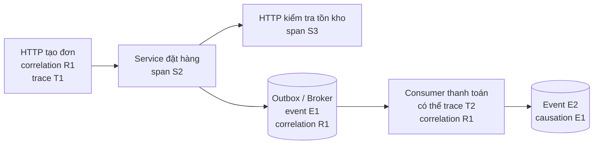

# Định danh nghiệp vụ, mã tương quan và metadata trao đổi

## 1. Vì sao tích hợp hệ thống cần nhiều loại định danh?

Một hệ thống Spring Boot hiếm khi xử lý nghiệp vụ trong đúng một lời gọi. Khi tạo đơn hàng, API có thể gọi dịch vụ tồn kho qua HTTP, ghi dữ liệu vào PostgreSQL, phát sự kiện tới Kafka/RabbitMQ, cập nhật cache Redis và kích hoạt luồng xử lý của Spring Integration. Một thao tác của người dùng có thể trở thành nhiều request, message, lần thử lại và bản ghi ở nhiều hệ thống.

Nếu mọi thành phần chỉ truyền một trường chung tên `id`, rất khó xác định nó đại diện cho đơn hàng, lời gọi HTTP, sự kiện, lần thử xử lý hay toàn bộ chuỗi nghiệp vụ. Hậu quả thường gặp gồm:

- Không đối soát được một đơn hàng qua nhiều hệ thống vì mỗi hệ thống ghi một loại ID khác nhau.
- Không truy vết được các message sinh từ cùng một yêu cầu ban đầu.
- Retry tạo đơn/sự kiện trùng vì dùng correlation ID làm khóa chống trùng.
- Log thiếu liên kết giữa HTTP client, database, cache, consumer và các adapter tích hợp.
- Metadata chưa được kiểm soát vô tình mang thông tin nhạy cảm, hoặc giá trị header do bên ngoài cung cấp bị tin cậy như thông tin xác thực.

**Nguyên tắc cốt lõi:** Mỗi định danh phải có **ngữ nghĩa, phạm vi duy nhất, nơi sinh, vòng đời và quy tắc truyền đi** được định nghĩa trong hợp đồng dữ liệu. Mã định danh nghiệp vụ phục vụ trạng thái nghiệp vụ; correlation ID phục vụ liên kết các thao tác; event/message ID phục vụ nhận diện một đơn vị trao đổi; trace ID phục vụ quan sát các lần thực thi.

Trong phạm vi tích hợp Spring Boot, bài này áp dụng chung cho RestClient/WebClient, JDBC/JPA, cache, broker và Spring Integration.

## 2. Phân biệt các loại định danh quan trọng

| Trường | Đại diện cho | Khi nào sinh và giữ nguyên? | Ví dụ sử dụng |
| --- | --- | --- | --- |
| `orderId` / business ID | Một thực thể nghiệp vụ, chẳng hạn đơn hàng | Sinh khi tạo thực thể; ổn định suốt vòng đời thực thể | Truy vấn/trạng thái/đối soát đơn hàng |
| `commandId` | Một lệnh nghiệp vụ có ý nghĩa riêng | Sinh khi nhận lệnh hoặc tại nguồn gửi; giữ qua những lần phát lại *cùng lệnh* | Xác định lệnh `CreateOrder` gây thay đổi |
| `idempotencyKey` | Ý định thực hiện *cùng một thao tác* từ một client | Client sinh cho một thao tác logic; dùng lại khi retry cùng thao tác | Chặn tạo đơn/trừ tiền hai lần |
| `correlationId` | Một chuỗi trao đổi liên quan cùng workflow/yêu cầu | Sinh ở biên tin cậy nếu thiếu; truyền qua những chặng thuộc cùng chuỗi | Tìm log API → HTTP → broker → worker |
| `causationId` | Lệnh/sự kiện trực tiếp gây ra sự kiện hiện tại | Gắn ID của nguyên nhân trực tiếp khi phát thông điệp mới | `PaymentConfirmed` do `PaymentRequested` nào tạo ra |
| `eventId` | Một sự kiện logic đã phát sinh | Sinh duy nhất cho sự kiện; giữ nguyên khi giao lại cùng sự kiện | Consumer dedup theo event ID |
| `messageId` | Một đơn vị message hoặc envelope ở tầng vận chuyển | Quy tắc phụ thuộc broker/adapter; có thể khác `eventId` | Theo dõi message trong hệ thống trung gian |
| `traceId` / `spanId` | Trace và từng công đoạn thực thi trong distributed tracing | Trình tracing quản lý; thường span mới ở mỗi hop | Điều tra latency và nhánh gọi dịch vụ |
| `tenantId` | Phạm vi khách hàng/tổ chức chứa dữ liệu | Xác định từ danh tính đã xác thực, đưa vào truy cập dữ liệu | Phân vùng dữ liệu và khóa idempotency |

Các ID ở trên **không thay thế cho nhau**. Ví dụ, `correlationId` có thể giống nhau cho 5 message, trong khi mỗi message có `eventId` riêng. Một lần retry cùng sự kiện phải giữ `eventId` của sự kiện đó, dù được chuyển đến broker hoặc tiêu thụ thêm nhiều lần. `traceId` có thể thay đổi khi workflow kéo dài, qua hàng đợi hoặc được xử lý lại; không nên lấy trace ID làm khóa nghiệp vụ.

### 2.1. Định danh nghiệp vụ và định danh vận chuyển

Giả sử `orderId = ORD-2026-00421`. Khi API trả về và worker xử lý bất đồng bộ, giá trị đó vẫn nhận diện cùng một đơn hàng. Nếu message `OrderCreated` có `eventId = 4b5a...`, event ID nhận diện **sự kiện đơn được tạo**, còn order ID nhận diện **đơn hàng**. Khi sau đó phát `OrderShipped`, `orderId` vẫn vậy nhưng `eventId` mới.

Một `eventId` có thể được đặt trong payload và đưa thêm vào header để routing/observability. Nếu hệ thống vận chuyển tự gán `messageId`, phải mô tả rõ quan hệ giữa hai ID. Tránh phụ thuộc vào ID nội bộ của framework như một định danh sự kiện ổn định giữa các hệ thống hoặc sau khi tái phát message.

### 2.2. Correlation và causation

- **Correlation** trả lời: *Những lời gọi và sự kiện nào thuộc cùng một chuỗi công việc?*
- **Causation** trả lời: *Lệnh hoặc sự kiện ngay trước nào tạo ra sự kiện hiện tại?*

Ví dụ:

```text
CreateOrder (commandId = C1, correlationId = R1)
  └─ OrderCreated (eventId = E1, causationId = C1, correlationId = R1)
       ├─ StockReserved (eventId = E2, causationId = E1, correlationId = R1)
       └─ PaymentRequested (eventId = E3, causationId = E1, correlationId = R1)
            └─ PaymentConfirmed (eventId = E4, causationId = E3, correlationId = R1)
```

Ở ví dụ này, `R1` dùng để tìm **cả chuỗi**; `E3` là nguyên nhân trực tiếp của `E4`. Nếu một sự kiện được tạo từ nhiều nguyên nhân, hợp đồng có thể cần tập hợp liên kết hoặc mô hình saga riêng, thay vì ép một `causationId` mang quá nhiều ý nghĩa.

## 3. Thiết kế hợp đồng định danh nhất quán

Trước khi đặt tên header hoặc viết mã, thống nhất cho từng trường:

1. **Ý nghĩa và chủ thể sở hữu:** ID đại diện cho đối tượng nào, bên nào được phép phát sinh/thay đổi?
2. **Phạm vi duy nhất:** Duy nhất toàn cục, trong một tenant, trong một aggregate hay trong một consumer?
3. **Kiểu và định dạng:** UUID, ULID, ID do database sinh, mã nghiệp vụ có cấu trúc, hay chuỗi opaque?
4. **Thời gian tồn tại:** Giữ đến khi nào; lần retry có tái sử dụng ID cũ không?
5. **Vị trí trong hợp đồng:** Path/body/header/message key/metadata; có cần trong database/outbox không?
6. **Tin cậy và bảo mật:** Ai cung cấp, có được phép ghi log, cần xác thực/giới hạn độ dài không?
7. **Quy tắc thiếu hoặc không hợp lệ:** Tạo mới, từ chối yêu cầu hay bỏ metadata tùy chọn?

Không nhất thiết mọi hệ thống đều dùng UUID. ID số tuần tự từ database có thể phù hợp ở phạm vi nội bộ, còn ID công khai nên tránh làm lộ số lượng hoặc thứ tự bản ghi nếu điều đó là rủi ro. UUID/ULID tiện cho việc sinh phân tán, nhưng cần chú ý độ dài, cách biểu diễn thống nhất và đặc tính index của database. Không nên coi sự khó đoán của ID là cơ chế phân quyền.

Một quy ước minh họa:

| Lớp dữ liệu | Trường đề xuất | Vị trí |
| --- | --- | --- |
| REST resource | `orderId` | `/orders/{orderId}` và payload |
| Lệnh HTTP có thể retry | `Idempotency-Key` | HTTP request header; phía server gắn với tenant/principal, thao tác và fingerprint |
| Correlation ở HTTP | `X-Correlation-Id` | HTTP request/response header theo quy ước nội bộ |
| Tracing chuẩn | `traceparent`, `tracestate` | W3C Trace Context, do hệ thống tracing quản lý |
| Domain event | `eventId`, `orderId`, `occurredAt`, `eventType`, `schemaVersion` | Event envelope/payload |
| Broker metadata | `correlationId`, `causationId`, content type | Header/attributes được map chủ động |
| Log/metric | `correlationId`, `traceId`, tên dependency, kết quả | Structured log và tracing; tránh ID có cardinality cao trong metric labels |

`X-Correlation-Id` chỉ là **quy ước ví dụ**, không phải một header tiêu chuẩn bắt buộc cho mọi tổ chức. Nếu hai đối tác đã dùng `Correlation-Id` hay một header khác, hãy thỏa thuận rõ tên, phạm vi và hành vi ở từng boundary. Hạn chế duy trì nhiều tên alias không được kiểm soát.

## 4. Ví dụ một hợp đồng trao đổi xuyên HTTP và broker

### 4.1. Yêu cầu đồng bộ từ client

```http
POST /api/orders HTTP/1.1
Content-Type: application/json
X-Correlation-Id: web-checkout-7f2b
Idempotency-Key: checkout-action-6630

{
  "customerId": "CUS-318",
  "items": [
    { "sku": "SKU-314", "quantity": 2 }
  ]
}
```

Tại API gateway hoặc ứng dụng Spring Boot:

- Xác thực người dùng và xác định tenant từ token/session đáng tin cậy.
- Kiểm tra cú pháp/độ dài `X-Correlation-Id`; có thể tạo ID mới nếu vắng mặt/không hợp lệ, theo chính sách đã công bố.
- Ràng buộc `Idempotency-Key` với chủ thể đã xác thực, loại thao tác, fingerprint payload và thời gian lưu.
- Tạo `orderId` và `commandId` cho nghiệp vụ; tiếp tục truyền `correlationId` qua HTTP client và message.

Phản hồi bất đồng bộ có thể là:

```http
HTTP/1.1 202 Accepted
Content-Type: application/json
X-Correlation-Id: web-checkout-7f2b

{
  "orderId": "ORD-2026-00421",
  "status": "PENDING",
  "statusUrl": "/api/orders/ORD-2026-00421"
}
```

`202 Accepted` có nghĩa yêu cầu đã được chấp nhận xử lý, **không** tự chứng minh quy trình đặt hàng đã hoàn tất. Nếu xử lý hoàn toàn đồng bộ, server có thể dùng `201 Created` theo đúng hợp đồng API.

### 4.2. Sự kiện được phát cho consumer

Ví dụ envelope JSON được đặt làm payload trong topic/queue:

```json
{
  "eventId": "f2da93ac-1f9b-4a49-a82b-244d6a47e01d",
  "eventType": "OrderCreated",
  "schemaVersion": 1,
  "occurredAt": "2026-11-21T05:00:00Z",
  "aggregateType": "Order",
  "aggregateId": "ORD-2026-00421",
  "data": {
    "orderId": "ORD-2026-00421",
    "customerId": "CUS-318",
    "status": "PENDING"
  }
}
```

Headers bên ngoài envelope có thể chứa:

```text
correlation-id = web-checkout-7f2b
causation-id   = C1
content-type   = application/json
```

Giá trị `C1` ở đây là `commandId` của lệnh tạo đơn trong ví dụ. Nếu broker/adapter loại bỏ header, consumer vẫn đọc được business ID và event ID từ payload, nhưng có thể mất correlation; vì vậy cần kiểm tra đường đi metadata và cân nhắc lưu `correlationId` trong outbox/event envelope khi khả năng tái phát và truy vết là yêu cầu quan trọng. Quy ước nằm trong header hay payload cần nhất quán, có tài liệu và được kiểm thử.

Không đưa thông tin cần thiết để xác định nghiệp vụ **chỉ** vào một header có thể bị xóa khi chuyển broker hoặc lưu trữ lâu dài. Các trường trong payload phải cho phép diễn giải sự kiện độc lập theo hợp đồng.

## 5. Spring Boot: tiếp nhận, xác thực hình thức và truyền correlation ID

Đoạn mã bên dưới minh họa REST MVC dùng Java 17+ và Spring Boot 3.2+ (có `RestClient`). `X-Correlation-Id` là metadata quan sát; nó không chứng minh danh tính của client. Ở biên HTTP, ứng dụng có thể tạo correlation ID khi đầu vào không hợp lệ; một API có yêu cầu chặt hơn cũng có thể trả `400 Bad Request` thay vì thay thế.

### 5.1. Chuẩn hóa giá trị ở biên HTTP

```java
import java.util.UUID;
import java.util.regex.Pattern;

public final class CorrelationIds {
    public static final String HEADER = "X-Correlation-Id";
    private static final Pattern SAFE =
            Pattern.compile("[A-Za-z0-9._-]{1,64}");

    private CorrelationIds() {}

    public static String acceptOrGenerate(String incoming) {
        return incoming != null && SAFE.matcher(incoming).matches()
                ? incoming
                : UUID.randomUUID().toString();
    }
}
```

Giới hạn ký tự và độ dài giúp giảm rủi ro log injection/header abuse. Giá trị hợp lệ về cú pháp vẫn là **dữ liệu không đáng tin cậy** nếu đến từ mạng công cộng. Ở hệ thống có gateway và nhiều vùng tin cậy, gateway có thể phát ID nội bộ mới và lưu ID nhận từ client dưới một trường khác để tránh mạo danh log.

### 5.2. Controller gắn metadata với một yêu cầu

```java
import org.springframework.http.HttpStatus;
import org.springframework.http.ResponseEntity;
import org.springframework.web.bind.annotation.*;

record CreateOrderItem(String sku, int quantity) {}
record CreateOrderCommand(
        String customerId, java.util.List<CreateOrderItem> items) {}
record OrderAck(String orderId, String status) {}

@RestController
@RequestMapping("/api/orders")
class OrderController {
    private final OrderApplicationService orderService;

    OrderController(OrderApplicationService orderService) {
        this.orderService = orderService;
    }

    @PostMapping
    ResponseEntity<OrderAck> create(
            @RequestHeader(value = CorrelationIds.HEADER, required = false)
            String incomingCorrelationId,
            @RequestHeader("Idempotency-Key") String idempotencyKey,
            @RequestBody CreateOrderCommand command) {

        String correlationId =
                CorrelationIds.acceptOrGenerate(incomingCorrelationId);

        // OrderApplicationService phải thực thi kiểm tra quyền, dữ liệu
        // và idempotency trong phạm vi tenant/principal đã xác thực.
        OrderAck ack = orderService.submit(command, idempotencyKey, correlationId);

        return ResponseEntity.status(HttpStatus.ACCEPTED)
                .header(CorrelationIds.HEADER, correlationId)
                .body(ack);
    }
}
```

`OrderApplicationService` ở đây là lớp nghiệp vụ của hệ thống, không phải API có sẵn của Spring. Code tập trung vào đường truyền metadata; việc xử lý đơn và idempotency phải được triển khai theo hợp đồng thật. Validation của `Idempotency-Key` cần giới hạn độ dài, định dạng và trạng thái thiếu/sai; không tin tưởng key mà client gửi như một bằng chứng quyền truy cập đơn hàng.

### 5.3. Truyền correlation ID sang HTTP client

```java
import org.springframework.stereotype.Component;
import org.springframework.web.client.RestClient;

record Availability(String sku, boolean available) {}

@Component
class InventoryGateway {
    private final RestClient restClient;

    InventoryGateway(RestClient.Builder builder) {
        this.restClient = builder
                .baseUrl("https://inventory.internal.example")
                .build();
    }

    Availability check(String sku, String correlationId) {
        return restClient.get()
                .uri("/api/inventory/{sku}", sku)
                .header(CorrelationIds.HEADER, correlationId)
                .retrieve()
                .body(Availability.class);
    }
}
```

Truyền `correlationId` qua tham số rõ ràng giúp thấy chính xác nơi metadata được sử dụng và vẫn hoạt động khi chuyển từ request thread sang worker. Trong dự án lớn, có thể dùng context hoặc interceptor để tự động truyền, nhưng cần bảo đảm context tồn tại đúng vòng đời và không bị rò sang request tiếp theo. Cấu hình timeout cho HTTP client và bộ phục hồi bulkhead/circuit breaker là trách nhiệm riêng; một correlation ID không bảo vệ hệ thống khỏi phụ thuộc chậm.

Nếu dùng WebClient/reactive, nên mang metadata qua Reactor Context hoặc dữ liệu request phù hợp; không dựa hoàn toàn vào `ThreadLocal` khi lịch thực thi có thể chuyển luồng.

### 5.4. Structured logging và MDC

MDC hỗ trợ thêm correlation ID vào log trên đường xử lý đồng bộ. Một filter/handler có thể đặt context trước khi xử lý, rồi xóa ở `finally`:

```java
String previous = org.slf4j.MDC.get("correlationId");
try {
    org.slf4j.MDC.put("correlationId", correlationId);
    // Gọi nghiệp vụ cần ghi log ở cùng luồng.
} finally {
    if (previous == null) {
        org.slf4j.MDC.remove("correlationId");
    } else {
        org.slf4j.MDC.put("correlationId", previous);
    }
}
```

Đây là **đoạn minh họa phạm vi xử lý**, không phải một filter hoàn chỉnh. MDC thông thường có phạm vi thread; khi dùng `@Async`, executor, `CompletableFuture`, scheduler, listener hoặc reactive pipeline, phải truyền context qua cơ chế thích hợp, ví dụ `TaskDecorator`, Micrometer Context Propagation hay công cụ tracing tương thích. Luôn dọn MDC để tránh gắn nhầm ID của request trước vào log request sau.

## 6. Metadata của Spring Integration và broker

Spring Messaging có `Message<T>` gồm payload và map headers. Header của framework (ví dụ ID/timestamp, `replyChannel`, `errorChannel`) phục vụ cơ chế nội bộ. Khi message đi qua HTTP, Kafka, RabbitMQ hoặc adapter khác, **không mặc định mọi header nội bộ đều được giữ**; header mapper, serializer, giới hạn của broker và filter có thể thay đổi dữ liệu.

### 6.1. Xây message với metadata ứng dụng

```java
import org.springframework.messaging.Message;
import org.springframework.messaging.support.MessageBuilder;

record OrderCreated(String eventId, String orderId, String status) {}

Message<OrderCreated> buildOrderMessage(
        OrderCreated event, String correlationId, String commandId) {

    return MessageBuilder.withPayload(event)
            .setHeader("correlationId", correlationId)
            .setHeader("causationId", commandId)
            .setHeader("eventId", event.eventId())
            .build();
}
```

Trong Spring Integration, header `correlationId` cũng có thể được dùng bởi aggregator/splitter, tùy flow. Nếu nghiệp vụ có nhóm message riêng với correlation key của framework, cần định nghĩa rõ tránh ghi đè hoặc nhầm giữa *nhóm aggregate* và *correlation của workflow*. Một header có cùng tên không bảo đảm cùng ngữ nghĩa qua các adapter.

**Lưu ý:** `MessageHeaders.ID` có thể được framework phát sinh cho message mới. Đừng coi nó thay thế `eventId` bất biến của domain event trong giao dịch hoặc quá trình replay.

### 6.2. Gửi Kafka với key ổn định và header rõ ràng

Ví dụ khi đã cấu hình `KafkaTemplate<String, OrderCreated>` cùng serializer tương ứng:

```java
import java.nio.charset.StandardCharsets;
import org.apache.kafka.clients.producer.ProducerRecord;
import org.springframework.kafka.core.KafkaTemplate;

void publishOrderCreated(
        KafkaTemplate<String, OrderCreated> kafkaTemplate,
        OrderCreated event,
        String correlationId,
        String causationId) {

    ProducerRecord<String, OrderCreated> record =
            new ProducerRecord<>(
                    "orders.created.v1",
                    event.orderId(), // key theo aggregate để hỗ trợ thứ tự trong partition
                    event);

    record.headers().add("correlation-id",
            correlationId.getBytes(StandardCharsets.UTF_8));
    record.headers().add("causation-id",
            causationId.getBytes(StandardCharsets.UTF_8));

    kafkaTemplate.send(record);
}
```

Kafka record key thường quyết định partition theo partitioner và cấu hình topic. Dùng `orderId` làm key có thể giúp sự kiện của cùng đơn hàng vào cùng partition khi số partition và chiến lược partition ổn định; không tự bảo đảm thứ tự toàn cục giữa các partition, hoặc thứ tự logic nếu producer phát sự kiện lệch trình tự. Nếu cần thứ tự nghiệp vụ, xem xét aggregate version/sequence và ràng buộc ghi/phát sự kiện.

`KafkaTemplate.send(...)` trả kết quả bất đồng bộ; lệnh gửi được gọi không có nghĩa broker đã xác nhận. Cần xử lý thất bại gửi, retry an toàn, observability và cân nhắc **transactional outbox** để tránh trường hợp ghi đơn thành công nhưng phát sự kiện thất bại. Với RabbitMQ, dùng AMQP properties/headers và publisher confirms theo cấu hình thực tế; không áp đặt cùng một API Kafka cho các broker khác nhau.

### 6.3. Hợp đồng header ở ranh giới adapter

Nên có một bảng mapping trong tài liệu tích hợp:

| Giá trị chuẩn của ứng dụng | HTTP | Kafka/RabbitMQ | Lưu trữ/outbox |
| --- | --- | --- | --- |
| Correlation ID | `X-Correlation-Id` | `correlation-id` (quy ước minh họa) | `correlation_id` |
| Causation ID | Theo hợp đồng khi cần | `causation-id` | `causation_id` |
| Event ID | Thường không có trên API tạo đơn | `eventId` trong payload | `event_id` |
| Business ID | URL hoặc body | Payload và record key nếu phù hợp | `order_id` |
| Schema version | Media type/version contract | `schemaVersion` trong event envelope | `schema_version` |
| Trace context | W3C `traceparent`/`tracestate` | Header truyền bằng instrumentation phù hợp | Thường không dùng làm ID lưu trữ nghiệp vụ |

Tên header khác nhau là **ví dụ về mapping có chủ đích**. Đặt chính sách chuyển đổi, quy tắc encode UTF-8, độ dài tối đa và xử lý khi header bị thiếu hoặc trùng; không nối bừa tất cả header HTTP sang broker. Nếu dùng chuẩn CloudEvents, có thể áp dụng các thuộc tính như `id`, `source`, `type`, `time`, `subject` và `dataschema`, song phải tuân thủ cách ánh xạ đúng của CloudEvents; không đồng nhất `id` của CloudEvent với `orderId`.

## 7. Idempotency và xử lý phát lại: dùng đúng ID

**Correlation ID không phải khóa chống trùng.** Hai thao tác khác nhau của cùng một workflow có thể chia sẻ correlation ID; ngược lại, cùng một thao tác có thể được thực thi lại trong trace mới. Idempotency cần có khóa định danh **một thao tác logic** và trạng thái được lưu bền vững.

### 7.1. API nhận lệnh có thể retry

Ví dụ client gửi `CreateOrder` với `Idempotency-Key=K1`. Sau khi ghi đơn, kết nối bị rớt trước khi client nhận response. Client retry **cùng payload** và **cùng key K1**:

- Server tìm key theo `(tenantId, actor/client, operation, K1)` hoặc scope tương đương đã thống nhất.
- Nếu key đã hoàn tất với cùng fingerprint payload, trả lại kết quả trước đó theo chính sách API.
- Nếu key đang xử lý, trả trạng thái đang tiến hành hoặc thông báo xung đột/thử lại theo hợp đồng.
- Nếu cùng key được tái sử dụng với payload khác, từ chối để tránh gán sai hai thao tác.
- Lưu thời hạn hết hạn key và cách hệ thống ứng xử khi key hết hạn.

Chỉ dùng một `Map` trong RAM để chống trùng sẽ mất trạng thái khi restart và không bảo vệ được nhiều instance. Nên có unique constraint hoặc cơ chế lưu atomically ở database/cache bền vững phù hợp mức bảo đảm yêu cầu. Không lưu payload chứa thông tin nhạy cảm trong key hoặc log; fingerprint nên tính trên dữ liệu chuẩn hóa, có bảo vệ phù hợp.

### 7.2. Consumer nhận lại cùng event

Kafka, RabbitMQ và nhiều middleware có thể giao lại message khi consumer crash, timeout, retry hoặc redelivery. Consumer cần dedup theo `eventId` trong phạm vi `consumerName`/subscriber nghiệp vụ (có thể cộng tenant) và phải liên kết với cập nhật trạng thái một cách atomically khi có thể.

```sql
-- Ví dụ PostgreSQL: một consumer xử lý event logic tối đa một lần
CREATE TABLE processed_events (
    consumer_name VARCHAR(120) NOT NULL,
    event_id UUID NOT NULL,
    processed_at TIMESTAMPTZ NOT NULL DEFAULT now(),
    PRIMARY KEY (consumer_name, event_id)
);
```

Trong transaction xử lý một database, ứng dụng có thể `INSERT ... ON CONFLICT DO NOTHING` trước khi cập nhật nghiệp vụ và commit cùng giao dịch. Nếu không insert được vì trùng, bỏ qua tác dụng phụ trong transaction đó. Nếu có gọi API ngoài database, transaction cục bộ không tự bảo đảm exactly-once trên hệ thống bên ngoài: cần idempotency key tại đích, outbox/inbox, saga hoặc đối soát.

Định nghĩa rõ `eventId` khi retry *cùng sự kiện* (giữ nguyên) và khi phát sinh một sự kiện **mới** (sinh mới). Không sinh `eventId` mới chỉ vì broker gửi lại bản tin.

## 8. Tracing: correlation ID khác trace context

Truy vết phân tán theo W3C Trace Context sử dụng:

- `traceparent`: mang version, trace ID, parent span ID và trace flags.
- `tracestate`: metadata tracing bổ sung theo quy tắc của chuẩn.
- `spanId`: nhận diện một công đoạn thực thi cụ thể trong trace.

Trong Spring Boot, hệ thống Micrometer Tracing/OpenTelemetry (nếu được cấu hình) có thể tạo và truyền trace context thông qua instrumentation cho HTTP client/server và messaging. Để tránh mất trace, nên dùng client/bean được Spring quản lý, tích hợp tracing tương thích và kiểm tra propagation thực tế. Không tự tạo một `traceparent` tùy ý bằng cách chèn correlation ID vào đó.



Một workflow bất đồng bộ chạy hàng phút/giờ có thể liên quan nhiều trace. Correlation ID giúp truy vấn toàn bộ hành trình; trace ID và span cung cấp cây gọi/latency của từng giai đoạn. Có thể gắn span link để liên hệ các đoạn xử lý khi phù hợp với kiến trúc tracing. `baggage` là metadata cần kiểm soát kích thước và an toàn dữ liệu, không dùng để mang thông tin xác thực hoặc dữ liệu nhạy cảm.

Đối với log, ghi `correlationId`, `traceId`, `spanId`, tên công đoạn, mã lỗi và thời gian xử lý ở dạng cấu trúc. Không nên dùng correlation ID, order ID hay event ID làm **label của metric** nếu cardinality tăng theo từng request: số time series có thể bùng nổ. Metrics nên gắn các nhãn giới hạn như tên dependency, operation, outcome; ID chi tiết phù hợp hơn trong logs/traces.

## 9. Bảo mật, quyền riêng tư và biên tin cậy

Metadata là một phần của hợp đồng trao đổi và cần được bảo vệ:

1. **Không xem ID là quyền truy cập.** Biết `orderId` hoặc `correlationId` không đồng nghĩa có quyền đọc đơn hoặc truy vết người khác.
2. **Tenant phải từ identity đã xác thực.** Không dùng trực tiếp `X-Tenant-Id` do client tự cung cấp để áp điều kiện truy cập dữ liệu; chỉ nhận header tenant nếu proxy đáng tin cậy đã xác thực và bảo vệ được ranh giới.
3. **Validate header bên ngoài.** Giới hạn kích thước, ký tự và số lượng; loại bỏ control characters, newline và nội dung không phù hợp log.
4. **Allowlist khi propagation.** Chỉ truyền metadata cần thiết đến downstream; không tự động forward `Authorization`, cookie, internal auth claims hoặc header nhạy cảm sang đối tác.
5. **Giảm lộ dữ liệu.** Không nhúng email, số điện thoại, mã định danh cá nhân hay token vào correlation/idempotency key. Áp chính sách retention, masking và phân quyền truy cập log.
6. **Kiểm tra cách ly tenant.** Key chống trùng, dữ liệu trong cache, consumer dedup và truy vấn đối soát phải nằm trong scope tenant thích hợp.
7. **Không ký gửi tính đúng đắn vào header.** Trường nghiệp vụ bắt buộc cần nằm trong payload/schema đáng tin, được xác thực và kiểm tra theo hợp đồng.

Với message nhận từ broker, không phải mọi producer đều đáng tin. Kiểm tra danh tính producer, ACL topic/queue, schema và nguồn phát; không để một header tùy ý điều khiển quyền truy cập, tên tenant, đường dẫn file hoặc SQL.

## 10. Versioning và quản trị hợp đồng metadata

Mỗi integration contract nên định nghĩa một schema cho payload **và** một quy ước metadata. Việc thêm `correlationId` hay đổi cách encode header cần được coi là thay đổi hợp đồng, nhất là với adapter cũ không truyền header. Trường tùy chọn mới thường dễ triển khai tiến dần hơn trường bắt buộc mới.

Nguyên tắc triển khai:

- Chỉ định một bên sinh `eventId` và `orderId`, tránh mỗi consumer tự tạo ID khác cho cùng đơn vị nghiệp vụ.
- Quy định trường bắt buộc và tùy chọn. Với header tương quan thiếu ở hệ thống cũ, tạo correlation ID mới và đánh dấu thiếu context nguồn khi cần; không làm giả causation ID.
- Giữ phiên bản schema trong hợp đồng và cho consumer xử lý được các bản tương thích; nếu phá vỡ tương thích, phân tách version/topic/endpoint theo chiến lược dự án.
- Với outbox, lưu ID và metadata cần cho retry/replay trong bản ghi được commit cùng thay đổi nghiệp vụ.
- Phân biệt timestamp sự kiện thực tế (`occurredAt`) với timestamp broker nhận hoặc consumer xử lý; không dùng timestamp làm khóa duy nhất.
- Tránh thay đổi ID khi triển khai mapping giữa HTTP, DTO, JSON, message broker và database; bổ sung test round-trip để phát hiện mất metadata.

## 11. Kiểm thử hợp đồng và khả năng truy vết

| Kịch bản | Cách kiểm tra | Kỳ vọng |
| --- | --- | --- |
| Request có correlation ID hợp lệ | Gọi API rồi kiểm tra response, log, HTTP outbound và message | Một correlation ID nhất quán trong chuỗi trao đổi |
| Request thiếu hoặc ID không hợp lệ | Bỏ header hoặc gửi ký tự xuống dòng/quá dài | Sinh ID thay thế hoặc trả lỗi theo chính sách, không gây log injection |
| Hai thao tác của cùng workflow | Gửi hai command khác nhau có chung correlation ID | Business/command/event ID vẫn phân biệt |
| Retry `CreateOrder` cùng key và cùng payload | Gửi đồng thời, giả lập rớt response rồi retry | Tối đa một tác dụng phụ; kết quả retry theo hợp đồng |
| Tái dùng key với payload khác | Cùng actor, operation, key; đổi payload | Trả lỗi xung đột, không âm thầm tạo/ghép đơn sai |
| Broker redelivery | Giao cùng `eventId` nhiều lần | Consumer không lặp tác dụng phụ; log vẫn truy vết được |
| Event mới cùng order | Phát `OrderCreated` rồi `OrderShipped` | `orderId` giống nhau; `eventId` khác nhau; causation đúng |
| Async/executor/thread reuse | Chạy requests đồng thời qua các worker | Context và MDC không rò sang request khác |
| HTTP → Spring Integration → broker | Kiểm tra payload/header ở từng boundary | Mapping metadata đúng, không mất ID bắt buộc |
| Sai tenant hoặc header giả mạo | Đổi `tenantId`/business ID trong request | Bị chặn bởi authentication/authorization; không truy cập dữ liệu tenant khác |
| Thay version payload | Consumer cũ nhận sự kiện mới tương thích | Vẫn đọc được trường quan trọng; trường mới không làm hỏng consumer |

Khi dùng contract test, cần kiểm tra cả **tên header, kiểu dữ liệu, encoding, giới hạn độ dài, sự vắng mặt và quy tắc giữ ID khi retry**. Một kiểm thử chỉ so sánh JSON payload là chưa đủ nếu correlation nằm trong broker header.

### Bài tập tình huống

Một request tạo đơn được ghi DB thành công, nhưng HTTP client timeout và Kafka consumer nhận cùng sự kiện ba lần. Hãy thiết kế:

1. Một `orderId` cố định để đối soát đơn qua mọi lần xử lý.
2. Một `Idempotency-Key` cố định cho thao tác tạo đơn được client retry.
3. Một `eventId` cố định cho *cùng sự kiện* được giao ba lần.
4. Một `correlationId` gắn toàn chuỗi đặt hàng và một `causationId` trỏ đến lệnh/sự kiện trực tiếp.
5. Unique constraint cho idempotency API và dedup consumer, kèm giao dịch/outbox thích hợp.
6. Log/trace cho phép tìm cả ba lần nhận message nhưng chỉ một lần phát sinh tác dụng phụ.

Kiểm tra giải pháp bằng cách giả lập crash trước và sau commit, thay đổi thứ tự nhận event và tăng số consumer/instance. Chú ý rằng **at-least-once delivery** không tự biến thành exactly-once business effect chỉ bằng cách gắn correlation ID.

## 12. Checklist dùng trong dự án Spring Boot Integration

- Mỗi business ID, command ID, event ID, correlation ID, causation ID và trace ID có ý nghĩa/phạm vi riêng được tài liệu hóa.
- ID nghiệp vụ ổn định khi request, event hoặc message bị retry; sự kiện mới có event ID mới.
- HTTP header và broker header được validate, allowlist, map rõ ràng; metadata quan trọng có thể được lưu trong outbox.
- `tenantId` đến từ nguồn đã xác thực; mọi truy cập business ID đều qua kiểm tra quyền.
- Idempotency key chống trùng ở cấp thao tác; event ID chống xử lý trùng ở cấp consumer.
- Spring Integration header, Kafka headers, AMQP properties và JSON envelope được kiểm thử ở boundary thực tế.
- Tracing dùng `traceparent`/instrumentation đúng chuẩn; correlation ID nối các bước bất đồng bộ; MDC được dọn và truyền qua executor khi cần.
- Structured log chứa ID đủ điều tra; metric labels tránh cardinality cao và không lộ dữ liệu nhạy cảm.
- Có test cho retry đồng thời, redelivery, mất header, lỗi encoding, thay version, nhiều instance và phân tách tenant.

**Kết quả mong muốn:** Khi một đơn hàng đi qua REST API, HTTP client, database, cache, broker và các adapter Spring Integration, nhóm vận hành có thể trả lời chính xác *đây là thực thể nào*, *thao tác nào đã được thử lại*, *sự kiện nào đã được phát và giao lại*, *bước nào gây ra bước tiếp theo* và *log/trace nào thuộc cùng hành trình*, mà không đánh đồng các loại định danh.
