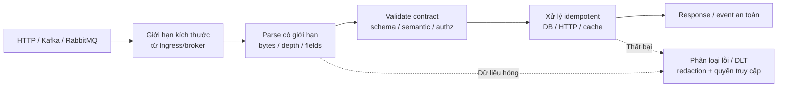
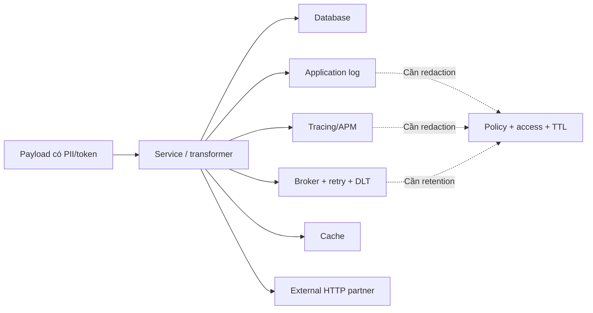

# Giới hạn kích thước, dữ liệu không tin cậy và thông tin nhạy cảm

## 1. Bài toán trong hợp đồng dữ liệu tích hợp

Trong mô-đun **SPRING_BOOT_INTEGRATION**, một ứng dụng Spring Boot có thể nhận JSON từ HTTP, đọc record Kafka, tiêu thụ message RabbitMQ, truy vấn SQL, lưu cache Redis hoặc chuyển dữ liệu qua các adapter của Spring Integration. Các hệ thống này thường được xây dựng bởi những nhóm khác nhau, sử dụng phiên bản triển khai khác nhau và có mức độ tin cậy khác nhau.

Một thông điệp được **xác thực** hoặc đến từ mạng nội bộ chưa chắc đã **hợp lệ và an toàn để xử lý**. Producer hợp lệ vẫn có thể gửi nhầm một JSON quá lớn, đối tác có thể thay đổi schema, một client bị xâm nhập có thể chèn dữ liệu độc hại, và một lỗi logging có thể làm lộ token hoặc dữ liệu khách hàng.

Giả sử dịch vụ nhận sự kiện cập nhật trạng thái đơn hàng:

```json
{
  "schemaVersion": 1,
  "eventId": "a4327556-6c8d-492e-aea7-1c2bec0fbb47",
  "orderId": "ORD-2026-0042",
  "status": "PAID",
  "note": "Đã xác nhận thanh toán"
}
```

Hợp đồng **không dừng ở việc JSON có đủ trường**. Nó còn phải xác định:

- Payload lớn tối đa bao nhiêu **byte**? Trường `note` được phép dài bao nhiêu ký tự? Có bao nhiêu phần tử trong danh sách, bao nhiêu tầng object và bao nhiêu phần tử trong một batch?
- Client có quyền gửi trường nào, giá trị nào và cho thực hiện hành động nào? Khi nào phải từ chối vì dữ liệu không tin cậy?
- Trường nào là dữ liệu cá nhân, bí mật xác thực, thông tin tài chính hoặc metadata có thể gây lộ danh tính?
- Khi lỗi, dữ liệu được đưa vào log, trace, metric, retry topic, DLT, database hoặc cache như thế nào?
- Nếu một event được gửi lại sau lỗi DB commit, HTTP timeout hoặc Kafka rebalance, việc xử lý có gây tác dụng phụ trùng không?

Để an toàn, cần kết hợp **giới hạn tài nguyên + xác thực cấu trúc/ngữ nghĩa + xử lý dữ liệu không tin cậy + bảo vệ thông tin nhạy cảm + kiểm thử các ranh giới**.



## 2. Phân biệt các loại giới hạn

Một cấu hình tên “max size” không nhất thiết bảo vệ mọi lớp dữ liệu. Cần chỉ ra **đơn vị, vị trí kiểm tra và tác động**.

| Giới hạn | Ví dụ | Bảo vệ | Không tự bảo vệ |
| --- | --- | --- | --- |
| **Toàn bộ HTTP body** | JSON tối đa 256 KiB | Băng thông, bộ nhớ và tài nguyên parse của request đó | Số request đồng thời, body ở endpoint khác |
| **Kích thước từng field** | `orderId` tối đa 64 ký tự | Ràng buộc nghiệp vụ sau parse | Bộ nhớ bị dùng để parse JSON cực lớn trước validation |
| **Số phần tử** | Tối đa 100 records/batch | Số thao tác DB và fan-out downstream | Kích thước từng record |
| **Độ sâu JSON** | Tối đa 32 tầng | Parser khỏi cấu trúc lồng sâu gây hao CPU/stack | Chuỗi phẳng dài hàng chục MB |
| **Số và độ dài number** | Tối đa 64 ký tự biểu diễn số | Một phần chi phí parse số bất thường | Overflow/giá trị ngoài miền nghiệp vụ |
| **Giới hạn multipart/file** | 5 MiB/file | Upload file qua multipart | Body JSON thông thường |
| **Max message của broker** | Topic/queue có ngưỡng riêng | Tài nguyên đường truyền/lưu trữ broker | Logic consumer, PII trong DLT |
| **Concurrency/rate limit** | 20 request đang xử lý/tenant | Tổng tài nguyên khi nhiều request hợp lệ | Một request đơn lẻ quá lớn |
| **Timeout** | 3 giây lấy kết nối | Ngăn request giữ tài nguyên quá lâu | Payload lớn vẫn có thể làm cạn bộ nhớ trước timeout |

### Byte, ký tự và dung lượng sau giải nén

- **Byte** là đơn vị của HTTP body, Kafka record và bộ nhớ/băng thông. Một chuỗi Unicode có thể cần nhiều byte trong UTF-8.
- Annotation `@Size(max = 64)` trên `String` kiểm tra **độ dài chuỗi Java**, không đặt giới hạn byte cho toàn bộ payload HTTP.
- `Content-Length` có thể không hiện diện (chunked transfer) và không nhất thiết mô tả số byte sau khi reverse proxy giải nén. Không dựa **chỉ** vào header này để bảo vệ giới hạn.
- Base64 làm dữ liệu nhị phân phình to; JSON chứa base64 thường tốn bộ nhớ/CPU hơn gửi dữ liệu nhị phân theo đường riêng.
- Payload nén, file ZIP hoặc tài liệu XML có thể nhỏ ở đầu vào nhưng rất lớn sau giải nén hoặc mở rộng thực thể. Cần giới hạn **dung lượng đã giải nén** và tài nguyên thao tác ở lớp xử lý thực tế.

Ví dụ: 200 request đồng thời, mỗi body 2 MiB, đã cần tới khoảng 400 MiB chỉ để giữ bản sao body thô; sau parse thành object, log/copy, queue và retry, lượng bộ nhớ có thể lớn hơn đáng kể. Cần tính **kích thước × concurrency × số bản sao trung gian**, không chọn ngưỡng độc lập với tải.

## 3. Thiết kế lớp phòng vệ theo luồng tích hợp

Thay vì chỉ có một `@Valid` ở controller, hãy đặt các biện pháp bảo vệ sớm nhất ở nơi có thể:

| Ranh giới | Kiểm soát chính | Phản ứng khi vi phạm |
| --- | --- | --- |
| API gateway / ingress | Body size, header size, authentication, rate/concurrency limit | Trả 413/429/401 phù hợp; không chuyển request sâu hơn |
| HTTP application | Giới hạn số byte thực sự đọc, media type, timeout | Từ chối trước khi tạo object lớn |
| JSON/XML deserializer | Độ sâu, string/number length, cấu trúc và kiểu dữ liệu | 400 hoặc quarantine đối với message |
| DTO / hợp đồng nghiệp vụ | Required fields, enum, range, list length, version, tenant | 400/422 hoặc lỗi hợp đồng |
| Authorization | Kiểm tra danh tính, quyền trên từng entity, không tin client-supplied owner | 403 hoặc cách che giấu phù hợp |
| Database | Prepared statement, unique constraint, column limit, transaction | Rollback và lỗi đã phân loại |
| Broker/adapter | Producer/broker/consumer size, key, schema, retry/DLT | Reject, quarantine hoặc cơ chế phục hồi |
| Logging/trace/metric | Allowlist metadata, masking/redaction, retention và quyền truy cập | Loại bỏ giá trị nhạy cảm khỏi telemetry |

Nếu một lớp không có khả năng xử lý ràng buộc nào đó, cần bảo vệ ở lớp thích hợp kế tiếp. **Giới hạn payload trước khi deserialize** và **giới hạn field sau khi deserialize** bổ sung cho nhau, không thay thế nhau.

## 4. Viết hợp đồng dữ liệu đủ chặt

Đặt hợp đồng đầu vào tách khỏi entity database. Ví dụ Spring Boot 3.x với Jakarta Bean Validation:

```java
import jakarta.validation.constraints.NotBlank;
import jakarta.validation.constraints.NotNull;
import jakarta.validation.constraints.Pattern;
import jakarta.validation.constraints.Size;
import java.util.UUID;

public record PartnerOrderEvent(
        @NotNull Integer schemaVersion,
        @NotNull UUID eventId,
        @NotBlank
        @Size(max = 64)
        @Pattern(regexp = "[A-Z0-9-]+")
        String orderId,
        @NotNull OrderStatus status,
        @Size(max = 200) String note) {
    public enum OrderStatus { PAID, CANCELLED }
}
```

Ví dụ dùng `record` để chỉ nhận những field nằm trong hợp đồng. Cần thêm `spring-boot-starter-validation` nếu Bean Validation chưa được đưa vào classpath. Các ràng buộc trên kiểm tra hình dạng của dữ liệu **sau khi được parse**; chúng không thay thế giới hạn kích thước JSON thô.

Các nguyên tắc quan trọng:

1. **Không deserialize trực tiếp vào JPA entity**, object có quyền admin hoặc domain object chứa trường server-only (ví dụ `tenantId`, `isAdmin`, `approvedAmount`). Đây là rủi ro *mass assignment/over-posting*.
2. **Không để producer tự cấp mọi giá trị đáng tin**. Tenant và quyền truy cập phải được đối chiếu với danh tính đã xác thực ở phía server; `orderId` đúng định dạng chưa chứng minh caller có quyền với đơn đó.
3. **Xác thực version và semantic**. Ví dụ `schemaVersion == 1` và trạng thái chỉ được chuyển từ `PENDING → PAID` theo quy tắc nghiệp vụ; enum hợp lệ vẫn có thể là transition không hợp lệ.
4. **Giới hạn list/map** bằng `@Size(max=...)`; kiểm tra các phần tử bằng `@Valid` và constraint trong container khi cần. Với batch lớn, chia thành những đơn vị có kích thước cố định và có idempotency key.
5. **Định nghĩa xử lý trường không biết**. Strict reject phát hiện lỗi hợp đồng nhanh, còn tolerant reader giúp mở rộng schema; chọn một chính sách có versioning/compatibility tests, không ngẫu nhiên bỏ qua field có thể làm sai nghiệp vụ.
6. **Chống trùng lặp**. `eventId` ổn định qua retry/replay; database nên có unique constraint hoặc inbox cùng transaction với side effect để một message giao lại không tạo kết quả hai lần.

Không đưa các đoạn dữ liệu nguyên văn từ người dùng vào thông báo exception nhằm “giải thích” lỗi validation, vì exception có thể được ghi log hoặc chuyển sang hệ thống giám sát.

## 5. Giới hạn thực sự HTTP JSON body trong Spring MVC

Với REST JSON, chỉ khai báo `spring.servlet.multipart.max-request-size` là **không đủ**: property này quản lý multipart upload. Cấu hình giới hạn phần form của Tomcat cũng không nên được coi là một giới hạn cho mọi JSON body.

Một hướng đơn giản với endpoint chuyên nhận JSON là **đọc tối đa N + 1 byte**, sau đó mới deserialize. Ví dụ dưới đây có giới hạn 256 KiB cho **body endpoint này**; không dựa vào `Content-Length`:

```java
import com.fasterxml.jackson.core.JsonProcessingException;
import com.fasterxml.jackson.databind.ObjectMapper;
import jakarta.servlet.http.HttpServletRequest;
import jakarta.validation.ConstraintViolation;
import jakarta.validation.Validator;
import java.io.IOException;
import java.util.Set;
import org.springframework.http.HttpStatus;
import org.springframework.http.MediaType;
import org.springframework.http.ResponseEntity;
import org.springframework.web.bind.annotation.PostMapping;
import org.springframework.web.bind.annotation.RequestMapping;
import org.springframework.web.bind.annotation.RestController;
import org.springframework.web.server.ResponseStatusException;

@RestController
@RequestMapping("/integrations")
public class PartnerOrderController {

    private static final int MAX_BODY_BYTES = 256 * 1024;
    private final ObjectMapper json;
    private final Validator validator;
    private final OrderIngestService orders;

    public PartnerOrderController(
            ObjectMapper json,
            Validator validator,
            OrderIngestService orders) {
        this.json = json;
        this.validator = validator;
        this.orders = orders;
    }

    @PostMapping(
            path = "/orders",
            consumes = MediaType.APPLICATION_JSON_VALUE)
    public ResponseEntity<Void> receive(HttpServletRequest request)
            throws IOException {

        // Dung lượng cấp phát cho body thô không vượt MAX_BODY_BYTES + 1.
        byte[] raw = request.getInputStream()
                .readNBytes(MAX_BODY_BYTES + 1);
        if (raw.length > MAX_BODY_BYTES) {
            throw new ResponseStatusException(
                    HttpStatus.PAYLOAD_TOO_LARGE, "Request body too large");
        }

        final PartnerOrderEvent event;
        try {
            event = json.readValue(raw, PartnerOrderEvent.class);
        } catch (JsonProcessingException ex) {
            // Không đưa raw JSON hoặc exception message ra client.
            throw new ResponseStatusException(
                    HttpStatus.BAD_REQUEST, "Malformed JSON");
        }
        if (event == null) {
            throw new ResponseStatusException(
                    HttpStatus.BAD_REQUEST, "Event is required");
        }

        Set<ConstraintViolation<PartnerOrderEvent>> violations =
                validator.validate(event);
        if (!violations.isEmpty()) {
            throw new ResponseStatusException(
                    HttpStatus.BAD_REQUEST, "Invalid event fields");
        }

        // Ngoài validation còn cần kiểm tra quyền, schema version,
        // transition nghiệp vụ và xử lý idempotent trong service.
        orders.acceptIfNew(event);
        return ResponseEntity.accepted().build();
    }
}
```

`OrderIngestService` là service ứng dụng cần được hiện thực riêng. Ví dụ tập trung vào ranh giới đọc/parse/validate; có thể dùng `@Valid @RequestBody` cho endpoint đơn giản khi đã **có giới hạn body ở tầng trước**. Đoạn trên dùng Java 17+, Spring Web MVC và Jakarta Validation (Spring Boot 3.x).

**Giới hạn của kỹ thuật:** body đến endpoint vẫn cần trải qua tầng mạng/server trước khi controller được gọi. Với request rất lớn, HTTP server hoặc gateway có thể đã cấp buffer/giữ kết nối; vì vậy phải có giới hạn **ingress/proxy** và chính sách timeout/concurrency. Nếu proxy giải nén body trước khi chuyển tiếp, kiểm tra kích thước trên lượng dữ liệu **sau giải nén** tại nơi đọc phù hợp.

Ngoài ra, nếu có streaming upload, SSE, WebSocket hoặc API tải file lớn, không áp dụng máy móc cách đọc toàn bộ vào một mảng. Dùng đọc tuần tự có bộ đếm byte, giới hạn tổng dung lượng, timeout và đường lưu trữ phù hợp.

## 6. Cấu hình hạ tầng và parser: giới hạn nào áp dụng?

Ví dụ bên dưới minh họa hai loại giới hạn trong một Spring Boot application có cả servlet multipart và WebFlux client:

```yaml
server:
  max-http-request-header-size: 16KB

spring:
  servlet:
    multipart:
      max-file-size: 5MB
      max-request-size: 6MB
  codec:
    max-in-memory-size: 256KB
```

Cần đọc đúng ý nghĩa:

- `server.max-http-request-header-size` giới hạn dung lượng **request headers** theo hỗ trợ của embedded server, không phải JSON body.
- `spring.servlet.multipart.*` áp dụng cho **multipart** theo cấu hình Servlet; không được dùng làm bằng chứng một request JSON lớn đã bị chặn.
- `spring.codec.max-in-memory-size` đặt ngưỡng cho một số tình huống **codec cần gom dữ liệu vào bộ nhớ** trong reactive stack; nó không phải một bộ đếm tổng số byte cho mọi luồng streaming hoặc mọi HTTP request trên Spring MVC.
- Reverse proxy/API gateway (ví dụ NGINX `client_max_body_size`) có thể chặn body lớn sớm hơn; cần thiết kế giới hạn đồng nhất giữa client, gateway, app và backend.

### Giới hạn cấu trúc khi Jackson parse JSON

Ở Jackson phiên bản hỗ trợ `StreamReadConstraints` (Jackson 2.15+), có thể hạn chế độ sâu, độ dài chuỗi và biểu diễn số. Ví dụ cho ObjectMapper được Spring Boot tạo bằng builder:

```java
import com.fasterxml.jackson.core.StreamReadConstraints;
import org.springframework.boot.autoconfigure.jackson.Jackson2ObjectMapperBuilderCustomizer;
import org.springframework.context.annotation.Bean;
import org.springframework.context.annotation.Configuration;

@Configuration
public class JsonParserLimits {
    @Bean
    Jackson2ObjectMapperBuilderCustomizer constrainParser() {
        return builder -> builder.postConfigurer(mapper ->
                mapper.getFactory().setStreamReadConstraints(
                        StreamReadConstraints.builder()
                                .maxNestingDepth(32)
                                .maxStringLength(16_384)
                                .maxNumberLength(64)
                                .build()));
    }
}
```

Các ngưỡng chỉ là ví dụ, phải đối chiếu phiên bản Jackson và nhu cầu dữ liệu thật. Tùy framework, custom `ObjectMapper` tự tạo hoặc serializer khác có thể **không** nhận cấu hình từ Spring Boot builder. Test bằng chính parser/HTTP endpoint đang được dùng; không đặt niềm tin vào một bean chưa được kết nối vào đường xử lý.

`StreamReadConstraints` giới hạn parser **trong lúc đọc**, còn `@Size`/`@Pattern` giới hạn dữ liệu **sau khi đã tạo DTO**. Nếu payload có một mảng hàng triệu phần tử nhỏ, chỉ max depth/string length vẫn chưa đủ; phải giới hạn body bytes và số phần tử theo hợp đồng.

## 7. Validation khác authorization và bảo vệ khỏi injection

Một event hợp lệ về mặt cấu trúc vẫn có thể không được phép thực hiện. Ví dụ caller gửi `orderId = ORD-2026-0042` nhưng đơn hàng thuộc tenant khác. Trường đúng regex và độ dài chỉ chứng minh **định dạng**, không chứng minh **quyền**.

Các nhóm dữ liệu cần tránh sử dụng trực tiếp:

| Dữ liệu không tin cậy | Nguy cơ | Cách bảo vệ |
| --- | --- | --- |
| URL hoặc hostname do client gửi | SSRF đến metadata service, mạng nội bộ | Dùng danh sách đích được phép, xác minh DNS/IP, redirect và network egress policy |
| Chuỗi SQL/filter/sort | SQL injection hoặc truy vấn rất nặng | Prepared parameters; allowlist tên cột/sort; giới hạn range và độ phức tạp |
| Tên file / đường dẫn object store | Path traversal, ghi đè | Tạo tên server-side, canonicalize và áp quyền theo tenant |
| Header `X-Tenant-Id` / `X-User-Id` | Giả mạo danh tính nếu trust trực tiếp | Lấy identity từ authentication context đáng tin, chỉ cho proxy tin cậy set header |
| JSON chứa field quyền admin | Mass assignment | Input DTO allowlist, mapping tường minh sang domain |
| HTML/Markdown do đối tác gửi | XSS khi hiển thị | Encode/escape theo ngữ cảnh output; sanitize khi cho phép HTML |
| XML payload | XXE/external entity expansion | Tắt external entity/DTD theo parser, giới hạn depth/size |
| Regex/filter do caller cung cấp | ReDoS/chi phí CPU | Chỉ hỗ trợ cú pháp đơn giản có giới hạn, timeout và độ dài thích hợp |

Ví dụ SQL an toàn với tham số giá trị:

```java
String status = jdbcTemplate.queryForObject(
        "SELECT status FROM customer_orders WHERE order_id = ? AND tenant_id = ?",
        String.class,
        event.orderId(),
        authenticatedTenantId);
```

Nếu client chọn `sortBy`, **không** truyền tên cột tùy ý vào câu SQL dù đã escape chuỗi. Ánh xạ các lựa chọn được phép thành hằng số SQL server-side. Đối với HTTP client, việc dùng TLS/mTLS chỉ chứng minh an toàn đường truyền/danh tính peer; payload nhận được **vẫn phải validate**.

## 8. WebClient và HTTP downstream: đừng để response làm cạn bộ nhớ

Ứng dụng có thể giới hạn request đầu vào nhưng vô tình tải một JSON response rất lớn từ đối tác:

```java
import org.springframework.web.reactive.function.client.WebClient;

WebClient partnerClient = WebClient.builder()
        .baseUrl("https://api.partner.example")
        .codecs(codecs -> codecs.defaultCodecs()
                .maxInMemorySize(256 * 1024))
        .build();
```

`maxInMemorySize` giảm rủi ro khi codec **gom dữ liệu để decode**, ví dụ `bodyToMono(SomeDto.class)`; nó **không phải** ngưỡng tuyệt đối cho mọi response streaming. Nếu xử lý `Flux<DataBuffer>`, `InputStream` hoặc file lớn, application cần giới hạn tổng số byte đọc, số record, thời gian và nơi lưu riêng.

Thiết kế hợp đồng outbound:

- Chỉ gọi các host/đường dẫn đã cấp phép, kiểm soát redirects và egress. Không truyền URL tùy ý từ payload vào HTTP client.
- Đặt connect, response/read timeout, số connection tối đa, retry/backoff có giới hạn và circuit breaker khi phù hợp.
- Kiểm tra HTTP status, `Content-Type`, schema version, field size và giới hạn response trước khi chuyển sang database/message mới.
- Khi downstream trả 429/503 hoặc timeout, phân loại lỗi và áp dụng idempotency cho thao tác có side effect. **Timeout không chứng minh server chưa thực hiện request.**
- Không log nguyên HTTP request/response khi có `Authorization`, cookie, token, thông tin khách hàng hoặc dữ liệu tài chính.

## 9. Kafka, RabbitMQ và các broker: giới hạn ở nhiều phía

Với Kafka, một record quá lớn có thể bị từ chối ở producer hoặc broker, nhưng các cấu hình có nghĩa khác nhau:

| Kafka setting | Phạm vi điển hình | Cần nhớ |
| --- | --- | --- |
| `max.request.size` | Giới hạn một request produce ở Kafka producer client | Không phải giới hạn field bên trong event |
| Broker `message.max.bytes` hoặc topic `max.message.bytes` | Giới hạn record batch mà broker chấp nhận theo cấu hình | Cần căn chỉnh với producer và đặc tính nén |
| `max.partition.fetch.bytes` | Ngưỡng dữ liệu fetch mỗi partition tại consumer | Có ngoại lệ để Kafka vẫn tiến triển với batch đầu tiên lớn |
| `fetch.max.bytes` | Ngưỡng tổng dữ liệu một fetch request | Không phải hard cap tuyệt đối trong mọi trường hợp |
| `max.poll.records` | Giới hạn **số record** trả về mỗi poll | Không đặt giới hạn tổng byte của các record |

**Không có một property Kafka duy nhất** thay thế kiểm tra kích thước và hợp đồng ở producer lẫn consumer. Nếu Kafka producer nén record, byte mà broker lưu có thể khác kích thước sau giải nén và khi parse thành object. Broker/consumer cần có giới hạn tài nguyên phù hợp; application vẫn phải chặn message quá lớn **trước khi fan-out, parse sâu hoặc ghi SQL**.

Với RabbitMQ, thông điệp có thể chịu giới hạn kích thước message của broker theo phiên bản/cấu hình. `frame_max` chỉ giới hạn **kích thước một frame AMQP**, không phải bảo đảm rằng toàn bộ message nhỏ hơn ngưỡng nghiệp vụ. Một message có thể đi qua nhiều frame. Cần giới hạn phía producer, chính sách của queue/broker và bước consume. Với Spring Integration, transformer/router/aggregator hoặc queue nội bộ cũng có thể giữ bản sao payload; giới hạn upstream giúp tránh phình bộ nhớ ở các thành phần này.

### Đừng cho payload lớn đi vòng qua retry và DLT

Retry topic, dead-letter topic/queue có thể sao chép **cả payload gốc lẫn headers**. Nếu message chứa token hoặc dữ liệu cá nhân, DLT trở thành một **kho dữ liệu nhạy cảm** khác với retention, ACL và người có quyền đọc riêng. Nếu lỗi do payload quá lớn, việc đẩy nguyên payload đó qua nhiều retry topic có thể làm nặng thêm sự cố.

Quy trình nên là:

1. Phát hiện vi phạm sớm bằng giới hạn broker/consumer và schema.
2. Phân loại lỗi có thể retry (DB tạm unavailable) và lỗi không retry (sai schema, quá ngưỡng cố định).
3. Với message không thể xử lý, cân nhắc **quarantine có quyền truy cập chặt**, chỉ lưu metadata/ID hoặc pointer đến object đã mã hóa thay vì nhân bản dữ liệu nhạy cảm.
4. Giữ `eventId`, `correlationId` và metadata về nguồn gốc đủ để tra soát, nhưng không tạo metric tag chứa PII.
5. Định nghĩa retention, replay, xóa dữ liệu và audit cho mọi topic/queue xử lý lỗi.

Nếu chọn gửi bản gốc sang DLT, phải có ACL, encryption at rest nếu hạ tầng yêu cầu, chính sách retention và kiểm thử đường publish DLT thất bại. **Không ACK/commit offset thành công chỉ vì một thao tác chuyển DLT chưa được xác nhận**; hành vi thật phụ thuộc cấu hình listener/recoverer/transaction.

## 10. Database, cache và object storage

Giới hạn ở HTTP không bảo vệ khi dữ liệu đi qua SQL, Redis hoặc batch:

- **SQL:** dùng kiểu dữ liệu phù hợp, constraint/unique index, transaction và prepared statements; không chứa mọi raw payload trong cột JSONB một cách vô hạn. Cân nhắc hạn mức query, page size, batch size và LOB streaming.
- **Redis:** giới hạn value size/TTL, số khóa trên mỗi tenant và serialization depth. Cache không phải kho bí mật mặc định; cần ACL/TLS, thời gian sống và hạn chế lưu token/PII.
- **Spring Integration aggregator:** tránh gom vô hạn message vào `MessageGroupStore` nếu thiếu `sequence size`/expiry; theo dõi số group và byte thực tế.
- **Object storage:** với file hoặc payload lớn có lý do chính đáng, lưu file tại kho object có quyền và thời hạn; Kafka/HTTP event chỉ mang **pointer đã xác thực, kích thước, content type và checksum**.

Đối với mô hình event mang pointer:

```json
{
  "eventId": "5b45c348-2e86-409f-87e2-e1d471cf86e0",
  "schemaVersion": 1,
  "objectKey": "tenant-42/orders/2026/11/attachment-481",
  "contentType": "application/pdf",
  "sizeBytes": 184320,
  "sha256": "a34b0d98f4a3a6eedcd0a22e3b3c50adf70f6ee70c917b13d97a48dfa19bd738"
}
```

`objectKey` không nên được client tự dùng như đường dẫn truy cập tùy ý: server phải kiểm tra tenant/ACL và dùng credential nội bộ có phạm vi phù hợp. Checksum dùng để kiểm chứng integrity **sau khi tải**, không thay thế authorization hay xác minh nguồn. Với file không tin cậy, cần thêm giới hạn dung lượng sau giải nén, kiểm tra định dạng thực, quét file khi hợp đồng yêu cầu và chống path traversal.

## 11. Nhận diện và phân loại thông tin nhạy cảm

Không phải mọi trường đều cần được ghi log hoặc sao chép qua các connector. Tạo một bảng phân loại ngay từ lúc thiết kế hợp đồng:

| Loại dữ liệu | Ví dụ | Cách xử lý mặc định |
| --- | --- | --- |
| **Secret xác thực** | Password, API key, OAuth access/refresh token, private key, cookie session | Không ghi log/trace/DLT nguyên văn; cấp từ secret manager, rotate, quyền tối thiểu |
| **PII** | Email, số điện thoại, địa chỉ, giấy tờ định danh | Thu thập tối thiểu, che khi hiển thị, giới hạn retention và quyền |
| **Tài chính/nhạy cảm nghiệp vụ** | Số tài khoản, giá giao dịch, thông tin thanh toán | Mã hóa khi cần, kiểm soát quyền theo mục đích, tránh telemetry chứa giá trị |
| **Định danh kỹ thuật** | Event ID ngẫu nhiên, correlation ID, schema version | Có thể log có kiểm soát để truy vết, tránh dùng PII làm ID |
| **Nội dung do client tự nhập** | Comment, địa chỉ callback, filename, exception text | Coi là không tin cậy; validate và escape khi hiển thị; không chép thẳng vào log |

**Băm email/phone không mặc nhiên biến dữ liệu thành vô danh**: tập giá trị có thể dễ dò ngược hoặc liên kết với dữ liệu khác. Một mã giả danh/pseudonym vẫn có thể là dữ liệu cá nhân trong bối cảnh vận hành. Không dùng email, token hoặc business ID có độ phân biệt cực cao làm label cho Prometheus/Micrometer, vì gây rủi ro lộ dữ liệu và tăng cardinality.

### Dữ liệu nhạy cảm lan truyền qua đâu?



Rò rỉ thường đến từ đường phụ: debug HTTP body, exception serialization, monitoring agent, retry/DLT, log tập trung, cache dump, bộ nhớ crash dump hoặc bộ dữ liệu test; không chỉ từ bảng database chính.

## 12. Logging, tracing và xử lý lỗi không làm lộ dữ liệu

Một log tốt cho luồng tích hợp cần giúp tìm **message nào, bước nào, tại sao lỗi**, mà không phải chứa nguyên body:

```text
event=ORDER_EVENT_REJECTED
correlationId=0bcb9846-42f5-4cb0-b62c-b25a1cba9582
schemaVersion=1
source=partner-a
reason=PAYLOAD_TOO_LARGE
maxBytes=262144
receivedBytesBucket=256-512KiB
```

Không ghi:

```text
Authorization: Bearer eyJ...
password=plain-text-value
requestBody={"customerEmail":"someone@example.com", "cardNumber":"..."}
```

Các biện pháp phù hợp:

- Dùng **allowlist field** cho structured logs, thay vì log toàn bộ DTO rồi mới tìm cách redact tất cả trường có thể xuất hiện sau này.
- Khi cần debug, ưu tiên lưu request ID, event ID, size bucket, schema version và mã lỗi; nếu cần sample payload phục vụ điều tra, đưa vào kho hạn chế truy cập theo quy trình có hạn lưu.
- Bảo vệ `Authorization`, `Cookie`, `Set-Cookie`, `X-API-Key` và secret ở HTTP client/server logging; kiểm tra chế độ wiretap/debug trong môi trường production.
- Không đẩy exception message chứa dữ liệu do client nhập vào error response hoặc metric tags. Exception của SQL/JSON/HTTP library đôi khi có thể kèm raw value, URL hoặc header.
- Kiểm soát quyền truy cập hệ thống log, trace, audit và DLT, retention/lifecycle, cũng như quy trình xóa dữ liệu liên quan khi cần.
- Trace/span nên chứa tên endpoint chuẩn hóa, hệ thống đích và status; không ghi raw query string/token, request body, tài khoản khách hàng.

Tránh dùng “redact mọi thứ bằng regex” làm rào chắn duy nhất. Regex không bao quát trường mới, format tùy ý, object lồng nhau hoặc token ở dạng encode. **Không thu thập dữ liệu không cần thiết** vẫn là biện pháp hiệu quả nhất.

## 13. Lỗi biên, HTTP status và chính sách xử lý

| Tình huống | HTTP gợi ý | Kafka/RabbitMQ gợi ý |
| --- | --- | --- |
| Body vượt giới hạn byte | **413 Payload Too Large** | Reject hoặc quarantine; không retry vô hạn |
| JSON sai cú pháp / type | **400 Bad Request** | Cách ly poison pill; xác nhận xử lý lỗi theo policy |
| Media type không hỗ trợ | **415 Unsupported Media Type** | Validate schema/content type theo hợp đồng |
| Field hợp lệ về JSON nhưng vi phạm nghiệp vụ | 400 hoặc **422** tùy API contract | Không retry tự động nếu lỗi cố định; DLT/incident |
| Caller vượt quota | **429 Too Many Requests** | Rate control/backpressure, tiêu thụ có giới hạn |
| Hạ nguồn tạm unavailable | 503/timeout có kiểm soát | Retry hữu hạn + backoff, không mất idempotency |
| Caller thiếu quyền với entity | 403/404 theo chính sách bảo vệ tài nguyên | Từ chối thao tác, cảnh báo nếu nghi tấn công |

Đối với HTTP API, dùng `ProblemDetail`/error contract có **mã lỗi ổn định** và request ID:

```json
{
  "type": "about:blank",
  "title": "Payload Too Large",
  "status": 413,
  "detail": "Request body exceeds the allowed limit",
  "requestId": "req-8f6dc2"
}
```

Tránh trả lại nội dung request, JWT, SQL, đường dẫn internal hoặc full stack trace. Một response 413 không chứng minh request độc hại; có thể do producer thay schema hoặc sai giới hạn ở API gateway. Cần dựa trên phân loại/số liệu để điều chỉnh hợp đồng và tải.

### Retry phải gắn với tính chất lỗi

Nếu message quá lớn, không đổi sau retry, việc đẩy lại 10 lần chỉ tốn thêm broker/network. Nếu lỗi database tạm thời, retry có giới hạn lại có ích. Khi producer gửi bản mới đã sửa, cần giữ quy tắc về `eventId`/version và idempotency để không tạo ghi trùng hoặc vô tình coi hai phiên bản khác payload là một event giống hệt.

Không dùng dead-letter topic như nơi công khai cho mọi người “xem raw payload”; một DLT có thể chứa dữ liệu nhạy cảm hơn topic nghiệp vụ vì bao gồm cả exception headers và bản sao của record lỗi.

## 14. Kiểm thử biên về kích thước và dữ liệu không tin cậy

Kiểm thử cần nhắm vào các **điểm chuyển trạng thái**: trước và sau giới hạn, trước/sau deserialize, trước ghi DB, sau khi lỗi broker và khi phát sinh telemetry.

| Test case | Kỳ vọng |
| --- | --- |
| JSON 256 KiB hợp lệ | Endpoint có thể chấp nhận nếu field/schema/semantic cũng hợp lệ |
| JSON 256 KiB + 1 byte | **413**, không gọi service hoặc ghi DB |
| Request chunked, không có Content-Length | Giới hạn dựa trên byte **đã đọc**, không bỏ qua |
| Body nén có kích thước sau giải nén quá lớn | Kiểm tra đúng tại lớp giải nén; không tạo object vượt budget |
| `orderId` dài 65 ký tự | **400** dù body nhỏ; không lưu dữ liệu |
| JSON lồng quá sâu, string/number cực dài | Parser từ chối trong giới hạn tài nguyên |
| Trường enum lạ, schemaVersion không hỗ trợ | Phân loại lỗi hợp đồng, không âm thầm ghi sai |
| Thêm field `isAdmin` hoặc `tenantId` từ client | Không cấp quyền/trạng thái không được phép |
| URL callback trỏ tới địa chỉ nội bộ | Không gọi; allowlist/egress policy chặn SSRF |
| SQL query chứa ký tự đặc biệt | Prepared statement coi dữ liệu là giá trị |
| Message Kafka/RabbitMQ quá ngưỡng | Không làm kẹt consumer vô hạn hoặc tạo DLT không giới hạn |
| Trường có token/PII làm lỗi | Không lộ giá trị trong response, log, trace hoặc metric |
| Event giao lại sau DB commit | Idempotency giữ side effect đúng một lần |

### Ví dụ kiểm thử HTTP body limit với MockMvc

Với endpoint `/integrations/orders` ở phần trên và một `@SpringBootTest` cấu hình `MockMvc`:

```java
import static org.springframework.test.web.servlet.request.MockMvcRequestBuilders.post;
import static org.springframework.test.web.servlet.result.MockMvcResultMatchers.status;
import org.junit.jupiter.api.Test;
import org.springframework.beans.factory.annotation.Autowired;
import org.springframework.boot.test.autoconfigure.web.servlet.AutoConfigureMockMvc;
import org.springframework.boot.test.context.SpringBootTest;
import org.springframework.http.MediaType;
import org.springframework.test.web.servlet.MockMvc;

@SpringBootTest
@AutoConfigureMockMvc
class OrderBodyLimitTest {
    @Autowired MockMvc mvc;

    @Test
    void rejectsBodyAboveLimit() throws Exception {
        byte[] oversized = new byte[256 * 1024 + 1];
        java.util.Arrays.fill(oversized, (byte) 'x');

        mvc.perform(post("/integrations/orders")
                .contentType(MediaType.APPLICATION_JSON)
                .content(oversized))
                .andExpect(status().isPayloadTooLarge());
    }
}
```

Test này xác minh logic endpoint trong `MockMvc`; nó **không thay thế** integration test qua reverse proxy/HTTP server thực hoặc thử Kafka/RabbitMQ. Trong test suite nên dùng service mock để kiểm tra chắc chắn `acceptIfNew` **không được gọi** khi body quá lớn, và dùng fixture có dữ liệu thật để thử ranh giới đúng bằng N, JSON Unicode, batch lồng sâu và nội dung không hợp lệ.

Đối với API và broker, nên có bài test contract giữa producer và consumer: cùng giới hạn bytes, version, enum, nullable, số phần tử và cách xử lý unknown fields. Nếu một phía tăng message size mà phía còn lại chưa nâng ngưỡng, lỗi sẽ xuất hiện ở runtime dù unit test của từng service đều xanh.

## 15. Vận hành và quan sát giới hạn

Đặt chỉ số theo **loại dữ liệu và mã lỗi**, không lưu giá trị nhạy cảm:

- Tỷ lệ 400/413/415/422/429 trên từng endpoint và từng producer đã xác thực.
- Kích thước request/response theo histogram/buckets, không dùng body làm metric label.
- Tỷ lệ JSON parser failure, Bean Validation failure, unknown schema version và unauthorized entity access.
- Thời gian parse và transform, bộ nhớ heap, GC, active requests, queue depth, connection pool và độ trễ downstream.
- Lượng message bị reject hoặc đưa DLT vì payload, dung lượng backlog, tuổi sự cố và tỷ lệ replay thành công.
- Sự kiện audit khi một operator được phép xem dữ liệu nhạy cảm phục vụ tra soát; không ghi secret vào audit.

Khi 413 tăng đột biến, cần kiểm tra producer nào thay đổi payload, phân phối size và bản phát hành nào gây thay đổi. Không tự ý nâng giới hạn gấp hàng trăm lần để “hết lỗi” nếu chưa tính RAM, băng thông, persistence, broker và quyền truy cập.

Khi log/trace vô tình chứa dữ liệu nhạy cảm, phải dừng nguồn ghi mới, giới hạn quyền đọc, đánh giá phạm vi đã sao chép, áp quy trình loại bỏ/revoke phù hợp và sửa cơ chế logging. Đổi API key hoặc token bị lộ; **chỉ mask ở giao diện log không xóa được bản ghi gốc** đã lưu trong hệ thống phía dưới.

## 16. Bài thực hành tổng hợp

**Bối cảnh:** một Spring Boot service nhận sự kiện đơn hàng bằng HTTP từ đối tác, ghi PostgreSQL, publish Kafka `orders.accepted`, lưu một số thông tin Redis và chuyển lỗi xử lý sang DLT khi cần. Payload có `note` do người dùng nhập; một số event có tài liệu đính kèm.

### Yêu cầu

1. Định nghĩa contract version 1: `eventId` bắt buộc, `orderId` tối đa 64 ký tự, `note` tối đa 200 ký tự, không nhận trường server-only.
2. Giới hạn HTTP JSON 256 KiB tại ingress và endpoint, parser depth tối đa 32, list tối đa 100 phần tử nếu API cho phép batch.
3. Nếu có file đính kèm, gửi file qua endpoint/object storage riêng; event chỉ mang pointer đã xác minh quyền, size, media type và checksum.
4. Từ chối URL callback ngoài allowlist và không gắn `tenantId` từ JSON vào domain context; lấy tenant từ principal đã xác thực.
5. Xử lý dữ liệu SQL bằng parameter binding, unique event ID và transaction; thiết kế retry/outbox để DB commit và Kafka publish không gây mất hoặc nhân đôi sự kiện.
6. Kafka producer, topic và consumer có giới hạn phù hợp; DLT lưu có kiểm soát, giới hạn retention và không cho người không có quyền đọc payload nhạy cảm.
7. Logging chỉ dùng event ID/correlation ID, mã lỗi và size bucket; test bảo đảm không có token/email trong response/log/trace.
8. Chạy thử các case từ 1 byte dưới ngưỡng tới 1 byte vượt ngưỡng, JSON lồng sâu, Unicode, message bị giao lại và downstream timeout.

### Tiêu chí hoàn thành

| Kiểm tra | Kết quả mong đợi |
| --- | --- |
| Body quá 256 KiB | 413 và không thực hiện side effect |
| JSON hợp lệ nhưng thiếu ID hoặc sai schema | Lỗi hợp đồng rõ ràng, không lộ raw input |
| Trường do client không được phép chỉnh | Không ghi đè server-owned fields, không vượt tenant |
| Broker nhận record phù hợp | Không vượt budget khi serialize/deserialize và không sao chép payload lớn qua DLT |
| DB retry/redelivery | Event được áp dụng tối đa một lần về mặt nghiệp vụ |
| Telemetry | Có mã lỗi và correlation ID; không có secret/PII không cần thiết |
| File/object pointer | Download được kiểm tra quyền, dung lượng, loại file và integrity |
| Capacity test | Không vượt budget CPU/RAM và không gây nghẽn hệ thống dưới concurrency mục tiêu |

## 17. Những sai lầm cần tránh

1. Dùng `@Size` trên DTO làm cơ chế duy nhất để chống JSON hàng chục MB.
2. Nghĩ `spring.servlet.multipart.max-request-size` giới hạn mọi request JSON.
3. Coi `max.poll.records` của Kafka là giới hạn dung lượng byte.
4. Tăng broker message size mà không tính downstream deserialization, retry và DLT.
5. Tin dữ liệu vì đến từ HTTPS, mTLS, mạng nội bộ hoặc producer đã xác thực.
6. Dùng entity database làm request DTO và để client gửi cả trường quyền/tenant.
7. Log nguyên HTTP body, record broker hoặc exception có kèm token/PII khi gặp lỗi.
8. Dùng email/điện thoại làm correlation ID hoặc metric label.
9. Retry vô hạn với dữ liệu sai schema hoặc quá kích thước.
10. Lưu raw payload nhạy cảm ở cache, DLT, test fixture hoặc object store mà không kiểm soát quyền/retention.
11. Coi checksum của object là bằng chứng người tải có quyền truy cập.
12. Bỏ qua giới hạn sau giải nén, nested JSON, collection lớn và số request đồng thời.

## 18. Câu hỏi tự kiểm tra

1. Vì sao phải giới hạn body trước khi parse, dù đã có `@Size` trên `note`?
2. `Content-Length`, `@Size` và `maxInMemorySize` giải quyết những vấn đề khác nhau thế nào?
3. Tại sao một JSON nhỏ được nén vẫn có thể gây cạn bộ nhớ?
4. Trong Kafka, `max.poll.records` khác gì `max.partition.fetch.bytes`?
5. Rủi ro khi consumer đẩy nguyên record chứa access token sang DLT là gì?
6. Vì sao payload đến qua mTLS vẫn phải validate và kiểm tra authorization theo entity?
7. Làm sao hạn chế mass assignment và SSRF khi mapping DTO vào domain?
8. Nếu DB commit thành công nhưng offset Kafka chưa commit, ứng dụng phải có biện pháp nào?
9. Vì sao metric có label là email có thể gây cả vấn đề bảo mật lẫn cardinality?
10. Test `MockMvc` cho 413 đã chứng minh được gì và còn thiếu kiểm chứng nào ở tầng ingress thực?

## Tổng kết

Hợp đồng dữ liệu tích hợp an toàn phải mô tả không chỉ **kiểu và ý nghĩa field** mà cả **giới hạn tài nguyên, mức độ tin cậy và phân loại thông tin nhạy cảm**. Trong Spring Boot, đặt giới hạn sớm ở ingress/broker, giới hạn byte và cấu trúc khi deserialize, kiểm tra DTO/authorization trước side effect, và bảo vệ transaction/idempotency khi retry. Với HTTP client, SQL, Redis, Kafka, RabbitMQ và Spring Integration adapters, cần tính cả bản sao payload, buffer, queue, DLT và log. Dùng allowlist, schema version, error response an toàn, quyền truy cập, retention và kiểm thử trên mọi ranh giới để có luồng tích hợp bền vững mà không làm lộ dữ liệu.

### Tài liệu tham khảo

- [Spring Framework Reference — HTTP Message Conversion](https://docs.spring.io/spring-framework/reference/web/webmvc/message-converters.html)
- [Spring Boot Reference — Servlet Web Applications](https://docs.spring.io/spring-boot/reference/web/servlet.html)
- [Spring Boot Reference — Validation](https://docs.spring.io/spring-boot/reference/io/validation.html)
- [Spring for Apache Kafka Reference](https://docs.spring.io/spring-kafka/reference/)
- [OWASP — Input Validation Cheat Sheet](https://cheatsheetseries.owasp.org/cheatsheets/Input_Validation_Cheat_Sheet.html)
- [OWASP — Logging Cheat Sheet](https://cheatsheetseries.owasp.org/cheatsheets/Logging_Cheat_Sheet.html)
- [OWASP — API Security Top 10: Unrestricted Resource Consumption](https://owasp.org/API-Security/editions/2023/en/0xa4-unrestricted-resource-consumption/)
