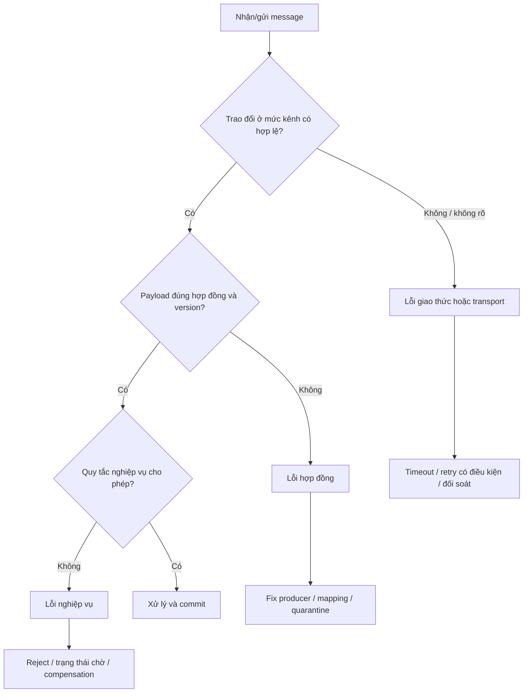
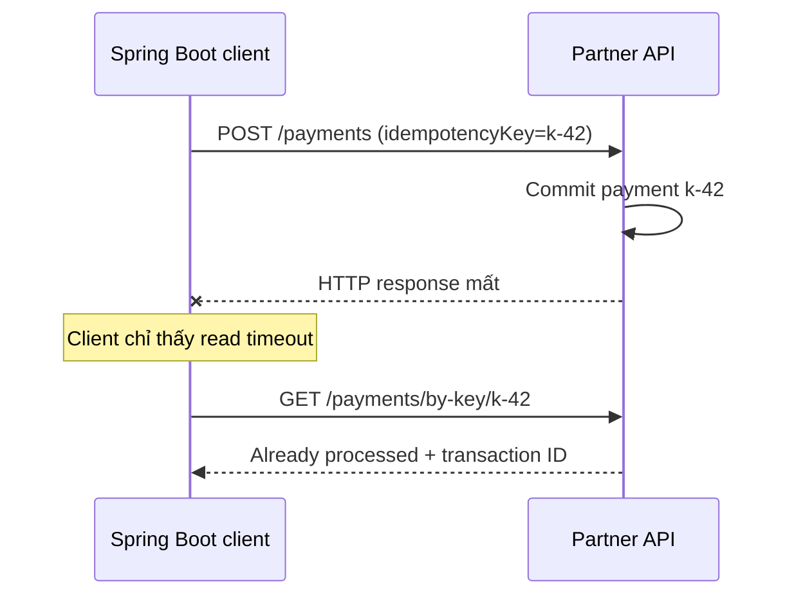
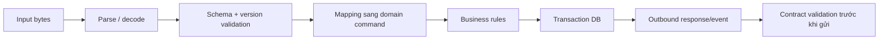
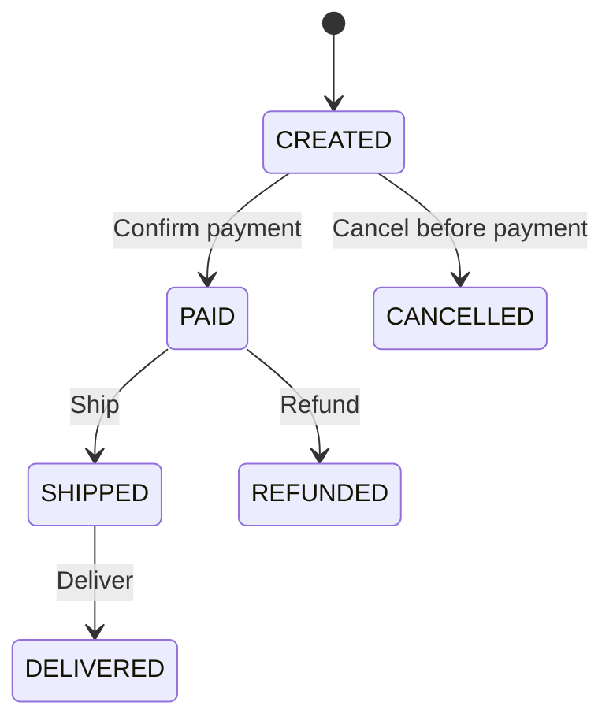
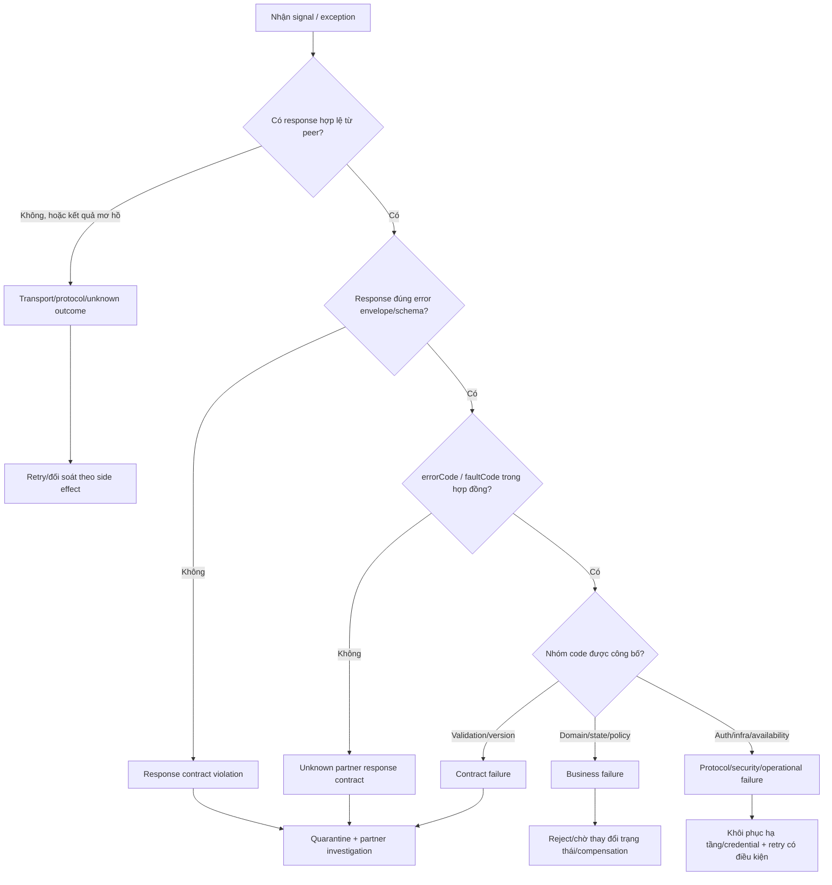
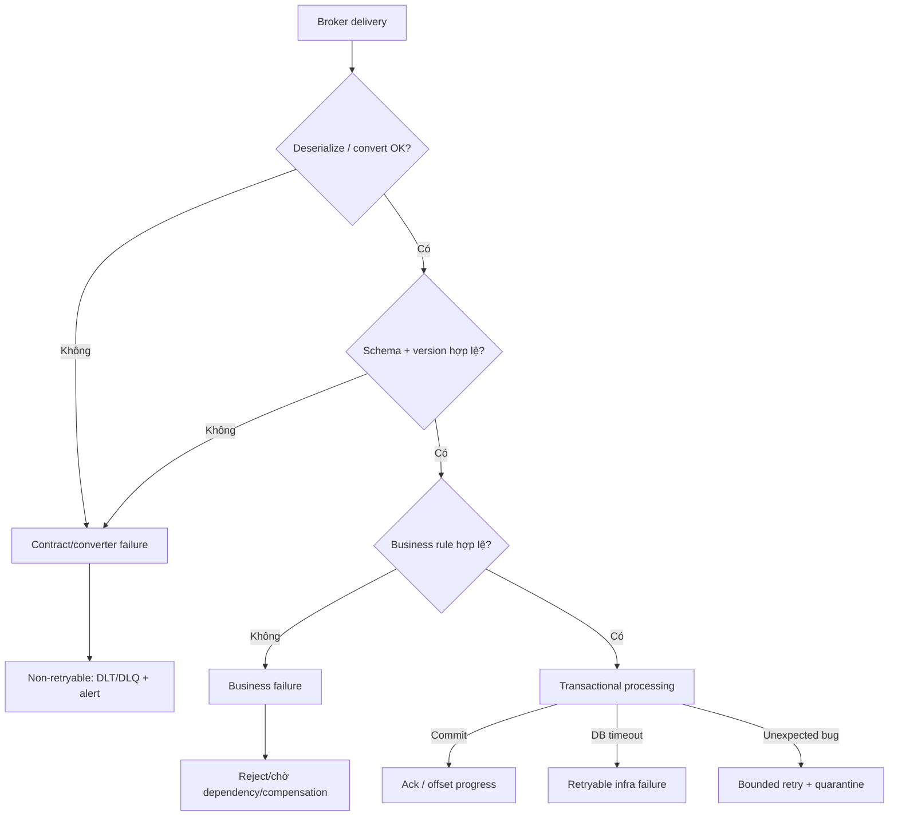
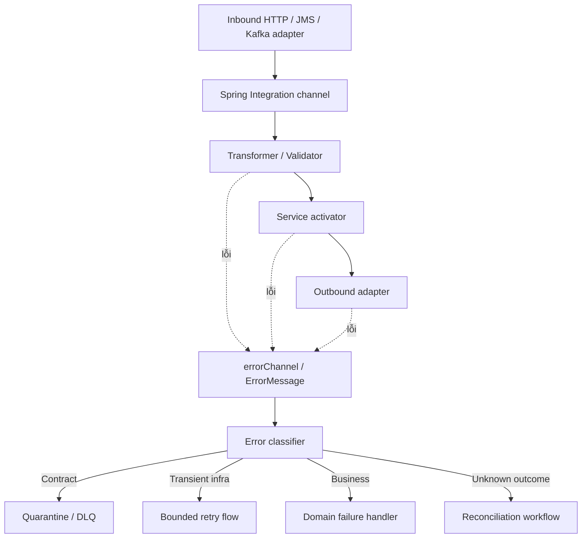
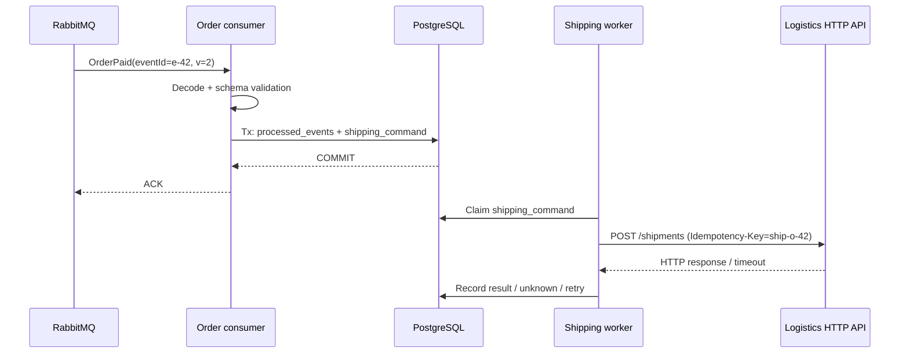

# Phân biệt lỗi giao thức, lỗi hợp đồng và lỗi nghiệp vụ

Trong một luồng tích hợp Spring Boot, cùng một triệu chứng “gọi dịch vụ thất bại” có thể bắt nguồn từ những vấn đề hoàn toàn khác nhau: kết nối HTTPS bị ngắt, JSON thiếu trường bắt buộc, mã trạng thái đơn hàng không được hỗ trợ, hoặc một đơn hợp lệ nhưng **không được phép hoàn tiền** vì đã hết hạn. Nếu xếp tất cả vào một nhóm `IntegrationException` rồi retry giống nhau, hệ thống dễ gây nghẽn downstream, tạo tác dụng phụ trùng lặp hoặc đưa message không sửa được vào vòng xử lý vô hạn.

Bài thuộc chương **Hợp đồng dữ liệu** của mô-đun `SPRING_BOOT_INTEGRATION`. Trọng tâm là phân biệt ba lớp lỗi **giao thức/kênh trao đổi**, **hợp đồng dữ liệu**, **quy tắc nghiệp vụ**; sau đó gắn mỗi lớp với mã lỗi, cách phản hồi, retry, idempotency, transaction, dead-letter queue, kiểm thử và khả năng quan sát. Những nguyên tắc này áp dụng cho HTTP client, SOAP, JDBC, cache, Kafka, RabbitMQ và các adapter Spring Integration, nhưng mỗi giao thức có cách báo lỗi riêng.

## 1. Ba lớp lỗi trả lời ba câu hỏi khác nhau

| Lớp lỗi | Câu hỏi cốt lõi | Ví dụ | Bước xử lý đầu tiên |
| --- | --- | --- | --- |
| **Giao thức / kênh trao đổi** | Hai hệ thống có trao đổi được một thông điệp theo quy tắc vận chuyển, phiên làm việc và xác nhận của kênh không? | DNS lỗi, TLS handshake thất bại, HTTP proxy từ chối, HTTP framing sai, Kafka broker unavailable, RabbitMQ channel đóng | Xác định kết nối, xác thực, route và **kết quả đã được bên kia chấp nhận hay chưa** |
| **Hợp đồng dữ liệu** | Thông điệp đã nhận có đúng cấu trúc, kiểu, schema version, field và ngữ nghĩa dữ liệu đã cam kết giữa hai phía không? | JSON thiếu `orderId`, enum lạ, timestamp sai định dạng, SOAP namespace sai, event thiếu `eventId`, field `currency` không hợp lệ theo contract | Trả lỗi validation, cách ly payload hoặc sửa mapping/schema; tránh retry cùng nội dung vô hạn |
| **Nghiệp vụ** | Một yêu cầu **đúng hợp đồng** có được phép thực hiện trong trạng thái và chính sách hiện tại không? | Đơn đã hủy không thể giao, số dư không đủ, yêu cầu hoàn tiền vượt hạn, hàng không còn | Trả lỗi nghiệp vụ ổn định; từ chối, chờ điều kiện đổi hoặc tạo workflow bù theo quy tắc |



Sơ đồ này là **mô hình tư duy**, không phải quy tắc mọi lỗi đều được phân loại ngay. Ví dụ timeout xảy ra sau khi bên kia đã xử lý là **kết quả không xác định**, không phải bằng chứng rằng yêu cầu chưa được thực hiện. Một `HTTP 409` được nhận hợp lệ ở tầng HTTP có thể biểu thị xung đột trạng thái nghiệp vụ, nhưng cũng có thể biểu thị một điều khoản về version/idempotency của hợp đồng. Phải đọc **hợp đồng endpoint và error code** thay vì suy luận chỉ từ status.

### 1.1. Phân biệt lỗi khi giao tiếp với lỗi do đối tác báo về

Một client nhận được `HTTP 422` với body `{"code":"INVALID_CURRENCY"}` nghĩa là kênh HTTP **đã hoạt động**; ứng dụng phía đối tác đang từ chối một payload theo hợp đồng. Ngược lại, `ConnectException` khi kết nối chưa được tạo là lỗi kênh/transport, chưa thể biết đối tác đã nhận yêu cầu ở lần trước hay không. `HTTP 200` nhưng response JSON không parse được là **lỗi hợp đồng response**, mặc dù tầng HTTP thành công.

Vì vậy, hãy phân tách hai trục:

1. **Nơi phát hiện:** transport/protocol, parser/schema validator, application/domain handler.
2. **Nguyên nhân và cách phục hồi:** tạm thời, cần sửa dữ liệu, cần thay đổi trạng thái, cần vận hành, hoặc không rõ đã tạo side effect.

Một lỗi giao thức có thể là lỗi cấu hình vĩnh viễn (chứng chỉ sai), còn lỗi nghiệp vụ có thể là tạm thời (tồn kho chưa được đồng bộ). Không đồng nhất “lỗi giao thức = retry” và “lỗi nghiệp vụ = không retry”.

## 2. Lỗi giao thức và transport: kênh trao đổi chưa tạo ra kết quả đáng tin

Tầng thấp nhất gồm DNS, TCP/TLS, HTTP/AMQP/Kafka protocol, proxy, broker route, connection/session và cơ chế acknowledgement. Có ích khi chia tiếp:

- **Lỗi transport:** không kết nối được, TLS handshake hỏng, connection reset, đọc/ghi timeout.
- **Lỗi protocol/session:** message frame không hợp lệ, server không hỗ trợ phiên bản giao thức, proxy `407`, AMQP channel `PRECONDITION_FAILED`, broker trả xác nhận lỗi theo protocol.
- **Kết quả remote chưa rõ:** request có thể đã được nhận trước khi phản hồi hoặc xác nhận bị mất.

| Tình huống | Tín hiệu | Không được suy ra |
| --- | --- | --- |
| DNS không phân giải được host | Unknown host, lookup timeout | Không kết luận endpoint đích đã nhận request |
| TLS certificate/hostname không hợp lệ | SSL handshake/verification exception | Không sửa bằng cách tắt TLS verification |
| HTTP proxy yêu cầu đăng nhập | HTTP `407 Proxy Authentication Required` | Không gửi Bearer token của origin như proxy password |
| HTTP request bị server từ chối vì media type | `415 Unsupported Media Type` | Không xem đó là domain failure kiểu “hết hàng” |
| Kafka producer future thất bại/timeout | Send exception/timeout | Không khẳng định record chắc chắn chưa từng vào broker |
| RabbitMQ publish confirm bị mất | Timeout khi chờ confirm | Không khẳng định broker đã hoặc chưa lưu message |
| JDBC connection bị cắt trong commit | SQL/network exception | Không khẳng định transaction chưa commit nếu kết quả commit chưa rõ |

**Đừng nhầm HTTP status với lỗi transport:** `401`, `403`, `404`, `409` và `503` là những HTTP response được trao đổi hợp lệ, sau đó phải giải thích theo tầng ứng dụng. `401` có thể là lỗi xác thực, `503` là sự cố dịch vụ, còn `409` thường là xung đột nghiệp vụ/trạng thái. Status là **tín hiệu**, không phải toàn bộ taxonomy.

### 2.1. Ví dụ timeout sau khi đối tác đã xử lý



Retry `POST` với **idempotency key mới** có thể tạo thanh toán thứ hai. Hướng xử lý đúng là giữ operation ID/key ổn định, tra trạng thái khi được hỗ trợ và lưu trạng thái `UNKNOWN/PENDING_RECONCILIATION` nếu chưa thể đối soát. Cả ứng dụng và hệ thống đích phải có hợp đồng về idempotency; thêm header tùy ý không buộc một đối tác phải dedupe.

### 2.2. Bảo mật giao thức và dữ liệu xác thực

Phân biệt ba trường hợp:

- **Xác thực transport/identity thất bại:** mTLS certificate không tin cậy, API token hết hạn, proxy chưa xác thực. Phải sửa cấu hình/credential hoặc refresh theo policy, không retry nóng cùng secret.
- **Đã xác thực nhưng bị cấm:** HTTP `403` hoặc broker không có quyền publish/consume. Đây là quyết định access-control, không phải dữ liệu order sai.
- **Dữ liệu hợp đồng không hợp lệ:** signature của message trên payload sai hoặc thiếu metadata bắt buộc. Tùy contract, có thể được xem là lỗi authentication/integrity protocol hay lỗi contract; cần ghi rõ trong tài liệu giao tiếp để phân loại ổn định.

Không log token, mật khẩu, secret của HMAC, private key hay toàn bộ message chứa thông tin nhạy cảm khi điều tra các lỗi này.

## 3. Lỗi hợp đồng: payload không đáp ứng điều hai bên đã cam kết

**Hợp đồng dữ liệu** gồm nhiều lớp hơn một JSON schema:

| Thành phần hợp đồng | Ví dụ điều kiện | Sai lệch |
| --- | --- | --- |
| Media type và serialization | `Content-Type: application/json`, UTF-8, SOAP Body XML đúng namespace | Unsupported content type, sai framing/encoding |
| Cấu trúc | Có `eventId`, `orderId`; các field đúng nesting | Missing/unknown required field |
| Kiểu dữ liệu và định dạng | `amount` decimal, `occurredAt` ISO-8601 | Chuỗi ở field số, timestamp parse không được |
| Constraint liên trường | `amount > 0`; `currency` thuộc enum hỗ trợ; `startAt <= endAt` | Dữ liệu có kiểu đúng nhưng vi phạm validation |
| Định danh và version | `schemaVersion` hỗ trợ, `eventId` ổn định khi retry | Consumer không hỗ trợ version, message ID bị thay khi replay |
| Quy ước null/default | `null` khác absent, danh sách rỗng khác chưa cung cấp | Producer và consumer hiểu khác ý nghĩa |
| Semantic contract | Đơn vị số tiền, timezone, định dạng mã, ý nghĩa field | Gửi cents nhưng consumer hiểu đồng, local time bị hiểu UTC |

Ví dụ request HTTP được thỏa thuận:

```json
{
  "eventId": "7b59a727-3b75-4c36-995c-7745c20ab1aa",
  "schemaVersion": 2,
  "orderId": "ORD-1042",
  "amount": 125000,
  "currency": "VND",
  "occurredAt": "2026-11-21T03:20:00Z"
}
```

Một producer gửi `"amount":"125000"` thay số JSON, hoặc `"currency":"XYZ"` khi enum chỉ cho phép `VND` và `USD`, đang vi phạm hợp đồng như đã khai báo. Một producer gửi `"amount":125000` nhưng thực tế đại diện cho **125.000 xu** trong khi consumer hiểu **125.000 đồng** lại vi phạm **semantic contract** dù JSON Schema thông thường có thể không phát hiện.

### 3.1. Lỗi hợp đồng ở request và response

Ở phía **server**, validate trước khi thực hiện side effect: nếu request sai, trả error code cụ thể và không thực thi nghiệp vụ. Ở phía **client**, validate response trước khi cập nhật DB hoặc phát event tiếp theo: HTTP 2xx không có nghĩa payload đã đúng contract.



Với luồng outbound, kiểm tra cả dữ liệu **trước khi gửi**: để bên kia trả `400` cho dữ liệu mà mình có thể tự biết sai chỉ làm tăng latency và khiến lỗi bị trộn với sự cố network.

### 3.2. Phân biệt validation và quy tắc nghiệp vụ

Ví dụ `amount > 0` là constraint của dữ liệu đầu vào; `amount <= availableCredit` phụ thuộc trạng thái tài khoản hiện tại và là business rule. `currency` phải là một trong các mã hỗ trợ trong hợp đồng là validation; khách hàng đã vượt hạn mức giao dịch với currency hợp lệ là lỗi nghiệp vụ.

Biên giới giữa hai lớp đôi khi phụ thuộc cách định nghĩa: một tham số `deliveryDate` nằm ngoài khung ngày được phép có thể được xem là contract constraint hoặc business policy. Điều quan trọng không phải tên gọi tuyệt đối mà là **hợp đồng error code nhất quán, ownership rõ, cách retry và cách sửa cụ thể**.

## 4. Lỗi nghiệp vụ: dữ liệu hợp lệ nhưng thao tác không được phép

Một command có đúng schema vẫn có thể bị từ chối vì trạng thái hoặc quy tắc domain.

Ví dụ state machine đơn hàng:



Nếu command `ShipOrder(orderId=ORD-1042)` được gửi khi đơn ở `CANCELLED`, dữ liệu `orderId` vẫn hợp lệ; điều thất bại là **transition**. Không có lý do tự retry sau mỗi giây nếu trạng thái không thay đổi. Có thể trả `ORDER_NOT_SHIPPABLE` với `currentState=CANCELLED` theo hợp đồng, hoặc ghi yêu cầu vào luồng xử lý bù nếu được nghiệp vụ cho phép.

| Trường hợp | Lỗi hợp đồng hay nghiệp vụ? | Đặc điểm |
| --- | --- | --- |
| `orderId` trống hoặc sai format | Hợp đồng | Có thể phát hiện trước truy vấn DB |
| `orderId` đúng format nhưng chưa tồn tại | Nghiệp vụ/resource lookup, tùy API | Có thể là không tìm thấy vĩnh viễn hoặc dữ liệu chưa đồng bộ |
| Đơn đã bị hủy, vẫn yêu cầu giao hàng | Nghiệp vụ | Transition bị cấm bởi current state |
| Hạn mức hoàn tiền là 30 ngày, yêu cầu sau ngày 45 | Nghiệp vụ | Cần quyết định domain, không sửa bằng schema |
| Consumer nhận `schemaVersion=99` chưa hỗ trợ | Hợp đồng/compatibility | Phải nâng cấp consumer hoặc chuyển đổi event |
| `amount` dương nhưng vượt số dư hiện tại | Nghiệp vụ | Phụ thuộc trạng thái dữ liệu và race |

### 4.1. Kiểm tra invariant trong transaction

Các business rule phụ thuộc DB có thể bị race condition giữa lúc kiểm tra và lúc ghi. Không dùng riêng:

```java
// Ví dụ dễ có race: hai request cùng thấy status=PAID.
if (orderRepository.findStatus(orderId).equals("PAID")) {
    orderRepository.markShipped(orderId);
}
```

Thay bằng optimistic locking, versioning, khóa phù hợp hoặc câu SQL transition có điều kiện trong một transaction:

```sql
UPDATE orders
   SET status = 'SHIPPED',
       version = version + 1
 WHERE order_id = :order_id
   AND status = 'PAID'
   AND version = :expected_version;
```

Nếu số row cập nhật là `0`, cần đọc trạng thái để phân biệt `ORDER_NOT_FOUND`, `ORDER_ALREADY_SHIPPED` và `VERSION_CONFLICT`. Nếu client retry cùng command sau khi commit nhưng mất response, **idempotency key** giúp trả lại kết quả đã xử lý thay vì báo lỗi nghiệp vụ sai.

## 5. Phân loại theo tầng phát hiện, mã lỗi và trách nhiệm sửa

Một classifier tốt không chỉ gắn nhãn mà còn chỉ ra **ai phải sửa** và **hành động có thể tự động hóa**.



Không nên để một `Throwable.getMessage()` tự do trở thành quyết định retry. String error message có thể thay đổi theo ngôn ngữ, triển khai và version. Dùng **error code ổn định**, HTTP/SOAP/broker metadata, trạng thái transaction và ngữ cảnh nghiệp vụ để phân loại.

| Lỗi | Owner chính | Có retry nguyên payload? | Điều kiện để retry an toàn |
| --- | --- | --- | --- |
| DNS/TLS/proxy config sai | Platform/security/integration owner | Thường không cho đến khi sửa | Endpoint, CA hoặc secret hợp lệ |
| HTTP 503, broker unavailable | Hạ tầng/downstream | Có thể | Backoff, budget, circuit breaker, idempotency |
| JSON thiếu required field | Producer hoặc mapping owner | Không | Payload được sửa, schema được thương lượng |
| Unknown enum/schema version | Producer–consumer contract owner | Không với cùng consumer version | Nâng phiên bản/chuyển đổi hoặc route tương thích |
| Business rule `INSUFFICIENT_FUNDS` | Chủ domain | Không ngay | Khách hàng nạp tiền hoặc workflow khác |
| Business rule `DEPENDENCY_NOT_READY` | Domain/workflow owner | Có thể sau delay | Có deadline, trạng thái có thể đổi |
| Remote commit không rõ sau timeout | Application/operations | Không retry mù | Tra cứu operation ID, cùng idempotency key |
| Cùng event ID nhưng payload khác | Contract/data-integrity owner | Không | Điều tra xung đột, không âm thầm dedupe |

### 5.1. Không dùng HTTP status làm nhãn duy nhất

| Status hoặc tín hiệu | Khả năng diễn giải | Điều cần xem thêm |
| --- | --- | --- |
| `400 Bad Request` | Malformed JSON, thiếu field hoặc lỗi business được API mapping thiếu chuẩn | `errorCode`, tài liệu API, trường lỗi |
| `401 Unauthorized` | Credential thiếu/hết hạn | Origin hay proxy? Cơ chế refresh nào được phép? |
| `403 Forbidden` | Identity đúng nhưng không có quyền | Scope/policy; khác business state |
| `404 Not Found` | Tài nguyên không tồn tại, hoặc route sai | Endpoint/path, contract resource lookup |
| `409 Conflict` | Tranh chấp version, trạng thái không cho phép, idempotency key xung đột payload | `errorCode` và trạng thái đã commit |
| `415 Unsupported Media Type` | Content-Type/body encoding không được hỗ trợ | Giao thức HTTP và serialization contract |
| `422 Unprocessable Content` | Payload parse được nhưng validation/domain rules không thỏa | Field constraint hay business invariant? |
| `429 Too Many Requests` | Rate limit/throttling | Retry-After, quota, retry budget |
| `500/502/503/504` | Lỗi server/gateway hoặc timeout | Liệu side effect đã commit? Retry có idempotent không? |
| `200 OK` với JSON/XML sai schema | **Response contract violation** | Không tự ghi dữ liệu vào DB |

Một server có thể quy ước `422` cho lỗi nghiệp vụ, server khác dùng `409`. Mục tiêu của taxonomy là tạo mã lỗi có ý nghĩa xuyên biên giới, **không áp đặt một status tuyệt đối cho mọi domain**.

## 6. Thiết kế error contract có thể lập trình được

Phía HTTP, có thể dùng **Problem Details** theo RFC 9457 (media type `application/problem+json`), với các trường chuẩn `type`, `title`, `status`, `detail`, `instance` và extension fields của ứng dụng. Spring Framework cung cấp `ProblemDetail` để biểu diễn response; có thể mở rộng bằng `setProperty(...)`.

Ví dụ phản hồi từ chối payload không hợp lệ:

```http
HTTP/1.1 422 Unprocessable Content
Content-Type: application/problem+json

{
  "type": "https://errors.example.org/contracts/invalid-currency",
  "title": "Payload violates the integration contract",
  "status": 422,
  "detail": "Currency is unsupported for this API version",
  "instance": "/api/orders",
  "errorClass": "CONTRACT",
  "errorCode": "INVALID_CURRENCY",
  "retryable": false,
  "correlationId": "trace-7c42",
  "violations": [
    {"field": "currency", "code": "UNSUPPORTED_VALUE"}
  ]
}
```

Một lỗi nghiệp vụ có thể sử dụng cùng envelope nhưng khác error code:

```json
{
  "type": "https://errors.example.org/business/order-not-shippable",
  "title": "Order cannot be shipped in the current state",
  "status": 409,
  "errorClass": "BUSINESS",
  "errorCode": "ORDER_NOT_SHIPPABLE",
  "retryable": false,
  "correlationId": "trace-7c43",
  "currentState": "CANCELLED"
}
```

Trong ví dụ này `type` là URL định danh **loại lỗi**, không bắt buộc phải trả nội dung bí mật; cách tổ chức trang tài liệu error types tùy hệ thống. `errorClass`, `errorCode`, `retryable`, `correlationId` và `violations` là **extension fields tự định nghĩa**, không phải trường bắt buộc của RFC 9457. Với client phía ngoài, **`retryable` chỉ là gợi ý từ server**; quyết định retry cuối cùng vẫn phải dựa trên loại operation, idempotency key và trạng thái đã commit.

### 6.1. Nguyên tắc thiết kế mã lỗi

Một error contract dùng tốt trong nhiều ngôn ngữ nên có:

1. **Code ổn định:** ví dụ `INVALID_CURRENCY`, `SCHEMA_VERSION_UNSUPPORTED`, `ORDER_NOT_SHIPPABLE`, `DEPENDENCY_UNAVAILABLE`; không dùng text message làm khóa logic.
2. **Scope rõ:** code thuộc API/operation nào, version nào, field nào; nếu một enum tăng giá trị mới phải xét compatibility.
3. **Retry semantics cụ thể:** có cần đổi payload, chờ điều kiện domain, refresh token, hay đối soát không?
4. **Thông tin vừa đủ:** có thể bổ sung violation field/code, retry-after, trạng thái domain đã được phép công bố và correlation ID.
5. **Bảo vệ dữ liệu:** không lộ stack trace, SQL statement, JWT, password, thông tin người dùng hoặc payload nhạy cảm.
6. **Versioning:** consumer phải chịu được extension fields mới; thay đổi ý nghĩa một `errorCode` cũ là breaking change.

### 6.2. Ma trận ownership của lỗi

| `errorClass` ví dụ | `errorCode` | Đội xử lý chính | Automation |
| --- | --- | --- | --- |
| `PROTOCOL` | `UPSTREAM_CONNECT_TIMEOUT` | Hạ tầng/integration | Retry có idempotency và deadline |
| `PROTOCOL` | `TLS_IDENTITY_INVALID` | Security/platform | Dừng và cảnh báo |
| `CONTRACT` | `MISSING_REQUIRED_FIELD` | Producer/mapper | Fix input, không hot retry |
| `CONTRACT` | `SCHEMA_VERSION_UNSUPPORTED` | API/schema owner | Upgrade/migrate/route |
| `BUSINESS` | `ORDER_ALREADY_CANCELLED` | Domain/order owner | Trả trạng thái hiện tại, không replay bừa |
| `BUSINESS` | `DEPENDENCY_NOT_READY` | Workflow owner | Đưa sang delayed retry có hạn |
| `UNKNOWN` | `REMOTE_OUTCOME_UNKNOWN` | Điều phối tích hợp | Lưu pending và reconciliation |

Không ép mọi lỗi khó hiểu vào `PROTOCOL`. Giữ nhóm `UNKNOWN` hoặc `UNCLASSIFIED_REMOTE_RESPONSE` để tránh retry sai; khi đã xác định nguyên nhân, cập nhật taxonomy và test tương ứng.

## 7. Server-side Spring Boot: phân tách validation và domain exception

Ví dụ endpoint ghi đơn giao hàng. DTO biểu diễn **contract**; service kiểm tra state machine **nghiệp vụ**. Đặt validation ở biên vào giúp loại bỏ request không hợp lệ trước khi tạo side effect.

```java
public record ShipOrderRequest(
        @NotBlank String orderId,
        @NotBlank String carrierCode,
        @NotNull @Positive BigDecimal declaredValue) {
}

public record ShipOrderResponse(String operationId, String status) {}

@RestController
@RequestMapping("/api/shipments")
public class ShipmentController {
    private final ShipmentService shipmentService;

    public ShipmentController(ShipmentService shipmentService) {
        this.shipmentService = shipmentService;
    }

    @PostMapping
    public ResponseEntity<ShipOrderResponse> ship(
            @Valid @RequestBody ShipOrderRequest request,
            @RequestHeader("Idempotency-Key") String idempotencyKey) {
        ShipOrderResponse result =
                shipmentService.requestShipment(request, idempotencyKey);
        return ResponseEntity.accepted().body(result);
    }
}
```

Các annotation thuộc `jakarta.validation.constraints`, `jakarta.validation.Valid` và `org.springframework.web.bind.annotation`. Cần dependency validation phù hợp (ví dụ `spring-boot-starter-validation`) để các constraint hoạt động trong Spring Boot. `ShipmentService` là service nghiệp vụ do ứng dụng định nghĩa, phải kiểm tra độ dài/format idempotency key, quyền tenant, state transition và lưu idempotency record bằng DB constraint.

Một `@RestControllerAdvice` có thể ánh xạ ba trường hợp:

```java
@RestControllerAdvice
public class IntegrationErrorAdvice {

    @ExceptionHandler(HttpMessageNotReadableException.class)
    ResponseEntity<ProblemDetail> malformedJson(
            HttpMessageNotReadableException ignored) {
        return problem(
                HttpStatus.BAD_REQUEST,
                "CONTRACT", "MALFORMED_JSON",
                "Request body cannot be decoded");
    }

    @ExceptionHandler(MethodArgumentNotValidException.class)
    ResponseEntity<ProblemDetail> invalidFields(
            MethodArgumentNotValidException ignored) {
        return problem(
                HttpStatus.UNPROCESSABLE_ENTITY,
                "CONTRACT", "VALIDATION_FAILED",
                "Request fields violate the published schema");
    }

    @ExceptionHandler(OrderNotShippableException.class)
    ResponseEntity<ProblemDetail> businessRule(
            OrderNotShippableException ignored) {
        return problem(
                HttpStatus.CONFLICT,
                "BUSINESS", "ORDER_NOT_SHIPPABLE",
                "Order state does not allow shipment");
    }

    private ResponseEntity<ProblemDetail> problem(
            HttpStatus status,
            String errorClass,
            String errorCode,
            String detail) {
        ProblemDetail body = ProblemDetail.forStatus(status);
        body.setTitle("Integration request rejected");
        body.setDetail(detail);
        body.setProperty("errorClass", errorClass);
        body.setProperty("errorCode", errorCode);
        body.setProperty("retryable", false);
        return ResponseEntity.status(status)
                .contentType(MediaType.APPLICATION_PROBLEM_JSON)
                .body(body);
    }
}
```

Các import liên quan: `org.springframework.http.HttpStatus`, `ProblemDetail`, `MediaType`, `ResponseEntity`; `org.springframework.http.converter.HttpMessageNotReadableException`; `org.springframework.web.bind.MethodArgumentNotValidException`; `RestControllerAdvice`, `ExceptionHandler`. `OrderNotShippableException` là exception nghiệp vụ tự định nghĩa. `@Valid` vi phạm ràng buộc DTO thường đưa tới `MethodArgumentNotValidException` trong luồng MVC phù hợp; lỗi validation của method/path parameter hoặc kiểu binding khác có thể dùng exception khác và cần được xử lý bổ sung.

**Không đưa `ignored.getMessage()` trực tiếp vào response production.** Exception từ parser/DB có thể chứa schema nội bộ, đường dẫn, thông tin nhạy cảm và nội dung người dùng gửi. Có thể lưu nguyên nhân nội bộ bằng log đã redact và phát correlation ID cho khách hàng.

### 7.1. Media type, method và security errors có đường riêng

`HttpMediaTypeNotSupportedException` (HTTP 415), `HttpRequestMethodNotSupportedException` (HTTP 405), lỗi xác thực và access denied do Spring Security xử lý **không nhất thiết đi qua ba handler** ở trên. Nên để framework/security filter chain trả status phù hợp hoặc chuẩn hóa error envelope ở đúng lớp, nhưng **không** biến authentication failures thành `VALIDATION_FAILED` hoặc `ORDER_NOT_SHIPPABLE`.

Nếu client gửi body JSON đúng schema nhưng có `Content-Type: text/plain`, nguyên nhân là **content negotiation/protocol contract**, không phải đơn hàng vi phạm business invariant. Với URL không tồn tại, kiểm tra routing trước khi kết luận order ID không tồn tại.

### 7.2. Mã lỗi ổn định trước văn bản hiển thị

Thay đổi ngôn ngữ `detail` từ tiếng Anh sang tiếng Việt không được làm client đổi logic retry. Client nên dựa vào `errorCode` đã công bố; `detail` là thông tin cho con người. Khi tài liệu hóa API, liệt kê code nào có thể xuất hiện ở từng operation, status gợi ý và cách phục hồi.

## 8. Client-side Spring Boot: phân loại cả HTTP status lẫn response body

Một `RestClient` gọi đối tác không thể chỉ dựa vào `retrieve()` thành công hay exception. Cần kiểm tra **HTTP-level outcome**, **body contract** và **nghiệp vụ được biểu diễn trong response**.

Ví dụ logic:

```java
public record PartnerInvoiceResponse(
        String invoiceId,
        String status,
        BigDecimal amount) {
}

@Service
public class PartnerInvoiceClient {
    private final RestClient restClient;
    private final ObjectMapper objectMapper;

    public PartnerInvoiceClient(
            RestClient restClient, ObjectMapper objectMapper) {
        this.restClient = restClient;
        this.objectMapper = objectMapper;
    }

    public PartnerInvoiceResponse getInvoice(String invoiceId) {
        ResponseEntity<String> raw;
        try {
            raw = restClient.get()
                    .uri("/v1/invoices/{id}", invoiceId)
                    .retrieve()
                    .toEntity(String.class);
        } catch (RestClientResponseException remoteStatus) {
            // Nhận được HTTP response 4xx/5xx: phân loại bằng
            // status + errorCode của error contract đối tác.
            throw mapRemoteHttpFailure(remoteStatus);
        } catch (ResourceAccessException transport) {
            // Kết nối/đọc timeout: kết quả remote có thể chưa rõ.
            throw new PartnerTransportFailure(
                    "Partner invoice transport failed", transport);
        }

        if (raw.getBody() == null || raw.getBody().isBlank()) {
            throw new PartnerContractFailure(
                    "Missing invoice response body");
        }
        try {
            PartnerInvoiceResponse reply = objectMapper.readValue(
                    raw.getBody(), PartnerInvoiceResponse.class);
            if (reply.invoiceId() == null
                    || !reply.invoiceId().equals(invoiceId)
                    || reply.status() == null
                    || !Set.of("PAID", "PENDING", "CANCELLED")
                            .contains(reply.status())
                    || reply.amount() == null
                    || reply.amount().signum() < 0) {
                throw new PartnerContractFailure(
                        "Invoice reply violates the partner contract");
            }
            return reply;
        } catch (JsonProcessingException invalidJson) {
            throw new PartnerContractFailure(
                    "Malformed partner invoice response", invalidJson);
        }
    }

    private RuntimeException mapRemoteHttpFailure(
            RestClientResponseException response) {
        // Ví dụ cần thay bằng parser cho ProblemDetail/errorCode
        // đã được công bố trong hợp đồng của đối tác.
        int status = response.getStatusCode().value();
        if (status == 429 || status == 503) {
            return new PartnerTemporaryFailure(
                    "Partner unavailable or throttling", response);
        }
        if (status == 400 || status == 422) {
            return new PartnerContractFailure(
                    "Partner rejected invoice query contract", response);
        }
        return new PartnerRemoteFailure(
                "Partner returned HTTP " + status, response);
    }
}
```

`PartnerTransportFailure`, `PartnerContractFailure`, `PartnerTemporaryFailure` và `PartnerRemoteFailure` là các exception do ứng dụng định nghĩa. Code giả định có bean `RestClient` được cấu hình đúng base URL, TLS, timeout và credentials; nếu có nhiều đối tác, dùng `@Qualifier` để inject đúng client. Imports chính: `com.fasterxml.jackson.databind.ObjectMapper`, `com.fasterxml.jackson.core.JsonProcessingException`, `org.springframework.web.client.RestClient`, `RestClientResponseException`, `ResourceAccessException`, `org.springframework.http.ResponseEntity`, `java.util.Set` và `java.math.BigDecimal`.

Đây là ví dụ **đơn giản hóa phần mapping status**. Trong production, cần parse error body theo schema mà đối tác đã công bố; một `422` có thể là `ORDER_NOT_SHIPPABLE` (business), không phải mặc định là lỗi hợp đồng. Nếu status là `200` nhưng body có trường `status="UNKNOWN_VALUE"`, phía client phải dừng trước khi ghi trạng thái sai vào DB.

### 8.1. Không biến mọi exception client thành “giao thức lỗi”

Một số ngoại lệ có thể bị wrapper ở tầng framework:

- `RestClientResponseException`: remote trả HTTP error status, cần xem **response body contract**.
- `ResourceAccessException`: I/O hoặc kết nối, cần phân biệt đã gửi body hay chưa nếu có thể; timeout có thể có kết quả không xác định.
- `HttpMessageConversionException`/Jackson exception: dữ liệu response không parse được theo DTO, thường là response contract violation.
- `WebClientResponseException` của WebClient: tương tự HTTP error status khi reactive pipeline chọn cách chuyển 4xx/5xx thành exception.
- `WebClientRequestException`: lỗi request/transport ở WebClient.
- `SoapFaultClientException`: phía SOAP trả Fault hợp lệ ở tầng SOAP, phải đọc fault code/detail và contract.

Không bắt `Exception` rồi gọi mọi trường hợp là `UPSTREAM_TIMEOUT`. Việc bắt rộng và bỏ stack/cause khiến tracing và retry policy không thể phân biệt bug code, lỗi schema và network.

### 8.2. Mô hình reactive với WebClient

`WebClient.retrieve()` có cơ chế xử lý error status; có thể dùng `onStatus(...)` để map theo error response contract và `bodyToMono(...)` để decode normal response. Khi dùng `exchangeToMono(...)`, ứng dụng có quyền truy cập `ClientResponse` và tự điều phối cả status lẫn body.

```java
public Mono<PartnerInvoiceResponse> getInvoiceReactive(String id) {
    return webClient.get()
            .uri("/v1/invoices/{id}", id)
            .exchangeToMono(response -> {
                if (response.statusCode().isError()) {
                    return response.bodyToMono(String.class)
                            .defaultIfEmpty("")
                            .flatMap(body -> Mono.error(
                                    classifyRemoteError(
                                            response.statusCode(), body)));
                }
                return response.bodyToMono(PartnerInvoiceResponse.class)
                        .switchIfEmpty(Mono.error(
                                new PartnerContractFailure(
                                        "Missing SOAP/HTTP invoice body")))
                        .flatMap(reply -> validateReply(id, reply));
            })
            .onErrorMap(WebClientRequestException.class,
                    error -> new PartnerTransportFailure(
                            "Reactive transport failed", error));
}
```

`classifyRemoteError` và `validateReply` là hàm do ứng dụng triển khai; `validateReply` cần trả `Mono<PartnerInvoiceResponse>` nếu dữ liệu hợp lệ hoặc phát `PartnerContractFailure` nếu sai. Đoạn này minh họa vị trí phân loại, không phải một service hoàn chỉnh có thể copy chạy ngay. Với HTTP 204 hoặc response rỗng hợp lệ theo contract, sửa rule `switchIfEmpty` tương ứng. Trong reactive flow, không dùng JDBC blocking trực tiếp trên Netty event-loop khi chuyển sang commit DB.

## 9. SOAP: Fault hợp lệ khác lỗi XML/schema và lỗi mạng

SOAP làm sự phân biệt này rõ hơn:

| Tín hiệu | Lớp lỗi gần nhất | Ví dụ xử lý |
| --- | --- | --- |
| TLS handshake thất bại trước SOAP | Protocol/transport | Sửa truststore, cert; không retry nóng |
| HTTP status lỗi không có SOAP Envelope hợp lệ | Transport/gateway hoặc response contract | Phân loại theo status + gateway error contract |
| SOAP Envelope sai namespace/version | Giao thức SOAP/contract binding | Sửa SOAP 1.1/1.2 message factory, content type |
| SOAP Body thiếu phần tử bắt buộc | Hợp đồng XML/XSD | Sửa JAXB mapping, namespace, schema version |
| SOAP `Sender/Client Fault` vì field sai | Thường contract failure | Không retry cùng payload |
| SOAP `Receiver/Server Fault` | Có thể là lỗi phía server | Retry có điều kiện, không mặc định an toàn với lệnh tạo side effect |
| SOAP Fault `detail` báo vượt hạn mức | Business failure | Map domain error code theo WSDL/contract |
| HTTP 200 nhưng reply không unmarshal được | Response contract violation | Điều tra version, không ghi sai DB |

Một lời gọi SOAP có Fault là **đã trao đổi được SOAP message**; client phải dùng fault resolver/mapping đúng, không đánh đồng nó với `SocketTimeoutException`.

Ví dụ handler của adapter:

```java
try {
    GetInvoiceResponse reply = partnerSoapGateway.lookup(request);
    return mapToDomain(reply);
} catch (SoapFaultClientException soapFault) {
    // Lấy fault code/detail theo contract, không chỉ message text.
    throw classifySoapFault(soapFault);
} catch (WebServiceTransportException transportFailure) {
    throw new PartnerTransportFailure(
            "SOAP transport failed", transportFailure);
} catch (XmlMappingException contractFailure) {
    throw new PartnerContractFailure(
            "SOAP response does not match expected XML", contractFailure);
}
```

Đây là snippet vị trí catch trong một phương thức adapter, không phải đoạn Java tự chạy độc lập. `GetInvoiceResponse`, `partnerSoapGateway`, `request`, `mapToDomain`, `classifySoapFault` và `XmlMappingException` là kiểu hoặc thành phần thích hợp của ứng dụng; `XmlMappingException` thuộc Spring OXM. Việc unmarshal có thể ném wrapper khác tùy cấu hình, nên cần test với SOAP envelope/response thật của phiên bản library đang dùng.

### 9.1. Không dùng SOAP Fault như một bản thay thế HTTP status

Các gateway SOAP có thể trả HTTP 500 kèm SOAP Fault theo binding hợp lệ. Nếu client chỉ nhìn `HTTP 500` rồi retry, nó có thể bỏ qua Fault `INVALID_CUSTOMER_ID` không thể tự phục hồi. Ngược lại, nếu server trả HTTP 200 với body không có XML hợp lệ, không nên xem đó là thành công vì HTTP status `200`.

Với Spring-WS, `WebServiceTemplate`, fault resolver, message factory và interceptor là những vị trí cần kiểm thử. `MockWebServiceServer` phù hợp để mô phỏng payload/fault; test transport HTTP/TLS/proxy cần một stub/server thật, không thể chứng minh bằng mock in-memory.

## 10. Kafka và RabbitMQ: lỗi contract trong consumer phải được cách ly

Trong messaging, một exception xảy ra **trước hoặc sau khi message vào listener** tạo ra chính sách retry khác nhau.



### 10.1. RabbitMQ: conversion failure và listener error

Với Spring AMQP, JSON message converter có thể ném lỗi **trước khi method `@RabbitListener` được gọi**, ví dụ enum mới không map được sang DTO. Một `try/catch` trong method listener không bắt được lỗi phát sinh trước khi method được gọi; cần cấu hình `ConditionalRejectingErrorHandler`, conversion error behavior và retry/requeue policy của container.

- **Contract poison message:** reject với `requeue=false` để chuyển sang DLX/DLQ nếu topology hỗ trợ.
- **Tạm mất DB:** retry có giới hạn/backoff hoặc đưa sang retry queue theo policy; tránh requeue hot loop.
- **Business dependency chưa sẵn sàng:** có thể retry có deadline nếu domain cho phép; không đẩy luôn vào nhóm lỗi schema.
- **Đã commit DB nhưng mất consumer ack:** broker redeliver, consumer phải dedupe theo `eventId`.

RabbitMQ DLX/DLQ chỉ định tuyến lỗi. Một message đã vào DLQ chưa có nghĩa đã được khôi phục. Nếu queue nguồn không có DLX hoặc routing sai, message bị reject có thể không xuất hiện ở terminal DLQ; cần quan sát topology và loại queue thực tế.

### 10.2. Kafka: deserialization failure có thể chặn cả partition

Spring Kafka có thể xử lý lỗi deserialize trước listener theo cơ chế tương ứng. Nếu cấu hình `ErrorHandlingDeserializer` cùng delegate deserializer và `DefaultErrorHandler`/recoverer phù hợp phiên bản, container có thể phân loại non-retryable record và chuyển sang DLT khi được phép. Một record poison bị xử lý sai có thể làm consumer mắc kẹt cùng offset.

Định hướng:

| Tình huống Kafka | Cách xử lý |
| --- | --- |
| Record bytes không decode được | Deserializer/error handler phù hợp, DLT và alert; không retry vô hạn |
| Schema version mới chưa hỗ trợ | Contract/version failure; nâng consumer hoặc route tương thích |
| DB lock timeout | Retry giới hạn, giữ offset chưa commit khi chưa ghi bền |
| Domain transition không được phép | Ghi kết quả nghiệp vụ hoặc DLT/quarantine tùy hợp đồng |
| DB commit xong trước khi offset commit | Có thể redelivery; dedupe khi nhận lại |

DLT của Kafka là **topic khác** nhận record lỗi, không phải bản sao semantics của RabbitMQ DLX. Routing, publish success, offset commit và recovery phụ thuộc container/config. Đặc biệt, **đưa record sang DLT và commit offset nguồn** cần được kiểm tra theo policy, không tự xem mọi recoverer đều đảm bảo nguyên tử xuyên DB và Kafka.

### 10.3. Dedupe bằng business event ID, không bằng lỗi hoặc offset

Message `OrderPaid(eventId=e-42, orderId=o-7)` có thể xuất hiện nhiều lần sau retry. Consumer lưu `processed_events(consumer_name, event_id)` bằng unique constraint trong **cùng transaction DB** với thay đổi nghiệp vụ. Nếu nhận lại `e-42`, nó không tạo bút toán thứ hai.

Không dùng duy nhất Kafka offset hoặc RabbitMQ delivery tag làm ID của **sự kiện logic**: bản publish lại có thể nhận offset/tag khác. Cũng không dùng `orderId` làm khóa dedupe mọi sự kiện vì cùng đơn có thể có `OrderCreated`, `OrderPaid`, `OrderCancelled` hợp lệ. Nếu **cùng eventId nhưng payload khác**, phải phát hiện contract violation thay vì âm thầm bỏ qua.

## 11. JDBC, Redis và Spring Integration: ranh giới lỗi nằm ở đâu?

### 11.1. JDBC: lỗi constraint không phải lúc nào cũng là lỗi hợp đồng

Một `DataIntegrityViolationException` có thể biểu thị nhiều nguyên nhân:

- `NOT NULL` hoặc type check của bảng bị vi phạm: request/mapper có thể sai **contract**.
- `UNIQUE(idempotency_key)` bị vi phạm: có thể là **retry hợp lệ** của command đã commit, cần tra kết quả cũ; hoặc là **contract conflict** khi cùng key nhưng payload khác.
- `FOREIGN KEY` không thỏa: có thể dữ liệu nguồn thiếu quan hệ (contract/data consistency) hoặc một business dependency chưa tồn tại.
- `CHECK(balance >= 0)` bị vi phạm: đây có thể là business invariant phải bảo vệ bằng DB, không nên tự coi mọi constraint là validation syntax.

`CannotAcquireLockException`, deadlock/serialization failure và connection outage thường thuộc nhóm **hạ tầng/đồng thời**, có thể retry **transaction** với giới hạn và idempotency. Nhưng lỗi ở thời điểm commit có thể để lại kết quả chưa rõ nếu kết nối bị ngắt; phải xem ngữ nghĩa DB/driver và tra trạng thái operation trước khi phát lại command có side effect bên ngoài.

Trong Spring Boot, `@Transactional` áp dụng cho local DB transaction theo transaction manager thực tế. Nó không rollback một email đã gửi hoặc HTTP request đã được đối tác xử lý. Nếu cần ghi DB và phát event broker, dùng transactional outbox hoặc giải pháp giao dịch phù hợp, không giữ HTTP/broker I/O bên trong transaction DB dài.

### 11.2. Redis cache: timeout cache không có nghĩa business command sai

Ví dụ service cập nhật đơn rồi invalidate Redis. Redis timeout là lỗi cache/transport, **không phải** lỗi hợp đồng `OrderUpdated`. Chính sách có thể cho phép trả kết quả nghiệp vụ đã commit và xử lý invalidation sau, nếu cache có TTL và chiến lược nhất quán được thiết kế.

Ngược lại, nếu ứng dụng lưu kết quả nghiệp vụ **chỉ trong Redis** và coi Redis làm hệ thống ghi nhận duy nhất, timeout tại lệnh ghi có thể là **kết quả không xác định**. Khi đó cần nhận diện operation và đối soát; không đơn giản “bỏ cache failure” như trường hợp cache-aside.

| Lỗi ở Redis | Phạm vi ảnh hưởng | Cách xem xét |
| --- | --- | --- |
| Cache GET timeout | Khả năng đọc cache | Có thể fallback DB theo policy, tránh đổ dồn tải |
| Cache DELETE/INVALIDATE timeout sau DB commit | Cache consistency | Retry invalidate, TTL và giám sát stale data |
| Redis key serialize sai type | Contract của cache serialization | Sửa mapping/codec/schema version, không retry cùng bytes |
| Cache chứa dữ liệu version cũ không deserialize | Contract evolution | Version cache keys, TTL hoặc migration |
| Redis command làm side effect nghiệp vụ | Business state ngoài DB | Cần idempotency/đối soát, không mặc định rollback |

### 11.3. Spring Integration ErrorChannel là cơ chế vận chuyển lỗi, không tự phân loại

Spring Integration truyền message qua channel, adapter và endpoint. Khi flow async phát sinh exception, framework có thể gửi `ErrorMessage` đến một `errorChannel` phù hợp với cấu hình. Payload của `ErrorMessage` thường là exception, có thể là `MessagingException` chứa `failedMessage`. Tuy nhiên **error channel chỉ chuyển một sự kiện lỗi**, không tự quyết định exception thuộc protocol, contract hay business.



Một handler `@ServiceActivator(inputChannel = "integrationErrors")` có thể nhận `ErrorMessage` và ghi log/correlation để route theo nguyên nhân:

```java
@Component
public class IntegrationErrorObserver {

    @ServiceActivator(inputChannel = "integrationErrors")
    public void onError(ErrorMessage errorMessage) {
        Throwable cause = errorMessage.getPayload();
        Message<?> original = errorMessage.getOriginalMessage();

        // Bản minh họa: classify(...) và audit(...) do ứng dụng định nghĩa.
        IntegrationFailure failure = classify(cause, original);
        audit(failure);
    }
}
```

`IntegrationFailure`, `classify` và `audit` là abstraction của dự án, không phải API Spring Integration có sẵn. Import tiêu biểu: `org.springframework.integration.annotation.ServiceActivator`, `org.springframework.messaging.support.ErrorMessage`, `org.springframework.messaging.Message` và `org.springframework.stereotype.Component`. Cần **khai báo channel `integrationErrors`** và cấu hình error-channel routing của flow tương ứng; một method đơn lẻ không bảo đảm mọi exception của mọi adapter sẽ đến đó.

### 11.4. Error channel không thay thế ack/retry của broker

Với flow đồng bộ `DirectChannel`, exception có thể lan trực tiếp về sender; với `ExecutorChannel`, poller, gateway hay message-driven adapter, error delivery và transaction boundary có thể khác. Nếu `ErrorMessage` được handler “xử lý thành công”, framework có thể coi lỗi đã được xử lý; với inbound broker, điều này có thể ảnh hưởng cách listener container ack/requeue tùy thiết kế adapter.

Do đó cần kiểm thử **đường consumer container → Spring Integration flow → errorChannel → ack/retry/DLQ**, không chỉ kiểm tra có log exception. Nếu một exception được route vào error channel rồi bị nuốt, hệ thống có nguy cơ acknowledge thông điệp khi DB chưa commit, trừ khi đã có cơ chế lưu công việc bền vững.

## 12. Quyết định retry, ack/nack và HTTP response từ loại lỗi

Phân loại không có tác dụng nếu mọi lớp lỗi vẫn bị xử lý giống nhau. Một policy cần định nghĩa **khi nào**, **bao nhiêu lần**, **trong điều kiện gì** được thử lại.

| Phân loại và ví dụ | HTTP synchronous API | Broker consumer | Retry tự động |
| --- | --- | --- | --- |
| Transport mất kết nối trước khi gửi | `503/504` hoặc lỗi gateway theo contract | Giữ công việc, reconnect | Có giới hạn, backoff |
| Remote timeout sau POST có side effect | `202`/trạng thái pending hoặc lỗi không xác định theo contract | Lưu workflow pending, không ack quá sớm | Chỉ sau đối soát/cùng key |
| JSON/XML sai schema | `400/422`, `CONTRACT` | Reject/quarantine/DLT/DLQ | Không với cùng payload |
| Unsupported schema version | `422` hoặc lỗi version đã công bố | Quarantine, route/up-convert khi hỗ trợ | Chỉ sau nâng/đổi contract |
| Business state conflict | `409` + domain code | Ghi failed business outcome, retry khi state có thể đổi | Theo domain, không vô hạn |
| Rate limit hoặc dependency unavailable | `429/503` với retry guidance | Delayed retry có budget | Có, tôn trọng `Retry-After` khi phù hợp |
| Authentication/authorization failure | `401/403` | Stop/alert route/secret/scope | Chỉ sau sửa/refresh |
| Duplicate command/event | Trả kết quả đã thực hiện hoặc conflict nếu payload khác | Dedupe rồi ack sau commit | Không tạo side effect thứ hai |
| Code bug không phân loại | `500` + correlation ID | Retry ngắn rồi quarantine/alert | Giới hạn, tránh hot loop |

### 12.1. Retry chính là một thao tác nghiệp vụ mới nếu thiếu idempotency

Giả sử producer gửi `CreateShipment(eventId=e-42)` rồi timeout. Nếu lần retry tạo `eventId=e-43` và bên vận chuyển không hỗ trợ idempotency, hệ thống có thể tạo hai vận đơn. Ngược lại, retry cùng ID nhưng **payload khác** cũng sai contract. Thiết kế nên lưu bản định danh và canonical payload/fingerprint của command lúc đầu, giữ nguyên qua mọi lần phát lại.

Một idempotency record có thể gồm:

```sql
CREATE TABLE command_idempotency (
    tenant_id VARCHAR(100) NOT NULL,
    idempotency_key VARCHAR(160) NOT NULL,
    request_fingerprint VARCHAR(128) NOT NULL,
    status VARCHAR(20) NOT NULL,
    result_reference VARCHAR(200),
    created_at TIMESTAMPTZ NOT NULL DEFAULT NOW(),
    PRIMARY KEY (tenant_id, idempotency_key),
    CONSTRAINT chk_command_status CHECK (
        status IN ('PROCESSING','COMPLETED','FAILED')
    )
);
```

Đây là schema minh họa. Trong transaction nghiệp vụ, cần ràng buộc unique và khóa/version để hai request đồng thời không tự cùng xử lý. Nếu cùng key mà fingerprint khác, trả **`IDEMPOTENCY_KEY_REUSED_WITH_DIFFERENT_PAYLOAD`** (contract conflict). Nếu cùng key, cùng payload và đã hoàn thành, trả kết quả cũ theo hợp đồng thay vì tạo hiệu ứng mới. Nếu trạng thái `PROCESSING` tồn tại quá lâu, có đường recovery/lease riêng để tránh kẹt mãi.

### 12.2. Retry budget phải tính qua các tầng

`RestClient`, Resilience4j, Spring Retry, Spring Kafka/Rabbit retry advice và broker redelivery đều có thể thử lại. Nếu HTTP client retry ba lần, listener retry bốn lần và broker redeliver năm lần, một command logic có thể tạo **tới 60 network attempts** trong kịch bản xấu.

Chọn một tầng sở hữu budget retry theo `operationId`, truyền deadline/attempt theo contract nội bộ khi cần, giới hạn concurrency và ghi nhận những lần retry từ các tầng khác. Với poison message, dừng sau ngân sách và đưa vào quarantine. Retry không giới hạn không làm lỗi hợp đồng biến mất; nó chỉ tăng tải và có thể che mất message lành.

### 12.3. Đừng dùng cùng cách xử lý cho mọi timeout

| Thời điểm timeout | Có thể suy ra | Không thể suy ra |
| --- | --- | --- |
| Trước khi tạo kết nối TCP | Chưa có HTTP request trên kết nối đó | Những attempt trước của cùng operation chưa từng được xử lý |
| Trong lúc đang gửi body | Bên kia có thể nhận một phần hoặc toàn bộ | Đã hay chưa thực hiện side effect |
| Sau khi bên kia commit, trước khi nhận response | Bên kia có thể đã thực hiện thành công | Request chắc chắn đã thất bại |
| Đợi broker publisher confirm | Producer chưa biết kết quả confirm trong deadline | Record chắc chắn không có ở broker |
| DB commit rồi connection mất | Có thể DB đã commit | Có thể rollback tùy theo lỗi; cần query/recovery |

Nguyên tắc: **lỗi transport là tín hiệu về kênh, không nhất thiết là kết quả nghiệp vụ**. Khi không thể chứng minh remote chưa xử lý, lưu trạng thái kết quả chưa rõ và đối soát bằng ID ổn định.

## 13. Schema evolution và backward/forward compatibility

Rất nhiều lỗi hợp đồng chỉ xuất hiện sau khi deploy một producer mới trong khi consumer cũ vẫn chạy. Không thể loại bỏ bằng retry; cần **quản lý compatibility**.

Giả sử `OrderCreated v1`:

```json
{
  "schemaVersion": 1,
  "eventId": "2a6e0f3c-7d68-433d-ae30-e92e4f3d34d1",
  "orderId": "ORD-1",
  "amount": 50000
}
```

v2 bổ sung field tùy chọn:

```json
{
  "schemaVersion": 2,
  "eventId": "2a6e0f3c-7d68-433d-ae30-e92e4f3d34d1",
  "orderId": "ORD-1",
  "amount": 50000,
  "currency": "VND"
}
```

Đây **không tự động tương thích ngược** nếu v1 consumer cấu hình reject unknown fields hoặc v2 consumer buộc field `currency` phải hiện diện khi đọc v1. Compatibility phải được xác nhận bằng schema rule và test của đúng serializer/consumer. Ngoài ra, thay đổi ý nghĩa `amount` từ đồng sang xu là **breaking semantic change** dù các field/kiểu JSON không đổi.

### 13.1. Các kiểu thay đổi dễ gặp

| Thay đổi | Rủi ro | Cách quản lý |
| --- | --- | --- |
| Thêm field optional với default rõ | Consumer cũ có thể reject unknown fields | Test reader cũ với writer mới; cấu hình tolerance có chủ đích |
| Thêm field required không có default | Message cũ thiếu dữ liệu | Version major/migration hoặc default hợp đồng |
| Đổi `amount` number sang string | Deserialization failure | Chuyển đổi có version, không đổi âm thầm |
| Đổi enum thêm giá trị `REFUNDED` | Consumer cũ không hiểu | Unknown fallback hoặc route version có kiểm soát |
| Đổi timezone/đơn vị đo | Semantics sai nhưng schema có thể pass | Data contract phải mô tả đơn vị/timezone |
| Xóa hoặc đổi tên field | Consumer cũ có thể thất bại | Giai đoạn deprecated/migrate, contract tests |
| Đổi namespace SOAP hoặc schema registry subject | Client không parse / tìm schema | Contract negotiation và rollout |
| Đổi ý nghĩa error code cũ | Client retry/UX sai | Giữ code semantics ổn định, thêm code mới |

### 13.2. Contract tests phải chạy theo cả chiều producer và consumer

Một cách tổ chức:

- **Producer tests:** tạo payload thật bằng serializer, validate against published schema, kiểm tra required fields, semantic constraints, error envelope.
- **Consumer tests:** đọc payload của những phiên bản được cam kết, kể cả unknown optional fields, missing defaults và enum values mới.
- **Compatibility checks:** nếu dùng schema registry Avro/Protobuf/JSON Schema, thiết lập chính sách BACKWARD/FORWARD/FULL phù hợp **với cách dùng và phiên bản schema thực tế**; tên chế độ một mình không thay thế test.
- **Deployment tests:** rollout producer/consumer không đồng thời, replay event cũ và hỗ trợ retry sau nhiều ngày.
- **Error contract tests:** mã lỗi và `retryable` semantics không đổi bất ngờ khi version tăng.

Với Avro/Protobuf, khả năng tương thích phụ thuộc field numbers, default, schema evolution rules và tooling; không áp dụng máy móc luật JSON vào mọi serializer. Với SOAP, QName/namespace và WSDL/XSD binding thường quan trọng hơn tên local element. Quy trình phát triển cần duy trì fixtures contract theo từng version và kiểm thử trước khi deploy.

## 14. Quan sát lỗi: đo lớp lỗi, không chỉ đo HTTP 5xx

Nếu dashboard chỉ có tổng số HTTP 500 hoặc số message vào DLQ, đội vận hành sẽ không biết vấn đề nằm ở đâu. Cần chuẩn hóa thông tin quan sát tại các ranh giới:

| Nhóm metric/log | Trường hoặc chỉ số | Giúp trả lời |
| --- | --- | --- |
| Lỗi giao thức/transport | `integration_name`, `transport`, `operation`, `status`, TLS/DNS/connect/read timeout | Hệ thống nào không giao tiếp được? |
| Lỗi hợp đồng | `schema_version`, `errorCode`, `field_code`, producer/consumer version | Producer/consumer nào không tương thích? |
| Lỗi nghiệp vụ | `domain_error_code`, `aggregate_type`, transition | Quy tắc nghiệp vụ nào từ chối nhiều nhất? |
| Retry | attempt, retry budget, delay, deadline, circuit state | Có đang gây retry storm không? |
| Kết quả không xác định | `operationId`, `reconciliation_status`, age | Bao nhiêu operation đang cần đối soát? |
| Broker | DLT/DLQ depth, oldest age, nack/requeue, consumer lag | Message lỗi có được xử lý chưa? |
| Database | Constraint violation, deadlock, lock wait, rollback | Business invariant hay hạ tầng DB gặp vấn đề? |
| Kết quả nghiệp vụ | processed/deduplicated events, outbox backlog, mismatch count | Side effect thực tế có nhất quán không? |

Một log tối thiểu đã loại dữ liệu nhạy cảm:

```text
integration=shipping-partner
operation=createShipment
operationId=ship-2026-1042
correlationId=trace-a81f
failureClass=CONTRACT
errorCode=UNSUPPORTED_SCHEMA_VERSION
sourceVersion=4
consumerVersion=3
action=QUARANTINE
retryable=false
durationMs=38
```

Các giá trị trên chỉ minh họa, không phải tên metric bắt buộc của Spring Boot. Đối với Micrometer, nên dùng **nhãn cardinality thấp** như integration name, operation, failureClass, errorCode đã chuẩn hóa; không dùng operation ID, email, full URL, exception message hay raw payload làm label.

### 14.1. Correlation ID, event ID và trace ID không thay thế nhau

| ID | Ý nghĩa |
| --- | --- |
| `correlationId` | Nối các log/message cùng luồng giao tiếp |
| `traceId` | Định danh distributed trace trong hệ thống quan sát |
| `eventId` | Định danh sự kiện nghiệp vụ, giữ ổn định khi retry/replay |
| `operationId` hoặc `idempotencyKey` | Định danh một command hoặc workflow có side effect |
| Kafka offset / Rabbit delivery tag | Vị trí/delivery metadata do broker cung cấp |

Một exception có trace ID không có nghĩa việc xử lý đó đã được deduplicate. Một event ID cũng không được dùng trực tiếp làm nhãn metric vì tạo cardinality lớn. Cần log theo ID và chỉ aggregate metrics theo loại lỗi/operation.

### 14.2. Phân loại lỗi không được làm lộ dữ liệu

Không copy nguyên:

- `HttpMessageNotReadableException.getMessage()` nếu chứa đoạn JSON từ request.
- SOAP Fault detail chứa thông tin cá nhân/chứng từ.
- SQL exception/SQL statement chứa bind values hoặc connection credentials.
- Access token/JWT/API key/Proxy-Authorization hoặc full URI có secret trong query.
- Toàn bộ Kafka/RabbitMQ payload vào log/DLT UI không được phân quyền.

Thay vào đó ghi lỗi được chuẩn hóa, field path đã lọc, schema version, event ID và dữ liệu tham chiếu. Payload cần điều tra chuyên sâu có thể lưu trong **kho cách ly có mã hóa, phân quyền, thời hạn retention và audit**; không mặc định dump ra CI artifacts hoặc error response công khai.

## 15. Tình huống tổng hợp: tạo vận đơn qua HTTP, DB và RabbitMQ

Giả sử hệ thống nhận `OrderPaid` từ RabbitMQ, lưu command tạo vận đơn ở PostgreSQL và một worker gọi HTTP API logistics. Các lớp lỗi xuất hiện ở những giai đoạn khác nhau:



### 15.1. Bốn lỗi có biểu hiện tương tự nhưng cách xử lý khác

**Trường hợp A — Không decode được event:** producer gửi `amount` là string nhưng consumer yêu cầu number. Đây là **contract failure** ở ranh giới message. Không tạo `shipping_command`, không requeue nóng; chuyển message sang DLQ/DLT có metadata schema/version và cảnh báo đội sở hữu contract. Khi đã sửa mapping/consumer, replay **cùng event ID**.

**Trường hợp B — Đơn đã bị hủy:** event parse được, signature/tenant hợp lệ, nhưng trạng thái đơn không cho phép tạo vận đơn. Đây là **business failure**. Consumer ghi kết quả domain phù hợp (ví dụ `SHIPMENT_NOT_ALLOWED`) trong một transaction, rồi ack khi đã lưu bền theo hợp đồng. Nếu một hệ thống khác phải nhận sự kiện từ chối, ghi outbox event trong cùng transaction.

**Trường hợp C — Không kết nối được logistics:** worker không thể thiết lập TLS hoặc API trả 503. Đây là **transport/operational failure**. TLS identity sai cần sửa cấu hình; HTTP 503 có thể retry với backoff và circuit breaker, theo giới hạn resource. Không giữ transaction DB mở suốt HTTP call.

**Trường hợp D — POST có thể đã thành công nhưng HTTP response mất:** không phải lỗi validation hay business rule. Worker có trạng thái **remote outcome unknown**; tra cứu trạng thái bằng idempotency key/operation ID theo contract. Nếu retry, giữ key và payload cũ. Đánh dấu thành công chỉ khi có bằng chứng theo chính sách.

| Kịch bản | `failureClass` | Action | Dữ liệu còn phải giữ |
| --- | --- | --- | --- |
| Event thiếu required field | CONTRACT | Quarantine/DLQ | Payload gốc, schema version, event ID |
| Order CANCELLED | BUSINESS | Ghi kết quả từ chối | Aggregate ID, trạng thái, error code |
| Logistics 503 | PROTOCOL/OPERATIONAL | Retry có delay | Command, attempt, deadline |
| Logistics POST timeout | UNKNOWN | Reconcile trước retry | Idempotency key, request fingerprint, trạng thái |

### 15.2. Vì sao không gộp tất cả vào một retry queue?

Nếu event schema sai được retry liên tục, nó sẽ tiếp tục sai. Nếu nghiệp vụ đã từ chối vĩnh viễn, retry có thể chiếm CPU và gây duplicate logs. Nếu HTTP POST đã thành công, retry không có idempotency sẽ tạo tác dụng phụ mới. Chính sách tốt phải có **route riêng theo loại lỗi**, đồng thời hệ thống giữ khả năng hồi phục khi giả định ban đầu sai (ví dụ loại lỗi chưa xác định được đưa vào quarantine để điều tra).

### 15.3. Contract ở từng ranh giới

| Ranh giới | Contract cần quản lý | Failure cần kiểm thử |
| --- | --- | --- |
| RabbitMQ → consumer | Event type, ID, schema version, field/semantic validation | JSON lỗi, enum lạ, v2/v3 khác nhau |
| Consumer → PostgreSQL | Transaction, unique key, state transition, dedupe | Constraint conflict, DB rollback |
| PostgreSQL → shipping worker | Command status, lease/claim, retry deadline | Crash sau claim, hai worker cùng lấy |
| Worker → logistics | HTTP endpoint, auth, request body, error code, idempotency | 422 contract, 409 business, 503, timeout |
| Worker → DB result | Result contract và trạng thái UNKNOWN | DB commit failure, response mất, replay |

**Mỗi ranh giới có contract riêng.** Một JSON event hợp lệ không bảo đảm lệnh HTTP outbound hợp lệ; database đã commit không đảm bảo đối tác đã nhận; RabbitMQ ack không đồng nghĩa HTTP shipment đã thành công.

## 16. Kiểm thử phân loại lỗi theo ranh giới

Ma trận kiểm thử phải bắt cả happy path và các lỗi dễ bị gộp sai:

| Kịch bản | Kỳ vọng phân loại | Assertion quan trọng |
| --- | --- | --- |
| HTTP request sai JSON | CONTRACT | `400/422` với error code, không gọi business service |
| HTTP request hợp lệ nhưng order CANCELLED | BUSINESS | `409` + `ORDER_NOT_SHIPPABLE`, không tạo shipment |
| HTTP 200 nhưng response sai schema | CONTRACT | Client ném contract exception, không commit DB |
| HTTP 422 + `INVALID_CURRENCY` | CONTRACT | Không retry cùng payload |
| HTTP 409 + `ORDER_NOT_SHIPPABLE` | BUSINESS | Không retry nóng; trả current state nếu được |
| HTTP 503 | OPERATIONAL | Retry giới hạn, có backoff |
| TLS hostname sai | PROTOCOL/SECURITY | Không tắt verification, phát cảnh báo |
| POST timeout sau remote commit | UNKNOWN | Reconcile bằng idempotency key, không double side effect |
| SOAP Sender Fault | CONTRACT theo contract | Map fault code, không retry vô hạn |
| SOAP business Fault detail | BUSINESS | Bảo toàn domain code, không đổi thành generic 500 |
| Kafka record không deserialize được | CONTRACT | DLT/quarantine, không làm kẹt partition vô hạn |
| RabbitMQ converter thất bại trước listener | CONTRACT | Error handler xử lý, không requeue hot loop |
| RabbitMQ DB commit xong nhưng ack mất | Redelivery bình thường | Unique event ID ngăn side effect trùng |
| JDBC deadlock/serialization retry | OPERATIONAL/CONCURRENCY | Transaction retry có hạn, invariant đúng |
| Dùng lại idempotency key với payload khác | CONTRACT CONFLICT | Từ chối, không tự bỏ qua |
| Cache đọc JSON version cũ | CONTRACT của cache | Fallback/migrate/evict theo policy |
| Consumer cũ đọc event v2 có field mới | COMPATIBILITY | Test cả chiều cũ/mới theo rule đã công bố |

### 16.1. Test server error envelope bằng Spring MVC

Ví dụ dùng `MockMvc` với Spring MVC test context chứa controller/advice thật:

```java
@Test
void invalidRequestUsesContractErrorCode() throws Exception {
    mockMvc.perform(post("/api/shipments")
                    .contentType(MediaType.APPLICATION_JSON)
                    .header("Idempotency-Key", "req-42")
                    .content("""
                            {
                              "orderId": "ORD-42",
                              "carrierCode": "",
                              "declaredValue": -5
                            }
                            """))
            .andExpect(status().isUnprocessableEntity())
            .andExpect(jsonPath("$.errorClass").value("CONTRACT"))
            .andExpect(jsonPath("$.errorCode").value("VALIDATION_FAILED"));

    verifyNoInteractions(shipmentService);
}
```

Imports tiêu biểu là `MockMvcRequestBuilders.post`, `MockMvcResultMatchers.status`/`jsonPath` và Mockito `verifyNoInteractions`. Đây là đoạn test method bên trong class đã inject `MockMvc` và mock `shipmentService` trong test context; code không bao gồm setup bean. Đừng quên test `OrderNotShippableException` trả `BUSINESS` và `409` riêng, cũng như security errors ngoài ba handler chính.

### 16.2. Test client HTTP status và response body

Với `RestClient`, có thể dùng `MockRestServiceServer` khi request factory/client builder được cấu hình phù hợp, hoặc một HTTP stub thật để kiểm tra transport. Các case quan trọng:

1. `200` với JSON hợp lệ và đúng invoice ID → trả domain DTO.
2. `200` với body thiếu `status` → **PartnerContractFailure**.
3. `422` với error code `INVALID_CURRENCY` → **CONTRACT**, không retry.
4. `409` với error code `ORDER_NOT_SHIPPABLE` → **BUSINESS**, không áp dụng generic server failure.
5. `503` với `Retry-After` → retry theo budget, timeout tổng.
6. HTTP server cắt socket sau khi nhận POST → trạng thái không xác định; tra cứu operation ID.

Mock ở mức client có thể kiểm tra response mapping nhưng **không chứng minh** timeout mạng/TLS; để kiểm chứng kết nối, dùng stub HTTP chạy thật có khả năng delay/reset hoặc fault injection. Không gắn mock vào một `RestClient` khác instance với client đang test.

### 16.3. Test consumer với broker và database thật

Đối với Kafka/RabbitMQ, dùng broker test (ví dụ Testcontainers) và database test có unique constraints để kiểm tra:

- Message schema sai được chuyển DLT/DLQ, không ack như business success.
- Message hợp lệ nhưng business rule từ chối được ghi nhận bằng code đúng.
- Hai message có cùng `eventId` nhưng payload giống nhau tạo một hiệu ứng DB.
- Cùng `eventId` nhưng payload khác tạo cảnh báo **contract conflict**.
- Handler commit DB rồi bị kill trước ack/offset commit; lần redelivery không tạo hiệu ứng thứ hai.
- Poison record không làm kẹt partition/work queue vô hạn khi đã hết retry budget.

Mock `KafkaTemplate`, `RabbitTemplate` hay repository không thể chứng minh semantics ack, redelivery, constraint và transaction commit của hệ thống thật. Nên phân chia unit/contract/integration/fault-injection test thành những nhóm CI riêng với mục tiêu rõ ràng.

### 16.4. Contract tests trước khi deploy

Trong CI, producer và consumer có thể chia sẻ **schema registry hoặc contract artifacts**, nhưng không có nghĩa phải chia sẻ cùng Java DTO jar mãi mãi. Test serialization thật từ phía producer, deserialization thật từ phía consumer, các version mà hệ thống còn hỗ trợ và các error codes. Với API public, có thể xuất OpenAPI/JSON Schema hoặc WSDL/XSD và kiểm tra tương thích; việc so sánh hợp đồng chỉ có ích khi **semantics** (đơn vị đo, timezone, idempotency, quyền) cũng được kiểm tra.

## 17. Batch và kết quả từng phần: một request không phải lúc nào cũng chỉ có một lỗi

Nhiều luồng tích hợp xử lý một batch 1.000 dòng, gọi một API bulk hoặc nhận một trang dữ liệu có nhiều đối tượng. Khi đó response HTTP `200` hoặc `207`, hay một message broker được ack, **không thể tự đại diện cho kết quả của tất cả record**. Hợp đồng cần mô tả rõ mức nguyên tử và cách báo lỗi theo từng mục.

Ví dụ response bulk import tự định nghĩa:

```json
{
  "operationId": "bulk-20261121-001",
  "status": "PARTIAL_SUCCESS",
  "items": [
    {
      "sourceId": "R-1",
      "status": "IMPORTED",
      "targetId": "ORD-1"
    },
    {
      "sourceId": "R-2",
      "status": "REJECTED",
      "errorClass": "CONTRACT",
      "errorCode": "INVALID_CURRENCY"
    },
    {
      "sourceId": "R-3",
      "status": "REJECTED",
      "errorClass": "BUSINESS",
      "errorCode": "CUSTOMER_BLOCKED"
    },
    {
      "sourceId": "R-4",
      "status": "RETRY_PENDING",
      "errorClass": "PROTOCOL",
      "errorCode": "DEPENDENCY_UNAVAILABLE"
    }
  ]
}
```

Đây là **error envelope do ứng dụng định nghĩa**, không tự động được Spring Boot trả về. Khi chọn HTTP `207 Multi-Status`, phải hiểu semantics gốc của WebDAV và việc client/đối tác có hỗ trợ hay không; không chọn 207 chỉ để nói “có một số dòng lỗi” mà không thỏa thuận hợp đồng. Nhiều API bulk trả `200/202` kèm danh sách trạng thái từng item; điều quan trọng là **contract công bố kết quả từng phần**.

### 17.1. Checkpoint và per-item error

Nếu batch dùng checkpoint để tiếp tục sau crash:

1. Chỉ tăng checkpoint qua các dòng đã được commit kết quả xử lý hoặc đã ghi **quarantine bền vững** theo policy.
2. Không coi mọi lỗi là fail của toàn batch nếu hợp đồng cho phép skip một số dữ liệu lỗi; nhưng cũng không được bỏ qua lỗi âm thầm.
3. Giữ `sourceId`, schema version, business key và error code để replay từng dòng.
4. Retry các dòng tạm lỗi theo budget riêng, không xử lý lại toàn batch đã thành công nếu không cần.
5. Với side effect HTTP bên ngoài, lưu operation ID và trạng thái kết quả chưa rõ trước khi retry.

Nếu batch dùng một giao dịch DB cho cả chunk, rollback mọi dòng trong chunk khi gặp lỗi là lựa chọn đơn giản và nhất quán. Nếu muốn partial commit, phải thiết kế isolation/transaction cho từng item hoặc savepoint có ý nghĩa, không chỉ bắt exception rồi tiếp tục trong transaction có thể đã bị đánh dấu rollback-only.

### 17.2. API async: trạng thái job là hợp đồng riêng

Một API có thể trả `202 Accepted` cùng operation ID, sau đó job chạy bất đồng bộ. `202` chỉ nói yêu cầu đã được tiếp nhận theo contract, **không đồng nghĩa nghiệp vụ đã hoàn tất**.

```http
HTTP/1.1 202 Accepted
Location: /operations/op-812
Content-Type: application/json

{"operationId":"op-812","status":"PENDING"}
```

Endpoint `GET /operations/op-812` nên có trạng thái rõ như `PENDING`, `RUNNING`, `COMPLETED`, `FAILED`, `UNKNOWN` cùng error contract phù hợp. Nếu worker gặp lỗi payload, job có thể `FAILED` với `CONTRACT`; nếu đơn bị hủy, job có thể `FAILED` với `BUSINESS`; nếu phía đối tác đã có thể commit nhưng mất phản hồi, job nên là `UNKNOWN` cho đến khi đối soát. Cách này tránh việc ép mọi xử lý bất đồng bộ thành một HTTP 500 không thể giải thích.

## 18. Những nhầm lẫn thường gặp và cách sửa

| Nhầm lẫn | Hậu quả | Cách hiểu chính xác |
| --- | --- | --- |
| “HTTP 4xx đều là lỗi hợp đồng.” | Retry/UX sai khi gặp 409 business state hoặc 401 authentication | Đọc error code và tài liệu từng operation |
| “HTTP 5xx đều có thể retry ngay.” | POST có side effect bị thực hiện lặp | Xét idempotency và kết quả remote chưa rõ |
| “200 nghĩa là dữ liệu đúng.” | Persist response sai schema hoặc sai nghĩa | Validate response contract kể cả khi 2xx |
| “JSON parse được nghĩa là đúng contract.” | Sai đơn vị, timezone, version vẫn lọt | Kiểm tra semantic contract và schema version |
| “Vi phạm `@NotNull` là lỗi nghiệp vụ.” | Trộn validation với domain state | Field constraint là contract; business invariant riêng |
| “Đơn đã hủy thì retry là sẽ hết lỗi.” | Vòng retry vĩnh viễn | State transition bị cấm cần quyết định nghiệp vụ |
| “Một TLS error cũng giống JSON error.” | Sửa mapping khi certificate sai | Lỗi xác thực/kênh và lỗi payload có owner khác |
| “SOAP Fault luôn là lỗi transport.” | Không đọc business fault detail | Fault là thông điệp SOAP, có thể mô tả domain/contract |
| “Exception consumer luôn ở method listener.” | Converter poison message bị requeue trước listener | Cấu hình error handler/deserializer ở container |
| “RabbitMQ DLX/Kafka DLT đã xử lý xong lỗi.” | Message tồn đọng không có người chịu trách nhiệm | Quarantine cần alert, replay, retention, audit |
| “Database unique violation chắc chắn là bug.” | Retry idempotent bị báo sai | Phân biệt duplicate hợp lệ với payload conflict |
| “Có `@Transactional` nên HTTP/broker cũng rollback.” | Remote side effect và DB lệch | Xác định transaction boundary; outbox/idempotency |
| “`eventId` mới cho mỗi retry sẽ tránh trùng.” | Phía consumer thấy nhiều sự kiện khác nhau | Giữ cùng ID cho cùng event/command |
| “`x-death` hoặc Kafka offset là business event ID.” | Dedupe sai khi republish/redelivery | Dùng ID nghiệp vụ ổn định trong payload/metadata |
| “Thêm field optional luôn backward-compatible.” | Consumer cũ có thể reject unknown field | Test reader/writer thực theo version |
| “`ProblemDetail.detail` đủ để client quyết định retry.” | Text thay đổi khiến workflow sai | Dùng `errorCode` ổn định và policy riêng |
| “Đặt retryable=true là chắc chắn retry an toàn.” | Lặp lại side effect khi response mất | Cần operation ID, idempotency key và kết quả đã commit |
| “Mọi lỗi không rõ đều là transient.” | Retry storm hoặc làm hỏng dữ liệu | Có nhóm UNKNOWN/quarantine và cơ chế đối soát |

## 19. Checklist áp dụng cho một luồng Spring Boot Integration

1. **Ranh giới:** liệt kê đầy đủ HTTP, SOAP, JDBC, cache, broker, Spring Integration channels/adapters và nơi mỗi loại lỗi xuất hiện.
2. **Taxonomy:** có phân biệt `PROTOCOL/TRANSPORT`, `CONTRACT`, `BUSINESS` và `UNKNOWN_OUTCOME` không? Có phân loại tiếp theo transient/permanent và owner không?
3. **Contract dữ liệu:** request/response/event có schema, version, kiểu, required field, null/default, đơn vị, timezone, enum và semantic constraints rõ chưa?
4. **Lỗi response:** đã dùng mã lỗi ổn định như `INVALID_CURRENCY` hoặc `ORDER_NOT_SHIPPABLE` bên cạnh HTTP status/SOAP Fault/exception chưa?
5. **Server validation:** validate trước side effect; mapping 400/415/422/409/401/403 có đúng ngữ nghĩa và không lộ exception nội bộ không?
6. **Client validation:** xác minh cả HTTP success body, remote error envelope, SOAP Fault, schema version và trạng thái nghiệp vụ; không coi 2xx là hợp đồng đúng?
7. **Retry:** lỗi nào retry được, với điều kiện gì? Có backoff, jitter, deadline, circuit breaker và tổng budget xuyên các tầng không?
8. **Kết quả không xác định:** khi timeout sau POST/broker confirm/DB commit, có lưu operation ID, fingerprint và đối soát trước retry không?
9. **Idempotency:** cùng command/event dùng ID ổn định, DB unique constraint và conflict detection khi cùng ID nhưng payload khác không?
10. **Consumer:** lỗi converter/deserializer có đi đến DLT/DLQ hoặc quarantine; lỗi tạm thời có retry hạn chế; ack/offset commit đúng sau khi ghi bền không?
11. **Transaction:** business state và outbox/processed marker có commit cùng local transaction; remote HTTP/email/broker side effect được tách đúng ranh giới không?
12. **Schema evolution:** đã kiểm tra version cũ/mới, unknown enum, missing defaults và đổi nghĩa field/error code khi rollout không đồng thời chưa?
13. **Batch/async:** partial success, per-item error, operation status, checkpoint và quarantine có contract rõ để resume/replay không?
14. **Quan sát:** log có error class/code, integration, correlation/event ID và quyết định retry/quarantine; metrics không tạo cardinality lớn hoặc lộ PII chưa?
15. **Kiểm thử:** có case HTTP 200 body sai, 409 business, 422 contract, 503 transient, SOAP Fault, poison message, DB deadlock, timeout kết quả mơ hồ và crash trước ack chưa?
16. **Vận hành:** có bảng owner theo error code, runbook sửa dữ liệu/nâng contract, đối soát UNKNOWN và replay có kiểm soát, audit và retention chưa?

**Kết luận:** lỗi giao thức trả lời việc **kênh trao đổi có đáng tin và kết quả đã được xác nhận chưa**, lỗi hợp đồng trả lời **thông điệp có đúng điều hai phía đã cam kết không**, còn lỗi nghiệp vụ trả lời **một thao tác hợp lệ có được phép thực hiện trong trạng thái hiện tại không**. Spring Boot có thể truyền ba loại lỗi qua HTTP, SOAP, database, cache và broker bằng nhiều exception/status khác nhau; điều quan trọng là phân loại ở đúng ranh giới, giữ mã lỗi ổn định và lựa chọn hành động tương ứng. Khi kết quả remote **không xác định**, hãy đối soát và bảo vệ idempotency thay vì tự động coi đó là thất bại hoặc thành công.
