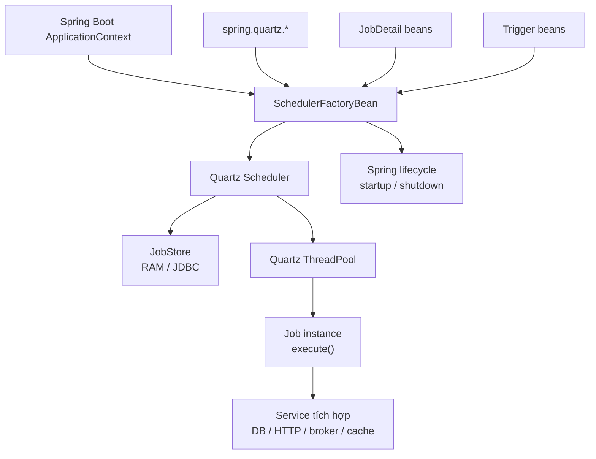
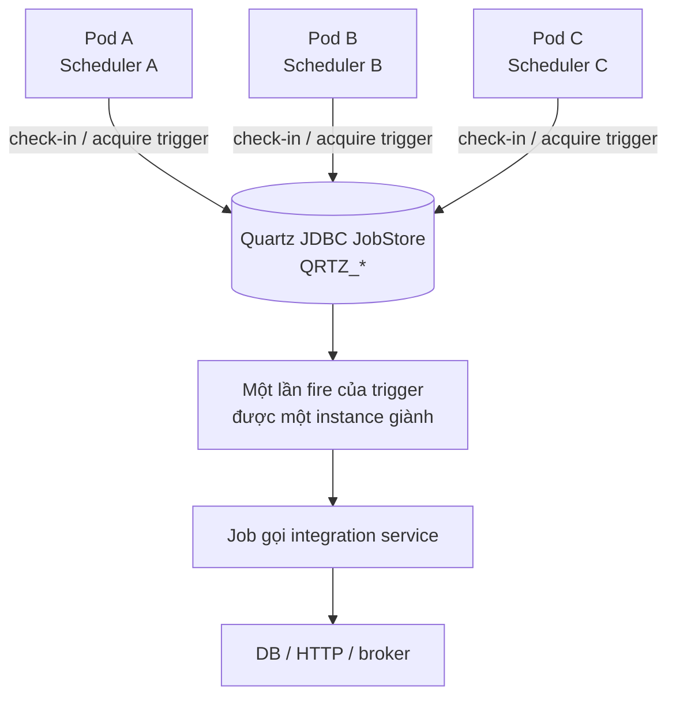
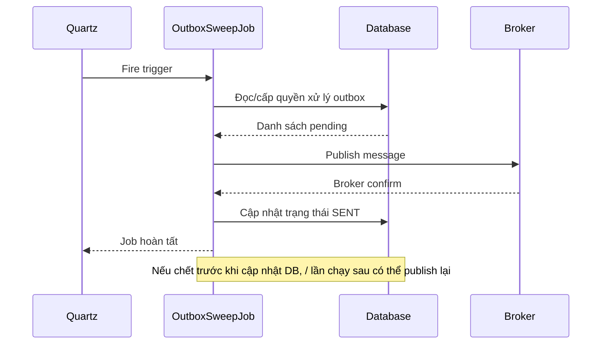

# spring-boot-starter-quartz và SchedulerFactoryBean

## 1. Quartz giải quyết vấn đề gì trong Spring Boot Integration?

Trong một hệ thống tích hợp, không phải thao tác nào cũng được kích hoạt ngay bởi HTTP request hay thông điệp từ broker. Nhiều tác vụ cần chạy **theo thời gian** hoặc **được lập lịch động**: quét outbox để gửi sự kiện còn tồn đọng, đồng bộ dữ liệu đối tác vào ban đêm, kiểm tra những giao dịch chưa có phản hồi, làm sạch bản ghi idempotency đã hết hạn hoặc thử lại một yêu cầu tích hợp sau một khoảng trì hoãn.

**Quartz** là thư viện lập lịch tác vụ của Java, cung cấp khái niệm job, trigger, lịch thực thi và bộ lưu trữ trạng thái lịch. Trong module **SPRING_BOOT_INTEGRATION**, Quartz là thành phần điều phối *khi nào một công việc tích hợp cần bắt đầu*. Nó kết hợp với HTTP client, cơ sở dữ liệu, cache, message broker và adapter của Spring Integration để thực hiện công việc; bản thân Quartz không thay thế những cơ chế này.

Hai thành phần quan trọng nhất của bài:

- **`spring-boot-starter-quartz`** cung cấp dependency và kích hoạt tự cấu hình Quartz theo quy ước của Spring Boot.
- **`SchedulerFactoryBean`** là lớp tích hợp của Spring Framework dùng để tạo, cấu hình và quản lý vòng đời một `org.quartz.Scheduler` trong application context.

Sau bài học, bạn có thể lựa chọn giữa Quartz và `@Scheduled`, khai báo job/trigger, cấu hình `spring.quartz.*`, lựa chọn `RAMJobStore` hoặc JDBC JobStore, hiểu tác động khi chạy nhiều replica và thiết kế tác vụ tích hợp an toàn trước lỗi, thực thi lại và thay đổi phiên bản ứng dụng.

> Phạm vi: Ví dụ dùng Spring Boot với Quartz qua starter chính thức. API, property và cấu hình cụ thể cần được đối chiếu với phiên bản Spring Boot/Spring Framework/Quartz của dự án khi triển khai. Ví dụ PostgreSQL và cron bên dưới là minh họa, không có nghĩa mọi cơ sở dữ liệu đều dùng cùng DDL hoặc đặc tính khóa.

## 2. Khi nào dùng Quartz thay vì @Scheduled?

Spring Framework đã có `@Scheduled` để chạy các method định kỳ. Quartz hữu ích khi cần lưu trạng thái lịch, quản lý nhiều trigger, điều khiển lịch động và phối hợp lịch giữa nhiều instance thông qua JDBC JobStore.

| Nhu cầu | `@Scheduled` | Quartz |
| --- | --- | --- |
| Chạy method mỗi vài phút trong một tiến trình | Đơn giản, ít cấu hình | Có thể dùng nhưng nhiều thành phần hơn |
| Đăng ký/sửa/xóa lịch động lúc runtime | Cần tự xây thêm lớp quản lý | Có API `Scheduler`, `JobKey`, `TriggerKey` |
| Lưu job/trigger để còn tồn tại sau khi restart | Không tự cung cấp kho lịch bền vững | Có JDBC JobStore nếu cấu hình |
| Nhiều replica nhưng mỗi lần kích hoạt chỉ một node nhận trigger trong cluster | Mỗi instance thường có lịch riêng; cần phối hợp bên ngoài | Quartz JDBC clustering có cơ chế giành trigger |
| Chính sách misfire, pause/resume, group job | Cần xây riêng hoặc giới hạn | Có các khả năng lập lịch chuyên dụng |
| Đồng bộ API đơn giản, không cần lưu lịch | Thường phù hợp | Cần cân nhắc độ phức tạp bổ sung |

**Không hiểu Quartz cluster là đảm bảo “exactly once” cho nghiệp vụ.** Quartz có thể phối hợp quyền chạy một trigger giữa các instance dùng chung JDBC JobStore, nhưng một job vẫn có thể được phục hồi/chạy lại khi tiến trình gặp sự cố; side effect ở database, HTTP hoặc broker phải idempotent.

Ví dụ chọn công cụ:

- Gửi heartbeat từ một tiến trình thử nghiệm mỗi 30 giây: `@Scheduled` có thể đủ.
- Quản lý lịch đối soát cho hàng trăm đối tác, có thể tạm dừng, đổi thời gian và duy trì qua restart: Quartz phù hợp hơn.
- Một HTTP callback phải được xử lý ngay và retry theo quy tắc giao nhận: HTTP adapter, queue, outbox và retry mechanism vẫn là các thành phần chính; Quartz chỉ phù hợp nếu cần kích hoạt công việc theo thời điểm.
- Job xử lý tập dữ liệu rất lớn, cần partition/restart theo từng bước: cân nhắc kết hợp Quartz để *khởi chạy* một Spring Batch job, còn Spring Batch quản lý các bước và checkpoint.

## 3. Các khái niệm chính và vai trò của SchedulerFactoryBean



| Thành phần | Chức năng | Ví dụ |
| --- | --- | --- |
| `Job` | Đoạn xử lý được Quartz gọi khi một lần thực thi bắt đầu | Quét các bản ghi outbox chưa gửi |
| `JobDetail` | Định danh job, lớp job, `JobDataMap` và các thuộc tính như durable/recovery | Job `integration.outbox-sweep` |
| `Trigger` | Quy định điều kiện hoặc thời gian kích hoạt một job | Chạy mỗi 5 phút bằng CronTrigger |
| `Scheduler` | Quản lý đăng ký job/trigger, pause, resume, kích hoạt và phối hợp thực thi | `scheduleJob`, `rescheduleJob` |
| `JobStore` | Lưu trạng thái job/trigger và các thông tin Quartz cần | Bộ nhớ RAM hoặc bảng `QRTZ_*` |
| Quartz thread pool | Cấp luồng chạy các job đã đến hạn | Tối đa số job chạy đồng thời theo cấu hình |
| `SchedulerFactoryBean` | Tích hợp `Scheduler` với Spring, liên kết properties, data source, bean job/trigger và vòng đời | Bean do Spring Boot tạo từ auto-configuration |

**JobDetail không phải lịch:** một JobDetail có thể có một hoặc nhiều trigger. **Trigger không chứa nghiệp vụ:** nó quyết định khi nào Quartz thực thi JobDetail tương ứng. **SchedulerFactoryBean không phải job:** nó tạo và quản lý Quartz Scheduler, đồng thời nhận JobDetail/Trigger do Spring cấu hình.

Một luồng thường diễn ra như sau:

1. Application context khởi tạo `SchedulerFactoryBean`.
2. Factory tạo hoặc kết nối `Scheduler`, chuẩn bị JobStore, thread pool và đăng ký các job/trigger khai báo qua bean.
3. Khi tới lịch, Quartz lấy trigger đến hạn và tạo job instance theo JobFactory.
4. Job gọi service nghiệp vụ, ví dụ tải trang dữ liệu từ API đối tác hoặc gửi message từ outbox.
5. Quartz cập nhật trạng thái trigger và chờ lần thực thi tiếp theo; transaction của service nghiệp vụ vẫn cần thiết kế riêng.

## 4. Cài đặt spring-boot-starter-quartz

### Maven

Với Spring Boot parent/BOM đã quản lý dependency:

```xml
<dependency>
    <groupId>org.springframework.boot</groupId>
    <artifactId>spring-boot-starter-quartz</artifactId>
</dependency>
```

### Gradle

```groovy
dependencies {
    implementation 'org.springframework.boot:spring-boot-starter-quartz'
}
```

Starter kéo theo các thư viện Quartz và phần tích hợp Spring cần thiết. Cần thêm starter JDBC hoặc dependency datasource/database driver nếu chọn lưu job bằng JDBC. Để giảm lỗi tương thích, dùng dependency management/BOM của Spring Boot thay vì cố định độc lập phiên bản Quartz không cần thiết.

Khi điều kiện tự cấu hình đáp ứng và ứng dụng chưa tự cung cấp Scheduler tương ứng, Spring Boot thường tạo `SchedulerFactoryBean` và một `Scheduler` có thể inject vào service. Các bean kiểu `JobDetail`, `Trigger` và `Calendar` được đưa vào cấu hình scheduler theo cơ chế tự động của Spring Boot.

Starter **không tự tạo cơ sở dữ liệu nghiệp vụ**, không tự chạy HTTP integration flow, và việc có Quartz trong classpath không đồng nghĩa mọi `Job` sẽ tự được lập lịch. Cần khai báo JobDetail và trigger hoặc đăng ký lịch bằng `Scheduler`.

## 5. Ví dụ đầy đủ: lập lịch quét outbox mỗi 5 phút

Giả sử một dịch vụ nhận yêu cầu HTTP, ghi sự kiện tích hợp vào bảng outbox và cần định kỳ quét những bản ghi chưa xuất bản sang broker. Ta tách việc **lập lịch** ra khỏi **logic giao nhận** để có thể kiểm thử, tái sử dụng và quản lý transaction.

### 5.1. Job gọi service nghiệp vụ

```java
import org.quartz.DisallowConcurrentExecution;
import org.quartz.JobExecutionContext;
import org.quartz.JobExecutionException;
import org.springframework.scheduling.quartz.QuartzJobBean;

@DisallowConcurrentExecution
public class OutboxSweepJob extends QuartzJobBean {

    private final OutboxDispatchService outboxDispatchService;

    public OutboxSweepJob(OutboxDispatchService outboxDispatchService) {
        this.outboxDispatchService = outboxDispatchService;
    }

    @Override
    protected void executeInternal(JobExecutionContext context)
            throws JobExecutionException {
        try {
            outboxDispatchService.dispatchPending(100);
        } catch (Exception ex) {
            // Giữ thông tin lỗi để Quartz và cơ chế quan sát nhận biết.
            throw new JobExecutionException("Outbox sweep failed", ex);
        }
    }
}
```

`OutboxDispatchService` là service nghiệp vụ **do dự án hiện thực**; ví dụ trên giả định một bean triển khai đã được đăng ký và có phương thức `dispatchPending(int batchSize)`. Service cần tự quản lý transaction, tình trạng bản ghi và bảo đảm xử lý trùng. Không gửi message một cách mù quáng mỗi lần job chạy.

Với cấu hình tích hợp Quartz mặc định của những phiên bản Spring Boot hỗ trợ autowire job, các dependency Spring có thể được inject vào job instance. Nếu ứng dụng thay `JobFactory` bằng triển khai riêng, phải kiểm tra lại cơ chế tạo job và dependency injection; Quartz thuần túy không mặc nhiên dùng Spring để khởi tạo đối tượng.

`@DisallowConcurrentExecution` yêu cầu Quartz không chạy đồng thời **các lần thực thi của cùng một JobDetail/JobKey**. Nó không chặn một công việc tương đương do HTTP endpoint, một job key khác, ứng dụng khác hoặc worker broker thực hiện. Vì thế vẫn cần idempotency tại lớp dữ liệu.

### 5.2. Định nghĩa JobDetail và CronTrigger

```java
import java.util.TimeZone;

import org.quartz.CronScheduleBuilder;
import org.quartz.JobBuilder;
import org.quartz.JobDetail;
import org.quartz.Trigger;
import org.quartz.TriggerBuilder;
import org.springframework.beans.factory.annotation.Qualifier;
import org.springframework.context.annotation.Bean;
import org.springframework.context.annotation.Configuration;

@Configuration
public class OutboxQuartzConfiguration {

    @Bean
    JobDetail outboxJobDetail() {
        return JobBuilder.newJob(OutboxSweepJob.class)
            .withIdentity("outbox-sweep", "integration")
            .withDescription("Dispatch pending integration outbox messages")
            .storeDurably()
            .build();
    }

    @Bean
    Trigger outboxSweepTrigger(
            @Qualifier("outboxJobDetail") JobDetail jobDetail) {

        return TriggerBuilder.newTrigger()
            .forJob(jobDetail)
            .withIdentity("outbox-every-5-minutes", "integration")
            .withSchedule(
                CronScheduleBuilder.cronSchedule("0 0/5 * * * ?")
                    .inTimeZone(TimeZone.getTimeZone("Asia/Ho_Chi_Minh"))
                    .withMisfireHandlingInstructionDoNothing()
            )
            .build();
    }
}
```

Đoạn mã tạo một JobDetail khóa `integration.outbox-sweep` và trigger chạy vào giây thứ 0 của các mốc phút 0, 5, 10,... theo múi giờ `Asia/Ho_Chi_Minh`. `storeDurably()` cho phép JobDetail tồn tại dù không còn trigger; điều này hữu ích khi quản lý lịch linh hoạt nhưng không bắt buộc với mọi job.

`withMisfireHandlingInstructionDoNothing()` yêu cầu CronTrigger **bỏ qua những lần kích hoạt đã bị lỡ** và chờ lần hợp lệ kế tiếp. Chính sách này hợp lý cho việc *quét trạng thái hiện tại* vì một lần quét tiếp theo có thể bao phủ các bản ghi tồn đọng. Nó có thể **sai** nếu nghiệp vụ yêu cầu lưu vết mỗi lần chạy theo ngày, ví dụ chốt sổ cuối ngày. Cần chọn misfire policy theo hợp đồng nghiệp vụ.

Trong dự án thật, giá trị cron, zone và kích thước batch thường được externalize để môi trường có thể điều chỉnh mà không sửa mã. Nếu dùng JDBC JobStore và lịch đã tồn tại, cần kết hợp quy tắc cập nhật trigger ở mục 9.

### 5.3. Vì sao không đặt toàn bộ nghiệp vụ trong executeInternal?

Một job có thể chết sau khi ghi dữ liệu thành công nhưng trước khi Quartz ghi nhận kết quả; nó cũng có thể được kích hoạt lại thủ công hoặc chạy sau một lần retry vận hành. Bởi vậy, `executeInternal` chỉ nên:

- Chuyển ngữ cảnh chạy như `fireInstanceId`, thời điểm trigger, correlation ID đến service nếu cần.
- Gọi service có biên transaction, timeout và retry thích hợp.
- Ném lỗi có ý nghĩa khi tác vụ thất bại; tránh bắt mọi exception rồi luôn trả về thành công.
- Không giữ tài nguyên kết nối trong suốt thời gian chờ không giới hạn.
- Tránh phụ thuộc trực tiếp vào trạng thái trong bộ nhớ của một replica.

## 6. Cấu hình spring.quartz.* trong application.yml

Ví dụ tối giản dùng **RAMJobStore**, phù hợp môi trường local hoặc demo mà lịch không cần tồn tại qua restart:

```yaml
spring:
  quartz:
    scheduler-name: integration-scheduler
    job-store-type: memory
    auto-startup: true
    startup-delay: 0s
    wait-for-jobs-to-complete-on-shutdown: true
```

| Thuộc tính | Ý nghĩa | Lưu ý triển khai |
| --- | --- | --- |
| `spring.quartz.scheduler-name` | Tên Quartz scheduler | Dùng giá trị nhất quán, đặc biệt khi cấu hình cluster |
| `spring.quartz.job-store-type` | Chọn `memory` hoặc `jdbc` | `memory` không lưu lịch bền vững giữa những lần khởi động |
| `spring.quartz.auto-startup` | Có tự start scheduler theo vòng đời Spring hay không | Nếu tắt, phải điều khiển start có chủ đích |
| `spring.quartz.startup-delay` | Khoảng trễ trước khi scheduler bắt đầu chạy job | Không thay thế readiness kiểm tra dependency |
| `spring.quartz.wait-for-jobs-to-complete-on-shutdown` | Chờ job đang chạy hoàn tất khi đóng scheduler | Cần giới hạn thời gian công việc để shutdown không treo |
| `spring.quartz.overwrite-existing-jobs` | Có ghi đè định nghĩa job đã lưu bằng bean job/trigger khi khởi động không | Rất quan trọng với JDBC JobStore và thay đổi lịch qua các phiên bản |
| `spring.quartz.properties.*` | Truyền các thuộc tính gốc `org.quartz.*` | Dùng cho instanceId, clustering, threadPool, JobStore tuning... |
| `spring.quartz.jdbc.initialize-schema` | Cách chạy script tạo bảng Quartz khi dùng JDBC | Không để chạy lại script phá dữ liệu production |
| `spring.quartz.jdbc.schema` | Vị trí script schema Quartz tùy biến nếu dùng cơ chế initializer | Phải đúng dialect/version database |

Có hai lớp cấu hình liên quan nhưng khác nhau:

1. **Thuộc tính Spring Boot `spring.quartz.*`** được bind vào cấu hình của Spring Boot rồi truyền cho `SchedulerFactoryBean`.
2. **Thuộc tính Quartz `org.quartz.*`** được chuyển tiếp qua `spring.quartz.properties.*`, ví dụ `org.quartz.threadPool.threadCount`.

Không nhầm `spring.task.scheduling.pool.size` (dùng cho cơ chế task scheduling của Spring) với số luồng job của **Quartz**. Khi dùng Quartz, điều chỉnh thread pool bằng thuộc tính hoặc cấu hình dành cho Quartz.

## 7. SchedulerFactoryBean: tự cấu hình, vòng đời và tùy biến

`SchedulerFactoryBean` thuộc `org.springframework.scheduling.quartz` và hiện thực `FactoryBean<Scheduler>`. Nó nhận các thành phần như `JobDetail`, `Trigger`, `DataSource`, thuộc tính Quartz, JobFactory và listeners; sau đó quản lý scheduler qua lifecycle của Spring.

Trong một ứng dụng dùng starter bình thường:

```java
import org.quartz.Scheduler;
import org.quartz.SchedulerException;
import org.springframework.stereotype.Service;

@Service
public class QuartzScheduleInspector {

    private final Scheduler scheduler;

    public QuartzScheduleInspector(Scheduler scheduler) {
        this.scheduler = scheduler;
    }

    public boolean isRunning() throws SchedulerException {
        return scheduler.isStarted() && !scheduler.isShutdown();
    }
}
```

Inject `Scheduler` để quản lý hoặc quan sát lịch, thay vì tự tạo một `StdSchedulerFactory` mới. Nếu tự dựng factory khác, bạn có thể vô tình tạo hai scheduler với cấu hình JobStore, thread pool hoặc dữ liệu lịch không đồng nhất.

### Khi nào sử dụng SchedulerFactoryBeanCustomizer?

Spring Boot cung cấp cơ chế **`SchedulerFactoryBeanCustomizer`** để chỉnh những tùy chọn của factory mà thuộc tính YAML chưa biểu đạt đủ, ví dụ đăng ký một JobListener do Spring quản lý hoặc cấu hình cụ thể của hệ thống hiện có. Ưu tiên các thuộc tính `spring.quartz.*` cho nhu cầu thông thường; customizer giúp giữ auto-configuration thay vì thay cả `SchedulerFactoryBean` bằng bean tự dựng.

Ví dụ khái niệm về customizer:

```java
import org.quartz.JobListener;
import org.springframework.boot.autoconfigure.quartz.SchedulerFactoryBeanCustomizer;
import org.springframework.context.annotation.Bean;
import org.springframework.context.annotation.Configuration;

@Configuration
public class QuartzCustomization {

    @Bean
    SchedulerFactoryBeanCustomizer registerJobAuditListener(
            JobListener auditJobListener) {
        return factory -> factory.setGlobalJobListeners(auditJobListener);
    }
}
```

Ví dụ giả định `auditJobListener` đã được cung cấp dưới dạng bean. Mỗi listener phải được thiết kế nhẹ, bắt lỗi phù hợp và tránh làm chậm worker thread. Trong một số phiên bản/package Spring Boot, tên package của auto-configuration có thể thay đổi khi nâng cấp lớn, vì vậy cần đối chiếu dependency phiên bản đang dùng trước khi sao chép import.

**Trường hợp cần tự định nghĩa `SchedulerFactoryBean`:** chỉ khi có yêu cầu đặc biệt mà starter/customizer không giải quyết. Khi cung cấp bean riêng, auto-configuration có thể rút lui; bạn phải tự xét lại việc gắn JobDetail/Trigger, DataSource, transaction manager, cấu hình thuộc tính và lifecycle. Việc tự tạo bean không phải bước cần thiết để dùng Quartz bình thường.

## 8. RAMJobStore và JDBC JobStore

### RAMJobStore

Với `spring.quartz.job-store-type=memory`, job/trigger được lưu trong bộ nhớ của scheduler. Đặc điểm:

- Triển khai đơn giản; không cần bảng Quartz.
- Khi tiến trình dừng, lịch và trạng thái trong RAM không được bảo toàn.
- Nếu có hai ứng dụng/replica cùng cấu hình job, mỗi scheduler RAM có thể thực thi lịch độc lập.
- Phù hợp dev, thử nghiệm hoặc công việc không yêu cầu lịch bền vững và không có ràng buộc một lần chạy trên toàn hệ thống.

### JDBC JobStore

Với `spring.quartz.job-store-type=jdbc`, Quartz lưu JobDetail, trigger, trạng thái và thông tin phối hợp trong cơ sở dữ liệu. Các bảng thường có prefix `QRTZ_`, chẳng hạn `QRTZ_JOB_DETAILS`, `QRTZ_TRIGGERS`, `QRTZ_CRON_TRIGGERS`, `QRTZ_FIRED_TRIGGERS` và `QRTZ_LOCKS`. Danh sách bảng/cú pháp DDL thực tế phụ thuộc phiên bản Quartz và database.

Ví dụ khai báo cơ bản:

```yaml
spring:
  datasource:
    url: ${DB_URL}
    username: ${DB_USER}
    password: ${DB_PASSWORD}

  quartz:
    scheduler-name: integration-scheduler
    job-store-type: jdbc
    jdbc:
      initialize-schema: never
    overwrite-existing-jobs: false
```

Ở đây `initialize-schema: never` **giả định bảng Quartz đã được tạo qua migration** và đúng phiên bản/dialect. Spring Boot có cơ chế script initialization cho Quartz, nhưng các script chuẩn do Quartz cung cấp có thể **xóa bảng hiện có trước khi tạo lại**, làm mất lịch và trigger. Vì vậy tuyệt đối không bật `spring.quartz.jdbc.initialize-schema=always` trong production nếu chưa xem kỹ nội dung script và hậu quả. Cách được ưu tiên cho hệ thống cần lưu lịch là đưa DDL Quartz đúng phiên bản vào Flyway/Liquibase, áp dụng đúng một lần trước khi scheduler sử dụng.

`spring.jpa.hibernate.ddl-auto` **không** tạo các bảng `QRTZ_*` thay cho Quartz DDL. Cũng không nên lấy một schema SQL trên internet dành cho phiên bản/DB khác rồi áp dụng trực tiếp.

### DataSource riêng cho Quartz

Khi ứng dụng dùng một database cho nghiệp vụ nhưng muốn Quartz dùng datasource khác, Spring Boot hỗ trợ đánh dấu bean chuyên dùng, ví dụ `@QuartzDataSource` và trong trường hợp phù hợp là `@QuartzTransactionManager`. Cần quản lý migration, connection pool và credential cho đúng datasource được chọn.

Tách datasource có thể giảm ảnh hưởng lẫn nhau giữa tải business query và tải trigger/lock, nhưng không tự biến transaction của hai database thành một transaction phân tán. Nếu Quartz và dữ liệu nghiệp vụ không cùng một transaction boundary, cần thiết kế khả năng phục hồi như transactional outbox hoặc checkpoint bền vững.

### Dữ liệu JobDataMap trong JDBC JobStore

Không đưa `DataSource`, HTTP client, Spring bean, access token hoặc đối tượng nghiệp vụ lớn vào `JobDataMap`. Chỉ lưu ID, loại tác vụ, phiên bản hợp đồng hoặc tham số đơn giản. Job dùng ID để tải trạng thái mới nhất từ database/service.

Nếu bật `org.quartz.jobStore.useProperties=true`, hãy thiết kế các giá trị JobDataMap có thể biểu diễn dưới dạng chuỗi. Nếu dùng lưu dạng Java object/serialization, việc đổi tên package, class hoặc version có thể phá khả năng đọc lịch đã lưu. Không xem JobDataMap là kho lưu dữ liệu nghiệp vụ.

## 9. Clustering nhiều replica với JDBC JobStore

Giả sử deployment có ba pod Spring Boot, mỗi pod có SchedulerFactoryBean riêng nhưng dùng cùng một database Quartz. Để chúng phối hợp trigger thay vì mỗi pod tự chạy lịch, cần cấu hình **Quartz clustering** thống nhất.

Ví dụ trong `application.properties` cho một cụm có bảng Quartz đã migrate:

```properties
spring.quartz.scheduler-name=integration-scheduler
spring.quartz.job-store-type=jdbc
spring.quartz.jdbc.initialize-schema=never

spring.quartz.properties.org.quartz.scheduler.instanceId=AUTO
spring.quartz.properties.org.quartz.jobStore.isClustered=true
spring.quartz.properties.org.quartz.jobStore.clusterCheckinInterval=15000
spring.quartz.properties.org.quartz.threadPool.threadCount=8
```

Các instance trong **cùng một Quartz cluster** cần dùng chung scheduler name, cùng bộ bảng/prefix JobStore phù hợp và `instanceId` phân biệt; `AUTO` là một lựa chọn để Quartz tự tạo ID cho từng instance. Database phải hỗ trợ cơ chế locking cần thiết, các máy nên đồng bộ thời gian, và không được lẫn một scheduler cấu hình nonclustered vào cùng tập bảng đang dùng bởi cluster.



Ý nghĩa đúng của clustering: Quartz phối hợp **quyền lấy trigger** giữa các instance đang hoạt động. Quartz không bảo đảm tác động HTTP/SQL/broker xảy ra duy nhất một lần. Khi pod chết sau khi gửi message nhưng trước khi lưu tiến độ, message có thể cần gửi lại; phải nhận diện được sự kiện trùng.

Cần cân nhắc thêm:

- **Thread pool nhân theo replica:** `threadCount=8` ở ba pod có thể cho phép nhiều job chạy đồng thời trên toàn cụm. Không hiểu 8 là giới hạn tổng.
- **Áp lực database:** nhiều pod cùng polling, khóa bảng Quartz, cập nhật trigger và xử lý nghiệp vụ có thể tạo tải lớn.
- **Đồng hồ hệ thống:** độ lệch thời gian lớn ảnh hưởng việc đánh giá trigger và cluster check-in; cần time synchronization.
- **Chiến lược recovery:** cấu hình request recovery cho JobDetail khi thích hợp; job phục hồi phải an toàn với side effect lặp.
- **Chế độ bảo trì:** khi migrate bảng Quartz hoặc nâng phiên bản, kiểm soát sự tương thích của các scheduler cũ và mới.

## 10. Cron, SimpleTrigger, time zone và misfire

### CronTrigger

Quartz cron thường có **6 trường bắt buộc**: giây, phút, giờ, ngày trong tháng, tháng, ngày trong tuần; trường năm có thể tùy chọn. Nó không hoàn toàn giống cron 5 trường trên Linux.

| Quartz cron | Cách hiểu ví dụ | Phù hợp cho |
| --- | --- | --- |
| `0 0/5 * * * ?` | Cứ 5 phút, tại giây 0 | Quét outbox hoặc trạng thái chờ |
| `0 0 2 * * ?` | 02:00 mỗi ngày theo time zone của trigger | Đối soát ban đêm |
| `0 30 8 ? * MON-FRI` | 08:30, từ thứ Hai đến thứ Sáu | Lịch ngày làm việc; chưa tính ngày lễ |
| `0 0 0 1 * ?` | 00:00 ngày đầu mỗi tháng | Tổng hợp dữ liệu theo tháng |

Ký tự `?` thường dùng ở trường day-of-month hoặc day-of-week khi không chỉ định trường đó. Với tác vụ theo ngày/tuần/tháng, cần khai báo time zone rõ ràng: một trigger chạy lúc 02:00 `Asia/Ho_Chi_Minh` khác 02:00 UTC. Ở khu vực có daylight saving time, thời điểm giờ địa phương bị bỏ qua hoặc lặp lại có thể ảnh hưởng số lần chạy; phải có quy tắc nghiệp vụ.

### SimpleTrigger

Khi chỉ cần khoảng thời gian cố định và số lần chạy giới hạn, `SimpleTrigger` có thể dễ hiểu hơn cron:

```java
import org.quartz.SimpleScheduleBuilder;
import org.quartz.Trigger;
import org.quartz.TriggerBuilder;

Trigger trigger = TriggerBuilder.newTrigger()
    .withIdentity("retry-check-every-30-seconds", "integration")
    .startNow()
    .withSchedule(
        SimpleScheduleBuilder.simpleSchedule()
            .withIntervalInSeconds(30)
            .repeatForever()
    )
    .build();
```

Ví dụ này tạo một trigger độc lập; để Quartz thực thi, trigger phải được liên kết với JobDetail qua `.forJob(...)` và được đăng ký với Scheduler. Trong production, để điều phối các lần retry cá biệt cho từng business event, có thể cần lưu trạng thái retry trong bảng nghiệp vụ và để job định kỳ quét, thay vì tạo hàng triệu trigger đơn lẻ mà không kiểm soát tải và vòng đời.

### Misfire là gì?

Misfire xảy ra khi một trigger lỡ thời điểm cần chạy quá ngưỡng Quartz xác định, ví dụ scheduler bị dừng, thread pool cạn hoặc database tạm thời không sẵn sàng. Quartz cho phép các instruction khác nhau tùy trigger:

- **Cron + `DoNothing`:** bỏ qua lần bắn đã lỡ và chờ lịch tiếp theo.
- **Cron + `FireAndProceed`:** kích hoạt bù một lần rồi trở lại chu kỳ tiếp theo.
- **SimpleTrigger:** có những chiến lược liên quan tới remaining/existing repeat count và mốc thời gian bắn tiếp theo.

Không có chính sách misfire chung cho tất cả công việc. Đối với job quét tồn đọng, lần quét kế tiếp có thể bù đủ dữ liệu. Với tác vụ tạo báo cáo từng ngày, nếu bỏ qua lịch ngày hôm qua có thể mất một kỳ báo cáo; khi đó cần tính toán **business period** độc lập và ghi nhận kỳ nào đã hoàn thành.

## 11. Đăng ký, thay đổi và xóa lịch động bằng Scheduler

Các bean `JobDetail`/`Trigger` phù hợp với lịch tĩnh được quản lý cùng code. Nếu mỗi đối tác có lịch riêng có thể thay đổi trong runtime, sử dụng `Scheduler` API:

| Thao tác | API Quartz thường dùng | Điểm cần lưu ý |
| --- | --- | --- |
| Đăng ký job với trigger | `scheduleJob(jobDetail, trigger)` | Khóa `JobKey` và `TriggerKey` phải được quản lý nhất quán |
| Thay lịch của trigger | `rescheduleJob(triggerKey, newTrigger)` | `newTrigger` phải liên kết đúng job, cập nhật trên JDBC JobStore |
| Tạm dừng trigger/job | `pauseTrigger` / `pauseJob` | Pause không nhất thiết dừng job đang chạy |
| Tiếp tục chạy | `resumeTrigger` / `resumeJob` | Cần xét misfire nếu lịch bị bỏ lỡ |
| Xóa job | `deleteJob` | Có thể xóa các trigger liên quan; xác định hậu quả trước khi xóa |
| Kiểm tra trạng thái | `checkExists` / `getTriggerState` | Trạng thái có thể thay đổi ngay sau khi đọc dưới tác động song song |

Ví dụ thay trigger đã tồn tại:

```java
import org.quartz.CronScheduleBuilder;
import org.quartz.Scheduler;
import org.quartz.SchedulerException;
import org.quartz.Trigger;
import org.quartz.TriggerBuilder;
import org.quartz.TriggerKey;
import org.springframework.stereotype.Service;

@Service
public class PartnerScheduleService {

    private final Scheduler scheduler;

    public PartnerScheduleService(Scheduler scheduler) {
        this.scheduler = scheduler;
    }

    public void updateSchedule(String cronExpression)
            throws SchedulerException {

        TriggerKey key =
            TriggerKey.triggerKey("outbox-every-5-minutes", "integration");

        Trigger updated = TriggerBuilder.newTrigger()
            .withIdentity(key)
            .forJob("outbox-sweep", "integration")
            .withSchedule(
                CronScheduleBuilder.cronSchedule(cronExpression)
                    .withMisfireHandlingInstructionDoNothing()
            )
            .build();

        if (scheduler.rescheduleJob(key, updated) == null) {
            throw new IllegalStateException("Trigger does not exist");
        }
    }
}
```

Ví dụ cố tình tối giản; trong API thật phải validate `cronExpression`, time zone, quyền người sửa lịch, giới hạn tần suất, audit trail và lịch sử thay đổi. Cần bảo vệ thao tác cập nhật trong trường hợp nhiều người hoặc nhiều replica đồng thời sửa cùng trigger. Nếu tên job/trigger đến từ input người dùng, không cho phép tự ý truy cập job của đối tác khác.

### overwrite-existing-jobs và dữ liệu lịch đã lưu

Khi dùng JDBC JobStore, các JobDetail/Trigger có thể tồn tại từ bản phát hành trước hoặc đã được sửa qua API. Việc thêm bean trigger mới trong code **không có nghĩa** lúc restart lịch cũ luôn bị thay thế. Thuộc tính `spring.quartz.overwrite-existing-jobs` quyết định chiến lược ghi đè các định nghĩa do factory đăng ký lên đối tượng đã tồn tại.

Hãy xác định nguồn sở hữu lịch:

- **Lịch tĩnh theo mã nguồn:** thay đổi cron có thể được đưa qua release và migration cấu hình có kiểm soát.
- **Lịch động theo người dùng/đối tác:** cần bảo toàn các thay đổi runtime; không nên bật ghi đè tất cả mỗi lần deploy.
- **Kết hợp:** tách rõ tên nhóm JobKey/TriggerKey hoặc cơ chế đồng bộ chính sách để không tranh chấp quyền sở hữu lịch.

## 12. Concurrency, idempotency và transaction

Quartz có thể bảo đảm một JobDetail không chạy chồng lấn qua `@DisallowConcurrentExecution` khi sử dụng đúng một JobKey và cluster thích hợp. Tuy nhiên, thực thi qua HTTP/SQL/broker vẫn có nhiều điểm lỗi:



**Lưu ý:** Sơ đồ `sequenceDiagram` thể hiện một luồng tham khảo; trong thực tế cần dùng lock/lease, transaction, publisher confirm/return và cơ chế cứu dữ liệu nếu một bước thất bại. Nếu câu lệnh publish ở broker thành công nhưng cập nhật trạng thái SQL thất bại, job chạy lại có thể publish lần nữa. Đây là lý do các consumer nhận message phải dựa vào `eventId` để xử lý idempotent.

Một thiết kế thực tế thường gồm:

1. Ghi thay đổi nghiệp vụ và outbox trong **cùng transaction database** khi nhận HTTP request.
2. Job Quartz chọn một lô outbox cần xử lý; nếu có nhiều worker, dùng cơ chế claim/lease/lock thích hợp.
3. Publisher gửi với correlation ID, theo dõi confirm và trạng thái unroutable/return.
4. Cập nhật kết quả gửi, số lần thử và `nextAttemptAt` vào database theo transaction phù hợp.
5. Consumer downstream chống xử lý trùng dựa vào khóa sự kiện ổn định.
6. Các sự kiện lỗi lâu dài được đưa vào quy trình điều tra hoặc dead-letter, thay vì retry vô hạn.

**Không giả định transaction của SchedulerFactoryBean và transaction của service nghiệp vụ tự hợp nhất.** Đặc biệt khi Quartz dùng datasource riêng, việc đăng ký lịch và ghi dữ liệu nghiệp vụ có thể xảy ra trong những transaction khác nhau. Nếu yêu cầu hai bước phải nhất quán, hãy định nghĩa chiến lược recover/reconcile rõ ràng.

### Exception và retry ở cấp job

`JobExecutionException` cho phép job thông báo lỗi tới Quartz, và một số cờ có thể yêu cầu refire ngay hoặc unschedule trigger/job. **Đừng bật refireImmediately liên tục** để xử lý một API đang chết; nó có thể tạo vòng lặp nóng, bão tải và che khuất backoff nghiệp vụ.

Nhiều tình huống tích hợp phù hợp hơn với việc lưu `retryCount`, `nextAttemptAt` và kết quả cuối cùng trong bảng dữ liệu; Quartz chỉ quét những bản ghi đến hạn. Khi broker/HTTP downstream quá tải, dùng timeout, retry có giới hạn, exponential backoff và circuit breaker ở adapter.

## 13. Shutdown, recovery và tính sẵn sàng

Lifecycle của scheduler gắn với application context:

- Khi application context khởi tạo và `auto-startup=true`, scheduler được start theo lifecycle; `startup-delay` cho phép trì hoãn.
- Khi shutdown, `wait-for-jobs-to-complete-on-shutdown=true` yêu cầu chờ các job đang chạy. Một job block vô thời hạn vì HTTP timeout không hợp lý có thể làm chậm shutdown đáng kể.
- Scheduler có thể tạm ngừng hoặc gặp vấn đề nếu database JobStore mất kết nối. Cần kiểm tra log, khả năng khôi phục và policy restart.
- Job có thể cần recovery sau sự cố; `JobBuilder.requestRecovery(true)` biểu thị ý định recovery đối với job phù hợp, nhưng không thay thế transaction/idempotency.
- Dù scheduler có trạng thái started, nó không chứng minh tất cả trigger đều chạy đúng, không có misfire hoặc downstream khỏe mạnh.

Ví dụ một job có thể chạy 20 phút nhưng triển khai pod có termination grace period 30 giây: cần điều chỉnh thời hạn xử lý, chia nhỏ batch/ghi checkpoint, hoặc thiết kế job an toàn khi bị dừng và chạy lại. Chỉ bật chờ shutdown không thể đảm bảo Kubernetes sẽ đợi vô hạn.

Với hệ thống yêu cầu cao, hãy quyết định rõ lịch phải **skip**, **bù một lần**, hay **chạy đủ từng kỳ** sau downtime. Quartz misfire policy xử lý lịch thực thi; dữ liệu nghiệp vụ có thể cần bảng checkpoint theo kỳ riêng.

## 14. Kiểm thử tích hợp Quartz

Không chỉ kiểm tra rằng `Job` được gọi khi test. Với Quartz, nhiều lỗi thực tế xảy ra ở JobStore, trigger, cluster và thứ tự khởi động.

| Tình huống kiểm thử | Tiêu chí chấp nhận |
| --- | --- |
| Khởi động với RAMJobStore | Scheduler tạo, JobDetail và Trigger có thể đọc được |
| Khởi động với JDBC JobStore từ DB trống đã migrate | Bảng Quartz đúng dialect; scheduler start không có lỗi |
| Restart ứng dụng | Job/trigger còn trong JDBC; không tạo bản trùng hoặc tự mất lịch |
| Chỉnh lịch qua `Scheduler` | Thời điểm thực thi tiếp theo thay đổi; restart vẫn đúng theo chính sách |
| Hai replica dùng chung cluster | Một lần fire được giành bởi một instance hợp lệ, không đồng thời do trùng scheduler |
| Pod chết khi đang xử lý | Hệ thống khôi phục theo policy, side effect nghiệp vụ không bị nhân đôi |
| Job chạy quá thời gian dự kiến | Có log/metric/timeout; không chiếm hết thread pool |
| Database hoặc broker mất kết nối | Retry có giới hạn, backlog/cảnh báo rõ, không mất trạng thái đã cam kết |
| Misfire do scheduler bị pause | Hành vi skip hoặc catch-up đúng yêu cầu nghiệp vụ |
| Payload hoặc hợp đồng downstream đổi phiên bản | Job không xử lý sai dữ liệu cũ, có kế hoạch tương thích |

Đối với integration test liên quan JDBC JobStore, nên dùng database thực tế gần production, chẳng hạn PostgreSQL chạy bằng Testcontainers, để kiểm chứng locking và dialect. Kiểm thử hai instance cần thiết nếu cấu hình clustering là yêu cầu chức năng; test một ứng dụng đơn lẻ không chứng minh tính phối hợp cluster.

Ví dụ test kiểm tra job và trigger đã được Spring đăng ký:

```java
import static org.junit.jupiter.api.Assertions.*;

import org.junit.jupiter.api.Test;
import org.quartz.JobKey;
import org.quartz.Scheduler;
import org.quartz.TriggerKey;
import org.springframework.beans.factory.annotation.Autowired;
import org.springframework.boot.test.context.SpringBootTest;

@SpringBootTest
class QuartzRegistrationIT {

    @Autowired
    Scheduler scheduler;

    @Test
    void registersOutboxJobAndTrigger() throws Exception {
        assertTrue(
            scheduler.checkExists(
                JobKey.jobKey("outbox-sweep", "integration")
            )
        );

        assertNotNull(
            scheduler.getTrigger(
                TriggerKey.triggerKey(
                    "outbox-every-5-minutes",
                    "integration"
                )
            )
        );
    }
}
```

Test này chỉ kiểm tra **đăng ký lịch**; vẫn cần test xử lý nghiệp vụ, misfire, JDBC persistence và tình huống lỗi phù hợp. Nếu không muốn scheduler thực thi thật trong một số test, có thể tắt `spring.quartz.auto-startup` riêng cho profile test rồi gọi API khi cần. Test integration của luồng thực vẫn phải xác minh execution với broker/database khi thích hợp.

## 15. Observability: nhìn cả Quartz và luồng tích hợp

Quartz cung cấp khả năng quan sát job/trigger qua `Scheduler` API, listener và log. Spring Boot Actuator có thể cung cấp endpoint dành cho Quartz tùy phiên bản, dependency, enablement và cấu hình exposure; cần kiểm tra cấu hình endpoint thực tế và bảo vệ quyền truy cập.

Những tín hiệu có giá trị:

| Chỉ số / sự kiện | Vì sao cần |
| --- | --- |
| `jobKey`, `triggerKey`, `fireInstanceId` | Liên kết một lần kích hoạt với log/job cụ thể |
| Thời gian bắt đầu, kết thúc, duration | Phát hiện job chậm, bị treo, chạy quá chu kỳ |
| `scheduledFireTime` và `fireTime` | Phát hiện độ trễ lập lịch, thread pool/database quá tải |
| Số job thành công/thất bại theo loại | Đánh giá reliability và tìm lỗi lặp |
| Số trigger bị pause/misfire | Phát hiện những kỳ chạy bị ảnh hưởng |
| Số bản ghi outbox pending, retry, failed | Phản ánh kết quả nghiệp vụ, không chỉ trạng thái scheduler |
| Broker publish confirm/return, queue depth | Phản ánh kết quả downstream khi Quartz kích hoạt gửi sự kiện |
| JDBC pool, DB lock wait, thread pool utilization | Khoanh vùng nghẽn tài nguyên khi chạy nhiều lịch |

Có thể triển khai `JobListener` và `TriggerListener` để ghi metrics/tracing. Tránh đặt thao tác mạng chậm bên trong listener vì nó có thể ảnh hưởng luồng thực thi Quartz. Gắn business correlation ID, `eventId` và partner ID nếu phù hợp; không log secret hoặc toàn bộ payload nhạy cảm.

Một nguy cơ dễ bỏ sót: scheduler vẫn chạy, trigger vẫn fire, nhưng service trả về sớm vì một lỗi được catch và bỏ qua. Cần metric **số lượng bản ghi thực sự xử lý** và **kỳ đối soát đã hoàn thành** để xác nhận thành công ở cấp nghiệp vụ.

## 16. Các lỗi cấu hình thường gặp

| Triệu chứng | Nguyên nhân có thể | Hướng xử lý |
| --- | --- | --- |
| Job không bao giờ chạy | Chỉ có class `Job`, chưa đăng ký JobDetail/Trigger; scheduler chưa start | Kiểm tra bean, `auto-startup`, JobKey/TriggerKey và log startup |
| Mỗi pod đều chạy cùng job | RAMJobStore cho từng pod hoặc cluster chưa cấu hình | Dùng JDBC JobStore và clustering khi cần một trigger chia sẻ |
| Lỗi bảng `QRTZ_*` không tồn tại | Chưa áp dụng DDL Quartz, sai schema/datasource | Chạy migration đúng phiên bản/dialect và kiểm tra quyền |
| Mất hết trigger sau restart | RAMJobStore hoặc script Quartz init có DROP table | Kiểm tra `job-store-type`, `jdbc.initialize-schema`, lịch sử migration |
| Cron đổi trong code nhưng lịch cũ còn | JDBC lưu trigger cũ; chính sách `overwrite-existing-jobs` | Xác định quyền sở hữu lịch, dùng migration hoặc reschedule có kiểm soát |
| Job không inject được service | JobFactory tùy biến không dùng cơ chế DI của Spring | Xem JobFactory và cách tạo job instance; tránh tự khởi tạo Quartz ngoài context |
| Hai job cùng sửa dữ liệu và gây xung đột | JobKey khác, nhiều hệ thống cùng xử lý hoặc lock chưa đúng | Dùng ràng buộc DB/idempotency/lease theo business key |
| Job chạy quá lâu, lần sau không bắt đầu | `@DisallowConcurrentExecution`, hết worker thread, hoặc downstream chậm | Đo duration, giới hạn batch/timeout, chỉnh concurrency có cơ sở |
| Lịch chạy lệch giờ | Sai time zone hoặc Quartz cron dùng cú pháp khác Unix cron | Khai báo time zone và kiểm thử timestamp tuyệt đối |
| Scheduler không shutdown kịp | Job block, timeout thiếu, wait-for-completion lâu | Giới hạn thời gian tác vụ và thiết kế resume/checkpoint |
| Có nhiều lần publish cùng event | Crash sau publish/trước checkpoint, retry hoặc replay | Dùng outbox + eventId + xử lý trùng ở consumer |

## 17. Cấu hình tham khảo cho ứng dụng dùng PostgreSQL và nhiều replica

Giả định migration đã tạo bảng `QRTZ_*`, các instance dùng chung PostgreSQL dành cho Quartz và job đã được triển khai với khóa idempotency ở tầng nghiệp vụ:

```properties
# Datasource ví dụ; DB_URL/DB_USER/DB_PASSWORD lấy từ môi trường.
spring.datasource.url=${DB_URL}
spring.datasource.username=${DB_USER}
spring.datasource.password=${DB_PASSWORD}

# Quản lý Quartz scheduler bằng Spring Boot.
spring.quartz.scheduler-name=integration-scheduler
spring.quartz.job-store-type=jdbc
spring.quartz.jdbc.initialize-schema=never
spring.quartz.auto-startup=true
spring.quartz.wait-for-jobs-to-complete-on-shutdown=true

# Giữ thay đổi lịch đã được quản trị trong JDBC, trừ khi có
# quy trình triển khai chủ động ghi đè các JobDetail/Trigger.
spring.quartz.overwrite-existing-jobs=false

# Tất cả replica của cùng cluster dùng chung scheduler name,
# nhưng cần instanceId khác nhau.
spring.quartz.properties.org.quartz.scheduler.instanceId=AUTO
spring.quartz.properties.org.quartz.jobStore.isClustered=true
spring.quartz.properties.org.quartz.jobStore.clusterCheckinInterval=15000

# Tuning phụ thuộc tốc độ job, broker/API/DB và số replica.
spring.quartz.properties.org.quartz.threadPool.threadCount=8
```

Trước khi áp dụng vào production, xác nhận:

1. Tất cả instance dùng đúng **cùng Quartz tables**, scheduler name, cluster setting, và có instance ID duy nhất.
2. Datasource và transaction manager mà Quartz thực tế sử dụng đã được xác định; schema đã có trước khi SchedulerFactoryBean start.
3. Job có timeout, idempotency và cách xử lý phần công việc dở khi pod bị dừng.
4. Thread pool và số replica không vượt giới hạn database, HTTP partner hoặc message broker.
5. Quy trình release xử lý được việc thay đổi JobDetail/Trigger tồn tại sẵn và cần giữ lại lịch động.
6. Observability theo dõi cả mức độ trễ scheduler **lẫn** kết quả xử lý của các integration adapter.
7. Credential/tài khoản database được cấp quyền cần thiết theo mô hình vận hành; không commit mật khẩu thực vào repository.

Cấu hình này là điểm khởi đầu minh họa, không thay thế việc load test, chọn dialect Quartz và kiểm chứng topology cluster của hệ thống cụ thể.

## 18. Tình huống tự đánh giá

Một nền tảng Spring Boot Integration có ba replica. Mỗi 10 phút, hệ thống cần quét những đơn hàng chưa đồng bộ tới API nhà vận chuyển; người vận hành có thể tạm dừng lịch của từng đối tác. Hiện trạng: cứ mỗi lần deploy lại xuất hiện yêu cầu đồng bộ trùng; sau khi thay cron trong code, lịch cũ vẫn chạy; một số đơn hàng đã gửi thành công nhưng còn trạng thái `PENDING`.

Hãy phân tích theo các lớp:

1. **Chọn scheduler:** dùng Quartz với JDBC JobStore thay cho lịch RAM độc lập trên từng replica nếu cần quản lý lịch bền vững và cluster.
2. **Sở hữu lịch:** tạo JobKey/TriggerKey ổn định theo đối tác, xác định lịch nào được sửa qua runtime; dùng `rescheduleJob` và cẩn thận với `overwrite-existing-jobs`.
3. **Phối hợp cluster:** bật `isClustered`, dùng chung JobStore/scheduler name, instance ID riêng và đồng bộ đồng hồ.
4. **Không chạy đè:** áp dụng `@DisallowConcurrentExecution` theo JobDetail thích hợp, đồng thời dùng business key/lease nếu nhiều job hoặc luồng khác có thể xử lý cùng đơn hàng.
5. **Không tạo side effect trùng:** lưu attempt, request idempotency key, trạng thái đồng bộ và checkpoint; giả định job có thể crash sau khi gọi API nhưng trước khi commit kết quả.
6. **Phân biệt lỗi:** lỗi HTTP 429/503 có thể retry với backoff; lỗi dữ liệu không hợp lệ cần cách ly, điều tra và tránh retry nóng.
7. **Khôi phục:** lựa chọn misfire policy phù hợp với việc quét `PENDING`; một lần quét sau downtime có thể xử lý mọi bản ghi còn chờ nếu query đúng.
8. **Kiểm chứng:** test restart, đổi lịch, pause/resume, chạy hai replica, ngắt kết nối sau HTTP success và theo dõi số đơn hàng thực sự đồng bộ.

**Ghi nhớ:** `spring-boot-starter-quartz` giúp đưa Quartz vào Spring Boot, còn `SchedulerFactoryBean` quản lý Scheduler trong application context. Thiết kế đáng tin cậy cần kết hợp **JobDetail/Trigger + JobStore + cấu hình `spring.quartz.*` + transaction, idempotency, kiểm thử và quan sát** để các luồng HTTP, cơ sở dữ liệu và broker hoạt động chính xác qua restart, mở rộng số replica và sự cố thực tế.
