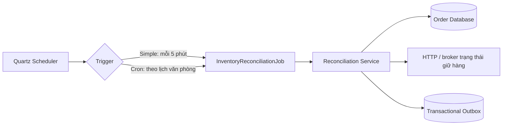
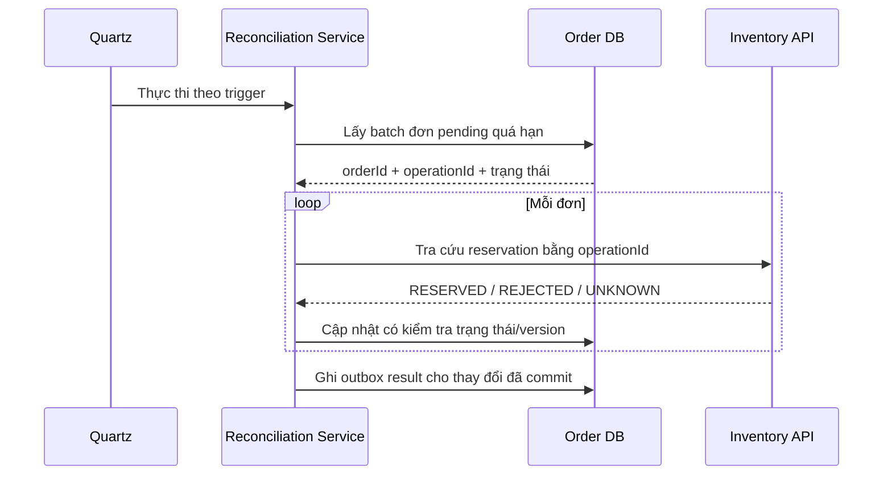

# Khai báo lịch đơn giản hoặc CronTrigger

## 1. Bài toán và kết quả cần đạt

Một ứng dụng Spring Boot không phải lúc nào cũng xử lý công việc do HTTP request hoặc message từ broker kích hoạt. Nhiều nhiệm vụ cần được khởi chạy **theo thời gian**: rà soát đơn hàng quá hạn, đồng bộ dữ liệu với hệ thống đối tác, đối soát giao dịch chưa hoàn tất, làm sạch cache hoặc xuất báo cáo cuối ngày. Khi yêu cầu vượt quá một tác vụ `@Scheduled` đơn giản, **Quartz Scheduler** giúp quản lý job, trigger, thời điểm chạy, tình huống bỏ lỡ lịch và khả năng lưu lịch vào database.

Bài học thuộc chương **Quartz** của module **SPRING_BOOT_INTEGRATION**. Module nghiên cứu tích hợp hệ thống trong Spring Boot qua HTTP client, cơ sở dữ liệu, cache, broker thông điệp và các adapter Spring Integration, tập trung vào **quản lý cấu hình, hợp đồng dữ liệu, giao dịch, lỗi, xử lý trùng lặp, kiểm thử và khả năng quan sát**. Vì vậy, việc đặt lịch cần đi kèm kiểm soát side effect: Quartz kích hoạt job vào thời điểm nào, nhưng **không tự bảo đảm** HTTP request đến đối tác, transaction SQL và event được gửi tới broker đều thành công đúng một lần.

Sau bài này, bạn có thể:

- Phân biệt `Job`, `JobDetail`, `Trigger`, `SimpleTrigger`, `CronTrigger`, `JobKey` và `TriggerKey`.
- Khai báo một job dùng lịch lặp theo khoảng thời gian hoặc dùng cron expression bằng Spring Boot.
- Giải thích Quartz cron (giây, `?`, timezone), các rủi ro khi chạy qua giờ mùa hè (DST), các lựa chọn misfire.
- Thiết kế job chạy lâu, chạy trùng, restart và triển khai nhiều instance với RAM/JDBC job store.
- Kiểm thử thời điểm kích hoạt và nghiệp vụ mà không cần chờ đúng một ngày hay gọi dependency production.

> **Phạm vi phiên bản:** Ví dụ dành cho **Java 17+, Spring Boot 3.2+ và Quartz 2.x** với dependency do Spring Boot parent/BOM quản lý. Quartz cron không hoàn toàn tương đương cron của Linux hoặc Spring `@Scheduled`; khi đổi version cần kiểm tra API `org.quartz` và các property tương ứng. Các đoạn Java lược bớt import để tập trung vào cấu hình.

### Tình huống xuyên suốt: đối soát đơn đặt hàng đang chờ

**Order Service** lưu những đơn ở trạng thái `PENDING_RESERVATION` trong PostgreSQL. Khi đã gửi yêu cầu giữ hàng qua HTTP hoặc broker nhưng phản hồi thất lạc, không nên khẳng định đã giữ hàng thất bại. Một job **`InventoryReconciliationJob`** sẽ tìm các đơn đang chờ quá lâu, tra cứu trạng thái reservation bằng một **operation ID ổn định**, cập nhật database và có thể ghi outbox event.

Có hai nhu cầu lịch:

1. **Cách A – Lịch đơn giản:** đối soát mỗi 5 phút theo mốc bắt đầu của trigger.
2. **Cách B – CronTrigger:** đối soát lúc phút `0, 15, 30, 45` trong các giờ làm việc, thứ Hai đến thứ Sáu, theo timezone của tổ chức.

Hai cách là **lựa chọn thay thế** cho cùng một công việc, không nên khai báo cả hai trigger nếu không cố ý muốn job được kích hoạt từ hai lịch.



Sơ đồ biểu diễn hai **phương án** trigger, không khẳng định cả hai cùng được bật. Quartz chịu trách nhiệm quyết định thời điểm gọi `Job.execute`; còn service quyết định đối soát lệnh nào, an toàn khi retry và cách xử lý lỗi.

## 2. Cấu trúc job và trigger trong Quartz

| Thành phần | Vai trò | Ví dụ |
|---|---|---|
| `Job` | Định nghĩa logic được Quartz gọi khi đến lịch | `InventoryReconciliationJob` |
| `JobDetail` | Định nghĩa job class, định danh và dữ liệu job | `inventoryReconcileJob` |
| `JobKey` | Định danh logic của job bằng **name + group** | `("inventoryReconcileJob", "integration")` |
| `Trigger` | Định nghĩa thời điểm kích hoạt và job mục tiêu | `inventorySimpleTrigger` |
| `TriggerKey` | Định danh trigger bằng **name + group** | `("inventorySimpleTrigger", "integration")` |
| `SimpleTrigger` | Kích hoạt một lần hoặc lặp theo **khoảng thời gian** | Mỗi 5 phút |
| `CronTrigger` | Kích hoạt tại **các mốc đồng hồ** khớp Quartz cron | Mỗi 15 phút trong giờ làm việc |
| `Scheduler` | Điều phối trigger, phân phối job cho thread và quản lý trạng thái | Scheduler do Spring Boot cấu hình |
| `JobDataMap` | Dữ liệu tham số có kiểu phù hợp do Quartz chuyển cho job | Mã tenant, batch size, operation label |

Một `JobDetail` có thể được liên kết với **nhiều trigger**. Mỗi lần trigger fire, Quartz tạo một thực thi theo `JobDetail`; đối tượng job có thể được tạo qua `JobFactory`. Không xem instance của job class như nơi lưu state nghiệp vụ xuyên các lần chạy.

### 2.1. `startNow()` không đồng nghĩa job chạy ngay trong phương thức tạo bean

Trong `TriggerBuilder`, `startNow()` đặt mốc thời gian bắt đầu vào lúc tạo trigger. Job sẽ được thực thi khi **scheduler được khởi động, trigger được đăng ký và thread sẵn sàng**. Nếu scheduler bị đặt `auto-startup=false` hoặc chưa kết nối JDBC job store, lần chạy đầu có thể đến muộn hoặc bị xử lý theo misfire policy.

### 2.2. Mốc thời gian, khoảng lặp và timezone

**SimpleTrigger** theo lịch khoảng cách thời gian tương đối giữa các lần fire; thích hợp polling/đối soát lặp định kỳ. **CronTrigger** khớp các mốc giờ/phút/ngày theo **timezone**, thích hợp lịch báo cáo/giờ làm việc. Nếu cần “mỗi 5 phút sau lần hoàn tất gần nhất” thay vì theo lịch đã lên, hãy đánh giá lại yêu cầu: trigger lặp cố định không mặc nhiên đợi công việc chạy xong rồi mới bắt đầu đếm lại.

### 2.3. Quartz khác `@Scheduled` ở đâu?

Spring `@Scheduled` phù hợp các tác vụ nhỏ có cấu hình lịch đơn giản trong một ứng dụng; `@Scheduled(cron=...)` dùng cú pháp cron và cơ chế scheduler của Spring, **không phải Quartz CronTrigger**. Quartz hữu ích khi cần `JobDetail`, trigger độc lập, lưu trữ lịch, misfire handling hoặc cluster scheduler dựa trên JDBC.

| Yêu cầu | `@Scheduled` | Quartz |
|---|---|---|
| Chạy tác vụ ở thời điểm định kỳ | Có | Có |
| Định danh job/trigger và thao tác trên lịch | Không theo mô hình Quartz | `JobKey`/`TriggerKey`, Scheduler API |
| Simple interval / cron | Theo cơ chế Spring | `SimpleTrigger`/`CronTrigger` |
| Quản lý misfire chi tiết | Khác cơ chế Quartz | Chính sách theo loại trigger |
| Lưu trạng thái lịch trong JDBC job store | Không phải tính năng mặc định của `@Scheduled` | Có với Quartz JDBC JobStore |
| Cluster điều phối một trigger giữa nhiều node | Cần giải pháp khác | Có với JDBC JobStore và cấu hình clustering đúng |

Quartz **không tự làm tác vụ I/O nhanh hơn**. Nếu job gọi REST API, database hay broker, vẫn phải thiết kế timeout, retry, idempotency và giới hạn số tác vụ đồng thời.

## 3. Dependency và cấu hình Spring Boot

### 3.1. Maven / Gradle

Với Maven đã dùng Spring Boot parent/BOM:

```xml
<dependencies>
    <dependency>
        <groupId>org.springframework.boot</groupId>
        <artifactId>spring-boot-starter-quartz</artifactId>
    </dependency>

    <dependency>
        <groupId>org.springframework.boot</groupId>
        <artifactId>spring-boot-starter-test</artifactId>
        <scope>test</scope>
    </dependency>
</dependencies>
```

Tương đương trong Gradle Kotlin DSL:

```kotlin
dependencies {
    implementation("org.springframework.boot:spring-boot-starter-quartz")
    testImplementation("org.springframework.boot:spring-boot-starter-test")
}
```

Starter Quartz tích hợp Scheduler vào lifecycle Spring Boot, bao gồm hỗ trợ tự cấu hình `SchedulerFactoryBean` và phát hiện các bean `JobDetail`, `Trigger` hoặc `Calendar` phù hợp trong context. Không cần tự khởi động `new StdSchedulerFactory()` ở trường hợp cơ bản, vì sẽ tạo một scheduler độc lập không chịu đầy đủ cấu hình/lifecycle của Spring Boot.

### 3.2. Cấu hình lịch như một hợp đồng của ứng dụng

```yaml
# application.yml — phương án chạy đơn giản theo khoảng
spring:
  quartz:
    auto-startup: true
    job-store-type: memory
    properties:
      org.quartz.threadPool.threadCount: 5

integration:
  reconcile:
    mode: simple
    interval-minutes: 5
    # Khi chọn mode: cron, cung cấp:
    cron: "0 0/15 9-17 ? * MON-FRI"
    zone: Asia/Ho_Chi_Minh
```

- `spring.quartz.auto-startup` quyết định scheduler có tự start hay không.
- `spring.quartz.job-store-type=memory` dùng RAMJobStore, không lưu lịch qua restart; đây là lựa chọn phù hợp demo hoặc tác vụ không cần phục hồi lịch.
- `org.quartz.threadPool.threadCount` giới hạn số thread thực thi job trong scheduler Quartz cụ thể, **không phải** connection pool database hay số consumer broker.
- `integration.reconcile.mode` là thuộc tính **ứng dụng tự đặt**, không phải thuộc tính có sẵn của Quartz. Nó sẽ được dùng bằng `@ConditionalOnProperty` để chỉ tạo **một** trigger.
- `cron` và `zone` ở đây biểu diễn mốc lịch của tổ chức; đối với cron schedule cần xử lý timezone và DST cẩn thận.

Khi chạy nhiều instance với RAMJobStore, **mỗi instance có scheduler và lịch riêng**, vì thế cùng một job logic có thể chạy trên tất cả instance. RAMJobStore **không** tự cluster. Nếu mục tiêu là một scheduler cluster điều phối công việc, cần JDBC JobStore với cấu hình clustering và database phù hợp (xem mục 8).

## 4. Xây dựng job tách biệt logic nghiệp vụ

### 4.1. Interface để cô lập logic đối soát

Job nên là lớp điều phối mỏng. Tầng service chịu trách nhiệm đọc database, tra cứu trạng thái bên ngoài và tạo quyết định idempotent.

```java
// InventoryReconciliationService.java
public interface InventoryReconciliationService {
    void reconcilePendingReservations();
}
```

Trong ứng dụng thật, implementation có thể chạy theo từng batch với transaction ngắn, có query lấy lệnh pending theo trạng thái/time window, dùng HTTP client với timeout hoặc broker event đối soát. Không nên giữ một transaction SQL dài bao trùm tất cả lời gọi HTTP.

### 4.2. Job Quartz

```java
// InventoryReconciliationJob.java — imports lược bỏ
@DisallowConcurrentExecution
public class InventoryReconciliationJob extends QuartzJobBean {

    @Autowired
    private InventoryReconciliationService reconciliationService;

    @Override
    protected void executeInternal(JobExecutionContext context)
            throws JobExecutionException {
        try {
            reconciliationService.reconcilePendingReservations();
        } catch (RuntimeException ex) {
            throw new JobExecutionException(
                    "Đối soát Inventory thất bại", ex);
        }
    }
}
```

`QuartzJobBean` là một helper của Spring; `JobExecutionContext` và `JobExecutionException` thuộc Quartz. `@DisallowConcurrentExecution` yêu cầu Quartz không chạy đồng thời nhiều lần của **cùng một `JobDetail`/`JobKey`** trong phạm vi scheduler hoặc cluster có job store hỗ trợ; nó **không** cấm job khác xử lý cùng SKU/đơn hàng ở hệ thống bên ngoài. Cần vẫn chống trùng nghiệp vụ tại database.

Ở ví dụ, field `reconciliationService` được Spring inject khi job instance được tạo bằng **JobFactory hỗ trợ autowire**, như tích hợp Quartz mặc định phù hợp của Spring Boot. Nếu ứng dụng thay JobFactory hoặc tự khởi tạo Quartz scheduler, phải cấu hình dependency injection riêng hoặc dùng `SchedulerContext`/adapter theo thiết kế; không giả định mọi `Job` đều là Spring singleton.

Lỗi được bọc trong `JobExecutionException` để Quartz có thông tin failure. Mặc định, **throw exception không đồng nghĩa Quartz tự retry với backoff**. Không dùng `setRefireImmediately(true)` cho lỗi downstream tạm thời nếu không có giới hạn và idempotency; chính sách retry thuộc ứng dụng/broker/trigger phải được thiết kế rõ.

### 4.3. `JobDetail` với danh tính ổn định

```java
// ReconciliationQuartzConfiguration.java — imports lược bỏ
@Configuration(proxyBeanMethods = false)
public class ReconciliationQuartzConfiguration {

    @Bean
    JobDetail inventoryReconcileJobDetail() {
        return JobBuilder
                .newJob(InventoryReconciliationJob.class)
                .withIdentity("inventoryReconcileJob", "integration")
                .withDescription("Đối soát lệnh giữ hàng đang chờ")
                .storeDurably()
                .build();
    }
}
```

`storeDurably()` cho phép Quartz lưu JobDetail dù chưa có trigger gắn với nó; nó **không tự biến RAMJobStore thành kho lưu bền qua restart**. Khi cần JDBC JobStore, phải cấu hình persistence và schema Quartz.

`withIdentity(name, group)` tạo khóa ổn định. Khi có JDBC JobStore, việc đổi tên/group mà không migrate có thể để lại job/trigger cũ vẫn tồn tại bên cạnh định nghĩa mới. Nên version hóa và quản lý việc thay đổi identity như một thay đổi lịch production.

## 5. Phương án A: khai báo SimpleTrigger

`SimpleTrigger` phù hợp khi tác vụ cần chạy **một lần** hoặc lặp lại theo khoảng thời gian đều đặn, không gắn với các ngày/giờ làm việc trên đồng hồ. Với bài toán đối soát pending reservation, yêu cầu “mỗi 5 phút” là ví dụ tiêu biểu.

### 5.1. Chạy lặp mãi mỗi 5 phút

Thêm bean trigger vào class `ReconciliationQuartzConfiguration` đã khai báo `JobDetail`:

```java
@Bean
@ConditionalOnProperty(
        prefix = "integration.reconcile",
        name = "mode",
        havingValue = "simple",
        matchIfMissing = true
)
SimpleTrigger inventorySimpleTrigger(
        JobDetail inventoryReconcileJobDetail,
        @Value("${integration.reconcile.interval-minutes:5}")
        int intervalMinutes
) {
    if (intervalMinutes <= 0) {
        throw new IllegalArgumentException(
                "interval-minutes phải lớn hơn 0");
    }

    return TriggerBuilder.newTrigger()
            .forJob(inventoryReconcileJobDetail)
            .withIdentity("inventorySimpleTrigger", "integration")
            .startNow()
            .withSchedule(
                    SimpleScheduleBuilder.simpleSchedule()
                            .withIntervalInMinutes(intervalMinutes)
                            .repeatForever()
                            .withMisfireHandlingInstructionNextWithRemainingCount()
            )
            .build();
}
```

| Lệnh builder | Tác dụng |
|---|---|
| `forJob(jobDetail)` | Gắn trigger vào đúng job |
| `withIdentity(...)` | Tạo tên/group ổn định cho trigger |
| `startNow()` | Chọn start time là thời điểm tạo trigger |
| `withIntervalInMinutes(5)` | Định nghĩa khoảng lặp danh nghĩa 5 phút |
| `repeatForever()` | Cho phép tiếp tục lặp cho tới khi trigger bị thay/unschedule hoặc có end condition khác |
| `withMisfireHandlingInstructionNextWithRemainingCount()` | Khi misfire, điều chỉnh lịch để đi tới lần kích hoạt sau theo quy tắc SimpleTrigger, không chạy bù tất cả những lần lỡ |

**Quan trọng:** Vì `startNow()` đặt mốc ngay khi bean trigger được tạo, thời gian lặp ban đầu gắn với **start time của trigger**, không nhất thiết đúng phút scheduler bật. Nếu scheduler start muộn, misfire policy có thể điều chỉnh fire time. Ví dụ này cũng không có nghĩa Quartz thực hiện job chính xác từng 5 phút trong mọi điều kiện tải: thread pool, độ trễ database và misfire có thể tác động.

Nếu job chạy lâu hơn interval, lịch có thể đến hạn khi job cũ chưa xong. `@DisallowConcurrentExecution` ngăn thực thi chồng nhau đối với cùng `JobKey`, nhưng những lần đến hạn có thể bị trì hoãn hoặc bị coi là misfire theo ngưỡng được cấu hình.

### 5.2. Chạy một lần hoặc hữu hạn lần

Một lần ở một thời điểm xác định:

```java
Trigger oneTime = TriggerBuilder.newTrigger()
        .forJob(inventoryReconcileJobDetail)
        .withIdentity("inventoryOneTime", "integration")
        .startAt(Date.from(
                Instant.parse("2027-01-01T00:00:00Z")))
        .build();
```

Không khai báo `withSchedule(...)` sẽ tạo trigger đơn giản cho một lần fire theo `startAt`. Thời điểm trong ví dụ là **UTC instant**; cách hiển thị sang giờ địa phương không thay đổi instant đó.

Lịch hữu hạn với ba lần lặp **sau lần đầu**:

```java
SimpleScheduleBuilder finite = SimpleScheduleBuilder
        .simpleSchedule()
        .withIntervalInSeconds(30)
        .withRepeatCount(3);
```

Tổng số fire danh nghĩa là **4** (một lần đầu + ba lần lặp), trước khi xét misfire hoặc việc scheduler bị dừng. Đây là lỗi off-by-one thường gặp khi đọc `repeatCount`.

Nếu mục tiêu là “chạy vào một ngày rồi dừng”, nên dùng single-shot trigger và khai báo `startAt`. Nếu mục tiêu là “mỗi 5 phút cho tới khi hết ngày”, cần thêm `endAt` hoặc thiết kế một lịch theo giờ cụ thể.

### 5.3. SimpleTrigger có phải fixed-delay không?

Không mặc định. Khoảng lặp của `SimpleTrigger` được tính theo **lịch trigger**, không đảm bảo “khi job hoàn tất mới đợi thêm 5 phút”. Nếu service cần khoảng nghỉ cố định sau **thành công lần trước**, có thể tạo lại trigger dựa trên thời điểm hoàn tất hoặc dùng cách điều phối khác, nhưng phải giải quyết crash/restart và trạng thái lưu bền. Đừng dùng `repeatForever` rồi mô tả nó như fixed-delay theo completion.

## 6. Phương án B: khai báo CronTrigger

`CronTrigger` phù hợp khi yêu cầu gắn với **đồng hồ và lịch**: đầu giờ, những ngày làm việc, ngày đầu tháng hoặc khoảng giờ xử lý báo cáo.

### 6.1. Quartz cron có 6 hoặc 7 trường

Một cron expression Quartz thường có **6 trường bắt buộc** và trường **năm tùy chọn**:

```text
giây  phút  giờ  ngày-trong-tháng  tháng  ngày-trong-tuần  [năm]
  0    0/15  9-17       ?            *        MON-FRI
```

Ví dụ: `0 0/15 9-17 ? * MON-FRI` nghĩa là tại **giây 0**, mỗi 15 phút (0, 15, 30, 45), trong các giờ từ 09 đến 17, thứ Hai tới thứ Sáu, theo timezone của trigger.

| Vị trí | Ví dụ | Ý nghĩa |
|---|---|---|
| Giây | `0` | Thời điểm giây 0 |
| Phút | `0/15` | Các phút 0, 15, 30, 45 |
| Giờ | `9-17` | Các giờ 09–17, **gồm cả 17** |
| Ngày trong tháng | `?` | Không chỉ định điều kiện ở trường này |
| Tháng | `*` | Tất cả các tháng |
| Ngày trong tuần | `MON-FRI` | Thứ Hai đến thứ Sáu |
| Năm (tùy chọn) | Để trống | Không hạn chế theo năm |

Trong Quartz cron, `?` thường dùng ở một trong hai trường **day-of-month** hoặc **day-of-week** khi không ràng buộc trường đó. Không coi `?` giống cách đặt wildcard `*` trong mọi ngữ cảnh. Quartz còn có `L`, `W`, `#` với semantics riêng; những biểu thức phức tạp cần test bằng `CronExpression` trước khi đưa vào production.

### 6.2. Bean CronTrigger có timezone rõ ràng

Thêm bean dưới đây vào **cùng** class `ReconciliationQuartzConfiguration`:

```java
@Bean
@ConditionalOnProperty(
        prefix = "integration.reconcile",
        name = "mode",
        havingValue = "cron"
)
CronTrigger inventoryCronTrigger(
        JobDetail inventoryReconcileJobDetail,
        @Value("${integration.reconcile.cron}")
        String cronExpression,
        @Value("${integration.reconcile.zone:Asia/Ho_Chi_Minh}")
        String zone
) {
    TimeZone timeZone = TimeZone.getTimeZone(ZoneId.of(zone));

    CronScheduleBuilder schedule = CronScheduleBuilder
            .cronSchedule(cronExpression)
            .inTimeZone(timeZone)
            .withMisfireHandlingInstructionDoNothing();

    return TriggerBuilder.newTrigger()
            .forJob(inventoryReconcileJobDetail)
            .withIdentity("inventoryCronTrigger", "integration")
            .withSchedule(schedule)
            .build();
}
```

Trong `application.yml`, đổi:

```yaml
integration:
  reconcile:
    mode: cron
    cron: "0 0/15 9-17 ? * MON-FRI"
    zone: Asia/Ho_Chi_Minh
```

Nhờ hai `@ConditionalOnProperty`, `mode=simple` chỉ tạo SimpleTrigger, `mode=cron` chỉ tạo CronTrigger. `JobDetail` vẫn chỉ có một bean dùng chung. Nếu đặt một giá trị `mode` không được hỗ trợ, có thể **không có trigger nào**; production nên validate configuration bằng `@ConfigurationProperties`, tài liệu vận hành hoặc startup check để phát hiện sớm.

Nếu muốn hỗ trợ **cả hai** trigger có chủ đích, phải nêu rõ rằng một JobDetail có thể bị kích hoạt vào hai thời điểm gần nhau; kiểm soát chồng lịch, identity, misfire và idempotency tương ứng.

### 6.3. Ví dụ cron phổ biến

| Yêu cầu | Quartz cron | Ghi chú |
|---|---|---|
| Mỗi ngày 02:30 | `0 30 2 * * ?` | Phụ thuộc timezone và DST |
| 08:00 thứ Hai đến thứ Sáu | `0 0 8 ? * MON-FRI` | Theo timezone trigger |
| 00:00 ngày đầu tháng | `0 0 0 1 * ?` | Theo lịch địa phương |
| Mỗi 5 phút | `0 0/5 * * * ?` | Khớp các mốc phút trên đồng hồ, khác mốc tương đối của SimpleTrigger |
| Mỗi 15 phút trong giờ 09–17 ngày làm việc | `0 0/15 9-17 ? * MON-FRI` | Bao gồm 17:45 |

**Đừng sao chép máy móc từ cron Linux.** Một Unix cron thường có năm trường, Spring `@Scheduled` cũng có quy tắc và macro riêng; Quartz cần giây và một số ký tự đặc biệt. Ví dụ `0 0 * * *` kiểu Linux không phải biểu thức Quartz đầy đủ.

### 6.4. Timezone và DST có thể làm lệch lịch

Timezone của trigger cần được cấu hình có chủ đích. `Asia/Ho_Chi_Minh` không có chuyển đổi DST trong thời kỳ hiện đại, nhưng hệ thống đa quốc gia có thể chạy lịch theo `America/New_York` hoặc `Europe/Berlin`. Khi chuyển giờ mùa hè:

- Một giờ địa phương có thể **không tồn tại** vào ngày chuyển sang DST. Cron “02:30 mỗi ngày” có thể không có mốc fire như kỳ vọng hôm đó.
- Một giờ địa phương có thể **xuất hiện hai lần** khi lùi đồng hồ. Cần kiểm tra scheduler và contract nghiệp vụ sẽ xử lý mốc trùng như thế nào, không suy đoán từ biểu thức.
- Lịch theo giờ địa phương **không đồng nghĩa** khoảng cách đúng 24 giờ giữa mỗi lần fire.

Nếu cần xử lý chính xác theo UTC hoặc mỗi khoảng 24 giờ bất kể lịch địa phương, hãy thiết kế lịch theo UTC/interval phù hợp. Nếu cần “kết sổ mỗi ngày kinh doanh”, phải có business date, lịch ngày nghỉ và cơ chế chống chạy hai lần cùng ngày. Một cron expression không tự biết ngày nghỉ lễ của tổ chức.

## 7. Misfire: điều gì xảy ra khi đến giờ mà job không chạy?

**Misfire** là tình huống một trigger đã quá hạn so với lịch theo ngưỡng misfire của JobStore, ví dụ vì scheduler tạm dừng, JVM restart, JDBC database không sẵn sàng hoặc worker pool bận. Quartz có những misfire instruction khác nhau theo loại trigger. Việc xử lý không đồng nghĩa luôn chạy bù **từng** lần bị lỡ.

| Trigger | Chính sách ví dụ | Ý nghĩa thiết kế |
|---|---|---|
| `CronTrigger` | `withMisfireHandlingInstructionDoNothing()` | Bỏ thời điểm lỡ, đợi lần fire kế tiếp theo cron |
| `CronTrigger` | `withMisfireHandlingInstructionFireAndProceed()` | Kích hoạt một lần sau misfire rồi tiếp tục theo lịch cron |
| `SimpleTrigger` | `withMisfireHandlingInstructionNextWithRemainingCount()` | Đưa thời điểm chạy tới lần tiếp theo theo lịch, điều chỉnh số lần còn lại theo quy tắc |
| `SimpleTrigger` | `withMisfireHandlingInstructionNowWithExistingCount()` | Chạy sớm sau misfire và tiếp tục đếm theo quy tắc |
| Bất kỳ | SMART_POLICY (mặc định tùy loại) | Quartz tự áp chiến lược mặc định theo trigger; cần kiểm tra tài liệu của từng loại |

Trong bài toán **đối soát** đơn pending, bỏ qua một số mốc rồi quét lại toàn bộ trạng thái pending ở lần sau có thể chấp nhận được. Vì vậy chọn `DoNothing()` cho CronTrigger giúp tránh dồn việc sau outage. Nhưng trong bài toán **phát báo cáo tài chính đúng mỗi ngày**, việc bỏ lịch có thể không được phép; nên lưu business date và xử lý backfill có kiểm soát, thay vì giả định misfire “fire now” bảo đảm mọi ngày đều được tính đủ.

### 7.1. Ví dụ xử lý misfire sau một giờ downtime

Giả sử cron là `0 0/15 * * * ?`, scheduler dừng từ 10:02 đến 11:08. Các mốc 10:15, 10:30, 10:45, 11:00 đã trôi qua:

- `DoNothing`: về nguyên tắc không chạy bù các mốc trễ; đợi mốc kế tiếp, ví dụ 11:15 (theo timezone và trạng thái scheduler).
- `FireAndProceed`: kích hoạt một lần gần thời điểm phục hồi rồi tiếp tục ở các mốc tương lai. **Không chạy bốn lần** chỉ vì lỡ bốn mốc.

Kết quả cụ thể còn phụ thuộc ngưỡng nhận diện misfire, trạng thái trigger, lịch/cấu hình scheduler và thời điểm phục hồi. Để đưa chính sách vào production, cần integration test mô phỏng pause/restart đúng theo job store đang dùng.

### 7.2. Misfire khác retry nghiệp vụ

Một cron fire đúng giờ nhưng HTTP client trả `503` là **lỗi thực thi job**, không phải misfire theo nghĩa trigger chưa được kích hoạt. Quartz không tự retry HTTP request với exponential backoff chỉ vì `JobExecutionException` được ném. Cần phân loại rõ:

- **Lỗi transient:** timeout, HTTP `503`, pool tạm bận; retry có giới hạn tại adapter/service hoặc để lần trigger sau đối soát tiếp.
- **Lỗi permanent:** payload không hợp lệ, quyền truy cập bị thu hồi, schema thay đổi; đưa vào cảnh báo/quarantine, không retry vô hạn.
- **Kết quả chưa rõ:** timeout sau thao tác ghi ở downstream; truy vấn trạng thái bằng operation ID trước khi thử lại.

Đừng dùng misfire để thay thế cơ chế dead-letter, idempotency hoặc transactional outbox của nghiệp vụ.

## 8. RAMJobStore, JDBC JobStore và nhiều instance

### 8.1. Khi nào RAMJobStore là đủ?

`spring.quartz.job-store-type=memory` phù hợp cho:

- Bài thực hành, proof of concept hoặc một tác vụ có thể tạo lại toàn bộ lịch sau restart.
- Job nhẹ, có cơ chế đối soát lại trạng thái pending từ database nên không cần ghi nhớ từng lần fire.
- Môi trường **chỉ một instance** hoặc nơi có chấp nhận rõ ràng việc nhiều instance cùng kích hoạt job.

RAMJobStore lưu lịch trong **bộ nhớ JVM**. Khi ứng dụng restart, các JobDetail/Trigger khai báo từ Spring được đăng ký trở lại; những lịch được tạo/chỉnh động mà không có nguồn lưu khác có thể biến mất. Hai replica có RAMJobStore sẽ **không chia sẻ lịch và trạng thái chạy**.

### 8.2. JDBC JobStore để lưu lịch và cluster

Khi ứng dụng chạy nhiều instance và muốn Quartz điều phối việc fire của **một logical trigger** qua một scheduler cluster, dùng JDBC JobStore với database được quản lý đúng:

```yaml
# application-prod.yml — ví dụ có PostgreSQL DataSource hợp lệ
spring:
  datasource:
    url: ${APP_JDBC_URL}
    username: ${APP_DB_USERNAME}
    password: ${APP_DB_PASSWORD}

  quartz:
    job-store-type: jdbc
    jdbc:
      initialize-schema: never
    auto-startup: true
    overwrite-existing-jobs: false
    properties:
      org.quartz.scheduler.instanceName: inventoryReconcileScheduler
      org.quartz.scheduler.instanceId: AUTO
      org.quartz.jobStore.isClustered: true
      org.quartz.jobStore.clusterCheckinInterval: 20000
      org.quartz.threadPool.threadCount: 5
```

**Điều kiện bắt buộc:**

1. Có **JDBC DataSource** phù hợp với Quartz và database; thêm JDBC driver tương ứng. Không nhầm `spring.r2dbc.url` với `spring.datasource.url`: Quartz JDBC JobStore dựa trên JDBC.
2. Các bảng Quartz (`QRTZ_*` theo prefix mặc định) phải được tạo bằng schema phù hợp với **loại database và phiên bản Quartz** đang dùng. Quản lý qua migration hoặc script được duyệt.
3. Tất cả node của **cùng Quartz cluster** dùng cùng database/table prefix và `instanceName`, mỗi node có `instanceId` duy nhất (ví dụ `AUTO`). Đồng hồ các node cần được đồng bộ.
4. Đặt `org.quartz.jobStore.isClustered=true` khi nhiều scheduler chia sẻ cùng job store; **không** cho nhiều instance độc lập dùng chung bảng với cấu hình cluster không nhất quán.
5. Hiểu cấu hình connection pool, DB max connections, transaction isolation/locks và nhu cầu khôi phục trigger sau node failure.

Với Spring Boot, `job-store-type: jdbc` cho phép auto-configuration tích hợp Quartz với `DataSource`. Không sao chép `org.quartz.jobStore.class` từ một ví dụ Quartz thuần mà chưa kiểm tra vì nó có thể xung đột cách Spring Boot cấu hình `LocalDataSourceJobStore`. Nếu có `@QuartzDataSource` hoặc nhiều datasource, phải định nghĩa rõ datasource Quartz sử dụng và transaction manager thích hợp.

**Cảnh báo migration:** Không bật `spring.quartz.jdbc.initialize-schema=always` trên production mà không hiểu script của Boot: các script khởi tạo Quartz thường có thể **xóa bảng và dữ liệu lịch hiện tại**. Dùng `never` sau khi migration đảm bảo bảng sẵn có, hoặc một quy trình khởi tạo riêng khi dựng môi trường mới.

### 8.3. Cluster Quartz thực sự bảo đảm gì?

Trong một Quartz JDBC cluster được cấu hình đúng, scheduler nodes phối hợp giành quyền fire trigger trong bảng dùng chung. Điều này giúp giảm việc cùng một trigger được lên lịch đồng thời ở nhiều node so với RAMJobStore độc lập. Tuy nhiên:

- Nếu một node đã gọi HTTP hoặc ghi SQL rồi crash trước khi Quartz hoàn tất execution record, vẫn có **kết quả nghiệp vụ không rõ**; cơ chế recover/re-fire phụ thuộc job detail và cấu hình.
- Một job khác có `JobKey` khác vẫn có thể xử lý cùng tập đơn hàng.
- Admin thao tác thủ công, event broker hoặc retry của HTTP client có thể tạo xử lý trùng **ngoài Quartz**.
- “Cluster fire một lần” không có nghĩa **exactly-once cho tác động ở database/broker/HTTP**.

Với tính toán cần an toàn, áp thêm khóa nghiệp vụ, unique constraint/operation ID, optimistic lock hoặc lease trong database. Nếu có job chạy hàng giờ, cần cân nhắc recovery/timeout và tránh một job giữ DB transaction quá lâu.

### 8.4. Khai báo lịch từ bean và lịch đã tồn tại trong JDBC store

Khi dùng JDBC job store, định nghĩa `JobDetail`/`Trigger` đã lưu có thể tồn tại qua restart. Property `spring.quartz.overwrite-existing-jobs` quyết định mức độ Spring Boot có ghi đè các định nghĩa JobDetail/Trigger đã tồn tại khi khởi tạo scheduler hay không.

- Giữ `false` khi muốn tránh ghi đè lịch đã được chỉnh bằng Scheduler API trong runtime.
- Đặt `true` **chỉ khi** chủ động muốn cấu hình Spring trở thành nguồn sự thật và hiểu tác động của thay đổi cron/interval trên lịch lưu bền.
- Khi đổi `JobKey`, `TriggerKey`, cấu trúc job data hoặc tên group, cần **migration/cleanup có kiểm soát** thay vì chỉ đổi constant trong code.

Không assume sửa `application.yml` là đủ để lịch trong JDBC store đang tồn tại được cập nhật. Hãy kiểm tra `Scheduler.getTrigger(...)`, next fire time và audit thay đổi lịch sau deploy.

## 9. Chạy chồng, chạy lặp và idempotency

### 9.1. `@DisallowConcurrentExecution` có giới hạn

Giả sử `reconcilePendingReservations()` mất 8 phút nhưng SimpleTrigger lặp mỗi 5 phút. Nếu không có cơ chế ngăn concurrent execution, những lần chạy có thể chồng nhau và cùng xử lý một đơn `PENDING_RESERVATION`.

`@DisallowConcurrentExecution` nói với Quartz không thực thi đồng thời những execution của **cùng `JobKey`** theo quy tắc scheduler/job store. Nhưng nó **không** thay cho:

- Khóa/transaction database để nhiều tác vụ khác nhau không cùng cập nhật một đơn.
- Chống trùng giữa hai scheduler RAM độc lập trên hai replica.
- Chống trùng do retry HTTP, broker redelivery, manual trigger hoặc thay đổi tên JobKey.
- Deadline cho job bị treo vô hạn do downstream.

Nếu cần lưu biến trạng thái trong `JobDataMap` giữa các lần chạy, Quartz có `@PersistJobDataAfterExecution`. Dù vậy JobDataMap không phù hợp làm nơi lưu kết quả giao dịch quan trọng; cần dùng database có khóa, constraint và transaction phù hợp. Với JDBC job store, tránh đặt object Spring bean/connection/client vào JobDataMap vì yêu cầu serialization, nâng cấp class và rủi ro tương thích.

### 9.2. Thiết kế đối soát idempotent

Một job đối soát nên làm việc theo **batch hữu hạn**, ví dụ lấy tối đa 100 đơn `PENDING_RESERVATION` đã quá timeout. Không phải một lần chạy phải xử lý hết toàn bộ dữ liệu mọi lúc.



**Nguyên tắc quan trọng:**

1. Giữ `operationId` ổn định xuyên HTTP retry, broker redelivery và các lần chạy Quartz.
2. Tra cứu trạng thái **bằng ID đã ghi**; nếu endpoint chỉ hỗ trợ tạo reservation, không phát lệnh tạo mới mỗi lần cron chạy.
3. Dùng câu `UPDATE ... WHERE status='PENDING_RESERVATION'`, `version` hoặc cơ chế claim/lease thích hợp để ngăn nhiều worker cùng hoàn tất một đơn hai lần.
4. Mọi kết quả không rõ phải được giữ ở trạng thái `UNKNOWN/PENDING_RECONCILIATION` để đối soát lại, không tự coi timeout là thất bại.
5. Khi publish event qua broker, ghi **outbox row trong cùng transaction SQL** với thay đổi trạng thái đơn. Worker outbox phát event bất đồng bộ và downstream consumer vẫn cần idempotent.

Ví dụ SQL cập nhật có điều kiện, giúp một transition chỉ thành công khi bản ghi còn ở trạng thái đang chờ:

```sql
UPDATE orders
   SET status = 'RESERVED',
       updated_at = CURRENT_TIMESTAMP
 WHERE order_id = :orderId
   AND operation_id = :operationId
   AND status = 'PENDING_RESERVATION';
```

Nếu affected rows = 0, cần đọc trạng thái hiện tại và xác định nguyên nhân: đã xử lý, đã hủy, không tồn tại hoặc bị worker khác cập nhật. **Không phát result event hai lần** chỉ vì đã gọi lại SQL. Có thể đặt unique key cho outbox event theo operation ID + event type để hỗ trợ xử lý trùng.

### 9.3. Transaction của Quartz không phải transaction nghiệp vụ

Quartz JDBC JobStore dùng transaction để quản lý **lịch và trạng thái trigger**. Transaction của `OrderRepository`, lời gọi HTTP, cache Redis hoặc gửi message tới RabbitMQ/Kafka **không tự nhập chung** với transaction đó.

Nếu job làm ba việc “gọi Inventory → cập nhật orders → gửi event”, giữa các bước vẫn có cửa sổ crash hoặc response thất lạc. Quartz chỉ biết execution được lên lịch/hoàn tất hay bị lỗi theo trạng thái scheduler. Dùng outbox, idempotency, result event, các trạng thái bù/đối soát và cảnh báo thay vì dựa vào Quartz job store để có distributed transaction.

### 9.4. Retry và số lượng job chạy đồng thời

Giới hạn `org.quartz.threadPool.threadCount` không thay thế giới hạn số HTTP connection, connection pool database hoặc consumer của broker. Nếu có 10 Quartz jobs và mỗi job xử lý 100 đơn song song, tổng outbound request có thể rất lớn dù chỉ có 5 thread scheduler. Cần đặt batch size, concurrency của reactive pipeline/executor, deadline và rate limit theo khả năng downstream.

Lỗi tạm thời có thể được xử lý bằng retry ít lần với backoff và jitter ở adapter, hoặc để lần chạy Quartz kế tiếp đối soát tiếp; tránh vừa retry tại HTTP client, vừa retry ở job, vừa phát lại broker mà không có ngân sách chung. Với các thao tác ghi, timeout có thể xảy ra **sau khi server commit**, nên chính sách retry phải tuân thủ idempotency.

## 10. Kiểm thử SimpleTrigger và CronTrigger

### 10.1. Kiểm thử biểu thức cron bằng thời gian cố định

Không nên viết test chờ đến đúng 09:00 hôm sau để biết một biểu thức cron có đúng không. Quartz có `CronExpression` cho phép tính mốc fire tiếp theo từ một `Date` xác định.

```java
// ReconciliationCronTest.java — imports lược bỏ
class ReconciliationCronTest {

    @Test
    void nextFireIsTheNextQuarterHourInBusinessTimezone()
            throws ParseException {
        CronExpression cron = new CronExpression(
                "0 0/15 9-17 ? * MON-FRI");
        cron.setTimeZone(
                TimeZone.getTimeZone(
                        ZoneId.of("Asia/Ho_Chi_Minh")));

        // 2026-11-20 (thứ Sáu), 10:07 giờ Việt Nam.
        Date after = Date.from(
                Instant.parse("2026-11-20T03:07:00Z"));
        Date next = cron.getNextValidTimeAfter(after);

        assertNotNull(next);
        assertEquals(
                Instant.parse("2026-11-20T03:15:00Z"),
                next.toInstant());
    }

    @Test
    void invalidCronIsRejected() {
        assertFalse(CronExpression.isValidExpression(
                "0 0 * * *")); // 5 trường kiểu Unix, thiếu trường
    }
}
```

Test này chứng minh **cách parser Quartz tính lịch** với biểu thức và timezone được cung cấp, không cần khởi động Spring. Nó chưa chứng minh database Quartz, thread pool hay job thực thi thành công.

Thêm test trường hợp:

- Một mốc sau 17:45 ngày thứ Sáu phải nhảy tới mốc đúng vào thứ Hai (trừ khi cron/holiday policy khác).
- `SimpleTrigger` với `repeatCount=3` có 4 lần fire danh nghĩa.
- Lịch qua ngày chuyển DST ở timezone có DST, đặc biệt 02:30 vào ngày chuyển giờ.
- Cron không hợp lệ hoặc timezone `ZoneId` không tồn tại khiến cấu hình bị từ chối khi startup.

### 10.2. Kiểm tra bean JobDetail/Trigger đã được đăng ký

`@SpringBootTest` phù hợp để xác minh Spring Boot phát hiện các bean và cấu hình Scheduler. Đặt `auto-startup=false` để test không tự kích hoạt tác vụ ngay khi context khởi động.

```java
// ReconciliationQuartzWiringIT.java — imports lược bỏ
@SpringBootTest(
    webEnvironment = SpringBootTest.WebEnvironment.NONE,
    properties = {
        "spring.quartz.auto-startup=false",
        "spring.quartz.job-store-type=memory",
        "integration.reconcile.mode=cron",
        "integration.reconcile.cron=0 0/15 9-17 ? * MON-FRI",
        "integration.reconcile.zone=Asia/Ho_Chi_Minh"
    }
)
class ReconciliationQuartzWiringIT {

    @Autowired
    Scheduler scheduler;

    @MockBean
    InventoryReconciliationService reconciliationService;

    @Test
    void registersCronTriggerForExpectedJob()
            throws SchedulerException {
        JobKey jobKey = JobKey.jobKey(
                "inventoryReconcileJob", "integration");
        TriggerKey triggerKey = TriggerKey.triggerKey(
                "inventoryCronTrigger", "integration");

        JobDetail detail = scheduler.getJobDetail(jobKey);
        Trigger trigger = scheduler.getTrigger(triggerKey);

        assertNotNull(detail);
        assertNotNull(trigger);
        assertInstanceOf(CronTrigger.class, trigger);
        assertEquals(jobKey, trigger.getJobKey());
        assertEquals(
                "Asia/Ho_Chi_Minh",
                ((CronTrigger) trigger).getTimeZone().getID());
        assertNull(scheduler.getTrigger(
                TriggerKey.triggerKey(
                        "inventorySimpleTrigger", "integration")));
    }
}
```

`@MockBean` phù hợp Spring Boot 3.2–3.3, giúp đưa một mock service vào context; ở Spring Boot mới hơn cần đối chiếu `@MockitoBean`. Nếu ứng dụng có runner, JDBC, cache hay broker khác, những bean đó **vẫn có thể khởi tạo** khi dùng full context, nên phải cô lập dependencies theo profile test.

### 10.3. Kiểm thử job có thực thi khi scheduler được kích hoạt

Khi cần kiểm tra Scheduler gọi job và DI hoạt động, có thể khởi động scheduler test đã đặt `auto-startup=false` rồi yêu cầu fire job thủ công:

```java
@Test
void schedulerInvokesInjectedService()
        throws SchedulerException {
    JobKey key = JobKey.jobKey(
            "inventoryReconcileJob", "integration");
    scheduler.start();
    try {
        scheduler.triggerJob(key);
        verify(reconciliationService, timeout(3_000))
                .reconcilePendingReservations();
    } finally {
        scheduler.standby();
    }
}
```

Đoạn test này có thể đặt trong class `ReconciliationQuartzWiringIT` ở trên. Vì test đã chọn `mode=cron` và lịch chỉ xảy ra trong giờ làm việc, một lần fire tự động gần trùng thời gian test có thể gây nhiễu; để test thật sự ổn định nên chọn một cron ở **thời điểm xa trong tương lai** hoặc dùng scheduler/test fixture riêng, đồng thời reset mock và cleanup trạng thái theo từng test.

`scheduler.triggerJob(JobKey)` yêu cầu fire ngay một lần, **không** chứng minh cơ chế cron tự fire đúng các ngày làm việc. Muốn kiểm tra misfire hoặc retry trong JDBC cluster, phải dùng integration test chuyên biệt chạy với store và nhiều scheduler phù hợp, không suy diễn từ unit test `CronExpression`.

### 10.4. Ma trận kiểm thử vận hành

| Kịch bản | Điều cần xác minh |
|---|---|
| Mode `simple` | Có đúng một `SimpleTrigger`, interval dương và job key đúng |
| Mode `cron` | Có đúng một `CronTrigger`, cron/timezone chính xác |
| Config sai | Cron không hợp lệ, timezone không tồn tại, interval `<= 0` bị từ chối |
| Job thực thi thành công | Service được gọi, kết quả có log/metric/trạng thái nghiệp vụ |
| Service ném exception | Execution failure được ghi lại; không giả định automatic retry |
| Quartz bị pause/restart | Misfire policy đúng với Simple/Cron và backlog nghiệp vụ |
| Job chạy lâu hơn interval | Không overlap khi áp `@DisallowConcurrentExecution` với cùng JobKey |
| Hai instance | RAM store có thể chạy lặp; JDBC cluster được kiểm tra điều phối |
| Database tạm lỗi | Job không nuốt lỗi; pending được giữ để đối soát ở lần sau |
| HTTP timeout sau thay đổi bên ngoài | Không phát lệnh ghi trùng; dùng operation ID và đọc trạng thái |
| JDBC schema/upgrade | Bảng Quartz còn nguyên sau restart và migration đúng version |
| Lịch thay đổi | Định nghĩa persisted thay đổi đúng theo `overwrite-existing-jobs`/migration |

Với các bài test database hoặc broker, có thể dùng Testcontainers nhưng cần cùng loại database, migration và cơ chế lưu state tương ứng. Để test **JDBC job store**, không dùng H2/RAMJobStore rồi kết luận PostgreSQL cluster đã được kiểm chứng; các lock/cluster check-in/transaction phải được đo trên một môi trường sát production.

## 11. Quan sát và vận hành Quartz

### 11.1. Các thông số cần biết

| Nhóm | Cần đo/ghi |
|---|---|
| Lịch | `JobKey`, `TriggerKey`, previous/next fire time, trạng thái paused/normal/error |
| Thực thi | Số lần bắt đầu, thành công/thất bại, thời lượng p95/p99 và lần chạy chậm |
| Misfire | Số lần/cảnh báo misfire, thời gian trễ từ scheduled fire time đến actual fire time |
| Scheduler | Thread pool, job đang chạy, trạng thái instance/cluster và lỗi job store |
| JDBC store | Độ trễ DB, lock wait, connection pool, migration/schema version |
| Nghiệp vụ | Số đơn pending đã kiểm tra, số `RESERVED`/`REJECTED`, còn lại cần đối soát |
| Downstream | HTTP timeout/`5xx`, broker publish confirm, outbox backlog và retry |

Quartz cung cấp các extension point như `JobListener`, `TriggerListener` và `SchedulerListener` để ghi nhận sự kiện. Có thể thêm Micrometer custom metrics và log correlation theo `JobKey`/lần chạy. **Không mặc định** mọi con số trong bảng có sẵn chỉ bằng việc thêm `spring-boot-starter-quartz` hoặc Actuator; phải kiểm tra instrumentation đang bật.

Đo chênh lệch `context.getScheduledFireTime()` và `context.getFireTime()` giúp hiểu lịch có trễ hay không. Nhưng nếu tính toán SLA quan trọng, nên phân biệt thời điểm trigger fire với thời điểm **business transaction commit** và thời điểm event được consumer xác nhận.

**Không dùng** `orderId`, operation ID, user ID, SKU hoặc timestamp mỗi lần chạy làm metric tag có cardinality lớn. Log có thể giữ ID tương quan khi có quyền và chính sách bảo mật phù hợp; không ghi token HTTP, mật khẩu database/broker hay payload chứa thông tin nhạy cảm.

### 11.2. Quan sát trạng thái bằng Scheduler API

```java
// Ví dụ thao tác kiểm tra khi vận hành
JobKey jobKey = JobKey.jobKey(
        "inventoryReconcileJob", "integration");
TriggerKey triggerKey = TriggerKey.triggerKey(
        "inventoryCronTrigger", "integration");

JobDetail job = scheduler.getJobDetail(jobKey);
Trigger trigger = scheduler.getTrigger(triggerKey);
Trigger.TriggerState state = scheduler.getTriggerState(triggerKey);

if (job != null && trigger != null) {
    log.info("Quartz job={}, trigger={}, state={}, nextFire={}",
            jobKey, triggerKey, state, trigger.getNextFireTime());
}
```

Không dựa riêng vào `scheduler.getCurrentlyExecutingJobs()` của một node để kết luận toàn cluster không có job nào đang thực thi; dữ liệu đó liên quan đến scheduler instance hiện tại. Với JDBC cluster, cần kết hợp bảng job store, scheduler metadata và telemetry của từng instance khi điều tra.

### 11.3. Lỗi thường gặp

| Dấu hiệu | Nguyên nhân khả dĩ | Hướng xử lý |
|---|---|---|
| Không có job chạy | Chưa có trigger, auto-startup=false, job/trigger không register | Kiểm tra bean, mode, Scheduler API, startup log |
| Chạy sai giờ | Timezone/JVM default, cron Quartz sai, DST | Đặt `inTimeZone`, test `CronExpression` với instant cố định |
| Chạy hai lần trên hai pod | Hai RAMJobStore độc lập, cùng cron | JDBC cluster hoặc idempotency/leader election có kiểm soát |
| Job chồng và tranh dữ liệu | Chưa giới hạn concurrency hoặc nhiều JobKey | `@DisallowConcurrentExecution`, DB constraint/claim |
| Không thấy cron mới sau deploy | JDBC store giữ lịch cũ, overwrite=false | Migration/reschedule có kiểm soát |
| Lỗi `QRTZ_*` không tồn tại | Chưa chạy migration Quartz | Tạo schema đúng vendor/version |
| Mất lịch sau restart | Dùng RAMJobStore, dynamic schedule không lưu ngoài | JDBC store hoặc nguồn cấu hình có thể tái tạo |
| Job không nhận injected service | Custom JobFactory không hỗ trợ autowire | Xác minh DI và test execute thật |
| Job báo lỗi lặp nhưng không retry như dự kiến | `JobExecutionException` không tạo backoff tự động | Thiết kế retry/idempotency và misfire riêng |
| Thời gian chạy ngày càng dài | SQL chậm, HTTP timeout thiếu, batch không giới hạn | Đo p95/p99, chia batch, giới hạn concurrency |
| Startup làm mất các job persisted | Chạy init schema phá hủy bảng hoặc đổi key | Migration an toàn, không dùng init=always tùy tiện |

## 12. Chọn SimpleTrigger hay CronTrigger trong bài toán thật

| Yêu cầu | Khuyến nghị | Giải thích |
|---|---|---|
| Đối soát pending mỗi vài phút | `SimpleTrigger` hoặc cron `0 0/5 ...` | Simple theo interval, cron theo mốc đồng hồ |
| Chạy một lần tại một instant | Simple single-shot | Dùng `startAt` |
| Báo cáo đúng 08:00 ngày làm việc | `CronTrigger` | Có lịch và timezone rõ |
| Chạy ngày đầu tháng | `CronTrigger` | Chọn `day-of-month=1` và timezone |
| “Mỗi 5 phút sau khi xong lần trước” | Cần đánh giá giải pháp fixed-delay riêng | Simple interval không mặc nhiên dựa trên completion |
| Không bỏ sót ngày kinh doanh khi scheduler downtime | Cron + trạng thái business date và backfill | Misfire không bảo đảm xử lý từng ngày |
| Có nhiều replicas muốn lịch bền/điều phối | JDBC JobStore + clustering | RAMJobStore không phối hợp giữa các pod |
| Lệnh ghi không được thực thi trùng | Bổ sung idempotency, unique constraint, outbox | Quartz không cho exactly-once end-to-end |

### Checklist trước khi triển khai

1. Xác định rõ **job này chạy theo interval hay theo giờ đồng hồ**; không nhập nhằng “mỗi ngày” và “mỗi 24 giờ”.
2. Đặt `JobKey`/`TriggerKey` có tên ổn định và quản lý lifecycle thay đổi lịch.
3. Chọn cron expression Quartz hợp lệ, timezone IANA, kiểm tra DST/ngày nghỉ.
4. Quy định **misfire**: bỏ mốc, chạy bù một lần hay backfill nghiệp vụ có kiểm soát.
5. Quyết định RAM/JDBC job store và chính sách nhiều instance; migration schema Quartz an toàn.
6. Giới hạn batch size, thời gian chạy, retry, transaction và số request tới downstream.
7. Chống xử lý trùng tại database, nhất là khi crash/restart/manual trigger hoặc broker redelivery.
8. Tách logic nghiệp vụ khỏi Quartz adapter để unit test được.
9. Có test cron, Spring wiring, execution, misfire/restart và lỗi kết nối phù hợp.
10. Quan sát next fire, execution latency, error rate, pending backlog và cảnh báo job trễ.

### Câu hỏi tự kiểm tra

1. `JobDetail` và `Trigger` khác nhau thế nào? Một JobDetail có thể gắn nhiều Trigger không?
2. Khi nào dùng `SimpleTrigger` thay cho `CronTrigger`?
3. `repeatCount=3` nghĩa là có bao nhiêu lần fire theo lịch, nếu không có misfire?
4. Quartz cron `0 0/15 9-17 ? * MON-FRI` gồm những trường nào? Ký hiệu `?` dùng làm gì?
5. Vì sao `SimpleTrigger` lặp 5 phút không mặc nhiên là fixed-delay 5 phút sau khi job hoàn tất?
6. Khi scheduler dừng một giờ, `DoNothing` và `FireAndProceed` cho CronTrigger khác nhau thế nào?
7. Vì sao phải đặt timezone và kiểm tra DST khi job chạy ở nhiều quốc gia?
8. `@DisallowConcurrentExecution` ngăn overlap trong phạm vi nào? Vì sao vẫn cần unique constraint?
9. RAMJobStore và JDBC JobStore khác nhau ra sao khi có hai instance Spring Boot?
10. Tại sao `spring.quartz.jdbc.initialize-schema=always` nguy hiểm khi dùng persisted jobs?
11. Vì sao fail `JobExecutionException` không tự động retry HTTP request với backoff?
12. Làm thế nào kiểm thử cron tiếp theo mà không chờ tới đúng thời điểm chạy?
13. Nếu database đã commit nhưng Quartz job crash, bạn đảm bảo không phát lệnh giữ hàng hai lần thế nào?

**Ghi nhớ:** **SimpleTrigger** mô tả một lần fire hoặc lịch lặp theo khoảng thời gian; **CronTrigger** mô tả mốc thời gian theo lịch với cú pháp Quartz, timezone và misfire policy. Trong Spring Boot, tách `JobDetail` và các bean `Trigger`, dùng configuration mode để chọn rõ lịch, quản lý JobStore và concurrency phù hợp. Quartz chỉ giải quyết việc **điều phối thời điểm thực thi**; một tích hợp đáng tin cậy vẫn phải có timeout, xử lý lỗi, idempotency, transaction/outbox, kiểm thử với tài nguyên đúng và khả năng quan sát kết quả nghiệp vụ.
