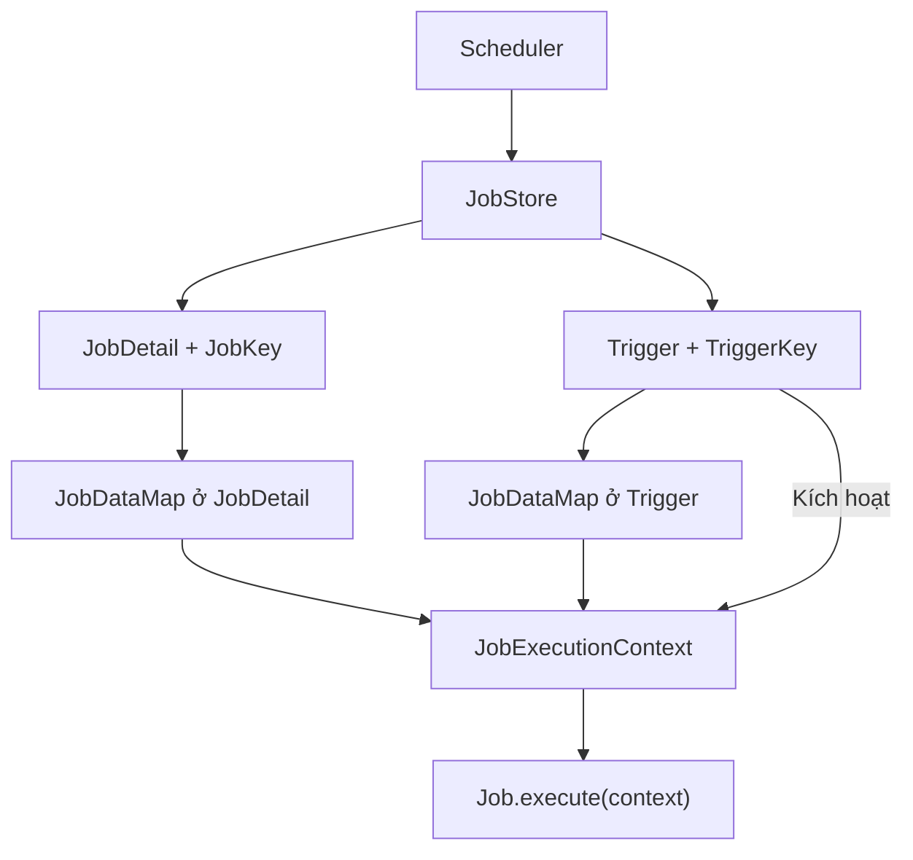
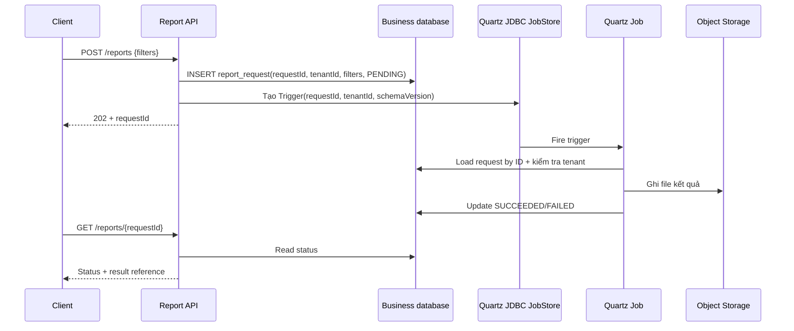
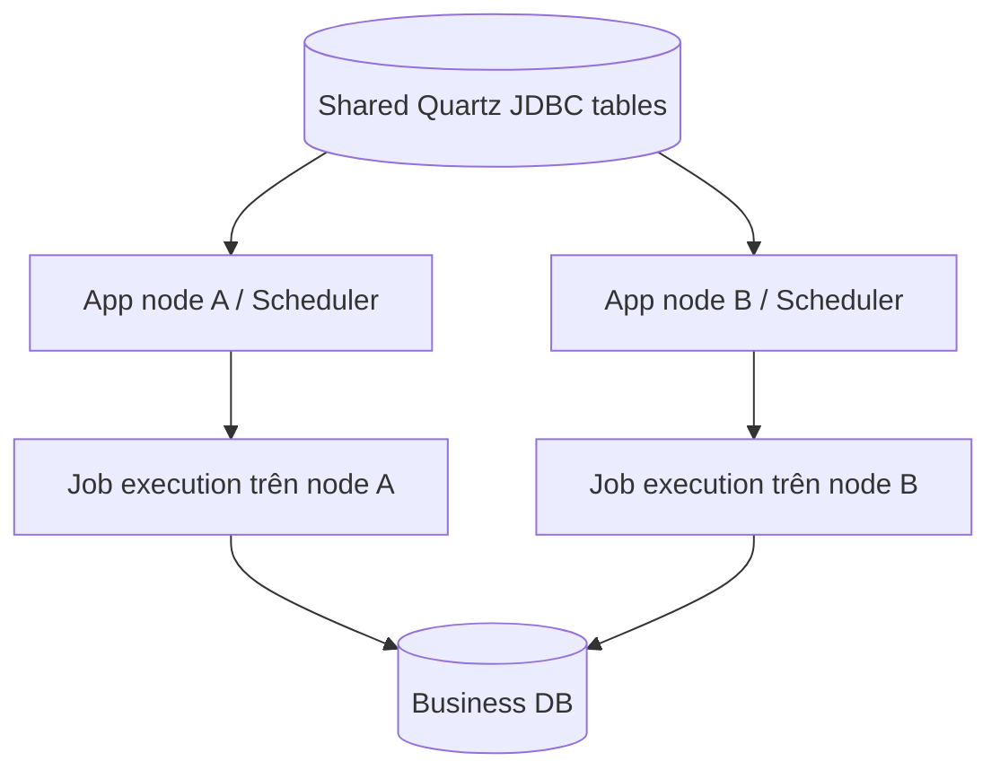
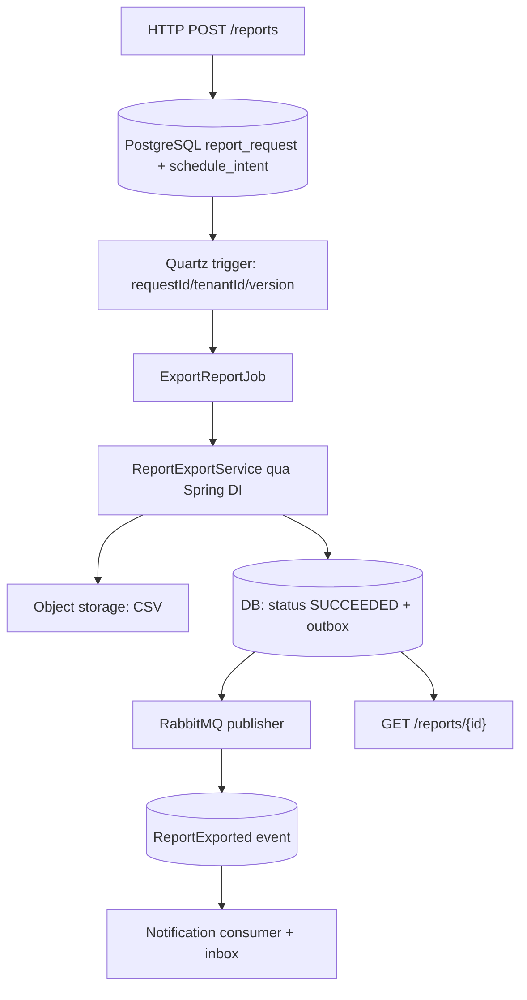

# JobDataMap, truyền dữ liệu và giới hạn tuần tự hóa

## 1. Vì sao JobDataMap là một phần của hợp đồng tích hợp?

Trong mô-đun **SPRING_BOOT_INTEGRATION**, Spring Boot kết nối HTTP client, cơ sở dữ liệu, cache, broker thông điệp và các adapter Spring Integration. Không phải công việc nào cũng nên xử lý ngay trong HTTP request: ứng dụng có thể cần gửi báo cáo vào 02:00, đối soát giao dịch mỗi đêm, kiểm tra một outbox chưa được publish hoặc thử lại một công việc sau một khoảng thời gian.

**Quartz** là một scheduler có cơ chế `Job`, `JobDetail`, `Trigger` và `JobStore`. Một câu hỏi xuất hiện ngay khi thiết kế công việc: *job chạy sau này sẽ biết phải xử lý yêu cầu, tenant, tài liệu hoặc thời điểm nào bằng cách nào?*

Quartz cung cấp **`JobDataMap`** để gắn những cặp khóa–giá trị vào `JobDetail` và `Trigger`. Tuy nhiên, cách ghi dữ liệu vào map quyết định liệu job có thể tồn tại qua restart, chạy trên instance khác, tương thích với phiên bản ứng dụng sau deployment và bảo vệ thông tin nhạy cảm hay không.

Ví dụ một API nhận yêu cầu xuất báo cáo:

```text
POST /api/reports
  → lưu report_request(request_id, tenant_id, filters, status)
  → tạo Quartz trigger có JobDataMap:
       requestId = "req-1024"
       tenantId  = "tenant-17"
       schemaVersion = "1"
  → HTTP 202 Accepted + requestId

Đến giờ chạy:
  → Quartz gọi ExportReportJob
  → Job đọc requestId/tenantId từ JobDataMap
  → Repository đọc request đã lưu
  → Dịch vụ xuất file ra object storage
  → Cập nhật trạng thái SUCCEEDED/FAILED
```

**Tư tưởng chính:** `JobDataMap` phù hợp để mang **metadata nhỏ, ổn định, có thể chuyển qua ranh giới scheduler**. Nó không nên trở thành nơi lưu một HTTP request sống, JPA entity, Spring bean, dữ liệu nhạy cảm hoặc toàn bộ trạng thái workflow.

```mermaid
flowchart LR
    A["HTTP / Integration Gateway"] --> B["Lưu yêu cầu nghiệp vụ vào DB"]
    B --> C["Quartz Scheduler"]
    C --> D["JobDetail + Trigger"]
    D --> E["JobDataMap: ID / version / tùy chọn nhỏ"]
    E --> F["Job.execute(context)"]
    F --> G["Đọc DB bằng requestId"]
    G --> H["HTTP / DB / Redis / Broker adapters"]
    H --> I["Cập nhật trạng thái bền vững"]
```



Bài học dùng **Spring Boot 3.x**, **Quartz 2.x** và Java 17+. Các ví dụ chủ yếu dùng API `org.quartz` và starter Quartz của Spring Boot. Khi áp dụng trên phiên bản mới hơn, cần đối chiếu metadata property và tài liệu tương ứng; cấu hình database của Quartz phải khớp phiên bản Quartz và RDBMS thực tế.

## 2. Phân biệt Job, JobDetail, Trigger, JobStore và JobDataMap

Năm thành phần thường bị gộp làm một, nhưng vai trò khác nhau:

| Thành phần | Trách nhiệm | Ví dụ |
| --- | --- | --- |
| `Job` | Code thực hiện một lần chạy | `ExportReportJob implements Job` |
| `JobDetail` | Định nghĩa công việc: class Job, `JobKey` và dữ liệu cấp job | `export-report` trong group `reports` |
| `Trigger` | Chọn khi nào kích hoạt job, mang `TriggerKey` và dữ liệu riêng | Chạy ngay hoặc cron hằng đêm |
| `JobStore` | Quản lý metadata/lịch sử trigger cần thiết cho scheduler, trong RAM hoặc JDBC | `RAMJobStore`, JDBC-based JobStore |
| `JobDataMap` | Các cặp key/value truyền cho một JobDetail/Trigger | `requestId`, `tenantId`, `schemaVersion` |



**Một `JobDetail` có thể được kích hoạt bởi nhiều `Trigger`.** Dữ liệu chung cho job nên nằm ở JobDetail; dữ liệu riêng cho lần/schedule kích hoạt có thể đặt ở Trigger. Hai map được Quartz phối hợp khi tạo `JobExecutionContext`.

### 2.1. JobKey và TriggerKey khác business request ID

- `JobKey` định danh **định nghĩa job** trong scheduler, ví dụ `("export-report", "reporting")`.
- `TriggerKey` định danh **trigger**, ví dụ `("run-req-1024", "reporting")`.
- `requestId` hoặc `eventId` là **ID nghiệp vụ** để xử lý trùng lặp và đối soát.

Không nên cho rằng `JobKey` tự thay thế unique constraint trong database nghiệp vụ. Quartz biết lịch kích hoạt; Order Service/Report Service mới biết có được phép thực thi cùng business operation hai lần hay không.

### 2.2. JobDataMap của ai được lưu?

`JobDetail.getJobDataMap()` và `Trigger.getJobDataMap()` thuộc về metadata scheduler. Khi sử dụng JDBC JobStore, các map này có thể được persist theo chính sách của JobStore; còn với RAMJobStore, thông tin chỉ nằm trong bộ nhớ JVM.

`JobExecutionContext.getMergedJobDataMap()` là **bản map tổng hợp để job đọc thuận tiện**. Nó không phải một bảng dữ liệu workflow tự động có transaction chung với PostgreSQL business database.

## 3. Tạo JobDetail và Trigger với dữ liệu String

Một ví dụ Spring Boot tự chứa về cấu hình job xuất báo cáo. Trước hết thêm starter.

### 3.1. Dependency

Maven với parent/BOM của Spring Boot:

```xml
<dependency>
    <groupId>org.springframework.boot</groupId>
    <artifactId>spring-boot-starter-quartz</artifactId>
</dependency>
```

Gradle:

```groovy
dependencies {
    implementation("org.springframework.boot:spring-boot-starter-quartz")
}
```

Starter cung cấp tích hợp Quartz/Spring Boot và tạo `Scheduler` khi auto-configuration đáp ứng điều kiện. Nó **không tự tạo database metadata của JDBC JobStore theo yêu cầu production**, và không cung cấp một workflow business có retry/idempotency chỉ bằng việc thêm dependency.

### 3.2. JobDetail có dữ liệu cố định

```java
package example.integration.reports;

import org.quartz.JobBuilder;
import org.quartz.JobDetail;
import org.springframework.context.annotation.Bean;
import org.springframework.context.annotation.Configuration;

@Configuration
public class ReportQuartzConfiguration {

    @Bean
    JobDetail exportReportJobDetail() {
        return JobBuilder.newJob(ExportReportJob.class)
            .withIdentity("export-report", "reporting")
            .usingJobData("taskType", "EXPORT")
            .usingJobData("schemaVersion", "1")
            .storeDurably()
            .build();
    }
}
```

`storeDurably()` cho phép JobDetail tồn tại trong scheduler kể cả khi hiện tại không có Trigger tham chiếu, theo semantics Quartz. Điều này hữu ích nếu API sẽ tạo những trigger động sau đó.

**Không nhầm `storeDurably()` với việc chắc chắn tồn tại sau JVM restart.** Dữ liệu có bền qua restart còn phụ thuộc `JobStore`, database, chính sách khởi tạo lại scheduler và việc cấu hình có ghi đè definition cũ hay không.

### 3.3. Trigger truyền ID riêng của lần yêu cầu

Một service tạo trigger cho job đã được đăng ký:

```java
package example.integration.reports;

import org.quartz.JobKey;
import org.quartz.Scheduler;
import org.quartz.SchedulerException;
import org.quartz.Trigger;
import org.quartz.TriggerBuilder;
import org.springframework.stereotype.Service;

@Service
public class ReportScheduleService {

    private final Scheduler scheduler;

    public ReportScheduleService(Scheduler scheduler) {
        this.scheduler = scheduler;
    }

    public void schedule(
            String requestId,
            String tenantId) throws SchedulerException {

        Trigger trigger = TriggerBuilder.newTrigger()
            .withIdentity("run-" + requestId, "reporting")
            .forJob(JobKey.jobKey("export-report", "reporting"))
            .usingJobData("requestId", requestId)
            .usingJobData("tenantId", tenantId)
            .startNow()
            .build();

        scheduler.scheduleJob(trigger);
    }
}
```

Mẫu này giả định bean `JobDetail` đã được Spring Boot đăng ký vào `Scheduler` trước khi service tạo trigger; với custom SchedulerFactoryBean, cần kiểm tra việc đăng ký. Cần **validate** `requestId`/`tenantId`: chiều dài, character set, quyền sở hữu tenant và tránh key do client tùy ý làm phình metadata scheduler.

`scheduler.scheduleJob(trigger)` có thể ném exception, bao gồm lỗi trùng `TriggerKey` hoặc lỗi JobStore. Không bắt chung `SchedulerException` rồi trả thành công. Nếu API cam kết “đã nhận việc”, phải xác định ranh giới **lưu yêu cầu và lưu trigger** theo thiết kế durable.

## 4. Job đọc dữ liệu qua JobExecutionContext

Một Quartz Job thực hiện công việc tại thời điểm trigger fire. Quartz truyền `JobExecutionContext` cho method `execute(...)`.

```java
package example.integration.reports;

import org.quartz.Job;
import org.quartz.JobDataMap;
import org.quartz.JobExecutionContext;
import org.quartz.JobExecutionException;

public class ExportReportJob implements Job {

    private final ReportExportService exportService;

    public ExportReportJob(ReportExportService exportService) {
        this.exportService = exportService;
    }

    @Override
    public void execute(JobExecutionContext context)
            throws JobExecutionException {

        JobDataMap data = context.getMergedJobDataMap();

        String requestId = data.getString("requestId");
        String tenantId = data.getString("tenantId");
        String schemaVersion = data.getString("schemaVersion");

        if (requestId == null || requestId.isBlank()
                || tenantId == null || tenantId.isBlank()
                || !"1".equals(schemaVersion)) {
            throw new JobExecutionException(
                "Invalid Quartz job parameters"
            );
        }

        exportService.export(requestId, tenantId);
    }
}
```

`ReportExportService` là Spring service do ứng dụng triển khai, ví dụ load request từ repository, kiểm tra authorization/tenant, xuất file và cập nhật trạng thái. Với Boot Quartz auto-configuration, Spring-managed job factory có thể hỗ trợ autowiring phù hợp; nếu thay bằng `JobFactory` tự viết, **phải đảm bảo Job được tạo qua cơ chế có thể inject dependency**. Không đưa `ReportExportService` trực tiếp vào JobDataMap.

### 4.1. Vì sao không truyền toàn bộ ExportRequest?

Một DTO có thể chứa nhiều bộ lọc, danh sách hàng nghìn IDs, attachment hoặc thông tin nhạy cảm. Nếu put nguyên object vào JobDataMap:

- RAMJobStore có thể giữ tham chiếu tới object mutable trong cùng JVM.
- JDBC JobStore có thể yêu cầu Java serialization hoặc từ chối object tùy cấu hình.
- Thay class/package của DTO sau deploy có thể làm job cũ không deserialize được.
- Dữ liệu nhạy cảm có thể rơi vào bảng scheduler hoặc log exception.
- Map có thể bị serialize/deserialize lặp ở mỗi lần persist/fire, gây chi phí không cần thiết.

Thay vì thế, lưu **`requestId`** rồi load payload từ store có schema/version/lifecycle riêng. Quartz chỉ mang thông tin đủ để biết “phải xử lý cái gì”.

## 5. Hai JobDataMap: job-level và trigger-level

Quartz hỗ trợ map ở `JobDetail` và map ở `Trigger`. Khi một job chạy, ta có thể truy cập:

```java
JobDataMap jobData =
    context.getJobDetail().getJobDataMap();

JobDataMap triggerData =
    context.getTrigger().getJobDataMap();

JobDataMap merged =
    context.getMergedJobDataMap();
```

Ví dụ:

```text
JobDetail map:
  taskType      = EXPORT
  schemaVersion = 1
  format        = CSV

Trigger map:
  requestId     = req-1024
  tenantId      = tenant-17
  format        = JSON

Merged map:
  taskType      = EXPORT
  schemaVersion = 1
  format        = JSON
  requestId     = req-1024
  tenantId      = tenant-17
```

**Khi trùng key, dữ liệu từ Trigger có độ ưu tiên cao hơn dữ liệu cùng key ở JobDetail trong merged map**. Đây là hành vi cần nhớ nếu ứng dụng có nhiều trigger gọi cùng một JobDetail nhưng mỗi trigger sử dụng tham số riêng.

### 5.1. Chọn map nào làm nguồn sự thật?

| Nhu cầu | Chỗ đặt khuyến nghị | Lý do |
| --- | --- | --- |
| Type/schedule contract cố định của job | JobDetail map | Dùng chung giữa triggers |
| ID request của một lần được kích hoạt | Trigger map | Gắn với một trigger cụ thể |
| Cấu hình môi trường như URL/secret | Spring configuration/secret manager | Không sao chép secret sang scheduler store |
| Dữ liệu business lớn | Database/object storage | Có version, transaction, retention riêng |
| Metadata chỉ đọc trong job | `getMergedJobDataMap()` | Đọc kết quả đã phối hợp hai nguồn |
| Trạng thái cần lưu lại qua executions | Store nghiệp vụ hoặc JobDetail map với semantics có kiểm soát | Không ghi trực tiếp vào merged map rồi mong được persist |

Tránh dùng cùng key cho hai ý nghĩa khác nhau. Ví dụ nếu JobDetail gắn `tenantId` phục vụ security và Trigger có thể override `tenantId` từ input chưa tin cậy, một bug routing có thể xử lý sai tenant. Các key nhạy cảm phải được validate và kiểm tra lại với bản ghi nghiệp vụ.

### 5.2. Merged map là snapshot để tiêu thụ, không phải write-through map

Một ví dụ sai:

```java
JobDataMap merged = context.getMergedJobDataMap();
merged.put("status", "COMPLETED");

// Sai giả định: Quartz sẽ tự lưu status vào JobDetail hoặc Trigger.
```

Các chỉnh sửa vào **merged map** không phải cơ chế cập nhật dữ liệu lâu dài của JobDetail. Nó là map tiện lợi để đọc thông số đã merge. Nếu cần cập nhật dữ liệu job-level theo Quartz semantics, dùng JobDetail map cùng annotation phù hợp; nhưng với business status, lưu vào database có transaction riêng vẫn an toàn và rõ nghĩa hơn.

## 6. JobDataMap là Map<String, Object>, nhưng không phải object nào cũng lưu an toàn

`org.quartz.JobDataMap` là cấu trúc key-value với key dạng `String` và value có thể là object Java. Vì thế, nếu chỉ nhìn API, bạn có thể viết:

```java
import org.quartz.JobDataMap;

JobDataMap map = new JobDataMap();
map.put("requestId", "req-1024");
map.put("attempt", 2);
map.put("exportOptions", new ExportOptions("CSV", true));
```

`ExportOptions` là type minh họa do ứng dụng định nghĩa. Map trong bộ nhớ có thể giữ các object này, nhưng **khả năng tồn tại qua restart, persist vào JDBC và đọc trên node khác không tự động được bảo đảm**.

**Điểm phân biệt quan trọng:**

- API map cho phép đặt object.
- JobStore quyết định cách lưu dữ liệu.
- Khi dùng JDBC JobStore, cấu hình `useProperties` quyết định cách lưu JobDataMap theo mô hình phù hợp.
- Khả năng deserialization sau deployment phụ thuộc vào type/class/version.
- Bất biến, bảo mật và kích thước của dữ liệu là trách nhiệm ứng dụng.

### 6.1. Đừng nhầm “serializable” với “hợp đồng bền vững”

Một class `implements Serializable` có thể thỏa điều kiện kỹ thuật để Java serialize, nhưng không bảo đảm:

- Có thể deserialize sau khi đổi package hoặc xóa class.
- Tương thích giữa hai node chạy phiên bản application khác nhau.
- Dữ liệu được bảo mật khi đọc/ghi từ bảng scheduler.
- Dữ liệu không chứa proxy JPA, thread, socket, file handle hoặc object graph lớn.
- Bản serialized có thể đọc bởi ứng dụng khác ngôn ngữ.

Vì vậy, **`Serializable` chỉ là khả năng encode object Java; không phải tiêu chuẩn schema evolution hoặc dữ liệu tích hợp liên hệ thống**.

## 7. RAMJobStore: tham chiếu trong bộ nhớ và giới hạn restart

Quartz `RAMJobStore` lưu job/trigger metadata trong bộ nhớ JVM. Nó phù hợp demo, test đơn giản và những công việc có thể tái tạo từ một store khác khi ứng dụng restart.

Ví dụ:

```yaml
spring:
  quartz:
    job-store-type: memory
```

Với RAMJobStore:

- JobDataMap có thể chứa object Java tùy ý ở mức API nếu việc tạo/sử dụng hợp lệ.
- Không cần serialize vào database ở thời điểm lưu job.
- **Job/trigger metadata trong RAM không sống qua JVM restart**.
- Hai application instances không dùng chung một RAMJobStore, do đó có thể cùng lên lịch và chạy trùng logical job nếu mỗi instance tự tạo lịch.
- Object mutable trong map có thể dẫn đến shared-state bug; không xem RAM storage là bảo đảm bất biến.

### 7.1. Trường hợp xấu khi truyền Spring bean qua JobDataMap

```java
// KHÔNG làm vậy:
JobDataMap data = new JobDataMap();
data.put("reportService", reportExportService);
data.put("dataSource", dataSource);
data.put("httpClient", restClient);
```

Những bean này thường có lifecycle, connection pool, ThreadLocal hoặc cấu hình runtime gắn với một application context. Chúng không phải dữ liệu business và không có ý nghĩa khi serialize sang JDBC jobstore hoặc chạy trên node khác.

Thay thế bằng **constructor injection** qua job factory được Spring quản lý. JobDataMap chỉ chứa `requestId`, `tenantId`, schema version hoặc các tham số có hợp đồng rõ.

### 7.2. RAMJobStore không phải durable queue

Nếu API trả HTTP `202 Accepted` sau khi tạo một trigger chỉ nằm trong RAM, và sau đó JVM crash, trigger có thể mất. Muốn cam kết công việc sẽ được xử lý sau restart, cần JDBC JobStore hoặc business job store/outbox và chính sách phục hồi phù hợp. Chỉ chuyển từ direct HTTP sang Quartz trong cùng process **không tự tạo durability**.

## 8. JDBC JobStore: lưu JobDataMap xuống database như thế nào?

Quartz JDBC JobStore dùng các bảng `QRTZ_*` để lưu scheduler metadata, job details, triggers và trạng thái cần thiết cho việc điều phối. Nó có thể hỗ trợ restart và clustering khi được cấu hình đúng.

Trong Spring Boot:

```yaml
spring:
  quartz:
    job-store-type: jdbc
    jdbc:
      initialize-schema: never
```

Cấu hình trên **giả định bảng Quartz đã được provision trước** bởi migration hoặc quy trình DBA. Nếu chưa tạo bảng phù hợp với phiên bản Quartz/RDBMS, scheduler có thể không start được.

### 8.1. Hai hướng lưu dữ liệu của JDBC JobStore

| `useProperties` | Dữ liệu phù hợp | Cách nghĩ thực tế | Rủi ro |
| --- | --- | --- | --- |
| `false` (theo mặc định Quartz JDBC thường gặp) | Object serializable tương thích | JobDataMap có thể lưu thông qua Java object serialization | Thay class/version, kích thước, bảo mật deserialization |
| `true` | **String values** trong JobDataMap | Lưu key/value theo cơ chế properties | Giá trị non-String có thể làm persist thất bại |

Đặt `useProperties=true` thường là một hướng **an toàn hơn để giới hạn kiểu dữ liệu** và tránh Java serialization của arbitrary business objects trong JobDataMap. Nó không tự mã hóa bí mật, không validate schema nghiệp vụ và không thay thế bảo vệ bảng Quartz.

Trong Spring Boot, property này được chuyển vào Quartz bằng:

```yaml
spring:
  quartz:
    job-store-type: jdbc
    jdbc:
      initialize-schema: never
    properties:
      org.quartz.jobStore.useProperties: "true"
```

`spring.quartz.properties` là một map truyền **Quartz-native properties**. Không đặt `useProperties` dưới `spring.quartz.jdbc` rồi kỳ vọng binding tự hiểu nếu không có property tương ứng. Đồng thời, nếu ứng dụng có cấu hình Quartz custom bằng code, hãy kiểm tra chính `SchedulerFactoryBean` và loại JobStore thực tế để xác nhận map property đã được dùng.

### 8.2. Vì sao không lưu cả DTO như một blob?

Giả sử phiên bản v1 lưu Java object:

```java
public class ExportOptions implements java.io.Serializable {
    private static final long serialVersionUID = 1L;

    private String format;
    private java.util.List<String> columns;
}
```

Nếu JobDataMap chứa `ExportOptions` và Quartz serialize object đó vào JDBC, deploy v2 có thể đổi class name, field, thư viện hoặc xóa `serialVersionUID`. Job cũ vẫn nằm trong DB nhưng lúc Quartz tải lại JobDataMap có thể gặp lỗi deserialization như `ClassNotFoundException`/`InvalidClassException` ở đường bên dưới.

Vấn đề không chỉ là phiên bản field: có thể tồn tại serialized data từ nhiều năm trước, chạy trên node có classpath khác, hoặc một deserialization path không nên tin tưởng dữ liệu DB tuyệt đối.

**Một DTO có `serialVersionUID` ổn định không đủ để đảm bảo schema migration cho dữ liệu đã persist.** Cần thiết kế hợp đồng dữ liệu bền vững thay vì coi Java serialization là API.

### 8.3. Khi useProperties=true, mọi giá trị nên là String

Dùng:

```java
JobDataMap data = new JobDataMap();
data.put("requestId", "req-1024");
data.put("tenantId", "tenant-17");
data.put("attemptLimit", "3");
data.put("schemaVersion", "1");
data.put("businessDate", "2026-11-20");
```

Tránh:

```java
// Không phù hợp với chính sách String-only:
data.put("attemptLimit", 3);                // Integer
data.put("createdAt", java.time.Instant.now());
data.put("payload", new ExportOptions());   // Object
```

Ngay cả khi `JobDataMap.putAsString(...)` hay builder overload cho số nguyên có sẵn trong một số phiên bản API, cần **kiểm tra kiểu giá trị thực tế** trước khi lưu; với `useProperties=true`, tốt nhất truyền tường minh String cho mọi field. Không đặt một Java Map/JSON node object vào value rồi nghĩ Quartz sẽ chuyển nó thành JSON.

### 8.4. Serialize JSON vào một String có được không?

Về kỹ thuật, có thể:

```java
data.put(
    "requestJson",
    "{\"requestId\":\"req-1024\",\"format\":\"CSV\"}"
);
```

Nhưng JobDataMap **không phải nơi tối ưu để lưu JSON lớn**:

- JSON String có thể lớn, bị ghi/đọc lại qua các thao tác scheduler.
- Khi thay schema, phải decode/validate tất cả các job cũ còn lưu.
- Dữ liệu có thể chứa secret/PII trong bảng `QRTZ_*` và backup.
- Không có business query/index tốt như bảng yêu cầu riêng.
- Lịch sử nghiệp vụ và trạng thái chạy không tự gắn với transaction của scheduler.

Nếu payload rất nhỏ, bất biến và thực sự thuộc cấu hình lịch, JSON String là lựa chọn có thể cân nhắc với **schema version, giới hạn kích thước và test compatibility**. Với request/task thật, lưu `requestId` và tra dữ liệu từ database/domain store thường rõ ràng hơn.

## 9. Cấu hình Spring Boot Quartz cho môi trường cục bộ và production

### 9.1. Local: dùng RAMJobStore để thử scheduling

```yaml
# application-local.yml
spring:
  quartz:
    job-store-type: memory
    auto-startup: true
```

Phù hợp cho một instance demo chạy giờ nhất định. Cần nhớ dữ liệu job metadata biến mất khi restart. Có thể test logic của job bằng unit test và scheduling semantics bằng integration test mà không cần JDBC store.

### 9.2. Production: JDBC JobStore và String-only data

```yaml
# application-prod.yml
spring:
  quartz:
    scheduler-name: report-scheduler
    job-store-type: jdbc
    jdbc:
      initialize-schema: never
    overwrite-existing-jobs: false
    wait-for-jobs-to-complete-on-shutdown: true
    properties:
      org.quartz.scheduler.instanceId: AUTO
      org.quartz.jobStore.useProperties: "true"
      org.quartz.jobStore.isClustered: "true"
      org.quartz.jobStore.clusterCheckinInterval: "20000"
      org.quartz.threadPool.threadCount: "8"
```

Giải thích có điều kiện:

- `job-store-type=jdbc` yêu cầu datasource và schema Quartz được quản lý đúng.
- `initialize-schema=never` tránh ứng dụng production tự chạy SQL init destructive; provision bảng Quartz qua migration/DBA.
- `overwrite-existing-jobs=false` giúp tránh ghi đè job detail/trigger đã persist mỗi lần startup theo cơ chế Boot hỗ trợ, nhưng **không thay thế chiến lược nâng cấp lịch đã lưu**.
- `wait-for-jobs-to-complete-on-shutdown=true` hỗ trợ shutdown có kiểm soát, không bảo đảm tiến trình sẽ được phép chạy mãi nếu orchestrator đã hết grace period.
- `instanceId=AUTO` hữu ích khi cấu hình nhiều instance trong cùng scheduler cluster.
- `isClustered=true` chỉ nên bật khi các nodes **thật sự chia sẻ một Quartz JDBC JobStore/schema** và đồng bộ cấu hình scheduler.
- `threadPool.threadCount` giới hạn số Quartz worker threads trong một Scheduler; không tự giới hạn tổng concurrent HTTP/DB calls của toàn cluster.

**Chú ý Spring Boot tích hợp datasource:** Boot thường cấu hình một JobStore phù hợp với `SchedulerFactoryBean`/Spring-managed datasource. Tránh tự ép `org.quartz.jobStore.class=org.quartz.impl.jdbcjobstore.JobStoreTX` hoặc tự cấu hình datasource lần nữa nếu không có lý do; điều đó có thể mâu thuẫn với cơ chế Spring Boot. Với nhiều datasource, phải chủ động chọn đúng datasource Quartz và transaction manager qua cấu hình phù hợp.

### 9.3. Quartz schema initialization có thể phá hủy dữ liệu

Spring Boot hỗ trợ property:

```yaml
spring:
  quartz:
    jdbc:
      initialize-schema: never
```

Không đặt `initialize-schema=always` trong production như một bước “đảm bảo tồn tại bảng”. Một số Quartz initialization scripts dành cho database chứa thao tác **drop/recreate các bảng scheduler**, có thể làm mất jobs/triggers đã persist. Dùng Flyway/Liquibase hoặc script được DBA review theo môi trường.

## 10. Kiểu dữ liệu và encoding: giữ contract ổn định

Với chính sách String-only, nên định nghĩa một **schema nhỏ** cho JobDataMap:

| Key | Kiểu lưu | Quy tắc | Ví dụ |
| --- | --- | --- | --- |
| `schemaVersion` | String | Phiên bản contract JobDataMap | `"1"` |
| `requestId` | String | ID đã tồn tại trong business store | `"req-1024"` |
| `tenantId` | String | Tenant identity được xác minh ở repository | `"tenant-17"` |
| `businessDate` | ISO date String | `yyyy-MM-dd` và timezone nghiệp vụ định nghĩa riêng | `"2026-11-20"` |
| `attemptLimit` | Decimal String | 1–5 theo policy ứng dụng | `"3"` |
| `mode` | Enum name String | Giá trị allowlist | `"FULL"` hoặc `"DELTA"` |
| `payloadRef` | Opaque reference String | Key đã được phân quyền, không phải raw URL có token | `"object:reports/req-1024"` |

Đừng dùng object `LocalDate`/`Instant` trong persistent JobDataMap khi `useProperties=true`. Encode thành ISO String rồi parse có validation.

Ví dụ parse:

```java
import java.time.LocalDate;
import org.quartz.JobDataMap;

public final class JobParameters {

    private JobParameters() {}

    public static LocalDate requireBusinessDate(JobDataMap data) {
        String raw = data.getString("businessDate");
        if (raw == null || raw.isBlank()) {
            throw new IllegalArgumentException(
                "businessDate is required"
            );
        }
        return LocalDate.parse(raw);
    }

    public static int requireAttemptLimit(JobDataMap data) {
        String raw = data.getString("attemptLimit");
        if (raw == null) {
            throw new IllegalArgumentException(
                "attemptLimit is required"
            );
        }

        int value = Integer.parseInt(raw);
        if (value < 1 || value > 5) {
            throw new IllegalArgumentException(
                "attemptLimit must be between 1 and 5"
            );
        }
        return value;
    }
}
```

`Integer.parseInt`/`LocalDate.parse` có thể ném exception khi dữ liệu sai; hãy phân loại thành invalid persistent job data, không retry vô hạn cùng một chuỗi lỗi định dạng. Giá trị kiểu string chỉ là bước đầu: **validation theo contract vẫn bắt buộc**.

### 10.1. Versioning cho JobDataMap

Trong rolling deployment, job tạo bởi v1 có thể chạy khi v2 đã được deploy. Do đó:

- Đặt `schemaVersion` trong JobDataMap khi có cấu trúc tham số cần tiến hóa.
- Chỉ thêm key optional nếu v1 handler chịu được.
- Nếu đổi tên key, có giai đoạn đọc cả tên cũ và mới.
- Không xóa decoder v1 khi JDBC JobStore còn job v1 đang chờ.
- Có kế hoạch migrate/cancel/reschedule những job cũ chưa chạy.
- Không để một class Job đổi behavior hoàn toàn mà không xem xét triggers đã persist.

Ví dụ decoder:

```java
String version = data.getString("schemaVersion");

String requestId = switch (version) {
    case "1" -> data.getString("requestId");
    case "2" -> data.getString("exportRequestId");
    default -> throw new IllegalArgumentException(
        "Unsupported Quartz JobDataMap version: " + version
    );
};
```

Không đưa nguyên `data.toString()` vào exception/log nếu map có thể chứa secret hoặc PII. Với dữ liệu không tin cậy, giới hạn kích thước và tập giá trị trước khi đưa vào logs.

## 11. Không truyền trực tiếp HTTP request, JPA entity hoặc service bean

Đây là các dữ liệu đặc biệt dễ gây lỗi.

### 11.1. HTTP request hoặc security context

Một `HttpServletRequest` sống theo HTTP request lifecycle. Khi Quartz job được thực thi vài phút sau, request object cũ đã hết ý nghĩa. Tương tự, `SecurityContextHolder` dựa trên ThreadLocal thường không tự có trong Quartz worker thread.

**Không làm:**

```java
jobDataMap.put("httpRequest", request);
jobDataMap.put("authentication", authentication);
jobDataMap.put("jwt", rawAccessToken);
```

Thay thế:

1. Validate authentication/authorization tại HTTP ingress.
2. Lưu yêu cầu cùng tenant/actor/audit context đã được chuẩn hóa trong business database.
3. Job đọc request bằng ID và xác nhận quyền theo mô hình service-to-service.
4. Lấy service credentials ngắn hạn từ secret/token provider khi cần gọi downstream.
5. Không gửi token người dùng hết hạn vào persistent scheduler table.

### 11.2. JPA entity và persistence context

`@Entity` có thể chứa lazy proxies, collection mutable, reference tới `EntityManager` và object graph phụ thuộc transaction cũ. Serializing nguyên entity vào JobDataMap dễ gây:

- `LazyInitializationException` hoặc truy vấn ngoài ý định.
- Object graph lớn, lộ PII.
- Schema serialized lệch database sau khi entity được thay đổi.
- Giá trị stale so với database hiện tại.
- Lỗi classloading khi worker chạy bản triển khai khác.

**Giữ `entityId`**, và query lại trong transaction của job. Nếu cần snapshot tại thời điểm schedule, lưu bản snapshot có schema/version riêng trong database hoặc object storage, không để nó phụ thuộc entity sống.

### 11.3. Spring beans, HTTP clients và connections

`DataSource`, `RestClient`, `WebClient`, `RedisTemplate`, `RabbitTemplate`, `ApplicationContext`, `ObjectMapper` thường thuộc cấu hình/runtime. Chúng phải được inject vào Job hoặc service qua Spring DI, **không phải put vào JobDataMap**.

Với Spring Boot, kiểm tra Quartz `JobFactory` thực sự hỗ trợ dependency injection khi dùng custom configuration. JobDataMap là **dữ liệu**, không phải service locator.

## 12. Khi nào @PersistJobDataAfterExecution có tác dụng?

Quartz cung cấp annotation:

```java
import org.quartz.PersistJobDataAfterExecution;
```

Khi một Job class được đánh dấu `@PersistJobDataAfterExecution`, Quartz có thể ghi lại những thay đổi của **JobDetail JobDataMap** sau execution theo semantics JobStore, thay vì chỉ giữ state của lần chạy hiện tại.

Một ví dụ đếm số execution để hiểu cơ chế:

```java
import org.quartz.DisallowConcurrentExecution;
import org.quartz.Job;
import org.quartz.JobDataMap;
import org.quartz.JobExecutionContext;
import org.quartz.JobExecutionException;
import org.quartz.PersistJobDataAfterExecution;

@PersistJobDataAfterExecution
@DisallowConcurrentExecution
public class QuartzExecutionCounterJob implements Job {

    @Override
    public void execute(JobExecutionContext context)
            throws JobExecutionException {

        JobDataMap persistentData =
            context.getJobDetail().getJobDataMap();

        String raw = persistentData.getString("runCount");
        int previous = raw == null ? 0 : Integer.parseInt(raw);

        persistentData.put(
            "runCount",
            Integer.toString(previous + 1)
        );
    }
}
```

Ví dụ dùng `String` để tương thích `useProperties=true`. Không sửa `getMergedJobDataMap()` rồi mong thay đổi được persist; phải tác động map của JobDetail theo hợp đồng của Quartz.

### 12.1. Vì sao nên kết hợp @DisallowConcurrentExecution?

Nếu cùng một JobDetail được kích hoạt đồng thời, hai executions có thể cùng đọc `runCount=3` rồi cùng ghi `4`, mất một lần cập nhật. `@DisallowConcurrentExecution` yêu cầu Quartz không thực thi chồng lấn **cùng JobDetail/JobKey** theo cơ chế scheduler.

Lưu ý:

- Annotation có hiệu lực theo **JobDetail key**, không có nghĩa mọi instance của cùng Java class trên các JobKey khác nhau bị khóa toàn cục.
- Clustering cần JDBC JobStore shared state và cấu hình đúng mới điều phối được giữa các node.
- Nó không khóa toàn bộ bảng business database, không ngăn một ứng dụng khác xử lý cùng `requestId`.
- Worker chết hoặc timeout có thể tạo ranh giới “đã gây side effect nhưng chưa cập nhật state” cần reconciliation.

### 12.2. State trong JobDataMap không phải transaction business

Giả sử Job:

```text
1. Gọi Payment API thành công
2. Tăng runCount trong JobDataMap
3. Process chết trước khi Quartz persist map mới
```

Lần chạy tiếp có thể không thấy `runCount` đã tăng, nhưng Payment API **đã commit**. Ngược lại, metadata Quartz được persist không chứng minh side effect downstream đã hoàn thành. **`@PersistJobDataAfterExecution` không cung cấp atomic transaction xuyên Quartz store, business DB, HTTP và broker.**

Nếu state quyết định tính đúng đắn, ví dụ `lastProcessedOrderId`, `workflowStatus` hoặc `retryAttempt` cho thao tác thanh toán, hãy lưu trong business store có concurrency control và idempotency riêng.

### 12.3. Không dùng JobDataMap để làm distributed counter đáng tin cậy

Một JobDataMap integer/string counter có thể đủ cho **demo scheduler state**, nhưng không phù hợp làm:

- Bộ đếm thanh toán thành công.
- Chính sách rate limiting trên nhiều ứng dụng.
- Global cursor cho các worker có khóa business khác nhau.
- Transaction log hoặc audit trail.
- Bằng chứng email đã được gửi đúng một lần.

Những mục tiêu đó cần database constraints, optimistic locking, atomic operation hoặc event log được thiết kế cho chính nghiệp vụ.

## 13. Misfire, retry, job recovery và dữ liệu truyền theo Trigger

Một trigger có thể bị **misfire** nếu scheduler bị dừng/quá tải tại thời điểm lẽ ra phải fire. Khi scheduler chạy lại, Quartz xử lý theo chính sách misfire của trigger.

**Misfire không phải retry business.** Nó liên quan đến **lịch kích hoạt**; retry business là việc xử lý một attempt đã thất bại.

| Cơ chế | Câu hỏi trả lời | Không tự bảo đảm |
| --- | --- | --- |
| Quartz misfire instruction | Một lần lịch bị lỡ sẽ được xử lý ra sao? | Side effect không lặp |
| `JobExecutionException` | Job báo một execution thất bại như thế nào? | Durable retry queue có backoff |
| `refireImmediately` / `setRefireImmediately(true)` | Có yêu cầu Quartz chạy lại ngay không? | Retry budget, jitter, circuit breaker |
| `requestsRecovery` trên JobDetail | Có recovery execution trong một số trường hợp scheduler failure? | Exactly-once business transaction |
| Business job store | Status/attempt/lease/recovery của logical operation | Quartz tự chạy nếu không có worker tích hợp |
| Broker DLQ/retry | Message delivery/reprocess policy | Đồng bộ với Quartz job state |

### 13.1. Không dùng refireImmediately để lặp vô hạn

Ví dụ sai:

```java
try {
    downstream.call();
} catch (Exception ex) {
    JobExecutionException retry =
        new JobExecutionException(ex);
    retry.setRefireImmediately(true);
    throw retry;
}
```

Nếu downstream liên tục trả 503, có thể tạo một chuỗi refire ngay lập tức không có backoff, gây retry storm. Với lỗi tạm thời cần thử lại, lựa chọn nên được thiết kế riêng: bounded retry có exponential backoff/jitter trong adapter, hoặc lưu trạng thái `RETRY_PENDING` và tạo trigger mới cho thời điểm tương lai.

### 13.2. Retry bằng trigger mới có yêu cầu idempotency

Ví dụ logic:

```text
JobDataMap: requestId=req-1024
Job attempt 1: gọi HTTP upstream, response timeout
Business DB: status=RETRY_PENDING, nextRetryAt=t+30s
Quartz: schedule trigger cho req-1024 tại nextRetryAt
Job attempt 2: load lại requestId từ DB
```

Nếu upstream đã thực hiện side effect trước timeout, attempt 2 phải gửi **cùng idempotency key** và/hoặc đối soát trạng thái. JobDataMap chỉ mang `requestId`, không tự tạo deduplication.

**Không cho Quartz TriggerKey ngẫu nhiên thay thế business unique constraint**. Khi cần scheduler retry nhưng tránh hai trigger cùng request, dùng deterministic trigger name, transaction/locking trong business store và xử lý race condition khi schedule.

## 14. Spring Boot SchedulerFactoryBean và injection vào Job

Ứng dụng Spring Boot thường tạo `Scheduler` bằng Quartz auto-configuration. Một Job không được Spring tạo bằng `@Component` theo cùng cách như HTTP controller trong mọi thiết lập: Quartz có **`JobFactory`** chịu trách nhiệm tạo job instance khi trigger fire.

Trong setup Boot phù hợp, các dependency có thể được inject qua cơ chế job factory mà Boot chuẩn bị. Tuy nhiên, **nếu bạn cấu hình custom JobFactory hoặc SchedulerFactoryBean**, phải đảm bảo các bean cần dùng được wiring đúng.

### 14.1. Đưa service vào constructor, không vào JobDataMap

```java
public class ExportReportJob implements org.quartz.Job {

    private final ReportExportService exportService;

    public ExportReportJob(ReportExportService exportService) {
        this.exportService = exportService;
    }

    @Override
    public void execute(org.quartz.JobExecutionContext context)
            throws org.quartz.JobExecutionException {
        String requestId =
            context.getMergedJobDataMap().getString("requestId");
        exportService.export(requestId);
    }
}
```

Nếu job factory không hỗ trợ constructor injection, Quartz có thể báo lỗi tạo Job instance. Đừng sửa bằng cách truyền `exportService` vào map; sửa cấu hình job factory/Spring Boot integration theo đúng runtime.

### 14.2. Không để Quartz Job trở thành “service business” chứa mọi thứ

Tách hai lớp:

- **Quartz Job**: đọc map, validate version/ID, tạo correlation và điều phối thời điểm.
- **Application Service**: load durable request, mở transaction, gọi HTTP/DB/Redis/broker, cập nhật trạng thái và xử lý idempotency.

Cách tách này giúp unit test business logic không cần scheduler và giúp đổi từ Quartz sang broker/job queue khác mà không viết lại toàn bộ logic nghiệp vụ.

## 15. Payload reference pattern: truyền ID, giữ dữ liệu trong store nghiệp vụ

Đây là mẫu nên ưu tiên khi job xử lý dữ liệu lớn hoặc sống lâu qua deploy.



### 15.1. Bảng nghiệp vụ minh họa

```sql
CREATE TABLE report_requests (
    request_id VARCHAR(64) PRIMARY KEY,
    tenant_id VARCHAR(64) NOT NULL,
    schema_version INTEGER NOT NULL,
    request_json TEXT NOT NULL,
    status VARCHAR(24) NOT NULL,
    attempt_count INTEGER NOT NULL DEFAULT 0,
    result_ref VARCHAR(500),
    created_at TIMESTAMP WITH TIME ZONE NOT NULL,
    updated_at TIMESTAMP WITH TIME ZONE NOT NULL,
    version BIGINT NOT NULL DEFAULT 0
);
```

Bảng này phục vụ **hợp đồng nghiệp vụ**. Một hệ thống thực cần thêm constraints cho `status`, indexes theo status/due time, retention, quyền truy cập tenant, audit và lease/claim semantics nếu có nhiều worker.

Dữ liệu JSON trong `request_json` cũng cần version và hạn chế kích thước, nhưng nó được quản lý bởi business schema/migration thay vì âm thầm nằm trong Quartz BLOB. Có thể dùng JSONB/normalized tables hoặc object storage tùy nhu cầu truy vấn.

### 15.2. Ranh giới commit giữa DB và Scheduler

Hai thao tác dưới đây **không mặc nhiên atomic**:

```text
INSERT report_requests
scheduler.scheduleJob(trigger)
```

Nếu DB commit rồi scheduler call fail, request ở trạng thái `PENDING` nhưng chưa có trigger. Nếu scheduler ghi trigger xong mà transaction DB rollback, job có thể fire rồi không tìm thấy request.

Cách khắc phục cần có **nguồn sự thật và reconciliation**:

1. Ghi business request vào DB với status phù hợp.
2. Ghi outbox/schedule intent trong **cùng DB transaction** nếu cần bảo đảm không thất lạc.
3. Một dispatcher đọc schedule intent và tạo Quartz trigger idempotently.
4. Job chỉ xử lý request đã được commit, kiểm tra current status.
5. Reconciliation định kỳ phát hiện request chưa schedule hoặc trigger không còn request hợp lệ.

Ngay cả khi Quartz và business tables cùng nằm trong một database vật lý, **không suy ra mọi API Scheduler tham gia cùng transaction nghiệp vụ chỉ vì có `@Transactional`**. Cấu hình Quartz JobStore/transaction manager và thứ tự commit phải được xác minh rõ.

## 16. Quartz clustering: JobDataMap phải đọc được ở mọi node

Khi nhiều Spring Boot instances cùng chạy, Quartz JDBC JobStore có thể điều phối cluster nếu cấu hình shared store và scheduler identity đúng.



**JobDataMap phải được giải mã bởi bất kỳ node nào có thể nhận job.** Nếu map chứa object Java serializable của v1 mà node B đang chạy code v2 không có class tương ứng, một node có thể chạy được còn node kia lỗi load job.

Đối với rolling deployment:

- Dùng `String`-only data và `schemaVersion`.
- Giữ decoder cho contract cũ cho đến khi tất cả job/trigger cũ được xử lý hoặc migrate.
- Đảm bảo các node dùng cùng configuration `schedulerName`, JobStore DB/schema và Quartz version tương thích.
- Có cơ chế không cho binary mới claim những job chưa tương thích nếu tổ chức triển khai mixed-version cluster phức tạp.
- Tách scheduler cluster metadata khỏi domain business IDs và data.
- Kiểm tra clock synchronization, misfire threshold và resource limits.

**Quartz clustering không tạo exactly-once side effects**: một worker có thể commit DB nhưng crash trước khi Quartz ghi xong execution state; recovery có thể khiến job chạy lại theo cấu hình. Thiết kế job idempotent và có business state reconciliation vẫn bắt buộc.

## 17. Security và serialization: tránh biến scheduler database thành kho bí mật

### 17.1. Không lưu secrets và dữ liệu nhạy cảm

Không để `JobDataMap` chứa:

- Bearer token hoặc refresh token của người dùng.
- Password Redis/PostgreSQL/RabbitMQ.
- Private key, mTLS keystore bytes.
- Raw credit card/payment details, PII không cần thiết.
- Signed URL dài hạn cấp quyền truy cập tài liệu.
- Toàn bộ body HTTP request với dữ liệu nhạy cảm.

Quartz JDBC tables có thể được backup, dump, truy vấn bởi DBA hoặc sao chép sang môi trường khác. Thông tin nhạy cảm trong JobDataMap dễ tồn tại lâu hơn request ban đầu và khó xóa sạch khỏi backup.

**Truyền opaque ID**, sau đó lấy secret ở thời điểm thực thi bằng secret manager hoặc service credentials với TTL/quyền phù hợp. Nếu thật sự cần lưu một trường dữ liệu nhạy cảm, thiết kế mã hóa ở tầng business store, key management, access logging và retention; không giả định Quartz tự encrypt map.

### 17.2. Hạn chế Java deserialization

Java serialization của object tùy ý trong persistent JobDataMap làm tăng rủi ro compatibility và an toàn. `useProperties=true` giúp áp giới hạn String-only ở đường JobDataMap JDBC theo Quartz, nhưng **không thay thế bảo vệ database, dependency hygiene và input validation**.

Các nguyên tắc:

1. Không persist arbitrary Java object graph.
2. Không deserialize dữ liệu từ nguồn không tin cậy vào type tùy ý.
3. Không bật Jackson polymorphic default typing rộng cho JSON payload references.
4. Áp least privilege lên Quartz database và tài khoản runtime.
5. Validate `requestId`, `tenantId`, `mode`, `schemaVersion` trước khi dùng.
6. Không đưa raw JobDataMap vào structured log hay exception chi tiết.

### 17.3. JobDataMap cũng có giới hạn thực tế về kích thước

Quartz không cung cấp một “giới hạn số bytes hợp lý cho mọi ứng dụng”. Giới hạn thực tế đến từ DB column/storage, chi phí serialization, network và JobStore operations. Một map chứa JSON hàng MB có thể khiến scheduling chậm, lock contention hoặc tiêu tốn bộ nhớ khi scheduler tải metadata.

Thiết lập **giới hạn ứng dụng** theo use case: số keys tối đa, chiều dài key/value, tập key allowlist và kích thước tổng. Với payload lớn, ghi database/object storage và chỉ truyền reference.

## 18. Kiểm thử JobDataMap và serialization trước production

Một unit test của Quartz Job chỉ kiểm tra method logic chưa đủ để phát hiện lỗi JDBC JobStore sau restart. Nên có nhiều lớp test.

### 18.1. Unit test: hợp đồng dữ liệu String-only

```java
import static org.assertj.core.api.Assertions.assertThat;

import java.util.Map;
import org.junit.jupiter.api.Test;
import org.quartz.JobDataMap;

class QuartzJobDataContractTest {

    @Test
    void createsStringOnlyJobData() {
        JobDataMap data = new JobDataMap(
            Map.of(
                "requestId", "req-1024",
                "tenantId", "tenant-17",
                "schemaVersion", "1"
            )
        );

        assertThat(data.getString("requestId"))
            .isEqualTo("req-1024");

        assertThat(data.values())
            .allMatch(value -> value instanceof String);
    }
}
```

Test này bảo vệ **kiểu value** và vài key tối thiểu. Nó không kiểm tra JDBC schema, restart, clustering hay Quartz triggers.

### 18.2. Test parsing và input validation

```java
import static org.assertj.core.api.Assertions.assertThat;
import static org.assertj.core.api.Assertions.assertThatThrownBy;

import org.junit.jupiter.api.Test;
import org.quartz.JobDataMap;

class QuartzParameterParsingTest {

    @Test
    void readsIsoBusinessDate() {
        JobDataMap map = new JobDataMap();
        map.put("businessDate", "2026-11-20");

        assertThat(JobParameters.requireBusinessDate(map))
            .isEqualTo(java.time.LocalDate.of(2026, 11, 20));
    }

    @Test
    void rejectsUnboundedAttempts() {
        JobDataMap map = new JobDataMap();
        map.put("attemptLimit", "999");

        assertThatThrownBy(
            () -> JobParameters.requireAttemptLimit(map)
        ).isInstanceOf(IllegalArgumentException.class);
    }
}
```

Khi test job thực, còn phải kiểm tra thiếu key, invalid version, sai tenant, request ID không tồn tại và payload reference đã bị xóa. Không retry vô hạn các lỗi dữ liệu vĩnh viễn.

### 18.3. Integration test JDBC JobStore với PostgreSQL

Trong Spring Boot test có thể dùng PostgreSQL Testcontainers với Quartz JDBC JobStore và các bảng `QRTZ_*` đã được migrate. Cần kiểm tra:

1. Schedule một JobDetail/Trigger có String-only JobDataMap.
2. Scheduler lưu metadata xuống PostgreSQL.
3. Dừng scheduler/test context một cách có kiểm soát.
4. Khởi tạo scheduler mới trên cùng database.
5. Xác minh job/trigger vẫn tồn tại và JobDataMap được đọc đúng.
6. Fire job trên một context/node khác nếu kiểm thử cluster.
7. Thử case non-String values khi `useProperties=true` để xác nhận lỗi được phát hiện trước rollout.

**Lưu ý Testcontainers lifecycle:** nếu test dừng container giữa hai lần tạo scheduler thì không còn database để kiểm tra persistence. Dùng cùng container/database hoặc một test fixture được quản lý xuyên hai context. Đừng vô tình đặt `spring.quartz.jdbc.initialize-schema=always` ở context thứ hai vì schema init script có thể xóa các bản ghi vừa persist.

### 18.4. Test phiên bản class và rolling deployment

Khi trước đây ứng dụng từng dùng Java serialized objects trong JobDataMap, test upgrade path với **database snapshot chứa jobs thực từ v1**. Cần xác định:

- Class/`serialVersionUID` cũ còn đọc được không.
- Có bao nhiêu job chưa chạy cần migrate hoặc reschedule.
- Có thể chuyển từ BLOB sang string-only một cách an toàn không.
- App v1 và v2 có chạy song song trên shared store không.
- Dữ liệu thất bại deserialize có đường quarantine/khôi phục không.

**Đổi `useProperties=false` sang `true` không tự di chuyển các BLOB JobDataMap đã lưu**. Đây là thay đổi định dạng lưu trữ; cần migration/cleanup plan riêng, thử nghiệm trên bản sao DB và kiểm tra behavior của Quartz/JDBC schema hiện tại.

### 18.5. Matrix case quan trọng

| Ca | Kỳ vọng |
| --- | --- |
| Map chỉ có String values | JDBC persist và load lại thành công |
| Một value là Java object khi `useProperties=true` | Bị phát hiện/refused, không âm thầm coi là JSON |
| JobDetail và Trigger cùng đặt `format` | Trigger value thắng ở merged map |
| Handler sửa merged map | Không thay JobDetail/Trigger state như write-through |
| JobDataMap thiếu `requestId` | Fail rõ, không chạy business side effect |
| JobDataMap schemaVersion cũ | Decoder cũ hoặc migration path được dùng |
| Trigger chạy trên node khác | Không phụ thuộc in-memory object reference |
| DB business commit rồi process crash | Retry/recovery không lặp side effect |
| Scheduler restart | Trigger/job còn nếu JDBC store, không còn nếu RAM store |
| Quartz tables không tồn tại | Startup/scheduling fail, không tự đánh dấu thành công |
| Hai instances cùng xử lý requestId | Business idempotency ngăn duplicate |
| Job dùng API token cũ trong map | Test/lint chặn secret persistence |
| Map value dài hàng MB | Validation giới hạn kích thước |
| Unsupported trigger misfire | Trạng thái business và lịch phục hồi rõ |

## 19. Quan sát và điều tra lỗi JobDataMap trong vận hành

Để vận hành scheduler trong một hệ thống tích hợp, cần biết **Quartz đã kích hoạt job**, **job có đủ tham số**, **business operation đã commit**, và **downstream đã nhận kết quả** hay chưa.

### 19.1. Các tín hiệu cần theo dõi

| Tín hiệu | Vì sao hữu ích |
| --- | --- |
| Số trigger scheduled/fired/misfired | Biết scheduler có theo kịp lịch không |
| Job execution duration, failures | Phát hiện công việc bị kẹt/chậm |
| JDBC JobStore connection/lock latency | Phát hiện scheduler DB quá tải |
| Invalid `schemaVersion` / missing job parameter | Phát hiện persistent job data không tương thích |
| Deserialize/JobPersistenceException | Phát hiện lỗi kiểu dữ liệu/upgrade |
| Business request `PENDING`/`RUNNING`/`FAILED` | Đo tình trạng nghiệp vụ thật |
| Request age và retry backlog | Phát hiện job tồn tại nhưng không tiến triển |
| HTTP/Redis/broker downstream failures | Chỉ ra lỗi adapter bên trong job |
| Duplicate processing prevented count | Xác minh idempotency hoạt động |

Khi cần trace end-to-end, dùng `requestId`/`eventId` ổn định trong **structured log/trace có kiểm soát**, không đưa ID có cardinality cao làm metric label. Có thể dùng `JobKey`, tên group, job type và exception class làm tag với tập giá trị giới hạn.

### 19.2. Các lỗi thường gặp

| Triệu chứng | Nguyên nhân khả dĩ | Hướng điều tra |
| --- | --- | --- |
| Job chạy local nhưng mất sau restart | `RAMJobStore` | Xem `spring.quartz.job-store-type` |
| JDBC JobStore lỗi khi schedule | Thiếu `QRTZ_*` tables/DB permissions | Kiểm tra migration và datasource |
| `JobPersistenceException` liên quan data | Value không serializable hoặc non-String khi `useProperties=true` | Kiểm tra map và storage mode |
| Job cũ không đọc được sau deploy | Class Java trong serialized BLOB đổi | Xem snapshot/version, migration plan |
| Spring bean null trong Job | JobFactory không hỗ trợ injection | Kiểm tra custom SchedulerFactoryBean/JobFactory |
| `getMergedJobDataMap()` cho giá trị bất ngờ | Trigger override JobDetail key | Inspect hai map gốc |
| Đếm state không tăng sau execution | Sửa merged map thay vì JobDetail map, thiếu annotation | Kiểm tra `@PersistJobDataAfterExecution` |
| Một job chạy trên nhiều nodes | Không dùng cluster store đúng cách, trùng JobKey hoặc business ID | Kiểm tra scheduler identity, DB và dedupe |
| HTTP 202 nhưng job không bao giờ chạy | Trigger chưa persist/failed schedule, thiếu reconciliation | Kiểm tra schedule intent, trigger state |
| Job chạy thành công nhưng event bị gửi trùng | Scheduler execution không atomic với broker | Dùng outbox/inbox, eventId ổn định |
| Misfire sau bảo trì | Trigger lỡ giờ, policy misfire | Kiểm tra trigger type/schedule/misfire instruction |
| Dữ liệu tenant bị trộn | Tin tenantId từ trigger không kiểm tra DB authorization | Validate tenant ownership khi load request |

**Không chỉ xem Quartz job báo `execute()` không ném exception.** Một job có thể gọi API, ghi DB hoặc gửi message async rồi trả về trước khi business operation hoàn tất. Phải định nghĩa rõ kết quả job là gì và cập nhật business status dựa trên tín hiệu đủ tin cậy.

## 20. Ví dụ tích hợp: xuất báo cáo rồi phát sự kiện hoàn tất

Hãy ghép những nguyên tắc lại trong một workflow:

- Client yêu cầu export báo cáo bằng HTTP.
- API lưu request vào PostgreSQL và trả `202` sau khi có schedule intent bền vững.
- Quartz chạy Job với `JobDataMap` chỉ chứa String IDs và version.
- Job dùng service Spring để load request và xuất CSV lên object storage.
- Database cập nhật trạng thái, outbox ghi `ReportExported`.
- Publisher phát event qua RabbitMQ; Notification Service dùng inbox/deduplication.
- Redis có thể cache trạng thái job với TTL, nhưng database vẫn là source of truth.



### 20.1. Mẫu cấu hình rút gọn

```yaml
spring:
  quartz:
    job-store-type: jdbc
    jdbc:
      initialize-schema: never
    properties:
      org.quartz.jobStore.useProperties: "true"
      org.quartz.scheduler.instanceId: AUTO
      org.quartz.jobStore.isClustered: "true"
```

Cần có datasource và Quartz tables được migrate. Nếu chỉ chạy một Scheduler local trên JDBC, clustering là tùy chọn; **không bật cluster chỉ vì có nhiều Spring Boot instances** khi chúng không dùng chung Quartz database và scheduler identity.

### 20.2. Payload reference và business validation

```java
String requestId =
    context.getMergedJobDataMap().getString("requestId");

ReportRequest request = repository.findById(requestId)
    .orElseThrow(() ->
        new IllegalArgumentException("Unknown report request")
    );

if (!request.tenantId().equals(
        context.getMergedJobDataMap().getString("tenantId"))) {
    throw new SecurityException("Tenant mismatch");
}

exportService.process(request);
```

`ReportRequest`, `repository` và `exportService` trong đoạn trên do ứng dụng định nghĩa. Validation tenant và status cần được thực hiện trong transaction/concurrency policy phù hợp, không chỉ bằng phép so sánh giá trị. Nếu hai workers cùng lấy một request, DB unique/lease/optimistic locking phải bảo đảm chỉ một worker tiến hành bước gây side effect theo quy định.

### 20.3. Các failure windows cần mô phỏng

1. **DB commit nhưng scheduler chưa tạo trigger:** schedule intent vẫn tồn tại; dispatcher/reconciliation tạo lại trigger idempotently.
2. **Quartz trigger fire, request đã bị hủy:** job đọc status `CANCELLED` và kết thúc không gây side effect.
3. **Job tạo file xong nhưng DB update fail:** retry phải dùng deterministic result key hoặc cơ chế phát hiện file đã có để không tạo nhiều file ngoài ý muốn.
4. **DB status commit nhưng publisher crash trước phát event:** outbox bảo đảm event vẫn còn để gửi sau.
5. **Broker confirm mất:** publisher có thể gửi lại cùng event ID, consumer inbox chống trùng.
6. **Rolling deploy khi một trigger v1 còn lưu:** v2 phải hiểu `schemaVersion=1` hoặc migration trước.
7. **JobDataMap chứa object từ Java class cũ:** JDBC deserialization có thể thất bại; không sửa bằng cách bật `useProperties=true` trên dữ liệu cũ mà chưa migrate.

### 20.4. Checklist trước khi merge

- [ ] Đã phân biệt `JobDetail`, `Trigger`, `JobStore` và hai JobDataMap?
- [ ] Key trùng giữa job-level và trigger-level có được kiểm soát không?
- [ ] Job đọc `getMergedJobDataMap()` nhưng không coi đó là persistent state?
- [ ] Với JDBC JobStore và `useProperties=true`, tất cả values thực sự là String?
- [ ] Không persist bean/HTTP request/JPA entity/password/large DTO vào JobDataMap?
- [ ] Có `schemaVersion` và decoder cho job còn sống qua rolling deployment?
- [ ] Có hiểu `@PersistJobDataAfterExecution` và `@DisallowConcurrentExecution` chỉ quản lý semantics trong Quartz?
- [ ] Job important có business request store, status, idempotency và reconciliation?
- [ ] Đã phân biệt scheduler misfire/recovery với retry lỗi nghiệp vụ?
- [ ] Quartz JDBC tables được provision bằng migration có kiểm soát; tránh init-schema phá dữ liệu?
- [ ] Đã test JDBC restart, cluster, invalid values, version migration và after-commit failure?
- [ ] Có logs/metrics an toàn cho job latency, invalid parameters, retry và business completion?

**Kết luận:** `JobDataMap` là cách Quartz truyền metadata từ **JobDetail/Trigger đến Job execution**, không phải một kho dữ liệu nghiệp vụ có transaction và schema evolution tự động. Với RAMJobStore, object có thể sống trong bộ nhớ nhưng không bền qua restart. Với JDBC JobStore, Java serialized objects có rủi ro compatibility và bảo mật; `org.quartz.jobStore.useProperties=true` khuyến khích thiết kế **String-only key/value** và tránh object serialization trong JobDataMap. Trong Spring Boot Integration, chiến lược bền vững là truyền **ID + schemaVersion** bằng Quartz, load payload từ business store, inject dependency qua Spring, dùng idempotency/outbox/inbox cho side effects và kiểm thử recovery khi scheduler hoặc cả ứng dụng restart.
