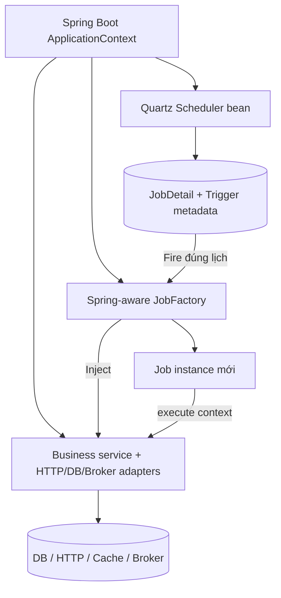
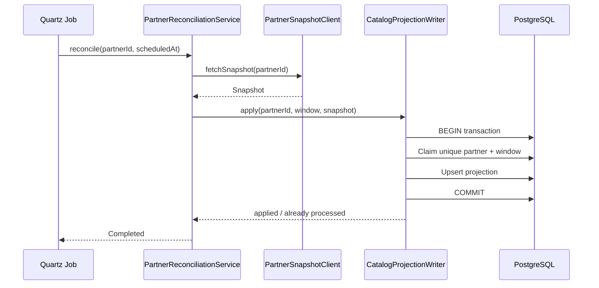

# Tích hợp bean nghiệp vụ và tiêm phụ thuộc vào job

Trong **SPRING_BOOT_INTEGRATION**, một tác vụ Quartz có thể định kỳ gọi API đối tác, đọc hoặc cập nhật dữ liệu qua JDBC/JPA, làm mới Redis, gửi message sang Kafka/RabbitMQ hoặc khởi động một luồng Spring Integration. Mấu chốt không chỉ là viết một phương thức `execute()`: Quartz có **vòng đời tạo Job riêng**, trong khi logic nghiệp vụ, HTTP client, repository và transaction thường là những **Spring beans** được quản lý trong `ApplicationContext`. Nếu nối hai thế giới này không đúng, job có thể bị `NullPointerException` do dependency không được tiêm, tự tạo HTTP client cho mỗi lần chạy hoặc ghi lặp khi scheduler retry.

Bài thuộc chương **Quartz**, tập trung vào **tích hợp bean nghiệp vụ và tiêm phụ thuộc vào job** trong Spring Boot. Ta sẽ phân biệt `JobDetail`, `Trigger`, `JobFactory`, instance của `Job` và Spring service; thực hành constructor injection an toàn; giải thích `JobDataMap` chỉ nên mang dữ liệu định danh/cấu hình serializable; tổ chức transaction, lỗi, chống trùng, kiểm thử và vận hành khi job kết nối nhiều hệ thống.

> Các ví dụ hướng tới **Java 17+, Spring Boot 3.x, Quartz 2.x**. `RestClient` (nếu dùng) có từ Spring Framework 6.1/Spring Boot 3.2; các ví dụ bên dưới dùng interface adapter để không phụ thuộc HTTP engine cụ thể. API Boot/Quartz và cơ chế `JobFactory` mặc định có thể khác theo phiên bản hoặc khi ứng dụng khai báo `SchedulerFactoryBean` riêng; hãy kiểm tra cấu hình thực đang chạy thay vì giả định mọi kiểu tiêm đều hoạt động.

## 1. Mục tiêu học tập

Sau bài này, bạn có thể:

1. Giải thích **ai tạo Job instance**: Spring container, Quartz `JobFactory` hay một thành phần tùy biến.
2. Phân biệt metadata bền vững `JobDetail`/`Trigger` với mỗi **lần thực thi** `JobExecutionContext` và instance `Job`.
3. Cấu hình Spring Boot Quartz starter, một `JobDetail` và một `Trigger` bằng các bean được quản lý.
4. Dùng **constructor injection** cho Job thông qua `SchedulerFactoryBeanCustomizer` và `AutowireCapableBeanFactory` khi cần một chiến lược tạo Job tường minh.
5. Đặt logic nghiệp vụ vào Spring service, HTTP client/repository/transaction trong đúng lớp, thay vì nhồi vào `execute()`.
6. Truyền `partnerId`, phạm vi đồng bộ, cửa sổ dữ liệu hoặc business operation ID qua `JobDataMap`; không đưa `DataSource`, service hoặc secret vào đó.
7. Hiểu concurrency, job identity, misfire, retry, JDBC JobStore, cluster và ranh giới idempotency.
8. Kiểm thử một Job thực sự được Quartz tạo, xác minh bean nghiệp vụ đã được tiêm và hoàn tất dưới lỗi.

## 2. Bốn khái niệm cần tách bạch

Quartz vận hành theo những thành phần riêng biệt:

| Khái niệm | Vai trò | Vòng đời và ownership |
| --- | --- | --- |
| `Scheduler` | Quản lý lịch, triggers, các workers thực thi job | Thường là **Spring bean dùng lâu dài**; có thể được Boot auto-configure. |
| `JobDetail` | Định nghĩa **job identity**, Job class, `JobDataMap`, durability | Metadata do scheduler quản lý; có thể được lưu ở JDBC JobStore. |
| `Trigger` | Định nghĩa **khi nào** một JobDetail được kích hoạt | Metadata riêng; một JobDetail có thể có nhiều triggers. |
| `JobFactory` | Tạo instance `Job` khi cần thực thi | Cầu nối giữa Quartz và Spring DI; ảnh hưởng khả năng constructor/field injection. |
| `Job` instance | Chứa `execute(JobExecutionContext)` được Quartz gọi | Thường tạo cho mỗi lần fire; **không coi là singleton service**. |
| Spring service bean | Chứa use case, transaction, repository, HTTP/broker adapters | `ApplicationContext` quản lý lifecycle và dependency graph. |
| `JobExecutionContext` | Thông tin **một lần fire**: key, trigger, scheduled/actual time, map | Chỉ hợp lệ cho lần thực thi tương ứng; không cache toàn cục. |



Một `JobDetail` có thể được lưu hàng tháng, còn **Job instance** chỉ sống trong lúc thực thi. Mỗi khi trigger fire, Quartz có thể nhờ `JobFactory` tạo instance mới; không nên dùng field của instance như bộ nhớ tiến độ giữa các lần chạy. Tiến độ, checkpoint và idempotency cần một nơi lưu bền vững (DB/outbox/inbox) nếu phải sống qua restart.

### 2.1. Vì sao `@Component` trên Job không phải lời giải chắc chắn?

```java
import org.quartz.Job;
import org.quartz.JobExecutionContext;
import org.springframework.stereotype.Component;

@Component
public class FragileExampleJob implements Job {
    private final PartnerReconciliationService service;

    public FragileExampleJob(PartnerReconciliationService service) {
        this.service = service;
    }

    @Override
    public void execute(JobExecutionContext context) {
        service.reconcile("catalog", context.getScheduledFireTime().toInstant());
    }
}
```

Điều này **chỉ khai báo cách Spring tạo một bean**. Nếu Quartz tự tạo `FragileExampleJob` qua `JobFactory` không hỗ trợ Spring DI, constructor có tham số có thể không được gọi theo cách mong muốn. Thậm chí Spring đã tạo một bean `FragileExampleJob`, Quartz không mặc định phải sử dụng đúng bean đó để chạy. Một cấu hình Boot nhất định có thể tự hỗ trợ injection; cách đúng là **kiểm tra JobFactory đang được dùng**, không đoán từ annotation.

**Quy tắc thiết kế:** Job là adapter mỏng được Quartz tạo qua JobFactory; service mới là nơi mang workflow nghiệp vụ, transaction, HTTP client, repository và logic retry/idempotency.

## 3. Khởi tạo Quartz trong Spring Boot

Starter:

```xml
<dependency>
    <groupId>org.springframework.boot</groupId>
    <artifactId>spring-boot-starter-quartz</artifactId>
</dependency>
```

Hoặc Gradle Groovy:

```groovy
dependencies {
    implementation 'org.springframework.boot:spring-boot-starter-quartz'
}
```

Khi điều kiện auto-configuration phù hợp, Boot tạo `SchedulerFactoryBean`/`Scheduler`, tích hợp các bean `JobDetail`, `Trigger`, `Calendar` và customizers. Ứng dụng cần tự mô tả **việc gì chạy, khi nào chạy, JobFactory/lifecycle và storage policy**.

```yaml
spring:
  quartz:
    auto-startup: true
    job-store-type: memory
    properties:
      org.quartz.threadPool.threadCount: 5
```

Đây là profile minh họa cho ứng dụng một instance hoặc dev: `memory` **không lưu lịch qua restart** và không cung cấp clustering bền vững. `threadCount=5` chỉ giới hạn Quartz worker threads ở cấu hình này, không tự giới hạn connection pool của HTTP/DB, số Kafka consumers hay dung lượng hàng chờ bên ngoài.

### 3.1. Một JobDetail và Trigger định nghĩa lịch

```java
import java.util.TimeZone;
import org.quartz.CronScheduleBuilder;
import org.quartz.JobBuilder;
import org.quartz.JobDetail;
import org.quartz.Trigger;
import org.quartz.TriggerBuilder;
import org.springframework.context.annotation.Bean;
import org.springframework.context.annotation.Configuration;

@Configuration(proxyBeanMethods = false)
public class PartnerReconciliationSchedule {

    @Bean
    JobDetail catalogReconciliationDetail() {
        return JobBuilder.newJob(PartnerReconciliationJob.class)
                .withIdentity("catalog-reconciliation", "integration")
                .withDescription("Reconcile one configured catalog partner")
                .usingJobData("partnerId", "catalog")
                .storeDurably()
                .build();
    }

    @Bean
    Trigger catalogReconciliationTrigger(
            @org.springframework.beans.factory.annotation.Qualifier(
                    "catalogReconciliationDetail") JobDetail catalogReconciliationDetail) {
        return TriggerBuilder.newTrigger()
                .withIdentity("catalog-every-five-minutes", "integration")
                .forJob(catalogReconciliationDetail)
                .withSchedule(
                        CronScheduleBuilder
                                .cronSchedule("0 0/5 * * * ?")
                                .inTimeZone(TimeZone.getTimeZone("UTC"))
                                .withMisfireHandlingInstructionDoNothing())
                .build();
    }
}
```

Lịch **`0 0/5 * * * ?`** fire ở các mốc phút chia hết cho 5, giây 0, theo UTC ở ví dụ. Nó **không** có nghĩa “đợi 5 phút sau lúc ứng dụng khởi động rồi chạy”; misfire policy `DoNothing` bỏ qua những mốc đã lỡ theo cơ chế Quartz và chờ mốc hợp lệ kế tiếp. Hãy chọn misfire policy theo nhu cầu: đồng bộ có thể muốn catch-up, nhưng payment/bulk sync không nên chạy dồn mọi lần bị lỡ.

`withIdentity(...)` đặt một **JobKey ổn định** gồm name và group. Nhiều triggers có thể cùng trỏ tới `catalogReconciliationDetail`; `storeDurably()` cho phép giữ JobDetail khi không có trigger nhưng không tự đồng nghĩa lịch đã bắt đầu chạy.

### 3.2. Metadata JobDetail khác instance bean nghiệp vụ

Trong ví dụ, `.newJob(PartnerReconciliationJob.class)` chỉ đăng ký **class**; JobDetail **không chứa instance Spring service**. Khi fire, scheduler dùng JobFactory để tạo Job và inject dependency theo cấu hình. Đây là điểm nối tiếp cần xử lý rõ.

## 4. Tiêm bean bằng JobFactory: constructor injection tường minh

Một cách rõ ràng, dễ kiểm thử là dùng `SchedulerFactoryBeanCustomizer` chỉ định `JobFactory` tạo từng Job bằng `AutowireCapableBeanFactory.createBean(...)` của Spring. Cách này hỗ trợ **constructor injection**, thay vì chờ Quartz gọi constructor no-arg rồi thử tiêm field.

```java
import org.quartz.spi.TriggerFiredBundle;
import org.springframework.beans.factory.config.AutowireCapableBeanFactory;
import org.springframework.boot.autoconfigure.quartz.SchedulerFactoryBeanCustomizer;
import org.springframework.context.annotation.Bean;
import org.springframework.context.annotation.Configuration;
import org.springframework.scheduling.quartz.SpringBeanJobFactory;

@Configuration(proxyBeanMethods = false)
public class QuartzJobFactoryConfiguration {

    @Bean
    SchedulerFactoryBeanCustomizer springConstructorInjectedJobs(
            AutowireCapableBeanFactory beanFactory) {

        return schedulerFactoryBean ->
                schedulerFactoryBean.setJobFactory(new SpringBeanJobFactory() {
                    @Override
                    protected Object createJobInstance(
                            TriggerFiredBundle bundle) throws Exception {

                        return beanFactory.createBean(
                                bundle.getJobDetail().getJobClass());
                    }
                });
    }
}
```

**Cách hoạt động:**

1. Spring Boot tạo SchedulerFactoryBean và áp các `SchedulerFactoryBeanCustomizer` khi auto-configuration phù hợp.
2. Khi Quartz yêu cầu một instance, `JobFactory` gọi `beanFactory.createBean(JobClass)` để Spring tạo object và resolve constructor dependencies.
3. Job mới nhận service/repository qua constructor; Quartz gọi `execute(context)` cho lần fire đó.
4. **`JobDataMap` vẫn được đọc từ `JobExecutionContext`**, không tự được bind thành property của Job bởi cách tạo bean tùy biến này.

**Lưu ý về lifecycle:** `createBean(...)` tạo **instance mới**, không biến Job thành Spring singleton thường được lấy bằng `getBean(...)`. Các object được tạo thủ công qua `AutowireCapableBeanFactory` không nên dựa vào một vòng `@PreDestroy` như singleton đăng ký thường xuyên; hãy giữ Job **stateless, không tự sở hữu socket/thread/pool**. HTTP clients, DataSources và các service có tài nguyên phải là Spring-managed beans dùng chung.

**Lưu ý về Boot version:** Spring Boot có thể đã cung cấp cơ chế JobFactory hỗ trợ tiêm phụ thuộc mặc định. Đoạn customizer nhằm trình bày một cơ chế **tường minh cho constructor injection** khi dự án cần kiểm soát chắc chắn; không thêm một JobFactory nữa vô ích nếu cấu hình hiện tại đã đáp ứng. Nếu tự tạo `SchedulerFactoryBean` riêng, phải xác minh customizers được áp vào bean đó, hoặc đặt JobFactory trực tiếp theo thiết kế ứng dụng.

### 4.1. Vì sao không lấy `@Component` Job singleton làm factory?

Một `Job` có thể được kích hoạt nhiều lần, thậm chí đồng thời (khi không có `@DisallowConcurrentExecution` cho cùng key). Nếu cố tái sử dụng **một Job instance có mutable fields** cho mọi lần fire, trạng thái như currentTenant, page, error hay accessToken có thể bị lẫn giữa các executions. **Quartz Job nên không chứa trạng thái nghiệp vụ giữa các lần chạy**; service singleton chỉ được giữ state bất biến hoặc quản lý concurrency đúng cách.

## 5. Job adapter mỏng: chỉ chọn ngữ cảnh và gọi use case

Từ JobDetail phần 3, ta tạo một Job có **constructor injection**, kiểm tra `partnerId` từ `JobDataMap`, xác định mốc fire và gọi một Spring service:

```java
import java.time.Instant;
import java.util.Date;
import java.util.Set;
import org.quartz.DisallowConcurrentExecution;
import org.quartz.Job;
import org.quartz.JobExecutionContext;
import org.quartz.JobExecutionException;

@DisallowConcurrentExecution
public final class PartnerReconciliationJob implements Job {
    private static final Set<String> ALLOWED_PARTNERS =
            Set.of("catalog");

    private final ReconciliationUseCase service;

    public PartnerReconciliationJob(ReconciliationUseCase service) {
        this.service = service;
    }

    @Override
    public void execute(JobExecutionContext context)
            throws JobExecutionException {

        String partnerId = context.getMergedJobDataMap()
                .getString("partnerId");
        Date scheduledFireTime = context.getScheduledFireTime();

        if (partnerId == null
                || !ALLOWED_PARTNERS.contains(partnerId)
                || scheduledFireTime == null) {
            throw new JobExecutionException(
                    new IllegalArgumentException(
                            "Invalid scheduled reconciliation job data"),
                    false);
        }

        Instant scheduledAt = scheduledFireTime.toInstant();

        try {
            service.reconcile(partnerId, scheduledAt);
        } catch (Exception error) {
            // Quartz ghi nhận thất bại; retry phải do policy rõ ràng quản lý.
            throw new JobExecutionException(error, false);
        }
    }
}
```

Một vài điểm cần hiểu chính xác:

- `@DisallowConcurrentExecution` ngăn các executions **đồng thời của cùng `JobKey`** theo cơ chế Quartz; **không khóa tất cả instances của cùng Java Job class** với JobKey khác nhau, và không thay thế khóa phân tán khi các scheduler không cùng cluster/job store.
- `getMergedJobDataMap()` hợp nhất dữ liệu từ JobDetail và Trigger; khi trùng key, dữ liệu Trigger có thể **ghi đè** giá trị tương ứng. Do đó không coi field trong map là nguồn cấu hình bất biến hoặc tin cậy tuyệt đối khi API quản trị scheduler cho phép thay trigger.
- `scheduledFireTime` biểu diễn mốc lẽ ra được fire; `fireTime` là thời điểm Quartz thực sự bắt đầu chạy. Trong tình huống misfire hoặc executor bận, hai giá trị có thể lệch nhau. ID nghiệp vụ cần được xác định theo hợp đồng, không dùng máy móc `fireInstanceId` làm khóa chống trùng.
- `JobExecutionException(error, false)` **không yêu cầu refire ngay lập tức**. Quartz sẽ xử lý lần fire theo trigger/instructions và listeners; **không tự có retry với backoff** chỉ vì Job ném exception. Các lỗi khác nhau có thể được phân loại để quarantine, reschedule hoặc alert ở tầng workflow.
- Đoạn ví dụ **không ghi state vào field của Job**, không tự lấy `ApplicationContext` qua static holder và không tự tạo HTTP client/DB connection.

### 5.1. Thực thi nhiều đối tác với cùng Job class

Có thể đăng ký thêm JobDetail `billing-reconciliation` cùng class `PartnerReconciliationJob` nhưng JobKey khác, `JobDataMap` khác; constructor vẫn tiêm cùng **service bean** theo DI. Với pattern này phải thay `ALLOWED_PARTNERS` bằng danh sách đối tác cấu hình được kiểm soát, không viết thêm `new Driver`/`new RestClient` trong từng Job.

**Đừng** dùng một `static String currentPartner` cho tất cả jobs hoặc sửa cấu hình singleton HTTP client dựa trên JobDataMap: hai JobKeys có thể thực thi đồng thời. Service phải dùng cấu hình theo đối tác, qualifier/client registry có allowlist và per-request headers phù hợp.

## 6. Business service: HTTP ở ngoài DB transaction, ghi dữ liệu bên trong

Ví dụ một use case đồng bộ snapshot danh mục từ API đối tác vào PostgreSQL. Kiến trúc:



### 6.1. DTO và HTTP adapter contract

```java
public record PartnerSnapshot(
        String sourceVersion,
        long itemCount
) {}

public interface PartnerSnapshotClient {
    PartnerSnapshot fetchSnapshot(String partnerId);
}
```

Một implementation có thể dùng một `RestClient` singleton đã cấu hình base URL/timeout/auth cho catalog; một ứng dụng khác có thể dùng `WebClient` hoặc HTTP interface. **Job không cần biết** cụ thể client nào xử lý JSON, TLS, query parameters, 429 hoặc credential rotation.

### 6.2. Orchestrator không mở transaction SQL trước HTTP

```java
import java.time.Instant;

@FunctionalInterface
public interface ReconciliationUseCase {
    void reconcile(String partnerId, Instant scheduledAt);
}
```

```java
import java.time.Instant;
import org.springframework.stereotype.Service;

@Service
public class PartnerReconciliationService implements ReconciliationUseCase {
    private final PartnerSnapshotClient snapshots;
    private final CatalogProjectionWriter writer;

    public PartnerReconciliationService(
            PartnerSnapshotClient snapshots,
            CatalogProjectionWriter writer) {
        this.snapshots = snapshots;
        this.writer = writer;
    }

    @Override
    public void reconcile(String partnerId, Instant scheduledAt) {
        PartnerSnapshot snapshot = snapshots.fetchSnapshot(partnerId);
        writer.apply(partnerId, scheduledAt, snapshot);
    }
}
```

`PartnerReconciliationService` là Spring singleton được inject vào mỗi Job instance. Nó không mang mutable job state trong field; `partnerId` và `scheduledAt` là tham số **theo lần fire**. Nếu logic cần tra Redis, gửi notification hoặc phát Kafka event, hãy chọn ranh giới riêng, tránh làm chúng trực tiếp **trong SQL transaction giữ connection/lock** lâu khi chờ HTTP.

### 6.3. Idempotent writer với unique constraint

Để minh họa, database PostgreSQL có hai bảng:

```sql
CREATE TABLE reconciliation_run (
    partner_id VARCHAR(64) NOT NULL,
    window_start TIMESTAMPTZ NOT NULL,
    status VARCHAR(32) NOT NULL,
    PRIMARY KEY (partner_id, window_start)
);

CREATE TABLE catalog_projection (
    partner_id VARCHAR(64) PRIMARY KEY,
    source_version VARCHAR(128) NOT NULL,
    item_count BIGINT NOT NULL
);
```

Trong ví dụ, cron ở mỗi mốc **5 phút UTC**. Ta chuẩn hóa cửa sổ theo 300 giây và ghi **claim + projection trong cùng transaction**:

```java
import java.sql.Timestamp;
import java.time.Instant;
import org.springframework.jdbc.core.JdbcTemplate;
import org.springframework.stereotype.Service;
import org.springframework.transaction.annotation.Transactional;

@Service
public class CatalogProjectionWriter {
    private final JdbcTemplate jdbc;

    public CatalogProjectionWriter(JdbcTemplate jdbc) {
        this.jdbc = jdbc;
    }

    @Transactional
    public void apply(
            String partnerId,
            Instant scheduledAt,
            PartnerSnapshot snapshot) {

        long epochSeconds = scheduledAt.getEpochSecond();
        long windowEpoch = Math.floorDiv(epochSeconds, 300L) * 300L;
        Timestamp window = Timestamp.from(
                Instant.ofEpochSecond(windowEpoch));

        int claimed = jdbc.update("""
                INSERT INTO reconciliation_run(
                    partner_id, window_start, status)
                VALUES (?, ?, 'COMPLETED')
                ON CONFLICT (partner_id, window_start) DO NOTHING
                """, partnerId, window);

        if (claimed == 0) {
            // Cửa sổ này đã commit thành công trong một lần chạy trước.
            return;
        }

        jdbc.update("""
                INSERT INTO catalog_projection(
                    partner_id, source_version, item_count)
                VALUES (?, ?, ?)
                ON CONFLICT (partner_id) DO UPDATE SET
                    source_version = EXCLUDED.source_version,
                    item_count = EXCLUDED.item_count
                """,
                partnerId, snapshot.sourceVersion(), snapshot.itemCount());
    }
}
```

**Vì sao không dùng `boolean alreadyProcessed` trong Job field?** Quartz có thể restart hoặc chạy nhiều pods; chỉ unique key trong **database chung** mới có thể bảo vệ quy tắc chống ghi trùng theo định danh `partnerId + windowStart` trong ví dụ. Hai executions cạnh tranh cùng key được PostgreSQL xử lý bằng unique constraint; nếu câu upsert thất bại, transaction rollback cả claim nên job sau vẫn có thể thực hiện lại.

**Cẩn trọng về semantics:** mã trên chỉ bảo đảm “**mỗi cửa sổ tối đa một lần ghi projection thành công**”, không bảo đảm snapshot HTTP thực sự thuộc cửa sổ 5 phút hay không bị đảo thứ tự khi job chạy trễ. Production nên có watermark/version của nguồn và chỉ apply dữ liệu mới hơn; khi cần catch-up mọi cửa sổ, service phải fetch dữ liệu **theo window** và xử lý thứ tự đúng. Mô hình một bảng projection không thay thế lưu event history; nó chỉ là ví dụ ranh giới transaction và idempotency.

### 6.4. Tại sao đặt `@Transactional` trên service ghi, không đặt ở Job?

`CatalogProjectionWriter.apply` được gọi qua **Spring proxy** từ `PartnerReconciliationService` khác bean, nên transaction JDBC có thể được áp dụng. Nếu dùng một method `@Transactional` rồi **self-invoke** từ method khác của cùng object, Spring AOP proxy theo cơ chế phổ biến có thể không intercept, dẫn đến thiếu transaction như dự kiến.

Nếu đặt `@Transactional` trên toàn `PartnerReconciliationJob.execute` hoặc bao cả `snapshots.fetchSnapshot`, JDBC connection và DB locks có thể bị giữ trong lúc chờ HTTP. Ranh giới hợp lý hơn là **fetch outside transaction, write atomically in a short transaction**. Dù Job đã hoàn tất ghi DB, Kafka publish/Redis cache còn cần outbox/reconciliation nếu hợp đồng yêu cầu cập nhật nhiều hệ thống.

## 7. JobDataMap truyền dữ liệu, không truyền Spring beans

`JobDataMap` là nơi Quartz giữ **tham số cho JobDetail hoặc Trigger**. Ví dụ:

```java
JobDetail detail = JobBuilder
        .newJob(PartnerReconciliationJob.class)
        .withIdentity("catalog-reconciliation", "integration")
        .usingJobData("partnerId", "catalog")
        .usingJobData("schemaVersion", 1)
        .storeDurably()
        .build();
```

| Nên đặt trong JobDataMap | Không nên đặt |
| --- | --- |
| `partnerId` hoặc `tenantKey` đã qua allowlist | `DataSource`, `JdbcTemplate`, `RestClient` hay Spring service object |
| `jobConfigurationVersion`, `schemaVersion` | Access token, OAuth refresh token, DB password, secret |
| `businessRunId` hoặc correlation ID bền vững khi có hợp đồng | HTTP request/response/`InputStream`, thread, lambda hoặc session |
| `pageSize` và filter keys được validate, có giới hạn | Toàn bộ DTO lớn hoặc danh sách hàng triệu IDs |
| ID của durable work item/outbox record | Mutable in-memory object dùng làm checkpoint sau restart |

Với **JDBC JobStore**, JobDataMap có thể được persist/serialize tùy configuration (`useProperties` và các giới hạn Quartz tương ứng). Đưa bean Spring vào đó không chỉ kém thiết kế mà còn có thể gây serialization failure, class-version mismatch và rò secrets vào bảng Quartz. Khi cần dữ liệu lớn, lưu ở database nghiệp vụ rồi đặt **workItemId** trong JobDataMap để tra cứu.

### 7.1. Trigger có thể override JobDetail data

Một JobDetail chứa `partnerId=catalog` nhưng Trigger chứa `partnerId=billing` có thể khiến `context.getMergedJobDataMap()` trả **billing**. Khi giá trị này điều khiển host/credentials hoặc tenant, cần validate và quản lý quyền thay đổi triggers; không tin rằng JobDataMap chỉ do application code khởi tạo.

Nên dùng JobDataMap chứa **key định danh policy**, sau đó service tra registry cấu hình được kiểm soát. Không tạo `RestClient` đến URL do JobDataMap chứa; đó có thể trở thành SSRF và credential exposure nếu scheduler admin API bị dùng sai.

### 7.2. Không dùng JobDataMap làm transaction log

`JobDataMap` có thể được thay đổi giữa lần thực thi theo behavior của Quartz, đặc biệt khi có `@PersistJobDataAfterExecution`. Nhưng đây không phải cơ chế thay cho **progress checkpoint, inbox, outbox hoặc durable dedup**. Với SQL transaction và broker, dùng bảng application với unique constraint/version; trạng thái Quartz như nextFireTime chỉ mô tả lịch, không chứng minh business write đã hoàn tất.

## 8. Injection qua field/setter: dùng được nhưng hiểu giới hạn

Một pattern từng gặp:

```java
import org.quartz.Job;
import org.quartz.JobExecutionContext;
import org.springframework.beans.factory.annotation.Autowired;

public class SetterInjectionJob implements Job {
    private PartnerReconciliationService service;

    @Autowired
    public void setService(PartnerReconciliationService service) {
        this.service = service;
    }

    @Override
    public void execute(JobExecutionContext context) {
        service.reconcile(
                "catalog",
                context.getScheduledFireTime().toInstant());
    }
}
```

Setter/field injection **chỉ chạy** nếu JobFactory hoặc một bước tạo bean thông qua Spring thực sự thực hiện dependency injection. `SpringBeanJobFactory` theo một số cách dùng hỗ trợ bind properties từ JobDataMap vào setters nhưng **property binding từ dữ liệu Quartz không đồng nghĩa `@Autowired` Spring bean injection**. Đừng lẫn hai hành vi này.

Một custom JobFactory theo pattern:

```java
Object instance = super.createJobInstance(bundle);
beanFactory.autowireBean(instance);
return instance;
```

có thể inject fields/setters sau khi Quartz đã tạo instance, **nhưng không giải quyết constructor chỉ có tham số** nếu `super.createJobInstance` vẫn cần no-arg constructor. Bởi vậy phần 4 dùng `beanFactory.createBean(JobClass)` cho constructor injection, rồi đọc business parameters từ `JobExecutionContext` thay vì setter property binding.

**Khuyến nghị:** dùng constructor injection và field `final` trong Job, service/interface singleton hoặc scoped bean phù hợp, và một JobFactory được xác minh bằng integration test. Field/setter injection vẫn có thể dùng cho code cũ nhưng ít thể hiện rõ dependency và dễ che lỗi JobFactory.

## 9. Bean lifecycle: Quartz worker thread không phải HTTP request scope

Một Quartz Job không chạy trong một HTTP request thông thường. `@RequestScope`, session HTTP, `SecurityContext` của người dùng hiện tại hoặc Reactor context từ một inbound request **không tự tồn tại** khi Quartz kích hoạt cron.

| Dependency | Thường phù hợp cho Job? | Lý do |
| --- | --- | --- |
| Singleton `@Service` chứa use case/stateless orchestration | **Có** | Job mới gọi service bean dùng chung. |
| `JdbcTemplate`/`EntityManagerFactory` hoặc repository Spring Data | **Có**, thông qua service | Hạ tầng Spring quản lý connection và transaction. |
| `RestClient`/`WebClient` singleton theo đối tác | **Có**, thông qua adapter | Pool/credentials/timeout ở bean dùng chung. |
| `KafkaTemplate`/`RabbitTemplate` | Có, theo thiết kế outbox hoặc publisher | Không giả định gửi message và DB commit thuộc một transaction. |
| `@RequestScope` bean từ HTTP controller | **Không mặc định** | Không có request context; injection proxy chỉ dời lỗi tới lúc gọi. |
| `HttpServletRequest`/session cookie của một người dùng | Không | Quartz không thay mặt một HTTP caller cụ thể trừ khi đã thiết kế delegation rõ. |
| `EntityManager` giữ trong field Job | Không | EntityManager/session làm việc có vòng đời/transaction và không chia sẻ đồng thời tùy tiện. |
| `ThreadLocal` chứa user/tenant từ request trước | Không | Quartz worker threads được tái sử dụng; nguy cơ context leakage. |

### 9.1. Nếu job chạy thay mặt một tenant hoặc người dùng?

Nên truyền một **tenantId hoặc workItemId** trong JobDataMap, tra cứu principal/policy từ nguồn server-side đáng tin cậy, rồi **kiểm tra authorization** cho thao tác cần làm. Không ghi JWT/access token dài hạn hoặc nguyên HTTP headers vào JobStore. Nếu cần gọi OAuth2 endpoint, dùng service-account/client-credentials flow thích hợp; nếu cần delegated user token, thiết kế refresh/expiration/consent riêng.

Với multi-tenancy, service phải đặt tenant scope rõ trong mọi truy vấn DB/cache/HTTP. Nếu ứng dụng dùng thread-local tenant context, phải **set/clear trong try/finally** hoặc tốt hơn truyền tenant bằng tham số, tránh rò sang Job khác trên cùng Quartz thread.

### 9.2. Shutdown và dependency đã bị hủy

Khi Spring context đóng, scheduler nên ngừng nhận triggers mới và các jobs in-flight cần được xử lý theo policy trước khi datasource/HTTP client bị dispose. Cấu hình `spring.quartz.wait-for-jobs-to-complete-on-shutdown` có thể ảnh hưởng việc scheduler chờ job đang chạy, nhưng **không** đồng nghĩa JVM/container sẽ chờ vô thời hạn; Kubernetes termination grace period hoặc shutdown deadline có thể ngắt process.

Nếu job đang gọi HTTP rồi bị ngắt sau khi API đối tác đã commit, lần chạy lại phải dùng operation ID/idempotency. Nếu đang ghi SQL transaction thì rollback/commit phụ thuộc trạng thái thực và timing. Nên dùng durable checkpoint/outbox cùng policy restart, không dựa vào việc Spring gọi `@PreDestroy` của Job instance cho mọi lần fire.

## 10. `@DisallowConcurrentExecution`, JobKey và số instance

Giả sử một JobDetail với JobKey `integration.catalog-reconciliation` có hai triggers: cron 5 phút và manual trigger do admin tạo. Nếu job chạy 8 phút, mặc định Quartz có thể cho những lần fire chồng nhau nếu không có concurrency policy phù hợp.

Đặt:

```java
@DisallowConcurrentExecution
public final class PartnerReconciliationJob implements Job {
    // ...
}
```

cho Quartz biết **không thực thi đồng thời nhiều instances của cùng một JobDetail**. Đây là annotation trên Job class nhưng khóa serialization thực tế là **`JobKey`**, không phải tên Java class đơn lẻ.

| Kịch bản | Annotation có ngăn overlap? | Lưu ý |
| --- | --- | --- |
| Hai triggers cùng trỏ tới JobKey catalog | Có, trong cùng Scheduler/cooperating cluster | Có thể khiến lịch sau chờ/misfire. |
| Hai JobDetails catalog và billing, khác JobKey, cùng class | **Không** ngăn chúng chạy song song | Service/client registry phải an toàn khi concurrent. |
| Hai pods có Quartz RAMJobStore độc lập, đều có job key catalog | **Không** tạo distributed lock giữa chúng | Mỗi pod có scheduler riêng, có thể chạy trùng. |
| Hai nodes Quartz cluster cùng chia sẻ JDBC JobStore đúng cấu hình | Quartz phối hợp claims/misfires cho cùng scheduler cluster | Cần chung DB/table prefix, unique instance IDs và môi trường đúng. |
| Hai workflows tạo cùng payment dù JobKey khác nhau | Không phải trách nhiệm annotation | Phải có idempotency/unique business key ở hệ thống đích. |

**`@DisallowConcurrentExecution` không làm job “exactly once”.** Một node có thể mất mạng sau khi thực hiện side effect nhưng trước khi scheduler ghi nhận kết quả; job có thể được recovery/refire tùy cấu hình. Những hệ thống ngoài Quartz như Kafka có thể giao lại message và Spring Integration có thể retry riêng.

### 10.1. `@PersistJobDataAfterExecution`: không dùng làm bộ đếm nghiệp vụ mặc định

Quartz có `@PersistJobDataAfterExecution` để lưu thay đổi trong **JobDetail JobDataMap** sau mỗi execution theo semantics của scheduler/job store. Khi dùng với state mutation, annotation thường được khuyến nghị phối hợp với `@DisallowConcurrentExecution` để tránh concurrent writes đến JobDataMap.

Tuy nhiên:

- Không nên lưu user credentials, HTTP client, file stream hay object graph lớn ở JobDataMap.
- Không dùng một integer `lastProcessedPage` trong map làm checkpoint chính của một job đồng bộ nhiều nghìn bản ghi nếu cần transaction cùng database.
- Restart/recovery/misfire và thay đổi trigger có thể khiến trạng thái lịch khác trạng thái đã commit ở DB/broker.
- Với nhiều JobKeys, việc mỗi key có map riêng không thay thế khóa theo business ID.

Nếu yêu cầu khôi phục chính xác tiến độ đồng bộ, dùng bảng `sync_checkpoint` có version/unique key và cập nhật **trong cùng transaction** với dữ liệu áp dụng. JobDataMap chỉ giữ ID của checkpoint cần đọc.

## 11. Misfire, recovery và các kiểu retry phải tách riêng

Một trigger được kỳ vọng fire lúc 10:00 nhưng scheduler bị dừng tới 10:20 có thể đã **misfire**. Quartz dùng misfire policy của trigger và thông tin JobStore để quyết định xử lý những lần bị lỡ. Đây là **cơ chế lịch**, không phải retry HTTP khi partner trả 503 và cũng không phải replay Kafka message.

| Hiện tượng | Thành phần quyết định | Tác động cần xử lý |
| --- | --- | --- |
| Cron fire bị lỡ khi server downtime | Quartz trigger misfire instruction | Bỏ qua, catch-up một lần hay chính sách khác tùy trigger. |
| Job ném `JobExecutionException` | Job + Scheduler/JobListeners + retry orchestration | Không tự có exponential backoff trừ khi cấu hình. |
| Driver SQL mất kết nối tạm thời | Service/DB retry policy | Chỉ retry đoạn an toàn, không nhân side effect. |
| HTTP partner timeout sau POST | HTTP adapter/workflow | Kết quả có thể đã commit ở đối tác; cần idempotency/reconcile. |
| Process crash sau DB commit trước broker publish | Outbox publisher | Phát lại event có cùng event ID. |
| Kafka/RabbitMQ gửi message trùng | Consumer inbox/dedup | Không tạo hiệu ứng nghiệp vụ trùng. |
| Scheduler node ngừng trong cluster | Quartz JDBC JobStore/recovery settings | Phục hồi lịch/job theo cấu hình; không thể rollback external side effect. |

### 11.1. Đừng lạm dụng `refireImmediately`

`JobExecutionException` cho phép chỉ thị `refireImmediately` trong một số tình huống. Nhưng nếu service đang lỗi xác thực, database hết connection hoặc partner trả 429, yêu cầu **chạy ngay lập tức trên cùng worker** có thể tạo vòng retry không có backoff, làm tình hình xấu hơn.

Với lỗi transient, một thiết kế hợp lý thường gồm:

1. Phân loại exception (transient/permanent/unknown outcome).
2. Giới hạn số attempts và deadline của **một business operation**.
3. Backoff có jitter và rate limit theo downstream.
4. Khi cần retry bền vững qua restart, lưu durable work item và schedule lại hoặc đặt vào broker thay vì chỉ sleep trong Quartz thread.
5. Quarantine dữ liệu sai contract, không retry mãi.
6. Giữ business idempotency key ổn định giữa attempts.

### 11.2. Khi nào nên dùng Quartz và khi nào dùng broker?

Quartz giỏi **lịch định kỳ, cron, phân phối trigger**; broker giỏi **hàng chờ công việc, redelivery và tách producer/consumer**. Một công việc nặng chạy 2 giờ không nhất thiết cần giữ Quartz worker trong 2 giờ: job có thể **tạo durable batch/work item trong database**, rồi workers nhận từ broker để xử lý song song, kiểm soát retry/checkpoint.

Tuy nhiên, nếu Quartz job chỉ publish message rồi tự báo `COMPLETED`, phải định nghĩa “completed” nghĩa là **đã gửi lệnh vào hàng chờ bền vững**, không phải toàn bộ batch đã hoàn tất. Nếu cần API hiển thị trạng thái, dùng bảng workflow với trạng thái `SCHEDULED`, `QUEUED`, `RUNNING`, `COMPLETED`/`FAILED` thay vì suy từ Quartz `nextFireTime`.

## 12. JDBC JobStore và nhiều Spring Boot instances

Khi cần lịch sống qua restart hoặc cluster, Quartz có JDBC JobStore. Trong Spring Boot:

```yaml
spring:
  quartz:
    job-store-type: jdbc
    jdbc:
      initialize-schema: never
    properties:
      org.quartz.scheduler.instanceName: partner-scheduler
      org.quartz.scheduler.instanceId: AUTO
      org.quartz.jobStore.isClustered: true
      org.quartz.threadPool.threadCount: 8
```

**Điều kiện để cấu hình này có ý nghĩa:** Quartz tables đã được tạo bằng schema đúng với driver/version; tất cả instances trong cùng cluster dùng chung JDBC store/table prefix và `instanceName` phù hợp; mỗi scheduler instance có ID riêng; clocks và hạ tầng đủ ổn định. `isClustered=true` khi không có JDBC JobStore/cluster schema phù hợp không tự làm RAMJobStore hoạt động như distributed scheduler.

### 12.1. Schema Quartz không phải business schema

- Bảng `QRTZ_*` lưu metadata JobDetail, Trigger, locks và scheduling state.
- Bảng `reconciliation_run` hoặc `inbox`/`outbox` lưu **trạng thái nghiệp vụ**, chống trùng và kết quả thực.
- Quartz cluster coordination không thay thế transaction của PostgreSQL projection hoặc idempotency của API bên ngoài.
- Không lưu `PartnerReconciliationService`/`RestClient` trong JobDataMap JDBC; dùng scalar keys và Spring DI.

Với production, hãy dùng một quy trình **migration/initialization Quartz schema được kiểm soát**. Cẩn trọng với `spring.quartz.jdbc.initialize-schema=always`: tùy script/DB, việc khởi tạo có thể xóa các bảng Quartz và lịch bền vững đang tồn tại. Không dùng giá trị đó trong production chỉ để “auto-fix missing tables”.

### 12.2. Boot bean definitions và lịch đã persisted

Spring Boot có thể đăng ký các `JobDetail`/`Trigger` bean khi scheduler khởi tạo. Khi JDBC store đã có dữ liệu, chính sách overwrite của `spring.quartz.overwrite-existing-jobs` quyết định ở một số trường hợp liệu definitions trong code ghi đè definitions tồn tại. Không thay đổi cron trên code rồi giả định lịch đã persisted chắc chắn sẽ cập nhật. Kiểm tra:

1. Trạng thái JobDetail/Trigger có trong JDBC JobStore.
2. `overwrite-existing-jobs` và quy trình rollout dự kiến.
3. Có những jobs được tạo động bởi admin API hay không.
4. Việc thay Job class/package khi Quartz lưu class metadata qua deployment.
5. Không đổi JobKey tùy tiện làm tồn tại song song job cũ và job mới.

### 12.3. Nhiều `SchedulerFactoryBean` và bean customization

Nếu ứng dụng tự tạo `SchedulerFactoryBean`, định nghĩa một `JobFactory` riêng, hoặc có nhiều `SchedulerFactoryBeanCustomizer` cùng set JobFactory, thứ tự cấu hình có thể làm một tùy biến bị thay thế. Khi đó constructor injection tưởng đã bật nhưng Quartz vẫn instantiate Job theo cách khác.

Do đó test phải **để Quartz thực sự fire Job**, không chỉ assert Spring context tồn tại bean `PartnerReconciliationService`. Cũng cần kiểm tra job đang chạy ở scheduler nào nếu có nhiều Scheduler beans hoặc nhiều service deployment.

## 13. Hoàn thiện dependency graph: HTTP adapter, JDBC và cấu hình theo đối tác

Trong ví dụ phần 6, `PartnerSnapshotClient` là một interface. Để Spring tạo `PartnerReconciliationService` thật, application context phải có **implementation bean** của interface đó, cùng `CatalogProjectionWriter`, `JdbcTemplate` và các dependency thích hợp.

### 13.1. Dependencies cho ví dụ HTTP + PostgreSQL

Nếu dùng Spring Boot 3.2+ và `RestClient`:

```xml
<dependency>
    <groupId>org.springframework.boot</groupId>
    <artifactId>spring-boot-starter-web</artifactId>
</dependency>
<dependency>
    <groupId>org.springframework.boot</groupId>
    <artifactId>spring-boot-starter-jdbc</artifactId>
</dependency>
<dependency>
    <groupId>org.postgresql</groupId>
    <artifactId>postgresql</artifactId>
    <scope>runtime</scope>
</dependency>
```

`spring-boot-starter-quartz` **không tự cung cấp** đầy đủ web client và database business schema. Với hệ không cần inbound HTTP, có thể dùng dependency HTTP client thích hợp thay `spring-boot-starter-web`, miễn Spring Boot/Framework version và auto-configuration tương thích.

Ví dụ configuration:

```yaml
app:
  partners:
    catalog:
      base-url: ${CATALOG_BASE_URL:https://catalog.example.org}
spring:
  datasource:
    url: ${APP_DB_URL:jdbc:postgresql://localhost:5432/integration}
    username: ${APP_DB_USERNAME}
    password: ${APP_DB_PASSWORD}
```

Trong production, `base-url` phải được allowlist và có TLS/timeout/pool/secret policy; `APP_DB_PASSWORD` từ secret manager. Các bảng `reconciliation_run` và `catalog_projection` do migration tạo trước khi job hoạt động, **không nhờ Quartz auto-create**.

### 13.2. Cấu hình `RestClient` một lần và tiêm vào adapter

```java
import org.springframework.beans.factory.annotation.Value;
import org.springframework.context.annotation.Bean;
import org.springframework.context.annotation.Configuration;
import org.springframework.web.client.RestClient;

@Configuration(proxyBeanMethods = false)
public class CatalogClientConfig {

    @Bean
    RestClient catalogRestClient(
            RestClient.Builder bootBuilder,
            @Value("${app.partners.catalog.base-url}") String baseUrl) {

        return bootBuilder
                .baseUrl(baseUrl)
                .build();
    }
}
```

```java
import org.springframework.beans.factory.annotation.Qualifier;
import org.springframework.stereotype.Component;
import org.springframework.web.client.RestClient;

@Component
public class CatalogSnapshotHttpClient implements PartnerSnapshotClient {
    private final RestClient client;

    public CatalogSnapshotHttpClient(
            @Qualifier("catalogRestClient") RestClient client) {
        this.client = client;
    }

    @Override
    public PartnerSnapshot fetchSnapshot(String partnerId) {
        if (!"catalog".equals(partnerId)) {
            throw new IllegalArgumentException("Unknown partner");
        }

        PartnerSnapshot result = client.get()
                .uri("/v1/snapshot")
                .retrieve()
                .body(PartnerSnapshot.class);

        if (result == null
                || result.sourceVersion() == null
                || result.itemCount() < 0) {
            throw new IllegalStateException(
                    "Invalid partner snapshot");
        }
        return result;
    }
}
```

Đây là một endpoint **hư cấu** để giải thích dependency graph. Production cần HTTP authentication, JSON contract, connection pool, connect/response timeouts, retry chỉ cho GET an toàn và hạn mức response body phù hợp; mặc định `RestClient.Builder` không thay thế các quyết định vận hành đó.

**Chủ sở hữu rõ ràng:**

```text
ApplicationContext
  ├─ RestClient.Builder -> catalogRestClient (singleton HTTP client)
  ├─ DataSource -> JdbcTemplate
  ├─ CatalogSnapshotHttpClient implements PartnerSnapshotClient
  ├─ CatalogProjectionWriter       (@Transactional)
  ├─ PartnerReconciliationService  implements ReconciliationUseCase
  └─ Quartz Scheduler + JobFactory
       └─ mỗi lần fire -> PartnerReconciliationJob(ReconciliationUseCase)
```

JobFactory giải quyết constructor của Job **tại thời điểm Quartz fire**, còn Spring tạo business services và adapter beans **theo application context**. Không cần `ApplicationContext.getBean(...)` hoặc singleton holder bên trong `execute`. Một Spring bean dependency bị thiếu hoặc có nhiều implementation mà không có qualifier có thể làm job instantiation thất bại; phát hiện điều đó bằng integration test trước deploy.

### 13.3. Mỗi class `public` cần một file Java riêng

Các snippets trong bài được chia theo vai trò để dễ học. Khi đưa vào project thật, đặt từng top-level `public` class/interface/record trong file `.java` trùng tên, ví dụ `PartnerReconciliationJob.java`, `ReconciliationUseCase.java`, `PartnerReconciliationService.java`, `CatalogProjectionWriter.java`. Phải đăng ký cấu hình, tạo DB migration và thực hiện dependency/integration test; chép một vài đoạn đơn lẻ chưa tạo thành một ứng dụng chạy được.

## 14. Kiểm thử tiêm bean bằng một Quartz Scheduler thật

**Test tạo bean Job trực tiếp bằng `new PartnerReconciliationJob(service)` chỉ chứng minh constructor nhận được tham số**, không chứng minh Quartz JobFactory đang dùng chiến lược đó. Cần test khởi động Spring Boot context, có JobDetail/Trigger, rồi **để Quartz fire Job** và xác minh business callback được gọi.

### 14.1. Test Spring context với một service giả an toàn

Test dưới đây dùng một `ReconciliationUseCase` giả ghi tín hiệu vào `CountDownLatch`, vì mục tiêu chỉ là **JobFactory constructor injection và lịch thật**; nó không thực hiện HTTP hoặc ghi database. Các helper types lồng trong test:

```java
import static org.junit.jupiter.api.Assertions.*;
import java.time.Instant;
import java.util.concurrent.CountDownLatch;
import java.util.concurrent.TimeUnit;
import java.util.concurrent.atomic.AtomicReference;
import org.junit.jupiter.api.Test;
import org.quartz.JobKey;
import org.quartz.Scheduler;
import org.springframework.beans.factory.annotation.Autowired;
import org.springframework.boot.SpringBootConfiguration;
import org.springframework.boot.autoconfigure.EnableAutoConfiguration;
import org.springframework.boot.autoconfigure.jdbc.DataSourceAutoConfiguration;
import org.springframework.boot.test.context.SpringBootTest;
import org.springframework.boot.test.context.TestConfiguration;
import org.springframework.context.annotation.Bean;
import org.springframework.context.annotation.Import;

@SpringBootTest(
    classes = QuartzJobWiringIT.TestApp.class,
    properties = {
        "spring.quartz.job-store-type=memory",
        "spring.quartz.auto-startup=false"
    }
)
class QuartzJobWiringIT {

    @Autowired Scheduler scheduler;
    @Autowired JobInvocationProbe probe;

    @Test
    void quartzCreatesJobWithInjectedBusinessUseCase() throws Exception {
        JobKey key = JobKey.jobKey(
                "catalog-reconciliation", "integration");
        assertNotNull(scheduler.getJobDetail(key));

        scheduler.start();
        try {
            scheduler.triggerJob(key);
            assertTrue(
                    probe.called.await(5, TimeUnit.SECONDS),
                    "Quartz must invoke the injected ReconciliationUseCase");
            assertEquals("catalog", probe.partnerId.get());
            assertNotNull(probe.scheduledAt.get());
        } finally {
            scheduler.standby();
        }
    }

    static final class JobInvocationProbe {
        final CountDownLatch called = new CountDownLatch(1);
        final AtomicReference<String> partnerId = new AtomicReference<>();
        final AtomicReference<Instant> scheduledAt =
                new AtomicReference<>();

        void record(String partner, Instant time) {
            partnerId.set(partner);
            scheduledAt.set(time);
            called.countDown();
        }
    }

    @SpringBootConfiguration
    @EnableAutoConfiguration(exclude = DataSourceAutoConfiguration.class)
    @Import({
        QuartzJobFactoryConfiguration.class,
        PartnerReconciliationSchedule.class,
        ProbeConfiguration.class
    })
    static class TestApp {}

    @TestConfiguration(proxyBeanMethods = false)
    static class ProbeConfiguration {
        @Bean
        JobInvocationProbe jobInvocationProbe() {
            return new JobInvocationProbe();
        }

        @Bean
        ReconciliationUseCase reconciliationProbe(
                JobInvocationProbe probe) {
            return probe::record;
        }
    }
}
```

**Tại sao test này có giá trị?** Test không tạo `PartnerReconciliationJob` bằng tay và không cần một `PartnerReconciliationService` có HTTP/DB thật. Quartz auto-configuration đăng ký JobDetail/Trigger, custom JobFactory tạo Job, Spring inject `ReconciliationUseCase` duy nhất rồi `execute()` gọi `probe.record(...)`.

**Giới hạn:** `memory` JobStore và một scheduler test **không chứng minh clustering, JDBC persistence, transaction hay idempotency**. Lịch cron có thể fire do test gọi `scheduler.start()` nếu đúng thời điểm; test kiểm tra **ít nhất một callback** với ID đúng, không giả định số lần tuyệt đối khi có cron trigger. Test đặt deadline 5 giây cho callback, không dùng sleep chờ mù. Khi nhiều tests cùng Spring context, cần cô lập test scheduler để không ảnh hưởng job ở test khác.

### 14.2. Unit test validate JobDataMap và exception policy

Để kiểm tra Job riêng mà không cần network:

```java
import static org.junit.jupiter.api.Assertions.*;
import static org.mockito.Mockito.*;
import java.util.Date;
import org.junit.jupiter.api.Test;
import org.quartz.JobDataMap;
import org.quartz.JobExecutionContext;
import org.quartz.JobExecutionException;

class PartnerReconciliationJobTest {

    @Test
    void rejectsUnknownPartnerWithoutCallingService() {
        ReconciliationUseCase useCase =
                mock(ReconciliationUseCase.class);
        JobExecutionContext context =
                mock(JobExecutionContext.class);

        JobDataMap data = new JobDataMap();
        data.put("partnerId", "unknown-partner");
        when(context.getMergedJobDataMap()).thenReturn(data);
        when(context.getScheduledFireTime()).thenReturn(new Date());

        PartnerReconciliationJob job =
                new PartnerReconciliationJob(useCase);
        assertThrows(JobExecutionException.class,
                () -> job.execute(context));

        verifyNoInteractions(useCase);
    }
}
```

Unit test này kiểm tra policy input của Job nhưng **không thay thế integration test `quartzCreatesJobWithInjectedBusinessUseCase`**. Tương tự, kiểm tra duplicate key bằng mock `JdbcTemplate` không chứng minh race condition thật; cần PostgreSQL test container và SQL constraint đã chạy.

### 14.3. Kiểm thử transaction JDBC và redelivery

| Tình huống | Phương pháp kiểm thử | Kết quả cần đúng |
| --- | --- | --- |
| Upsert thành công | PostgreSQL Testcontainers với schema thật | Có đúng một `reconciliation_run` và projection tương ứng |
| Hai jobs cùng partner/window | Bắt đầu đồng thời hai transactions, unique index thật | Chỉ một transaction claim thành công; không có update trùng |
| Lỗi sau claim trước upsert | Inject SQL exception vào statement sau | Rollback cả claim, cho phép retry lại |
| Job chạy lại sau restart | Tạo mới Spring context, giữ database | Skip/đối soát theo business key, không dựa Job instance field |
| HTTP GET timeout | Mock server trả chậm; writer fake/probe | Không ghi projection khi không có snapshot hợp lệ |
| Commit DB xong, broker publish lỗi | Outbox/broker test theo workflow | Event vẫn có thể được phát lại và consumer idempotent |
| JobDataMap không hợp lệ | Truyền partner không nằm trong allowlist | Job lỗi rõ ràng, không gọi sang arbitrary host |
| Hai JobKeys cùng Job class | Hai JobDetail/triggers trong scheduler | Có thể chạy đồng thời; service không rò state |

Nếu mục tiêu là chứng minh **scheduling distributed** ở nhiều pods, một `@SpringBootTest` với RAMJobStore không đủ. Dùng môi trường tích hợp có ít nhất hai scheduler instances chia sẻ cùng JDBC Quartz JobStore và các kiểm tra ownership/recovery/misfire khi một node ngừng.

## 15. Gắn observability vào job và business workflow

Một job có thể được Quartz đánh dấu **đã chạy xong** nhưng business workflow lại chưa hoàn tất: ví dụ Job chỉ publish Kafka message, còn consumer chưa ghi graph Neo4j hoặc chưa cập nhật cache Redis. Vì thế cần tách ít nhất hai tầng quan sát:

1. **Scheduler execution**: trigger đã fire chưa, fire đúng giờ không, mất bao lâu, ném lỗi gì, có misfire/refire không?
2. **Business outcome**: đã fetch được dữ liệu đối tác chưa, SQL commit chưa, outbox/broker publish chưa, consumer xử lý xong chưa?

| Tín hiệu | Nguồn | Câu hỏi |
| --- | --- | --- |
| `JobKey` và trigger identity | Quartz metadata | Lịch nào và use case nào đang chạy? |
| Scheduled vs actual fire time | `JobExecutionContext` | Job bị trễ bao lâu do misfire, pool hoặc scheduler bị dừng? |
| Job runtime | Quartz execution/context | Có chạy chậm hơn chu kỳ cron không? |
| Job success/failure | Quartz listeners + service | Job kết thúc do thành công hay exception? |
| Worker threads và pending triggers | Quartz scheduler/JobStore | Quartz bão hòa hay đang chờ trigger? |
| Business idempotency claim status | SQL `reconciliation_run` | Đã xử lý cửa sổ này chưa? |
| HTTP partner status/latency | Outbound HTTP adapter | API đối tác chậm, 429/503 hay token hết hạn? |
| JDBC transaction duration | Business writer/DataSource | DB locks hoặc pool saturation? |
| Outbox age, broker lag | Outbox publisher/consumer | Job khởi động workflow nhưng downstream đã theo kịp? |
| Total completed business windows | Bảng nghiệp vụ/metrics | Có bỏ sót cửa sổ dù cron vẫn fire? |

### 15.1. `JobListener` có thể đo execution outcome

Quartz hỗ trợ `JobListener`/`TriggerListener` để quan sát scheduler mà không đặt toàn bộ logic logging trong `execute()`:

```java
import org.quartz.JobExecutionContext;
import org.quartz.JobExecutionException;
import org.quartz.listeners.JobListenerSupport;
import org.springframework.stereotype.Component;

@Component
public final class ReconciliationJobListener extends JobListenerSupport {

    @Override
    public String getName() {
        return "reconciliation-job-observer";
    }

    @Override
    public void jobWasExecuted(
            JobExecutionContext context,
            JobExecutionException error) {

        String jobName = context.getJobDetail().getKey().getName();
        long elapsedMillis = context.getJobRunTime();
        boolean succeeded = (error == null);

        // Ghi metrics/log theo JobKey, duration và outcome.
        // Không log toàn bộ JobDataMap, credentials, payload hay token.
        recordJobObservation(jobName, elapsedMillis, succeeded);
    }

    private void recordJobObservation(
            String jobName, long elapsedMillis, boolean succeeded) {
        // Điểm tích hợp Micrometer/logger do ứng dụng cung cấp.
        // Không làm I/O blocking kéo dài hoặc ném lỗi từ listener.
    }
}
```

Đây là **mẫu ranh giới instrumentation**, không tự thu thập metric khi `recordJobObservation` chưa được nối với logger/`MeterRegistry` thực. Một cách đăng ký listener là dùng `SchedulerFactoryBeanCustomizer` và `setGlobalJobListeners(...)` nếu API/version cho phép; xác minh listener được đăng ký trên scheduler đang chạy:

```java
import org.springframework.boot.autoconfigure.quartz.SchedulerFactoryBeanCustomizer;
import org.springframework.context.annotation.Bean;
import org.springframework.context.annotation.Configuration;

@Configuration(proxyBeanMethods = false)
public class QuartzObservabilityConfiguration {
    @Bean
    SchedulerFactoryBeanCustomizer reconciliationListenerCustomizer(
            ReconciliationJobListener listener) {
        return factory -> factory.setGlobalJobListeners(listener);
    }
}
```

Customizer này và JobFactory customizer ở phần 4 **có trách nhiệm độc lập**; chúng không cùng thay một property. Với app có listener customizers khác, cần kiểm tra việc set/append global listeners và hành vi đè cấu hình theo version. Listener chỉ quan sát; đừng đưa DB write, retry HTTP hoặc publish Kafka quan trọng vào listener mà không có recovery, bởi listener lỗi không nên làm thay đổi định nghĩa business success.

### 15.2. Metric label phải có cardinality thấp

Đo `job_name=catalog-reconciliation`, `job_group=integration`, `result=success|failure` hoặc loại lỗi có số lượng hữu hạn. Tránh đặt `tenantId`, `requestId`, `fireInstanceId`, raw HTTP URL hoặc toàn `JobDataMap` thành metric tag: mỗi lần fire có thể sinh series mới và lộ dữ liệu.

Correlation ID có thể đi từ Job sang business logs và broker event theo policy, nhưng **correlation ID không phải unique business operation ID**. Một lần chạy của cron có thể phát nhiều event, mỗi event có event ID riêng; khi job retry, cần xác định ID nào giữ nguyên theo business window để chống trùng.

### 15.3. Bảng trạng thái nghiệp vụ là nguồn sự thật của tiến độ

Quartz cung cấp `nextFireTime`/`previousFireTime`, nhưng **nextFireTime không chứng minh lần sync trước thành công**. Nếu operator cần trả lời “đối tác catalog được đồng bộ tới cửa sổ nào?”, hãy đọc checkpoint/`reconciliation_run` có unique key và timestamp commit thực.

Trong dashboard, có thể hiển thị cạnh nhau:

```text
Scheduler:
  next_fire_time = 2026-11-21T11:00:00Z
  previous_fire_time = 2026-11-21T10:55:00Z
  last_job_execution = success

Business:
  latest_committed_window = 2026-11-21T10:50:00Z
  missing_windows = 1
  outbox_oldest_pending_age_seconds = 190
```

Số liệu minh họa cho thấy scheduler có thể chạy bình thường trong khi **workflow thực vẫn trễ một cửa sổ**. Trường hợp này cần đối soát/catch-up, không chỉ đổi cron.

## 16. Bảo mật khi Job được kích hoạt tự động hoặc thủ công

Quartz thường có khả năng `Scheduler.triggerJob(...)` hoặc API quản trị để đổi lịch. Quyền tạo/sửa trigger phải được bảo vệ như quyền **kích hoạt nghiệp vụ**, đặc biệt khi JobDataMap chứa `tenantId`/`partnerId`, tên job hoặc kiểu tác vụ.

| Rủi ro | Phòng vệ |
| --- | --- |
| Người không có quyền gọi admin API để `triggerJob` | Authorization trên admin endpoint, audit actor/time/reason |
| Trigger map `partnerId` tùy ý dẫn HTTP tới host nội bộ | Allowlist partner config, không nhận arbitrary URL từ JobDataMap |
| JobDataMap lưu API token hoặc DB password trong JDBC Quartz tables | Chỉ lưu ID và scalar metadata không nhạy cảm; secrets từ Spring-managed providers |
| Job chạy với quyền DB superuser | Dùng principal least-privilege cho job service/schema riêng |
| Một tenant yêu cầu sync tenant khác | Tenant từ nguồn đã xác thực/allowlist, kiểm tra scope trước query và event |
| Logs lộ customer list, SQL error payload hoặc token | Redaction, giới hạn error details và metric cardinality |
| Manual retry gửi lại payment với operation ID mới | ID bền vững, đối soát kết quả và hợp đồng idempotency của partner |
| Job quá nặng ảnh hưởng HTTP traffic | Bulkhead/thread pool/rate limit theo subsystem, backpressure |

### 16.1. Không dùng Quartz SchedulerContext làm kho secrets

`SchedulerContext` có thể chứa những object do ứng dụng đưa vào, và JobFactory/Spring integration có thể dùng context để truy cập một số beans. Nhưng **không cần đặt `DataSource`, raw JWT hoặc password vào JobDataMap/SchedulerContext** để chuyển dependency. Các tài nguyên nghiệp vụ nên được inject qua service, secret provider và configuration properties do Spring quản lý.

Khi dùng JDBC JobStore, cần phân quyền truy cập tables Quartz; JobDetail/Trigger metadata có thể chứa tên workflow/partner và các thông tin vận hành. Không coi chúng là storage bí mật.

## 17. Khắc phục các lỗi tiêm bean và thực thi job thường gặp

| Triệu chứng | Nguyên nhân có thể | Kiểm tra/cách sửa |
| --- | --- | --- |
| `NoSuchMethodException` / không có constructor no-arg khi fire | Quartz JobFactory tạo Job như object thường, không hỗ trợ constructor injection | Kiểm tra JobFactory thực và `AutowireCapableBeanFactory.createBean` |
| `service` bằng `null` trong `execute()` | Job không được Spring autowire hoặc được tạo qua đường khác | Không chỉ thêm `@Component`; test Quartz trigger thật |
| Spring có bean Job nhưng Quartz chạy một instance khác | `JobDetail` lưu Job class, Quartz sử dụng JobFactory riêng | So sánh JobFactory/config, tránh dựa trên `getBean(Job.class)` |
| `No qualifying bean` khi create Job | Thiếu implementation `PartnerSnapshotClient`, qualifier sai hoặc nhiều beans cùng loại | Đăng ký adapter bean và giải quyết DI ambiguity rõ ràng |
| `Could not instantiate Job` sau deploy | Constructor đổi chữ ký, class metadata lưu trong JDBC store không tương thích | Kiểm tra persisted JobDetails/class và migration/rollout |
| Job chạy hai lần sau scale lên hai pods | Mỗi pod dùng RAMJobStore hoặc scheduler JDBC cluster chưa cấu hình đúng | Kiểm tra JobStore/`isClustered`/instanceName; business unique constraints |
| `@DisallowConcurrentExecution` nhưng hai partner vẫn song song | Hai JobKeys khác nhau | Đúng semantics; nếu cần giới hạn toàn đối tác, dùng distributed bulkhead |
| `@Transactional` không rollback DB | Self-invocation, sai transaction manager, connection ngoài transaction | Test JDBC thực và ranh giới Spring proxy |
| Job không tìm thấy HTTP request scope | Quartz worker không nằm trong HTTP request | Dùng singleton services, truyền tenant/work ID |
| `SerializationException` khi lưu job | JobDataMap chứa Spring bean/DTO không serializable hoặc thay version | Chỉ lưu scalar keys, dùng database nghiệp vụ cho payload |
| `Misfire` sau thời gian downtime | Cron miss hoặc worker bão hòa, trigger misfire policy | Xem scheduled/actual fire time, chỉnh policy/catch-up |
| Trigger fire nhưng dữ liệu không đổi | Business idempotency skip hoặc worker nuốt lỗi | Xem bảng `reconciliation_run`, service result và JobListener |
| Retry chạy quá nhanh, partner 429 | Dùng refireImmediate hoặc nhiều tầng retry không backoff | Retry budget, jitter/rate limit, durable retry queue |
| Job báo success trước khi Kafka/HTTP async hoàn thành | Service fire-and-forget hoặc trả `CompletableFuture` chưa await | Chọn durable enqueue semantics hay chờ completion có deadline |
| DB connection bị giữ 30 giây khi gọi HTTP | `@Transactional` bao cả outbound HTTP call | Tách fetch ngoài transaction, write ngắn hạn |
| Quartz dùng DB ứng dụng sai schema hoặc sai tài khoản | JDBC JobStore cùng DataSource mặc định, không có explicit config | Kiểm tra `@QuartzDataSource` khi dùng nguồn riêng và schema migration |
| Sau rollout cron vẫn là lịch cũ | JDBC JobStore persisted trigger, overwrite policy không như dự đoán | Kiểm tra `overwrite-existing-jobs` và migration lịch |
| App shutdown giữa job, dữ liệu dở dang | Stop/shutdown deadline, async fire-and-forget, external commit | Durable checkpoints, idempotency/recovery, shutdown policy |

### 17.1. Quy trình xác minh theo lớp

1. **Scheduler có chạy không?** Kiểm tra `auto-startup`, `Scheduler` status, JobKey và Trigger metadata.
2. **JobFactory nào được dùng?** Có custom factory/`SchedulerFactoryBean` nào ghi đè không?
3. **Instance được tạo ra sao?** Spring có resolve constructor interface `ReconciliationUseCase` đúng implementation?
4. **JobDataMap hợp lệ?** Có `partnerId`, trigger override, schema/version, tenant policy?
5. **Service nhận lỗi gì?** HTTP authentication/status, JDBC lock/transaction, broker hoặc cache?
6. **Quartz ghi nhận outcome nào?** Ném exception hay đã bị swallow; listeners và misfire/refire policy?
7. **Business đã commit gì?** Query run key, projection, outbox/inbox, event ID và checkpoint.
8. **Multi-instance có coordination không?** RAMJobStore vs JDBC cluster, consumer redelivery và duplicate writes.

Không chữa mọi lỗi bằng tăng `spring.quartz.properties.org.quartz.threadPool.threadCount`. Nếu issue là SQL lock contention, HTTP rate limit, missing bean hoặc sai persisted JobDetail, nhiều worker threads chỉ làm vấn đề lan rộng hơn.

## 18. So sánh Quartz Job injection với `@Scheduled` và Spring Integration poller

| Khía cạnh | Quartz `Job` | Spring `@Scheduled` | Spring Integration poller |
| --- | --- | --- | --- |
| Phân lịch | Quartz Trigger, CronTrigger, SimpleTrigger | `@Scheduled` cron/fixedDelay/fixedRate | Poller metadata trong flow |
| Bean tạo/call | Quartz tạo Job qua `JobFactory`, gọi `execute` | Spring gọi method trên managed bean | Framework kích hoạt endpoint/handler của flow |
| Constructor injection | Cần JobFactory hỗ trợ khi Quartz tạo instance | Method thuộc bean Spring, constructor DI thông thường | Handler/service beans dùng Spring DI |
| Durable schedule/JDBC job store | Có với Quartz JDBC JobStore | Không tự có persistent schedule | Tùy cơ chế poller/metadata store, không đồng nhất Quartz |
| Cluster coordination | Quartz JDBC clustering khi cấu hình phù hợp | Không tự có distributed lock | Cần chiến lược leader/lock/claim theo adapter/metadata store |
| Misfire/recovery | Trigger policies và Quartz recovery | Semantics lịch của scheduler Spring, không tương đương Quartz | Phụ thuộc poller/adapter/checkpoint |
| JobDataMap | Có, chứa scalar params/ID | Không có cùng API Quartz | Message headers/payload riêng, không phải JobDataMap |
| Transaction/side effects | Cần service + idempotency/outbox | Cần service + idempotency/outbox | Cần service + idempotency/outbox |

**Chọn công cụ theo nhu cầu:** nếu chỉ chạy một phương thức mỗi phút trên một instance, `@Scheduled` có thể đơn giản hơn; nếu cần quản lý trigger động, lịch persisted và cluster scheduler, Quartz có lợi. Với luồng poll file/DB/MQ, Spring Integration poller phù hợp nội dung tích hợp nhưng không tự giải quyết tính đúng đắn qua failover. Trong cả ba cách, **business service nên tái sử dụng được** và không bị phụ thuộc vào một framework scheduler cụ thể.

## 19. Checklist triển khai và vận hành

Trước khi đưa Quartz Job vào production:

1. **JobDetail/Trigger rõ:** JobKey/TriggerKey ổn định, cron/timezone/misfire policy đúng SLA, không dùng trigger name làm business ID.
2. **Quartz instance creation:** biết chính xác JobFactory nào tạo Job; constructor injection hoạt động với actual `Scheduler` được Boot quản lý.
3. **Dependency graph:** `ReconciliationUseCase`, HTTP client, JdbcTemplate/repositories, token/secret providers đều là Spring beans được cấu hình/qualify đúng.
4. **Job stateless:** không giữ mutable tenant/currentPage/context trong field Job hay singleton service không an toàn.
5. **JobDataMap an toàn:** chỉ scalar identifiers/config được validate; không lưu Spring beans, password, JWT, stream, raw payload lớn.
6. **Transaction scope:** external HTTP trước DB transaction, write/claim ngắn và atomic; không giao nhầm manager khi có nhiều databases.
7. **Idempotency:** unique keys theo partner/business window, không tin `@DisallowConcurrentExecution` làm distributed exactly-once.
8. **Retry:** phân biệt Quartz misfire, JobExecutionException, HTTP transient, database retry và broker redelivery; áp deadline/backoff.
9. **Cluster:** JDBC Quartz schema/migration, `instanceName`/`instanceId`/`isClustered`/table prefix, đồng hồ và permissions đúng nếu có nhiều pods.
10. **Persisted definitions:** kiểm soát `overwrite-existing-jobs`, việc đổi JobKey/class, rollover/rollback cron và lịch đã tồn tại.
11. **HTTP/broker:** không gọi external side effects trong managed transaction retry callback; dùng outbox/inbox và idempotency key ổn định.
12. **Async:** không fire-and-forget rồi báo job success khi chưa có durable handoff; Quartz worker có giới hạn concurrency.
13. **Shutdown:** `wait-for-jobs-to-complete-on-shutdown` và container grace period phù hợp; restart/recovery có checklist.
14. **Security:** admin trigger authorization/audit, tenant allowlist, outbound host/credential isolation, secret redaction.
15. **Kiểm thử:** actual Quartz JobFactory DI, runtime trigger, invalid JobDataMap, SQL unique/rollback, duplicate executions, multi-node recovery khi có cluster.
16. **Observability:** schedule lag, Job execution time/outcome, business committed windows, outbox pending/consumer lag, alert theo operation không theo dynamic IDs.

**Ghi nhớ:** Quartz quản lý **khi nào chạy**, `JobFactory` quyết định **Job instance được tạo bằng cách nào**, còn Spring **business service** chịu trách nhiệm **làm gì và bảo đảm kết quả ra sao**. Job nên mỏng, dùng constructor injection qua một JobFactory đã kiểm chứng, truyền tham số nhỏ trong `JobDataMap` và giao dịch với HTTP/DB/cache/broker qua các beans Spring dùng chung. Một Job đã fire hoặc một JobExecutionException đã được xử lý **không** chứng minh nghiệp vụ chỉ thực hiện một lần; điều đó cần **transaction boundary đúng, unique business key, outbox/inbox, retry có giới hạn, kiểm thử thật và observability tách scheduler khỏi business outcome**.
