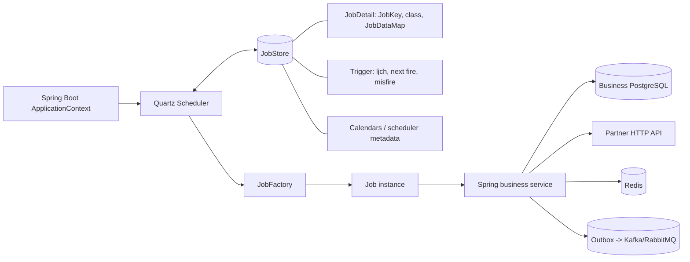
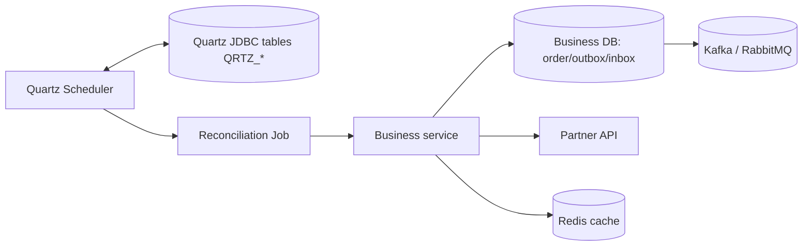
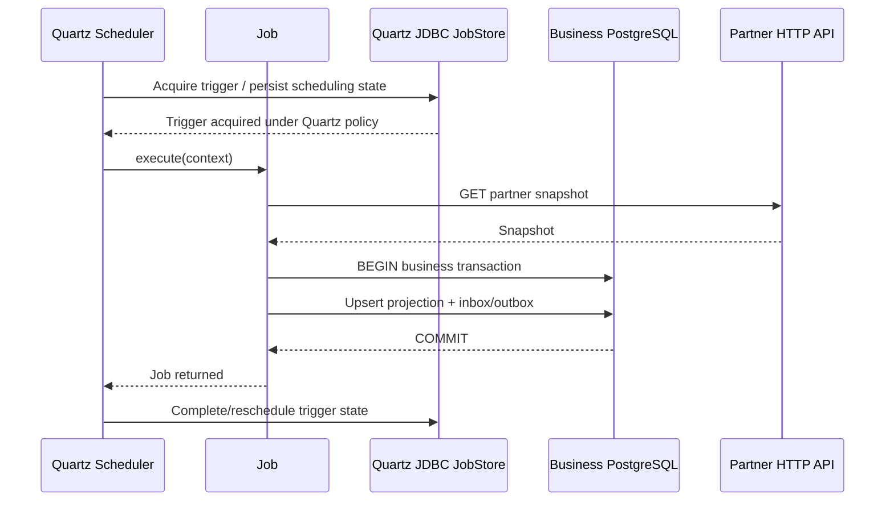
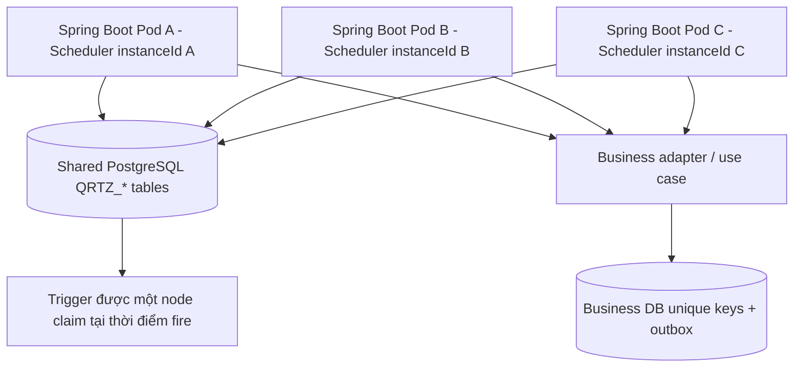
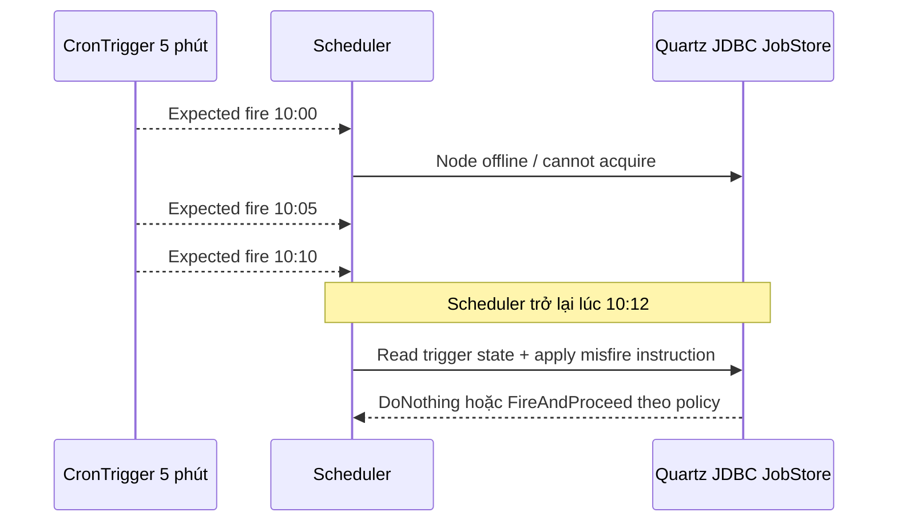

# In-memory JobStore và JDBC JobStore

Trong **SPRING_BOOT_INTEGRATION**, ứng dụng Spring Boot không chỉ nhận HTTP request rồi trả kết quả ngay. Nó còn có thể chạy lịch đồng bộ sản phẩm từ API đối tác, đối soát các giao dịch PostgreSQL, dọn Redis cache, tạo outbox events cho Kafka/RabbitMQ và kích hoạt Spring Integration flows. Một lịch có thể quan trọng đến mức **phải còn tồn tại sau restart** và **không nên được nhiều pod tự ý khởi chạy cùng lúc**. Đó là lúc lựa chọn **JobStore của Quartz** trở thành quyết định kiến trúc, không chỉ là một dòng YAML.

Bài thuộc chương **Quartz**, tập trung vào hai cách lưu lịch: **in-memory `RAMJobStore`** và **JDBC JobStore** của Quartz khi dùng với Spring Boot. Ta sẽ làm rõ scheduler metadata nào được giữ ở RAM hoặc database, cách cấu hình Boot, schema và transaction của JDBC JobStore, hành vi khi restart và khi chạy cluster, misfire/recovery, ranh giới idempotency và các kịch bản kiểm thử/quan sát vận hành. Bài không giả định Quartz có thể biến HTTP, database, cache và broker thành một distributed transaction nguyên tử.

> Ví dụ dùng **Java 17+, Spring Boot 3.x, Quartz 2.x, PostgreSQL** và Spring JDBC/JPA theo nhu cầu. Spring Boot có thể tích hợp JDBC JobStore qua `SchedulerFactoryBean`/`LocalDataSourceJobStore` thay vì một cấu hình Quartz độc lập dùng `JobStoreTX`; cần dùng đúng API và properties của phiên bản thực tế. Các tên server/database, JobKey và dữ liệu trong bài chỉ là minh họa.

## 1. Mục tiêu học tập

Sau bài này, bạn có thể:

1. Phân biệt **Scheduler, JobDetail, Trigger, Calendar, JobStore** và **kết quả nghiệp vụ** do một Job tạo ra.
2. Giải thích điểm mạnh/điểm yếu của `RAMJobStore` so với JDBC JobStore về **restart, transaction, startup, clustering, hiệu năng và vận hành**.
3. Cấu hình `spring.quartz.job-store-type=memory` hoặc `jdbc` trong Spring Boot và tránh trộn với các Quartz low-level properties gây xung đột.
4. Chuẩn bị bảng `QRTZ_*` bằng script/migration đúng database, chọn DataSource và transaction manager có chủ đích.
5. Hiểu **JobDetail/Trigger được persist** khác **Java Job instance** và khác trạng thái nghiệp vụ trong PostgreSQL, Redis hay broker.
6. Chọn chính sách **misfire, recovery, concurrency** và tránh hứa hẹn exactly-once chỉ nhờ JDBC JobStore.
7. Chạy nhiều Spring Boot instances trên **một Quartz JDBC cluster** đúng điều kiện, phân biệt với nhiều RAMJobStore độc lập.
8. Viết kiểm thử restart, job persistence, lịch bị lỡ, duplicate side effects và runbook khắc phục sự cố.

## 2. JobStore thực sự lưu những gì?

Một Quartz `Scheduler` quản lý những **định nghĩa** và **trạng thái lịch** để biết khi nào yêu cầu một Job thực thi. `JobStore` là tầng lưu trữ các thông tin đó. Khi Trigger fire, Quartz dùng `JobFactory` tạo một **Job instance** và gọi `execute(JobExecutionContext)`. Instance đó không phải “đối tượng được lưu nguyên vẹn” trong bảng JobStore.



| Thành phần | Trong Quartz JobStore? | Cần nhớ |
| --- | --- | --- |
| `JobDetail` | Có | `JobKey`, Job class name, durability, recovery flag, JobDataMap. |
| `Trigger` | Có | TriggerKey, liên kết JobKey, schedule, next/previous fire, state, misfire policy. |
| Quartz calendars | Có khi được cấu hình | Những ngày/giờ loại trừ khỏi schedule. |
| Scheduler/cluster execution metadata | Với JDBC JobStore có các bảng hỗ trợ | Phối hợp scheduler instances, trigger acquisition, failover. |
| **Job instance đang chạy** | Không phải một Java object được snapshot và khôi phục giữa chừng | Scheduler tạo instance mới khi fire/recover. |
| Spring service/HTTP client/`DataSource` bean | **Không** | Các beans được Spring tạo qua application context/DI. |
| Transaction SQL của đơn hàng | **Không** | Nằm trong database và transaction nghiệp vụ riêng. |
| Kafka offset/RabbitMQ ack/Redis TTL | **Không** | Có cơ chế lưu/khôi phục riêng theo từng hệ. |
| “Đã hoàn tất đối soát đơn hàng ORD-42” | **Không mặc định** | Phải lưu durable business checkpoint/inbox/outbox. |

### 2.1. JobDetail và Trigger là hai định danh khác nhau

```text
JobKey     = integration/catalog-reconciliation
TriggerKey = integration/catalog-every-five-minutes
Job class  = com.example.integration.quartz.CatalogReconciliationJob
Cron       = 0 0/5 * * * ?
Timezone   = UTC
```

Một JobDetail có thể được gắn **nhiều Triggers**. Thay một Trigger không đồng nghĩa thay Java Job class, và một Java class có thể được dùng bởi nhiều JobDetails với JobKeys khác nhau. Điều này quan trọng với `@DisallowConcurrentExecution`: annotation ngăn overlap **cùng JobKey**, không phải tất cả jobs dùng cùng class.

### 2.2. JobStore không tự tạo lịch từ annotations

Quartz cần JobDetails/Triggers được đăng ký bằng APIs, beans Spring Boot hoặc quy trình quản trị scheduler. `@Scheduled` của Spring Framework là cơ chế khác: nó không biến các methods được annotate thành Quartz JobDetails/Triggers. Nếu chọn Quartz, cần biết các lịch được khai báo ở đâu, ai được quyền thay đổi và nguồn sự thật của chúng là **Java configuration** hay **JDBC JobStore đã persist**.

## 3. `RAMJobStore`: lưu lịch trong bộ nhớ của một scheduler

`RAMJobStore` là JobStore trong RAM của Quartz. Nó phù hợp khi cấu hình đơn giản, lịch có thể được đăng ký lại mỗi lần khởi động và không cần phối hợp lịch qua nhiều nodes.

```yaml
spring:
  quartz:
    job-store-type: memory
    auto-startup: true
    properties:
      org.quartz.threadPool.threadCount: 5
```

Với Spring Boot có Quartz starter và không custom JobStore khác, `memory` chọn cách lưu trong RAM. Với các ứng dụng đơn giản, đây có thể là lựa chọn mặc định. Cần kiểm tra tình trạng auto-configuration/JobStore cụ thể nếu ứng dụng tự khai báo `SchedulerFactoryBean` hoặc đặt `org.quartz.jobStore.class`.

**Ưu điểm:**

- Không cần tạo bảng `QRTZ_*`, JDBC pool hay migration lịch.
- Ít thành phần để vận hành trong local/dev hoặc công việc không cần giữ schedule động qua restart.
- Thường có chi phí truy cập metadata thấp hơn vì không giao tiếp với RDBMS ở mỗi thao tác schedule/trigger.
- Thuận tiện cho test đơn lẻ kiểm tra misfire/JobFactory với scheduler không cần persistence.

**Giới hạn:**

- JobDetail, Trigger và trạng thái lịch **biến mất khi scheduler/process bị hủy**.
- Không có clustering chia sẻ trạng thái lịch giữa các process. Hai pod RAMJobStore chạy cùng cron có thể **mỗi pod tự thực thi một lần**.
- Không có durable trigger state để biết những lần fire nào lỡ trong toàn bộ thời gian JVM không tồn tại.
- Nếu các lịch được tạo động qua API rồi chỉ lưu trong RAM, chúng phải được **tái tạo từ nguồn ngoài** nếu muốn tồn tại sau restart.
- `@DisallowConcurrentExecution` chỉ phối hợp các executions trong phạm vi scheduler/job identity tương ứng, không là distributed lock giữa các RAM schedulers.

### 3.1. Kịch bản restart với RAMJobStore

```mermaid
sequenceDiagram
    participant A as Spring Boot v1
    participant R as RAMJobStore
    participant H as Partner HTTP API
    A->>R: Register JobDetail + Trigger
    R-->>A: Next fire at 10:05
    A->>H: Job runs at 10:05
    Note over A,R: Process stops at 10:07; RAM lost
    Note over A,R: No scheduler exists at 10:10
    A->>R: App restarts at 10:12 and registers definitions again
    R-->>A: Recalculate next fire using new trigger
```

Ở lần khởi động 10:12, nếu Spring Boot đăng ký lại cron trigger, Quartz có thể tính **mốc fire tương lai** từ trigger mới. Không được tự khẳng định rằng lần 10:10 sẽ được bù lại đúng một lần: lần fire trước khi process restart **không còn trong JobStore**. Khi cần catch-up các cửa sổ bị lỡ, ứng dụng phải dùng **durable business watermark/checkpoint** ở database hoặc một nơi lưu đáng tin cậy khác.

### 3.2. Khi nào RAMJobStore vẫn hợp lý trong production?

RAMJobStore không “sai” chỉ vì ứng dụng chạy production. Nó có thể hợp lý nếu:

1. Một instance duy nhất đảm nhận lịch; downtime/skip được chấp nhận.
2. Lịch luôn được định nghĩa bằng code và được dựng lại an toàn khi startup.
3. Job chỉ đánh thức một cơ chế durable khác (outbox/DB polling) đã bảo vệ work items.
4. Không yêu cầu quản lý lịch động hoặc lịch phải sống độc lập với deployment.
5. Có cơ chế điều phối ngoài Quartz nếu nhiều replicas nhưng chỉ một scheduler được phép chạy (và đã kiểm thử failover).

Ngược lại, nếu **mỗi pod** của một Deployment đều khởi tạo RAM Scheduler và cùng đăng ký cron “charge customer”, cần giả định **có thể chạy trùng**. Business idempotency vẫn phải bảo vệ mọi side effect.

## 4. JDBC JobStore: lưu trạng thái Quartz trong cơ sở dữ liệu

JDBC JobStore lưu JobDetails, Triggers, calendars và trạng thái liên quan đến scheduler vào các bảng SQL mà Quartz định nghĩa. Điều này cho phép **lịch sống qua restart** và, khi cấu hình đúng, **nhiều scheduler instances phối hợp trên một shared JobStore**.

```yaml
spring:
  quartz:
    job-store-type: jdbc
    jdbc:
      initialize-schema: never
    properties:
      org.quartz.threadPool.threadCount: 8
```

`initialize-schema: never` trong ví dụ production có nghĩa **ứng dụng không tự chạy script khởi tạo bảng Quartz**; hạ tầng/migration phải bảo đảm bảng đã tồn tại trước khi scheduler start. `spring.quartz.job-store-type=jdbc` **không** tự tạo bảng sản phẩm, bảng outbox hay bất kỳ business schema nào.

### 4.1. JDBC JobStore mang lại gì?

| Khía cạnh | `RAMJobStore` | JDBC JobStore |
| --- | --- | --- |
| Nơi lưu `JobDetail`/`Trigger` | Heap trong scheduler process | Bảng `QRTZ_*` của database |
| Lịch sau restart process | Mất và cần đăng ký lại | Có thể được nạp từ DB nếu không bị xóa/recreate |
| Lịch tạo động lúc runtime | Chỉ trong RAM process | Có thể tồn tại qua restart |
| Cluster với nhiều scheduler nodes | Không chia sẻ trạng thái | Có thể khi dùng **chung JDBC store và bật cluster đúng** |
| DB schema/migration | Không cần Quartz tables | Bắt buộc có schema phù hợp database/Quartz version |
| Hiệu năng metadata operations | Chủ yếu RAM | Có DB I/O, locks, network latency và connection pool |
| Failure modes | Restart/JVM loss | Thêm DB unavailable, deadlock/lock wait, schema drift, pool saturation |
| Job business exactly-once | Không | **Cũng không** |
| Cách quản lý secrets | Dependency của business service | Thêm JDBC credential/connection settings cho JobStore |

JDBC JobStore làm **scheduling state bền vững hơn**, không có nghĩa mọi Job execution là một transaction atomic với HTTP đối tác, PostgreSQL business data hoặc Kafka event. Nó cũng không phải hàng đợi công việc chuyên dụng thay Kafka/RabbitMQ: schedule frequency, job concurrency và retry semantics của Quartz vẫn cần được định nghĩa.

### 4.2. Sơ đồ hai nơi lưu khác nhau



Ngay cả khi hai tập bảng `QRTZ_*` và `order/outbox` dùng **cùng một PostgreSQL instance**, chúng vẫn phục vụ hai hợp đồng khác nhau. Việc Quartz trigger được xác nhận trong JobStore **không** tự xác nhận cập nhật order hoặc publish message; không cố gộp scheduler database state thành nguồn sự thật của business completion.

## 5. Các biến thể JDBC JobStore và Spring Boot auto-configuration

Tài liệu Quartz nền tảng thường nhắc tới hai biến thể:

| Biến thể | Ý nghĩa ở tầng Quartz | Lưu ý với Spring |
| --- | --- | --- |
| `JobStoreTX` | Quartz tự quản lý DB transaction cho scheduling operations qua JDBC | Hữu ích khi cấu hình Quartz độc lập; không nên áp cấu hình thủ công lên Boot-managed `SchedulerFactoryBean` mà không kiểm tra. |
| `JobStoreCMT` | Dành cho môi trường có container-managed transactions / dual data sources theo mô hình Quartz | Không có nghĩa business JPA transaction và Quartz trigger tự là một distributed transaction. |
| `LocalDataSourceJobStore` | Spring quản lý integration giữa Quartz JDBC JobStore và `DataSource`/Spring transaction resources | Thường được Spring Boot/Spring `SchedulerFactoryBean` sử dụng khi cung cấp DataSource phù hợp. |

Điểm mấu chốt: khi dùng **`spring.quartz.job-store-type=jdbc`** và để Spring Boot auto-configure `SchedulerFactoryBean`, không tự thêm:

```properties
# ANTI-PATTERN nếu không hiểu tích hợp Boot đang chạy:
org.quartz.jobStore.class=org.quartz.impl.jdbcjobstore.JobStoreTX
org.quartz.jobStore.dataSource=someOtherPool
```

như một cách “bắt buộc để dùng JDBC”. Nó có thể làm Quartz/Spring có **hai chủ sở hữu khác nhau cho DataSource hoặc transaction**, xung đột `LocalDataSourceJobStore` hoặc pool không nằm trong Spring context. Cần chọn rõ **một con đường cấu hình**: Spring Boot-managed Quartz JDBC qua properties/`@QuartzDataSource`, hoặc một scheduler thuần Quartz được cấu hình độc lập và sở hữu hoàn toàn cấu hình JDBC/transactions.

### 5.1. Kiểm tra đúng JobStore đang hoạt động

Quartz cung cấp `SchedulerMetaData`:

```java
import org.quartz.Scheduler;
import org.quartz.SchedulerMetaData;
import org.springframework.stereotype.Component;

@Component
public final class QuartzStoreDiagnostics {
    private final Scheduler scheduler;

    public QuartzStoreDiagnostics(Scheduler scheduler) {
        this.scheduler = scheduler;
    }

    public String describe() throws org.quartz.SchedulerException {
        SchedulerMetaData meta = scheduler.getMetaData();
        return "store=" + meta.getJobStoreClass().getName()
                + ", persistent=" + meta.isJobStoreSupportsPersistence()
                + ", clustered=" + meta.isJobStoreClustered();
    }
}
```

Với RAMJobStore, kỳ vọng `isJobStoreSupportsPersistence() == false`; với JDBC JobStore, kỳ vọng `true`. `isJobStoreClustered()` chỉ đúng khi scheduler được cấu hình và khởi tạo ở chế độ cluster. **Không dùng một tên class cứng** làm tiêu chí duy nhất, vì Spring có thể dùng `LocalDataSourceJobStore` thay cho class Quartz thuần, hoặc phiên bản framework thay cách dựng.

## 6. Chuẩn bị schema `QRTZ_*` và chiến lược migration

Quartz JDBC JobStore cần **một bộ bảng hệ thống Quartz** đúng SQL dialect/server version và tương thích với phiên bản Quartz library. Một số bảng tiêu biểu:

| Bảng (prefix mặc định `QRTZ_`) | Mục đích chính |
| --- | --- |
| `QRTZ_JOB_DETAILS` | JobKey, Job class, JobDataMap, durability/recovery flags. |
| `QRTZ_TRIGGERS` | Thông tin chung của trigger, trạng thái, thời điểm fire. |
| `QRTZ_CRON_TRIGGERS` | Chi tiết biểu thức cron/timezone. |
| `QRTZ_SIMPLE_TRIGGERS` | Chi tiết simple trigger, repeat count/interval. |
| `QRTZ_SIMPROP_TRIGGERS` | Một số trigger properties dạng đơn giản. |
| `QRTZ_BLOB_TRIGGERS` | Trigger metadata serialization dạng blob khi cần. |
| `QRTZ_CALENDARS` | Quartz calendar data. |
| `QRTZ_PAUSED_TRIGGER_GRPS` | Nhóm trigger bị pause. |
| `QRTZ_FIRED_TRIGGERS` | Trạng thái triggers đang được xử lý/đã acquire. |
| `QRTZ_SCHEDULER_STATE` | Theo dõi scheduler instances/check-ins trong cluster. |
| `QRTZ_LOCKS` | Phối hợp locks khi transaction/acquisition. |

Tên cột, SQL types, constraints và indices phụ thuộc **schema script chính thức phù hợp database**. Không tự tạo vài bảng thủ công theo danh sách này rồi coi là đủ. Dùng script vendor-specific (PostgreSQL/MySQL/SQL Server/Oracle, v.v.) từ Quartz/Boot dependency hoặc đưa script đã kiểm định vào Flyway/Liquibase với migration ID rõ.

### 6.1. Không dùng `initialize-schema: always` trên production database đã có lịch

Spring Boot hỗ trợ:

```yaml
spring:
  quartz:
    job-store-type: jdbc
    jdbc:
      initialize-schema: never
```

Các giá trị initialization và cơ chế tìm schema script cần theo tài liệu/configuration metadata của Boot version được dùng. **`always` có thể chạy script Quartz chứa `DROP TABLE`**, khiến JobDetails/Triggers đang tồn tại bị mất hoặc tái tạo; nó không phải migration “an toàn nếu bảng đã tồn tại”. Chỉ dùng auto-initialize như `always` trong **test container/database tạm thời** theo đúng fixture; production nên dùng migration pipeline được kiểm soát.

Một quy trình triển khai:

1. Chọn một **schema version** tương thích Quartz library và SQL vendor.
2. Tạo/bổ sung tables bằng migration chạy **trước scheduler startup**.
3. Kiểm tra account của Quartz có đúng DML/quyền bảng/sequence cần thiết, không phải superuser.
4. Kiểm tra các indices/locks quan trọng với tần suất trigger và số instances.
5. Nếu nâng Quartz version có thay đổi schema, chạy upgrade migration có rollback/backup plan, không dựa vào Hibernate `ddl-auto`.
6. Giữ schema Quartz tách logic với business DB migrations, dù chúng dùng chung PostgreSQL instance.
7. Có **data backup và restore test** khi persisted schedules là tài sản vận hành.

### 6.2. `tablePrefix` và nhiều scheduler trên cùng database

Quartz thường dùng `QRTZ_` làm prefix; nếu nhiều **scheduler độc lập** chia sẻ một PostgreSQL database nhưng **không phải cùng cluster**, cần tách table prefix/schema/DB tương ứng, chẳng hạn:

```text
Scheduler A -> schema scheduler_a, tables QRTZ_*
Scheduler B -> schema scheduler_b, tables QRTZ_*
```

Không đặt hai scheduler độc lập khác nghĩa vụ vào cùng một bộ `QRTZ_*` rồi đặt `instanceName` khác nhau để “cách ly”. Schema/instance names/locks cần thiết kế nhất quán; một bảng dùng chung sai cấu hình có thể dẫn đến trigger được acquire bởi node không có Job class thích hợp hoặc các lịch ngoài ý muốn.

## 7. Cấu hình DataSource cho Quartz: dùng chung hay tách với business DB?

Với một ứng dụng Spring Boot có JDBC/JPA business datasource và Quartz JDBC JobStore, có hai lựa chọn thường thấy.

### 7.1. Dùng chung DataSource trong ứng dụng nhỏ

```yaml
spring:
  datasource:
    url: ${APP_DB_URL:jdbc:postgresql://localhost:5432/integration}
    username: ${APP_DB_USERNAME}
    password: ${APP_DB_PASSWORD}
    hikari:
      maximum-pool-size: 20

  quartz:
    job-store-type: jdbc
    jdbc:
      initialize-schema: never
    auto-startup: true
```

Khi không khai báo `@QuartzDataSource` riêng, Boot-managed Quartz JDBC thường có thể dùng application DataSource phù hợp theo auto-configuration. Điều này tiện cho local/dev hoặc hệ đơn giản, nhưng Quartz trigger acquisition/check-in/recovery có thể **cạnh tranh connections** với HTTP service/business transactions. Nếu business query bị chặn hoặc pool bão hòa, scheduler cũng có thể chậm.

**Không** lấy việc dùng cùng `DataSource` để kết luận Quartz scheduler metadata update đã tham gia cùng một transaction với thay đổi business tables. Transaction boundaries phải được xác định theo mỗi API/transaction manager và cách Quartz/Spring quản lý chúng; ngay cả khi có một RDBMS, side effects HTTP/Kafka/Redis bên ngoài không tự rollback.

### 7.2. Tách Quartz DataSource bằng `@QuartzDataSource`

Spring Boot cung cấp annotation `@QuartzDataSource` để đánh dấu `DataSource` mà scheduler Quartz nên dùng khi có nhiều nguồn. Một cấu hình ví dụ:

```yaml
app:
  quartz:
    datasource:
      jdbc-url: ${QUARTZ_JDBC_URL:jdbc:postgresql://localhost:5432/scheduler}
      username: ${QUARTZ_DB_USER}
      password: ${QUARTZ_DB_PASSWORD}
      maximum-pool-size: 8

spring:
  quartz:
    job-store-type: jdbc
    jdbc:
      initialize-schema: never
```

```java
import javax.sql.DataSource;
import com.zaxxer.hikari.HikariDataSource;
import org.springframework.boot.autoconfigure.quartz.QuartzDataSource;
import org.springframework.boot.context.properties.ConfigurationProperties;
import org.springframework.context.annotation.Bean;
import org.springframework.context.annotation.Configuration;

@Configuration(proxyBeanMethods = false)
public class QuartzJdbcDataSourceConfiguration {

    @Bean("quartzDataSource")
    @QuartzDataSource
    @ConfigurationProperties("app.quartz.datasource")
    HikariDataSource quartzDataSource() {
        return new HikariDataSource();
    }
}
```

Ở ví dụ này, `app.quartz.datasource` là **namespace do ứng dụng tự định nghĩa**, Boot không tự biết đó là Quartz DataSource nếu không có bean/annotation tương ứng. `HikariDataSource` được bind trực tiếp với `jdbc-url`/`username`/`password`/`maximum-pool-size`. Tên property/khả năng binding cần xác minh ở phiên bản Spring Boot/Hikari thực tế.

**Chú ý với hai DataSources:** nếu app còn dùng một business DataSource, hãy tạo/định danh bean đó rõ ràng (thường cần `@Primary` hoặc qualifiers) và xác minh JDBC/JPA repositories không vô tình dùng Quartz DB. Không chỉ thêm bean `quartzDataSource` rồi nghĩ Boot sẽ tự biết business DataSource còn lại nếu auto-configuration bị thay đổi khi có custom DataSource beans.

### 7.3. Khi nào nên tách?

| Tiêu chí | Chung DataSource | Riêng Quartz DataSource |
| --- | --- | --- |
| Vận hành | Đơn giản hơn | Thêm credential, pool, migration, backup |
| Pool contention | Quartz và business có thể tranh pool | Dễ cấp quota/pool riêng |
| Permission | Quyền business và Quartz dễ bị cấp chung | Tách least-privilege theo bảng/schema |
| Lỗi DB | Chung một failure domain | Có thể tách tài nguyên nếu dùng backend/cluster khác |
| Transaction consistency | Không tự nguyên tử đa hệ | Cũng không tự nguyên tử đa hệ |
| Kiểm thử | Ít connection configs hơn | Cần test đúng `@QuartzDataSource` và transaction manager |

Không có đáp án tuyệt đối; với workload nhỏ, DataSource chung có thể đủ. Với scheduler có nhiều triggers, nhiều nodes hoặc business DB chịu tải lớn, tách pool/schema/permission giúp giảm rủi ro. **Tách database không có nghĩa scheduler có thể cứu business workflow nếu nguồn sự thật đang unavailable**.

### 7.4. `@QuartzTransactionManager` và JDBC JobStore

Spring Boot có `@QuartzTransactionManager` để đánh dấu transaction manager riêng cho Quartz trong những cấu hình cần thiết. Cần hiểu đây là **transaction resource của scheduler**, không phải lời cam kết transaction của Quartz triggers sẽ bao mọi repository và broker operations.

Nếu dùng nhiều transaction managers:

- Cấu hình tên bean/qualifier/`@QuartzTransactionManager` phù hợp theo Boot version.
- Chọn `@Transactional(transactionManager = "...")` cho **business service** khi có nhiều JDBC/JPA/Neo4j managers.
- Test rằng transaction business rollback đúng khi application service throw exception.
- Không đặt JDBC scheduler lock và HTTP partner call kéo dài trong cùng business transaction.
- Không nghĩ PostgreSQL business outbox, Redis SET và Kafka publish trở thành atomically committed chỉ nhờ thay transaction manager.

## 8. Spring Boot đăng ký JobDetail và Trigger bean

Các `JobDetail`, `Trigger` được định nghĩa bằng Spring `@Bean` có thể được Quartz auto-configuration nhận khi `SchedulerFactoryBean` được Boot quản lý:

```java
import java.util.TimeZone;
import org.quartz.CronScheduleBuilder;
import org.quartz.JobBuilder;
import org.quartz.JobDetail;
import org.quartz.Trigger;
import org.quartz.TriggerBuilder;
import org.springframework.beans.factory.annotation.Qualifier;
import org.springframework.context.annotation.Bean;
import org.springframework.context.annotation.Configuration;

@Configuration(proxyBeanMethods = false)
public class CatalogScheduleConfiguration {

    @Bean("catalogReconciliationJobDetail")
    JobDetail catalogReconciliationJobDetail() {
        return JobBuilder.newJob(CatalogReconciliationJob.class)
                .withIdentity("catalog-reconciliation", "integration")
                .withDescription("Reconcile external catalog projection")
                .usingJobData("partnerId", "catalog")
                .requestRecovery()
                .storeDurably()
                .build();
    }

    @Bean
    Trigger catalogReconciliationTrigger(
            @Qualifier("catalogReconciliationJobDetail") JobDetail job) {
        return TriggerBuilder.newTrigger()
                .withIdentity("catalog-every-five-minutes", "integration")
                .forJob(job)
                .withSchedule(CronScheduleBuilder
                        .cronSchedule("0 0/5 * * * ?")
                        .inTimeZone(TimeZone.getTimeZone("UTC"))
                        .withMisfireHandlingInstructionDoNothing())
                .build();
    }
}
```

**Lưu ý về ví dụ:**

- `JobDetail` trỏ đến **Java class**, không nhét Spring service instance vào JobStore.
- `.storeDurably()` làm JobDetail có thể tồn tại khi không gắn Trigger; không có nghĩa business data của Job được persisted.
- `.requestRecovery()` yêu cầu Quartz coi Job này là ứng viên recovery nếu scheduler chết trong lúc Job đang chạy theo cơ chế của JobStore; **không** bảo đảm exactly-once hoặc tiếp tục tại đúng dòng Java bị dừng.
- `withMisfireHandlingInstructionDoNothing()` là **chính sách lịch** bỏ những cron firings đã lỡ; không phải hệ thống đối soát business windows.
- `TimeZone.getTimeZone("UTC")` tránh cron chạy khác nhau theo múi giờ từng pod; nếu job cần 9 giờ địa phương và DST, phải xác định `ZoneId`/timezone policy theo nghiệp vụ.

Mỗi Java top-level `public` type trong bài cần file `.java` riêng khi triển khai. Class `CatalogReconciliationJob` sẽ được mô tả ở phần sau.

## 9. Lịch đăng ký bằng code gặp lịch đã được persist

Với RAMJobStore, restart xóa metadata cũ nên các JobDetail/Trigger beans được đăng ký lại vào bộ nhớ mới. Với JDBC JobStore, **JobKey/TriggerKey có thể đã tồn tại** từ deployment trước. Lúc đó phải quyết định **source-of-truth** và hành vi khi code/YAML đổi cron.

### 9.1. `overwrite-existing-jobs` không nên để theo may rủi

Spring Boot có property:

```yaml
spring:
  quartz:
    job-store-type: jdbc
    overwrite-existing-jobs: false
```

Khi đã có persisted definitions, việc bean definitions mới **ghi đè** hay **giữ lại** cấu hình cũ phụ thuộc policy và ngữ cảnh đăng ký. Nếu `overwrite-existing-jobs=false`, sửa cron trong Java có thể **không tự làm persisted Trigger đổi**. Nếu bật overwrite, code deployment mới có thể thay lịch do operator đã chỉnh tại runtime.

**Hai mô hình ownership khác nhau:**

1. **Code-owned schedules:** lịch trong Git/config là nguồn sự thật; rollout thay đổi JobDetail/Trigger theo migration/versioned procedure, có test/rollback.
2. **Operations-owned schedules:** lịch có thể được đổi qua admin API/database; code chỉ bootstrap các Job definitions cần thiết, **không tự ghi đè** thay đổi vận hành mỗi lần startup.

Không nên kết hợp hai mô hình mà không có quy trình phân quyền/audit. Nếu mỗi pod có release/config khác nhau và cùng ghi đè một Trigger khi khởi động, lịch có thể bị thay qua lại trong rolling deployment.

### 9.2. Đổi `JobKey` không phải sửa lịch cũ

Ví dụ v1 có JobKey `integration/catalog-reconciliation`. v2 đổi thành `integration/catalog-sync` và tạo trigger mới. JDBC JobStore có thể còn **JobDetail/Trigger cũ**, dẫn đến **hai jobs cùng chạy** nếu không có migration xóa/pause cái cũ. Đổi tên bean Spring hay class Java không tự dọn persisted JobKey. Hãy định nghĩa **migration scheduling metadata** khi rename/remove/rehome.

### 9.3. Đổi Java package/class có thể phá persisted JobDetail

JDBC JobStore có thể lưu **tên Java Job class**. Nếu v2 chuyển `CatalogReconciliationJob` sang package khác và xóa class cũ trong lúc old JobDetail còn persisted, scheduler có thể không instantiate được Job. Rolling deployment phức tạp hơn khi pod cũ và mới cùng đọc một JobStore nhưng classpath khác:

- Giữ **compatible Job class** trong giai đoạn rollout hoặc migration dữ liệu trước/sau theo kế hoạch.
- Không persist arbitrary `Spring bean`/HTTP client/`DataSource` vào JobDataMap.
- Dùng scalar versioned inputs như `partnerId`, `workItemId` thay vì DTO serialized theo Java package.
- Chạy test restart với **cùng database tables cũ** nhưng binary phiên bản mới.

### 9.4. JobDataMap trong JDBC: serialization là một hợp đồng

`JobDataMap` nằm trong metadata JobDetail/Trigger. Khi được JDBC store, values có thể được serialize hoặc được yêu cầu là Strings tùy Quartz config như `org.quartz.jobStore.useProperties`. Đặt `DataSource`, Spring `@Service`, lambda, `HttpServletRequest` hay object graph chứa secrets vào JobDataMap vừa không bền vững vừa có thể gây lỗi deserialize sau deploy.

Nên dùng:

```text
partnerId = catalog
workItemId = sync-20261121-00042
schemaVersion = 1  (nếu cấu hình cho phép kiểu int; hoặc "1" khi chỉ string)
```

Rồi trong `execute`, validate và lấy durable business work item từ DB qua Spring service. **`JobDataMap` không phải business checkpoint hay inbox/outbox.** Đừng suy từ metadata persisted thành business “đã xử lý xong message”.

## 10. Transaction và tính bền vững của scheduler metadata

JDBC JobStore dựa trên SQL transactions/locks để lưu/thay đổi trạng thái trigger. Nhưng có nhiều điểm commit khác nhau:



Một process crash có thể xảy ra **sau business COMMIT nhưng trước khi Quartz ghi nhận completion**. Lần recovery/retry sau có thể lặp lại một phần logic nghiệp vụ. Ngược lại, Quartz metadata được commit trước đó không bảo đảm partner API đã được gọi hay business transaction thành công.

### 10.1. Cùng PostgreSQL instance cũng không mặc định cùng transaction

Ngay cả khi `QRTZ_*` và business tables ở cùng JDBC server:

- Quartz có transaction/lock boundaries nội bộ khi acquire/reschedule triggers.
- Business `@Transactional` bắt đầu/kết thúc theo Spring transaction manager và service boundaries.
- Lời gọi HTTP/Kafka/Redis không nằm trong PostgreSQL transaction.
- Không có một annotation đơn giản biến toàn bộ luồng thành distributed atomic commit.

Nếu có yêu cầu “mỗi cửa sổ đồng bộ chỉ được áp dụng một lần”, dùng **unique key ở business DB**. Nếu có yêu cầu “một event gửi broker ít nhất một lần mà không mất”, dùng **transactional outbox**, rồi consumer inbox/idempotency để chịu duplicates.

### 10.2. Không giữ transaction business khi chờ API đối tác

Một Job gọi partner HTTP 20 giây trong `@Transactional` bao toàn `execute()` có thể giữ connection/locks của database trong lúc network chậm, khiến JobStore và business traffic bị nghẽn nếu dùng chung pool. Thay vào đó:

```text
1. Validate schedule identity, JobDataMap, deadline.
2. Gọi HTTP partner với timeout và limit rõ, không mở business transaction.
3. Chuẩn hóa/validate payload.
4. Bắt đầu business transaction NGẮN:
      claim unique business window;
      upsert projection;
      insert outbox;
   COMMIT.
5. Kết thúc Quartz Job; outbox publisher gửi message riêng.
```

**Idempotency phải bảo vệ khoảng crash giữa bước 4 và bước 5**, không dựa vào việc JDBC JobStore “đã durable” để bỏ qua khả năng chạy lại.

## 11. JDBC JobStore clustering: nhiều pods chia sẻ một bộ lịch

Khi một Deployment có ba Spring Boot replicas, nếu mỗi replica tự dùng RAMJobStore với cùng cron, mỗi pod có thể chạy cùng Job và gây **ba lần gọi partner API**. Với Quartz cluster được cấu hình đúng, các schedulers phối hợp qua **cùng JDBC JobStore** để điều phối trigger acquisition.



Cấu hình gợi ý (cần điều chỉnh DataSource và schema theo deployment):

```yaml
spring:
  quartz:
    scheduler-name: integration-scheduler
    job-store-type: jdbc
    auto-startup: true
    wait-for-jobs-to-complete-on-shutdown: true
    jdbc:
      initialize-schema: never
    properties:
      org.quartz.scheduler.instanceId: AUTO
      org.quartz.jobStore.isClustered: true
      org.quartz.jobStore.clusterCheckinInterval: 15000
      org.quartz.jobStore.misfireThreshold: 60000
      org.quartz.threadPool.threadCount: 8
```

**Điều kiện bắt buộc để gọi là cùng một cluster:**

1. Các nodes sử dụng **cùng JDBC JobStore database/schema/table prefix**.
2. Các nodes có **scheduler name/instanceName nhất quán** cho cùng cluster, còn **instanceId duy nhất** từng process; `AUTO` giúp tạo instance ID theo cơ chế Quartz.
3. `isClustered=true` trên **tất cả** cooperating nodes.
4. Các nodes dùng **Quartz library/schema tương thích** và có các Job classes/Trigger semantics tương thích trong rolling deployment.
5. Đồng hồ các nodes được **đồng bộ tốt**; Quartz cluster dựa vào timestamp và heartbeat/check-in, nên clock skew lớn gây misfire/failover bất thường.
6. Network/DNS/SQL locks/connection pools ổn định và cho phép scheduler ghi/đọc các bảng Quartz.
7. Không có một scheduler khác **không bật clustering** truy cập cùng bộ tables đang phục vụ cluster.

`clusterCheckinInterval` và `misfireThreshold` trong ví dụ là **milliseconds theo Quartz properties**, khác các Spring Boot duration properties dùng `15s`, `60s`. Kiểm tra các giá trị theo phiên bản Quartz/khả năng DB, không đặt quá thấp chỉ vì muốn failover lập tức.

### 11.1. Cluster điều phối triggers, không hứa exactly-once của side effect

Quartz cluster giúp giảm khả năng **nhiều nodes cùng claim một trigger** trong điều kiện bình thường. Nhưng khi node A hoàn thành HTTP POST rồi crash trước khi ghi nhận hoàn tất, node B có thể recover/re-fire theo policy. Hệ thanh toán có thể đã nhận POST ở A; nếu B dùng idempotency key mới, vẫn có thể tạo giao dịch trùng.

```text
Pod A: acquire trigger -> POST payment -> partner COMMIT
Pod A: crash trước khi Quartz/ứng dụng xác nhận xong
Pod B: cluster detects failed A -> recover / fire job
Pod B: POST payment lần nữa nếu không có idempotency
```

Vì vậy:

- Tạo **business operation ID ổn định** (thường theo partner + cửa sổ đối soát hoặc durable work item).
- Dùng bảng unique/inbox và điều kiện update trong database nghiệp vụ.
- Với HTTP side effect, dùng `Idempotency-Key` khi đối tác hỗ trợ, giữ **cùng key qua retries** và đối soát outcome không rõ.
- Với message broker, outbox publisher và consumer phải chịu at-least-once/redelivery; Quartz table không lưu Kafka offset/RabbitMQ ack.

### 11.2. `@DisallowConcurrentExecution` trong cluster

`@DisallowConcurrentExecution` bảo Quartz không chạy **đồng thời** các instances cùng `JobKey` trong cooperating scheduler/cluster theo cơ chế JobStore. Tuy nhiên:

| Tình huống | Quartz có tự bảo vệ? |
| --- | --- |
| Hai triggers cùng JobKey chạy trong **một** JDBC cluster đúng | Thường có serialization tương ứng với `@DisallowConcurrentExecution`. |
| Hai JobKeys khác nhau cùng gọi một paymentId | **Không**; annotation theo JobKey, không theo business paymentId. |
| Hai Kubernetes clusters khác nhau dùng **hai** JDBC stores | Không có coordination chung. |
| Một RAM scheduler chạy cùng cron với JDBC cluster | Không phải cooperating scheduler; có thể chạy thêm một lần. |
| Job chạy xong side effect nhưng process mất trước completion | Có thể recovery/refire; **không có exactly-once**. |

Nếu muốn giới hạn toàn cục “tối đa 3 jobs đồng bộ cùng lúc”, dùng Quartz thread pool/bulkhead cùng application policy và/hoặc distributed concurrency guard theo loại operation. `threadCount=8` trên **mỗi pod** có thể cho tổng số Quartz workers lớn hơn 8 trong cả cluster; nó không tự là global rate limit.

### 11.3. Tách cluster đúng với scheduler độc lập

Hai dịch vụ microservice khác domain dùng JDBC job store riêng có thể **không nên** cùng một Quartz cluster. Khi chia sẻ một cluster, mọi node có thể trở thành ứng viên thực thi Job class đã đăng ký; nếu mỗi service chỉ chứa class khác nhau, acquisition/recovery có thể lỗi. Hãy quyết định topology:

- **Một scheduler service chuyên dụng:** Quartz job chỉ tạo durable work items; workers nghiệp vụ xử lý qua DB/broker.
- **Một cluster cùng ứng dụng:** tất cả pods chạy cùng code/job classes và cùng JDBC Quartz store.
- **Nhiều scheduler domain độc lập:** tách table schemas/databases/prefix/scheduler namespaces, không bật chung cluster tùy tiện.

## 12. Misfire: đã lỡ mốc lịch thì Quartz xử lý thế nào?

**Misfire** xảy ra khi trigger dự kiến fire nhưng scheduler không thực thi đúng hạn theo logic Quartz/misfire threshold, ví dụ app dừng, thread pool bận, database unreachable hoặc node mất quyền acquire. Misfire **khác** với một Job đã chạy rồi ném exception.



### 12.1. Hai chính sách CronTrigger phổ biến

```java
import java.util.TimeZone;
import org.quartz.CronScheduleBuilder;

var skipMissed = CronScheduleBuilder
        .cronSchedule("0 0/5 * * * ?")
        .inTimeZone(TimeZone.getTimeZone("UTC"))
        .withMisfireHandlingInstructionDoNothing();

var fireOnceNow = CronScheduleBuilder
        .cronSchedule("0 0/5 * * * ?")
        .inTimeZone(TimeZone.getTimeZone("UTC"))
        .withMisfireHandlingInstructionFireAndProceed();
```

| Chính sách | Ý nghĩa khái quát | Khi phù hợp |
| --- | --- | --- |
| `DoNothing` | Bỏ các firings đã lỡ, tiến tới lịch hợp lệ kế tiếp | Polling không yêu cầu từng mốc; cache refresh có thể bỏ mốc. |
| `FireAndProceed` | Kích hoạt một lần theo misfire policy rồi tiếp tục cron | Cần thực hiện một lần để khôi phục sau downtime, có idempotency. |
| Smart/default policy | Quartz quyết định theo trigger type/default behavior | Chỉ sử dụng sau khi đã test đúng theo version và SLA. |

**FireAndProceed không có nghĩa replay đầy đủ 10:00, 10:05 và 10:10 như ba business windows riêng**. Muốn không bỏ sót mọi cửa sổ, Job phải đọc **durable checkpoint**, tính ra những windows chưa xử lý và tạo work items/catch-up với giới hạn tải. Với RAMJobStore sau full process restart, ngay cả metadata cron trước đó cũng không còn để Quartz tự hiểu những cửa sổ đã mất.

### 12.2. SimpleTrigger có chính sách khác CronTrigger

`SimpleTrigger` có repeat interval/count và các chỉ thị misfire như fire now hoặc reschedule now/next với chính sách xử lý số lần lặp riêng. Không sao chép nguyên policy của `CronTrigger` sang `SimpleTrigger` mà chưa xem semantics. Tương tự, `CalendarIntervalTrigger` hoặc `DailyTimeIntervalTrigger` có cách áp misfire riêng.

**Thời gian và timezone:** cron “9:00 mỗi ngày” theo vùng có DST có thể có ngày không tồn tại 9:00 hoặc giờ địa phương được điều chỉnh; cần quy tắc thực tế theo lịch kinh doanh. Những công việc tài chính cần có **business date/window ID** độc lập với trigger execution time.

### 12.3. `misfireThreshold` không phải thời hạn business

`org.quartz.jobStore.misfireThreshold` thường được cấu hình bằng **milliseconds**. Nó quyết định độ trễ trước khi trigger được xem là misfired theo logic Quartz; **không** giới hạn thời gian Job được phép chạy hoặc thời gian HTTP request chờ partner.

Để giới hạn một Job đồng bộ:

- Transport HTTP connect/read/response timeouts.
- JDBC statement/lock acquisition timeouts.
- Overall deadline cho business operation/chunk.
- Quartz thread pool và business concurrency cap.
- Phân loại lỗi timeout và chính sách retry có giới hạn.

Đừng tăng `misfireThreshold` lên hàng giờ để “cho phép job chạy lâu hơn”. Đó là hai chủ đề khác nhau.

## 13. Recovery: scheduler crash khác lỗi nghiệp vụ

Quartz có thể nhận diện một Job đang thực thi trên node đã chết và, nếu JobDetail yêu cầu, lên lịch **recovery execution** theo JobStore/recovery policy.

### 13.1. `requestRecovery()` và `isRecovering()`

```java
JobDetail job = org.quartz.JobBuilder
        .newJob(CatalogReconciliationJob.class)
        .withIdentity("catalog-reconciliation", "integration")
        .requestRecovery()
        .storeDurably()
        .build();
```

Trong Job:

```java
@Override
public void execute(JobExecutionContext context)
        throws JobExecutionException {
    boolean recovering = context.isRecovering();
    // Khi recovering == true, KHÔNG coi đây là lần chạy đầu tiên.
    // Dùng durable business key để tra cứu trạng thái thực đã commit.
}
```

Các snippets trên **minh họa API**, không phải hai định nghĩa cần ghép vào cùng class mà không có nội dung logic. Khi recovery:

- Quartz **không** khôi phục thread stack, HTTP response chưa nhận hoặc Java object state đang nằm trên heap.
- Job bắt đầu một **execution mới** theo cơ chế recovery, có thể cần đọc lại work item.
- Business DB/partner có thể đã commit một phần hoặc toàn bộ side effect của lần trước.
- Recovery không tự diễn giải “đã xử lý xong orderId này” từ JobStore.

Nếu một Job **không** yêu cầu recovery, hệ thống vẫn có misfire/trigger scheduling behavior cho các lần chạy sau; không đồng nghĩa “mọi work item đang chạy lúc crash sẽ tự được thực hiện lại”.

### 13.2. Các cửa sổ lỗi và trách nhiệm xử lý

| Thời điểm crash | Quartz có thể biết gì? | Ứng dụng phải bảo vệ gì? |
| --- | --- | --- |
| Trước acquire trigger | JDBC state vẫn mô tả trigger due | Quartz misfire/acquisition theo cluster policy. |
| Sau acquire, trước gọi service | Có execution state ở Quartz | Recovery theo config; business chưa chắc có tác động. |
| Sau POST partner commit, trước nhận response | Quartz không biết HTTP side effect thật | Idempotency key/outcome reconciliation; trạng thái UNKNOWN. |
| Sau SQL business commit, trước Quartz completion | Quartz chưa biết service đã xong | Unique business window/inbox/outbox chống chạy trùng. |
| Sau Quartz completion, trước broker consumer xử lý | Scheduler coi Job done | Theo dõi outbox/consumer lag, không suy downstream success. |
| Sau write Redis cache, trước DB commit | Cache có thể chứa projection không được DB xác nhận | Invalidate/version/source-of-truth, không lấy cache làm commit log. |

### 13.3. `JobExecutionException` không tự là durable retry queue

Khi `execute()` ném `JobExecutionException`, Quartz ghi nhận lỗi trong execution/listener nhưng **không tự triển khai exponential backoff cho mọi exception**. API có cờ `refireImmediately`, song lạm dụng có thể lặp nhanh, giữ worker thread và tăng tải vào partner/DB đang lỗi.

Nếu công việc cần retry bền vững:

1. Lưu **business work item** hoặc outbox/inbox ở database.
2. Phân loại transient/permanent/unknown-result.
3. Lên retry với giới hạn số attempts, deadline và backoff/jitter.
4. Khi cần hàng đợi nhiều items, sử dụng broker/DB work queue; Quartz có thể định kỳ thức tỉnh một worker.
5. Đưa payload sai contract vào quarantine/DLT để không chạy mãi cùng một lỗi.
6. Ghi nhận outcome thực và cho phép đối soát sau crash.

## 14. Đặt idempotency ở database nghiệp vụ, không đặt ở JobStore

Giả sử cron chạy đồng bộ catalog mỗi năm phút. Business operation ID có thể chọn:

```text
partner=catalog
windowStart=2026-11-21T10:30:00Z
operationId=catalog:2026-11-21T10:30:00Z
```

Không nên dùng Quartz `fireInstanceId` làm business ID duy nhất vì recovery/refire có thể có execution ID khác dù xử lý **cùng một cửa sổ**. Nếu cần xử lý cửa sổ 10:30 sau downtime, Job có thể tạo lại chính operation ID đó từ durable checkpoint và schedule policy.

### 14.1. Bảng claim theo business key

Ví dụ PostgreSQL:

```sql
CREATE TABLE catalog_sync_run (
    partner_id VARCHAR(64) NOT NULL,
    window_start TIMESTAMPTZ NOT NULL,
    status VARCHAR(24) NOT NULL,
    committed_at TIMESTAMPTZ,
    PRIMARY KEY (partner_id, window_start)
);

CREATE TABLE catalog_projection (
    partner_id VARCHAR(64) PRIMARY KEY,
    source_version VARCHAR(128) NOT NULL,
    item_count BIGINT NOT NULL
);
```

Trong một transaction ngắn:

```text
BEGIN
    INSERT catalog_sync_run(partner, windowStart, COMPLETED)
      ON CONFLICT DO NOTHING
    if claimed == 0:
        return ALREADY_COMMITTED
    UPSERT catalog_projection
    INSERT integration_outbox(eventId, schemaVersion, payload, PENDING)
COMMIT
```

Vì claim và projection/outbox được commit **trong cùng transaction**, một lỗi ở giữa rollback cả claim, cho phép attempt khác xử lý lại. Nếu claim đã tồn tại nhưng payload khác/version nguồn thay đổi, logic phải xác định **replay hợp lệ hay conflict** theo hợp đồng, không bỏ qua âm thầm.

### 14.2. Code transaction writer minh họa

```java
import java.sql.Timestamp;
import java.time.Instant;
import org.springframework.jdbc.core.JdbcTemplate;
import org.springframework.stereotype.Service;
import org.springframework.transaction.annotation.Transactional;

@Service
public class CatalogSyncWriter {
    private final JdbcTemplate jdbc;

    public CatalogSyncWriter(JdbcTemplate jdbc) {
        this.jdbc = jdbc;
    }

    @Transactional
    public boolean apply(
            String partner,
            Instant windowStart,
            String sourceVersion,
            long itemCount) {

        int claimed = jdbc.update("""
                INSERT INTO catalog_sync_run(
                    partner_id, window_start, status, committed_at)
                VALUES (?, ?, 'COMPLETED', CURRENT_TIMESTAMP)
                ON CONFLICT (partner_id, window_start) DO NOTHING
                """, partner, Timestamp.from(windowStart));

        if (claimed == 0) {
            return false;
        }
        jdbc.update("""
                INSERT INTO catalog_projection(
                    partner_id, source_version, item_count)
                VALUES (?, ?, ?)
                ON CONFLICT (partner_id) DO UPDATE SET
                    source_version = EXCLUDED.source_version,
                    item_count = EXCLUDED.item_count
                """, partner, sourceVersion, itemCount);

        // Nếu downstream phải được thông báo, ghi outbox ở đây
        // trong CÙNG transaction bằng một unique stable event ID.
        return true;
    }
}
```

**Đây là ví dụ idempotency đơn giản, không phải giải pháp ordering hoàn chỉnh.** Nếu job cửa sổ 10:25 thực thi muộn sau 10:30, upsert ở trên có thể ghi đè projection mới bằng dữ liệu cũ. Production cần source sequence/watermark, conditional update hoặc checkpoint theo thứ tự và chỉ công bố completion sau khi invariant đúng.

Nếu business side effect là gọi payment API, **không** đặt POST thanh toán sau claim nhưng trước commit một cách tùy tiện. PostgreSQL rollback không thể rollback payment ở hệ khác; cần outbox/workflow state và key idempotency mà payment provider hỗ trợ.

### 14.3. Khóa trùng ở các tầng khác nhau

| Định danh | Bảo vệ cái gì? | Không thay thế |
| --- | --- | --- |
| Quartz `JobKey` | Danh tính JobDetail, concurrency của cùng JobKey | Business dedup theo order/window. |
| Quartz `TriggerKey` | Danh tính một schedule | Event ID hoặc transaction ID. |
| Quartz `fireInstanceId` | Một lần execution của scheduler | Durable business operation ID. |
| `(partnerId, windowStart)` unique | Một business window sync | Dedup mọi Kafka event hoặc payment nếu một window có nhiều tasks. |
| Inbox `(source, eventId)` | Consumer nhận cùng event nhiều lần | Quartz trigger acquisition. |
| Outbox `eventId` | Phát lại đúng event đã commit | Exactly-once của consumer side effect. |
| HTTP `Idempotency-Key` | Một operation với partner theo hợp đồng | DB transaction/Quartz persistence. |

## 15. Job class và Spring service: persistence không có nghĩa lưu Spring bean

Khi JobStore được chuyển từ RAM sang JDBC, một lỗi phổ biến là cố đưa Spring service vào JobDataMap để “nó cũng được lưu bền vững”. Không được làm vậy: Spring beans, `DataSource`, `RestClient`/`WebClient`, KafkaTemplate, RedisTemplate và TransactionManager phải được **Spring ApplicationContext** tạo/quản lý.

Một Job class mỏng:

```java
import java.time.Instant;
import java.util.Date;
import org.quartz.DisallowConcurrentExecution;
import org.quartz.Job;
import org.quartz.JobExecutionContext;
import org.quartz.JobExecutionException;

@DisallowConcurrentExecution
public final class CatalogReconciliationJob implements Job {
    private final CatalogReconciliationUseCase useCase;

    public CatalogReconciliationJob(
            CatalogReconciliationUseCase useCase) {
        this.useCase = useCase;
    }

    @Override
    public void execute(JobExecutionContext context)
            throws JobExecutionException {
        String partner = context.getMergedJobDataMap()
                .getString("partnerId");
        Date expectedFire = context.getScheduledFireTime();

        if (!"catalog".equals(partner) || expectedFire == null) {
            throw new JobExecutionException(
                    new IllegalArgumentException(
                            "Unsupported partner or missing scheduled time"),
                    false);
        }

        Instant scheduledAt = expectedFire.toInstant();
        try {
            useCase.reconcile(partner, scheduledAt,
                    context.isRecovering());
        } catch (Exception cause) {
            // Không refireImmediately vô hạn.
            throw new JobExecutionException(cause, false);
        }
    }
}

public interface CatalogReconciliationUseCase {
    void reconcile(String partner,
                   Instant scheduledAt,
                   boolean recoveryExecution);
}
```

Hai top-level `public` types ở ví dụ cần đặt trong **hai file `.java` riêng**. `CatalogReconciliationUseCase` là interface nghiệp vụ, Spring service implementation có thể đọc partner API, tính business windows còn thiếu và gọi `CatalogSyncWriter` để ghi transaction. Không tự xử lý HTTP, Redis và SQL trực tiếp bên trong Job instance.

### 15.1. Tạo Job bằng Spring DI

Không được mặc định một `@Component` Job bean là instance Quartz đang chạy. Cần `JobFactory` tạo Job với Spring dependency injection. Một cách tường minh hỗ trợ constructor injection:

```java
import org.quartz.spi.TriggerFiredBundle;
import org.springframework.beans.factory.config.AutowireCapableBeanFactory;
import org.springframework.boot.autoconfigure.quartz.SchedulerFactoryBeanCustomizer;
import org.springframework.context.annotation.Bean;
import org.springframework.context.annotation.Configuration;
import org.springframework.scheduling.quartz.SpringBeanJobFactory;

@Configuration(proxyBeanMethods = false)
public class QuartzJobFactoryConfiguration {
    @Bean
    SchedulerFactoryBeanCustomizer jobFactoryCustomizer(
            AutowireCapableBeanFactory beans) {
        return factory ->
                factory.setJobFactory(new SpringBeanJobFactory() {
                    @Override
                    protected Object createJobInstance(
                            TriggerFiredBundle bundle) throws Exception {
                        return beans.createBean(
                                bundle.getJobDetail().getJobClass());
                    }
                });
    }
}
```

Spring Boot ở một số phiên bản/cấu hình có thể đã hỗ trợ job dependency injection mặc định. Customizer này thể hiện **một đường tạo Job rõ ràng** khi ứng dụng cần constructor injection chắc chắn. Nếu có nhiều `SchedulerFactoryBeanCustomizer` hoặc ứng dụng tự tạo `SchedulerFactoryBean`, hãy kiểm tra **JobFactory cuối cùng** đã được áp. `createBean` tạo instance mới, không biến Job thành singleton và không đảm bảo vòng đời `@PreDestroy` như một singleton đã đăng ký; Job không nên sở hữu resources dài hạn.

### 15.2. Không để `JobDataMap` chứa trạng thái volatile

Trong JDBC JobStore, `JobDataMap` cần chỉ chứa những tham số nhỏ, được phép serialize theo cấu hình:

```text
partnerId = catalog
workItemId = catalog-sync-20261121-1030
sourceContractVersion = "1"
```

Nếu cần tiếp tục từ trang thứ 500 trong một batch 10 triệu items, dùng **business checkpoint table** và workItemId. `@PersistJobDataAfterExecution` có thể lưu các thay đổi JobDetail JobDataMap theo semantics Quartz, nhưng không tự bảo vệ tính atomic của dữ liệu nghiệp vụ/cache/broker. Với concurrent executions, thường phải kết hợp `@DisallowConcurrentExecution` khi có mutable JobDataMap; tốt nhất tránh dùng map như transaction log.

## 16. Kiểm thử `RAMJobStore` và JDBC JobStore bằng scheduler thật

Một test chỉ xác nhận YAML có `job-store-type: jdbc` chưa chứng minh scheduler thật đang dùng JDBC store. Test phải lấy **`SchedulerMetaData`**, đăng ký/truy vấn JobDetail/Trigger và, với JDBC, xác minh dữ liệu **sống qua việc hủy/tạo lại application context** trên cùng database.

### 16.1. Những loại test cần có

| Mức test | Mục tiêu | Điều không thể suy ra |
| --- | --- | --- |
| Unit test `Job` | Validate JobDataMap, exception, business operation ID | Quartz JobFactory, JobStore, clustering có hoạt động hay không. |
| Spring Boot RAM scheduler test | JobDetail/Trigger beans được đăng ký; persistence=false | Data có tồn tại sau process restart hay không — thực tế sẽ mất RAM store. |
| Spring Boot JDBC Testcontainers | Persistence=true, JDBC tables dùng đúng datasource | Cluster failover/multi-node chưa được chứng minh. |
| Restart integration test | Lịch tạo động tồn tại qua hai Spring contexts/processes | Khả năng chống duplicate business side effect cần test riêng. |
| Hai scheduler nodes cùng JDBC store | Trigger acquisition/misfire/check-in/recovery | HTTP/SQL/Kafka exactly-once không được bảo đảm. |
| Fault-injection test | Kill node sau business commit hoặc giữa HTTP operation | Quy tắc idempotency/reconcile/retry thật. |

### 16.2. Unit test metadata theo JobStore thực

Một test Spring context nhỏ có thể:

```java
import static org.junit.jupiter.api.Assertions.*;
import org.junit.jupiter.api.Test;
import org.quartz.JobKey;
import org.quartz.Scheduler;
import org.quartz.TriggerKey;
import org.springframework.beans.factory.annotation.Autowired;
import org.springframework.boot.test.context.SpringBootTest;

@SpringBootTest(properties = {
        "spring.quartz.job-store-type=memory",
        "spring.quartz.auto-startup=false"
})
class QuartzRamStoreIT {

    @Autowired
    Scheduler scheduler;

    @Test
    void keepsDefinitionsInRamNotJdbc() throws Exception {
        assertFalse(scheduler.getMetaData()
                .isJobStoreSupportsPersistence());

        assertNotNull(scheduler.getJobDetail(JobKey.jobKey(
                "catalog-reconciliation", "integration")));
        assertNotNull(scheduler.getTrigger(TriggerKey.triggerKey(
                "catalog-every-five-minutes", "integration")));
    }
}
```

Test này **cần application context đã import `CatalogScheduleConfiguration` và những bean liên quan**, hoặc một test configuration nhỏ có JobDetail/Trigger beans. Nó không start scheduler vì mục tiêu chỉ là metadata; nếu muốn test Job thực thi, cần start scheduler/fire trigger và có Spring service DI tương ứng.

### 16.3. JDBC JobStore integration test với PostgreSQL Testcontainers

Với `spring-boot-starter-test`, `spring-boot-starter-quartz`, PostgreSQL driver, `org.testcontainers:postgresql` và `org.testcontainers:junit-jupiter` trong test dependencies, có thể dùng một database tạm:

```java
import static org.junit.jupiter.api.Assertions.*;

import java.util.UUID;
import org.junit.jupiter.api.Test;
import org.quartz.Job;
import org.quartz.JobBuilder;
import org.quartz.JobDetail;
import org.quartz.JobExecutionContext;
import org.quartz.JobKey;
import org.quartz.Scheduler;
import org.springframework.beans.factory.annotation.Autowired;
import org.springframework.boot.test.context.SpringBootTest;
import org.springframework.test.context.DynamicPropertyRegistry;
import org.springframework.test.context.DynamicPropertySource;
import org.testcontainers.containers.PostgreSQLContainer;
import org.testcontainers.junit.jupiter.Container;
import org.testcontainers.junit.jupiter.Testcontainers;

@Testcontainers
@SpringBootTest(properties = {
    "spring.quartz.job-store-type=jdbc",
    "spring.quartz.jdbc.initialize-schema=always",
    "spring.quartz.auto-startup=false",
    "spring.quartz.overwrite-existing-jobs=false"
})
class QuartzJdbcStoreIT {

    @Container
    static final PostgreSQLContainer<?> postgres =
            new PostgreSQLContainer<>("postgres:16-alpine");

    @DynamicPropertySource
    static void registerDb(DynamicPropertyRegistry props) {
        props.add("spring.datasource.url", postgres::getJdbcUrl);
        props.add("spring.datasource.username", postgres::getUsername);
        props.add("spring.datasource.password", postgres::getPassword);
    }

    @Autowired
    Scheduler scheduler;

    @Test
    void storesDurableJobDefinitionInJdbc() throws Exception {
        assertTrue(scheduler.getMetaData()
                .isJobStoreSupportsPersistence());

        JobKey key = JobKey.jobKey(
                "test-job-" + UUID.randomUUID(), "test");
        JobDetail detail = JobBuilder
                .newJob(NoOpJob.class)
                .withIdentity(key)
                .storeDurably()
                .build();

        scheduler.addJob(detail, false);
        assertNotNull(scheduler.getJobDetail(key));
    }

    public static class NoOpJob implements Job {
        @Override
        public void execute(JobExecutionContext context) {
            // Không thực hiện side effect.
        }
    }
}
```

**Giới hạn quan trọng:** Test này chứng minh scheduler sử dụng persistent JobStore và đọc được JobDetail vừa ghi trong **cùng context**. Nó **chưa chứng minh survive restart**. `initialize-schema=always` chỉ được dùng ở đây vì PostgreSQLContainer là database **tạm dành riêng cho test**, không được sao chép nguyên property này sang production hoặc cluster nhiều nodes.

### 16.4. Test survive restart phải có **hai contexts**

Một kịch bản integration test cần thực thi:

1. Khởi tạo **database test** với schema Quartz một lần.
2. Start application context A với `job-store-type=jdbc` và `initialize-schema=never`.
3. Scheduler A thêm JobDetail/Trigger có `JobKey` ổn định, ghi vào JDBC store.
4. Shutdown scheduler/context A **hoàn toàn**.
5. Start context B dùng **cùng JDBC database/schema**, vẫn `initialize-schema=never`.
6. Assert `schedulerB.getJobDetail(key) != null` và `schedulerB.getTrigger(triggerKey) != null`.
7. Assert lịch/cấu hình JobDataMap vẫn đúng và những Job classes cần thiết còn trên classpath.

Với RAMJobStore, chạy tương tự ở hai Scheduler/ApplicationContext objects độc lập nhưng **không đăng ký lại Job** trong B sẽ cho kết quả **không còn metadata**. Nếu Boot tự bootstrap cùng JobDetail/Trigger beans trong B, chúng có thể xuất hiện lại vì **code đăng ký mới**, không phải vì RAMJobStore persisted. Vì vậy để chứng minh persistence, hãy dùng một **dynamic JobKey chỉ được đăng ký trong context A**, không xuất hiện trong bean definitions B.

**Không** dùng test A có `initialize-schema=always` rồi test B cũng `always`, bởi schema initializer ở B có thể xóa sạch persisted definitions trước khi assertion, khiến bạn kết luận sai.

### 16.5. Test cluster với hai schedulers thật

Để kiểm chứng cluster:

- Chạy hai Spring Boot application instances (hoặc hai độc lập SchedulerFactoryBeans) với **cùng PostgreSQLContainer**, schema tạo đúng một lần.
- Dùng cùng `scheduler-name/instanceName`, `isClustered=true` nhưng instance IDs khác nhau.
- Đăng ký một **JobDetail có `@DisallowConcurrentExecution`** và một Trigger; quan sát các firings được claim/execute theo chính sách.
- Cố tình dừng/kill node đang chạy, xác minh scheduler còn lại phát hiện check-in thất bại, xử lý recovery/misfire.
- Tạo Job thực sự **idempotent**, ghi side effect vào một business table unique theo run key; assert invariant cuối cùng, không assert mỗi HTTP call chỉ xảy ra một lần.
- Chạy test dưới network latency/DB failover nếu production có những điều kiện đó.

Một JDBC Testcontainer đơn không mô phỏng tất cả failure modes của PostgreSQL HA/managed database. Muốn kiểm tra network partitions, proxy/TLS/certificate rotation hay JDBC pool starvation, cần thêm môi trường/fault-injection phù hợp.

## 17. Chuyển đổi từ RAMJobStore sang JDBC JobStore

Đổi một dòng `spring.quartz.job-store-type` **không tự chuyển dữ liệu RAM sang database**, cũng không có nghĩa mọi lịch đang chạy sẽ được giữ nguyên khi rollout. Cần một kế hoạch ownership và migration:

### 17.1. Kịch bản chỉ có code-owned schedules

Đây là trường hợp dễ nhất: tất cả JobDetail/Trigger được khai báo bằng code và không có dynamic schedules chỉ tồn tại trong RAM.

```text
Giai đoạn A
  RAMJobStore / one scheduler
  JobDetail + Trigger được đăng ký từ code

Giai đoạn B
  Tạo schema QRTZ_* trên PostgreSQL
  Deploy new config job-store-type=jdbc
  Startup đăng ký cùng JobKey / TriggerKey

Giai đoạn C
  Xác minh JDBC persistent=true
  Xác minh chỉ một owner scheduler active cho mỗi lịch
  Tắt RAM schedulers cũ
  Sau đó mới scale JDBC cluster nếu cần
```

**Điểm nguy hiểm nhất:** trong rolling deployment, RAM scheduler cũ và JDBC scheduler mới có thể **cùng fire cron**. Trong lúc chuyển đổi, thực hiện cutover có kiểm soát (pause scheduler cũ, một deployment riêng, feature flag/leader hoặc các bước rollout được điều phối) và có business idempotency làm lớp bảo vệ sau cùng.

### 17.2. Kịch bản có dynamic schedules chỉ nằm trong RAM

Nếu admin API đã tạo những lịch mà không ghi vào nguồn khác, bạn không thể phục hồi chúng **sau khi RAM process chết**. Trước khi cắt chuyển:

1. Khi scheduler RAM còn hoạt động, enumerate các `JobKeys`/`TriggerKeys`/calendars qua API quản trị đã kiểm soát.
2. Xuất định nghĩa dưới dạng **một manifest/schedule migration riêng**, có audit và schema/version.
3. Chỉ chuyển những metadata có thể biểu diễn an toàn: `JobKey`, class hợp lệ, cron/timezone, JobDataMap scalar, misfire/recovery policy.
4. Validate Job classes tồn tại trong phiên bản mới và parameter contract không đổi nghĩa.
5. Import vào JDBC JobStore trước khi cho scheduler mới chạy.
6. So sánh lịch cũ/mới và pause scheduler RAM trong cửa sổ cutover; tránh hai bên cùng fire.

Nếu không còn process RAM hoặc trước đây không có bản xuất, **không thể suy khôi phục lịch động từ business table hay từ file YAML mà không có bằng chứng**. Cần báo thiếu dữ liệu schedule và thực hiện đăng ký lại theo quy trình người sở hữu chấp thuận.

### 17.3. Rollback từ JDBC về RAM không tự bảo toàn lịch

Nếu rollout JDBC gặp lỗi và cần rollback sang RAM:

- RAM scheduler sẽ **không đọc** các `QRTZ_*` tables.
- Những lịch dynamic vừa được tạo trong JDBC trong thời gian triển khai sẽ không tự xuất hiện ở RAM.
- Có thể vẫn còn JDBC scheduler khác đang chạy cùng cron; phải đảm bảo chỉ một đường thực thi được bật.
- Giữ backup/manifest các persisted schedules và rollback plan, không xóa Quartz tables khi quay về RAM.

Nếu yêu cầu lịch động sống qua mọi rollback, tốt hơn duy trì một **nguồn lịch được quản lý/versioned** hoặc giữ JDBC store và sửa lỗi cấu hình thay vì đổi qua lại mà không có migration.

### 17.4. Chuyển giữa các JDBC JobStores cũng cần kế hoạch

Ví dụ thay PostgreSQL database/schema hoặc chuyển từ self-hosted sang managed SQL:

- Không chỉ sửa JDBC URL để trỏ sang DB trống rồi chờ triggers tự xuất hiện.
- Backup/copy Quartz metadata theo migration được kiểm thử với **schema/Quartz version tương thích**, không dùng SQL dump tùy ý giữa hai dialect khác nhau.
- Kiểm tra locks, fired triggers, scheduler state của nodes cũ và thời điểm cutover; không để hai clusters cùng active trên hai bản sao dữ liệu có cùng lịch.
- Xem xét những Jobs đang chạy ở thời điểm snapshot; business states cần reconcile độc lập.
- Xác minh Job class/JobDataMap serializers khi chạy bản mới.

## 18. Quyết định kiến trúc: RAM, JDBC hay broker queue?

Quartz là scheduler. Không phải workload nào “chạy định kỳ” cũng cần JDBC cluster; và không phải công việc cần durable processing thì nên giữ một Quartz worker chạy nhiều giờ.

| Use case | Lựa chọn thường phù hợp | Giải thích |
| --- | --- | --- |
| Demo/local dev, một node, lịch tái tạo từ code | RAMJobStore | Đơn giản, không cần schema. |
| Cache warm-up có thể bỏ một vài mốc | RAMJobStore hoặc `@Scheduled` | Không cần persisted dynamic schedule nếu cache tái tạo được. |
| Đối soát định kỳ phải nhớ cron sau restart | JDBC JobStore | Lưu bền vững định nghĩa lịch, misfire/recovery policy. |
| Nhiều pods cùng cần một cluster scheduler | JDBC JobStore cluster | Phối hợp trigger claims khi cấu hình DB/instances đúng. |
| Người vận hành tạo/sửa lịch động | JDBC JobStore | Có thể persist schedules, nhưng cần admin auth/audit/overwrite policy. |
| Hàng triệu work items nặng cần retry/backpressure | Quartz chỉ **tạo durable batches**, broker/DB work queue xử lý | Tránh dùng JobStore như một business queue quá tải. |
| Hệ thanh toán không được thu trùng tiền | Business DB idempotency + provider key + reconciliation | JDBC JobStore **không đủ** để bảo vệ side effect. |
| Kafka consumer cần redelivery/event ordering | Kafka/RabbitMQ consumer + inbox/outbox | Quartz không thay thế broker offsets/ack. |
| File poller/FTP/Redis adapter của Spring Integration | Spring Integration poller/flow theo contract | Có thể dùng Quartz để kích hoạt nếu cần persisted schedule, nhưng semantics vẫn thuộc adapter. |

### 18.1. Khi nào JDBC JobStore có thể quá đắt?

Một scheduler có hàng trăm nghìn triggers mỗi phút tạo tải DB I/O/locks đáng kể; thêm quá nhiều CronTriggers để mô phỏng từng item trong một massive queue có thể tạo sự phức tạp không cần thiết. Có thể chọn:

```text
Quartz cron -> enqueue durable batch record/outbox
                 -> Kafka/RabbitMQ/DB workers
                 -> process per item (idempotent)
                 -> update progress/checkpoint
```

Với pattern đó, Quartz quản lý “khi nào tạo batch”, còn broker/DB quản lý “những việc nào còn chưa được làm”. Khi Job chỉ enqueue, outcome `SUCCESS` của Quartz **chỉ có nghĩa durable enqueue đã thành công**, không có nghĩa toàn batch hoàn tất.

### 18.2. Khi nào RAMJobStore vẫn cần business checkpoint?

Ngay cả khi lịch không cần durable, dữ liệu xử lý có thể cần. Một RAM cron mỗi phút poll bảng `pending_order` và claim rows bằng SQL có thể phục hồi sau restart vì **DB vẫn giữ các rows chưa xử lý**. Vì thế quyết định chọn JobStore dựa trên **schedule durability/coordination requirements**, không chỉ tính “quan trọng” của tác vụ. Một thiết kế có RAMJobStore + durable DB queue + leader coordination phù hợp đôi khi đơn giản hơn JDBC Quartz cluster; nhưng nếu có nhiều pods, điều phối poller vẫn phải được chứng minh.

## 19. Bảo mật, quan sát và xử lý sự cố Quartz JobStore

Chuyển RAMJobStore sang JDBC JobStore mang lại persistence nhưng cũng thêm **một dependency vận hành**: database availability, account permissions, pool capacity, migrations, clocks và trạng thái cluster. Khi incident, cần phân biệt scheduler có chạy hay không với business workflow có hoàn tất hay không.

### 19.1. Những tín hiệu cần đo

| Tín hiệu | Nguồn dữ liệu | Điều cần hiểu |
| --- | --- | --- |
| JobStore persistence/cluster mode | `SchedulerMetaData` | Node đang dùng RAM hay JDBC, cluster thực bật chưa? |
| Scheduler started/standby/shutdown | Quartz Scheduler state/Actuator | Node có đang nhận trigger để fire không? |
| Scheduled fire time vs actual fire time | `JobExecutionContext` | Có scheduler lag, misfire hoặc thread pool bão hòa? |
| `JobKey`/`TriggerKey`/next fire time | Scheduler APIs, Quartz management endpoint | Lịch có thực sự tồn tại và đang ở trạng thái mong muốn? |
| Quartz thread pool size, executing jobs | Quartz scheduler metadata/APIs | Có đủ workers, Jobs có bị treo ở I/O? |
| QRTZ scheduler check-ins | JDBC JobStore/DB monitoring | Nodes nào còn hoạt động; phát hiện stale node? |
| Trigger acquisition/lock wait và DB pool wait | Quartz logging, Hikari/DB metrics | DB metadata bị nghẽn hay app thiếu connections? |
| Misfire count và recovery executions | Quartz listeners/business metrics | Lịch bị lỡ/có recovery sau crash? |
| Business committed window/checkpoint | Business PostgreSQL tables | Công việc thực đã xử lý đến mốc nào? |
| Inbox duplicate/conflict và outbox backlog | Business DB, broker metrics | Recovery tạo duplicate hay downstream chưa nhận? |
| HTTP partner timeout/429/5xx | HTTP client observations | Quartz Job chậm do partner, không phải JobStore? |
| Redis cache miss/stale và Kafka consumer lag | Redis/Broker telemetry | Downstream có theo kịp lịch định kỳ? |

Spring Boot Actuator (nếu thêm starter và cấu hình exposure/security phù hợp) có **Quartz actuator endpoint** ở những phiên bản Boot hỗ trợ, giúp xem jobs/triggers/nhóm. Không mặc định mọi deployment có endpoint hoặc được phép công khai nó; việc quản lý lịch có thể tiết lộ Job names, cron schedules hoặc metadata vận hành. Dùng authentication/authorization và network restrictions.

### 19.2. Instrumentation bằng JobListener

Một `JobListener` có thể ghi nhận lần fire và kết quả:

```java
import org.quartz.JobExecutionContext;
import org.quartz.JobExecutionException;
import org.quartz.listeners.JobListenerSupport;
import org.springframework.stereotype.Component;

@Component
public final class QuartzExecutionObserver extends JobListenerSupport {

    @Override
    public String getName() {
        return "quartz-execution-observer";
    }

    @Override
    public void jobWasExecuted(
            JobExecutionContext context,
            JobExecutionException error) {

        var key = context.getJobDetail().getKey();
        boolean recovering = context.isRecovering();
        long durationMs = context.getJobRunTime();
        boolean success = (error == null);

        // Nối vào Micrometer/logging với labels hữu hạn:
        // Job group/name, success/failure, recovery, duration.
        // Tránh log toàn JobDataMap hoặc exception raw có secrets.
        recordMetric(key.getGroup(), key.getName(),
                recovering, success, durationMs);
    }

    private void recordMetric(
            String group, String name,
            boolean recovering, boolean success, long durationMs) {
        // Điểm tích hợp với MeterRegistry/logger do app cung cấp.
    }
}
```

**Đây là vị trí gắn instrumentation, không phải logic metric hoàn chỉnh**: method `recordMetric` còn cần triển khai dựa trên `MeterRegistry`/tracing policy thật. Listener có thể được đăng ký vào Scheduler qua `SchedulerFactoryBeanCustomizer` hoặc Quartz API trong một nơi cấu hình duy nhất, rồi xác minh JobListener thực được gọi trong integration test. Tránh gửi HTTP hoặc ghi business DB quan trọng trong listener; lỗi listener không phải một transaction phục hồi đáng tin cậy.

### 19.3. Cardinality của metric và audit

`JobKey`/`TriggerKey` có thể là labels hợp lý nếu chúng được đặt từ một tập nhỏ cấu hình; nhưng nếu tạo một JobKey riêng cho **mỗi order ID** với hàng triệu orders, chúng trở thành high-cardinality labels. Không đặt raw `fireInstanceId`, user ID, tenant ID không giới hạn, Kafka offset hoặc HTTP URL chứa tham số vào metric tags.

Với audit/log có phân quyền, ghi đủ `scheduler instanceId`, JobKey, TriggerKey, scheduled/actual fire time, recovery flag, business operation ID và result category. Tránh ghi raw JobDataMap chứa PII/secret, raw SQL/HTTP bodies hoặc Bearer tokens. Giữ correlation IDs trong trace/log bảo mật, còn metrics theo operation/error type cố định.

### 19.4. Bảng triệu chứng và nguyên nhân

| Triệu chứng | Nguyên nhân có thể | Kiểm tra / cách sửa |
| --- | --- | --- |
| Startup báo **QRTZ table not found** | Chọn JDBC nhưng schema chưa được migration | Kiểm tra datasource/schema/search_path/table prefix và script đúng vendor. |
| Bảng `QRTZ_*` biến mất sau restart | `initialize-schema=always` chạy script drop/create | Chuyển production sang migration + `never`, khôi phục backup nếu cần. |
| `SchedulerMetaData` vẫn nói nonpersistent | Cấu hình JDBC không được Boot áp, custom `SchedulerFactoryBean`/JobStore ghi đè | Kiểm tra active properties, bean/configuration và actual JobStore class. |
| Hai pods cùng chạy cron | Mỗi pod RAM store, cluster flags sai hoặc stores khác nhau | Kiểm tra shared JDBC tables/instanceName/unique IDs, business idempotency. |
| Job bị “mất” sau đổi class/package | Persisted JobDetail trỏ class không còn trên classpath | Migration JobDetail/class compatibility, rollout có kiểm soát. |
| Thay cron code nhưng lịch vẫn cũ | JDBC Trigger đã persisted, overwrite policy giữ lịch cũ | Xác nhận nguồn lịch và `overwrite-existing-jobs`, dùng migration lịch. |
| Deploy xong có **hai** cron Jobs | Đổi JobKey tạo mới nhưng không xóa/pause cũ | Enumerate persisted JobKeys, migration xóa lịch cũ. |
| Scheduler dừng khi DB tạm mất | JDBC JobStore phụ thuộc DB availability | Giám sát pool/reconnect/DB HA và recovery, không coi JDBC là offline scheduler. |
| Trigger fire rất trễ | Thread pool bão hòa, slow Job, DB lock, clock skew | Đo scheduled vs actual time, pool wait/DB locks/cluster clocks. |
| Job chạy trùng dù `@DisallowConcurrentExecution` | Khác JobKeys, nhiều independent schedulers hoặc recovery sau crash | Kiểm tra JobKey/cluster và business unique constraint. |
| JDBC transactions bị deadlock/lock wait | Contention `QRTZ_LOCKS`/`QRTZ_TRIGGERS`, SQL DB tải cao | Xem execution plans/indices, số triggers/nodes, DB pool; tune có đo lường. |
| Job phản hồi thành công nhưng Kafka event chưa đến | Job chỉ enqueue/outbox hoặc publish async | Theo dõi outbox/consumer lag; tách scheduler success khỏi business completion. |
| RAMJobStore sau restart “tạo lại lịch” | Bootstrap từ code, **không phải persisted** | Test dynamic JobKey không có trong code qua hai contexts. |
| JobDataMap deserialize failure | Persisted Java object/class đã đổi hoặc không serializable | Chuyển map thành scalar keys, migration metadata với nguồn tin cậy. |
| Job recovery gọi lại partner POST | Crash sau external commit trước completion | Stable Idempotency-Key, state reconciliation, không tin JobStore exactly-once. |
| Quartz chiếm hết connections của JDBC/JPA API | Shared DataSource/pool không đủ hoặc Job giữ transaction dài | Tách pool/Quartz DataSource, giới hạn concurrency, rút ngắn transaction. |
| Không thấy Job ngay sau startup | `auto-startup=false`, trigger pause/standby, missing bean | Kiểm tra Scheduler state, JobDetail/Trigger bean registration và JDBC state. |
| SQL cluster check-in lỗi giữa các nodes | Clock skew, DNS, DB unavailable, instance IDs trùng | Đồng bộ clocks, kiểm tra IDs/connection/DB locks và cấu hình cluster. |

### 19.5. Runbook điều tra theo lớp

Khi một job “không chạy” hoặc “chạy hai lần”:

1. **Xác định instance:** có bao nhiêu Spring Boot pods/schedulers, scheduler name/instanceId và classpath versions?
2. **Kiểm tra JobStore thật:** `SchedulerMetaData.isJobStoreSupportsPersistence()` và `isJobStoreClustered()`. Không tin mỗi giá trị YAML.
3. **Kiểm tra tables/connection:** Quartz schema có đúng DB, table prefix, privileges, pool và migration version?
4. **Kiểm tra definitions:** JobKey/TriggerKey có tồn tại, đang paused/complete/error, nextFireTime là gì?
5. **Kiểm tra schedule:** cron/timezone, misfire policy, scheduled vs actual fire, cluster check-ins/clock skew.
6. **Kiểm tra execution:** JobFactory/DI có tạo Job không, error listener có log, thread pool bị nghẽn bởi downstream nào?
7. **Kiểm tra business state:** unique run key, source snapshot version, DB commit/outbox/inbox và HTTP unknown outcome.
8. **Đánh giá phục hồi:** nên reschedule, replay durable work item, invalidate cache hay đối soát với partner? Tránh rerun mù quáng lệnh có side effect.
9. **Kiểm tra sau sửa:** chạy integration/fault-injection test và quan sát duplicate/misfire/recovery counters trước khi giảm cảnh báo.

Không sửa lỗi schema bằng cách tăng Quartz threadCount; không sửa lỗi slow HTTP bằng cách hạ `misfireThreshold`; không chữa lỗi transaction không nguyên tử bằng cách ép `isClustered=true` lên RAMJobStore.

### 19.6. Bảo mật JDBC JobStore và admin APIs

Với JDBC Quartz:

- Cấp principal DB **quyền tối thiểu** trên các Quartz tables/schema cần sử dụng, tránh dùng quyền DDL/superuser cho runtime.
- Tách quyền migration (DDL) khỏi quyền scheduler runtime (DML/locks) khi quy trình cho phép.
- Bảo vệ database credentials/TLS, certificate/secret rotation và backups.
- Giới hạn quyền **pause/resume/delete/triggerJob/reschedule** trong API quản trị, có audit actor, reason và old/new cron.
- Không cho HTTP input tùy ý chọn Job class, trigger name, Redis key, tenant hoặc outbound URL; dùng registry/allowlist phía server.
- Tránh Java object serialization dữ liệu không tin cậy trong `JobDataMap` hoặc JobStore; classpath của app có thể chứa nhiều thư viện với risk khi deserialize.
- Nếu yêu cầu xóa dữ liệu cá nhân, xét cả JobDataMap, logs, outbox payload, backup và DLT; scheduler metadata không tự được loại khỏi retention policy.

## 20. Checklist lựa chọn và triển khai JobStore

Trước khi chọn RAMJobStore hay JDBC JobStore cho một luồng tích hợp:

1. **Yêu cầu lịch:** lịch có phải sống qua restart, được thay đổi động và audit hay chỉ được bootstrap từ code?
2. **Số instances:** chỉ một scheduler hay nhiều pods; có cần Quartz clustering thật hoặc cơ chế leader ngoài?
3. **JobStore type:** xác minh `SchedulerMetaData` phản ánh RAM/persistent/cluster đúng, không chỉ kiểm tra YAML.
4. **Schema JDBC:** có bộ bảng `QRTZ_*` vendor-specific được migration/versioned chuẩn bị trước startup?
5. **Schema safety:** production dùng migration kiểm soát, không để `initialize-schema=always` xóa schedules?
6. **DataSource:** Quartz dùng nguồn riêng `@QuartzDataSource` hay business datasource; pool/privileges/transaction manager có rõ?
7. **Auto-config:** không ép `JobStoreTX`/dataSource low-level xung đột với Boot-managed `LocalDataSourceJobStore`?
8. **Scheduler identity:** `scheduler-name/instanceName` nhất quán, instanceId duy nhất, table prefix/schema phù hợp?
9. **Clock/cluster:** clocks đồng bộ, `isClustered=true` và cluster check-in/misfire interval được test trên nhiều nodes?
10. **Code-owned vs DB-owned schedule:** ai là nguồn sự thật, có `overwrite-existing-jobs` và admin audit policy?
11. **JobDetail migration:** đổi JobKey, TriggerKey, Java Job class/package hoặc JobDataMap schema có kế hoạch migrate?
12. **Job instance:** Spring JobFactory/constructor DI đã kiểm chứng, không persist service/HTTP client trong JobDataMap?
13. **Concurrency:** `@DisallowConcurrentExecution` chỉ bảo vệ cùng JobKey trong cooperating scheduler; global/business concurrency đã có policy?
14. **Misfire/recovery:** CronTrigger policy và `requestRecovery()` phù hợp, không xem chúng là replay tất cả business windows?
15. **Business durability:** checkpoint, unique window ID, DB transaction, inbox/outbox và provider idempotency bảo vệ crash/redelivery?
16. **Bounded work:** Quartz thread pool, HTTP/SQL timeouts, bulkhead/rate limit, retry budget và giới hạn batch tránh làm scheduler kiệt sức?
17. **Multi-system:** Redis/Kafka/RabbitMQ/Spring Integration không được coi là chung transaction với Quartz DB; ack/offset/delivery có owner riêng?
18. **Tests:** RAM metadata, JDBC Testcontainers persistence, hai-context restart, multi-node clustering, failover, job recovery và duplicate side effects?
19. **Migration cutover:** RAM → JDBC không để cả hai schedulers chạy đồng thời; có manifest/backup dynamic schedules và rollback plan?
20. **Observability/security:** theo dõi schedule lag, QRTZ DB pool/locks, cluster check-in, business committed windows, job status; bảo vệ admin API và secrets?

**Ghi nhớ:** **`RAMJobStore`** phù hợp khi lịch được tạo lại từ code, downtime có thể bỏ qua và không cần Quartz cluster. **JDBC JobStore** lưu JobDetails/Triggers trong SQL, giúp lịch tồn tại qua restart và nhiều scheduler nodes phối hợp khi cluster cấu hình đúng, nhưng thêm chi phí schema, DB, locks, transactions và migrations. **Không JobStore nào đảm bảo exactly-once cho nghiệp vụ bên ngoài**. Trong Spring Boot Integration, hãy tách rõ **scheduler state** khỏi **business state**: dùng JobStore để quyết định *khi nào fire*, Spring services để xử lý *làm gì*, database unique keys/outbox/inbox để biết *đã commit gì*, và monitoring/reconciliation để khôi phục HTTP, SQL, Redis, Kafka/RabbitMQ cùng Spring Integration sau lỗi một cách có kiểm soát.
