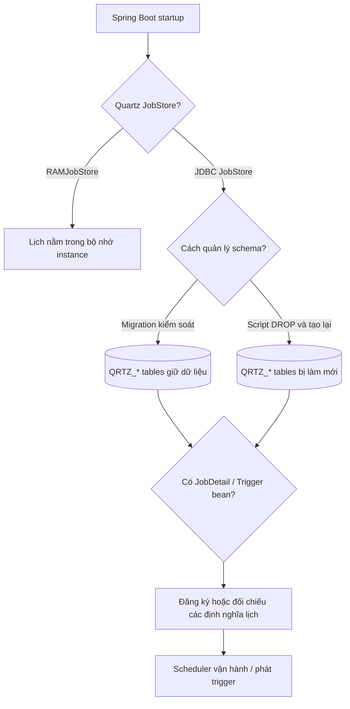
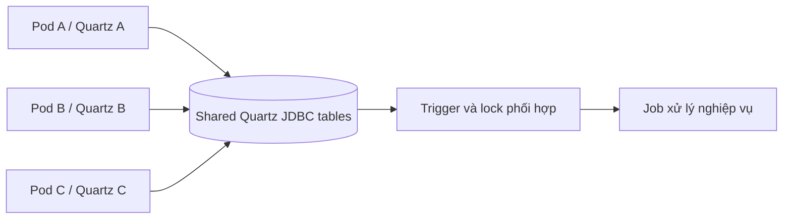
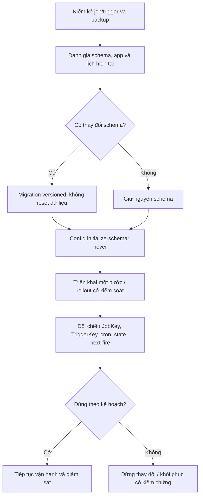

# Khởi tạo schema, dữ liệu lịch hiện có và nguy cơ ghi đè

## 1. Vấn đề: khởi động lại ứng dụng có được phép làm mất lịch Quartz không?

Trong **Spring Boot Integration**, Quartz thường chạy các công việc định kỳ như đồng bộ dữ liệu với hệ thống đối tác, đối soát thanh toán, quét outbox, dọn cache hoặc phát sự kiện sang message broker. Ứng dụng cần quản lý cấu hình kết nối, trạng thái, lỗi, giao dịch, xử lý trùng lặp và khả năng quan sát của những luồng này. Một lịch chạy có thể tồn tại lâu hơn vòng đời của một instance Spring Boot.

Giả sử dịch vụ đối soát có trigger `settlement/reconcile-cron`, được khai báo trong code chạy lúc 01:30 nhưng đã được người vận hành điều chỉnh sang 02:00. Sau đó một phiên bản ứng dụng mới được triển khai. Nếu quá trình khởi tạo schema Quartz **xóa các bảng lịch** rồi tạo lại, lịch đã lưu có thể biến mất hoặc bị dựng lại từ cấu hình mặc định. Nếu ứng dụng tự **ghi đè định nghĩa job/trigger** trong persistent store, lịch được chỉnh trong vận hành cũng có thể bị thay thế ngay cả khi schema vẫn tồn tại.

Để tránh lỗi này, cần tách ba việc:

1. **Khởi tạo schema:** tạo hoặc thay đổi các bảng `QRTZ_*` trong database. Đây là trách nhiệm DDL/migration.
2. **Đăng ký định nghĩa lịch:** thêm hoặc cập nhật `JobDetail`, `Trigger`, `Calendar` với danh tính và cấu hình cụ thể. Đây là trách nhiệm scheduler và mã cấu hình.
3. **Thực thi lịch:** Quartz xác định lúc trigger đến hạn, lấy lock/connection, gọi `Job.execute` và cập nhật trạng thái của lịch trong JobStore.

Ba việc này có mức rủi ro khác nhau. `spring.quartz.jdbc.initialize-schema` điều khiển việc **khởi tạo bảng** trong các cấu hình JDBC; `spring.quartz.overwrite-existing-jobs` điều khiển việc **đăng ký đè định nghĩa job/trigger đã có** từ các bean do Spring khởi tạo. Tắt ghi đè định nghĩa **không cứu được dữ liệu nếu bảng đã bị DROP**.



## 2. RAMJobStore và JDBC JobStore có ý nghĩa khác nhau

| Loại JobStore | Lưu job/trigger ở đâu? | Hành vi sau restart | Rủi ro chính |
| --- | --- | --- | --- |
| `RAMJobStore` | Bộ nhớ của tiến trình Quartz | Dữ liệu lịch phát sinh lúc chạy không được tự khôi phục từ RAM; lịch khai báo trong cấu hình cần được dựng lại | Mất lịch khi restart; không phù hợp nếu cần lưu lịch lâu dài. |
| JDBC JobStore | Database qua các bảng Quartz | Job, trigger và metadata có thể được đọc lại sau restart **nếu schema và dữ liệu được giữ nguyên** | Script DDL xóa bảng, ghi đè định nghĩa, migration không tương thích, cấu hình cluster sai. |

Trong Spring Boot, Quartz thường dùng in-memory store khi không chọn JDBC. Để dùng dữ liệu lịch bền vững, cần dependency phù hợp, một `DataSource` và cấu hình `spring.quartz.job-store-type=jdbc`. Tính bền vững của dữ liệu còn phụ thuộc backup, độ tin cậy database và cách triển khai schema; chỉ bật JDBC chưa đủ để đảm bảo lịch không bị mất.

### 2.1. Các bảng Quartz thường gặp

Với table prefix mặc định `QRTZ_`, schema JDBC của Quartz thường chứa:

| Bảng | Vai trò chính | Tại sao cần giữ lại? |
| --- | --- | --- |
| `QRTZ_JOB_DETAILS` | Định nghĩa job theo tên, nhóm, class thực thi, JobDataMap và thuộc tính liên quan | Mất hàng có thể làm biến mất các job đã đăng ký. |
| `QRTZ_TRIGGERS` | Thông tin chung của trigger, liên kết job, trạng thái, lần chạy kế tiếp | Mất hàng có thể làm mất lịch thực tế và trạng thái trigger. |
| `QRTZ_CRON_TRIGGERS` | Biểu thức cron và múi giờ của cron trigger | Cần để khôi phục lịch cron chính xác. |
| `QRTZ_SIMPLE_TRIGGERS` | Số lần lặp, khoảng lặp và số lần đã chạy của simple trigger | Cần để tiếp tục lịch lặp theo dữ liệu đã lưu. |
| `QRTZ_BLOB_TRIGGERS`, `QRTZ_SIMPROP_TRIGGERS` | Dữ liệu chuyên biệt của một số loại trigger | Cần cho trigger dùng dạng lưu trữ tương ứng. |
| `QRTZ_CALENDARS` | Lịch loại trừ ngày/giờ khi trigger chạy | Có thể ảnh hưởng trực tiếp đến lần chạy kế tiếp. |
| `QRTZ_FIRED_TRIGGERS` | Metadata của các lần kích hoạt đang/đã được scheduler xử lý | Liên quan tới recovery và trạng thái vận hành; không tự xóa để “sửa lịch”. |
| `QRTZ_SCHEDULER_STATE`, `QRTZ_LOCKS` | Trạng thái node và đồng bộ trong JDBC/cluster | Cần cho cơ chế phối hợp, không phải lịch nghiệp vụ để chỉnh tay. |
| `QRTZ_PAUSED_TRIGGER_GRPS` | Nhóm trigger đã được tạm dừng | Xóa dữ liệu có thể làm thay đổi ý định pause trong vận hành. |

Tên bảng thực tế còn phụ thuộc `org.quartz.jobStore.tablePrefix` và schema do phiên bản Quartz/cơ sở dữ liệu cung cấp. Quartz lưu **metadata lập lịch**, không tự bảo đảm lưu toàn bộ kết quả nghiệp vụ của job. Ví dụ, một lần đối soát đã thanh toán hay chưa vẫn phải dựa trên dữ liệu/khóa idempotency của hệ thống thanh toán.

### 2.2. Danh tính job/trigger phải ổn định

Quartz phân biệt:

- `JobKey(name, group)`: định danh job.
- `TriggerKey(name, group)`: định danh trigger.
- `JobDataMap`: dữ liệu gắn với định nghĩa hoặc lần chạy; cần xem xét khả năng serialize và tương thích phiên bản.

Đổi `name` hoặc `group` của job/trigger trong bản phát hành mới có thể tạo **định nghĩa khác** thay vì cập nhật lịch cũ. Nếu lịch cũ vẫn tồn tại, hai trigger có thể cùng kích hoạt cùng một nghiệp vụ. Vì thế, tên và nhóm là một phần hợp đồng vận hành cần quản lý khi nâng cấp.

## 3. `spring.quartz.jdbc.initialize-schema`: rủi ro nằm ở script DDL

Spring Boot hỗ trợ khởi tạo schema Quartz khi dùng JDBC JobStore. Các giá trị thường gặp của `spring.quartz.jdbc.initialize-schema`:

| Giá trị | Ý nghĩa | Cách dùng |
| --- | --- | --- |
| `always` | Yêu cầu chạy script khởi tạo schema khi ứng dụng khởi động với cấu hình phù hợp | Chỉ phù hợp môi trường thử nghiệm/disposable khi đã chấp nhận việc làm mới dữ liệu, hoặc script tự quản được thiết kế an toàn và kiểm soát kỹ. |
| `embedded` | Chỉ tự khởi tạo theo điều kiện database embedded được Spring Boot nhận diện | Hay dùng cho môi trường phát triển/test, nhưng vẫn cần xem xét script và dữ liệu hiện có. |
| `never` | Không tự chạy script khởi tạo schema Quartz lúc khởi động | Lựa chọn rõ ràng khi production quản lý schema bằng Flyway/Liquibase hoặc quy trình DBA riêng. |

**Điểm nguy hiểm:** script schema Quartz tiêu chuẩn mà Spring Boot cung cấp có thể chứa lệnh **DROP các bảng Quartz rồi CREATE lại**. Tài liệu Spring Boot cảnh báo rằng việc dùng các script khởi tạo mặc định có thể xóa dữ liệu trigger đã tồn tại sau mỗi lần ứng dụng khởi động. Đặc biệt, cấu hình `initialize-schema: always` đi cùng script DROP là nguy cơ mất lịch thực tế trong JDBC JobStore.

Ngay cả khi script được tùy biến, không thể mặc nhiên coi việc chạy lại DDL khi nhiều instance startup là an toàn. Cần kiểm soát tính tương thích của schema, thứ tự migration, lock triển khai và dữ liệu tồn tại. Một câu SQL `CREATE TABLE IF NOT EXISTS` cũng **không phải** cơ chế migration đầy đủ khi cần đổi index, constraint hay cấu trúc của phiên bản Quartz mới.

### 3.1. Phân biệt `initialize-schema` và `overwrite-existing-jobs`

Hai thuộc tính độc lập, giải quyết hai lớp dữ liệu:

| Thuộc tính | Tác động chính | Điều không thể đảm bảo |
| --- | --- | --- |
| `spring.quartz.jdbc.initialize-schema: never` | Bỏ qua bước khởi tạo schema qua cơ chế Boot | Không ngăn một migration khác hay mã tùy chỉnh tự xóa bảng, sửa job/trigger. |
| `spring.quartz.jdbc.initialize-schema: always` | Chạy script khởi tạo khi startup | Không đảm bảo an toàn dữ liệu có sẵn; tùy script, có thể DROP bảng. |
| `spring.quartz.overwrite-existing-jobs: false` | Mặc định tránh ghi đè các định nghĩa job/trigger đã đăng ký trong JobStore khi cấu hình bean lúc startup | Không bảo vệ trước DROP bảng, `Scheduler.deleteJob(...)`, mã tự reschedule hoặc DDL thủ công. |
| `spring.quartz.overwrite-existing-jobs: true` | Cho phép định nghĩa từ ứng dụng ghi đè định nghĩa đã tồn tại theo cơ chế đăng ký của Spring | Không phải công tắc quản lý schema và không có nghĩa việc đổi lịch luôn an toàn với yêu cầu nghiệp vụ. |

Ví dụ: lúc 09:00, người vận hành đổi cron trên trigger `settlement/reconcile-cron` từ 01:30 sang 02:00; lúc 10:00 bản mới triển khai. Nếu `overwrite-existing-jobs=true`, cấu hình trigger khai báo trong code có thể áp đặt lại lịch 01:30. Nếu `initialize-schema=always` chạy script xóa bảng, mọi dữ liệu lịch hiện có trong bảng liên quan có thể mất **trước cả bước xét overwrite**.

Không nên dùng một thuộc tính để “chữa” lỗi thuộc tính kia. Trước tiên phải xác định **schema có được giữ nguyên qua khởi động hay không**, rồi xác định **quy tắc cập nhật định nghĩa lịch**.

## 4. Cấu hình Spring Boot cho môi trường giữ lịch bền vững

Giả sử schema Quartz đã được tạo và quản lý qua quy trình migration riêng, có thể dùng cấu hình minh họa:

```yaml
spring:
  quartz:
    job-store-type: jdbc
    jdbc:
      initialize-schema: never
    overwrite-existing-jobs: false
    auto-startup: true
    properties:
      org.quartz.scheduler.instanceName: integrationScheduler
      org.quartz.scheduler.instanceId: AUTO
      org.quartz.jobStore.tablePrefix: QRTZ_
      org.quartz.jobStore.isClustered: true
      org.quartz.jobStore.clusterCheckinInterval: 20000
      org.quartz.threadPool.threadCount: 8
```

Ý nghĩa:

1. `job-store-type: jdbc` yêu cầu dùng persistent JobStore gắn với `DataSource` do Spring quản lý.
2. `initialize-schema: never` buộc deployment phải **chuẩn bị schema trước khi scheduler chạy**, không tự thực hiện DDL khi mỗi pod khởi động.
3. `overwrite-existing-jobs: false` đặt chính sách bảo toàn định nghĩa đã tồn tại khi Spring đăng ký các job/trigger bean; việc cập nhật lịch cần quy trình riêng.
4. `instanceName` phải thống nhất giữa các node tham gia cùng một cụm Quartz; `instanceId: AUTO` giúp mỗi scheduler instance có ID riêng.
5. `isClustered: true` chỉ phù hợp khi nhiều node Quartz thật sự chia sẻ **cùng JDBC JobStore** và cần phối hợp cluster; nếu triển khai một node hoặc mô hình khác, cấu hình phải theo topology thực tế.
6. `threadCount` phải phù hợp giới hạn tài nguyên và dịch vụ đích. Tăng số thread không làm database hoặc HTTP API có thêm năng lực tự động.

**Đây là cấu hình minh họa cho deployment có cluster JDBC.** Không sao chép tùy chọn cluster sang mọi ứng dụng một cách máy móc. Cụm Quartz cần clock đồng bộ, các instance cùng dùng đúng database/schema/prefix và cấu hình scheduler nhất quán; trộn các node clustered và non-clustered trên cùng các bảng có thể gây hỏng trạng thái lịch hoặc chạy trùng.

### 4.1. Sử dụng DataSource và transaction manager riêng cho Quartz

Khi Spring Boot kết nối nhiều database, có thể chỉ định nguồn dữ liệu chuyên dùng cho Quartz bằng `@QuartzDataSource`, và transaction manager tương ứng bằng `@QuartzTransactionManager` nếu phù hợp với cấu hình dự án. Ví dụ dưới đây dùng namespace riêng:

```yaml
app:
  quartz:
    datasource:
      url: ${QUARTZ_JDBC_URL}
      username: ${QUARTZ_DB_USER}
      password: ${QUARTZ_DB_PASSWORD}
      driver-class-name: org.postgresql.Driver
```

Tạo `DataSourceProperties` rồi đánh dấu datasource dùng cho Quartz:

```java
import javax.sql.DataSource;
import org.springframework.beans.factory.annotation.Qualifier;
import org.springframework.boot.autoconfigure.jdbc.DataSourceProperties;
import org.springframework.boot.autoconfigure.quartz.QuartzDataSource;
import org.springframework.boot.context.properties.ConfigurationProperties;
import org.springframework.context.annotation.Bean;
import org.springframework.context.annotation.Configuration;

@Configuration
class SchedulerDataSourceConfiguration {
    @Bean("quartzDataSourceProperties")
    @ConfigurationProperties(prefix = "app.quartz.datasource")
    DataSourceProperties quartzDataSourceProperties() {
        return new DataSourceProperties();
    }

    @Bean
    @QuartzDataSource
    DataSource quartzDataSource(
            @Qualifier("quartzDataSourceProperties") DataSourceProperties props) {
        return props.initializeDataSourceBuilder().build();
    }
}
```

Ví dụ giả định đã có JDBC driver và pool phù hợp trên classpath, đồng thời secret được cấp từ môi trường. Việc cấu hình thêm các datasource nghiệp vụ khác có thể cần `@Primary`, `@Qualifier` hoặc cấu hình bổ sung theo Spring Boot version. Nên dùng database/schema có quyền tối thiểu cho Quartz, theo dõi connection pool và cân nhắc cách transaction management của Quartz tương tác với datasource đó.

Tránh tự thiết lập `org.quartz.jobStore.class` theo ví dụ Quartz thuần nếu đang dùng JDBC JobStore do Spring Boot/Spring quản lý. Cấu hình Spring-managed JobStore có cơ chế kết nối và transaction riêng; việc ép sang class JobStore khác có thể tạo xung đột. Khi cần tùy biến sâu, phải kiểm chứng theo phiên bản Spring Boot, Spring Framework và Quartz thực tế.

## 5. Khởi tạo schema an toàn bằng migration có kiểm soát

Đối với production đã có dữ liệu lịch, cách tiếp cận ổn định là **quản lý schema bằng migration versioned** thay vì chạy script tạo bảng từ đầu ở mỗi lần restart.

### 5.1. Lần triển khai đầu tiên: schema chưa tồn tại

Quy trình khuyến nghị:

1. Chọn **script schema đúng DBMS và phiên bản Quartz** đang dùng (PostgreSQL, MySQL, Oracle, SQL Server... có kiểu dữ liệu, index, khóa và cú pháp khác nhau).
2. Đưa phần DDL tạo schema vào một migration khởi tạo có phiên bản, ví dụ `V1__create_quartz_tables.sql` cho Flyway. Trước khi sử dụng, kiểm tra nội dung script và bỏ mọi thao tác DROP/reset không phù hợp yêu cầu bảo toàn dữ liệu.
3. Chạy migration **một lần theo cơ chế quản lý migration** trước khi nhiều instance scheduler bắt đầu truy vấn hoặc ghi bảng.
4. Cấu hình `spring.quartz.jdbc.initialize-schema: never` ở ứng dụng.
5. Khởi động scheduler và kiểm chứng job/trigger mới được đăng ký, SQL hoạt động và lịch chạy đúng.

Đây là *mẫu quy trình*, không phải yêu cầu tự tạo file SQL trong bài học. Không thể lấy một schema Quartz chung cho mọi hệ quản trị; phải dựa trên bản DDL tương thích Quartz release/DBMS và chính sách DBA. Các thay đổi sau này phải là migration từ trạng thái trước sang trạng thái sau, không tái tạo bảng từ đầu.

### 5.2. Database đã có bảng và lịch thật

Trước một lần đổi schema hoặc nâng cấp Quartz:

1. **Kiểm kê trạng thái:** ghi nhận số lượng job, trigger, cron, paused groups; danh sách các `JobKey`/`TriggerKey` quan trọng và lần chạy dự kiến.
2. **Sao lưu có kiểm chứng:** tạo backup nhất quán theo database, có kế hoạch restore. Dữ liệu Quartz cần đi cùng thông tin phiên bản ứng dụng nếu còn chứa class/serialization phụ thuộc mã Java.
3. **Xác định chủ sở hữu lịch:** trigger nào do code khai báo, trigger nào do admin/API tạo động, trigger nào được phép cập nhật trong lần deploy?
4. **Đánh giá DDL:** so sánh schema hiện tại với schema đích, chuẩn bị migration không phá dữ liệu và phương án rollback được kiểm thử.
5. **Điều phối rollout:** chạy migration tại một điểm điều phối trước khi bật các scheduler; không để nhiều node cùng thực hiện thay đổi schema khi đang phát trigger.
6. **Kiểm tra sau nâng cấp:** đối chiếu job/trigger, trạng thái paused và next-fire time, đồng thời quan sát lỗi khi lịch đến hạn.

Nếu script hiện tại chứa `DROP TABLE QRTZ_*`, **không chạy trên database giữ lịch thật** chỉ vì ứng dụng mới yêu cầu “khởi tạo schema”. Phải xác định migration thật sự cần làm gì và kiểm soát thay đổi ở mức dữ liệu.

### 5.3. Ba môi trường với chiến lược khác nhau

| Môi trường | Chính sách schema hợp lý | Mục tiêu |
| --- | --- | --- |
| Unit/integration test dùng database tạm | Có thể dựng lại schema trong vòng đời test, chấp nhận xóa dữ liệu test | Kết quả lặp lại, độc lập giữa các bài test. |
| Staging giữ dữ liệu lịch mô phỏng production | Migration versioned và `initialize-schema: never` | Phát hiện lỗi nâng cấp, restart, backup/restore và logic ghi đè. |
| Production | Migration được phê duyệt, backup, `initialize-schema: never` | Bảo toàn lịch và trạng thái qua rollout/restart. |

Ngay tại test, cần tránh vô tình trỏ vào database chia sẻ hoặc database production bằng cấu hình môi trường sai. Quy trình test có DROP chỉ được dùng với nguồn dữ liệu **có thể hủy** đã được xác minh.

## 6. Đăng ký `JobDetail`, `Trigger` và chính sách ghi đè

Khi định nghĩa `JobDetail` và `Trigger` thành bean, Spring Boot có thể đăng ký chúng với `Scheduler` được auto-configuration tạo. Các identity ổn định giúp mã đối chiếu với lịch đã lưu:

```java
import java.util.TimeZone;
import org.quartz.CronScheduleBuilder;
import org.quartz.Job;
import org.quartz.JobBuilder;
import org.quartz.JobDetail;
import org.quartz.JobExecutionContext;
import org.quartz.JobExecutionException;
import org.quartz.Trigger;
import org.quartz.TriggerBuilder;
import org.quartz.DisallowConcurrentExecution;
import org.springframework.context.annotation.Bean;
import org.springframework.context.annotation.Configuration;

@DisallowConcurrentExecution
public class ReconcileJob implements Job {
    @Override
    public void execute(JobExecutionContext context)
            throws JobExecutionException {
        // Trong code thật: gọi service nghiệp vụ idempotent,
        // có timeout, metric, phân loại lỗi và logging.
    }
}

@Configuration
class ReconcileScheduleConfiguration {
    @Bean
    JobDetail reconcileJobDetail() {
        return JobBuilder.newJob(ReconcileJob.class)
                .withIdentity("reconcile-nightly", "settlement")
                .storeDurably()
                .build();
    }

    @Bean
    Trigger reconcileTrigger(JobDetail reconcileJobDetail) {
        return TriggerBuilder.newTrigger()
                .withIdentity("reconcile-cron", "settlement")
                .forJob(reconcileJobDetail)
                .withSchedule(CronScheduleBuilder
                        .cronSchedule("0 30 1 * * ?")
                        .inTimeZone(TimeZone.getTimeZone("UTC"))
                        .withMisfireHandlingInstructionDoNothing())
                .build();
    }
}
```

Trong ví dụ, `JobKey` là `settlement/reconcile-nightly` và `TriggerKey` là `settlement/reconcile-cron`. Biểu thức cron minh họa 01:30 hằng ngày theo UTC. Đối với lịch kinh doanh địa phương, cần chọn múi giờ được phê duyệt thay vì ngầm dựa vào timezone của server; việc đổi timezone/cron có thể làm dịch chuyển thời gian chạy tiếp theo.

`storeDurably()` cho phép giữ `JobDetail` ngay cả khi tạm thời không có trigger. `@DisallowConcurrentExecution` ngăn các lần chạy **của cùng JobKey** chồng lấn theo cơ chế Quartz; nó không ngăn chạy trùng giữa các JobKey khác nhau hoặc bảo đảm side effect chỉ xảy ra một lần khi có restart/failover. Trong tác vụ đối soát hoặc gửi broker, cần khóa idempotency theo sự kiện/kỳ xử lý.

### 6.1. `overwrite-existing-jobs: false` giữ gì và không giữ gì?

Khi ứng dụng khởi tạo JobDetail/Trigger bean có key trùng định nghĩa đã nằm trong persistent store, Spring tích hợp Quartz có chính sách dùng định nghĩa hiện có thay vì mặc nhiên áp đặt lại định nghĩa khai báo, tùy đường đi đăng ký và phiên bản được dùng. Với `overwrite-existing-jobs=false`, mục tiêu là **không vô ý thay các job đã tồn tại bởi cấu hình startup**.

Nhưng phải kiểm tra hành vi trên **trigger thật** trong phiên bản ứng dụng:

- Trigger tồn tại có thể đang dùng cron do vận hành thay đổi; chỉ nhìn vào bean cron trong code không biết cron có được cập nhật không.
- Dùng `Scheduler.scheduleJob(...)` khi một key đã tồn tại có thể nhận `ObjectAlreadyExistsException`; dùng `rescheduleJob(...)` có thể thay lịch. Chính sách từ bean startup không tự kiểm soát mọi lệnh qua Scheduler API.
- Xóa bean khỏi code không đồng nghĩa Quartz sẽ tự xóa định nghĩa cũ khỏi JDBC store. Cần quy trình decommission với identity xác định.
- Đổi tên key có thể tạo lịch song song, dù `overwrite-existing-jobs=false`.

### 6.2. Khi nào mới bật `overwrite-existing-jobs: true`?

Chỉ khi chính sách hệ thống xác định **cấu hình trong code là nguồn sự thật** cho những job/trigger đang được Spring đăng ký và nhóm vận hành đã chấp nhận việc thay định nghĩa cũ. Trước khi bật, phải đối chiếu:

| Câu hỏi | Rủi ro nếu bỏ qua |
| --- | --- |
| Trigger đã được admin/API sửa cron, timezone hoặc misfire policy chưa? | Rollout vô tình hủy chỉnh sửa hợp lệ. |
| Trigger mới có cùng `TriggerKey` và `JobKey` không? | Tạo trùng lịch hoặc bỏ lịch cũ. |
| Định nghĩa mới thay class, dữ liệu JobDataMap hoặc cờ recovery không? | Lịch có thể không chạy, deserialization lỗi, side effect thay đổi. |
| Có nhiều instance cùng đăng ký định nghĩa vào một store không? | Race và thay đổi không nhất quán khi rollout lệch phiên bản. |
| Có bản backup và bài test đối chiếu lịch trước/sau không? | Khó phục hồi sau khi ghi đè sai. |

Thường nên triển khai **thay đổi lịch có kiểm soát** bằng API/admin command riêng, có quyền, audit log, kiểm tra key tồn tại và version/điều kiện cập nhật thay vì mỗi instance tự ghi đè lúc khởi động.

## 7. Đổi lịch hiện có bằng API có chủ đích

Nếu yêu cầu nghiệp vụ là đổi cron cho một trigger cụ thể, có thể thực hiện theo quy trình có kiểm soát qua `Scheduler.rescheduleJob`:

```java
import java.util.Date;
import java.util.TimeZone;
import org.quartz.CronScheduleBuilder;
import org.quartz.Trigger;
import org.quartz.TriggerBuilder;
import org.quartz.TriggerKey;
import org.quartz.Scheduler;
import org.quartz.SchedulerException;

public class ScheduleChangeService {
    private final Scheduler scheduler;

    public ScheduleChangeService(Scheduler scheduler) {
        this.scheduler = scheduler;
    }

    public Date changeCron() throws SchedulerException {
        TriggerKey key = TriggerKey.triggerKey(
                "reconcile-cron", "settlement");
        Trigger current = scheduler.getTrigger(key);
        if (current == null) {
            throw new IllegalStateException("Trigger không tồn tại: " + key);
        }

        Trigger updated = current.getTriggerBuilder()
                .withSchedule(CronScheduleBuilder
                        .cronSchedule("0 0 2 * * ?")
                        .inTimeZone(TimeZone.getTimeZone("UTC"))
                        .withMisfireHandlingInstructionDoNothing())
                .build();

        return scheduler.rescheduleJob(key, updated);
    }
}
```

Mã minh họa có thể đổi lịch sang 02:00 UTC; API `rescheduleJob` trả `Date` của lần chạy tiếp theo hoặc `null` nếu không thể cập nhật trigger tương ứng theo hợp đồng API. Trong production, cần yêu cầu actor được cấp quyền, lý do thay đổi, old/new schedule, optimistic check hoặc bước xác nhận trước khi cập nhật, cùng audit log. Mẫu trên không tự triển khai cơ chế khóa đồng thời của workflow quản trị.

**Không chỉnh trực tiếp hàng `QRTZ_CRON_TRIGGERS` hay `QRTZ_TRIGGERS` bằng câu `UPDATE` thủ công** trong khi Quartz đang chạy; các trường liên quan và trạng thái cache/lock phải được API Quartz điều phối. SQL chỉ phù hợp cho migration/schema và công cụ kiểm tra được thiết kế riêng theo hướng dẫn của Quartz.

## 8. Khởi động nhiều instance Quartz cùng database

Khi chạy nhiều pod Spring Boot và chúng **cùng chia sẻ persistent JobStore**, phải xem đây là một cụm Quartz, không phải nhiều scheduler độc lập không liên quan.



Cụm nên đáp ứng:

- Các instance dùng cùng `scheduler.instanceName`, đúng DB/schema/tablePrefix và chế độ cluster được cấu hình nhất quán.
- Mỗi instance có `instanceId` riêng, thường dùng `AUTO`.
- Đồng hồ hệ thống các node được đồng bộ; Quartz dựa vào thời điểm trigger và dữ liệu check-in.
- Một migration schema do **một tiến trình/điểm điều phối** kiểm soát. Không để các pod tự chạy script DROP/CREATE lúc rollout song song.
- Phân phối kết nối database, thread pool, giới hạn dịch vụ bên ngoài và chính sách retry cần tính theo tổng số pod.
- Nếu hai ứng dụng độc lập không chia sẻ trách nhiệm scheduling, không tùy tiện trỏ cả hai vào cùng một bộ bảng `QRTZ_*` mà không có thiết kế namespace và quyền rõ ràng.

Ngay cả với clustering, sự cố sau khi một job đã ghi dữ liệu/HTTP call nhưng trước khi Quartz đánh dấu hoàn thành có thể dẫn đến recovery hoặc tác động được thử lại. Không tuyên bố “Quartz clustered bảo đảm exactly-once cho nghiệp vụ”; dùng idempotency key, trạng thái xử lý và outbox khi cần.

### 8.1. Misfire và khởi động lại sau một khoảng downtime

Nếu job lẽ ra chạy lúc 01:30 nhưng hệ thống ngừng tới 03:00, Quartz cần áp dụng **misfire instruction** cho trigger:

- Với CronTrigger, chính sách dạng `DoNothing` bỏ qua các lần đến hạn bị lỡ và tiến tới lịch hợp lệ kế tiếp.
- Chính sách dạng `FireAndProceed` có thể kích hoạt một lần chạy bù ngay rồi tiếp tục lịch bình thường.
- Với SimpleTrigger, hành vi liên quan repeat count và khoảng lặp có các policy khác, cần chọn đúng.

Misfire không liên quan trực tiếp tới việc schema có bị ghi đè, nhưng **bảo toàn lịch sau restart** sẽ không đầy đủ nếu không xác định cách xử lý các lần chạy lỡ. Với tác vụ tài chính, chạy bù hay bỏ lỡ phải dựa trên kỳ nghiệp vụ và thiết kế idempotent.

## 9. Dữ liệu JobDataMap và khả năng nâng cấp phiên bản

Khi dùng JDBC JobStore, ngoài các bảng lịch còn có nguy cơ không đọc được dữ liệu JobDataMap sau khi deploy:

1. Tránh lưu object Java tùy biến hoặc secrets vào JobDataMap để chúng bị serialize rồi phải đọc lại bằng classpath/phiên bản mới. Ưu tiên ID nghiệp vụ và dữ liệu cấu hình nhỏ, có phiên bản rõ.
2. Quartz có tùy chọn `org.quartz.jobStore.useProperties` cho dạng dữ liệu map dễ tương thích hơn, nhưng khi bật yêu cầu giá trị phù hợp với ràng buộc của cơ chế lưu đó. Không bật/tắt trên store đang chạy mà chưa kiểm tra và chuẩn bị migration dữ liệu liên quan.
3. Nếu đổi package/class của job, các hàng `QRTZ_JOB_DETAILS` có thể tham chiếu tới class name cũ. Phải chuẩn bị cách chuyển đổi, tương thích ngược hoặc cập nhật có kiểm soát.
4. Backup schema cùng thông tin phiên bản ứng dụng và migration. Khôi phục database vào phiên bản code không tương thích có thể tạo lỗi khi scheduler đọc job.
5. Định nghĩa lịch và trạng thái job nên có **quyền sở hữu** rõ: ai có quyền tạo, pause, resume, xóa, reschedule; hành động nào cần audit.

Nếu job gọi HTTP API hoặc gửi sự kiện, JobDataMap không phải nơi lưu chính cho tiến độ giao dịch phân tán. Dùng database nghiệp vụ, khóa idempotency và transaction/outbox để kiểm soát việc đã xử lý/chưa xử lý một đơn hàng hoặc kỳ đối soát.

## 10. Kiểm tra trạng thái trước và sau deploy

Trước khi triển khai, kiểm kê read-only từ cơ sở dữ liệu chứa Quartz. Các truy vấn sau chỉ minh họa với prefix mặc định; tên bảng/schema có thể khác tùy cấu hình:

```sql
-- Số định nghĩa job và trigger
SELECT COUNT(*) AS total_jobs FROM QRTZ_JOB_DETAILS;
SELECT COUNT(*) AS total_triggers FROM QRTZ_TRIGGERS;

-- Trạng thái trigger (NORMAL, PAUSED, ERROR, ...)
SELECT TRIGGER_STATE, COUNT(*) AS total
FROM QRTZ_TRIGGERS
GROUP BY TRIGGER_STATE
ORDER BY TRIGGER_STATE;

-- Các trigger cron và mốc kích hoạt (millisecond Unix epoch)
SELECT t.SCHED_NAME, t.TRIGGER_GROUP, t.TRIGGER_NAME,
       t.JOB_GROUP, t.JOB_NAME,
       t.TRIGGER_STATE, t.NEXT_FIRE_TIME,
       c.CRON_EXPRESSION, c.TIME_ZONE_ID
FROM QRTZ_TRIGGERS t
JOIN QRTZ_CRON_TRIGGERS c
  ON c.SCHED_NAME = t.SCHED_NAME
 AND c.TRIGGER_GROUP = t.TRIGGER_GROUP
 AND c.TRIGGER_NAME = t.TRIGGER_NAME
ORDER BY t.TRIGGER_GROUP, t.TRIGGER_NAME;
```

`NEXT_FIRE_TIME` trong các bảng Quartz thường biểu diễn thời điểm dạng epoch **milli**. Không so sánh trực tiếp con số này với giờ địa phương; chuyển sang thời gian/múi giờ phù hợp khi báo cáo. Trạng thái cụ thể và tên cột phụ thuộc schema/phiên bản Quartz đang triển khai.

Có thể kiểm tra qua API Quartz (trên scheduler đã dùng đúng JobStore) thay vì trực tiếp đọc bảng:

```java
import org.quartz.JobKey;
import org.quartz.Scheduler;
import org.quartz.Trigger;
import org.quartz.TriggerKey;

void inspect(Scheduler scheduler) throws Exception {
    JobKey jobKey = JobKey.jobKey(
            "reconcile-nightly", "settlement");
    TriggerKey triggerKey = TriggerKey.triggerKey(
            "reconcile-cron", "settlement");

    boolean jobExists = scheduler.checkExists(jobKey);
    Trigger trigger = scheduler.getTrigger(triggerKey);

    System.out.println("job exists: " + jobExists);
    System.out.println("trigger exists: " + (trigger != null));
    if (trigger != null) {
        System.out.println("next fire: " + trigger.getNextFireTime());
        System.out.println("state: " + scheduler.getTriggerState(triggerKey));
    }
}
```

Đối chiếu **trước/sau**:

| Dữ liệu cần đối chiếu | Tại sao quan trọng? |
| --- | --- |
| Số job/trigger và danh sách key | Phát hiện reset toàn bộ, lịch mất hoặc lịch phát sinh trùng. |
| Cron, timezone, misfire policy | Phát hiện lịch bị ghi đè dù số row không đổi. |
| Trạng thái trigger, paused group | Không tự động khởi động lại lịch đã được admin pause. |
| `NEXT_FIRE_TIME` | Phát hiện lần chạy kế tiếp bị dịch chuyển ngoài dự kiến. |
| `JobDataMap`/job class tương thích | Tránh job tồn tại trong DB nhưng không thể thực thi. |
| Số lần chạy thực tế và side effect | Phát hiện chạy lại do recovery/misfire/retry. |

Các truy vấn SQL này là **read-only**; không nên thử bằng `DELETE`/`TRUNCATE` để “dọn bảng”, vì có thể làm mất lịch và phá quan hệ giữa các bảng.

## 11. Tình huống sự cố thực tế

### 11.1. Restart làm biến mất toàn bộ trigger

**Triệu chứng:** trước deploy có hàng trăm trigger; sau deploy chỉ còn vài trigger được khai báo ở source code.

**Chẩn đoán:**

1. Kiểm tra cấu hình hiệu lực `spring.quartz.job-store-type` và `spring.quartz.jdbc.initialize-schema` của instance vừa khởi động.
2. Kiểm tra log schema initializer/migration, script cấu hình qua `spring.quartz.jdbc.schema` và nội dung DDL có `DROP TABLE` hoặc lệnh xóa dữ liệu hay không.
3. Kiểm tra database/schema/tablePrefix đúng môi trường; không nhầm trường hợp scheduler trỏ sang database mới rỗng với việc dữ liệu thật đã bị xóa.
4. Đối chiếu backup, log triển khai và snapshot job/trigger trước rollout.
5. Nếu xác nhận có reset, **ngừng các tiến trình tiếp tục reset**, điều phối phương án restore nhất quán và kiểm tra side effect của các lịch đã chạy trong khoảng thời gian sự cố.

**Khắc phục gốc:** chuyển schema production sang migration kiểm soát, đặt `initialize-schema: never`, kiểm thử restart trên database có lịch có sẵn và khóa quy trình thay đổi DDL.

### 11.2. Schema còn nguyên nhưng cron quay về giá trị cũ

**Triệu chứng:** bảng `QRTZ_TRIGGERS` không mất, nhưng cron của một trigger đổi từ 02:00 về 01:30 khi deploy.

**Chẩn đoán:** tìm `overwrite-existing-jobs=true`, JobDetail/Trigger bean có key trùng, hoặc code startup gọi `rescheduleJob`. Xác định có thao tác chỉnh lịch qua admin/API và cơ chế nào là nguồn sự thật.

**Khắc phục gốc:** thống nhất quyền sở hữu cấu hình lịch, dùng chính sách không ghi đè mặc định khi phù hợp, chuyển thao tác đổi lịch sang command có audit và test before/after.

### 11.3. Sau nâng cấp, trigger vẫn còn nhưng job thất bại

**Triệu chứng:** Quartz thấy trigger, song không thể tạo job class hoặc đọc dữ liệu job.

**Chẩn đoán:** đối chiếu `JOB_CLASS_NAME` trong `QRTZ_JOB_DETAILS` với code mới; kiểm tra classpath, JobDataMap đã serialize, schema và phiên bản Quartz.

**Khắc phục gốc:** migration tương thích cho job class/dữ liệu đã lưu, giữ lớp tương thích trong thời kỳ chuyển đổi, rollback theo kế hoạch nếu phát hiện không đọc được dữ liệu cũ.

### 11.4. Nhiều pod cùng chạy một kỳ đối soát

**Triệu chứng:** hai instance cùng thực thi nghiệp vụ tương tự, tạo hai HTTP call hoặc hai message.

**Chẩn đoán:** kiểm tra các instance có thật sự cùng một JDBC cluster không, có dùng cùng `JobKey` không, có tạo thêm trigger mới do đổi key hay không và có recovery sau sự cố không.

**Khắc phục gốc:** cấu hình cluster nhất quán, `@DisallowConcurrentExecution` khi phù hợp cho cùng JobKey, và triển khai idempotency ở tầng nghiệp vụ. Không dùng Quartz cluster như bằng chứng đã có exactly-once.

## 12. Quy trình rollout an toàn với dữ liệu lịch đã tồn tại



Checklist cho release:

1. **Trước deploy:** lưu bản kiểm kê có định danh lịch, cron, timezone, paused state và thời điểm dự kiến; xác nhận bản backup có thể restore.
2. **Cấu hình:** persistent store chính xác; `initialize-schema: never` trên hệ giữ lịch; `overwrite-existing-jobs` nhất quán với quyền sở hữu lịch.
3. **Schema:** migration tương thích DBMS, Quartz version; không chạy DROP/CREATE lại từ mỗi pod.
4. **Đăng ký lịch:** giữ nguyên JobKey/TriggerKey hoặc có migration đổi identity riêng; ghi nhận mọi thay đổi cron/misfire/data map.
5. **Cluster:** dùng cùng store, cấu hình cluster nhất quán, ID node riêng, clock đồng bộ và datasource đủ tài nguyên.
6. **Quan sát:** theo dõi lỗi khởi động scheduler, số lượng trigger, trạng thái paused/error, misfire, độ trễ job và retry.
7. **Khôi phục:** có hướng dừng job, restore/reconcile và bù trừ nghiệp vụ; không replay mù các lần chạy có side effect.

## 13. Các câu hỏi tự kiểm tra

1. Vì sao `spring.quartz.overwrite-existing-jobs=false` không bảo vệ lịch nếu script schema dùng `DROP TABLE`?
2. Khi database chứa trigger tạo động, vì sao restart với JDBC JobStore lại khác restart với RAMJobStore?
3. Trong rollout ba pod, chuyện gì có thể xảy ra nếu từng pod chạy `initialize-schema=always` trên cùng database?
4. Khi thay cron trong source code nhưng production lưu lịch đã chỉnh bằng API, ai nên là nguồn sự thật và cần cơ chế phê duyệt nào?
5. Vì sao đổi `JobKey` hoặc `TriggerKey` có thể tạo lịch chạy trùng dù ứng dụng không bật overwrite?
6. Có thể dùng dữ liệu trong `QRTZ_TRIGGERS` để kết luận một kỳ đối soát đã thanh toán thành công đúng một lần không? Cần bổ sung gì ở database nghiệp vụ?
7. Khi lịch bị reset, vì sao phải kiểm tra cả side effect trước khi restore và chạy bù?

**Điểm cần nhớ:** Trong Quartz dùng JDBC JobStore, **giữ schema** và **giữ định nghĩa lịch** là hai quyết định độc lập. Dùng migration có kiểm soát, cấu hình `spring.quartz.jdbc.initialize-schema: never` ở nơi có dữ liệu lịch cần bảo toàn, đặt chính sách `overwrite-existing-jobs` theo quyền sở hữu lịch, giữ identity ổn định và kiểm chứng trước/sau rollout. Khi Quartz điều phối các luồng tích hợp Spring Boot qua database, HTTP hoặc broker, việc lịch chạy đúng thời điểm vẫn phải đi cùng transaction, retry có giới hạn, idempotency và quan sát tác động nghiệp vụ.
