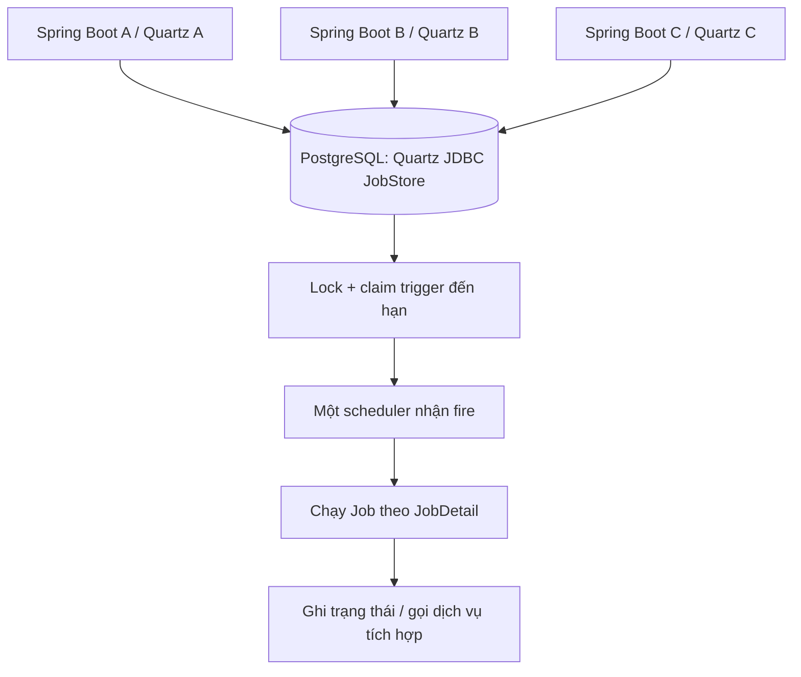
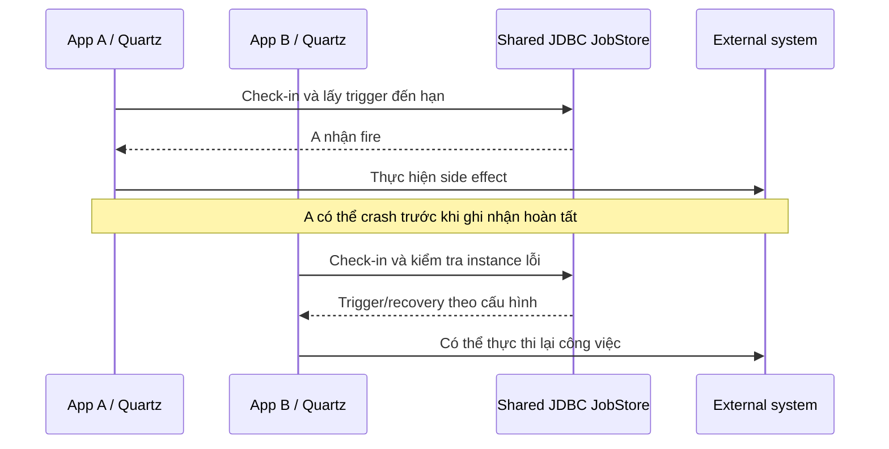

# Clustering và điều kiện chỉ một nút thực thi công việc

## 1. Vấn đề: một lịch chạy nhưng nhiều phiên bản Spring Boot

Trong module **SPRING_BOOT_INTEGRATION**, ứng dụng Spring Boot có thể cần chạy công việc định kỳ để đối soát thanh toán, đồng bộ đơn hàng từ HTTP API, kiểm tra bản ghi outbox còn chờ, làm mới cache hoặc gửi thông điệp sang broker. Khi hệ thống chạy nhiều instance để tăng khả dụng, câu hỏi xuất hiện là: **tại một thời điểm đến hạn, instance nào được phép thực thi công việc?**

Giả sử ba instance `app-A`, `app-B` và `app-C` đều chứa công việc đối soát mỗi 5 phút. Nếu mỗi instance tự chạy `@Scheduled`, cả ba có thể cùng gọi API đối tác và cập nhật những bản ghi giống nhau. Trong một số nghiệp vụ, ba lần thực thi chỉ làm lãng phí tài nguyên; trong nghiệp vụ thanh toán hoặc xuất hàng, tác dụng phụ lặp lại có thể gây sai dữ liệu.

**Quartz clustering** là cơ chế nhiều scheduler chia sẻ một **JDBC JobStore** để phối hợp quyền lấy trigger. Trong điều kiện cluster được cấu hình đúng, **một lần phát hỏa cụ thể của trigger** chỉ được một scheduler instance nhận và thực thi theo cơ chế khóa/điều phối của Quartz.

Điều này cần phân biệt với hai yêu cầu khác:

| Yêu cầu thực tế | Quartz hỗ trợ đến đâu? |
|---|---|
| Mỗi lần một trigger đến hạn chỉ có **một node** nhận fire đó | JDBC clustering phối hợp việc lấy trigger qua database chung |
| Không có hai lần chạy chồng lấn của **cùng một JobDetail** | Dùng thêm `@DisallowConcurrentExecution` trên Job class; phạm vi là cùng `JobKey` |
| Tác dụng phụ nghiệp vụ **chính xác một lần** dù chết máy/retry | Không tự bảo đảm; cần idempotency, transaction, ràng buộc dữ liệu và cơ chế phục hồi |
| Chỉ một node duy nhất làm **mọi** công việc trong cluster | Không phải mục tiêu mặc định; các lần fire khác nhau có thể chạy ở những node khác nhau |

Ví dụ: lúc 10:00, `app-A` nhận một lần fire của job đối soát; lúc 10:05, `app-C` có thể nhận lần fire tiếp theo. Đó vẫn là hành vi đúng. Quartz cluster không đòi hỏi một node lãnh đạo cố định.

## 2. Quartz phân phối công việc trong cluster như thế nào?

### 2.1. Các khái niệm cần phân biệt

- **Scheduler instance:** một tiến trình/instance Quartz chạy bên trong ứng dụng Spring Boot.
- **JobDetail:** mô tả công việc, gồm `JobKey` (group + name), Job class và `JobDataMap`.
- **Trigger:** định nghĩa thời điểm và quy tắc phát hỏa, chẳng hạn mỗi 5 phút hoặc một lần tại thời điểm cụ thể.
- **Fire / execution:** một lần thực thi được trigger sinh ra. `fireInstanceId` nhận diện lần chạy cụ thể nhưng không nhất thiết là khóa chống trùng nghiệp vụ khi phải retry/recovery.
- **JDBC JobStore:** bảng Quartz trong database lưu lịch, trigger, trạng thái scheduler và dữ liệu phục vụ phối hợp.

Khi nhiều scheduler thuộc **cùng một Quartz cluster**, chúng cùng truy cập các bảng Quartz. Mỗi scheduler kiểm tra trigger sắp đến hạn, nhưng việc chuyển trạng thái/lấy trigger được điều phối bằng các khóa và transaction tại JobStore. Nhờ đó, trong điều kiện bình thường, hai node không cùng nhận một lần fire của một trigger.



Các bảng thường gặp khi dùng tiền tố mặc định `QRTZ_`:

| Nhóm bảng | Vai trò khái quát |
|---|---|
| `QRTZ_JOB_DETAILS`, `QRTZ_TRIGGERS`, `QRTZ_CRON_TRIGGERS` | Lưu JobDetail và thông tin lịch chạy |
| `QRTZ_LOCKS` | Phối hợp khóa cần thiết giữa các scheduler |
| `QRTZ_FIRED_TRIGGERS` | Theo dõi những lần trigger được nhận/thực thi để phục vụ quản lý và phục hồi |
| `QRTZ_SCHEDULER_STATE` | Ghi nhận trạng thái/check-in của các instance trong cluster |

Các bảng này là **trạng thái nội bộ của Quartz**; ứng dụng không nên sửa trực tiếp nhằm “ép” một node chạy job. Muốn tạo, cập nhật hoặc dừng lịch, hãy dùng API `Scheduler`/cấu hình tích hợp có kiểm soát.

### 2.2. Không phải leader election cho toàn bộ ứng dụng

Quartz không biến `app-A` thành leader vĩnh viễn, cũng không tự bảo đảm “chỉ có một instance của ứng dụng được chạy mọi nghiệp vụ”. Nó phối hợp **việc lấy và thực thi trigger** của các scheduler dùng chung JobStore.

Nếu ứng dụng còn có `@Scheduled`, listener Kafka, consumer RabbitMQ hoặc một cron bên ngoài, các công việc đó không được Quartz cluster điều phối. Nếu hai job có **JobKey khác nhau** cùng truy cập một bảng đơn hàng, Quartz cũng không mặc nhiên chặn chúng xử lý cùng bản ghi. Sự nhất quán dữ liệu ở tầng nghiệp vụ vẫn cần bảo vệ riêng.

## 3. Điều kiện bắt buộc để nhiều node thật sự thuộc một cluster

Chỉ tăng số lượng pod/VM hoặc thêm dependency Quartz là chưa đủ. Cần kiểm tra đồng thời các điều kiện sau:

| Điều kiện | Cấu hình / ý nghĩa |
|---|---|
| **JDBC JobStore** | Dùng JobStore dựa trên DB chung; `RAMJobStore` của mỗi node là độc lập, không tạo cluster |
| **Cùng database và bộ bảng Quartz** | Mọi node dùng chung cùng schema, bảng, tiền tố bảng và dữ liệu lịch |
| **Bật clustering trên mọi node** | `org.quartz.jobStore.isClustered=true` phải nhất quán |
| **Cùng scheduler name** | `org.quartz.scheduler.instanceName` giống nhau trên các node trong cluster |
| **Scheduler instance ID riêng** | `org.quartz.scheduler.instanceId=AUTO` hoặc cấp ID duy nhất cho từng node |
| **Cùng định nghĩa Job/Trigger** | Job class có thể load trên mọi node; `JobKey`, `TriggerKey` và cron/timezone được triển khai nhất quán |
| **Đồng bộ đồng hồ** | Máy chủ phải đồng bộ thời gian (ví dụ NTP); clock skew lớn làm sai thời điểm fire/check-in/misfire |
| **Kết nối DB và transaction ổn định** | Cần đủ connection, khóa DB hoạt động đúng, thời gian check-in phù hợp |
| **Quy tắc không chạy chồng lấn nếu nghiệp vụ yêu cầu** | Áp dụng `@DisallowConcurrentExecution` cho các lần thực thi cùng `JobKey` |
| **Khả năng retry an toàn** | Job xử lý idempotent hoặc có cơ chế phục hồi cho các side effect ngoài database |

Nếu node A dùng `integration-cluster` nhưng node B dùng `integration-cluster-v2`, hai scheduler có thể được xem như hai cluster khác nhau. Nếu node B đọc một Quartz database khác, chúng cũng không thể phối hợp quyền lấy cùng trigger.

### 3.1. Cấu hình Spring Boot với JDBC JobStore

Ví dụ `application.yml` cho môi trường dùng PostgreSQL và schema Quartz đã được tạo qua migration:

```yaml
spring:
  quartz:
    job-store-type: jdbc
    jdbc:
      initialize-schema: never
    overwrite-existing-jobs: false
    properties:
      org.quartz.scheduler.instanceName: integration-quartz-cluster
      org.quartz.scheduler.instanceId: AUTO
      org.quartz.jobStore.isClustered: true
      org.quartz.jobStore.clusterCheckinInterval: 20000
      org.quartz.jobStore.misfireThreshold: 60000
      org.quartz.threadPool.threadCount: 8
```

Các node dùng **cùng** cấu hình cluster phía trên, nhưng kết nối tới database thực tế phải được cấu hình an toàn qua `spring.datasource.*` hoặc nguồn cấu hình bí mật tương ứng. Khi Spring Boot tự cấu hình `SchedulerFactoryBean` với DataSource, không tùy tiện ghi đè `org.quartz.jobStore.class` bằng một loại JobStore khác; hãy kiểm tra tương thích với phiên bản Spring Boot/Quartz đang dùng.

Ý nghĩa:

- `job-store-type: jdbc`: cấu hình lưu JobDetail/Trigger bằng JDBC JobStore, thay cho lịch nằm riêng trong RAM của mỗi node.
- `initialize-schema: never`: không chạy DDL tự động lúc ứng dụng khởi động. **Cần tạo các bảng Quartz trước** bằng script/migration phù hợp database và phiên bản Quartz. Trên production, tránh `initialize-schema: always` vì một số script khởi tạo có thể xóa/tạo lại bảng và làm mất lịch đã lưu.
- `instanceName`: tên chung định danh một cụm scheduler.
- `instanceId: AUTO`: Quartz tự tạo ID cho từng instance. Nếu đặt ID tĩnh, mỗi node bắt buộc phải khác nhau.
- `isClustered: true`: cho phép phối hợp chạy cluster với JDBC JobStore. Không trộn node cluster và non-cluster trên cùng tập bảng.
- `clusterCheckinInterval: 20000`: khoảng thời gian check-in, đơn vị mili giây; là tham số phục hồi, không phải thời gian chắc chắn job chuyển sang node khác.
- `misfireThreshold: 60000`: khoảng trễ để Quartz xem xét trigger bị misfire, đơn vị mili giây; chính sách xử lý còn phụ thuộc loại trigger.
- `overwrite-existing-jobs: false`: không tự động ghi đè JobDetail/Trigger đã lưu chỉ vì bean định nghĩa lúc khởi động thay đổi. Khi cần sửa cron production, phải có cách cập nhật lịch có chủ đích, không để các node triển khai khác version tranh nhau sửa trigger.

Với các node sử dụng chung DB, kiểm soát quyền DB để tránh dùng nhầm schema hoặc chạy migration không tương thích giữa hai version ứng dụng.

### 3.2. Cấu hình sai thường thấy

```yaml
# Ví dụ cấu hình KHÔNG tạo Quartz cluster đúng:
spring:
  quartz:
    job-store-type: memory
```

Trong cấu hình này, mỗi instance giữ JobStore trong RAM. Ba node có thể cùng sở hữu lịch có tên giống nhau nhưng vẫn chạy ba bản sao độc lập. Tương tự, cấu hình JDBC cho từng node nhưng trỏ tới **ba database riêng** cũng không tạo cluster.

Không thay Quartz cluster bằng giả định “load balancer sẽ gửi request tới một node”: lịch Quartz được scheduler khởi động nội bộ, không đi qua HTTP load balancer.

## 4. JobKey, TriggerKey và `@DisallowConcurrentExecution`

### 4.1. Một lần fire không đồng nghĩa không có xử lý chồng lấn

Giả sử job đối soát chạy mỗi phút nhưng thực thi mất 3 phút. Tại phút kế tiếp, có thể xuất hiện một lần fire **mới** khi lần chạy trước chưa xong. Quartz cluster ngăn việc hai node cùng lấy **một lần fire**, nhưng không mặc nhiên chặn hai fire khác nhau chạy song song.

Đặt `@DisallowConcurrentExecution` lên lớp Job để ngăn các execution có **cùng JobDetail/JobKey** chồng lấn:

```java
@DisallowConcurrentExecution
public class ReconcileShipmentJob implements Job {
    private static final Logger log =
        LoggerFactory.getLogger(ReconcileShipmentJob.class);

    @Override
    public void execute(JobExecutionContext context)
            throws JobExecutionException {
        try {
            String nodeId =
                context.getScheduler().getSchedulerInstanceId();
            log.info(
                "jobKey={}, fireId={}, node={}, scheduledAt={}, recovering={}",
                context.getJobDetail().getKey(),
                context.getFireInstanceId(),
                nodeId,
                context.getScheduledFireTime(),
                context.isRecovering()
            );

            // Gọi service nghiệp vụ qua JobFactory hỗ trợ DI nếu cần.
            // Service vẫn phải idempotent và tự quản lý DB transaction.
        } catch (SchedulerException e) {
            throw new JobExecutionException(e);
        }
    }
}
```

Annotation này **không khóa toàn bộ Java class**. Ví dụ:

| JobDetail | Java class | Có thể chạy đồng thời không? |
|---|---|---|
| `integration.reconcile-all` | `ReconcileShipmentJob` | Các fire của **chính JobKey này** không chồng lấn khi annotation được áp dụng |
| `integration.reconcile-east` và `integration.reconcile-west` | Cùng `ReconcileShipmentJob` | Hai `JobKey` khác nhau vẫn có thể chạy đồng thời |
| `integration.reconcile-all` và `integration.expire-orders` | Hai class khác nhau | Vẫn có thể chạy đồng thời |

Nếu cả hai JobKey đều ghi vào cùng tập bản ghi, cần thêm ràng buộc, khóa hoặc phân vùng công việc ở tầng database/nghiệp vụ.

Annotation là cơ chế ngăn chạy chồng lấn khi Quartz có trạng thái JobStore và scheduler hoạt động đúng. Nó không thay thế một **fencing token/lease** của hệ thống đích nếu yêu cầu kiểm soát quyền ghi tuyệt đối trong các tình huống mất kết nối, recovery hoặc tiến trình cũ còn tiếp tục thực hiện side effect.

### 4.2. Khai báo JobDetail và cron trigger ổn định

Spring Boot có thể đăng ký các bean `JobDetail`/`Trigger` vào scheduler đã được cấu hình. Ví dụ:

```java
@Configuration
class ReconcileQuartzConfiguration {

    @Bean
    JobDetail reconcileShipmentJobDetail() {
        return JobBuilder.newJob(ReconcileShipmentJob.class)
            .withIdentity("reconcile-shipments", "integration")
            .storeDurably()
            .requestRecovery(true)
            .build();
    }

    @Bean
    Trigger reconcileShipmentTrigger(
            @Qualifier("reconcileShipmentJobDetail") JobDetail jobDetail) {
        return TriggerBuilder.newTrigger()
            .withIdentity("reconcile-shipments-cron", "integration")
            .forJob(jobDetail)
            .withSchedule(
                CronScheduleBuilder.cronSchedule("0 0/5 * * * ?")
                    .inTimeZone(TimeZone.getTimeZone("UTC"))
                    .withMisfireHandlingInstructionDoNothing()
            )
            .build();
    }
}
```

Ở ví dụ này:

- `JobKey = integration.reconcile-shipments`, giống nhau ở mọi node.
- `TriggerKey = integration.reconcile-shipments-cron`, là một lịch dùng chung trong JDBC JobStore.
- `requestRecovery(true)` yêu cầu Quartz xem xét chạy lại JobDetail khi phát hiện instance đang thực thi job bị lỗi. **Không phải cam kết chạy chính xác một lần**.
- `withMisfireHandlingInstructionDoNothing()` lựa chọn **bỏ qua những mốc cron đã lỡ** và chờ mốc hợp lệ kế tiếp; chỉ chọn nếu nghiệp vụ cho phép bỏ qua chu kỳ.

Mỗi lần khởi động, các node có thể cùng tìm cách đăng ký định nghĩa lịch. Vì thế, cần cấu hình việc tạo/cập nhật job nhất quán: dùng JobKey/TriggerKey cố định, kiểm soát version cron và có chiến lược bootstrap/migration lịch. Không tạo `JobKey` ngẫu nhiên theo hostname hoặc UUID mỗi lần chạy nếu mục tiêu là **một JobDetail chung**. Với tác vụ đăng ký lịch bằng API, việc `checkExists()` rồi `scheduleJob()` trên từng node vẫn có thể gặp race; nên có quy trình đăng ký duy nhất hoặc xử lý trường hợp đã tồn tại.

> **Lưu ý về dependency injection:** Quartz trực tiếp khởi tạo `Job` qua `JobFactory`. Nếu Job cần gọi Spring service, cần sử dụng JobFactory có khả năng đưa dependency vào Job instance và kiểm tra cấu hình Spring Boot hiện tại. Có thể dùng `SchedulerFactoryBeanCustomizer` gắn JobFactory phù hợp, thay vì giả định mọi Job tự động trở thành Spring bean. Trong ví dụ trên, Job chỉ ghi log nên không cần dependency injection.

## 5. Điều gì xảy ra khi node thực thi bị lỗi?

### 5.1. Khởi chạy, mất kết nối và phục hồi

Một chuỗi điển hình:



Quartz theo dõi check-in của từng instance. Khi một node không còn check-in đúng hạn, các node sống có thể phát hiện và xử lý công việc liên quan dựa trên trạng thái lưu trong JobStore, recovery request và misfire policy. Thời điểm phục hồi không phải một số giây cố định; nó phụ thuộc check-in interval, độ trễ DB, worker đang bận và chính sách trigger.

| Lỗi xảy ra tại thời điểm | Kết quả cần kỳ vọng/kiểm thử |
|---|---|
| Một node chết trước khi nhận fire | Node khác vẫn có thể nhận fire khi đến hạn |
| Node đã nhận fire nhưng chết trước xử lý | Quartz có thể xử lý recovery/misfire theo cấu hình; cần xác nhận job có cơ hội được xử lý |
| Node đã gọi HTTP thành công rồi chết trước ghi trạng thái | Node khác có thể chạy lại và gọi HTTP trùng nếu không có idempotency |
| Node mất kết nối database tạm thời | Không được suy đoán tức thì có hoặc không có một lần chạy khác; phải kiểm tra trạng thái và phục hồi thực tế |
| Tất cả node đều dừng qua nhiều mốc cron | Misfire policy quyết định các mốc bị lỡ được bỏ qua hay xử lý theo quy tắc khác |
| Job chạy lâu hơn chu kỳ cron | Cần `@DisallowConcurrentExecution` nếu không được chạy chồng lấn cùng JobKey |

**Recovery không phải retry nghiệp vụ tổng quát.** `requestRecovery(true)` tập trung vào tình huống scheduler instance thất bại trong khi job đang thực thi. Nếu `execute()` ném `JobExecutionException` vì API đối tác trả 503, Quartz không tự cấp chính sách retry an toàn cho mọi trường hợp. Cần thiết kế retry/backoff, misfire handling hoặc scheduling riêng theo nhu cầu.

### 5.2. Misfire không giống crash recovery

Một **misfire** xảy ra khi trigger đã trễ quá ngưỡng được cấu hình. Với cron trigger, các chính sách thường gặp gồm:

| Chính sách | Ý nghĩa nghiệp vụ |
|---|---|
| `DoNothing` | Bỏ các lần cron đã lỡ, chờ mốc trong tương lai |
| `FireAndProceed` | Phát một lần để xử lý mốc bị lỡ, rồi tiếp tục lịch |
| Smart policy mặc định | Quartz chọn hành vi theo loại trigger; cần biết hành vi thực tế trước khi đưa vào production |

Nếu nghiệp vụ cần đối soát **từng ngày**, không nên chỉ dựa vào misfire để đảm bảo mỗi ngày được xử lý. Hãy lưu mốc/khoảng thời gian nghiệp vụ đã hoàn tất và có cơ chế quét bù các khoảng còn thiếu; misfire quyết định cách kích hoạt, còn dữ liệu nghiệp vụ quyết định **việc nào chưa làm**.

## 6. “Một node thực thi” vẫn cần bảo vệ nghiệp vụ khỏi chạy trùng

Trong tích hợp hệ thống, Quartz chỉ điều phối **khi nào và scheduler nào chạy Job**. Nó không tạo transaction phân tán bao trùm cả database, HTTP client, cache, broker và adapter Spring Integration.

Ví dụ job đọc 500 đơn chờ xác nhận rồi gọi HTTP đối tác. Node A gửi thành công 300 đơn, nhưng chết trước khi ghi nhận kết quả; Quartz có thể kích hoạt recovery trên node B. Nếu node B bắt đầu xử lý lại toàn bộ 500 đơn, một số yêu cầu sẽ bị gửi trùng.

Để thiết kế an toàn:

1. **Định nghĩa khóa nghiệp vụ ổn định.** Ví dụ `(jobName, businessDate)` cho đối soát theo ngày hoặc `orderId` cho thao tác gửi đơn. Không dùng `fireInstanceId` làm khóa nghiệp vụ duy nhất nếu recovery cần nhận diện cùng việc.
2. **Tạo ràng buộc ở nơi lưu trạng thái.** Unique constraint hoặc cập nhật trạng thái có điều kiện bảo vệ những chuyển trạng thái chỉ được áp dụng một lần.
3. **Tách thao tác ngoài DB.** Với broker, ưu tiên transactional outbox khi cần phát sự kiện bền vững; với HTTP, dùng idempotency key hoặc API tra cứu trạng thái bên nhận.
4. **Cho phép tiếp tục sau lỗi.** Ghi checkpoint theo bản ghi/lô và có cơ chế nhận lại việc đang dở. Bản ghi `IN_PROGRESS` cần lease/timeout/reclaim được thiết kế rõ, tránh bị kẹt vĩnh viễn sau crash.
5. **Giới hạn mức xử lý đồng thời.** `@DisallowConcurrentExecution` ngăn chồng lấn cùng JobKey; nếu nhiều job khác nhau đụng cùng tài nguyên, dùng ràng buộc/khóa nghiệp vụ bổ sung.

### 6.1. Ví dụ ràng buộc “một kỳ nghiệp vụ chỉ hoàn tất một lần”

Một bảng checkpoint có thể ghi lại kỳ đối soát theo khóa duy nhất:

```sql
CREATE TABLE reconciliation_run (
    job_name        VARCHAR(80) NOT NULL,
    business_period VARCHAR(40) NOT NULL,
    state           VARCHAR(20) NOT NULL,
    claimed_at      TIMESTAMP WITH TIME ZONE,
    completed_at    TIMESTAMP WITH TIME ZONE,
    PRIMARY KEY (job_name, business_period)
);
```

Trước khi xử lý, service có thể cố gắng claim đúng kỳ bằng thao tác **atomic trong database transaction** và chỉ chạy khi claim thành công. Khi đã hoàn tất, ghi `COMPLETED`. Với PostgreSQL, câu lệnh `INSERT ... ON CONFLICT DO NOTHING` là một cách bắt đầu claim không trùng, nhưng **chỉ insert một lần là chưa đủ**: nếu process chết sau khi insert `IN_PROGRESS`, lần chạy sau cần biết khi nào được reclaim và cách ngăn worker cũ ghi tiếp. Những nghiệp vụ đòi hỏi tính loại trừ rất cao có thể cần **lease cùng fencing token** mà hệ thống đích xác minh.

Không đặt toàn bộ lời gọi HTTP dài trong một database transaction chỉ để “giữ khóa”; điều đó dễ kéo dài transaction, tăng contention và vẫn không rollback được side effect đã thành công bên HTTP. Thay vào đó, dùng cơ chế claim/checkpoint ngắn và thiết kế idempotent cho từng tác vụ.

### 6.2. Khi công việc là polling outbox hoặc gọi Spring Integration

Một Quartz job quét bảng outbox có thể là **nguồn kích hoạt định kỳ** cho flow Spring Integration. Cluster bảo đảm các node Quartz phối hợp nhận mốc trigger, nhưng chính outbox processor vẫn cần:

- Claim bản ghi an toàn khi có nhiều consumer/worker khác cùng chạy.
- Không mất event khi broker từ chối kết nối hoặc instance chết giữa publish và đánh dấu `SENT`.
- Dùng `eventId`/business key ổn định để consumer xử lý trùng an toàn.
- Có retry, dead-letter hoặc trạng thái lỗi có thể quan sát.

Nếu Quartz Job bàn giao message vào `ExecutorChannel` hoặc `QueueChannel` **trong bộ nhớ**, việc `execute()` trả thành công chỉ chứng minh message đã được bàn giao ở mức channel; nó **không chứng minh worker phía sau hoàn tất**. Nếu ứng dụng crash sau khi Quartz đánh dấu Job thực thi xong nhưng trước khi consumer xử lý, công việc có thể mất. Hãy dùng outbox/broker bền vững hoặc chờ xác nhận xử lý phù hợp với hợp đồng nghiệp vụ.

## 7. Kiểm thử đúng điều kiện “chỉ một node” bằng hai instance thật

Một unit test cho Job class chỉ cho biết logic của `execute()`; nó không chứng minh Quartz cluster có thể phối hợp nhiều node. Bài kiểm thử xác thực cluster nên chạy **hai instance Spring Boot/Quartz riêng**, kết nối cùng PostgreSQL/Testcontainers và cùng schema Quartz, với hai `instanceId` khác nhau.

### 7.1. Kịch bản chạy bình thường

1. Khởi tạo schema Quartz, chạy node A và B với cùng `instanceName`, `isClustered=true`, cùng database.
2. Đăng ký **một** `JobDetail` với `JobKey` cố định và **một** trigger chạy tại một mốc được kiểm soát; tránh để mỗi node tự sinh JobKey mới.
3. Cho Job ghi một bản ghi kiểm toán vào bảng nghiệp vụ thử nghiệm, gồm `jobKey`, `scheduledFireTime`, `fireInstanceId`, `schedulerInstanceId` và thời điểm bắt đầu/kết thúc.
4. Chờ đến khi trigger chạy xong bằng điều kiện có timeout (ví dụ Awaitility); truy vấn bảng kiểm toán sau khi transaction đã commit.
5. Xác nhận **chỉ một bản ghi execution cho mốc fire được kiểm thử** và nó do một trong hai node thực thi. Chạy nhiều mốc để xác nhận cả hai node đều có thể nhận việc theo thời gian, nếu điều kiện scheduling cho phép.

```text
Ví dụ log mong muốn:
10:00:00 INFO job=integration.reconcile-shipments
              scheduledAt=10:00:00 node=app-B fireId=<id-1>
10:05:00 INFO job=integration.reconcile-shipments
              scheduledAt=10:05:00 node=app-A fireId=<id-2>

Không kỳ vọng hai node cùng log một fire lúc 10:00.
```

Khi ghi log, `schedulerInstanceId` là ID Quartz, không nhất thiết bằng tên pod hoặc hostname. Có thể thêm instance metadata của ứng dụng để truy vết rõ ràng.

### 7.2. Kịch bản kiểm tra `@DisallowConcurrentExecution`

Dùng **một JobKey nhưng hai trigger** có thời điểm gần nhau, làm handler chạy lâu có kiểm soát. Theo dõi số job execution cùng hoạt động:

- Có annotation: các execution của cùng JobDetail không được chồng lấn, kể cả khi cluster có nhiều scheduler.
- Không có annotation: hai fire khác nhau có thể chạy chồng lấn theo khả năng thread pool và trigger.
- Dùng hai JobKey khác nhau cùng Job class: annotation không có nghĩa là toàn bộ hai JobKey bị serialize.

Trong test, ghi `startTime/endTime` và tính số execution trùng khoảng hoặc dùng bộ đếm có bảo vệ; không suy ra kết quả chỉ từ thứ tự hai dòng log.

### 7.3. Kịch bản crash và recovery

1. Đăng ký job có `requestRecovery(true)`, làm nó bắt đầu xử lý và chặn ở điểm kiểm soát được.
2. Sau khi xác nhận node A đã nhận fire, **kết thúc tiến trình A bất ngờ** thay vì gọi graceful shutdown.
3. Giữ node B hoạt động, chờ thời gian check-in/khôi phục phù hợp với timeout test.
4. Xác nhận B phát hiện instance lỗi và chạy recovery theo cấu hình; ghi lại `context.isRecovering()` cùng trạng thái nghiệp vụ.
5. Cố tình cho A đã ghi side effect trước khi chết. Sau recovery, xác minh kết quả cuối không bị áp dụng trùng nhờ idempotency/unique constraint.

Không thể chứng minh exactly-once bằng cách chỉ đếm số lần `execute()`: một job có thể được gọi lại đúng theo recovery trong khi **kết quả nghiệp vụ** vẫn phải chính xác.

### 7.4. Kịch bản misfire và cấu hình lệch

Thử thêm các ca sau:

| Ca kiểm thử | Điều cần khẳng định |
|---|---|
| Dừng tất cả node qua nhiều kỳ cron, rồi khởi động lại | Hành vi bỏ qua/chạy bù đúng misfire policy |
| Chạy node A và B dùng hai `instanceName` khác nhau | Không thể xem đó là một cluster chung; phải phát hiện cấu hình lệch |
| Một node vô tình dùng `RAMJobStore` | Không bảo đảm phối hợp job/trigger chung; cấu hình phải được chặn trước production |
| Gửi cùng một khóa nghiệp vụ hai lần | Side effect chỉ áp dụng một lần theo idempotency rule |
| Trigger đến hạn trong khi job trước chưa xong | Không chạy chồng lấn cùng JobKey nếu `@DisallowConcurrentExecution` |
| Cơ sở dữ liệu Quartz tạm thời không truy cập được | Quan sát lỗi scheduler, thời gian phục hồi, các trigger bị lỡ và hành vi tiếp tục chạy |

Để test lặp lại, dùng database riêng cho bộ test, tạo dữ liệu và lịch có danh tính cố định trong phạm vi test, chờ trạng thái với timeout và bảo đảm dọn scheduler/container sau mỗi kịch bản. Tránh dùng `Thread.sleep()` cố định làm bằng chứng duy nhất; tranh chấp thread/clock có thể làm test sai lúc CI quá tải.

## 8. Vận hành cluster: theo dõi gì và tránh gì?

### 8.1. Quan sát trạng thái scheduler và công việc

| Tín hiệu | Cách diễn giải |
|---|---|
| Số scheduler đang check-in | Phát hiện node bị mất kết nối hoặc không tham gia cluster |
| Trigger đến hạn nhưng không được thực thi | Có thể do misfire, thread pool bão hòa, DB lỗi, Job bị pause/blocked |
| Số execution đang chạy và thời gian thực thi | Xác định job kéo dài quá chu kỳ |
| Job failure, recovery, misfire | Theo dõi tỷ lệ lỗi theo `JobKey` và `TriggerKey` |
| Database lock wait / pool exhaustion | Phát hiện contention ở JDBC JobStore |
| Số lần gọi HTTP/broker và lỗi idempotency | Phát hiện tác dụng phụ lặp và sự cố tích hợp bên ngoài |
| Thời gian từ scheduled fire tới hoàn thành nghiệp vụ | Đo độ trễ đầu-cuối, không chỉ độ trễ trigger |

Trong log/trace, tối thiểu nên có `jobKey`, `triggerKey`, `scheduledFireTime`, `fireInstanceId`, `schedulerInstanceId`, `businessKey` và `recovery flag`. Với hệ thống tích hợp, thêm correlation ID của HTTP/message để ghép được các bước qua database, broker và adapter.

Có thể xem `QRTZ_SCHEDULER_STATE` để hỗ trợ chẩn đoán check-in, nhưng đây không phải bảng kiểm toán thành công nghiệp vụ. Một Job bị kill vẫn có thể để lại trạng thái công việc chưa hoàn tất; audit business cần được lưu độc lập.

### 8.2. Các giới hạn vận hành

**Không dùng schema initialization phá dữ liệu khi khởi động.** Với JDBC JobStore, việc xóa/recreate các bảng Quartz sẽ làm mất lịch và thông tin phục hồi; quản lý DDL bằng migration có kiểm soát.

**Không đặt instance ID giống nhau trên nhiều node.** Quartz cần phân biệt từng scheduler khi check-in và phục hồi.

**Không dùng lịch/job tự sinh identity mới trên từng node.** Hai JobKey khác nhau, dù chỉ khác suffix hostname, là hai công việc độc lập đối với Quartz.

**Không coi graceful shutdown là crash test.** Tắt có kiểm soát có thể chờ job hoàn thành; tình huống mất máy cần được thử riêng.

**Không dùng `@DisallowConcurrentExecution` để thay cho idempotency.** Annotation không kiểm soát hai JobKey khác nhau và không giải quyết side effect đã xảy ra trước crash.

**Không giả định ngày/giờ giống nhau trên toàn cluster.** Cron cần timezone rõ ràng và đồng hồ máy chủ đồng bộ; riêng các khoảng chuyển giờ mùa hè (DST) phải được xem xét nếu lịch theo timezone có DST.

**Không nhầm “scheduler healthy” với “nghiệp vụ đã hoàn tất”.** Quartz có thể kích hoạt job đúng giờ nhưng HTTP client, database transaction hoặc broker vẫn lỗi sau đó.

## 9. Checklist quyết định “một nút chạy công việc” đã đúng hay chưa

Trước khi triển khai production, hãy đối chiếu lần lượt:

1. Mọi node dùng cùng **JDBC JobStore** và schema Quartz; cùng `instanceName`, bật `isClustered`, mỗi node có `instanceId` riêng.
2. JobDetail/Trigger có key cố định và không bị tạo thành nhiều lịch riêng khi mỗi instance startup.
3. Đồng hồ và timezone đã thống nhất; không để quá trình khởi tạo schema xóa lịch.
4. Với job không được chồng lấn, có `@DisallowConcurrentExecution` và phép thử xác minh trên **cùng JobKey**.
5. Công việc truy cập HTTP, cache, database và broker có khóa nghiệp vụ, idempotency, transaction và chính sách phục hồi tương ứng.
6. Đã thử **hai node chạy cùng lúc**, **node crash giữa việc**, **misfire** và **quá tải/DB gián đoạn**.
7. Có log/metric để biết node nào nhận fire, fire nào thành công, business key nào hoàn tất và có retry/recovery hay không.

**Kết luận kỹ thuật:** Quartz JDBC clustering giải quyết việc phối hợp các scheduler để **một node nhận một lần fire** trong điều kiện vận hành đúng. `@DisallowConcurrentExecution` bổ sung quy tắc không chạy chồng lấn với **cùng JobKey**. Để đảm bảo một giao dịch tích hợp qua Spring Boot thực sự tạo side effect đúng một lần ngay cả sau crash, phải kiểm soát thêm dữ liệu nghiệp vụ, idempotency, recovery và trạng thái các hệ thống bên ngoài.
