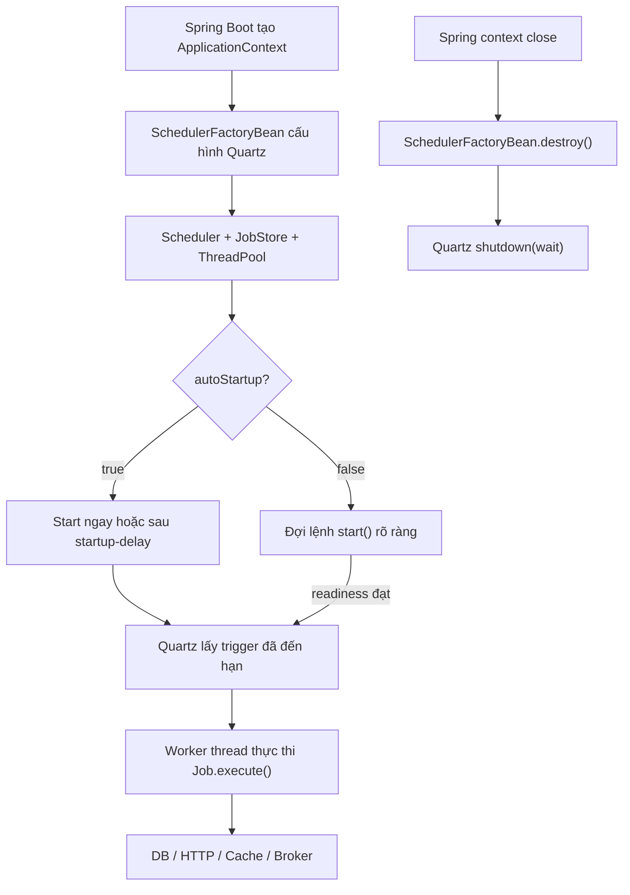
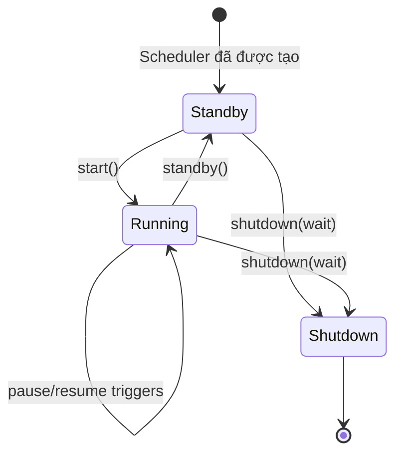
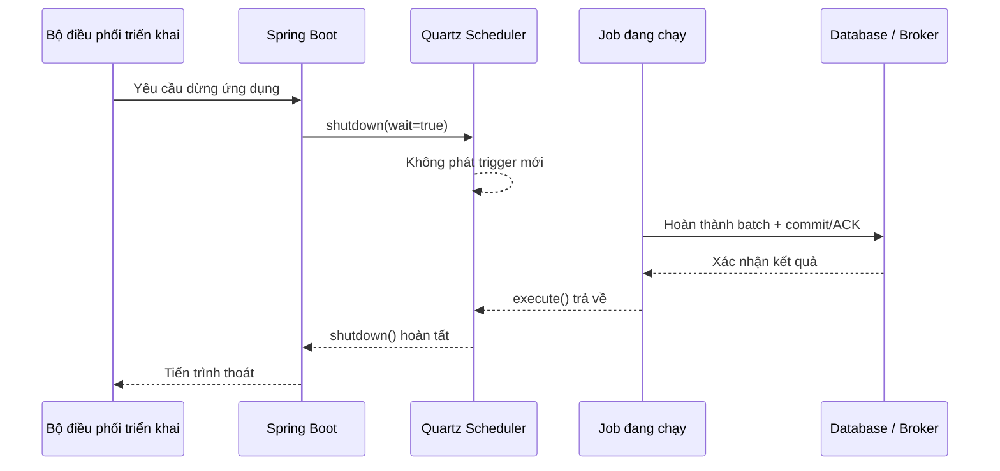
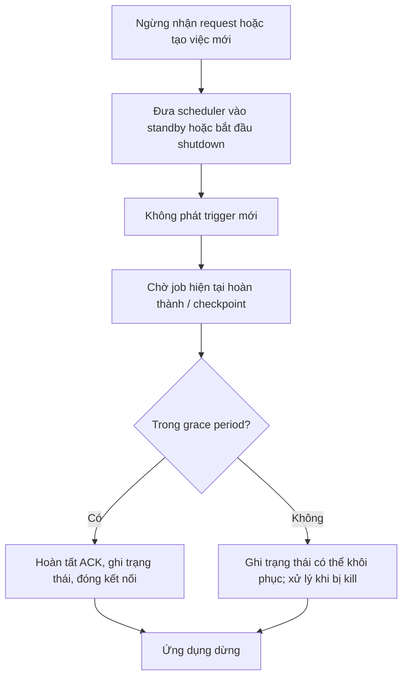

# Khởi động trễ, dừng scheduler và chờ công việc đang chạy

Trong một dịch vụ Spring Boot có Quartz, tác vụ nền có thể khởi chạy ngay khi ứng dụng vừa được tạo: quét đơn hàng chưa đồng bộ, gọi API đối tác, ghi trạng thái vào NoSQL, làm mới cache hoặc đưa sự kiện vào broker. Nếu Quartz bắt đầu bắn trigger trước khi schema, credentials, HTTP client hoặc consumer phía sau sẵn sàng, ứng dụng dễ phát sinh lỗi, retry dồn dập và xử lý cùng một bản ghi nhiều lần. Khi triển khai phiên bản mới hay tắt ứng dụng, dừng scheduler quá sớm cũng có thể cắt ngang công việc đang chạy.

Trong module **SPRING_BOOT_INTEGRATION**, Quartz là một thành phần của hệ thống tích hợp chứ không phải bộ hẹn giờ độc lập. Việc kiểm soát vòng đời cần gắn với **cấu hình, hợp đồng dữ liệu, giao dịch, lỗi, xử lý trùng lặp, kiểm thử và quan sát luồng** từ cơ sở dữ liệu qua HTTP, cache, broker và những adapter khác. Bài này giải thích:

- Khởi động tự động và **khởi động trễ** với Spring Boot và Quartz khác nhau ra sao.
- Khi nào nên sử dụng `Scheduler.standby()`, `start()`, `shutdown()` hoặc tạm dừng trigger.
- Tùy chọn **chờ job đang chạy hoàn tất khi shutdown** đảm bảo điều gì và không đảm bảo điều gì.
- Cách triển khai, kiểm thử và vận hành Quartz để giảm nguy cơ mất việc, lặp việc hoặc dừng ứng dụng không đúng hạn.

## 1. Hai vòng đời phối hợp: Spring container và Quartz scheduler

Spring Boot thường khởi tạo Quartz qua `spring-boot-starter-quartz`. Spring Framework cung cấp `SchedulerFactoryBean` để tạo và quản lý một `org.quartz.Scheduler`. Spring Boot cấu hình factory từ các thuộc tính `spring.quartz.*` và tự đăng ký `JobDetail`/`Trigger` được khai báo dưới dạng bean.



| Đối tượng | Trách nhiệm | Ranh giới cần hiểu |
| --- | --- | --- |
| Spring `ApplicationContext` | Tạo các bean, quản lý lifecycle và đóng context. | Bean `JobDetail` tồn tại chưa có nghĩa đã có job chạy. |
| `SchedulerFactoryBean` | Khởi tạo/configure Scheduler, điều khiển auto-start và shutdown cùng context. | Tùy chọn shutdown ở factory quyết định có chờ job đang chạy hay không. |
| `Scheduler` | Quản lý trigger, job store, thread pool và trạng thái start/standby/shutdown. | `start()` không đồng nghĩa mọi hệ thống phụ thuộc đã sẵn sàng. |
| `JobDetail` | Mô tả loại công việc, `JobKey`, dữ liệu đi kèm. | Không phải thread hay tác vụ đang chạy. |
| `Trigger` | Quy định thời điểm công việc đủ điều kiện được kích hoạt. | Trigger đến hạn khi scheduler đang chờ có thể trở thành *misfire*. |
| `Job.execute(JobExecutionContext)` | Thực hiện một lần chạy trên thread của Quartz. | Có thể tiếp tục chạy sau khi dừng phát trigger mới. |

Phân biệt hai thời điểm: **scheduler đã start** và **job đã hoàn tất một lần chạy**. Scheduler có thể đang chạy nhưng chưa có trigger đến hạn; ngược lại, scheduler chuyển sang standby trong lúc một job đã bắt đầu có thể không làm job đó dừng ngay.

## 2. Ba thuộc tính vòng đời quan trọng của Spring Boot

Cấu hình cơ bản:

```yaml
spring:
  quartz:
    auto-startup: true
    startup-delay: 30s
    wait-for-jobs-to-complete-on-shutdown: true
    job-store-type: memory
```

| Thuộc tính | Tác dụng | Chọn như thế nào |
| --- | --- | --- |
| `spring.quartz.auto-startup` | Cho phép Spring tự khởi động Quartz khi ứng dụng khởi động. | Đặt `false` khi cần kiểm tra điều kiện ngoài trước rồi chủ động gọi `Scheduler.start()`. |
| `spring.quartz.startup-delay` | Trì hoãn việc **tự động** start scheduler theo thời lượng cấu hình. | Dùng khi cần một khoảng đệm vận hành đã biết; `30s` là ví dụ, không phải giá trị khuyến nghị chung. |
| `spring.quartz.wait-for-jobs-to-complete-on-shutdown` | Khi factory đóng Quartz, truyền tùy chọn chờ các job đang thực thi kết thúc. | Cân nhắc `true` cho các job có thời gian chạy hữu hạn và cần hoàn tất trước khi thoát ứng dụng. |

Thông thường, auto-startup được bật, startup-delay bằng không và wait-on-shutdown tắt nếu không cấu hình; kiểm tra mặc định theo phiên bản Spring Boot đang dùng. `job-store-type: memory` trong ví dụ chỉ phù hợp thử nghiệm hoặc công việc không cần bền vững. Đối với lịch làm việc cần sống qua restart, đánh giá `jdbc` và các yêu cầu clustering tương ứng.

**Một nhầm lẫn phổ biến:** `startup-delay: 30s` có nghĩa đợi theo đồng hồ trước khi bắt đầu lập lịch, **không có nghĩa** đợi database khỏe, broker có consumer, HTTP API đã sẵn sàng hay dữ liệu đã migrate. Chạy chậm hơn chỉ làm giảm xác suất race condition trong một số môi trường; nó không giải quyết điều kiện khởi động phụ thuộc kết quả kiểm tra.

### Khi nào dùng trễ theo thời gian?

- Có một thao tác ngắn, có thời lượng khá ổn định và chấp nhận scheduler chưa xử lý job trong khoảng đó.
- Muốn phân tán thời điểm khởi chạy của các tác vụ tốn tài nguyên sau khi deployment bắt đầu.
- Đã có health/readiness và retry riêng, còn delay chỉ nhằm giảm tải ban đầu.

Khi điều kiện phụ thuộc có thể dao động, nên dùng **`auto-startup: false` + kiểm tra readiness + chủ động `Scheduler.start()`**. Khi có nhiều instance cùng chạy, delay không thay thế election/cluster coordination và không ngăn nhiều instance dùng memory store cùng thực thi một job nghiệp vụ.

## 3. Phân biệt start, standby, pause và shutdown

Quartz cung cấp những thao tác có ý nghĩa khác nhau:

| Thao tác | Ảnh hưởng lên trigger mới | Ảnh hưởng lên job đang chạy | Có thể tiếp tục không? |
| --- | --- | --- | --- |
| `scheduler.start()` | Cho phép Quartz tiếp tục xử lý trigger đến hạn. | Không tự khởi tạo lại công việc đã bị mất bên ngoài JobStore. | Có, nếu scheduler chưa shutdown. |
| `scheduler.standby()` | Ngừng kích hoạt trigger tiếp theo trong khi scheduler ở chế độ standby. | Không chủ động ngắt `execute()` đã bắt đầu. | Có, gọi `start()`. |
| `scheduler.pauseAll()` | Tạm dừng **tất cả trigger** theo trạng thái pause của trigger. | Không chủ động ngắt job đang thực thi. | Có, gọi `resumeAll()` cho các trigger cần hoạt động. |
| `scheduler.pauseJob(jobKey)` | Tạm dừng các trigger liên quan đến `JobKey` được chọn. | Không chủ động ngắt lần chạy đã bắt đầu. | Có, gọi `resumeJob(jobKey)`. |
| `scheduler.shutdown(false)` | Đóng scheduler; không kích hoạt thêm job mới. | Trả về mà không đợi mọi job đang chạy hoàn tất. Không có nghĩa cưỡng bức ngắt các job ấy. | **Không** thể restart cùng scheduler sau shutdown. |
| `scheduler.shutdown(true)` | Đóng scheduler; không kích hoạt thêm job mới. | Chờ các công việc đang thực thi hoàn tất trước khi trả về. | **Không** thể restart cùng scheduler sau shutdown. |

**Chọn thao tác theo mục đích:** để bảo trì tạm thời, dùng `standby()` hoặc pause trigger theo phạm vi phù hợp. Để đóng ứng dụng, dùng luồng shutdown của Spring và thiết lập wait phù hợp. Không gọi `shutdown()` chỉ để làm nút “tạm dừng”, vì đối tượng scheduler đã shutdown không nhận `start()` nữa.



Đây là mô hình thao tác, không phải mọi trạng thái nội bộ của Quartz. Ví dụ, `isStarted()` cho biết scheduler **đã từng được start**, và có thể vẫn `true` khi scheduler đang standby. Để quan sát chính xác, kiểm tra cả `isInStandbyMode()` và `isShutdown()`.

### Lệnh điều khiển trong một Spring component

```java
import org.quartz.Scheduler;
import org.quartz.SchedulerException;
import org.springframework.stereotype.Component;

@Component
public class QuartzOperations {
    private final Scheduler scheduler;

    public QuartzOperations(Scheduler scheduler) {
        this.scheduler = scheduler;
    }

    // Dừng phát trigger mới trong lúc bảo trì.
    public void pauseForMaintenance() throws SchedulerException {
        scheduler.standby();
    }

    // Mở lại sau khi điều kiện vận hành được xác nhận.
    public void resumeAfterMaintenance() throws SchedulerException {
        if (scheduler.isShutdown()) {
            throw new IllegalStateException("Scheduler has been shut down");
        }
        scheduler.start();
    }

    public boolean isAcceptingTriggers() throws SchedulerException {
        return !scheduler.isShutdown() && !scheduler.isInStandbyMode();
    }
}
```

Đối với luồng có nhiều nhóm job, `pauseJob` hoặc `pauseTriggers` có thể phù hợp hơn `standby()` vì không dừng mọi trigger. Tránh để endpoint quản trị này công khai không xác thực; chỉ cho phép bộ phận điều phối hoặc automation đáng tin cậy thao tác, ghi lại ai đã tạm dừng và thời điểm khôi phục.

## 4. Khởi động sau khi ứng dụng và hạ tầng đạt readiness

Giả sử một job định kỳ đọc các bản ghi chưa gửi từ database rồi gọi HTTP API đối tác. Muốn đảm bảo schema, credentials và endpoint đích khả dụng trước khi Quartz bắt đầu nhận trigger, hãy tắt auto-start:

```yaml
spring:
  quartz:
    auto-startup: false
    wait-for-jobs-to-complete-on-shutdown: true
```

Sau đó dùng một bước kiểm tra phụ thuộc trước khi gọi `start()`. Ví dụ tối giản có chủ đích:

```java
import org.quartz.Scheduler;
import org.quartz.SchedulerException;
import org.springframework.boot.context.event.ApplicationReadyEvent;
import org.springframework.context.event.EventListener;
import org.springframework.stereotype.Component;

@Component
public class QuartzReadinessGate {
    private final Scheduler scheduler;
    private final IntegrationDependencies dependencies;

    public QuartzReadinessGate(
            Scheduler scheduler,
            IntegrationDependencies dependencies) {
        this.scheduler = scheduler;
        this.dependencies = dependencies;
    }

    @EventListener(ApplicationReadyEvent.class)
    public void onApplicationReady() throws SchedulerException {
        if (dependencies.canRunScheduledJobs()) {
            scheduler.start();
        }
        // Nếu chưa sẵn sàng, giữ Quartz ở standby.
        // Cần có một tác vụ điều phối tin cậy kiểm tra lại và gọi start() sau đó.
    }
}

// Hợp đồng do ứng dụng tự triển khai:
interface IntegrationDependencies {
    boolean canRunScheduledJobs();
}
```

Trong triển khai thực tế, `IntegrationDependencies` có thể kiểm tra version/schema database, khóa cấu hình, quyền truy cập broker, hoặc một truy vấn lightweight đến dịch vụ đích. Nếu chưa sẵn sàng, phải có **đường thử lại có giới hạn**, backoff và cảnh báo vận hành; listener chạy một lần ở `ApplicationReadyEvent` không tự lặp lại. Không để việc kiểm tra một dịch vụ bên ngoài bị treo vô hạn khi startup.

`ApplicationReadyEvent` xảy ra sau phần lớn quá trình Spring Boot khởi tạo, nhưng **không tự xác nhận** cơ sở dữ liệu, cache, broker, API ngoài hoặc schema đã sẵn sàng. Nếu công việc nền là chức năng cốt lõi, trạng thái readiness của chính ứng dụng nên phản ánh việc scheduler đang chờ mở để hệ thống điều phối không tuyên bố phục vụ đầy đủ quá sớm.

Đừng nhầm thuộc tính startup-delay của `SchedulerFactoryBean` với API Quartz `Scheduler.startDelayed(int seconds)`. Cả hai đều trì hoãn dựa trên thời gian; cơ chế trong ví dụ ở trên dựa trên **điều kiện kiểm tra thực**.

## 5. Ví dụ end-to-end: đăng ký JobDetail và Trigger trước khi scheduler chạy

Spring Boot có thể đăng ký job và trigger lúc khởi tạo context, sau đó chỉ bắt đầu thực thi khi scheduler start. Ví dụ sau dùng RAMJobStore cho mục đích minh họa:

```java
import org.quartz.Job;
import org.quartz.JobExecutionContext;
import org.quartz.JobExecutionException;
import org.slf4j.Logger;
import org.slf4j.LoggerFactory;

public class SyncOrdersJob implements Job {
    private static final Logger log =
            LoggerFactory.getLogger(SyncOrdersJob.class);

    @Override
    public void execute(JobExecutionContext context)
            throws JobExecutionException {
        // Thực tế: lấy batch từ DB, gửi HTTP/broker theo idempotency key,
        // cập nhật checkpoint theo giao dịch và chính sách retry.
        log.info("Sync tick: {}", context.getFireInstanceId());
    }
}
```

```java
import org.quartz.CronScheduleBuilder;
import org.quartz.JobBuilder;
import org.quartz.JobDetail;
import org.quartz.Trigger;
import org.quartz.TriggerBuilder;
import org.springframework.context.annotation.Bean;
import org.springframework.context.annotation.Configuration;

@Configuration(proxyBeanMethods = false)
public class QuartzJobConfiguration {

    @Bean
    JobDetail syncOrdersDetail() {
        return JobBuilder.newJob(SyncOrdersJob.class)
                .withIdentity("syncOrders", "integration")
                .storeDurably()
                .build();
    }

    @Bean
    Trigger syncOrdersTrigger(JobDetail syncOrdersDetail) {
        return TriggerBuilder.newTrigger()
                .withIdentity("syncOrdersTrigger", "integration")
                .forJob(syncOrdersDetail)
                .withSchedule(
                        CronScheduleBuilder.cronSchedule("0 */5 * * * ?")
                                .withMisfireHandlingInstructionDoNothing())
                .build();
    }
}
```

Trigger trên yêu cầu một lần chạy mỗi năm phút theo biểu thức cron của Quartz. Chọn `withMisfireHandlingInstructionDoNothing()` có nghĩa những thời điểm đã lỡ do scheduler không hoạt động đủ lâu có thể được **bỏ qua** thay vì chạy bù ngay khi khởi động. Đây chỉ là một chính sách minh họa: công việc tài chính, đồng bộ trạng thái hoặc xuất báo cáo có thể cần chính sách khác và cơ chế quét lại những bản ghi chưa xử lý.

**Các điểm cần nghiệm thu:** `JobKey` và `TriggerKey` phải ổn định qua deploy; cron/time zone được xác định theo yêu cầu nghiệp vụ; job dùng key xử lý trùng; các lần chạy lỗi có log và khả năng replay. Khi dùng JDBCJobStore, việc deploy lại có thể phải xử lý trigger/job đã tồn tại và chính sách overwrite từ cấu hình của Boot. Không dựa vào việc khởi động chậm để ngăn trùng lặp giữa nhiều replica.

## 6. Shutdown: `wait-for-jobs-to-complete-on-shutdown` làm gì?

Với cấu hình:

```yaml
spring:
  quartz:
    wait-for-jobs-to-complete-on-shutdown: true
```

khi `SchedulerFactoryBean` bị hủy theo vòng đời Spring, factory gọi shutdown Quartz với lựa chọn **chờ các job đang thực thi hoàn tất**. Ở API Quartz, hành vi tương ứng là `Scheduler.shutdown(true)`. Nếu tắt tùy chọn này, shutdown thường không đợi những job đang chạy kết thúc trước khi trả về.



### Điều thuộc tính này **có** và **không có** hiệu lực

| Điều có thể trông đợi | Điều không được suy ra |
| --- | --- |
| Khi gọi shutdown bình thường và `wait=true`, Quartz chờ các `execute()` đang chạy trả về. | Không cưỡng bức job vượt qua HTTP call bị treo hoặc vòng lặp vô hạn. |
| Scheduler ngừng kích hoạt job mới trong quá trình shutdown. | Không tự động chuyển các trigger chưa chạy thành sự kiện bền vững nếu dùng memory store. |
| Ứng dụng có cơ hội hoàn thành batch và ghi checkpoint/ACK. | Không tự đảm bảo atomicity giữa database, HTTP và broker. |
| Spring đóng scheduler theo lifecycle của bean. | Không thể đảm bảo tiến trình sẽ sống đủ lâu nếu orchestrator gửi SIGKILL hoặc máy bị mất điện. |
| Job có thể hoàn tất nếu phụ thuộc vẫn còn hoạt động. | Không đảm bảo kết nối database/HTTP client sẽ luôn còn dùng được cho job; cần kiểm tra thứ tự cleanup và thời gian shutdown. |

**Đặc biệt:** `shutdown(true)` **không phải** “interrupt tất cả job rồi chờ”. Nó chủ yếu đợi công việc đang chạy kết thúc tự nhiên. `shutdown(false)` cũng **không** có nghĩa gửi lệnh hủy cưỡng bức đến từng thread. Nếu một job đang chờ I/O vô thời hạn, chọn `wait=true` có thể khiến ứng dụng không kết thúc đúng hạn; phải đặt timeout cho HTTP/DB, deadline nghiệp vụ và kế hoạch khôi phục khi bị kill.

### Dừng hạ tầng theo thứ tự có thể hoàn thành công việc

Nếu job phải gọi HTTP rồi commit DB, scheduler cần cơ hội xử lý công việc trước khi các client/datasource bị đóng. Kiểm tra lifecycle và phụ thuộc Spring bean cụ thể trong ứng dụng; không giả định mọi resource đều còn mở chỉ vì một cờ wait được bật. Với Spring Boot, `spring.lifecycle.timeout-per-shutdown-phase` là một cơ chế giới hạn thời gian dừng các nhóm `SmartLifecycle` ở các phiên bản hỗ trợ, nhưng không thể thay thế timeout I/O hay thời gian chờ job của Quartz. Đồng thời, thời gian grace period do Kubernetes/systemd/container runtime cấp phải đủ cho quy trình dừng thực tế.

## 7. Job dài, dừng hợp tác và `InterruptableJob`

Đôi khi không thể đợi job chạy xong trong vài phút hoặc vài giờ. Có thể thiết kế job chạy theo **batch nhỏ, có checkpoint** và hỗ trợ yêu cầu dừng hợp tác.

Quartz cung cấp `InterruptableJob` để scheduler có thể gửi tín hiệu qua `Scheduler.interrupt(JobKey)` hoặc cơ chế interrupt tương ứng, **chỉ đối với job có triển khai hỗ trợ interrupt**. Việc nhận tín hiệu không đảm bảo dừng được ngay: job phải tự kiểm tra cờ dừng và kết thúc tại điểm an toàn.

```java
import java.util.concurrent.atomic.AtomicBoolean;
import org.quartz.InterruptableJob;
import org.quartz.JobExecutionContext;
import org.quartz.JobExecutionException;
import org.quartz.UnableToInterruptJobException;

public class BatchSyncJob implements InterruptableJob {
    private final AtomicBoolean stopRequested = new AtomicBoolean(false);

    @Override
    public void execute(JobExecutionContext context)
            throws JobExecutionException {
        for (int batch = 0; batch < 100; batch++) {
            if (stopRequested.get()) {
                // Thoát tại ranh giới batch sau khi checkpoint an toàn.
                return;
            }
            // loadBatch(batch);
            // sendIdempotently();
            // commitCheckpoint();
        }
    }

    @Override
    public void interrupt() throws UnableToInterruptJobException {
        stopRequested.set(true);
    }
}
```

Mã trên minh họa cờ hủy, không phải nghiệp vụ hoàn chỉnh. Nếu đang ở giữa một giao dịch hoặc HTTP call, chỉ được thoát khi đã commit/rollback/ghi checkpoint theo hợp đồng. Phương thức `interrupt()` trong ví dụ **không tự ngắt một lời gọi socket đang treo**. Cần cấu hình timeout cụ thể cho HTTP client, database và broker; cân nhắc trạng thái bền vững để lần chạy kế tiếp tiếp tục được việc còn dở.

Khi muốn dừng mềm cho deployment, thường nên **ngừng nhận trigger mới rồi chờ job hoàn tất**. Chỉ yêu cầu interrupt khi đã định nghĩa rõ chính sách hủy, các điểm an toàn và cách replay. Nếu job dùng nhiều batch và checkpoint, cần tính cả race condition giữa `interrupt()` và hành động commit.

## 8. Misfire, restart và xử lý trùng lặp

**Misfire** là trường hợp trigger đáng lẽ phải fire nhưng bị bỏ lỡ đủ lâu theo ngưỡng và chính sách của Quartz, chẳng hạn khi scheduler đang standby, ứng dụng tắt hoặc thread pool không đủ khả năng xử lý. Khi khởi động trễ hoặc shutdown kéo dài, misfire cần được thiết kế tường minh.

| Chính sách minh họa | Tác động | Rủi ro nghiệp vụ |
| --- | --- | --- |
| Cron `withMisfireHandlingInstructionDoNothing()` | Bỏ qua mốc đã lỡ, chờ mốc hợp lệ tiếp theo. | Có thể bỏ qua kỳ đồng bộ cần thực hiện. |
| Cron `withMisfireHandlingInstructionFireAndProceed()` | Có thể bắn một lần ngay sau misfire rồi theo lịch tiếp. | Có thể tạo tải cao hoặc xử lý lại công việc đã chạy trong lúc chuyển tiếp. |
| Chính sách mặc định/smart policy | Quartz suy luận tùy loại trigger. | Không nên đoán hành vi; cần xác minh đúng loại trigger và version. |
| Quét backlog bằng dữ liệu nghiệp vụ | Job chủ động chọn các bản ghi chưa xử lý từ DB/queue. | Cần idempotency, checkpoint và giới hạn batch; độc lập với lịch cron. |

**Quartz trigger không phải hàng đợi sự kiện nghiệp vụ.** Nếu đòi hỏi mỗi hóa đơn hoặc message phải được xử lý, lưu trạng thái cần xử lý trong cơ sở dữ liệu hoặc broker có độ bền phù hợp; Quartz chỉ điều phối lúc kiểm tra backlog. Khi cron bỏ lỡ một mốc, không thể suy ra các message nghiệp vụ tương ứng vẫn được lưu trữ để tự khôi phục.

Để tránh chạy cùng logic hai lần khi trùng trigger hoặc deploy nhiều replica:

1. Xác định **khóa idempotency** theo đối tượng nghiệp vụ, ví dụ `partnerId + orderId + operationType`.
2. Ghi trạng thái hoặc checkpoint với ràng buộc nhất quán phù hợp; nếu cần, sử dụng transactional outbox để phát sự kiện sau commit.
3. Chọn retry có backoff và phân biệt lỗi tạm thời với lỗi dữ liệu không thể retry.
4. Đối soát số bản ghi chưa gửi và chưa ACK sau restart; không chỉ xem `JobExecutionContext.getFireInstanceId()`.
5. Dùng `@DisallowConcurrentExecution` khi **các lần chạy cùng JobDetail** không nên chồng nhau; hiểu rằng annotation này không thay thế idempotency của hệ thống ngoài.

Ví dụ:

```java
import org.quartz.DisallowConcurrentExecution;
import org.quartz.Job;

@DisallowConcurrentExecution
public class ReconciliationJob implements Job {
    @Override
    public void execute(org.quartz.JobExecutionContext context) {
        // Xử lý theo khóa nghiệp vụ và checkpoint bền vững.
    }
}
```

Với ứng dụng nhiều instance, **RAMJobStore ở mỗi instance là độc lập**: mỗi scheduler có thể tự chạy cùng công việc. Nếu dùng **JDBCJobStore với clustering được cấu hình đúng**, các node trong cùng Quartz cluster phối hợp nhận trigger. Dù vậy, failover và side effect bên ngoài vẫn có thể khiến cần chạy lại công việc, nên thiết kế idempotency không thể bỏ qua. Không bật clustering chỉ bằng một flag khi chưa chuẩn bị database, bảng Quartz, quyền truy cập, cấu hình `instanceId` và quy trình migration phù hợp.

## 9. Quy trình shutdown an toàn trong triển khai thực tế

Hãy coi shutdown là một giao thức vận hành nhiều bước:



1. **Dừng nhận việc mới:** gỡ instance khỏi routing nếu cần; dừng các adapter/producer khác cũng có thể đưa thêm dữ liệu vào job hoặc cùng tài nguyên.
2. **Ngăn trigger mới:** để context đóng Quartz theo lifecycle, hoặc điều phối `standby()` khi cần giai đoạn drain chủ động. Không gọi `shutdown()` thủ công rồi mong scheduler có thể start lại.
3. **Chờ công việc đang thực thi:** bật `wait-for-jobs-to-complete-on-shutdown` nếu thời gian chạy hữu hạn và chính sách dừng yêu cầu; đo inflight jobs, độ trễ và deadline.
4. **Hoàn thiện giao dịch và side effects:** với DB/HTTP/broker, ghi checkpoint và ACK đúng thời điểm; tránh đánh dấu hoàn thành trước khi hệ thống đích xác nhận.
5. **Đóng context và tiến trình:** cho scheduler/resource kết thúc trong thời gian cho phép; nếu orchestrator có thể cưỡng bức kill, phải có cơ chế replay và chống trùng sau restart.

Một job có thể kết thúc `execute()` nhưng bản tin bên ngoài chưa được ACK nếu logic bất đồng bộ tách khỏi thread job. Khi đó `shutdown(true)` chỉ chờ **thread job mà Quartz biết**, không chờ mọi tác vụ đã giao cho executor, HTTP callback hoặc một dịch vụ khác. Nếu job dispatch sang async, hãy xác định rõ ranh giới “hoàn tất” và quản lý inflight công việc ở thành phần tương ứng.

## 10. Kiểm thử lifecycle có thể tự động hóa

Đừng chỉ chạy unit test cho `execute()`. Cần kiểm thử scheduler ở mức tích hợp, nhất là các tính chất liên quan startup, pause và shutdown.

### 10.1. Test auto-startup bị tắt

Chạy test với profile riêng, Quartz memory store và không khai báo trigger phát tác vụ gây side effect thật:

```java
import static org.assertj.core.api.Assertions.assertThat;

import org.junit.jupiter.api.Test;
import org.quartz.Scheduler;
import org.quartz.SchedulerException;
import org.springframework.beans.factory.annotation.Autowired;
import org.springframework.boot.test.context.SpringBootTest;

@SpringBootTest(properties = {
        "spring.quartz.auto-startup=false",
        "spring.quartz.job-store-type=memory"
})
class QuartzLifecycleTest {
    @Autowired
    Scheduler scheduler;

    @Test
    void schedulerStartsOnlyWhenRequested() throws SchedulerException {
        assertThat(scheduler.isStarted()).isFalse();
        assertThat(scheduler.isInStandbyMode()).isTrue();

        try {
            scheduler.start();
            assertThat(scheduler.isInStandbyMode()).isFalse();

            scheduler.standby();
            assertThat(scheduler.isInStandbyMode()).isTrue();
        } finally {
            // Trả scheduler về standby để test khác không vô tình nhận trigger.
            if (!scheduler.isShutdown()) {
                scheduler.standby();
            }
        }
    }
}
```

Với một test suite có nhiều test cùng dùng ApplicationContext, việc đổi trạng thái scheduler là shared state. Cần tách context, cô lập profile hoặc reset state giữa các test. `isStarted()` sau khi đã chạy `start()` có thể vẫn `true` lúc scheduler trở về standby; vì vậy xác nhận `isInStandbyMode()` theo mục đích.

### 10.2. Test shutdown có chờ công việc đang chạy

Tạo một job test dùng `CountDownLatch` với **một latch báo đã vào `execute()`** và **một latch chỉ cho phép kết thúc**. Chạy Quartz bằng môi trường test độc lập; sau khi job vào `execute()`, gọi `scheduler.shutdown(true)` trong một thread khác. Xác minh thread shutdown còn chờ trước khi nhả latch, rồi nhả latch và xác minh shutdown trả về. Đảm bảo luôn nhả latch và dọn thread trong `finally` để không làm treo suite. Vì scheduler đã shutdown không thể restart, test này phải dùng scheduler riêng và không tái sử dụng bean của context chung.

Các ca cần bổ sung:

| Ca kiểm thử | Kỳ vọng |
| --- | --- |
| `auto-startup=false` | Scheduler tồn tại nhưng không phát trigger cho đến khi có `start()`. |
| `startup-delay` | Trigger chỉ bắt đầu fire sau khoảng trễ cấu hình, với sai số hợp lý do scheduler. |
| `standby()` rồi `start()` | Không phát trigger mới trong standby; có thể tiếp tục sau start. |
| `pauseJob()`/ `resumeJob()` | Chỉ job/trigger mục tiêu bị dừng, các job khác vẫn hoạt động. |
| `shutdown(true)` với job đang chạy | Lệnh shutdown đợi `execute()` trả về; không phát thêm trigger mới. |
| Job có I/O timeout hoặc được interrupt hợp tác | Có checkpoint/rollback phù hợp và policy replay rõ ràng. |
| Trễ vượt mốc cron và restart | Hành vi misfire đúng chính sách; job backlog không mất dữ liệu nghiệp vụ. |
| Nhiều replica với JDBCJobStore cluster | Không có hai instance tự phát cùng trigger; side effect vẫn có idempotency. |

Các test dựa vào `Thread.sleep()` đơn thuần dễ sai do tải CI và độ phân giải đồng hồ. Ưu tiên latch/barrier, `Awaitility` với timeout có giới hạn hoặc scheduler/clock kiểm soát được. Với JDBCJobStore, chạy test kết hợp database thật hoặc Testcontainers có phiên bản gần production; memory store không chứng minh được hành vi cluster.

## 11. Quan sát lỗi startup và shutdown

Khi Quartz không fire đúng lịch hoặc ứng dụng không tắt được, ghi nhận cả trạng thái scheduler và hạ tầng:

| Triệu chứng | Khả năng thường gặp | Kiểm tra đầu tiên |
| --- | --- | --- |
| Job không chạy sau deploy | `auto-startup=false` mà không có ai gọi `start()`; delay chưa kết thúc; trigger bị pause. | `isInStandbyMode()`, `isShutdown()`, trigger state, cấu hình profile. |
| Scheduler chạy nhưng job không được kích hoạt | Trigger chưa đến hạn, misfire policy, thread pool hết worker, lịch cron/time zone sai. | `nextFireTime`, lịch cron, số worker bận, log trigger và misfire. |
| Deploy mỗi lần làm trùng job | Nhiều replica dùng RAMJobStore, job không idempotent, retry sau timeout. | Số scheduler thực, job key, idempotency key, cluster configuration. |
| Shutdown kéo dài mãi | Job bị chặn I/O, vòng lặp vô hạn, `shutdown(true)` đang chờ. | Stack trace job, timeout HTTP/DB, inflight job, thời gian grace. |
| Shutdown xong vẫn có side effect | Job đã gửi công việc sang executor/HTTP bất đồng bộ, không chờ kết quả. | Ranh giới complete/ACK, các thread hoặc callback ngoài Quartz. |
| Mất việc sau restart | RAMJobStore không bền, misfire bỏ kỳ, checkpoint không lưu. | JobStore, trigger misfire policy, bản ghi backlog trong DB/broker. |

Có thể bổ sung `JobListener`/`TriggerListener` hoặc `SchedulerListener` để đo thời điểm fire, duration, lỗi và sự kiện lifecycle. Spring Boot Actuator/Micrometer có thể cung cấp metric Quartz tùy cấu hình và phiên bản; khi dùng cần kiểm tra metric thực tế đã được đăng ký. Chỉ số quan trọng gồm số job đang chạy, lần thành công/thất bại, thời gian chạy p95/p99, next fire time, trigger misfire, backlog nghiệp vụ, retry và số lần ghi trùng. Không chỉ đo CPU hay việc tiến trình vẫn sống.

### Checklist vận hành

- [ ] Quyết định `auto-startup` và `startup-delay` dựa vào hợp đồng readiness, có cơ chế retry nếu kiểm tra phụ thuộc chưa đạt.
- [ ] Phân biệt tạm dừng `standby()/pause` và đóng vĩnh viễn `shutdown()`; biết đường khôi phục trigger.
- [ ] Định nghĩa rõ job nào được phép chạy đến hết, job nào có checkpoint để hủy hợp tác, và timeout I/O bắt buộc.
- [ ] Thiết lập `wait-for-jobs-to-complete-on-shutdown` phù hợp; cân đối grace period của tiến trình và thời gian xử lý job.
- [ ] Có lịch cron, time zone, misfire policy, JobStore và topology cluster được ghi nhận.
- [ ] Có idempotency key, retry/backoff, checkpoint và khả năng đối soát backlog sau restart.
- [ ] Test startup trễ, startup thủ công, standby, misfire, shutdown có chờ và tình huống mất kết nối.
- [ ] Theo dõi trạng thái scheduler, inflight jobs, trigger, backlog và giao dịch/ACK downstream khi triển khai.

### Tài liệu chính thức nên đối chiếu

- [Spring Boot — Quartz Scheduler](https://docs.spring.io/spring-boot/reference/io/quartz.html): cách cấu hình Quartz trong Spring Boot, JobStore và thuộc tính Spring Boot.
- [Spring Boot — QuartzProperties](https://docs.spring.io/spring-boot/api/java/org/springframework/boot/autoconfigure/quartz/QuartzProperties.html): các cấu hình `autoStartup`, `startupDelay`, `waitForJobsToCompleteOnShutdown`.
- [Spring Framework — SchedulerFactoryBean](https://docs.spring.io/spring-framework/docs/current/javadoc-api/org/springframework/scheduling/quartz/SchedulerFactoryBean.html): lifecycle, start delay và shutdown.
- [Quartz Scheduler API](https://www.quartz-scheduler.org/api/2.3.0/org/quartz/Scheduler.html): `start()`, `standby()`, `pauseAll()` và `shutdown(boolean)`.
- [Quartz InterruptableJob API](https://www.quartz-scheduler.org/api/2.3.0/org/quartz/InterruptableJob.html): hợp đồng dừng job có hợp tác.
- [Quartz Tutorials](https://www.quartz-scheduler.org/documentation/quartz-2.3.0/tutorials/): trigger, misfire, JobStore và clustering.

**Kết luận:** `startup-delay` là một khoảng chờ theo thời gian; `auto-startup=false` cho phép kiểm tra điều kiện thật trước khi scheduler chạy; `standby()` phục vụ tạm dừng, còn `shutdown()` đóng scheduler. Đặt `wait-for-jobs-to-complete-on-shutdown=true` giúp chờ `execute()` đang chạy kết thúc trong shutdown bình thường, nhưng độ an toàn còn phụ thuộc timeout, grace period, trạng thái bền vững, hợp đồng ACK và cơ chế chống trùng lặp của toàn bộ luồng tích hợp.
