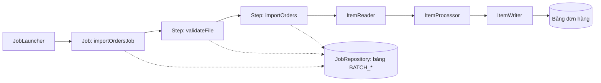
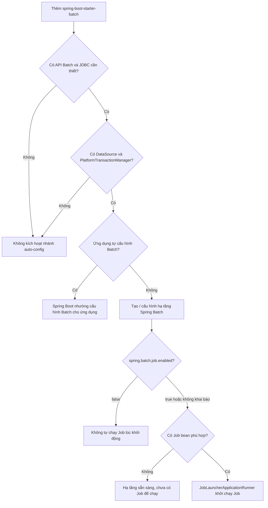

# `spring-boot-starter-batch` và điều kiện cấu hình tự động

## 1. Spring Batch nằm ở đâu trong hệ thống tích hợp?

Trong một hệ thống tích hợp thực tế, không phải tác vụ nào cũng nên được xử lý ngay trong HTTP request hoặc khi nhận một thông điệp từ broker. Nhập hàng triệu bản ghi từ đối tác, đồng bộ dữ liệu khách hàng mỗi đêm, tạo báo cáo đối soát hoặc chuyển đổi dữ liệu trước khi gửi sang hệ thống khác là những công việc cần **chạy theo lô, ghi nhận tiến độ và có khả năng khởi động lại khi lỗi**. Spring Batch cung cấp mô hình và hạ tầng cho nhóm bài toán này.

Trong module **SPRING_BOOT_INTEGRATION**, Spring Batch bổ sung một cách tổ chức luồng tích hợp bên cạnh HTTP client, cơ sở dữ liệu, cache, broker thông điệp và các adapter của Spring Integration. Điểm quan trọng là phối hợp **hợp đồng dữ liệu, cấu hình kết nối, giao dịch, xử lý lỗi, chống trùng lặp, kiểm thử và quan sát** trong một quá trình có thể kéo dài nhiều phút hoặc nhiều giờ.

Ví dụ xuyên suốt: ứng dụng Spring Boot nhận một tệp dữ liệu đơn hàng từ ERP mỗi đêm, kiểm tra từng dòng, chuẩn hóa dữ liệu và ghi vào PostgreSQL. Nếu tiến trình bị dừng ở dòng thứ 80.000, đội vận hành cần biết job nào bị lỗi, bước nào đã hoàn thành, có thể chạy lại phần chưa xử lý và tránh tạo đơn hàng trùng.

Spring Boot giúp kết nối các thành phần Spring Batch thông qua starter và cơ chế **auto-configuration**. Tuy nhiên, chỉ thêm một dependency không đồng nghĩa mọi Job được cấu hình và chạy đúng: cần hiểu những điều kiện kích hoạt, sự có mặt của `DataSource`/transaction manager, vị trí lưu metadata và quy tắc chạy job khi ứng dụng khởi động.

Sau bài học, bạn có thể:

- Giải thích `spring-boot-starter-batch` bổ sung những khả năng nào và không tự thực hiện phần việc nào.
- Phân biệt `Job`, `Step`, `JobRepository`, `JobLauncher`, `JobExplorer`, `JobExecution` và `JobParameters`.
- Xác định khi nào Spring Boot tự tạo hạ tầng Spring Batch và khi nào cơ chế này nhường quyền cho cấu hình thủ công.
- Thiết lập cách khởi tạo bảng metadata, tắt/bật chạy job lúc startup và chọn đúng transaction manager.
- Điều tra các tình huống thiếu bean, thiếu bảng `BATCH_*`, job chạy ngoài ý muốn, job không chạy hoặc không thể chạy lại.

## 2. Starter bổ sung gì?

`spring-boot-starter-batch` là **dependency tập hợp** để Spring Boot tích hợp Spring Batch vào application context. Trong hệ sinh thái Spring Boot 3.x, starter này thường kéo theo Spring Batch Core và các thư viện JDBC cần thiết để lưu metadata của quá trình chạy. Nó hoạt động cùng cơ chế auto-configuration của Spring Boot để tạo các thành phần hạ tầng khi ứng dụng đáp ứng điều kiện.

Khai báo với Gradle:

```kotlin
dependencies {
    implementation("org.springframework.boot:spring-boot-starter-batch")

    // Chọn driver phù hợp với cơ sở dữ liệu metadata của dự án.
    runtimeOnly("org.postgresql:postgresql")
}
```

Hoặc với Maven:

```xml
<dependency>
  <groupId>org.springframework.boot</groupId>
  <artifactId>spring-boot-starter-batch</artifactId>
</dependency>

<dependency>
  <groupId>org.postgresql</groupId>
  <artifactId>postgresql</artifactId>
  <scope>runtime</scope>
</dependency>
```

Ví dụ trên giả định dự án dùng cơ chế quản lý phiên bản dependency của Spring Boot. Nếu sử dụng BOM hoặc phiên bản Spring Boot khác, hãy kiểm tra dependency graph và API tương ứng; ví dụ Java ở phần sau minh họa mô hình **Spring Batch 5 / Spring Boot 3.x**, vì những phiên bản mới có thể thay đổi package, API hoặc auto-configuration.

**Starter không tự tạo nghiệp vụ xử lý dữ liệu.** Ứng dụng vẫn cần định nghĩa `Job`, `Step`, reader/processor/writer hoặc `Tasklet`, nguồn dữ liệu nghiệp vụ, lịch chạy hay cơ chế kích hoạt khi cần. Starter cũng không bảo đảm rằng mọi external system có chung một transaction.

## 3. Các thành phần cốt lõi và dữ liệu trạng thái

| Khái niệm | Vai trò | Ví dụ trong bài toán nhập đơn hàng |
|---|---|---|
| `Job` | Định nghĩa một quy trình batch gồm một hoặc nhiều bước. | `importOrdersJob`. |
| `Step` | Đơn vị thực thi của một Job; có thể là tasklet hoặc xử lý theo chunk. | Đọc, chuẩn hóa rồi ghi đơn hàng. |
| `ItemReader` | Cung cấp lần lượt dữ liệu đầu vào cho một step dạng chunk. | Đọc các dòng CSV. |
| `ItemProcessor` | Biến đổi hoặc lọc phần tử trước khi ghi. | Kiểm tra mã hàng, chuẩn hóa tiền tệ. |
| `ItemWriter` | Ghi một nhóm phần tử sau khi xử lý. | Ghi một batch vào PostgreSQL. |
| `JobRepository` | Lưu và tra cứu metadata của Job/Step execution. | Ghi nhận lần chạy đã hoàn thành bao nhiêu bước. |
| `JobLauncher` | Khởi động Job với bộ tham số. | Chạy nhập file `orders-2026-11-21.csv`. |
| `JobExplorer` | Đọc metadata và lịch sử thực thi. | Tra cứu job đang chạy hoặc bị lỗi. |
| `JobParameters` | Tham số xác định và điều khiển một lần chạy; một số tham số tham gia định danh `JobInstance`. | `fileName`, `businessDate`, `requestId`. |

Ba đối tượng trạng thái thường dễ bị nhầm:

- **`JobInstance`** đại diện cho một instance của một Job, được định danh bởi tên Job và các **identifying JobParameters**. Hai lần chạy cùng tên Job và cùng identifying parameters trỏ về cùng một JobInstance.
- **`JobExecution`** là một *lần thử thực thi* JobInstance đó. Khi lần chạy trước thất bại, một lần restart hợp lệ có thể tạo JobExecution mới cho cùng JobInstance.
- **`StepExecution`** ghi nhận một lần thực thi Step, gồm trạng thái, thời điểm, read/write count, commit/rollback count và các thông tin phục hồi tương ứng.

`JobRepository` thường dùng các bảng `BATCH_JOB_INSTANCE`, `BATCH_JOB_EXECUTION`, `BATCH_JOB_EXECUTION_PARAMS`, `BATCH_STEP_EXECUTION` và các bảng context/sequence liên quan. Đây là **metadata vận hành**, không phải bảng nghiệp vụ lưu đơn hàng. Không nên xóa metadata tùy tiện để “cho job chạy lại”: cách đó có thể làm mất khả năng theo dõi, restart và đối soát.



Với step dạng chunk, framework quản lý ranh giới giao dịch theo chunk: đọc và xử lý các item, ghi theo nhóm rồi cập nhật trạng thái phù hợp. Cơ chế restart còn phụ thuộc việc reader/writer có quản lý trạng thái đúng và side effect bên ngoài có idempotent hay không.

## 4. Spring Boot auto-configuration hoạt động như thế nào?

Spring Boot kiểm tra **các class trên classpath**, **các bean đã có**, **cấu hình người dùng** và **những điều kiện kích hoạt** trước khi thêm hạ tầng Spring Batch vào application context. Việc thêm starter chỉ làm cho các class liên quan xuất hiện trên classpath; nó chưa đủ để bảo đảm toàn bộ điều kiện đã thỏa mãn.

Ở cách cấu hình phổ biến của **Spring Boot 3.x kết hợp Spring Batch 5**, `BatchAutoConfiguration` được kích hoạt khi có các API Spring Batch/JDBC cần thiết, có `DataSource` và `PlatformTransactionManager`, đồng thời ứng dụng không chủ động nhận quyền cấu hình batch bằng `@EnableBatchProcessing` hoặc lớp cấu hình kế thừa `DefaultBatchConfiguration`. Tên class và chi tiết điều kiện có thể thay đổi theo phiên bản Spring Boot; khi cần xác định chính xác hãy xem *Condition Evaluation Report* của phiên bản đang dùng.



Sơ đồ là **mô hình tư duy** cho cấu hình tiêu chuẩn, không thay thế kiểm tra điều kiện của từng bản Spring Boot. Trong ứng dụng có nhiều Job, người dùng cần xác định rõ Job nào chạy lúc startup thay vì giả định thứ tự thực thi hoặc behavior mặc định.

### 4.1. Điều kiện classpath

Starter đưa Spring Batch và các thành phần tích hợp cần thiết vào classpath. Thiếu library quan trọng hoặc bị loại trừ dependency có thể khiến nhánh auto-configuration không khớp. Khi gặp tình huống `JobRepository` không được tạo, bước đầu tiên là kiểm tra dependency resolution và version conflict, đặc biệt khi tự ghim một phiên bản Spring Batch khác BOM của Spring Boot.

### 4.2. Điều kiện `DataSource` và transaction manager

Spring Batch cần cơ chế lưu metadata của job/step và quản lý transaction. Trong cấu hình JDBC thông dụng, Spring Boot cần tìm được:

1. `DataSource`: kết nối tới database chứa các bảng metadata batch.
2. `PlatformTransactionManager`: điều phối transaction phục vụ Batch infrastructure và/hoặc bước xử lý.

Đối với ứng dụng chỉ thêm starter nhưng chưa có database driver, chưa khai báo JDBC URL và cũng không có embedded database, Spring Boot có thể **thất bại sớm ở giai đoạn cấu hình DataSource**. Nếu ứng dụng có cách cấu hình dữ liệu đặc biệt mà không tạo `DataSource`/transaction manager phù hợp, nhánh Batch auto-configuration có thể không được áp dụng.

Lưu ý: **JPA không phải điều kiện bắt buộc của Spring Batch**. Spring Batch có thể dùng JDBC metadata dù phần việc nghiệp vụ xử lý file, gọi HTTP API hoặc gửi broker. Nếu có cả JPA và JDBC hoặc nhiều database, cần xác nhận chính xác transaction manager nào được gắn với Step.

### 4.3. Điều kiện “back off” khi ứng dụng tự cấu hình

Trong Spring Boot 3.x, các dấu hiệu như `@EnableBatchProcessing` hoặc `DefaultBatchConfiguration` có thể khiến Boot **nhường việc cấu hình hạ tầng Batch cho mã ứng dụng**. Điều này dễ gây bất ngờ nếu thêm `@EnableBatchProcessing` theo một bài hướng dẫn Spring Batch thuần trong khi dự án vốn đã dùng starter Boot.

```java
// Với Spring Boot 3.x, thông thường KHÔNG cần thêm annotation này
// chỉ để chạy một Job khi đã dùng spring-boot-starter-batch.
// @EnableBatchProcessing
@SpringBootApplication
public class IntegrationApplication {
    public static void main(String[] args) {
        SpringApplication.run(IntegrationApplication.class, args);
    }
}
```

Chỉ dùng cấu hình thủ công khi có nhu cầu cụ thể: repository đặc biệt, multiple data sources, cơ chế lưu trạng thái khác hoặc yêu cầu tùy biến không được auto-configuration đáp ứng. Khi chuyển sang cấu hình thủ công, phải chịu trách nhiệm cung cấp đầy đủ bean và cấu hình còn lại; không giả định các tùy chọn Boot vẫn được áp dụng như cũ.

### 4.4. Điều kiện tự khởi chạy Job

Việc tạo **hạ tầng Batch** khác với việc **tự khởi chạy một Job**. Với cấu hình Boot phổ biến, khi có Job bean và `spring.batch.job.enabled` giữ giá trị mặc định bật, Spring Boot có thể dùng `JobLauncherApplicationRunner` để chạy job lúc ứng dụng startup.

Để chạy Job theo lịch, REST endpoint nội bộ hoặc thông điệp từ broker, nên tắt cơ chế tự chạy lúc startup:

```yaml
spring:
  batch:
    job:
      enabled: false
```

Cấu hình này **không tắt Spring Batch**. Các bean `Job`, `Step`, `JobRepository` và `JobLauncher` vẫn có thể tồn tại và được gọi chủ động. Nếu có nhiều Job và muốn chọn một Job để startup, thuộc tính được hỗ trợ trong Spring Boot 3.x là `spring.batch.job.name`; hãy kiểm tra hành vi cụ thể của phiên bản đang dùng và tránh cho tất cả Job chạy ngoài ý muốn.

## 5. Cấu hình database metadata an toàn

Với PostgreSQL, một cấu hình minh họa:

```yaml
spring:
  datasource:
    url: ${BATCH_DB_URL}
    username: ${BATCH_DB_USERNAME}
    password: ${BATCH_DB_PASSWORD}

  batch:
    jdbc:
      initialize-schema: never
    job:
      enabled: false
```

Trong cấu hình đơn giản, `DataSource` này có thể đồng thời phục vụ metadata Spring Batch và dữ liệu nghiệp vụ. Khi quy mô lớn hoặc có nhiều nguồn dữ liệu, cần quyết định có tách riêng database/pool để lưu metadata hay không, sau đó cấu hình minh bạch quan hệ giữa `DataSource`, `JobRepository` và transaction manager.

Thuộc tính `spring.batch.jdbc.initialize-schema` kiểm soát việc Spring Boot chạy script khởi tạo schema metadata Batch trong những trường hợp auto-configuration tương ứng. Các giá trị đáng chú ý:

| Giá trị | Ý nghĩa thực tế | Môi trường thường dùng |
|---|---|---|
| `embedded` | Khởi tạo schema cho embedded database được hỗ trợ. | Thiết lập mặc định thường gặp trong ứng dụng dùng H2/HSQL/Derby. |
| `always` | Yêu cầu chạy script khởi tạo schema kể cả với database không embedded. | Demo hoặc môi trường phát triển có database trống; cần kiểm tra chuyện chạy lại script. |
| `never` | Không để cơ chế này tự chạy script schema. | Production có quy trình quản lý migration. |

Trong môi trường production, cách bền vững thường là **quản lý các bảng `BATCH_*` bằng Flyway, Liquibase hoặc migration được vận hành kiểm soát**. Cần lấy script schema phù hợp với phiên bản Spring Batch thực tế; không tự dựng bảng từ trí nhớ hoặc tái sử dụng script của phiên bản cũ mà chưa kiểm tra tương thích.

Phân biệt `spring.batch.jdbc.initialize-schema` với `spring.sql.init.mode`: hai thuộc tính phục vụ những nhánh khởi tạo SQL khác nhau. Việc tạo được bảng nghiệp vụ bằng Hibernate/JPA cũng không đảm bảo bảng metadata Spring Batch đã tồn tại.

### 5.1. Trạng thái database cũng là điều kiện vận hành

Một ứng dụng có thể **khởi động thành công và tạo bean Batch**, nhưng chỉ lỗi khi launch Job vì thiếu bảng `BATCH_JOB_INSTANCE`, bảng sequence hoặc thiếu quyền SELECT/INSERT/UPDATE. Vậy nên cần kiểm tra riêng:

- Driver, kết nối, chứng chỉ TLS, network và credential của database.
- Schema/migration metadata khớp phiên bản Spring Batch.
- Quyền truy cập bảng và sequence liên quan.
- Khả năng nhiều instance ứng dụng cùng truy cập `JobRepository` và cấu hình transaction isolation phù hợp.

Tránh dùng cùng một schema metadata Batch cho các môi trường độc lập nếu có khả năng trùng tên Job và `JobParameters`; metadata xác định JobInstance bằng tên và parameters, nên xung đột không mong muốn có thể khiến job bị xem là đã hoàn tất.

### 5.2. Nhiều `DataSource` trong một application

Ứng dụng tích hợp có thể cần một database cho metadata Batch, một database nghiệp vụ và thêm nguồn JDBC để đọc dữ liệu đối tác. Với các phiên bản Spring Boot hỗ trợ, annotation `@BatchDataSource` có thể chỉ định DataSource dành cho batch infrastructure. Tuy nhiên, phải cấu hình cả **transaction manager tương ứng**, cách chọn bean và cách kết nối của reader/writer. Đừng mặc nhiên cho rằng việc đánh dấu DataSource cũng khiến mọi Step sử dụng đúng transaction manager nghiệp vụ.

Một quyết định kiến trúc thường gặp:

| Thiết kế | Ưu điểm | Điều phải kiểm soát |
|---|---|---|
| Một database cho metadata và nghiệp vụ | Cấu hình đơn giản; có thể phối hợp trong cùng transaction database khi được thiết kế đúng. | Lock/contention, quyền truy cập và ảnh hưởng khi DB gặp sự cố. |
| Metadata Batch ở database riêng | Tách tải vận hành và quyền truy cập. | Không có transaction ACID tự động giữa metadata và DB nghiệp vụ. |
| Đọc từ nguồn ngoài, ghi vào DB nội bộ | Phù hợp luồng ETL. | Khả năng đọc lại dữ liệu, checkpoint và idempotency khi restart. |

## 6. Ví dụ Job và Step dùng auto-configuration

Ví dụ dưới đây cho Spring Boot 3.x / Spring Batch 5: tạo một `Tasklet` Step kiểm tra tệp đầu vào, sau đó tạo Job. Giả định starter, `DataSource`, transaction manager và bảng metadata Batch đã sẵn sàng từ cấu hình. **Không cần** `@EnableBatchProcessing` trong cấu hình Boot tiêu chuẩn.

```java
import org.springframework.batch.core.Job;
import org.springframework.batch.core.Step;
import org.springframework.batch.core.job.builder.JobBuilder;
import org.springframework.batch.core.step.builder.StepBuilder;
import org.springframework.batch.repeat.RepeatStatus;
import org.springframework.batch.core.repository.JobRepository;
import org.springframework.context.annotation.Bean;
import org.springframework.context.annotation.Configuration;
import org.springframework.transaction.PlatformTransactionManager;

@Configuration
public class ImportOrdersBatchConfiguration {

    @Bean
    public Step validateInputStep(
            JobRepository jobRepository,
            PlatformTransactionManager transactionManager) {

        return new StepBuilder("validateInputStep", jobRepository)
                .tasklet((contribution, chunkContext) -> {
                    // Minh họa: kiểm tra metadata/tính sẵn sàng của tệp đầu vào.
                    // Trong production, gọi một service có test và xử lý lỗi rõ ràng.
                    return RepeatStatus.FINISHED;
                }, transactionManager)
                .build();
    }

    @Bean
    public Job importOrdersJob(
            JobRepository jobRepository,
            Step validateInputStep) {

        return new JobBuilder("importOrdersJob", jobRepository)
                .start(validateInputStep)
                .build();
    }
}
```

Ở đây `JobRepository` và `PlatformTransactionManager` được Spring inject từ application context. Các class builder là API minh họa của Spring Batch 5; những đoạn code dùng `JobBuilderFactory`/`StepBuilderFactory` từ hướng dẫn cũ cần được đối chiếu khi chuyển phiên bản.

Để chạy chủ động sau khi đã tắt startup runner, một service có thể gọi `JobLauncher` với `JobParameters`:

```java
import java.time.LocalDate;
import org.springframework.batch.core.Job;
import org.springframework.batch.core.JobExecution;
import org.springframework.batch.core.JobParametersBuilder;
import org.springframework.batch.core.launch.JobLauncher;
import org.springframework.stereotype.Service;

@Service
public class OrderImportService {

    private final JobLauncher jobLauncher;
    private final Job importOrdersJob;

    public OrderImportService(JobLauncher jobLauncher, Job importOrdersJob) {
        this.jobLauncher = jobLauncher;
        this.importOrdersJob = importOrdersJob;
    }

    public JobExecution importBusinessDate(LocalDate businessDate) throws Exception {
        var params = new JobParametersBuilder()
                .addString("businessDate", businessDate.toString(), true)
                .toJobParameters();

        return jobLauncher.run(importOrdersJob, params);
    }
}
```

`businessDate` được đặt làm **identifying parameter**: cùng một ngày tương ứng cùng JobInstance. Nếu lần chạy trước đã `COMPLETED`, cố chạy lại cùng job/identifying parameters sẽ không đơn giản tạo một lượt xử lý mới; framework có thể báo `JobInstanceAlreadyCompleteException`. Nếu lần chạy thất bại và job restartable, có thể restart đúng JobInstance theo quy tắc Spring Batch. Với nhu cầu nhập lại dữ liệu có chủ ý, phải thiết kế quy tắc định danh và idempotency riêng; không thêm một tham số ngẫu nhiên vào mọi lượt chạy chỉ để lách kiểm tra của repository.

> Ví dụ service minh họa cách launch trực tiếp. Nếu `JobLauncher` chạy đồng bộ, lời gọi có thể chiếm thread của REST request cho tới khi job hoàn tất. Với tác vụ dài, thiết kế cơ chế kích hoạt bất đồng bộ, hàng đợi/worker, job ID và API tra cứu trạng thái; tránh để kết nối HTTP chờ toàn bộ tiến trình batch.

## 7. Từ `Tasklet` sang xử lý theo chunk

Một `Tasklet` thích hợp cho tác vụ hữu hạn như kiểm tra file, chuyển file, chuẩn bị dữ liệu hoặc gọi một service có kiểm soát. Với hàng trăm nghìn dòng, mô hình **chunk-oriented processing** phù hợp hơn vì cho phép quản lý đọc, xử lý, ghi, commit và restart theo lô.

```java
@Bean
Step processOrdersStep(JobRepository jobRepository,
                       PlatformTransactionManager transactionManager,
                       ItemReader<OrderRow> reader,
                       ItemProcessor<OrderRow, OrderEntity> processor,
                       ItemWriter<OrderEntity> writer) {

    return new StepBuilder("processOrdersStep", jobRepository)
            .<OrderRow, OrderEntity>chunk(100, transactionManager)
            .reader(reader)
            .processor(processor)
            .writer(writer)
            .build();
}
```

Đoạn code trên là khung cấu hình; các lớp `OrderRow`, `OrderEntity` và bean reader/processor/writer cần được ứng dụng định nghĩa. Chunk size `100` chỉ là ví dụ, phải điều chỉnh dựa trên memory, latency database, giới hạn batch write và tính chất transaction.

Trong batch có ghi sang hệ thống bên ngoài, **commit database không thể tự động rollback một HTTP request hoặc message đã gửi**. Giả sử writer gửi dữ liệu qua SOAP rồi transaction metadata rollback: lần restart có thể gửi lại chính bản ghi đó. Cần idempotency key, outbox hoặc cơ chế đối soát theo nghiệp vụ. Kích thước chunk không thay thế được quy tắc xử lý trùng lặp.

### `ExecutionContext` và checkpoint

Spring Batch có thể ghi trạng thái phục hồi vào `ExecutionContext` để reader/step tiếp tục sau lỗi, khi component hỗ trợ lưu và khôi phục state. Tuy nhiên, khả năng restart còn phụ thuộc vào dữ liệu nguồn ổn định hay không. Ví dụ tệp CSV bị sửa giữa hai lần chạy có thể khiến vị trí offset đã lưu không còn tương ứng cùng dữ liệu. Cần khóa/version hóa đầu vào, kiểm tra checksum hoặc xác nhận rằng tệp trong một JobInstance không thay đổi.

## 8. Những tình huống auto-configuration dễ gây nhầm lẫn

| Triệu chứng | Nguyên nhân cần kiểm tra | Cách xử lý |
|---|---|---|
| Không thấy `JobRepository` bean | Thiếu dependency; thiếu `DataSource`/transaction manager; Boot đã back off. | Xem Condition Evaluation Report và bean hiện có trước khi thêm cấu hình thủ công. |
| Ứng dụng báo không cấu hình được `DataSource` | Thiếu JDBC URL, driver, hoặc không có embedded DB. | Bổ sung driver và datasource đúng môi trường. |
| `BadSqlGrammarException` hoặc báo thiếu `BATCH_*` | Metadata schema chưa được khởi tạo hoặc nằm sai schema/database. | Kiểm tra migration, URL, schema mặc định và quyền DB. |
| Job chạy ngay khi startup dù chỉ muốn chạy theo lịch | Startup runner mặc định đang bật. | Đặt `spring.batch.job.enabled=false`; dùng scheduler hoặc trigger chủ động. |
| Không chạy job khi startup | Runner bị tắt, không có Job bean phù hợp, bị back off hoặc cấu hình chọn job sai. | Kiểm tra `spring.batch.job.enabled`, `spring.batch.job.name`, Condition Report và log. |
| Thêm `@EnableBatchProcessing` rồi bean/config thay đổi | Ứng dụng đã nhận quyền cấu hình Batch từ Boot. | Xác định có thật sự cần custom infrastructure hay không. |
| Job chạy lại báo `JobInstanceAlreadyCompleteException` | Cùng identifying parameters đã hoàn tất. | Thiết kế `JobParameters` theo nhu cầu xử lý và restart; không xóa metadata. |
| Job có nhiều lần thực thi trùng dữ liệu | Retry/restart với side effect không idempotent. | Dùng business key, unique constraint, idempotency và đối soát. |
| Test tự chạy Job ngoài ý muốn | Test context bật startup runner. | Tắt startup runner trong test và launch đúng job cần kiểm thử. |
| Nhiều `DataSource` hoặc transaction manager gây lỗi chọn bean | Cấu hình thiếu primary/qualifier hoặc chọn sai transaction manager. | Gắn rõ batch datasource và transaction manager cho repository/Step. |

Hai nhầm lẫn phổ biến cần tránh: **thêm starter không đồng nghĩa đã có Job**, và **`spring.batch.job.enabled=false` không đồng nghĩa Batch infrastructure bị tắt**.

## 9. Quan sát điều kiện auto-configuration

Khi nghi ngờ một bean lẽ ra được tạo nhưng không xuất hiện, Spring Boot có thể in **Condition Evaluation Report**. Trong môi trường phát triển, chạy:

```bash
java -jar integration-app.jar --debug
```

Sau đó tìm các nhánh liên quan đến `BatchAutoConfiguration`, `DataSourceAutoConfiguration`, `TransactionAutoConfiguration` và thông tin **matched/did not match**. Đọc nguyên nhân cụ thể: thiếu class, thiếu bean, một cấu hình khác đã được áp dụng, hoặc property khiến nhánh cấu hình bị bỏ qua.

Nếu đã tích hợp Spring Boot Actuator, endpoint `conditions` có thể giúp kiểm tra vì sao auto-configuration được áp dụng hoặc loại trừ khi được bật và cấp quyền đúng. Không công khai endpoint chẩn đoán này trên Internet vì nó có thể tiết lộ thông tin cấu trúc ứng dụng.

Một trình tự điều tra hiệu quả:

1. Xem phiên bản Spring Boot, Spring Batch và dependency graph có phù hợp không.
2. Xác nhận context thực sự có `DataSource` và `PlatformTransactionManager` phù hợp.
3. Xác nhận có/không `@EnableBatchProcessing` hoặc subclass của `DefaultBatchConfiguration`.
4. Xem Condition Evaluation Report của Batch auto-configuration.
5. Kiểm tra `JobRepository`, `JobLauncher`, tên Job bean và `spring.batch.job.enabled`.
6. Nếu bean đã có nhưng Job lỗi, chuyển sang kiểm tra schema metadata, transaction, `JobParameters` và lỗi từ Step.

Không nên thử “sửa” mọi lỗi bằng cách tự tạo một `JobRepository` thứ hai: có thể làm hạ tầng bị chồng chéo và job sử dụng nhầm database metadata.

## 10. Giao dịch, restart và tính đúng đắn của tích hợp

Spring Batch cung cấp hạ tầng checkpoint và lịch sử thực thi, nhưng **không bảo đảm exactly-once cho side effect nằm ngoài transaction**. Đặc biệt trong module tích hợp, reader có thể đọc JDBC, writer gọi HTTP, gửi Kafka/RabbitMQ hoặc ghi sang database khác. Các bước này không tự động nằm trong một transaction ACID chỉ vì code được đặt trong cùng một Step.

Một số quyết định quan trọng:

| Tình huống | Rủi ro | Biện pháp |
|---|---|---|
| Ghi vào database trong cùng transaction chunk | Rollback chunk khi writer lỗi. | Đảm bảo writer dùng transaction manager phù hợp, chọn commit interval và khóa hợp lý. |
| Gọi API tạo đơn hàng trong writer | API đã xử lý nhưng client timeout, job restart gửi lại. | Idempotency key, tra cứu trạng thái và đối soát trước retry. |
| Gửi message trước khi commit DB | Message đã ra broker dù DB rollback. | Outbox hoặc quy tắc bù/đối soát. |
| Đọc dữ liệu nguồn biến động trong khi job chạy | Dữ liệu đổi giữa các chunk hoặc lần restart. | Snapshot, khóa theo kỳ nghiệp vụ, watermark hoặc version input. |
| Chạy đồng thời cùng batch cho một kỳ dữ liệu | Xử lý trùng, tranh chấp lock. | Thiết kế identifying parameters, scheduler coordination và unique constraint. |
| Tái thực thi step sau lỗi | Bản ghi đã ghi thành công bị ghi lần nữa. | Upsert có điều kiện, business key duy nhất, hoặc checkpoint an toàn. |

Tính chất *restartable* phải được thiết kế đồng thời ở ba lớp: **JobRepository/ExecutionContext**, **dữ liệu đầu vào** và **side effect đầu ra**. Không thể chỉ dựa vào `JobExecution` đã lưu để khẳng định không trùng giao dịch.

## 11. Kiểm thử hành vi auto-configuration và job

Đối với một dự án thực tế, có thể chia kiểm thử thành ba nhóm:

**Kiểm thử cấu hình:** tải Spring context với `spring.batch.job.enabled=false`, xác nhận `JobRepository`, `JobLauncher` và các bean `Job`/`Step` được tạo. Kiểm tra profile dùng embedded database hoặc database test có schema Batch được khởi tạo đúng. Mục đích là phát hiện thiếu dependency, thiếu bean hoặc nhầm cấu hình.

**Kiểm thử Job/Step:** dùng `spring-batch-test` (ví dụ annotation `@SpringBatchTest` cùng `@SpringBootTest`) để launch một Job/Step với JobParameters rõ ràng; xác nhận `BatchStatus`, số bản ghi đã đọc/ghi, dữ liệu đầu ra và các tình huống skip/retry. Với nhiều Job, chỉ định Job nào được thử nghiệm thay vì phụ thuộc vào lựa chọn mặc định.

**Kiểm thử restart:** cho writer lỗi sau một số chunk, kiểm tra metadata được lưu, sau đó launch lại với **cùng identifying parameters** để chứng minh job tiếp tục đúng và không ghi lặp. Với tích hợp ngoài database, cần mock/stub hoặc hệ thống kiểm thử có cơ chế kiểm tra side effect trùng lặp.

Các test đáng có trong hệ thống nhập đơn hàng:

- File hợp lệ được nhập hết, Job và Step báo `COMPLETED`.
- File lỗi định dạng khiến job thất bại có kiểm soát, log và trạng thái đủ để đối soát.
- Reader xử lý giá trị `null`, số tiền, timezone và encoding theo hợp đồng dữ liệu.
- Database ngắt kết nối giữa chừng, transaction rollback và lần restart không tạo đơn trùng.
- Job không tự chạy khi test context khởi động vì đã đặt `spring.batch.job.enabled=false`.
- Chạy lại một JobInstance đã `COMPLETED` được hệ thống xử lý như một lần chạy trùng theo chính sách đã thiết kế.

Test hỗ trợ tăng độ tin cậy cho nội dung auto-configuration, nhưng **đừng chỉ kiểm tra bean tồn tại**; bean đầy đủ vẫn có thể đi cùng schema metadata sai, tham số định danh sai hoặc writer không an toàn khi retry.

## 12. Quan sát và vận hành batch job

Trong production, cần đủ dữ liệu để trả lời: Job nào đang chạy, dữ liệu thuộc kỳ nào, thất bại ở Step nào, có cần restart không và một phần công việc đã tạo side effect nào.

Các tín hiệu hữu ích:

- **Job identity:** tên Job, `JobInstance`, `JobExecution`, business date/đợt nhập và định danh file đã được làm sạch.
- **Tiến độ:** thời điểm bắt đầu/kết thúc, trạng thái, read/write/filter/skip count, commit/rollback count của từng Step.
- **Hiệu năng:** thời lượng từng Job/Step, thông lượng bản ghi, độ trễ database, thời gian chờ API ngoài, số lần retry.
- **Lỗi:** loại lỗi đã phân loại, bước lỗi, input reference và correlation ID; tránh log toàn bộ dữ liệu khách hàng hoặc credential.
- **Vận hành:** lệnh launch/restart cần quyền, có cơ chế khóa chạy trùng, hướng dẫn xử lý trạng thái `UNKNOWN` của hệ thống bên ngoài.

Spring Boot Actuator và Micrometer có thể hỗ trợ metrics và quan sát tùy phiên bản/thư viện được bật; không mặc nhiên giả định mọi phép đo về nghiệp vụ đã có sẵn. Ứng dụng thường cần bổ sung metric theo tên Job/Step và trạng thái thực tế, đồng thời tránh dùng `customerId`, `requestId` hoặc file path tùy ý làm metric tag vì dễ gây cardinality cao.

Nếu batch được kích hoạt từ Spring Integration flow hoặc từ một consumer của broker, cần quyết định rõ **cơ chế xác nhận thông điệp** và **bất đồng bộ**: ack thông điệp ngay sau khi gửi yêu cầu launch Job có thể làm mất khả năng retry khi Job thất bại sau đó. Nên lưu liên kết message/event ID với JobExecution và thực hiện theo dõi kết quả/đối soát theo chính sách nghiệp vụ.

## 13. Khi nào dùng Spring Batch, khi nào dùng giải pháp khác?

| Nhu cầu | Gợi ý |
|---|---|
| Đọc nhiều dữ liệu, xử lý theo chunk, có checkpoint/restart | Spring Batch phù hợp. |
| Đồng bộ vài đối tượng với latency thấp khi nhận HTTP request | Service/HTTP client đồng bộ có thể đơn giản hơn. |
| Xử lý sự kiện liên tục theo broker, scale consumer | Spring Kafka/AMQP hoặc Spring Integration flow thường hợp hơn; có thể kích hoạt Batch cho công việc định kỳ. |
| Chạy một hàm đơn giản đúng giờ | Scheduler có thể đủ; dùng Spring Batch khi cần metadata, restart, chunk hoặc workflow nhiều bước. |
| Workflow liên hệ nhiều hệ thống trong nhiều ngày | Cần thêm state machine/orchestrator, outbox và đối soát; Batch có thể là một bước trong workflow. |

Spring Batch không phải hệ thống lập lịch phân tán hoàn chỉnh. Nó quản lý định nghĩa, thực thi và metadata Job; việc chọn thời điểm chạy, quản lý nhiều worker, phân phối tác vụ hoặc điều phối xuyên hệ thống có thể thuộc về scheduler, platform orchestration hoặc các thành phần tích hợp khác.

## 14. Checklist cho một ứng dụng dùng `spring-boot-starter-batch`

- [ ] Chọn phiên bản Spring Boot và Spring Batch tương thích; không ghim dependency tùy tiện khác BOM.
- [ ] Khai báo starter và driver DB metadata cần dùng.
- [ ] Cung cấp `DataSource` và `PlatformTransactionManager` phù hợp với Batch infrastructure.
- [ ] Quyết định Boot quản lý Batch auto-configuration hay ứng dụng chủ động dùng `@EnableBatchProcessing`/`DefaultBatchConfiguration`.
- [ ] Tạo/migrate các bảng `BATCH_*` đúng phiên bản, với quyền truy cập cần thiết.
- [ ] Xác định `spring.batch.job.enabled`, cách chọn Job và cơ chế kích hoạt thực tế.
- [ ] Thiết kế `JobParameters` để phân biệt kỳ dữ liệu, lần restart và việc nhập lại có chủ ý.
- [ ] Dùng reader/processor/writer hoặc tasklet phù hợp; thiết kế transaction, chunk và checkpoint.
- [ ] Bảo đảm idempotency cho ghi database, HTTP hoặc broker khi retry/restart.
- [ ] Kiểm thử startup config, hoàn thành Job, lỗi giữa chừng và restart với cùng identifying parameters.
- [ ] Quan sát JobExecution/StepExecution, số bản ghi, timeout, lỗi và trạng thái cần đối soát.

## 15. Kết luận

`spring-boot-starter-batch` giúp đưa Spring Batch vào ứng dụng Spring Boot và **có thể** kích hoạt hạ tầng tự động khi các điều kiện về dependency, `DataSource`, transaction manager và quyền sở hữu cấu hình đều phù hợp. Cần tách biệt ba việc: **tạo batch infrastructure**, **định nghĩa Job/Step** và **quyết định thời điểm chạy Job**. `spring.batch.job.enabled=false` chỉ điều khiển việc chạy Job tự động lúc startup trong cấu hình liên quan.

Với hệ thống tích hợp, giá trị của Spring Batch nằm ở việc duy trì trạng thái và phục hồi một tiến trình nhiều bước. Cần kết hợp JobRepository, schema metadata, JobParameters, transaction, kiểm soát lỗi, idempotency, kiểm thử và observability để một lần chạy lại có thể được giải thích và kiểm soát. Khi không chắc vì sao auto-configuration được bật hoặc bỏ qua, **Condition Evaluation Report** của phiên bản đang chạy là điểm kiểm tra có căn cứ nhất.
