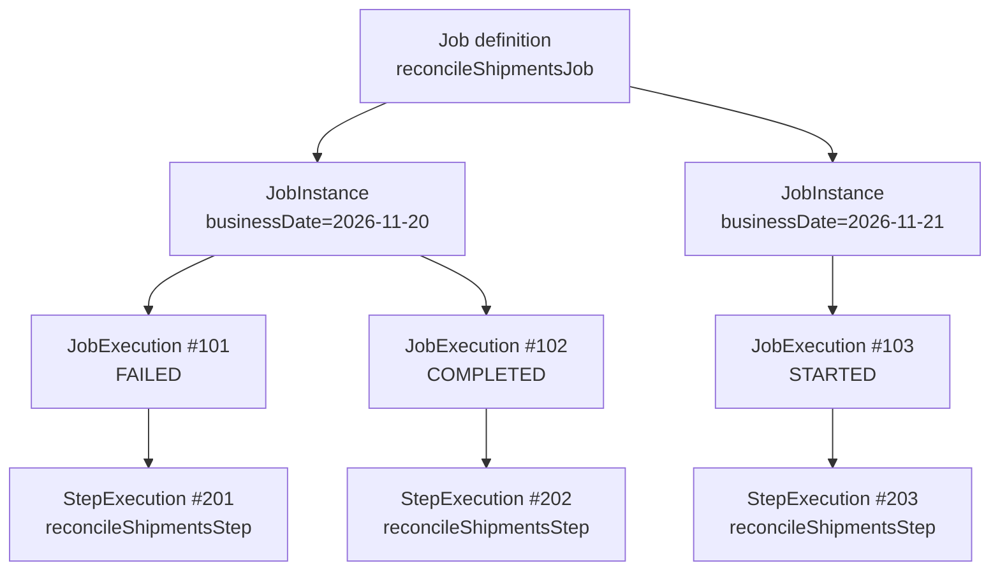
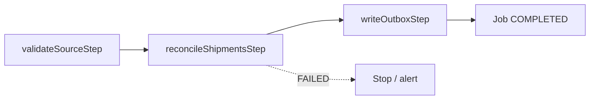
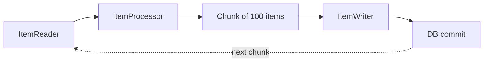
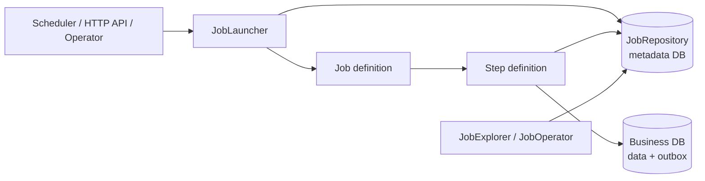

# Job, Step, JobInstance, JobExecution và JobParameters

> **Chương:** Spring Batch  
> **Module:** `SPRING_BOOT_INTEGRATION` — tổ chức tích hợp hệ thống trong Spring Boot qua HTTP client, cơ sở dữ liệu, cache, broker thông điệp và adapter Spring Integration, với trọng tâm ở cấu hình, hợp đồng dữ liệu, giao dịch, lỗi, xử lý trùng lặp, kiểm thử và quan sát.

## 1. Bài toán: cùng một tác vụ, nhiều lần chạy, kết quả khác nhau

Một hệ thống logistics nhận dữ liệu giao hàng từ đối tác và phải đối soát các vận đơn mỗi ngày. Mỗi lần đối soát có thể đọc hàng trăm nghìn bản ghi, chuẩn hóa dữ liệu, ghi bảng kết quả và tạo outbox event để các hệ thống khác cập nhật cache hoặc gửi thông báo.

Giả sử tác vụ xử lý dữ liệu ngày `2026-11-20` chạy đến bản ghi thứ 70.000 rồi mất kết nối database. Khi phục hồi, câu hỏi không chỉ là “chạy lại hàm nào?” mà còn là:

- Công việc cần làm được định nghĩa ở đâu?
- Lần chạy này thuộc **ngày dữ liệu** nào?
- Lần chạy thất bại có thể **tiếp tục** từ điểm đã commit hay phải làm từ đầu?
- Một lần khởi động lại chương trình có tạo ra tác vụ mới hay chỉ khởi chạy lại cùng tác vụ?
- Làm thế nào biết lần chạy nào thành công, thất bại hoặc đang chạy?
- Nếu một bản ghi đã gửi yêu cầu HTTP ra đối tác trước khi crash, retry có gây tác động hai lần không?

Spring Batch cung cấp mô hình **Job**, **Step**, **JobInstance**, **JobExecution**, **JobParameters**, cùng `JobRepository` và metadata vận hành để trả lời những câu hỏi đó. Mô hình này đặc biệt hữu ích với nhập dữ liệu, đối soát, xuất báo cáo, migration có kiểm soát và đồng bộ dữ liệu theo lịch trong ứng dụng Spring Boot.

**Mục tiêu học tập:** phân biệt chính xác năm khái niệm của tiêu đề, vận dụng các tham số định danh, hiểu restart và metadata, biết ranh giới giao dịch trong từng step, rồi gắn chúng vào một luồng tích hợp thực tế có khả năng phục hồi và quan sát.

## 2. Năm khái niệm cốt lõi

| Khái niệm | Bản chất | Ví dụ đối soát giao hàng |
|---|---|---|
| **Job** | **Định nghĩa một quy trình batch** gồm một hoặc nhiều step và thứ tự/điều kiện chuyển tiếp. | `reconcileShipmentsJob` |
| **Step** | **Định nghĩa một giai đoạn xử lý** trong job, có reader/processor/writer hoặc tasklet. | `reconcileShipmentsStep` |
| **JobParameters** | Bộ tham số của một lần khởi chạy; các tham số đánh dấu **identifying** tham gia xác định danh tính `JobInstance`. | `businessDate=2026-11-20` |
| **JobInstance** | **Một trường hợp logic của Job**, xác định bằng tên Job và các identifying JobParameters. | “Đối soát vận đơn ngày 20/11/2026” |
| **JobExecution** | **Một lần thử thực thi** một JobInstance, có ID, trạng thái, thời gian và lỗi. | Lần 1 `FAILED`, lần 2 `COMPLETED` |

Ngoài năm khái niệm trên còn có **StepExecution**: một lần thực thi Step thuộc một JobExecution. Nếu Step đã chạy trong một lần thử thất bại rồi được thực thi lại ở lần restart, hệ thống có nhiều StepExecution cho cùng Step definition qua các JobExecution khác nhau.

### 2.1. Sơ đồ quan hệ



Từ sơ đồ, cần ghi nhớ:

- **Job definition có thể được chạy cho nhiều JobInstance** khác nhau, tùy tập identifying parameters.
- **Một JobInstance có thể có nhiều JobExecution** nếu đã thất bại/dừng và được khởi động lại hợp lệ.
- **JobExecution là lịch sử một lần thử**, không phải định danh nghiệp vụ dùng để chống trùng toàn bộ dữ liệu.
- **StepExecution gắn với một JobExecution cụ thể**; không có ý nghĩa “mỗi Step chỉ có một StepExecution suốt đời”.
- `JobParameters` là đầu vào cho execution; phần identifying của chúng quyết định JobInstance tương ứng.

## 3. Job: mô tả quy trình batch cần thực hiện

Một `Job` là định nghĩa cấp cao của một công việc theo lô. Nó mô tả tên job, các step và cách chuyển từ step này sang step khác. Ví dụ:



Luồng trên biểu diễn ba giai đoạn:

1. Xác nhận nguồn dữ liệu của ngày cần xử lý tồn tại và hợp lệ.
2. Đọc dữ liệu, đối soát và cập nhật bản ghi.
3. Chuẩn bị thông điệp outbox cho downstream.

Trong triển khai thực tế, nếu bước 2 đã ghi thay đổi dữ liệu và cần phát event nguyên tử với thay đổi đó, **outbox record cần được ghi trong cùng transaction với bước cập nhật tương ứng**; không nên luôn để một step độc lập viết outbox sau các commit nghiệp vụ nếu rủi ro crash giữa hai step là không chấp nhận được. Sơ đồ trên chỉ minh họa cấu trúc step; thiết kế transaction cần được xác định riêng.

### 3.1. Job definition không phải JobExecution

Khai báo một bean `Job` không làm dữ liệu được xử lý ngay. Job phải được **khởi chạy** thông qua `JobLauncher` hoặc cơ chế điều phối tương ứng.

Một job definition cũng không phải một Java thread đang chạy. Job có thể được thực thi đồng bộ hoặc được launcher điều phối bất đồng bộ tùy cách cấu hình. Trạng thái của **JobExecution** cho biết nỗ lực thực thi đang ở đâu; tên job và cấu hình của bean chỉ cho biết công việc sẽ làm gì.

### 3.2. Job thường được đặt tên ổn định

`reconcileShipmentsJob` là tên logic dùng trong metadata. Đổi tên job từ `reconcileShipmentsJob` thành `shippingDailyJob` sẽ khiến Spring Batch coi đây là một job identity khác khi đối chiếu với metadata cũ. Cần có kế hoạch migration/compatibility nếu đổi tên trong môi trường đã vận hành.

## 4. Step: giai đoạn có ranh giới xử lý riêng

Một `Step` là một giai đoạn trong Job, có trạng thái và metadata riêng. Hai kiểu tổ chức phổ biến là:

| Kiểu Step | Cách làm việc | Tình huống phù hợp |
|---|---|---|
| **Tasklet step** | Thực hiện một công việc và trả `RepeatStatus`, có thể lặp theo chính sách của step. | Kiểm tra file đầu vào, dọn dữ liệu tạm, tạo snapshot có thời lượng ngắn. |
| **Chunk-oriented step** | Đọc từng item, tùy chọn xử lý, gom thành chunk và ghi; thường commit theo chunk. | Đối soát hàng trăm nghìn vận đơn, import CSV, chuẩn hóa dữ liệu theo trang. |

### 4.1. Chunk-oriented processing



Trong cấu hình chunk đơn giản `chunk(100, transactionManager)`, framework đọc và xử lý các item rồi gọi writer theo lô trong một transaction chunk. Nếu writer lỗi trước khi commit, các thay đổi **thuộc cùng transaction database** có thể rollback. Các chunk trước đó đã commit thường vẫn giữ kết quả khi job thất bại sau này.

Cần lưu ý:

- Commit interval `100` không tự bảo đảm “mỗi item được xử lý đúng một lần” đối với side effect bên ngoài database.
- `ItemReader` có trạng thái cần cơ chế checkpoint/restart phù hợp (`ItemStream` và `ExecutionContext` nếu áp dụng).
- `ItemProcessor` nên càng thuần túy càng tốt; tránh gọi HTTP làm side effect trong processor vì khi rollback/retry có thể gọi lại.
- `ItemWriter` nên thiết kế idempotent và có unique constraint nếu dữ liệu có thể được ghi lại sau crash.
- Một step có thể thất bại trong khi toàn bộ Job chưa đạt trạng thái cuối; việc Job chuyển tiếp xử lý ra sao còn tùy flow transition.

### 4.2. StepExecution khác Step definition

Một `Step` có thể là định nghĩa `reconcileShipmentsStep` trong cấu hình. Mỗi lần nó thực sự chạy sẽ tạo **StepExecution** gắn với JobExecution cụ thể; StepExecution lưu các count/metric như số item đọc, ghi, filter, skip, commit, rollback (tùy step), trạng thái và exception.

Dùng `StepExecution` để chẩn đoán “đã đọc bao nhiêu item ở lần thử thứ hai?”; dùng tên `Step` để xác định “giai đoạn nào trong định nghĩa job?”.

## 5. JobParameters: đầu vào và khóa định danh

`JobParameters` là bộ tham số được truyền khi launch một job. Những tham số này thường gồm ngày dữ liệu, tenant, nguồn import, phiên bản snapshot hoặc phạm vi đối soát.

Điểm dễ sai nhất là **identifying**:

- **Identifying parameter:** tham gia tạo khóa nhận diện `JobInstance` cùng tên job.
- **Non-identifying parameter:** lưu thông tin bổ sung của lần chạy nhưng **không làm JobInstance mới**.

### 5.1. Ví dụ JobParametersBuilder

Ví dụ theo API Spring Batch 5 với Spring Boot 3:

```java
import org.springframework.batch.core.JobParameters;
import org.springframework.batch.core.JobParametersBuilder;

JobParameters parameters = new JobParametersBuilder()
    .addString("businessDate", "2026-11-20", true)
    .addString("region", "south", true)
    .addString("requestedBy", "scheduler", false)
    .toJobParameters();
```

Bộ identifying parameter ở đây là `businessDate` và `region`. Cùng tên Job, cùng hai giá trị này thì cùng `JobInstance`, dù `requestedBy` đổi từ `scheduler` thành `operator`.

**Không biến nguồn dữ liệu thực tế khác nhau thành một JobInstance** bằng cách đánh dấu non-identifying sai. Nếu `sourceFileChecksum`, `tenant` hoặc `snapshotVersion` ảnh hưởng dữ liệu được xử lý, chúng có thể cần tham gia identity hoặc phải được cố định trong trạng thái bền vững của job.

### 5.2. Ma trận định danh JobInstance

Giả sử Job luôn có tên `reconcileShipmentsJob`:

| Lần launch | Identifying JobParameters | Non-identifying | JobInstance |
|---|---|---|---|
| A | `businessDate=2026-11-20`, `region=south` | `requestedBy=scheduler` | I-1 |
| B | `businessDate=2026-11-20`, `region=south` | `requestedBy=operator` | **I-1** |
| C | `businessDate=2026-11-21`, `region=south` | `requestedBy=scheduler` | **I-2** |
| D | `businessDate=2026-11-20`, `region=north` | `requestedBy=scheduler` | **I-3** |

Lần B **không tự động là một lần chạy thành công mới**: nếu I-1 đã `COMPLETED`, Spring Batch thường từ chối khởi chạy lại cùng JobInstance đã hoàn tất. Nếu I-1 đang chạy, lần launch song song cho cùng instance cũng thường bị từ chối. Nếu I-1 `FAILED` và job restartable, lần B có thể tạo **JobExecution mới của I-1**.

### 5.3. Chọn khóa identity theo đơn vị nghiệp vụ

Một khóa tốt mô tả **đúng một lô dữ liệu logic**:

- Batch đối soát theo ngày: `businessDate` và `region`.
- Import file: `sourceSystem`, `fileId` hoặc checksum/snapshot version theo contract.
- Batch theo tenant: `tenantId`, `businessDate`.
- Chạy correction độc lập: có thể thêm `correctionVersion` identifying để tạo **lô logic mới**.

Không lấy timestamp hiện tại làm identifying parameter chỉ để né lỗi “already complete” nếu mục đích là **restart một lần xử lý thất bại**. Làm vậy tạo JobInstance mới, mất mối liên hệ restart/checkpoint với instance cũ và có thể xử lý trùng dữ liệu.

### 5.4. RunIdIncrementer không đồng nghĩa restart

`RunIdIncrementer` thường tăng tham số `run.id` để tạo bộ identifying parameters khác cho các lần khởi chạy. Khi `run.id` thay đổi và là identifying, hệ thống tạo **JobInstance mới**, không phải một JobExecution restart cùng instance cũ.

Dùng incrementer khi thực sự muốn chạy **một job logic mới** mỗi lần; dùng **cùng identifying parameters** khi cần khởi động lại lô đã thất bại hoặc dừng, với điều kiện Job cho phép restart.

### 5.5. Validation, bảo mật và tính bất biến

- Kiểm tra `businessDate` đúng định dạng/ngữ nghĩa, không nằm ngoài phạm vi cho phép.
- Không lưu mật khẩu, token hay bí mật vào `JobParameters`; chúng được lưu trong **metadata JobRepository** và có thể xuất hiện ở dashboard/log.
- JobParameters không phải nơi cất một payload JSON khổng lồ; lưu reference tới nguồn dữ liệu bất biến nếu cần.
- Nếu job có thể restart, dữ liệu đầu vào phải có khả năng đọc lại ổn định hoặc biết rõ cách xử lý nguồn đã thay đổi.
- Kiểu dữ liệu và cách lưu tham số hỗ trợ khác nhau tùy phiên bản Spring Batch; đảm bảo việc serialize/convert vẫn tương thích sau nâng cấp.

## 6. JobInstance: danh tính một lô logic

Một `JobInstance` đại diện cho **một lần công việc logic theo định nghĩa**:

```text
JobInstance = Job name + identifying JobParameters
```

Không đồng nhất `JobInstance` với tiến trình JVM, HTTP request, cron tick hoặc một lần thử thực thi. Một JobInstance có thể tiếp tục qua nhiều lần process restart nếu `JobRepository` lưu metadata bền vững và hệ thống chạy lại với đúng identifying parameters.

Ví dụ đối soát vận đơn `2026-11-20`:

1. Lần chạy đầu xử lý 70.000 bản ghi rồi `FAILED`.
2. Hệ thống giữ bản ghi JobInstance I-1 trong repository.
3. Operator khởi chạy lại cùng ngày/region, tạo JobExecution mới thuộc **I-1** nếu điều kiện restart hợp lệ.
4. Chunk reader/writer tiếp tục theo checkpoint và trạng thái đã commit, với khả năng thực thi lại một phần phù hợp.

JobInstance không tự bảo đảm tất cả step restart chính xác từ byte hoặc bản ghi cuối; điều đó còn phụ thuộc **reader state, transaction, input stability, checkpoint và thiết kế idempotency**.

### 6.1. Đã COMPLETED thì sao?

Theo quy tắc vận hành phổ biến của Spring Batch, **JobInstance đã COMPLETED không được chạy lại bằng cùng bộ identifying parameters**. Để xử lý dữ liệu ngày cũ một cách chủ đích, cần chọn:

- **Correction/new run:** tạo một JobInstance khác bằng tham số identifying mới có ý nghĩa nghiệp vụ, ví dụ `correctionVersion=2`.
- **Rebuild projection:** thiết kế Job riêng có contract rebuild và idempotency rõ ràng.
- **Không thay metadata thủ công** để đánh lừa framework rằng instance chưa hoàn thành.

Nếu chỉ muốn đọc lịch sử, truy vấn `JobExplorer` hoặc dashboard/job repository thay vì thử launch lại.

## 7. JobExecution: một lần thử chạy và kết quả của nó

`JobExecution` mô tả **một nỗ lực thực thi** của một JobInstance. Nó có execution ID riêng, thời điểm bắt đầu/kết thúc (tùy trạng thái), `BatchStatus`, `ExitStatus`, thông tin lỗi và tập `StepExecution`.

Các trạng thái `BatchStatus` thường gặp:

| Trạng thái | Ý nghĩa |
|---|---|
| `STARTING` | Đã bước vào giai đoạn chuẩn bị start. |
| `STARTED` | Đang thực thi. |
| `STOPPING` | Đã được yêu cầu dừng và đang xử lý dừng. |
| `STOPPED` | Đã dừng. Có thể restart tùy cấu hình/trạng thái. |
| `COMPLETED` | Đã hoàn tất thành công theo định nghĩa flow. |
| `FAILED` | Lần chạy thất bại. Có thể restart nếu đáp ứng điều kiện. |
| `ABANDONED` | Đánh dấu bỏ qua/không restart bằng đường thông thường. |
| `UNKNOWN` | Trạng thái không xác định, cần điều tra trước khi can thiệp. |

Không nên xem `FAILED` và `ABANDONED` là đồng nghĩa. Job hoặc step bị đánh dấu abandoned thường yêu cầu quyết định vận hành khác với restart thất bại bình thường.

### 7.1. BatchStatus và ExitStatus

- **`BatchStatus`:** trạng thái vòng đời của `JobExecution`/`StepExecution`.
- **`ExitStatus`:** mã kết quả dùng trong **flow transitions**, có thể mặc định như `COMPLETED`/`FAILED` hoặc được điều chỉnh cho điều kiện nghiệp vụ.

Ví dụ, một step kết thúc bình thường ở mức xử lý nhưng có thể có `ExitStatus` tùy chỉnh `NO_DATA` để Job quyết định bỏ qua step gửi kết quả. Không tự suy luận rằng mọi `ExitStatus` tùy chỉnh đều tương đương một giá trị `BatchStatus`.

### 7.2. Một JobInstance có nhiều JobExecution

| JobInstance | JobExecution | Trạng thái | Ý nghĩa |
|---|---|---|---|
| I-1 (`2026-11-20, south`) | E-101 | `FAILED` | Lần thử 1 dừng sau 70.000 bản ghi |
| I-1 (`2026-11-20, south`) | E-102 | `COMPLETED` | Restart hợp lệ, hoàn tất lô I-1 |
| I-2 (`2026-11-21, south`) | E-103 | `COMPLETED` | Một lô ngày khác |
| I-3 (`2026-11-20, north`) | E-104 | `STARTED` | Một lô vùng khác đang chạy |

Số ID trên chỉ để minh họa. ID thực tế do `JobRepository` quản lý; không dùng execution ID làm khóa nghiệp vụ duy nhất cho bảng kết quả, vì restart cùng JobInstance có thể có execution ID mới.

## 8. StepExecution và ExecutionContext: theo dõi từng bước và checkpoint

`StepExecution` ghi trạng thái và thống kê của một lần thực thi Step: `readCount`, `writeCount`, `filterCount`, `skipCount`, `commitCount`, `rollbackCount` (phù hợp với loại step) và lỗi. Đây là nguồn dữ liệu hữu ích để điều tra nơi một batch bị dừng.

**`ExecutionContext`** là một vùng lưu trạng thái kỹ thuật dạng key/value được Spring Batch quản lý cho JobExecution hoặc StepExecution. Nó có thể lưu vị trí reader, số thứ tự đã xử lý, checkpoint hoặc dữ liệu vận hành cần cho restart.

| Đối tượng | Dùng cho | Không nên nhầm với |
|---|---|---|
| `JobParameters` | Đầu vào và identity của lô logic | Checkpoint đang thay đổi từng chunk |
| `JobExecution` | Lịch sử một lần thử chạy | Job definition hoặc JobInstance |
| `StepExecution` | Lịch sử và thống kê của một step ở lần thử đó | Định nghĩa Step |
| `ExecutionContext` | Trạng thái kỹ thuật phục vụ restart/tiếp tục | Nguồn sự thật cho toàn bộ nghiệp vụ ngoài hệ thống |

### 8.1. Checkpoint không bảo đảm exactly-once

Giả sử một chunk ghi được 100 row vào database rồi commit. Sau commit, process chết trước khi có thể xác nhận đủ mọi side effect liên quan. Khi restart, reader có thể đọc lại một số item tùy cách checkpoint/transaction được phối hợp. Do đó:

1. Item reader phải hỗ trợ khôi phục vị trí hoặc chủ động xây mô hình đọc lại idempotent.
2. Writer nên có **unique constraint**/upsert hoặc kiểm tra version để tránh ghi trùng.
3. Side effect HTTP/broker ngoài transaction database cần idempotency key hoặc outbox.
4. Input thay đổi giữa hai lần chạy có thể khiến offset không còn đại diện cho cùng dữ liệu; paging nên có thứ tự ổn định.
5. Phải kiểm thử restart sau crash ở những mốc nhạy cảm: trước commit, sau commit và khi external API đã xử lý nhưng response chưa về.

`ExecutionContext` được quản lý trong `JobRepository`, không phải tài liệu để người vận hành tự cập nhật tùy ý nhằm “sửa” một job đang kẹt.

## 9. JobRepository, JobLauncher và các thành phần vận hành

Để hiểu đầy đủ năm khái niệm, cần biết hạ tầng giữ metadata và khởi chạy chúng.



- **`JobRepository`:** lưu JobInstance, JobExecution, StepExecution, parameters và ExecutionContext. Để restart qua process crash, repository phải có **metadata lưu bền vững**, thường ở database.
- **`JobLauncher`:** được dùng để khởi chạy một `Job` với bộ `JobParameters`, trả một `JobExecution` hoặc ném ngoại lệ nếu launch không hợp lệ.
- **`JobExplorer`:** API đọc metadata/hệ thống lịch sử, hỗ trợ tra cứu trạng thái.
- **`JobOperator`:** API quản trị công việc như start/stop/restart tùy phiên bản Spring Batch và cấu hình.
- **`Job`/`Step`:** mô tả logic; execution metadata do repository theo dõi.

### 9.1. Các bảng metadata điển hình

Khi dùng JDBC JobRepository, Spring Batch quản lý nhóm bảng dạng:

```text
BATCH_JOB_INSTANCE
BATCH_JOB_EXECUTION
BATCH_JOB_EXECUTION_PARAMS
BATCH_JOB_EXECUTION_CONTEXT
BATCH_STEP_EXECUTION
BATCH_STEP_EXECUTION_CONTEXT
BATCH_*_SEQ  (hoặc cách sinh ID tương ứng theo database)
```

Tên cột, định dạng tham số và script schema phụ thuộc **phiên bản Spring Batch**/database. Hãy dùng migration/schema script tương thích với phiên bản đang chạy; không tự xây lại bảng bằng DDL từ trí nhớ. Không xóa các row metadata để “cho phép” chạy lại một job đã COMPLETED: việc đó làm mất lịch sử, ảnh hưởng restart và có thể gây lỗi tham chiếu.

### 9.2. Metadata database và business database

`JobRepository` có thể dùng chung database với dữ liệu nghiệp vụ hoặc database khác. **Không suy ra mọi thay đổi ở hai nơi đều tham gia cùng transaction** nếu dùng datasource/transaction manager khác nhau. Khi cần commit chính xác giữa trạng thái batch và business write, hãy xem ranh giới transaction, checkpoint và khả năng khôi phục; không chỉ giả định rằng lưu metadata luôn bảo đảm tính nguyên tử xuyên nhiều datasource.

## 10. Cấu hình Spring Boot và ví dụ Job/Step

Ví dụ dưới đây diễn tả một job đối soát vận đơn qua **chunk-oriented Step**, theo kiểu API builder của Spring Batch 5 với Spring Boot 3. Với phiên bản mới hơn, cần kiểm tra chữ ký API và auto-configuration của phiên bản dự án. Mẫu minh họa giả định cơ sở dữ liệu đã có schema batch và business phù hợp.

### 10.1. Dependency

Gradle Groovy DSL:

```gradle
dependencies {
    implementation("org.springframework.boot:spring-boot-starter-batch")
    implementation("org.springframework.boot:spring-boot-starter-jdbc")
    runtimeOnly("org.postgresql:postgresql")

    testImplementation("org.springframework.boot:spring-boot-starter-test")
    testImplementation("org.springframework.batch:spring-batch-test")
}
```

Spring Boot dependency management/BOM nên quản lý các phiên bản tương thích. Với batch sử dụng JPA, có thể thêm Spring Data JPA và transaction manager thích hợp. Không phải mọi job đều cần JPA; JDBC hoặc các reader/writer khác thường đủ.

### 10.2. application.yml cho môi trường đã quản lý schema

```yaml
spring:
  datasource:
    url: ${DB_JDBC_URL}
    username: ${DB_USERNAME}
    password: ${DB_PASSWORD}
  batch:
    job:
      enabled: false
    jdbc:
      initialize-schema: never
```

`spring.batch.job.enabled: false` được dùng khi muốn **khởi chạy theo lịch/API/operator một cách có kiểm soát**, tránh Boot tự kích hoạt job theo điều kiện lúc startup. `initialize-schema: never` giả định các bảng batch đã được tạo bằng migration hoặc quy trình khởi tạo của môi trường.

Ở local demo, có thể sử dụng chức năng khởi tạo schema do Boot hỗ trợ theo phiên bản, nhưng production nên quản lý schema batch bằng migration có version và backup. Nếu custom `@EnableBatchProcessing` hoặc tạo infrastructure bean riêng, hành vi auto-configuration của Boot có thể thay đổi; không thêm những annotation này chỉ vì thấy một ví dụ cũ.

### 10.3. Định nghĩa Job và Step

```java
import org.springframework.batch.core.Job;
import org.springframework.batch.core.Step;
import org.springframework.batch.core.job.builder.JobBuilder;
import org.springframework.batch.core.repository.JobRepository;
import org.springframework.batch.core.step.builder.StepBuilder;
import org.springframework.batch.item.ItemProcessor;
import org.springframework.batch.item.ItemReader;
import org.springframework.batch.item.ItemWriter;
import org.springframework.context.annotation.Bean;
import org.springframework.context.annotation.Configuration;
import org.springframework.transaction.PlatformTransactionManager;

@Configuration
public class ShipmentBatchConfiguration {

    @Bean
    Job reconcileShipmentsJob(JobRepository jobRepository,
                              Step reconcileShipmentsStep) {
        return new JobBuilder("reconcileShipmentsJob", jobRepository)
            .start(reconcileShipmentsStep)
            .build();
    }

    @Bean
    Step reconcileShipmentsStep(
            JobRepository jobRepository,
            PlatformTransactionManager transactionManager,
            ItemReader<ShipmentRow> shipmentReader,
            ItemProcessor<ShipmentRow, OutboxRecord> processor,
            ItemWriter<OutboxRecord> outboxWriter) {

        return new StepBuilder("reconcileShipmentsStep", jobRepository)
            .<ShipmentRow, OutboxRecord>chunk(100, transactionManager)
            .reader(shipmentReader)
            .processor(processor)
            .writer(outboxWriter)
            .build();
    }
}
```

**`ShipmentRow`**, **`OutboxRecord`** và các bean reader/processor/writer là **thành phần do ứng dụng định nghĩa**. Đoạn mã mô tả wiring và khung builder, không phải ứng dụng có thể chạy ngay nếu thiếu datasource, schema và các bean đó.

Thiết kế gợi ý:

- Reader đọc các vận đơn của `businessDate` theo thứ tự ổn định; nếu là paging reader, cấu hình sort key duy nhất và lưu checkpoint thích hợp.
- Processor kiểm tra/chuẩn hóa dữ liệu, **không gọi HTTP gây side effect** mỗi lần xử lý item.
- Writer cập nhật kết quả và thêm outbox record trong **cùng transaction database** (nếu cần tính nhất quán giữa dữ liệu và event).
- Relay độc lập đọc outbox để gửi Kafka/RabbitMQ sau commit. Event có ID ổn định để consumer dedup.
- Nếu writer ghi vào datasource khác với transaction manager của Step, phải thiết kế lại transaction boundary; không mặc định chunk transaction bao trùm tất cả.

### 10.4. Late binding một JobParameter vào reader

Nhiều reader cần giá trị `businessDate` chỉ tồn tại khi Job thực thi. Có thể dùng `@StepScope` và SpEL:

```java
import org.springframework.batch.core.configuration.annotation.StepScope;
import org.springframework.beans.factory.annotation.Value;
import org.springframework.context.annotation.Bean;

@Bean
@StepScope
ItemReader<ShipmentRow> shipmentReader(
        @Value("#{jobParameters['businessDate']}") String businessDate,
        ShipmentReaderFactory readerFactory) {
    return readerFactory.createForDate(businessDate);
}
```

`ShipmentReaderFactory` là factory do ứng dụng viết. `@StepScope` cho phép khởi tạo bean với context của StepExecution, thay vì cố resolve `jobParameters` khi ApplicationContext khởi động. Với reader có trạng thái, factory phải trả implementation hỗ trợ checkpoint/restart thích hợp; tạo một list reader từ dữ liệu biến động không tự bảo đảm restart chính xác.

## 11. Khởi chạy Job với JobLauncher

Khi ứng dụng đã có bean Job và `JobLauncher`:

```java
import org.springframework.batch.core.Job;
import org.springframework.batch.core.JobExecution;
import org.springframework.batch.core.JobParameters;
import org.springframework.batch.core.JobParametersBuilder;
import org.springframework.batch.core.launch.JobLauncher;

JobParameters params = new JobParametersBuilder()
    .addString("businessDate", "2026-11-20", true)
    .addString("region", "south", true)
    .addString("requestedBy", "operator", false)
    .toJobParameters();

JobExecution execution =
    jobLauncher.run(reconcileShipmentsJob, params);

Long executionId = execution.getId();
```

`jobLauncher` và `reconcileShipmentsJob` là bean đã được inject vào service/controller/runner. Đoạn code giả định đang ở một method có quyền xử lý các checked exception của `JobLauncher.run(...)`.

**Quan trọng:** launcher có thể được cấu hình để thực hiện Job **đồng bộ hoặc bất đồng bộ**, nên thời điểm `run(...)` trả về phụ thuộc executor của launcher. Không mặc nhiên xem giá trị trả về là `COMPLETED`. Nếu cung cấp API HTTP trigger job, cần xác thực, chống khởi chạy trùng, áp giới hạn concurrency và trả `executionId`/trạng thái theo đúng hợp đồng. Khi muốn `202 Accepted` nhanh, phải chủ động chọn mô hình launcher/queue phù hợp, thay vì chỉ đổi HTTP status.

### 11.1. Các trường hợp launch phải được xử lý

| Tình huống | Hành vi dự kiến ở mức framework | Cách xử lý ở ứng dụng |
|---|---|---|
| Chưa có instance cùng identity | Tạo JobInstance và JobExecution mới | Ghi nhận execution ID, trạng thái |
| Instance đã `COMPLETED` | Thường bị từ chối bằng lỗi đã hoàn tất instance | Trả “already processed” hoặc lập correction run rõ ràng |
| Instance đang chạy | Thường bị từ chối chạy đồng thời cùng instance | Hiển thị execution đang chạy, tránh duplicate trigger |
| Instance `FAILED` hoặc `STOPPED` | Có thể tạo JobExecution mới nếu restartable và trạng thái hợp lệ | Xác minh checkpoint/source trước restart |
| Job bị đánh dấu không restartable | Khởi chạy lại có thể bị từ chối | Điều tra nguyên nhân, chọn cơ chế phục hồi khác |
| Parameters thiếu/sai | Validator hoặc logic đọc input từ chối | Validate sớm, trả lỗi contract rõ ràng |

Các exception thường gặp gồm `JobInstanceAlreadyCompleteException`, `JobExecutionAlreadyRunningException`, `JobRestartException` và `JobParametersInvalidException`; cách phân loại HTTP/operator cần dựa vào hợp đồng và thông tin instance thực tế.

## 12. Ví dụ tuần tự: failed, restart và new instance

Xét một Job có identifying parameters `businessDate=2026-11-20` và `region=south`.

```mermaid
sequenceDiagram
    participant Op as Operator/Scheduler
    participant JL as JobLauncher
    participant JR as JobRepository
    participant Worker as Chunk Step
    participant DB as Business DB

    Op->>JL: launch same identifying params
    JL->>JR: create I-1 / E-1
    JL->>Worker: execute step
    Worker->>DB: commit chunks 1..700
    Worker--xDB: DB connection failure
    Worker->>JR: E-1 FAILED; checkpoint metadata
    Op->>JL: restart I-1 (same identifying params)
    JL->>JR: create E-2 of I-1
    JL->>Worker: execute pending/restarted step
    Worker->>DB: continue / safely replay as needed
    Worker->>JR: E-2 COMPLETED
    Op->>JL: launch same identifying params again
    JL-->>Op: already completed instance
```

Với chunk size 100, “700 chunks đã commit” là con số minh họa. Vị trí restart cụ thể phụ thuộc reader, persistence metadata và transaction. Nếu hệ thống mất nguồn dữ liệu đầu vào giữa hai lần chạy, không có cơ chế nào tự tái tạo file/snapshot cũ chỉ nhờ JobInstance ID.

### 12.1. Restart và rerun là hai thao tác khác nhau

- **Restart:** chạy lại **cùng JobInstance** đã thất bại/dừng, tạo JobExecution mới và sử dụng cơ chế khôi phục Step/ExecutionContext.
- **Rerun/new instance:** khởi tạo một JobInstance khác vì identifying parameters khác. Có thể xử lý lại cùng dữ liệu lịch sử nếu contract cho phép, nhưng đó là một lô logic mới, không dùng checkpoint của instance cũ.
- **Replay/rebuild:** quy trình nghiệp vụ có thể cần một job độc lập để xây lại projection; không nhất thiết đồng nghĩa với restart hoặc rerun một job import.

Đừng gộp ba tình huống vào nút “Run again” mà không giải thích cho operator, vì kết quả idempotency và dữ liệu có thể khác.

## 13. Transaction, retry và idempotency trong batch tích hợp

Spring Batch cung cấp retry/skip/restart ở những ranh giới mà framework kiểm soát, nhưng ứng dụng phải quản lý **side effect vượt ra khỏi một transaction database**.

### 13.1. Chunk transaction và external systems

Giả sử ItemWriter gọi HTTP đối tác để tạo vận đơn:

```text
Read item A
→ HTTP POST /shipments: đối tác đã tạo vận đơn
→ Database update/commit lỗi
→ Chunk rollback và retry
→ HTTP POST /shipments lần nữa
```

Nếu đối tác không có idempotency key, có thể tạo **hai vận đơn**. Chunk rollback chỉ rollback những tài nguyên có tham gia vào cùng transaction; không undo HTTP request.

Một thiết kế an toàn hơn trong nhiều trường hợp:

1. Step đọc và đối soát dữ liệu.
2. Trong cùng transaction database, ghi trạng thái cần cập nhật và outbox command/event có ID ổn định.
3. Relay/consumer riêng gửi HTTP/broker với retry, timeout và idempotency key.
4. Lưu phản hồi và trạng thái xử lý riêng; reconciliation khi timeout không xác định kết quả.

Nếu phải gọi HTTP trực tiếp trong step, hãy làm rõ nó có thể được lặp; có key idempotent phía đối tác, timeout, circuit breaker/rate limit và cách đối soát trước khi retry.

### 13.2. Retry, skip và restart không giống nhau

| Cơ chế | Xảy ra khi nào? | Mục đích |
|---|---|---|
| **Retry trong step** | Khi xử lý một thao tác/item gặp lỗi được cho phép retry | Thử lại lỗi tạm thời trước khi coi item/step thất bại |
| **Skip item** | Khi item có lỗi được cho phép bỏ qua, trong giới hạn cấu hình | Tiếp tục lô nhưng ghi nhận item lỗi, có chính sách business rõ |
| **Restart job** | Sau một JobExecution `FAILED`/`STOPPED` với instance restartable | Tiếp tục lô logic qua một JobExecution mới |
| **Replay message/outbox** | Khi luồng publish/consume bên ngoài cần phát lại | Đảm bảo truyền đạt kết quả giữa hệ thống, có thể gây message trùng |

Skip có thể thích hợp với một hàng CSV sai định dạng nhưng **không** thích hợp để im lặng bỏ qua lỗi thu tiền hoặc mất bản ghi quan trọng. Retry có giới hạn, backoff và phân loại lỗi; không lặp vô hạn một lỗi validation.

### 13.3. Thiết kế input/output idempotent

Một batch cần có khóa nghiệp vụ tương đối ổn định:

- `businessDate + region + shipmentId` để upsert bản ghi đối soát.
- `sourceSystem + eventId` để nhận webhook/record một lần.
- `outboxEventId` cho cùng sự kiện được phát lại.
- `commandId` gửi sang HTTP partner để phía đích chống xử lý trùng nếu hỗ trợ.

**JobExecution ID không nên làm khóa chống trùng** cho side effect, vì restart tạo JobExecution mới và cùng item có thể được thực thi lại.

## 14. Phối hợp với HTTP, database, cache, broker và Spring Integration

Trong `SPRING_BOOT_INTEGRATION`, Spring Batch thường nằm ở phần **xử lý theo lô**, còn các thư viện khác đảm nhiệm giao tiếp theo từng adapter.

| Thành phần | Vai trò trong luồng batch | Rủi ro cần thiết kế |
|---|---|---|
| HTTP client (`RestClient`/`WebClient`) | Tải nguồn, gửi dữ liệu hoặc gọi tra cứu theo lô | Timeout, rate limit, kết quả không chắc chắn, retry có idempotency |
| JDBC/JPA/R2DBC | Đọc và ghi data nghiệp vụ | Transaction đúng manager, lock, checkpoint, unique constraint |
| Cache/Redis | Làm mới dữ liệu đọc sau batch | Cache stale, race giữa event, invalidation không nguyên tử với DB |
| Kafka/RabbitMQ/JMS | Phát kết quả hoặc nhận yêu cầu xử lý | Publish trùng, ACK/offset, DLT/DLQ, giữ nguyên event ID |
| Spring Integration | Nối adapter, route hoặc transform message với luồng batch | Phân biệt channel trong RAM với broker bền vững |
| Spring Batch | Chia quy trình thành Job/Step, metadata, restart, chunk, retry/skip | Không tự bảo đảm exactly-once xuyên HTTP + DB + broker |

### 14.1. Không dùng JobRepository thay inbox/outbox

`JobRepository` quản lý **lịch sử chạy batch**, không tự cung cấp unique constraint cho từng event đối tác hoặc một hàng đợi message bền vững. Nếu một file chứa cùng event hai lần, JobInstance của file chỉ xác định lô nhập, không ngăn hai dòng tạo hai side effect.

- **Inbox/dedup:** chống trùng ở mức event/command của một consumer.
- **Outbox:** ghi ý định gửi message cùng transaction DB.
- **JobRepository:** quản lý instance, execution và checkpoint batch.

Chúng giải quyết những vấn đề khác nhau và có thể phối hợp trong cùng một hệ thống.

### 14.2. JobParameters không phải cơ chế hàng đợi

Hai request HTTP cùng gửi “chạy đối soát ngày X” không nên chỉ dựa vào việc tạo JobParameters khác nhau để xếp hàng. Nếu mỗi request tự thêm timestamp identifying, hệ thống có thể tạo nhiều JobInstance chạy đồng thời và ghi trùng.

Cần xác định **một lô logic duy nhất**, kiểm soát trùng trigger, quyền khởi chạy và quota. Nếu yêu cầu là tiếp nhận công việc bền vững theo API, cân nhắc job request table/broker và một service điều phối launch batch.

## 15. Concurrency, scheduler và nhiều instance ứng dụng

Trong môi trường nhiều pod/instance, có thể có nhiều scheduler cùng bắn trigger cho cùng businessDate. JobRepository có thể phát hiện trạng thái đang chạy của **cùng JobInstance** và từ chối launch trùng phù hợp. Tuy nhiên:

- Hai JobInstance với **identifying parameters khác** vẫn có thể xử lý các tập dữ liệu chồng lấn.
- Cùng job name ở hai ứng dụng dùng **JobRepository khác nhau** không chia sẻ trạng thái identity/concurrency.
- Một process chết khi metadata còn `STARTED` có thể cần thao tác phục hồi trạng thái/điều tra theo quy trình; không tự sửa bảng metadata tùy tiện.
- Step chạy song song, partitioning hoặc multi-threaded execution có thể thay đổi yêu cầu thread-safety của reader/writer và thứ tự xử lý.
- Database và API đối tác có giới hạn kết nối, transaction lock và rate limit riêng; tăng concurrency có thể làm chậm toàn cụm.

Với cron trong Spring Boot, `@Scheduled` chỉ tạo trigger theo thời gian; không thay JobRepository, không thay locking và không mặc nhiên bảo đảm cluster-wide single execution. Nếu chạy nhiều replica, cần chính sách điều phối tập trung hoặc cơ chế leader/lock phù hợp với hạ tầng.

### 15.1. Trạng thái JobInstance không phải HTTP session

Nếu HTTP client disconnect sau khi yêu cầu launch, job **có thể vẫn đang chạy**, tùy cách launcher thực thi. Đừng hủy JobExecution chỉ vì kết nối HTTP bị đóng nếu nghiệp vụ yêu cầu lô hoàn thành. Hãy trả mã execution và cung cấp cơ chế tra cứu trạng thái, cùng quy trình dừng job có chủ đích.

## 16. Quan sát, đối soát và vận hành

Mỗi đối tượng Spring Batch phục vụ một mức quan sát khác nhau:

| Cần hỏi | Nguồn dữ liệu |
|---|---|
| Công việc nào đang chạy? | Tên `Job`, JobExecution có `BatchStatus` đang tiến hành |
| Lô ngày nào và vùng nào? | Identifying `JobParameters` / `JobInstance` |
| Đã thử mấy lần? | Danh sách `JobExecution` của JobInstance |
| Hỏng ở bước nào? | `StepExecution`, exit status, failure exceptions |
| Đã xử lý bao nhiêu bản ghi? | Step read/write/filter/skip/commit/rollback counts |
| Có thể restart từ đâu? | Trạng thái Step và `ExecutionContext`, cộng với tính ổn định của nguồn |
| Broker đã nhận kết quả chưa? | Outbox status, producer ack, broker metrics |
| Downstream đã áp dụng nghiệp vụ chưa? | Consumer state, inbox/dedup, correlation/event IDs |

Nên theo dõi:

1. **Job duration** và tỷ lệ `COMPLETED`/`FAILED` theo job name (tránh label có cardinality quá cao).
2. **Step duration** và read/write/skip/retry count; cảnh báo khi tỷ lệ skip vượt ngưỡng nghiệp vụ.
3. **Số JobExecution chờ/running** và tuổi execution không tiến triển.
4. **Thời gian chờ DB/pool**, lock wait, query chậm, batch item throughput.
5. **Tuổi outbox record lâu nhất**, publish retry, consumer lag và dead-letter count.
6. **Correlation ID/batch business key** nối batch execution với HTTP request, broker event và downstream logs.
7. **Tính toàn vẹn kết quả**: tổng số input/output, số bản ghi bị từ chối, báo cáo đối soát và điều kiện chấp nhận cuối cùng.

Spring Boot Actuator, Micrometer và instrumentation cho Spring Batch có thể hỗ trợ metric, nhưng danh sách metric và tên cụ thể phụ thuộc phiên bản/registry/cấu hình. Không coi chỉ số `Job COMPLETED` là bằng chứng mọi tác động bên ngoài đã hoàn tất nếu quy trình còn các bước relay hoặc consumer bất đồng bộ.

## 17. Kiểm thử Job, JobInstance và khả năng restart

### 17.1. Kiểm thử job trên Spring context

Có thể dùng `spring-batch-test` và `@SpringBatchTest`, kết hợp `@SpringBootTest`:

```java
import static org.assertj.core.api.Assertions.assertThat;

import org.junit.jupiter.api.Test;
import org.springframework.batch.core.BatchStatus;
import org.springframework.batch.core.JobExecution;
import org.springframework.batch.core.JobParametersBuilder;
import org.springframework.batch.test.JobLauncherTestUtils;
import org.springframework.batch.test.context.SpringBatchTest;
import org.springframework.beans.factory.annotation.Autowired;
import org.springframework.boot.test.context.SpringBootTest;

@SpringBootTest
@SpringBatchTest
class ShipmentBatchJobTest {

    @Autowired
    private JobLauncherTestUtils launcher;

    @Test
    void reconcilesDay() throws Exception {
        JobExecution execution = launcher.launchJob(
            new JobParametersBuilder()
                .addString("businessDate", "2026-11-20", true)
                .addString("region", "south", true)
                .toJobParameters()
        );

        assertThat(execution.getStatus()).isEqualTo(BatchStatus.COMPLETED);
    }
}
```

Ví dụ giả định chỉ có một Job cần test hoặc `JobLauncherTestUtils` đã được đặt đúng Job; nếu có nhiều Job bean, cần chọn đúng Job để launch. Test cũng cần database/schema, reader/processor/writer hợp lệ và dữ liệu đầu vào được chuẩn bị. Không dùng lại cùng identifying parameters trong nhiều test trên metadata DB không được reset, vì instance đã completed sẽ không launch lại được.

### 17.2. Các ca kiểm thử có ý nghĩa

| Tình huống | Điều cần xác minh |
|---|---|
| Launch lần đầu với ngày D | Tạo JobInstance mới và JobExecution phù hợp |
| Launch lại ngày D khi đã COMPLETED | Bị từ chối theo contract; không tạo lô trùng ngoài ý muốn |
| Launch ngày D+1 | Tạo JobInstance khác |
| Thay non-identifying parameter | Không tạo JobInstance mới nếu identifying parameters giữ nguyên |
| Fail giữa các chunk | Các chunk đã commit vẫn đúng; dữ liệu chunk lỗi rollback phù hợp |
| Restart cùng instance | Tạo JobExecution mới, checkpoint/reader state hợp lệ |
| Đọc lại item đã ghi khi crash | Unique key/idempotency ngăn side effect lặp |
| Database và broker mất kết nối | Outbox/retry không bỏ mất kết quả đã commit |
| Input file thay đổi giữa các lần thử | Batch phát hiện sai lệch hoặc dùng snapshot bất biến |
| Hai trigger đồng thời cho cùng lô | Không chạy trùng vượt chính sách |
| Step không có dữ liệu đầu vào | Exit status/flow đúng theo hợp đồng |
| Schema/JobRepository không khả dụng | Fail có thông tin, không đánh dấu COMPLETED giả |

Với logic transaction/restart, dùng database cùng loại production trong integration test (ví dụ Testcontainers cho PostgreSQL). Khi kiểm tra publisher/consumer, cần broker tương ứng hoặc môi trường thử nghiệm có thể mô phỏng ACK, redelivery và failure. Một mock `ItemWriter` không thể chứng minh tính nguyên tử của database transaction và unique constraint.

## 18. Những lỗi và ngộ nhận phổ biến

| Ngộ nhận/lỗi | Thực tế | Hướng xử lý |
|---|---|---|
| “Job là một lần chạy.” | Job là **định nghĩa**; JobExecution là một lần thử. | Đọc metadata theo JobInstance/JobExecution. |
| “Mỗi JobInstance chỉ có một JobExecution.” | Một instance có thể có nhiều lần thử khi restart. | Giữ identifying parameters để restart hợp lệ. |
| “Thêm timestamp vào JobParameters để restart.” | Nếu timestamp identifying, nó tạo instance mới. | Không đổi identity khi cần restart. |
| “Đổi non-identifying parameter sẽ tạo lô mới.” | Non-identifying không tham gia khóa instance. | Đánh dấu identifying đúng với dữ liệu thực tế. |
| “COMPLETED rồi có thể launch lại cùng params.” | Thường bị từ chối theo instance đã hoàn tất. | Tạo correction/new instance có chủ đích. |
| “ExecutionContext chính là JobParameters.” | ExecutionContext là state có thể cập nhật/checkpoint; parameters mô tả đầu vào/identity. | Dùng đúng đối tượng và vòng đời. |
| “Chunk commit bảo đảm HTTP POST chỉ xảy ra một lần.” | HTTP ngoài DB transaction không tự rollback. | Idempotency key/outbox/reconciliation. |
| “@Scheduled bảo đảm chạy một lần trên toàn cluster.” | Nhiều instance có thể cùng kích hoạt trigger. | Điều phối theo cluster và JobRepository chung. |
| “JobRepository là hàng đợi nghiệp vụ.” | Nó lưu metadata batch, không thay inbox/outbox. | Lưu công việc cần gửi ở nơi bền vững phù hợp. |
| “FAILED nghĩa là chắc chắn restart được.” | Phụ thuộc restartable, step state, metadata, nguồn dữ liệu và tình trạng hệ thống. | Kiểm tra nguyên nhân, trạng thái và checkpoint. |
| “Job COMPLETED nghĩa là Kafka consumer đã cập nhật cache.” | Lô có thể chỉ tạo outbox; consumer xử lý về sau. | Theo dõi end-to-end với event ID. |
| “Có thể xóa BATCH_* để chạy lại.” | Làm hỏng lịch sử và khả năng restart. | Thiết kế correction run, recovery hợp lệ. |

## 19. Checklist trước khi đưa job tích hợp vào production

- **Đơn vị lô logic:** chọn tên Job và identifying parameters phản ánh đúng nguồn dữ liệu/ngày/tenant/phiên bản.
- **Đầu vào:** xác định nguồn bất biến, validation, schema/version, cách tìm lại dữ liệu khi restart.
- **Step structure:** tách giai đoạn có trách nhiệm rõ, chọn tasklet hoặc chunk, quy tắc transition/exit status.
- **Checkpoint:** reader có state và thứ tự ổn định; kiểm thử restart sau crash.
- **Transaction:** chọn đúng transaction manager, commit interval và giới hạn transaction với HTTP/broker.
- **Idempotency:** có unique constraint, khóa nghiệp vụ ổn định và cơ chế chống tác dụng phụ ngoài DB.
- **Metadata:** JobRepository JDBC bền vững, schema đúng phiên bản, backup/migration và quyền truy cập.
- **Vận hành:** khởi chạy qua launcher/operator với quyền, trạng thái, khóa tránh trùng và quy trình stop/restart.
- **Quá tải:** giới hạn concurrency, pool kết nối, rate limit đối tác, skip/retry budget và dead-letter.
- **Quan sát:** dashboard cho job/step executions, backlog, lỗi, latency và correlation ID.
- **Kiểm thử:** unit/step test, integration DB/broker, failure injection, replay và test nhiều instance.

## 20. Tự kiểm tra kiến thức

**Câu 1:** Cùng tên Job, cùng identifying parameters, lần đầu `FAILED`, lần sau launch lại thành công. Có bao nhiêu JobInstance?  
**Đáp án:** Một JobInstance; thông thường có hai JobExecution (hai lần thử) nếu restart hợp lệ.

**Câu 2:** Đổi `requestedBy` từ `scheduler` thành `admin` nhưng tham số này non-identifying. Có tạo JobInstance mới không?  
**Đáp án:** Không. Phần identifying của parameters không đổi.

**Câu 3:** Một JobInstance đã `COMPLETED`. Muốn xử lý lại dữ liệu ngày đó cho một correction độc lập, có nên xóa metadata không?  
**Đáp án:** Không. Tạo một JobInstance/correction workflow có identity và chính sách dữ liệu riêng.

**Câu 4:** `JobExecution` và `StepExecution` có giống nhau không?  
**Đáp án:** Không. JobExecution lưu một nỗ lực chạy cả Job; StepExecution lưu một lần chạy Step cụ thể bên trong JobExecution đó.

**Câu 5:** Reader đã checkpoint, nhưng writer gọi HTTP bên ngoài rồi chunk rollback. Restart có bảo đảm không gửi lặp HTTP không?  
**Đáp án:** Không. HTTP side effect không rollback cùng database; cần idempotency key/outbox hoặc đối soát.

**Câu 6:** Spring Boot đã bật Spring Batch, vậy có cần thiết kế inbox/outbox không?  
**Đáp án:** Vẫn cần khi luồng phải chống event trùng hoặc ghi trạng thái DB rồi phát message an toàn. JobRepository chỉ quản lý metadata batch.

---

Trong `SPRING_BOOT_INTEGRATION`, hãy gắn mỗi khái niệm với đúng câu hỏi: **Job** mô tả *quy trình nào*; **Step** mô tả *giai đoạn nào*; **JobParameters** chỉ ra *đầu vào và danh tính lô*; **JobInstance** biểu diễn *một lô logic*; **JobExecution** ghi lại *một lần thử chạy*. Nắm chắc ranh giới này là nền tảng để triển khai batch có restart, chống xử lý trùng và quan sát được các luồng tích hợp HTTP–database–cache–broker trong Spring Boot.
