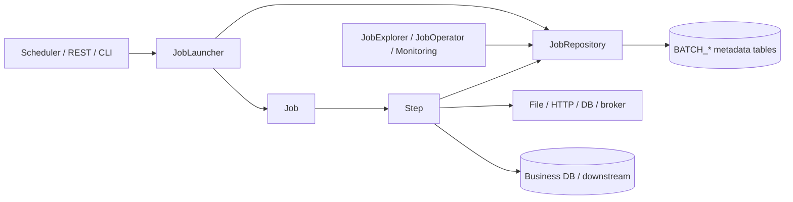
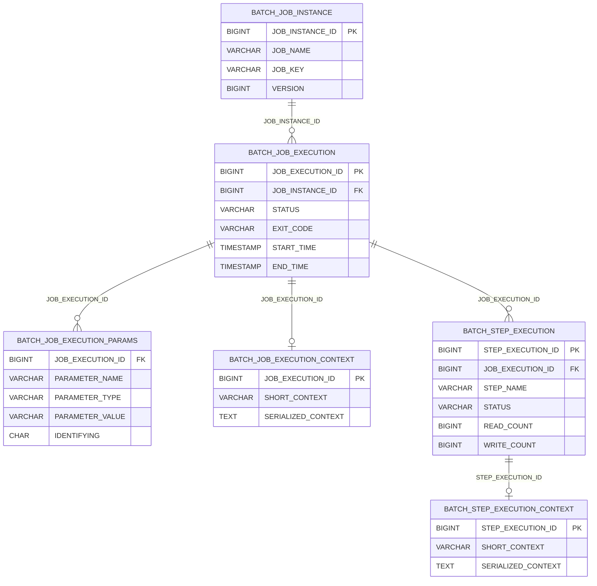
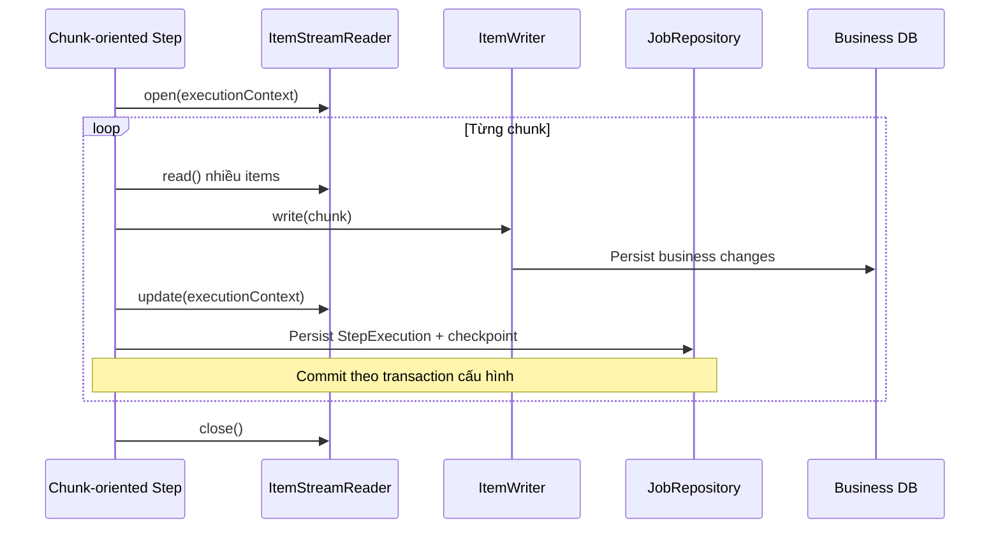
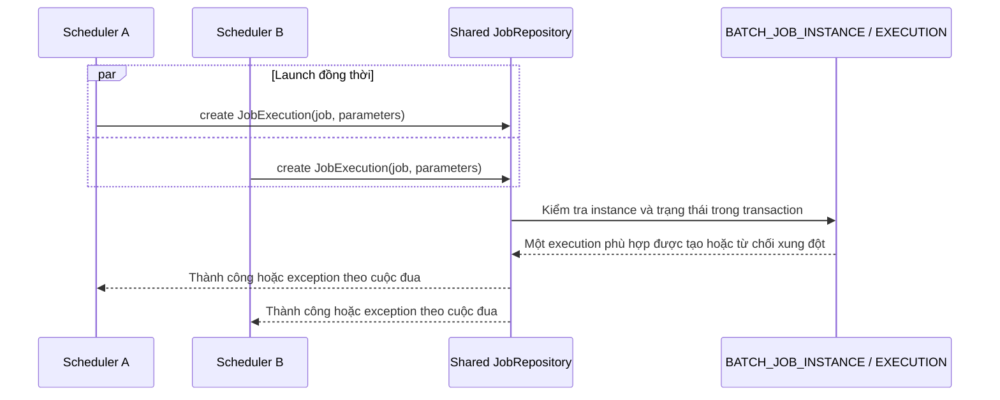

# JobRepository và schema lưu metadata

> **Chương:** Spring Batch  
> **Module:** SPRING_BOOT_INTEGRATION — tích hợp Spring Boot với HTTP client, cơ sở dữ liệu, cache, broker thông điệp và Spring Integration; đặc biệt quan tâm cấu hình, hợp đồng dữ liệu, giao dịch, xử lý lỗi/trùng lặp, kiểm thử và quan sát các luồng tích hợp thực tế.

## 1. Vì sao Spring Batch cần JobRepository?

Giả sử hệ thống nhận file giao dịch mỗi đêm. Một job đọc 100.000 dòng, chuẩn hóa dữ liệu, ghi PostgreSQL và tạo sự kiện cho Kafka. Khi job đã xử lý 60.000 dòng thì ứng dụng bị tắt đột ngột. Lần khởi động sau, hệ thống cần trả lời:

- Job nào đã chạy với **bộ tham số nghiệp vụ** nào?
- Lần chạy trước hoàn tất, thất bại, dừng hay còn được ghi nhận đang chạy?
- Step nào đã xử lý bao nhiêu bản ghi; checkpoint gần nhất là đâu?
- Có thể **restart chính JobInstance** đó hay cần tạo một JobInstance mới?
- Một scheduler khác có đang khởi chạy cùng công việc không?

`JobRepository` là hạ tầng trung tâm của Spring Batch để **lưu và cập nhật metadata của Job và Step**. Khi dùng repository JDBC, metadata nằm trong những bảng `BATCH_*` của database. Đây là dữ liệu vận hành phục vụ quản lý trạng thái và khả năng restart, không phải dữ liệu nghiệp vụ gốc của đơn hàng hay giao dịch.



**Giới hạn quan trọng:** repository ghi lại **trạng thái Spring Batch**; nó không tự khiến thao tác HTTP payment, gửi Kafka hay ghi một database khác trở thành exactly-once. Cần thiết kế idempotency, transaction boundary và recovery cho các side effect bên ngoài.

### 1.1. Mục tiêu bài học

Sau bài, bạn có thể:

1. Phân biệt `Job`, `JobInstance`, `JobExecution`, `StepExecution`, `JobParameters` và `ExecutionContext`.
2. Giải thích sơ đồ quan hệ và ý nghĩa **sáu bảng metadata** của Spring Batch 5.x.
3. Cấu hình `spring-boot-starter-batch`, `DataSource` và cơ chế khởi tạo schema trong Spring Boot 3.x.
4. Phân biệt **lần chạy mới** với **restart** dựa vào identifying JobParameters.
5. Sử dụng `JobBuilder`, `StepBuilder`, `JobLauncher` và `JobExplorer` với JobRepository.
6. Thiết kế checkpoint, transaction, isolation, idempotency và retention phù hợp.
7. Kiểm thử database metadata bằng Testcontainers và quan sát thất bại/restart thực tế.

## 2. Sáu khái niệm nghiệp vụ Spring Batch phải phân biệt

| Đối tượng | Ý nghĩa | Ví dụ |
| --- | --- | --- |
| **`Job`** | Định nghĩa luồng batch gồm một hoặc nhiều Step | `dailyOrderImportJob` |
| **`JobInstance`** | Một lần **định danh công việc logic** bằng `Job name + identifying JobParameters` | Nhập file `orders-2026-11-21.csv` |
| **`JobExecution`** | Một **lần cố gắng thực thi** JobInstance; có status, thời điểm, exit code | Lần đầu FAILED, lần restart sau COMPLETED |
| **`Step`** | Định nghĩa một công đoạn | `parseOrdersStep`, `writeOrdersStep` |
| **`StepExecution`** | Trạng thái/mức tiến độ của một Step trong một JobExecution | readCount=6000, writeCount=5900, rollbackCount=1 |
| **`JobParameters`** | Tham số job, trong đó các tham số *identifying* tham gia định danh JobInstance | `businessDate=2026-11-21` |
| **`ExecutionContext`** | Map trạng thái checkpoint có thể serialize; scope job hoặc step | offset hiện tại trong file, ID record đã xử lý |

### 2.1. Job khác JobInstance

`dailyOrderImportJob` là **định nghĩa Java**; cùng định nghĩa đó có thể được chạy cho nhiều ngày. Nếu parameter định danh `businessDate` là `2026-11-21`, đó là một `JobInstance`. Ngày `2026-11-22` sẽ là JobInstance khác.

**Một JobInstance có thể có nhiều JobExecution** nếu lần trước FAILED/STOPPED và job có thể restart. Không nên hiểu mỗi lần gọi `JobLauncher.run(...)` chắc chắn tạo JobInstance mới.

### 2.2. Ví dụ timeline thất bại và restart

```text
Job = dailyOrderImportJob
Identifying JobParameters = businessDate=2026-11-21

JobInstance #101
  ├── JobExecution #501  STATUS=FAILED
  │     ├── StepExecution parseOrdersStep  READ_COUNT=6000  STATUS=COMPLETED
  │     └── StepExecution writeOrdersStep  WRITE_COUNT=3200 STATUS=FAILED
  └── JobExecution #502  STATUS=COMPLETED  (restart)
        └── StepExecution writeOrdersStep  STATUS=COMPLETED

JobInstance #102
  └── businessDate=2026-11-22 (một công việc logic khác)
```

Hình minh họa giả định các Step restartable và trạng thái step đầu đã được ghi nhận chính xác. Khi restart, một Step đã COMPLETED thường được bỏ qua theo mặc định; một Step thất bại có thể chạy lại từ trạng thái trong `ExecutionContext`. Hành vi phụ thuộc cấu hình job/step, cách reader checkpoint và tham số chạy, không phải bất kỳ job nào cũng tự động tiếp tục đúng số dòng.

### 2.3. Khi nào việc gọi lại bị từ chối?

Với cùng Job name và cùng **identifying parameters**:

- Đã `COMPLETED`: Spring Batch thường từ chối chạy lại chính JobInstance đó (`JobInstanceAlreadyCompleteException`).
- Đang `STARTING/STARTED`: cơ chế repository sẽ bảo vệ việc tạo execution trùng trong các điều kiện hỗ trợ (ví dụ `JobExecutionAlreadyRunningException`).
- `FAILED/STOPPED`: có thể tạo JobExecution mới nếu Job cho phép restart, dữ liệu checkpoint và trạng thái hợp lệ.
- Nếu `Job` được đánh dấu **không restartable**, việc khởi chạy lại instance cũ sẽ bị từ chối theo quy tắc framework.

Trạng thái `UNKNOWN` hoặc execution bị kẹt `STARTED` do tiến trình chết cần **quy trình vận hành xác minh**; không sửa SQL status trực tiếp rồi xem như đã khôi phục nhất quán.

## 3. JobRepository làm gì và không làm gì?

Ở phía ứng dụng, các thành phần thường liên quan:

| API | Chức năng | Cách dùng |
| --- | --- | --- |
| `JobRepository` | Tạo/cập nhật JobExecution, StepExecution, ExecutionContext, trạng thái; lưu metadata | Framework gọi trong lúc launch và chạy |
| `JobLauncher` | Nhận Job + JobParameters để tạo execution và chạy job | Scheduler, CLI, REST trigger |
| `JobExplorer` | **Đọc** JobInstances, executions, step executions từ metadata | Dashboard, API trạng thái, điều tra |
| `JobOperator` | Các tác vụ vận hành như start, stop, restart (tùy phiên bản/cấu hình) | Công cụ điều hành job có phân quyền |
| `PlatformTransactionManager` | Giao dịch repository và/hoặc chunk processing | Phải phân biệt manager metadata với manager nghiệp vụ |
| `JobRegistry` | Danh mục các Job có thể tìm theo tên | Hữu ích khi vận hành nhiều job |

JobRepository **không phải** một queue để lưu bản tin nghiệp vụ, cũng không phải bộ nhớ cache cho cả file đã import. Metadata hữu ích vì nó tạo sự liên tục giữa các tiến trình khi có database bền vững, nhưng bản thân nó không cung cấp durability cho dữ liệu mà ItemWriter gửi ra HTTP/Kafka.

### 3.1. Vì sao database bền vững quan trọng?

Nếu dùng database in-memory như H2 cho kiểm thử, khi JVM tắt dữ liệu metadata có thể biến mất. Mất metadata đồng nghĩa:

- Không còn lịch sử chính xác để xác định instance đã thành công/thất bại.
- Các checkpoint có thể không tồn tại để restart đúng chỗ.
- Một batch import có thể bị chạy lại như một instance mới và tạo duplicate trong business DB.

Trong production, thường dùng một database SQL **bền vững, được backup và cấp quyền phù hợp**, có thể nằm cùng server với business DB nhưng nên quản lý schema, transaction và quyền của metadata riêng.

## 4. Schema JDBC: sáu bảng BATCH_* liên hệ ra sao?

Với Spring Batch **5.x**, JobRepository JDBC thường dùng sáu bảng metadata; các bảng được tạo từ DDL tương ứng **database vendor** trong thư viện Spring Batch, ví dụ PostgreSQL/H2/MySQL.



Sơ đồ rút gọn, **không phải SQL DDL hoàn chỉnh**; các kiểu như `TEXT` chỉ biểu diễn khái niệm, còn DDL thật dùng `CLOB`/`TEXT`/kiểu vendor tương đương. Tên cột, kiểu, độ dài, khóa ngoại, chỉ mục và sequences phải đối chiếu với script Spring Batch **đúng phiên bản**. Không dùng sơ đồ để tự triển khai bảng thủ công trong production.

| Bảng | Lưu dữ liệu | Liên hệ |
| --- | --- | --- |
| **`BATCH_JOB_INSTANCE`** | Job name, key của identifying parameters, version | Một instance → nhiều executions |
| **`BATCH_JOB_EXECUTION`** | Mỗi lần attempt: create/start/end/last updated, status, exit code/message, version | FK tới JobInstance |
| **`BATCH_JOB_EXECUTION_PARAMS`** | Các tham số của từng execution, kiểu, giá trị, cờ identifying | FK tới JobExecution |
| **`BATCH_JOB_EXECUTION_CONTEXT`** | Trạng thái job-scoped được serialize để restart | Một context theo JobExecution |
| **`BATCH_STEP_EXECUTION`** | Step name, status, counters read/write/commit/rollback/skip, version, thời gian | FK tới JobExecution |
| **`BATCH_STEP_EXECUTION_CONTEXT`** | Trạng thái checkpoint của step | Một context theo StepExecution |

### 4.1. BATCH_JOB_INSTANCE: danh tính logic

Các cột chính trong DDL tham khảo Spring Batch 5.2:

```sql
-- Minh họa schema khái niệm, không chạy thay vendor script.
CREATE TABLE BATCH_JOB_INSTANCE (
    JOB_INSTANCE_ID BIGINT PRIMARY KEY,
    VERSION BIGINT,
    JOB_NAME VARCHAR(100) NOT NULL,
    JOB_KEY VARCHAR(32) NOT NULL
);
```

`JOB_KEY` được Spring Batch tạo từ **identifying JobParameters**, chứ không phải hash tùy ý của payload nghiệp vụ. Thay đổi giá trị của parameter non-identifying không tạo JobInstance mới. Tên job cần ổn định theo thời gian để repository nhận diện đúng instance khi restart.

### 4.2. BATCH_JOB_EXECUTION và trạng thái kết thúc

Mỗi attempt sinh một `JOB_EXECUTION_ID` mới và tham chiếu `JOB_INSTANCE_ID`. Một số field có ý nghĩa:

| Cột | Ý nghĩa |
| --- | --- |
| `CREATE_TIME` | Thời điểm tạo execution |
| `START_TIME` | Thời điểm bắt đầu thực thi |
| `END_TIME` | Thời điểm kết thúc; có thể null khi chạy hoặc khi chết trước khi ghi trạng thái cuối |
| `STATUS` | `BatchStatus`: STARTING, STARTED, COMPLETED, FAILED, STOPPED... |
| `EXIT_CODE` | ExitStatus (ví dụ COMPLETED, FAILED hoặc mã custom) |
| `EXIT_MESSAGE` | Mô tả lỗi/kết quả; không nên lưu dữ liệu nhạy cảm |
| `LAST_UPDATED` | Lần cập nhật metadata gần nhất |
| `VERSION` | Optimistic locking khi nhiều tiến trình cùng truy cập |

**`BatchStatus` khác `ExitStatus`:** `BatchStatus` là trạng thái vòng đời nội bộ; `ExitStatus` biểu diễn kết quả để quyết định luồng tiếp theo, có thể được tùy chỉnh. Không nên chỉ dựa vào một chuỗi `EXIT_MESSAGE` tự do để quyết định restart.

### 4.3. BATCH_JOB_EXECUTION_PARAMS: tham số identifying hay không?

Trong Spring Batch 5.x, bảng parameter sử dụng những cột **`PARAMETER_NAME`, `PARAMETER_TYPE`, `PARAMETER_VALUE`, `IDENTIFYING`**. Ví dụ:

| JOB_EXECUTION_ID | PARAMETER_NAME | PARAMETER_TYPE | PARAMETER_VALUE | IDENTIFYING |
| --- | --- | --- | --- | --- |
| 501 | businessDate | java.lang.String | 2026-11-21 | Y |
| 501 | sourceFile | java.lang.String | orders-2026-11-21.csv | Y |
| 501 | requestedBy | java.lang.String | scheduler-a | N |
| 502 | businessDate | java.lang.String | 2026-11-21 | Y |
| 502 | sourceFile | java.lang.String | orders-2026-11-21.csv | Y |
| 502 | requestedBy | java.lang.String | recovery-operator | N |

Hai executions 501 và 502 ở cùng JobInstance khi identifying values không đổi, dù `requestedBy` khác. Đây là dữ liệu **minh họa**, không phải row đã đọc từ database thật.

Điểm khác biệt dễ gây lỗi nâng cấp:

- **Spring Batch 4.x** có các cột như `TYPE_CD`, `KEY_NAME`, `STRING_VAL`, `DATE_VAL`, `LONG_VAL`, `DOUBLE_VAL`.
- **Spring Batch 5.x** chuyển sang `PARAMETER_NAME`, `PARAMETER_TYPE`, `PARAMETER_VALUE` và cờ `IDENTIFYING`. Khi nâng cấp từ 4 lên 5 **phải migration metadata schema**, không chỉ nâng version dependency.
- Cột `PARAMETER_TYPE` chứa type của parameter; khi dùng type custom, bảo đảm converter có thể đọc lại giá trị sau restart hoặc sau nâng phiên bản code.

**Không lưu API key, password, token hoặc PII không cần thiết trong JobParameters.** Chúng được persist vào bảng metadata và có thể được xem bởi công cụ vận hành, backup hoặc các job khác có quyền đọc.

### 4.4. BATCH_STEP_EXECUTION: dữ liệu tiến độ và counters

Spring Batch ghi một `StepExecution` cho mỗi lần thực thi step. Những cột quan trọng:

| Cột | Dùng để làm gì? |
| --- | --- |
| `STEP_EXECUTION_ID` | ID duy nhất cho attempt của một step |
| `JOB_EXECUTION_ID` | Liên kết attempt của step với attempt của job |
| `STEP_NAME` | Tên step ổn định dùng trong xử lý restart |
| `STATUS`, `EXIT_CODE` | Trạng thái vòng đời và kết quả step |
| `READ_COUNT` | Số item đọc qua reader |
| `FILTER_COUNT` | Số item bị processor lọc |
| `WRITE_COUNT` | Số item được writer xử lý/ghi theo counters |
| `COMMIT_COUNT` | Số lần transaction chunk được commit |
| `ROLLBACK_COUNT` | Số lần rollback; có thể bao gồm retry/skip-recovery |
| `READ_SKIP_COUNT`, `PROCESS_SKIP_COUNT`, `WRITE_SKIP_COUNT` | Số item bỏ qua theo vị trí lỗi |
| `CREATE_TIME`, `START_TIME`, `END_TIME`, `LAST_UPDATED` | Mốc thời gian và lần metadata được lưu |
| `VERSION` | Optimistic locking metadata |

Từ `READ_COUNT` và `WRITE_COUNT` không thể suy rằng mọi side effect HTTP/Kafka đã hoàn tất theo exactly-once. Nếu writer phát message mà không đợi broker ACK hoặc lệnh HTTP thực thi ngoài transaction, counter chỉ phản ánh cách code writer hoạt động.

### 4.5. Hai bảng ExecutionContext: trạng thái checkpoint bền vững

| Bảng | Nội dung | Khi được sử dụng |
| --- | --- | --- |
| `BATCH_JOB_EXECUTION_CONTEXT` | Map key/value ở **scope job** | Truyền/trữ state cần dùng qua các steps |
| `BATCH_STEP_EXECUTION_CONTEXT` | Map key/value ở **scope step** | Vị trí đọc file, checkpoint, token phân trang, trạng thái reader |

Schema tham khảo có các cột `SHORT_CONTEXT` và `SERIALIZED_CONTEXT`. Dữ liệu context cần được serialize và có khả năng đọc lại khi restart; trong Spring Batch 5.x, serializer mặc định và cách thể hiện serialized payload **không giống mặc định của mọi thế hệ Spring Batch trước đó**.

Một context nên nhỏ và rõ:

```text
StepExecutionContext:
  reader.current.count = 6000
  sourceFileId = "file-2026-11-21"
  lastConfirmedRecordId = "r-5999"

Không lưu:
  - 6000 bản ghi dữ liệu nguyên gốc
  - connection, HTTP client, InputStream hay entity manager
  - password, API key, JWT
  - object Java không thể serialize/không tương thích khi nâng version
```

**Checkpoint không phải dấu bảo đảm cuối cùng của business side effects.** Nó chỉ bền vững ở những thời điểm framework lưu context/commit transaction thích hợp. Nếu writer xử lý HTTP side effect trước khi checkpoint được commit, restart có thể gửi lại cùng tác vụ. Reader và writer phải thiết kế replay an toàn.

### 4.6. Sequences và VERSION trong metadata

Các ID chính của `JobInstance`, `JobExecution`, `StepExecution` được cấp qua sequence hoặc cơ chế tương đương theo database vendor, **không phụ thuộc tự động vào `AUTO_INCREMENT` của riêng database ứng dụng**.

Trong schema PostgreSQL tham khảo cho **Spring Batch 5.2**, tên thường thấy là:

```sql
-- Tên sequence tham khảo Batch 5.2 PostgreSQL.
CREATE SEQUENCE BATCH_JOB_SEQ;
CREATE SEQUENCE BATCH_JOB_EXECUTION_SEQ;
CREATE SEQUENCE BATCH_STEP_EXECUTION_SEQ;
```

Một số vendor không hỗ trợ cùng cú pháp sequence sẽ có bảng/DDL thay thế. **Không đoán tên theo Spring Batch 6.x** hoặc copy DDL từ blog cũ vào schema 5.x: luôn chọn script tương ứng với artifact Spring Batch Core trong ứng dụng.

Các cột `VERSION` phục vụ **optimistic locking** của metadata. Khi hai tiến trình cùng cố ghi một execution ở version cũ, framework có thể báo `OptimisticLockingFailureException`. Không chỉnh version bằng SQL hoặc tắt constraint để “sửa” va chạm; cần điều tra concurrent launches, transaction isolation và JobRepository đang chia sẻ.

## 5. Khởi tạo metadata schema: local khác production

### 5.1. Dependency cho Spring Boot 3.x

Với Spring Boot 3.x, Java 17+ và PostgreSQL:

```groovy
// build.gradle — dự án đã sử dụng Spring Boot plugin/BOM
dependencies {
    implementation 'org.springframework.boot:spring-boot-starter-batch'
    runtimeOnly 'org.postgresql:postgresql'

    testImplementation 'org.springframework.boot:spring-boot-starter-test'
    testImplementation 'org.springframework.batch:spring-batch-test'
}
```

Maven tương đương:

```xml
<dependency>
    <groupId>org.springframework.boot</groupId>
    <artifactId>spring-boot-starter-batch</artifactId>
</dependency>
<dependency>
    <groupId>org.postgresql</groupId>
    <artifactId>postgresql</artifactId>
    <scope>runtime</scope>
</dependency>
```

Để **Spring Boot BOM** chọn phiên bản Spring Batch 5.x/JDBC driver phù hợp với phiên bản Boot đang dùng. Nếu nâng lên Boot 4.x / Spring Batch 6.x, các API, auto-configuration, repository store và DDL có thể khác: không sao chép schema 5.x cho phiên bản mới mà chưa đối chiếu migration guide.

### 5.2. application.yml: JDBC metadata database

```yaml
spring:
  datasource:
    url: ${BATCH_JDBC_URL}
    username: ${BATCH_DB_USER}
    password: ${BATCH_DB_PASSWORD}
  batch:
    jdbc:
      initialize-schema: never
    job:
      enabled: false
```

Ý nghĩa:

- `spring.datasource.*` tạo `DataSource` để repository lưu metadata (và có thể cũng là data source nghiệp vụ nếu app thiết kế như vậy).
- `spring.batch.jdbc.initialize-schema=never` yêu cầu **không tự chạy script tạo bảng**. Trong production, dùng Flyway/Liquibase hoặc migration DBA được review trước khi khởi chạy job.
- `spring.batch.job.enabled=false` **chỉ tắt việc Boot tự chạy Job khi ứng dụng startup**; nó không tắt Spring Batch, không xóa JobRepository và không có nghĩa không thể launch job qua scheduler/JobLauncher.
- Không commit `BATCH_DB_PASSWORD` vào Git; không cung cấp default password production trong YAML.

### 5.3. Ba chế độ initialize-schema

| Mode | Hành vi Spring Boot 3.x | Khi sử dụng |
| --- | --- | --- |
| `embedded` (mặc định phổ biến) | Tự chạy script khi dùng embedded database tương thích | Local/test với H2/HSQL/Derby; không dùng để giả định production PostgreSQL đã có bảng |
| `always` | Cố gắng chạy schema script lúc startup với database được hỗ trợ | Dev/test hoặc môi trường triển khai có chính sách kiểm soát chặt |
| `never` | Không chạy script tự khởi tạo Batch schema | **Production** đã quản lý schema qua migration |

Ví dụ local H2:

```yaml
# application-local.yml — chỉ dành cho môi trường thí nghiệm
spring:
  datasource:
    url: jdbc:h2:mem:batchdemo;DB_CLOSE_DELAY=-1
    username: sa
    password: ""
  batch:
    jdbc:
      initialize-schema: always
    job:
      enabled: false
```

Không lấy cấu hình H2 để chứng minh PostgreSQL transaction isolation, locking hoặc tương thích DDL. Nếu tắt `initialize-schema` mà không tạo bảng, lần chạy job có thể lỗi như “relation `batch_job_instance` does not exist” khi repository truy cập metadata.

### 5.4. Schema script đúng phiên bản, đúng database

Trong Spring Batch Core 5.x, các script DDL mẫu thường có dạng:

```text
classpath:org/springframework/batch/core/schema-h2.sql
classpath:org/springframework/batch/core/schema-postgresql.sql
classpath:org/springframework/batch/core/schema-mysql.sql
...
```

**Chỉ là đường dẫn tham khảo**; xác minh script thực sự có trong Spring Batch Core của build. Spring Boot có thể nhận biết database vendor và chạy script tương ứng. Có thể tùy chọn nguồn schema qua `spring.batch.jdbc.schema` khi môi trường cần script riêng, nhưng nếu có Flyway/Liquibase, nên thống nhất **một hệ thống quản lý schema** để tránh xung đột khởi tạo.

Ví dụ rủi ro: production khởi động nhiều replicas cùng `initialize-schema=always`, mỗi instance cố tạo cùng bảng/sequences, khiến startup lỗi hoặc tạo môi trường migration không kiểm soát. **Không dùng `continue-on-error` để che schema mismatch** rồi bắt job chạy tiếp.

### 5.5. Schema là tài sản vận hành, không phải bảng tạm

Metadata không chỉ phục vụ một lần chạy hiện tại: nó còn chứa lịch sử và checkpoint cho lần restart sau. Vì vậy:

1. Lưu schema metadata trên storage bền vững; backup và restore thử định kỳ.
2. Quyết định database/schema owner và quyền đọc/ghi tương ứng cho app, operator, migration.
3. Migrations có version, phê duyệt, backup và kế hoạch rollback; không tự động DROP/CREATE bảng khi deploy.
4. Khi restore business DB và metadata DB riêng, phải xét **khả năng nhất quán giữa hai mốc backup**.
5. Tách bảng nghiệp vụ và bảng metadata bằng schema/database phù hợp nếu cần phân quyền hoặc tránh contention.

Việc quản lý tốt schema metadata liên quan trực tiếp tới độ tin cậy của các luồng tích hợp dữ liệu, đặc biệt khi job đọc một nguồn rồi phát HTTP/Kafka hay ghi nhiều hệ thống.

## 6. Spring Boot tự cấu hình JobRepository như thế nào?

Với Spring Boot 3.x có `spring-boot-starter-batch`, `DataSource` và `PlatformTransactionManager` phù hợp, Boot có thể cấu hình hạ tầng batch như `JobRepository`, `JobLauncher`, `JobExplorer` và runner. Điều kiện bean phụ thuộc classpath, transaction manager, các bean người dùng tự khai báo và phiên bản Boot.

### 6.1. Tránh dùng @EnableBatchProcessing không cần thiết

Trong ứng dụng Boot 3.x **đã dựa vào auto-configuration**, thông thường **không cần** viết:

```java
// KHÔNG THÊM CHỈ VÌ MUỐN DÙNG JobRepository:
// @EnableBatchProcessing
```

Việc thêm `@EnableBatchProcessing` hoặc kế thừa `DefaultBatchConfiguration` chủ động chuyển sang **Spring Batch configuration thủ công**, khiến **Boot Batch auto-configuration back off**, bao gồm cả cơ chế Boot tự khởi tạo schema metadata. Sau đó ứng dụng phải quản lý JobRepository, transaction manager, schema và các bean liên quan bằng cấu hình tương ứng.

Khi startup không tìm thấy `BATCH_JOB_INSTANCE`, không nên khắc phục bằng cách thêm `@EnableBatchProcessing` tùy tiện. Cần xác minh Boot đang giữ quyền auto-config hay ứng dụng đã chủ động thay thế, đồng thời xác nhận schema thật sự được tạo bằng đúng DDL.

### 6.2. Boot tự chạy Job khi startup

Khi auto-configuration batch hoạt động, Boot có thể tự khởi chạy **Job bean duy nhất** lúc startup. Có nhiều Job bean thì thường cần chỉ rõ tên job cần chạy.

```yaml
spring:
  batch:
    job:
      enabled: false
```

Với dịch vụ HTTP có batch job được trigger qua scheduler/API được phân quyền, việc **tắt auto-run ở startup** thường an toàn hơn để không vô tình chạy lại import sau một rolling deployment. Scheduler phải phối hợp với JobInstance identity và chống concurrent launch, không dựa duy nhất vào việc bean tồn tại.

### 6.3. JobRepository và DataSource nghiệp vụ

Có hai thiết kế:

| Kiểu | Đặc điểm | Đánh đổi |
| --- | --- | --- |
| **Dùng chung một DataSource** | Bảng `BATCH_*` và bảng business chung database (có thể khác schema) | Dễ cấu hình, một transaction manager khi xử lý đồng bộ đúng cách; cần phân quyền/index và giới hạn pool |
| **DataSource metadata riêng** | Một database hoặc schema/cụm khác cho JobRepository | Cách ly tải/quyền tốt hơn, nhưng metadata commit và business commit **không còn tự atomic** |

Trong Boot 3.x, nếu cần DataSource riêng, sử dụng cơ chế `@BatchDataSource` theo tài liệu đúng phiên bản, đồng thời chọn `@BatchTransactionManager` nếu cần transaction manager chuyên dụng. Với nhiều `DataSource`, phải đánh dấu bean `@Primary` hoặc hạn chế default candidate một cách rõ ràng để tránh ambiguity.

**Cảnh báo:** với bước chunk có transaction manager của business DB khác với transaction manager của JobRepository, việc commit dữ liệu và cập nhật checkpoint **không mặc định nằm trong một transaction nguyên tử**. Nếu crash sau business commit nhưng trước metadata update, step có thể được chạy lại và ghi trùng. Thiết kế idempotent writer và khôi phục là bắt buộc.

### 6.4. Table prefix và nhiều bộ schema

Mặc định bảng tên `BATCH_*`. Spring Batch 5.x cho phép cấu hình **table prefix** của repository, ví dụ `TENANT_A_BATCH_` hoặc tên schema kèm prefix trong cấu hình thủ công:

```java
// Chỉ minh họa khi CHỦ ĐỘNG cấu hình Spring Batch thủ công.
@EnableBatchProcessing(
    tablePrefix = "APP_BATCH_",
    isolationLevelForCreate = "SERIALIZABLE")
```

Khi đổi prefix:

1. **Tạo hoặc migration bộ bảng/sequence khớp prefix mới**; đừng kỳ vọng property tự đổi tên bảng đã tồn tại.
2. `JobRepository` và `JobExplorer` phải dùng **cùng prefix/schema**.
3. Các operator, SQL báo cáo và retention jobs phải truy vấn đúng bảng.
4. DDL gốc được cung cấp với prefix mặc định; nếu tự tạo schema mới, cần review toàn bộ tên constraints/sequences/index.

Đoạn annotation ở trên **không phải một class Java hoàn chỉnh**, chỉ là fragment để nêu chỗ cấu hình khi chọn manual mode. Với Spring Boot 3.x, đừng kết hợp đồng thời manual `@EnableBatchProcessing` và kỳ vọng mọi thuộc tính `spring.batch.jdbc.*` của Boot vẫn tự vận hành.

## 7. Mẫu Job dùng JobRepository: Java 17 / Batch 5.x

Một cấu hình Spring Batch 5.x dùng `JobBuilder` và `StepBuilder` mới nhận `JobRepository` trong constructor. Đoạn sau cố tình làm ít công việc nghiệp vụ: nó tập trung vào **lifecycle metadata**, không phải hướng dẫn cách viết reader/writer phức tạp.

### 7.1. Job có hai Step

```java
import org.springframework.batch.core.Job;
import org.springframework.batch.core.Step;
import org.springframework.batch.core.job.builder.JobBuilder;
import org.springframework.batch.core.repository.JobRepository;
import org.springframework.batch.core.step.builder.StepBuilder;
import org.springframework.batch.repeat.RepeatStatus;
import org.springframework.beans.factory.annotation.Qualifier;
import org.springframework.context.annotation.Bean;
import org.springframework.context.annotation.Configuration;
import org.springframework.transaction.PlatformTransactionManager;

@Configuration(proxyBeanMethods = false)
public class DailyOrderBatchConfiguration {

    @Bean
    Step validateSourceStep(JobRepository jobRepository,
                            PlatformTransactionManager txManager) {
        return new StepBuilder("validateSourceStep", jobRepository)
                .tasklet((contribution, chunkContext) -> {
                    Object sourceFile = chunkContext.getStepContext()
                            .getJobParameters().get("sourceFile");
                    if (!(sourceFile instanceof String file)
                            || file.isBlank()) {
                        throw new IllegalArgumentException(
                                "sourceFile job parameter is required");
                    }
                    contribution.getStepExecution()
                            .getExecutionContext()
                            .putString("validatedSourceFile", file);
                    return RepeatStatus.FINISHED;
                }, txManager)
                .build();
    }

    @Bean
    Step importOrdersStep(JobRepository jobRepository,
                          PlatformTransactionManager txManager) {
        return new StepBuilder("importOrdersStep", jobRepository)
                .tasklet((contribution, chunkContext) -> {
                    Object fail = chunkContext.getStepContext()
                            .getJobParameters().get("simulateFailure");
                    if ("true".equalsIgnoreCase(String.valueOf(fail))) {
                        throw new IllegalStateException(
                                "Simulated failure before importing");
                    }

                    // Demo: không có side effect nghiệp vụ.
                    // Một import thật sẽ dùng restartable reader/writer.
                    contribution.getStepExecution()
                            .getExecutionContext()
                            .putString("importPhase", "completed");
                    return RepeatStatus.FINISHED;
                }, txManager)
                .build();
    }

    @Bean
    Job dailyOrderImportJob(JobRepository jobRepository,
                            @Qualifier("validateSourceStep") Step validateSourceStep,
                            @Qualifier("importOrdersStep") Step importOrdersStep) {
        return new JobBuilder("dailyOrderImportJob", jobRepository)
                .start(validateSourceStep)
                .next(importOrdersStep)
                .build();
    }
}
```

**Giải thích:**

- `new JobBuilder(name, jobRepository)` và `new StepBuilder(name, jobRepository)` là phong cách API của **Spring Batch 5.x**. Không lấy ví dụ Batch 4 cũ dùng `JobBuilderFactory`/`StepBuilderFactory` rồi giả định chúng phù hợp.
- `tasklet(..., txManager)` chỉ rõ transaction manager cho step. Nếu có nhiều managers, cần xác định manager đúng; không để injection mơ hồ.
- `ExecutionContext` ở step có thể lưu checkpoint nhỏ. Ở ví dụ này nó chỉ chứa chuỗi minh họa; không có `ItemStream`/reader thật nên **chưa thể bảo đảm restart từ dòng file cuối**.
- `simulateFailure` giúp minh họa failed execution. **Không đưa flag giả lập lỗi vào hệ thống production**; trong demo nó được truyền như non-identifying parameter.
- Với chunk-oriented step dùng `.<I,O>chunk(size, txManager).reader(...).processor(...).writer(...)` và lưu checkpoint theo chunk. Tên Step phải ổn định qua deployment nếu muốn lịch sử và restart chính xác.

### 7.2. Truyền identifying và non-identifying JobParameters

```java
import java.time.LocalDate;
import org.springframework.batch.core.Job;
import org.springframework.batch.core.JobExecution;
import org.springframework.batch.core.JobParameters;
import org.springframework.batch.core.JobParametersBuilder;
import org.springframework.batch.core.launch.JobLauncher;
import org.springframework.beans.factory.annotation.Qualifier;
import org.springframework.stereotype.Service;

@Service
public class DailyImportLauncher {
    private final JobLauncher jobLauncher;
    private final Job job;

    public DailyImportLauncher(
            JobLauncher jobLauncher,
            @Qualifier("dailyOrderImportJob") Job job) {
        this.jobLauncher = jobLauncher;
        this.job = job;
    }

    public Long start(LocalDate businessDate, String sourceFile,
                      boolean simulateFailure) throws Exception {
        JobParameters parameters = new JobParametersBuilder()
                .addString("businessDate", businessDate.toString(), true)
                .addString("sourceFile", sourceFile, true)
                .addString("simulateFailure",
                        Boolean.toString(simulateFailure), false)
                .toJobParameters();

        JobExecution execution = jobLauncher.run(job, parameters);
        return execution.getId();
    }
}
```

Ở `addString(name, value, identifying)`, tham số cuối xác định có tham gia tính `JobInstance` identity hay không. Chạy:

```text
start(2026-11-21, "orders-21.csv", true)  → JobInstance A, JobExecution 1 FAILED
start(2026-11-21, "orders-21.csv", false) → JobInstance A, JobExecution 2 COMPLETED
start(2026-11-22, "orders-22.csv", false) → JobInstance B, JobExecution 3 COMPLETED
```

Các ID/tình huống trên chỉ là **kịch bản minh họa**; thực tế lỗi/số execution phụ thuộc trạng thái và việc chạy job. Nếu file nội dung thay đổi nhưng vẫn có cùng tên, JobParameters có thể không phân biệt được **công việc logic đã thay đổi**. Hãy dùng source ID, checksum hoặc phiên bản input bất biến trong identifying parameters khi cần.

**Một điểm vận hành:** `JobLauncher.run(...)` không bảo đảm luôn trả về ngay lập tức; nếu launcher dùng executor đồng bộ, method có thể chỉ trả khi job chạy xong. Nếu bạn muốn HTTP trả `202 Accepted` ngay với execution ID, phải thiết kế async launcher/task executor, queue và cơ chế truy vấn trạng thái rõ ràng. Không đưa user input trực tiếp vào tên Job hoặc đường dẫn file mà chưa xác thực/ủy quyền.

### 7.3. Đọc metadata qua JobExplorer

```java
import java.util.Optional;
import org.springframework.batch.core.JobExecution;
import org.springframework.batch.core.explore.JobExplorer;
import org.springframework.stereotype.Service;

record JobExecutionSummary(
        Long executionId,
        Long instanceId,
        String jobName,
        String batchStatus,
        String exitCode) {
}

@Service
public class BatchStatusService {
    private final JobExplorer explorer;

    public BatchStatusService(JobExplorer explorer) {
        this.explorer = explorer;
    }

    public Optional<JobExecutionSummary> find(Long executionId) {
        JobExecution execution = explorer.getJobExecution(executionId);
        if (execution == null) {
            return Optional.empty();
        }
        return Optional.of(new JobExecutionSummary(
                execution.getId(),
                execution.getJobInstance().getId(),
                execution.getJobInstance().getJobName(),
                execution.getStatus().name(),
                execution.getExitStatus().getExitCode()));
    }
}
```

`JobExplorer` được thiết kế để đọc lịch sử; tránh tự chỉnh cột trạng thái bằng SQL khi đã có API vận hành của framework. Khi phát hành một endpoint trạng thái, phải kiểm tra **quyền xem execution/tenant** và không trả nguyên `JobParameters`, `ExitMessage` hoặc `ExecutionContext` nếu chúng có thể chứa dữ liệu nhạy cảm.

### 7.4. Tại sao không gọi JobRepository.createJobExecution thủ công?

Thường bạn **không cần** trực tiếp gọi `jobRepository.createJobExecution(...)` từ controller. `JobLauncher` đã phối hợp kiểm tra trạng thái, tạo execution và gọi Job. Một custom scheduler nên dùng `JobLauncher`, còn dashboard dùng `JobExplorer`, việc stop/restart do `JobOperator` phù hợp đảm nhiệm.

Việc tự ghi `BATCH_JOB_EXECUTION` bằng SQL, tự chọn `JOB_EXECUTION_ID` hoặc đổi `STATUS=COMPLETED` bằng tay sẽ phá vỡ logic xác định instance, version, transaction và restart.

## 8. Kiểm tra metadata bằng SQL đọc-only

Trong môi trường kiểm thử/điều tra có quyền đọc, có thể dùng SQL sau (cú pháp giới hạn `LIMIT` minh họa cho PostgreSQL).

### 8.1. Các execution gần nhất của một Job

```sql
SELECT ji.JOB_NAME,
       ji.JOB_INSTANCE_ID,
       je.JOB_EXECUTION_ID,
       je.STATUS,
       je.EXIT_CODE,
       je.CREATE_TIME,
       je.START_TIME,
       je.END_TIME,
       je.LAST_UPDATED
FROM BATCH_JOB_INSTANCE ji
JOIN BATCH_JOB_EXECUTION je
  ON je.JOB_INSTANCE_ID = ji.JOB_INSTANCE_ID
WHERE ji.JOB_NAME = 'dailyOrderImportJob'
ORDER BY je.CREATE_TIME DESC, je.JOB_EXECUTION_ID DESC
LIMIT 20;
```

Nếu một JobInstance có hai attempts, cùng `JOB_INSTANCE_ID` sẽ xuất hiện ở hai rows với `JOB_EXECUTION_ID` khác nhau. Một hàng `STARTED` kéo dài có thể là job thật đang chạy hoặc process đã chết trước khi cập nhật trạng thái: cần đối chiếu worker, heartbeat/log và orchestration.

### 8.2. Xem identifying parameters đã lưu

```sql
SELECT p.JOB_EXECUTION_ID,
       p.PARAMETER_NAME,
       p.PARAMETER_TYPE,
       p.PARAMETER_VALUE,
       p.IDENTIFYING
FROM BATCH_JOB_EXECUTION_PARAMS p
WHERE p.JOB_EXECUTION_ID = :execution_id
ORDER BY p.PARAMETER_NAME;
```

`:execution_id` là named SQL parameter do công cụ/JDBC layer hỗ trợ, không phải cú pháp native PostgreSQL khi paste trực tiếp vào `psql`. Nếu SQL client không hỗ trợ named params, dùng bind parameter theo công cụ hoặc thay bằng một số ID **không đến từ input chưa xác minh**. Không tùy ý SELECT và chia sẻ bảng này cho người không có quyền xem tham số vận hành.

### 8.3. Quan sát tiến độ StepExecution

```sql
SELECT se.JOB_EXECUTION_ID,
       se.STEP_NAME,
       se.STEP_EXECUTION_ID,
       se.STATUS,
       se.READ_COUNT,
       se.FILTER_COUNT,
       se.WRITE_COUNT,
       se.COMMIT_COUNT,
       se.ROLLBACK_COUNT,
       se.READ_SKIP_COUNT,
       se.PROCESS_SKIP_COUNT,
       se.WRITE_SKIP_COUNT,
       se.LAST_UPDATED
FROM BATCH_STEP_EXECUTION se
WHERE se.JOB_EXECUTION_ID = :execution_id
ORDER BY se.STEP_EXECUTION_ID;
```

Các counters giúp điều tra năng suất và rollback/skip, nhưng không dùng chúng như bằng chứng rằng mọi dịch vụ nhận dữ liệu downstream đã commit. Nếu step cần exactly-once business semantics, phải kiểm tra side effect store, idempotency key và replay behavior.

## 9. Restartability: ExecutionContext và thời điểm checkpoint

`ExecutionContext` là một trong những lý do quan trọng nhất để giữ metadata **bền vững và nhất quán**. Một reader đọc file 100.000 dòng không nên luôn bắt đầu lại từ dòng 1 khi JVM crash ở dòng 60.000. Reader cần thực hiện hợp đồng `ItemStream` để biết cách khôi phục vị trí.

### 9.1. ItemStream và các điểm lưu state

Với chunk-oriented step:

1. Framework mở reader/stream và gọi `open(executionContext)` để khôi phục checkpoint nếu có.
2. `ItemReader.read()` trả từng item; processor có thể biến đổi hoặc lọc; writer xử lý chunk.
3. Trước điểm commit thích hợp, `update(executionContext)` cho các streams ghi thông tin checkpoint mới.
4. Metadata và business transaction được commit theo transaction boundaries đã cấu hình.
5. Khi kết thúc, `close()` giải phóng tài nguyên.



Sơ đồ mô tả thứ tự logic, không phải mọi JDBC command hoặc transaction synchronization nội bộ; nếu metadata và business DB dùng hai transaction managers khác nhau, **không có atomic commit mặc định** giữa các bước trên.

### 9.2. Ví dụ ItemStreamReader lưu chỉ số item

Đây là một ví dụ thu nhỏ để hiểu contract. Danh sách đầu vào phải **không thay đổi giữa các lần restart**; với file hoặc pagination thật, cần nhận diện nguồn dữ liệu bất biến và cách đánh dấu vị trí đúng.

```java
import java.util.List;
import org.springframework.batch.item.ExecutionContext;
import org.springframework.batch.item.ItemStreamReader;

public final class RestartableListReader
        implements ItemStreamReader<String> {
    private static final String KEY = "orders.reader.nextIndex";
    private final List<String> items;
    private int nextIndex;

    public RestartableListReader(List<String> items) {
        this.items = List.copyOf(items);
    }

    @Override
    public void open(ExecutionContext context) {
        nextIndex = context.getInt(KEY, 0);
    }

    @Override
    public String read() {
        if (nextIndex >= items.size()) {
            return null;
        }
        return items.get(nextIndex++);
    }

    @Override
    public void update(ExecutionContext context) {
        context.putInt(KEY, nextIndex);
    }

    @Override
    public void close() {
        // Không có stream/socket cần đóng trong ví dụ này.
    }
}
```

Đây là **mô phỏng reader restartable**, không phải adapter production. Khi dùng `FlatFileItemReader`, `JdbcPagingItemReader` hoặc cursor reader, cần đọc cấu hình `saveState`, `name`, paging/order và transaction behavior. Với reader có state, nên dùng `@StepScope` hoặc tạo instance riêng cho từng StepExecution để tránh nhiều job chia sẻ mutable cursor.

**Cảnh báo về thứ tự và dữ liệu thay đổi:** nếu tập dữ liệu nguồn bị thêm/xóa, dùng index 6000 để restart có thể bỏ sót hoặc đọc trùng record. Khi xử lý file, dùng file checksum/version; khi đọc DB, dùng stable ordering và snapshot/keyset/cursor phù hợp; khi đọc message broker, dùng cơ chế offset/checkpoint gốc của broker và idempotency.

### 9.3. Chunk size ảnh hưởng cơ chế phục hồi

Giả sử mỗi chunk xử lý 100 bản ghi:

```text
Chunk 1..59: commit thành công và checkpoint ≈ 5900 items
Chunk 60:    đọc/ghi tới 5970 rồi lỗi trước commit
Restart:     đọc lại từ checkpoint gần nhất, xử lý lại chunk chưa commit
```

Với writer dùng cùng transactional database và manager phù hợp, phần ghi chưa commit có thể rollback đồng bộ với metadata; nhưng nếu writer đã gửi HTTP, email hoặc Kafka trực tiếp thì side effect **có thể đã được thực hiện** trước khi chunk rollback. Do đó:

- Không gửi payment/email trực tiếp trong chunk nếu không có cơ chế idempotency/reconciliation.
- Dùng **transactional outbox** cho DB → Kafka khi cần durability và có cơ chế idempotent consumer.
- Dùng unique business key hoặc processed-event table để việc chạy lại chunk không nhân đôi side effect.
- Không tăng chunk size vô hạn: chunk lớn giảm số commit nhưng có thể tăng memory, lock time, khối lượng cần replay sau lỗi.

### 9.4. Restart, re-run và rerun Step đã hoàn tất

Đối với Spring Batch 5.x:

- **Restart:** cùng tên Job và cùng identifying parameters → JobExecution mới của **JobInstance cũ**.
- **New instance:** thay đổi identifying parameters → một đơn vị công việc logic mới; có thể xử lý lại toàn bộ nguồn nếu không cẩn thận.
- **Completed Step:** trên restart, step COMPLETED thường được skip; nếu thật sự phải chạy lại step, có thể cấu hình `allowStartIfComplete(true)`.
- **Giới hạn số lần chạy Step:** `startLimit(n)` dùng để giới hạn attempts của một step trong JobInstance; không thay thế retry ở cấp item.
- **Không cho restart:** `new JobBuilder("...", repository).preventRestart()` với job chỉ được xử lý một lần theo contract.

```java
// Fragments minh họa Spring Batch 5.x.
new StepBuilder("validateSourceStep", jobRepository)
        .tasklet(validationTasklet, transactionManager)
        .allowStartIfComplete(true)
        .build();

new JobBuilder("oneShotJob", jobRepository)
        .preventRestart()
        .start(oneShotStep)
        .build();
```

Hai fragment giả định các biến `jobRepository`, `validationTasklet`, `transactionManager` và `oneShotStep` đã được định nghĩa. Chỉ bật `allowStartIfComplete(true)` nếu việc chạy lại step đã hoàn tất **đúng ngữ nghĩa và an toàn**; không bật cho bước tạo hóa đơn hoặc phát lệnh thanh toán không idempotent.

### 9.5. Không để class name trong ExecutionContext phá restart

Ở Spring Batch 5.x, `ExecutionContext` có serializer có thể được tùy biến, nhưng dữ liệu sẽ được đọc lại sau restart hoặc deploy version mới. Nếu serialize nguyên một object Java phức tạp rồi thay package/class/serialVersionUID, việc khôi phục có thể thất bại dù schema SQL không đổi.

Thực hành tốt:

- Ưu tiên string, number, ID, cursor, checkpoint rất nhỏ và ổn định.
- Đừng lưu socket/connection, transaction object, entity JPA, raw file content hay credential.
- Test restart từ metadata của **phiên bản code cũ sang code mới** khi nâng cấp job đang chạy lâu.
- Quyết định migration context format/serializer nếu đã đổi representation.

## 10. Giao dịch JobRepository và xử lý cạnh tranh

### 10.1. Isolation khi tạo JobExecution

Spring Batch sử dụng transactional advice cho những thao tác quan trọng của JobRepository. Khi hai scheduler cố tạo execution cùng tên Job + cùng identifying parameters:



Với cấu hình tham khảo Spring Batch 5.x, `isolationLevelForCreate` mặc định thường là `SERIALIZABLE` nhằm bảo vệ thao tác tạo job khi cạnh tranh. Có thể điều chỉnh tùy database/tải, nhưng phải **kiểm chứng concurrent launches**, unique constraints và transaction behavior thật. Không đổi thành `READ_UNCOMMITTED` chỉ để giảm lock mà bỏ qua nguy cơ chạy trùng nghiệp vụ.

**Điều kiện để coordination hiệu quả:** những instance ứng dụng cùng điều phối một Job phải nhìn thấy **cùng JobRepository và identifying parameter contract**. Nếu mỗi pod dùng H2 in-memory hoặc mỗi pod trỏ metadata DB khác, repository của pod A sẽ không biết job pod B đang chạy.

### 10.2. Transaction của metadata và transaction của chunk

| Phạm vi | Transaction quản lý gì? | Rủi ro |
| --- | --- | --- |
| JobRepository | Metadata Job/Step/ExecutionContext | Mất checkpoint nếu update metadata thất bại |
| Chunk với cùng DB/manager | Business records + metadata cập nhật ở điểm commit phù hợp | Cần kiểm tra transaction participation; không mặc định cho mọi writer |
| Chunk business DB khác metadata DB | Hai transactions/resource managers | Crash window tạo duplicate nếu business commit mà checkpoint chưa lưu |
| HTTP/Kafka trong ItemWriter | Side effect ngoài JDBC local transaction | Không rollback được bằng `DataSourceTransactionManager` |

Nếu database metadata là PostgreSQL A còn business data ở PostgreSQL B hoặc MongoDB, một transaction local không thể commit nguyên tử cả hai. Chọn idempotency keys, outbox/inbox hoặc saga/reconciliation tùy mức nhất quán cần đạt. Không giới thiệu “Batch restartable” như đồng nghĩa với exactly-once end-to-end.

### 10.3. Các lỗi repository đáng phân biệt

| Lỗi hoặc triệu chứng | Có thể do | Hành động |
| --- | --- | --- |
| `JobExecutionAlreadyRunningException` | Cùng instance đang chạy | Trả trạng thái đang chạy; không launch bản trùng |
| `JobInstanceAlreadyCompleteException` | JobInstance đã hoàn tất | Trả kết quả cũ hoặc yêu cầu job mới với identifying params khác nếu đúng nghiệp vụ |
| `JobRestartException` | Job không restartable, trạng thái/metadata không cho phép | Điều tra contract và lịch sử trước khi thay parameter |
| `OptimisticLockingFailureException` | Hai luồng sửa cùng metadata/version | Điều tra concurrent execution, transaction isolation |
| SQL relation/table does not exist | Schema chưa được tạo, sai schema/search_path | Kiểm tra migration, DataSource và prefix |
| Duplicate key/deadlock/serialization failure | Cạnh tranh launch, DB lock, isolation | Retry **có giới hạn** chỉ khi hiểu ngữ nghĩa |
| Serialization/deserialization context error | Dữ liệu context không tương thích version/class | Migration/khôi phục có backup, không xóa tùy tiện |

### 10.4. Một failure cần xem như kết quả chưa xác định

Nếu job thực hiện HTTP POST thanh toán rồi worker chết trước khi JobRepository ghi trạng thái cuối, metadata có thể vẫn `STARTED` hoặc `FAILED` nhưng payment đã được phía ngoài xử lý. Không được sửa `STATUS=FAILED` rồi restart mà không kiểm tra trạng thái downstream.

Với HTTP side effect, giữ idempotency key theo **record/job business identity**; với Kafka producer, giữ eventId và outbox; với dữ liệu SQL, có unique business key và transactional inbox. Nếu metadata DB và downstream lệch nhau sau recovery, cần quy trình **reconciliation**.

## 11. Schema migration, retention và khôi phục metadata

### 11.1. Nâng cấp từ Batch 4.x sang 5.x

Đây là **schema migration thực**, không chỉ thay Maven/Gradle dependency. Một vài thay đổi cần chú ý:

| Nội dung | V4.x | V5.x (theo schema tham khảo) |
| --- | --- | --- |
| Bảng `BATCH_JOB_EXECUTION_PARAMS` | `KEY_NAME`, `TYPE_CD` và nhiều cột value theo type | `PARAMETER_NAME`, `PARAMETER_TYPE`, `PARAMETER_VALUE`, `IDENTIFYING` |
| Bảng `BATCH_STEP_EXECUTION` | Layout thời gian theo version cũ | Thêm `CREATE_TIME`; `START_TIME` có thay đổi nullability |
| Cách lưu JobParameters | Giới hạn tập type chuẩn | Hỗ trợ mô hình parameter type/conversion mới |
| Serialization của ExecutionContext | Có thể dùng cơ chế cũ | Serializer mặc định/format có thay đổi ở v5 |

Kế hoạch nâng cấp:

1. Xác định **phiên bản Spring Batch hiện tại** và các scripts migration chính thức thuộc `org/springframework/batch/core/migration` trong artifact tương ứng.
2. Backup cả metadata tables, sequences và business data liên quan.
3. Dừng scheduler/worker hoặc cô lập môi trường để không có execution đang cập nhật schema khi migration.
4. Chạy migration trên **bản sao staging có dữ liệu lịch sử thật**, kiểm tra rows, indexes, các loại JobParameters và context cũ.
5. Khởi động ứng dụng phiên bản mới, thử **restart một job thất bại từ dữ liệu cũ**.
6. Chỉ rollout sau khi kiểm tra rollback plan, quyền/schema và metrics.

Không thực hiện `DROP TABLE BATCH_*` rồi tạo mới để “sửa” lỗi migration: làm vậy có thể khiến job cũ bị coi như chưa chạy, mất checkpoints và thực thi lại side effects.

### 11.2. Khi nào cần dọn metadata?

Mỗi lần chạy job tạo thêm records. Sau nhiều năm, bảng metadata có thể lớn, làm query dashboard/retention tốn thời gian. Tuy nhiên:

- Một JobInstance FAILED/STOPPED chưa được xử lý có thể cần `ExecutionContext` để restart.
- Chạy lại job theo identifying params phụ thuộc lịch sử JobInstance đã COMPLETED.
- Audit/compliance có thể yêu cầu retention lâu hơn số ngày business data tồn tại.
- Bảng phụ thuộc nhau bằng foreign keys, sequences và các metadata khác.

Vì vậy, retention phải là **một workflow được vận hành và kiểm chứng**, không phải `TRUNCATE BATCH_JOB_INSTANCE` theo lịch:

1. Đặt chính sách: giữ N ngày cho COMPLETED, giữ riêng FAILED/UNKNOWN/IN_PROGRESS, bảo vệ job có quyền restart.
2. Chỉ chọn candidates thật sự đã đóng và không còn được dùng để kiểm soát dedup/restart.
3. Archive các execution/parameters/context theo thứ tự phụ thuộc, phục vụ điều tra và audit.
4. Xóa theo chính sách được review, có transaction/batch size phù hợp và khả năng khôi phục.
5. Kiểm thử trường hợp restart sau retention và các dashboard/JobExplorer query.

Nếu muốn nhận lại cùng JobParameters cho công việc đã xóa lịch sử, đó là **thay đổi business semantics có chủ đích**, không phải hành vi dọn rác vô hại.

### 11.3. Backup, restore và đồng bộ các mốc dữ liệu

Metadata database có thể được backup lúc 02:00, business DB lúc 02:05. Nếu restore hai mốc khác nhau sau sự cố, một số side effects đã commit ở business DB nhưng JobRepository không ghi nhận. Lúc restart có thể xử lý trùng.

Chính sách phục hồi cần tính đến:

- Backup/restore PostgreSQL metadata, business DB và broker state.
- Quy ước replay, unique keys, idempotent writer và recovery operators.
- Ranh giới một transaction local so với các transactions độc lập.
- Cách chọn restart JobInstance đang có và không đổi identifying parameters tùy tiện.
- Người có quyền stop/restart và quy trình audit thay đổi trạng thái.

### 11.4. Tùy biến table prefix/schema không phải migration tự động

Nếu chuyển từ `BATCH_` sang `OPS_BATCH_` hoặc sang schema riêng, chỉ thay property trong ứng dụng **không di chuyển dữ liệu lịch sử**. Phải triển khai migration tên bảng, sequences, FK, indexes, grants, `search_path` hoặc schema qualification; kiểm tra `JobRepository`, `JobExplorer` và SQL monitoring đều trỏ về cùng nơi.

Mọi thay đổi DDL phải bám bản cụ thể của Spring Batch; đừng dùng sơ đồ Mermaid hoặc sample generic SQL của bài học như một nguồn DDL chính thức.

## 12. Kiểm thử metadata và restart trên PostgreSQL

### 12.1. Những mức kiểm thử cần có

| Mức | Công cụ | Điều chứng minh được |
| --- | --- | --- |
| Unit test | Fake reader/writer, mock business port | Input validation, retry/skip policy, idempotent writer logic |
| Batch test | `spring-batch-test`, `@SpringBatchTest`, `JobLauncherTestUtils` | Job/Step flows, tham số, trạng thái, restart theo metadata |
| JDBC integration | PostgreSQL Testcontainers hoặc database test độc lập | Tạo bảng, DDL, JobRepository isolation, schema version, transaction thực |
| End-to-end | DB + file/HTTP + broker + scheduler | Crash window, checkpoint replay, outbox/inbox, side effect không trùng |

H2 in-memory thuận tiện cho unit/slice test, nhưng **không chứng minh** concurrency và isolation/locking trên PostgreSQL production. Với yêu cầu restart bền vững, nên có ít nhất một integration test chạy đúng database vendor.

### 12.2. Test dependencies

Ví dụ Gradle cho **Spring Boot 3.2–3.5**:

```groovy
dependencies {
    implementation 'org.springframework.boot:spring-boot-starter-batch'
    runtimeOnly 'org.postgresql:postgresql'

    testImplementation 'org.springframework.boot:spring-boot-starter-test'
    testImplementation 'org.springframework.batch:spring-batch-test'
    testImplementation 'org.springframework.boot:spring-boot-testcontainers'
    testImplementation 'org.testcontainers:junit-jupiter'
    testImplementation 'org.testcontainers:postgresql'
}
```

Sử dụng versions do Boot BOM quản lý nếu tương thích. Hạ tầng CI phải có Docker/container runtime và quyền tải image; test không được kết nối vào database production.

### 12.3. Test hai JobExecutions cùng một JobInstance

Ví dụ bên dưới sử dụng cấu hình job ở mục 7, Spring Batch 5.x và PostgreSQL Testcontainers. `spring.batch.jdbc.initialize-schema=always` **chỉ dùng trong test**; production ở mục 5 dùng `never` và migration có kiểm soát.

```java
import java.util.UUID;
import org.junit.jupiter.api.Test;
import org.springframework.beans.factory.annotation.Autowired;
import org.springframework.boot.test.context.SpringBootTest;
import org.springframework.boot.testcontainers.service.connection.ServiceConnection;
import org.springframework.batch.core.BatchStatus;
import org.springframework.batch.core.JobExecution;
import org.springframework.batch.core.JobParameters;
import org.springframework.batch.core.JobParametersBuilder;
import org.springframework.batch.core.explore.JobExplorer;
import org.springframework.batch.test.JobLauncherTestUtils;
import org.springframework.batch.test.context.SpringBatchTest;
import org.testcontainers.containers.PostgreSQLContainer;
import org.testcontainers.junit.jupiter.Container;
import org.testcontainers.junit.jupiter.Testcontainers;

import static org.assertj.core.api.Assertions.assertThat;

@SpringBatchTest
@Testcontainers
@SpringBootTest(properties = {
        "spring.batch.job.enabled=false",
        "spring.batch.jdbc.initialize-schema=always"
})
class DailyImportMetadataIntegrationTest {

    @Container
    @ServiceConnection
    static final PostgreSQLContainer<?> postgres =
            new PostgreSQLContainer<>("postgres:16-alpine");

    @Autowired
    JobLauncherTestUtils launcher;

    @Autowired
    JobExplorer explorer;

    @Test
    void failedJobCanRestartSameInstance() throws Exception {
        String uniqueFile = "orders-" + UUID.randomUUID() + ".csv";

        JobParameters firstParameters = new JobParametersBuilder()
                .addString("businessDate", "2026-11-21", true)
                .addString("sourceFile", uniqueFile, true)
                .addString("simulateFailure", "true", false)
                .toJobParameters();

        JobExecution first = launcher.launchJob(firstParameters);
        assertThat(first.getStatus()).isEqualTo(BatchStatus.FAILED);

        JobParameters restartParameters = new JobParametersBuilder()
                .addString("businessDate", "2026-11-21", true)
                .addString("sourceFile", uniqueFile, true)
                .addString("simulateFailure", "false", false)
                .toJobParameters();

        JobExecution second = launcher.launchJob(restartParameters);
        assertThat(second.getStatus()).isEqualTo(BatchStatus.COMPLETED);
        assertThat(second.getId()).isNotEqualTo(first.getId());
        assertThat(second.getJobInstance().getId())
                .isEqualTo(first.getJobInstance().getId());

        assertThat(explorer.getJobExecutions(first.getJobInstance()))
                .hasSize(2);
    }
}
```

Trong test context phải có **một Job bean** (ở đây là `dailyOrderImportJob`) hoặc phải gọi `launcher.setJob(jobUnderTest)` nếu nhiều jobs. `@ServiceConnection` do `spring-boot-testcontainers` cung cấp metadata kết nối từ container để Boot cấu hình JDBC, không cần hard-code cổng localhost.

Một khi lần đầu đã `COMPLETED`, gọi lần nữa với **cùng identifying parameters** phải được framework từ chối theo quy tắc `JobInstanceAlreadyCompleteException`; test bổ sung có thể assert lỗi này. Không dùng `launcher.launchJob()` *không tham số* cho bài test định danh, vì helper có thể tự sinh tham số ngẫu nhiên làm JobInstance mới.

### 12.4. Test JobRepository schema và trạng thái lỗi

Để kiểm tra schema thật trong PostgreSQL:

1. Assert có đủ sáu bảng và sequences đúng version/DB vendor.
2. Launch job failed; dùng `JobExplorer` hoặc SQL đọc-only xác minh `BATCH_JOB_EXECUTION.STATUS=FAILED` và `BATCH_STEP_EXECUTION.STATUS=FAILED` đúng step.
3. Kiểm tra rows trong `BATCH_JOB_EXECUTION_PARAMS` có `PARAMETER_TYPE`, `PARAMETER_VALUE` và `IDENTIFYING` đúng.
4. Restart với **chính identifying parameters**; assert có hai JobExecutions nhưng **một JobInstance**.
5. Với reader thực, kiểm tra `BATCH_STEP_EXECUTION_CONTEXT` sau commit và xác nhận writer không ghi trùng record khi restart.
6. Thử hai launcher đồng thời cùng parameters; xác minh chỉ có xử lý nghiệp vụ hợp lệ, không tạo hai công việc song song trái contract.
7. Cố tình làm metadata DB unavailable; bảo đảm business writer và runner phản ứng đúng thay vì tiếp tục ghi side effect không có checkpoint.

Không dùng SQL `DELETE FROM BATCH_*` trực tiếp trong một test chạy đồng thời với job khác; nếu cần reset test repository, cô lập database hoặc dùng tiện ích test đã có với phạm vi dữ liệu được phép.

### 12.5. Kiểm tra nâng cấp schema bằng dữ liệu lịch sử

Test migration có giá trị nhất khi bắt đầu bằng metadata của phiên bản cũ **đã có FAILED execution và ExecutionContext thực**, chạy script migration rồi khởi động code mới để restart. Một test chỉ tạo schema mới từ đầu sẽ không tìm ra các vấn đề chuyển đổi parameter types, serialized context và index constraints.

## 13. Quan sát, cảnh báo và chẩn đoán JobRepository

### 13.1. Metric nên thu thập

| Tín hiệu | Câu hỏi vận hành |
| --- | --- |
| Job executions by `jobName` và `status` | Có nhiều FAILED/STOPPED hoặc job không chạy theo lịch không? |
| Step read/write/filter/skip/rollback counts | Có data-quality issue hoặc retry storm trong batch không? |
| Thời lượng Job/Step p50/p95, tổng lag so với lịch | Có downstream hoặc database bị chậm không? |
| Số executions đang `STARTED` quá SLA | Có process chết/metadata stale hay job thực sự đang chạy? |
| Repository DB availability, connection pool, SQL latency | Metadata DB có trở thành bottleneck khi nhiều worker không? |
| Optimistic lock/serialization/duplicate launch errors | Scheduler có chạy trùng, transaction isolation có phù hợp không? |
| Thời gian giữ transaction/chunk và commit frequency | Có lock/contention, chunk quá lớn, checkpoint quá thưa? |
| Outbox backlog và tuổi event chưa gửi | Job báo COMPLETED nhưng downstream chưa nhận sự kiện không? |
| Checkpoint age/records since last commit | Nếu crash bây giờ sẽ phải replay bao nhiêu item? |

Spring Boot Actuator, Micrometer và Spring Batch có khả năng instrumentation/metrics tùy phiên bản và cấu hình. **Đừng mặc định** mọi metric/trace đã tự xuất hiện chỉ vì thêm starter; phải kiểm tra registry, exporters, listener và cách Job/Step được instrument. Không đưa source file path chứa PII, JobParameters tự do hoặc execution ID vô hạn vào metric labels.

### 13.2. Phân biệt ba loại trạng thái

**Trạng thái runtime (ngắn hạn):** process/container còn sống, thread đang chạy, SQL transaction hiện tại, Kafka send future.

**Metadata status (bền vững):** `BATCH_JOB_EXECUTION.STATUS`, `BATCH_STEP_EXECUTION.STATUS`, `ExecutionContext` đã được commit.

**Business completion (nghiệp vụ):** file thực sự nhập đủ, PostgreSQL ghi đúng bản ghi, Kafka consumer nhận và áp dụng event, API đối tác xác nhận kết quả.

Một trong ba có thể đúng trong khi hai cái còn lại sai. Ví dụ metadata `COMPLETED` khi writer chỉ enqueue một công việc asynchronous rồi trả về trước ACK của Kafka. Vì thế JobRepository là **nguồn sự thật cho Batch lifecycle**, không phải bằng chứng duy nhất của kết quả end-to-end.

### 13.3. Runbook lỗi phổ biến

| Triệu chứng | Kiểm tra trước | Hướng xử lý |
| --- | --- | --- |
| `BATCH_JOB_INSTANCE` không tồn tại | `initialize-schema`, migration state, DataSource và schema/search_path | Tạo/migrate schema đúng vendor/version; không tự ghi tables tùy tiện |
| Có `@EnableBatchProcessing`, Boot không tạo schema | Auto-config đã back off | Chuyển về Boot-managed hoặc tự quản lý schema đầy đủ |
| Job tự chạy mỗi lần service restart | `spring.batch.job.enabled` mặc định và số lượng Job beans | Tắt auto-run, đưa job vào scheduler/launcher có quyền |
| JobInstanceAlreadyCompleteException | Identifying params trùng với job đã hoàn tất | Trả kết quả cũ hoặc tạo công việc mới hợp lệ, không đổi param ngẫu nhiên để vượt kiểm soát |
| JobExecutionAlreadyRunningException | Launch cùng instance ở nhiều worker | Phát hiện job đang chạy, truy vấn JobExplorer, kiểm tra scheduler |
| Execution `STARTED` rất lâu sau khi pod chết | Không ghi trạng thái cuối vì crash | Xác minh process thực, metadata, checkpoint, side effects trước khi phục hồi |
| `OptimisticLockingFailureException` metadata | Cập nhật đồng thời, transaction isolation hoặc nhiều repo clients | Xem concurrent launches, version, isolation; không sửa VERSION trực tiếp |
| Restart đọc file lại từ đầu | Reader không implement ItemStream hoặc mất context | Kiểm tra `open/update`, state, scope, source bất biến |
| Restart không deserialize được context | Thay class/serializer qua deployment | Khôi phục backup, migration format và compatibility test |
| Job báo COMPLETED nhưng Kafka không thấy event | Writer không đợi ACK hoặc crash DB → Kafka | Outbox, kiểm tra producer receipt, idempotent replay |
| Metadata DB pool cạn | Nhiều workers, DB slow, lock/index/query | Pool limit, SQL latency, transaction duration, index, number of jobs |
| Metadata tăng quá nhanh | Retention thiếu, scheduler nhiều attempts | Thiết lập archive/retention có bảo vệ restart/audit |

### 13.4. Bảo mật và kiểm toán

JobParameters, `EXIT_MESSAGE` và `SERIALIZED_CONTEXT` có thể chứa đường dẫn file, mã khách hàng hoặc exception chi tiết. Do đó:

- Không lưu password, API token, authorization header hoặc credential trong JobParameters/ExecutionContext.
- Hạn chế quyền SELECT trên `BATCH_*`, dashboard và endpoint trạng thái theo role/tenant.
- Che thông tin cá nhân trong lỗi, giữ mã lỗi ổn định phục vụ điều tra.
- Ghi audit đối với thao tác stop/restart/relaunch, không mở JobOperator công khai qua REST mà thiếu authorization.
- Đặt chính sách retention, encryption-at-rest và backup phù hợp mức nhạy cảm của metadata.

## 14. Bài tập thực hành và checklist kiến trúc

**Đề bài:** Một ứng dụng Spring Boot nhận lịch import dữ liệu đơn hàng mỗi tối. Nguồn là file có checksum bất biến, đích là PostgreSQL và Kafka. Cần dùng metadata để restart chính xác sau khi lỗi và không tạo đơn/event trùng.

### 14.1. Các bước thực hành

1. Dùng Spring Boot 3.x, `spring-boot-starter-batch` và PostgreSQL Testcontainers. Bật schema initialization **chỉ trong test**, dùng migration trong production.
2. Xác định identifying JobParameters: `businessDate` và `sourceFileId/checksum`; non-identifying: `requestedBy` hoặc `correlationId`.
3. Tạo Job gồm `validateFileStep` và `importOrdersStep`, dùng `JobRepository` từ Spring Boot.
4. Triển khai một reader có state (ví dụ `FlatFileItemReader`) với `ItemStream`/checkpoint đúng sau chunk commit; writer dùng unique business key.
5. Tạo outbox cho sự kiện cần publish sang Kafka; không tự phát message trong transaction rồi mặc định có atomic commit xuyên Kafka.
6. Cố tình crash sau vài chunks; kiểm tra rows trong `BATCH_JOB_INSTANCE`, `BATCH_JOB_EXECUTION`, `BATCH_STEP_EXECUTION` và `BATCH_STEP_EXECUTION_CONTEXT`.
7. Chạy lại **cùng identifying parameters**, xác nhận JobInstance ID giữ nguyên nhưng JobExecution ID mới, không mất hoặc nhân đôi business rows.
8. Chạy một JobInstance mới với checksum khác; xác nhận identity, schema và business dedup policy đúng.
9. Thử hai schedulers đồng thời và một metadata DB unavailable để đánh giá error handling/alerting.
10. Đo counters, elapsed time, backlog outbox và tuổi checkpoint; định nghĩa runbook để operator dừng/restart an toàn.

### 14.2. Checklist trước khi deploy

- [ ] Đã chọn đúng phiên bản Spring Boot/Spring Batch và DDL schema tương thích?
- [ ] Có đủ sáu metadata tables và sequences/vendor-specific key generators?
- [ ] Metadata DB bền vững, backup được và không dùng H2 in-memory cho production?
- [ ] `spring.batch.jdbc.initialize-schema=never` tại production khi dùng migration?
- [ ] Không vô tình thêm `@EnableBatchProcessing` làm mất Boot schema auto-init?
- [ ] `spring.batch.job.enabled` đã được quyết định rõ, tránh job auto-run khi rolling restart?
- [ ] Job name, Step names và identifying JobParameters ổn định/đúng business identity?
- [ ] Có reader checkpoint đúng và nguồn dữ liệu bất biến khi restart?
- [ ] Transaction manager của metadata và chunk được cấu hình đúng; đã hiểu cửa sổ commit không atomic?
- [ ] HTTP/Kafka writer có idempotency, outbox hoặc reconciliation phù hợp?
- [ ] Có concurrency test, failed→restart test, migration test với metadata lịch sử?
- [ ] JobExplorer/JobOperator được bảo vệ, có metric và runbook xử lý STARTED stale/FAILED?
- [ ] Retention không xóa metadata của JobInstance còn cần restart hay audit?

### 14.3. Câu hỏi tự kiểm tra

1. Một JobInstance và một JobExecution khác nhau thế nào? Khi restart sau FAILED, đối tượng nào được tạo mới?
2. Vì sao `businessDate` nên là identifying parameter còn `requestedBy` thường không?
3. Có bao nhiêu bảng metadata chính trong Spring Batch 5.x? Mỗi bảng phục vụ dữ liệu nào?
4. `BATCH_JOB_EXECUTION_PARAMS` của Batch 5.x khác Batch 4.x ở tên cột nào?
5. Dữ liệu trong `BATCH_STEP_EXECUTION_CONTEXT` giúp restart như thế nào? Khi nào context được commit?
6. Vì sao không được xóa toàn bộ `BATCH_*` sau một lần chạy job FAILED?
7. `spring.batch.job.enabled=false` có tắt JobRepository hoặc xóa schema không?
8. Vì sao thêm `@EnableBatchProcessing` trong ứng dụng Boot có thể khiến init schema không chạy?
9. Nếu metadata nằm ở PostgreSQL A và writer ghi PostgreSQL B, crash có thể gây duplicate theo cơ chế nào?
10. Vì sao JobRepository báo COMPLETED chưa chứng minh consumer Kafka đã nhận và xử lý event?
11. Khi hai scheduler cùng launch một JobInstance, transaction isolation và shared repository đóng vai trò gì?
12. Nếu nâng Spring Batch 4 lên 5, ngoài cập nhật Java dependency còn phải xử lý những vấn đề gì?

**Ghi nhớ:** `JobRepository` là **nhật ký trạng thái bền vững của Spring Batch**. `JobInstance` được nhận diện bằng Job name và identifying parameters; `JobExecution` ghi từng lần chạy; `StepExecution` và `ExecutionContext` ghi tiến độ/checkpoint. Để restart thật sự an toàn, cần **schema đúng version, transaction đúng ranh giới, reader checkpoint, idempotent writer, kiểm thử failure/restart, bảo vệ metadata và giám sát** — không chỉ có sáu bảng `BATCH_*`.

### Tài liệu tham khảo chính thức

- [Spring Batch 5.2 — Meta-Data Schema](https://docs.spring.io/spring-batch/reference/5.2/schema-appendix.html)
- [Spring Batch 5.2 — Configuring a JobRepository](https://docs.spring.io/spring-batch/reference/5.2/job/configuring-repository.html)
- [Spring Batch 5.2 — Advanced Metadata Usage (JobExplorer, JobOperator)](https://docs.spring.io/spring-batch/reference/5.2/job/advanced-meta-data.html)
- [Spring Batch 5.2 — Configuring a Step for Restart](https://docs.spring.io/spring-batch/reference/5.2/step/chunk-oriented-processing/restart.html)
- [Spring Batch 5.2 — Unit and Integration Testing](https://docs.spring.io/spring-batch/reference/5.2/testing.html)
- [Spring Boot 3.5 — Batch Applications](https://docs.spring.io/spring-boot/3.5/how-to/batch.html)
- [Spring Boot 3.5 — Database Initialization](https://docs.spring.io/spring-boot/3.5/how-to/data-initialization.html)
- [Spring Batch 5.0 Migration Guide](https://github.com/spring-projects/spring-batch/wiki/Spring-Batch-5.0-Migration-Guide)
