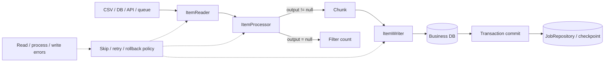
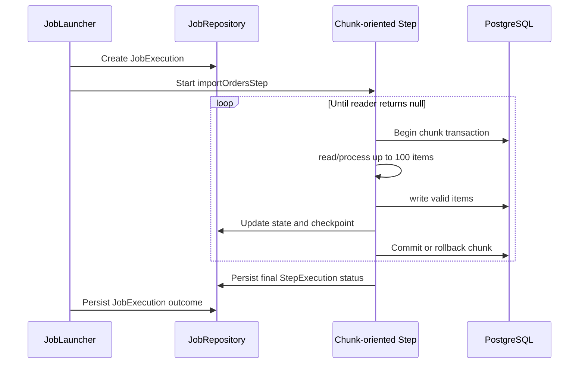
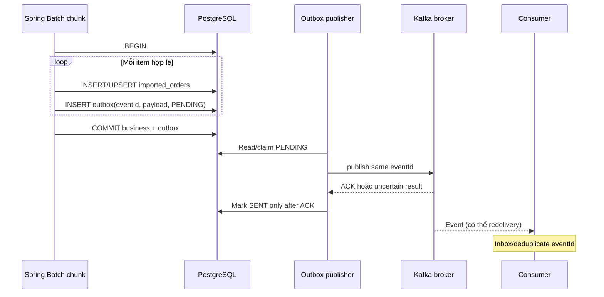
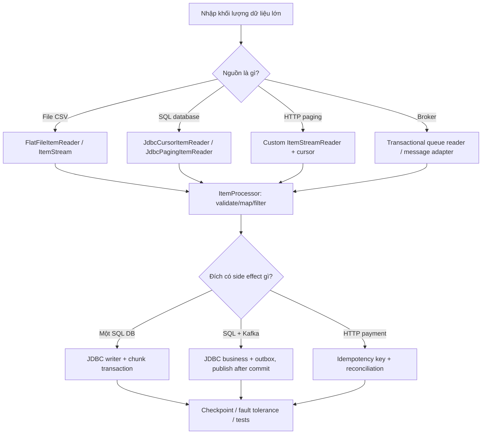

# ItemReader, ItemProcessor, ItemWriter và xử lý theo chunk

> **Chương:** Spring Batch  
> **Module:** SPRING_BOOT_INTEGRATION — tích hợp hệ thống trong Spring Boot qua HTTP client, cơ sở dữ liệu, cache, broker thông điệp và các adapter Spring Integration. Bài học tập trung vào hợp đồng dữ liệu, phạm vi transaction, lỗi, xử lý trùng lặp, checkpoint, kiểm thử và quan sát khi nhập dữ liệu theo lô.

## 1. Vì sao cần mô hình Reader → Processor → Writer?

Giả sử mỗi đêm một hệ thống thương mại điện tử xuất file CSV chứa 2 triệu đơn hàng. Ứng dụng Spring Boot cần đọc từng dòng, kiểm tra dữ liệu, bỏ qua những dòng đã được đánh dấu không cần nhập, ghi dữ liệu hợp lệ vào PostgreSQL và sau đó chuyển tiếp các thay đổi sang Kafka.

Nếu viết một method duy nhất để đọc toàn bộ file vào `List`, biến đổi, rồi gọi `saveAll(...)`:

- Có thể hết heap khi file lớn.
- Không có checkpoint rõ ràng khi JVM chết ở dòng thứ 900.000.
- Khó quyết định bản ghi lỗi nào được bỏ qua và lỗi nào phải dừng job.
- Một lần retry toàn file có thể tạo dữ liệu hoặc sự kiện trùng.
- Không có số liệu chi tiết về bao nhiêu dòng đã đọc, lọc, ghi, skip và rollback.

**Spring Batch** giải quyết phần cốt lõi bằng *chunk-oriented processing*: đọc một nhóm item có giới hạn, xử lý từng item, ghi nhóm kết quả, rồi commit theo ranh giới transaction. Ba hợp đồng chính là:

| Thành phần | API Spring Batch 5.x | Nhiệm vụ |
| --- | --- | --- |
| **`ItemReader<I>`** | `I read() throws Exception` | Cung cấp một item mỗi lần gọi, trả `null` khi hết input |
| **`ItemProcessor<I,O>`** | `O process(I item) throws Exception` | Chuyển đổi/kiểm tra input, trả `null` nếu muốn **filter** item |
| **`ItemWriter<O>`** | `void write(Chunk<? extends O> chunk) throws Exception` | Nhận cả nhóm output để ghi xuống đích |



Sơ đồ là mô hình khái niệm: thời điểm cập nhật metadata và commit tùy transaction manager, `ItemStream`, configuration và resource được dùng. **Không suy ra rằng việc ghi DB, publish Kafka và cập nhật checkpoint luôn là một giao dịch phân tán.**

### 1.1. Mục tiêu học tập

Sau bài, bạn có thể:

1. Phân biệt trách nhiệm và vòng đời của `ItemReader`, `ItemProcessor`, `ItemWriter` theo Spring Batch 5.
2. Tạo `Step` xử lý theo chunk với `JobRepository` và `PlatformTransactionManager`.
3. Hiểu commit interval, filter, skip, retry, rollback và `StepExecution` counters.
4. Viết reader CSV, processor validate/transform và JDBC writer chống ghi trùng.
5. Quản lý checkpoint bằng `ItemStream`, `@StepScope` và identifying `JobParameters`.
6. Xử lý các boundary khó: HTTP, broker, Redis, nhiều datasource và restart.
7. Kiểm thử chunk transaction, lỗi tạm thời, skip/retry và metadata trên database thực.

## 2. Hiểu đúng một vòng đời chunk

Giả sử cấu hình `chunk(3, transactionManager)`, file có năm dòng:

```text
1. web-101, customer-A, 10.00, USD, IMPORT
2. web-102, customer-B, 20.00, USD, SKIP
3. web-103, customer-C, 30.00, USD, IMPORT
4. web-104, customer-D, 40.00, USD, IMPORT
5. web-105, customer-E, 50.00, USD, IMPORT
```

Vòng xử lý thông thường:

1. Framework mở các `ItemStream` của step (nếu có), khôi phục state từ `ExecutionContext`.
2. Trong một transaction chunk, đọc tối đa **3 input items**.
3. Gọi processor cho từng input; dòng 2 trả `null` để được **filter**, nên output chunk chỉ chứa dòng 1 và 3.
4. Gọi writer với `Chunk<Output>` chứa **2** phần tử.
5. Ghi checkpoint/step metadata theo lifecycle của framework và commit transaction.
6. Đọc tiếp các dòng 4–5, sau đó reader trả `null` để báo hết nguồn; xử lý chunk cuối và kết thúc step.

| Chunk logic | Số input được đọc | Số bị filter | Số output đưa writer | Số commit chunk minh họa |
| --- | ---: | ---: | ---: | ---: |
| Chunk thứ nhất | 3 | 1 | 2 | 1 |
| Chunk thứ hai | 2 | 0 | 2 | 1 |
| Tổng | 5 | 1 | 4 | 2 |

Các con số này minh họa tình huống thành công không có retry/skip/rollback. Số `COMMIT_COUNT` thực tế còn chịu ảnh hưởng cách Spring Batch xử lý vòng đọc EOF và các transaction nội bộ; **không lấy bảng minh họa làm công thức tuyệt đối cho mọi cấu hình**.

### 2.1. Commit interval không phải batch size của JDBC

`chunk(100, txManager)` nghĩa là Spring Batch tổ chức **transaction/checkpoint** sau một lượng input theo completion policy, không đảm bảo `ItemWriter` gửi đúng một JDBC batch gồm 100 câu lệnh trong mỗi lần. `ItemWriter` có thể:

- Lặp gọi `JdbcTemplate.update(...)` 100 lần trong một transaction.
- Gọi `JdbcBatchItemWriter` hoặc `JdbcTemplate.batchUpdate(...)` để nhóm SQL statements.
- Gửi message tới broker; mỗi item có thể sinh request mạng riêng.
- Gọi một bulk API có giới hạn riêng khác chunk size.

Tối ưu chunk size và JDBC batch size là **hai núm điều chỉnh liên quan nhưng khác nhau**.

### 2.2. Filter khác skip

| Trường hợp | Cơ chế | Ý nghĩa |
| --- | --- | --- |
| Đơn có `action=SKIP` hợp lệ | Processor trả `null` | **Filter** theo quy tắc nghiệp vụ, không phải lỗi |
| Dòng CSV sai định dạng | Reader ném exception | **Read error**; có thể skip nếu policy cho phép |
| Amount âm hoặc currency không hỗ trợ | Processor ném exception | **Process error**; thường dừng hoặc skip có audit |
| SQL unique-key conflict không phù hợp | Writer ném exception | **Write error**; không tự filter thành thành công |
| PostgreSQL mất kết nối tạm thời | Writer ném transient exception | Có thể **retry có giới hạn**, cần rollback/replay an toàn |

Một lỗi bị bỏ qua bởi chính sách skip vẫn là lỗi đã được framework cho phép **bỏ qua item**. Một item trả `null` bởi processor là **được lọc hợp lệ**, không làm tăng `SKIP_COUNT`.

### 2.3. Chunk không phải transaction toàn Job

Một job có 20.000 chunks đã commit được 19.000 chunks rồi crash sẽ **không tự rollback toàn bộ 19.000 chunks**. Chunk processing cố ý đánh đổi atomicity toàn file lấy khả năng xử lý bền vững, bộ nhớ giới hạn và restart. Khi job chạy lại, không được giả định các bản ghi đã commit sẽ tự mất đi.

## 3. Chọn phiên bản, dependency và cấu hình Boot

Ví dụ bài này nhắm **Java 17+, Spring Boot 3.2–3.5 và Spring Batch 5.x**, tập trung vào JDBC/PostgreSQL. Spring Batch 5 dùng `ItemWriter.write(Chunk<? extends T>)`; nhiều ví dụ trên Internet dành cho Batch 4 sử dụng `write(List<? extends T>)` **không còn đúng chữ ký API**.

### 3.1. Gradle

```groovy
// Đã áp dụng Spring Boot plugin và BOM tương ứng.
dependencies {
    implementation 'org.springframework.boot:spring-boot-starter-batch'
    implementation 'org.springframework.boot:spring-boot-starter-jdbc'
    runtimeOnly 'org.postgresql:postgresql'

    testImplementation 'org.springframework.boot:spring-boot-starter-test'
    testImplementation 'org.springframework.batch:spring-batch-test'
}
```

`spring-boot-starter-batch` cung cấp hạ tầng Spring Batch, còn JDBC driver và JDBC starter phục vụ `JdbcTemplate` trong writer. Để Boot quản lý các phiên bản; nếu ứng dụng dùng Boot 4/Batch 6, kiểm tra lại API, bean auto-config và schema metadata theo major version.

### 3.2. Cấu hình application.yml

```yaml
spring:
  datasource:
    url: ${ORDERS_DB_URL}
    username: ${ORDERS_DB_USERNAME}
    password: ${ORDERS_DB_PASSWORD}
    hikari:
      maximum-pool-size: 12

  batch:
    job:
      enabled: false
    jdbc:
      initialize-schema: never
```

Ý nghĩa:

- `spring.batch.job.enabled=false` tắt cơ chế **tự chạy Job khi Spring Boot startup**. Job vẫn có thể được kích hoạt bằng `JobLauncher` hoặc công cụ vận hành đã kiểm soát.
- `spring.batch.jdbc.initialize-schema=never` phù hợp **production dùng migration** để quản lý sáu bảng `BATCH_*` và sequences. Trong test, có thể sử dụng init schema riêng hoặc migration tương ứng.
- `ORDERS_DB_PASSWORD` phải được cấp từ secret manager/environment an toàn, không commit.
- Cần kiểm tra JDBC datasource, PostgreSQL driver, transaction manager và schema đã sẵn sàng trước khi chạy job.

Với Boot 3.x dựa vào Batch auto-configuration, **không thêm `@EnableBatchProcessing` chỉ để “bật Batch”**: annotation hoặc cấu hình Batch thủ công có thể khiến Boot Batch auto-configuration (bao gồm schema initialization) back off. Khi chủ động cấu hình thủ công, bạn phải sở hữu hạ tầng và migration tương ứng.

### 3.3. Metadata lưu ở đâu?

JobRepository ghi `JobInstance`, `JobExecution`, `StepExecution` và `ExecutionContext` trong các bảng `BATCH_*`. Trong bài này, focus là quá trình chunk:

| Bảng metadata | Vai trò trong chunk/restart |
| --- | --- |
| `BATCH_JOB_INSTANCE` | Nhận diện job theo tên + identifying parameters |
| `BATCH_JOB_EXECUTION` | Lần chạy/restart và trạng thái toàn job |
| `BATCH_STEP_EXECUTION` | Số item đọc, ghi, lọc, skip, rollback, commit và trạng thái step |
| `BATCH_STEP_EXECUTION_CONTEXT` | Checkpoint của reader/stream trong step |
| `BATCH_JOB_EXECUTION_CONTEXT` | Trạng thái cần chia sẻ ở phạm vi job |
| `BATCH_JOB_EXECUTION_PARAMS` | Các tham số và cờ identifying dùng khi launch |

Chính xác cột, index và sequence phụ thuộc **schema Spring Batch cùng version và vendor SQL**. Dùng migration chính thức; không tự tạo những bảng này theo một sơ đồ rút gọn trong tài liệu học.

## 4. ItemReader<I>: mỗi lần gọi đọc một item

Hợp đồng tối giản:

```java
@FunctionalInterface
public interface ItemReader<T> {
    T read() throws Exception;
}
```

Đây là phiên bản giản lược để nhìn ý nghĩa; interface chính thức của Spring Batch có Javadoc/naming riêng. **`null` từ `read()` có nghĩa đã hết input**, không phải một item có giá trị null. Nếu nguồn dữ liệu cho phép bản ghi mang giá trị null, adapter phải biểu diễn nó bằng object/marker hợp lệ chứ không trả null giữa luồng.

### 4.1. Reader phải trả một item hoặc báo EOF

Ví dụ reader đơn giản chỉ phục vụ unit test:

```java
import java.util.Iterator;
import java.util.List;
import org.springframework.batch.item.ItemReader;

public final class ListOrderReader implements ItemReader<String> {
    private final Iterator<String> iterator;

    public ListOrderReader(List<String> values) {
        this.iterator = List.copyOf(values).iterator();
    }

    @Override
    public String read() {
        return iterator.hasNext() ? iterator.next() : null;
    }
}
```

Reader này **không restartable**: iterator chỉ tồn tại trong bộ nhớ của instance hiện tại. Nếu JVM chết, không có checkpoint để biết vị trí đã commit. Không dùng nó như adapter production cho file lớn.

### 4.2. FlatFileItemReader đọc CSV

Giả sử input file:

```csv
externalOrderId,customerId,amount,currency,action
web-101,cus-A,10.00,USD,IMPORT
web-102,cus-B,20.00,USD,SKIP
web-103,cus-C,30.00,USD,IMPORT
```

Định nghĩa record **raw input**, giữ amount dạng chuỗi cho processor tự quyết định validation:

```java
public record OrderCsvRow(
        String externalOrderId,
        String customerId,
        String amount,
        String currency,
        String action) {
}
```

Spring Batch 5 cung cấp `FlatFileItemReaderBuilder<T>`:

```java
import java.nio.file.Path;
import org.springframework.batch.core.configuration.annotation.StepScope;
import org.springframework.batch.item.file.FlatFileItemReader;
import org.springframework.batch.item.file.builder.FlatFileItemReaderBuilder;
import org.springframework.beans.factory.annotation.Value;
import org.springframework.context.annotation.Bean;
import org.springframework.context.annotation.Configuration;
import org.springframework.core.io.FileSystemResource;

@Configuration(proxyBeanMethods = false)
public class OrderReaderConfiguration {

    @Bean
    @StepScope
    FlatFileItemReader<OrderCsvRow> orderCsvReader(
            @Value("#{jobParameters['sourceFile']}") String sourceFile) {
        if (sourceFile == null || sourceFile.isBlank()) {
            throw new IllegalArgumentException(
                    "sourceFile job parameter is required");
        }

        return new FlatFileItemReaderBuilder<OrderCsvRow>()
                .name("orderCsvReader")
                .resource(new FileSystemResource(Path.of(sourceFile)))
                .linesToSkip(1)
                .delimited()
                .names("externalOrderId", "customerId",
                        "amount", "currency", "action")
                .fieldSetMapper(fieldSet -> new OrderCsvRow(
                        fieldSet.readString("externalOrderId"),
                        fieldSet.readString("customerId"),
                        fieldSet.readString("amount"),
                        fieldSet.readString("currency"),
                        fieldSet.readString("action")))
                .build();
    }
}
```

Điểm quan trọng:

1. `@StepScope` tạo instance theo từng `StepExecution` và cho phép resolve `jobParameters['sourceFile']` khi step chạy, không phải khi application context mới khởi động.
2. `.name("orderCsvReader")` cung cấp tiền tố khóa checkpoint khi `saveState` hoạt động. Tên phải **ổn định giữa các lần restart**.
3. `FlatFileItemReader` là một `ItemStreamReader`: mở/đóng resource và có thể lưu vị trí đọc vào `ExecutionContext` ở commit boundary.
4. `.linesToSkip(1)` chỉ bỏ dòng tiêu đề CSV của ví dụ, không phải chính sách skip cho record lỗi.
5. Với CSV có dấu phẩy nằm trong quoted field, encoding đặc biệt, newline lồng hoặc định dạng vendor-specific, cần kiểm thử tokenizer/encoding với fixture thật; không mặc định mọi file có đuôi `.csv` đều cùng chuẩn.
6. `sourceFile` phải do scheduler đáng tin cậy cung cấp hoặc được validate theo thư mục cho phép, canonical path, file permission và checksum. Không nhận đường dẫn tùy ý từ HTTP user rồi đọc file hệ thống.

**Cẩn thận thread-safety:** `FlatFileItemReader` có state (vị trí đọc) và không tự an toàn khi bị nhiều threads đọc cùng lúc. Không chia sẻ một instance giữa các step executions hoặc dùng multi-threaded step mà bỏ qua vấn đề synchronization/checkpoint.

### 4.3. Chọn reader theo nguồn dữ liệu

| Nguồn dữ liệu | Reader thường dùng | Điểm dễ sai |
| --- | --- | --- |
| CSV/plain text | `FlatFileItemReader` | Encoding, tokenizer, header, state/offset và file bị thay đổi |
| XML | `StaxEventItemReader` | XML schema, fragment root, encoding, lỗi dữ liệu |
| JDBC cursor | `JdbcCursorItemReader` | Connection/cursor lifecycle, driver fetch size, dữ liệu thay đổi khi restart |
| JDBC paging | `JdbcPagingItemReader` | Sort key duy nhất/ổn định, page boundary, snapshot consistency |
| JPA paging | `JpaPagingItemReader` | Persistence context, fetch plan, page order, transaction semantics |
| MongoDB | Spring Batch/Spring Data Mongo reader phù hợp version | Paging, sort, ObjectId, resume/restart semantics |
| HTTP có cursor | Custom reader implements `ItemStreamReader` | Retry/rate limit, cursor expiry, checkpoint và dedup |
| Kafka/JMS | Message-driven/broker adapter hoặc reader chuyên biệt | Ack/offset khác transaction JDBC, redelivery |

**Không chọn reader chỉ vì tên gần nguồn dữ liệu.** Cần hiểu nguồn có thay đổi trong lúc job chạy không, có stable ordering không, support resume không, và checkpoint có thể tái tạo đúng item sau restart hay không.

### 4.4. Reader không nên thực hiện side effect nghiệp vụ

Reader lý tưởng chỉ **lấy dữ liệu nguồn và trả item**. Nếu `read()` đồng thời xóa message, chuyển tiền hoặc cập nhật business status, khi chunk rollback framework có thể cần đọc lại item nhưng side effect đã tồn tại. Với queue có transaction/ack riêng, cần cấu hình rõ mối quan hệ của broker acknowledgment với chunk commit; không suy rằng `read()` trả được item là đã xử lý xong.

## 5. ItemProcessor<I,O>: lọc, validate, biến đổi

`ItemProcessor<I,O>` tách cấu trúc raw input khỏi dữ liệu đã qua validation; trong pipeline này, `I = OrderCsvRow` và `O = ImportOrder`.

### 5.1. DTO đầu ra đã chuẩn hóa

```java
import java.math.BigDecimal;

public record ImportOrder(
        String externalOrderId,
        String customerId,
        BigDecimal amount,
        String currency) {
}
```

Trong record này, `amount` đã là `BigDecimal`, `currency` chuẩn uppercase, ID đã được kiểm tra. Nếu đơn vị tiền, quy tắc precision hoặc tax calculation phức tạp hơn, nên dùng value object/domain validator thay vì tin vào định dạng CSV.

### 5.2. Một processor có quy tắc filter và validation rõ

```java
// InvalidOrderRowException.java
public final class InvalidOrderRowException extends RuntimeException {
    public InvalidOrderRowException(String message) {
        super(message);
    }

    public InvalidOrderRowException(String message, Throwable cause) {
        super(message, cause);
    }
}
```

```java
// OrderRowProcessor.java
import java.math.BigDecimal;
import java.util.Locale;
import java.util.Set;
import org.springframework.batch.item.ItemProcessor;
import org.springframework.stereotype.Component;

@Component
public class OrderRowProcessor
        implements ItemProcessor<OrderCsvRow, ImportOrder> {

    private static final Set<String> SUPPORTED_CURRENCIES =
            Set.of("USD", "EUR");

    @Override
    public ImportOrder process(OrderCsvRow input) {
        String action = normalize(input.action());
        if ("SKIP".equals(action)) {
            return null; // Filter có chủ đích, không phải lỗi.
        }
        if (!"IMPORT".equals(action)) {
            throw new InvalidOrderRowException(
                    "Unsupported action");
        }

        String orderId = trim(input.externalOrderId());
        String customerId = trim(input.customerId());
        String currency = normalize(input.currency());

        if (orderId.isEmpty() || customerId.isEmpty()) {
            throw new InvalidOrderRowException(
                    "Missing business identifier");
        }
        if (!SUPPORTED_CURRENCIES.contains(currency)) {
            throw new InvalidOrderRowException(
                    "Unsupported currency");
        }

        BigDecimal amount;
        try {
            amount = new BigDecimal(trim(input.amount()));
        } catch (NumberFormatException ex) {
            throw new InvalidOrderRowException(
                    "Invalid amount format", ex);
        }
        if (amount.signum() <= 0 || amount.scale() > 2) {
            throw new InvalidOrderRowException(
                    "Amount must be positive with at most 2 decimals");
        }

        return new ImportOrder(orderId, customerId, amount, currency);
    }

    private static String trim(String text) {
        return text == null ? "" : text.trim();
    }

    private static String normalize(String text) {
        return trim(text).toUpperCase(Locale.ROOT);
    }
}
```

**Hai kết quả khác nhau:**

- `process(...) == null` cho action `SKIP` → Spring Batch tăng **filterCount** khi xử lý item.
- `throw InvalidOrderRowException` cho amount hoặc currency sai → step **thất bại**, trừ khi fault-tolerant policy cho phép skip và còn skip budget.

Processor nên **stateless**, deterministic theo input và tránh side effect: framework có thể gọi lại processor khi chunk rollback/retry, tùy cơ chế caching. Gọi một API tạo hóa đơn hay publish Kafka trong `process(...)` là rủi ro nếu chunk được thực thi lại.

### 5.3. Filter hợp lệ không thay thế auditing dữ liệu bỏ qua

Nếu nghiệp vụ cần biết tại sao một dòng bị loại, có thể:

1. Định nghĩa trạng thái action hợp lệ (`SKIP` là chỉ thị nguồn).
2. Đếm filter, thu metric theo **lý do có cardinality thấp**.
3. Nếu cần lưu từng dòng bị filter để audit, tạo cơ chế side output/durable audit được thiết kế riêng, tránh ghi vào hệ thống ngoài DB transaction mà không có recovery.

Không lạm dụng filter để nuốt mọi lỗi: nếu `amount="not-a-number"`, việc return `null` làm job “COMPLETED” nhưng dữ liệu có thể bị mất mà không có dấu hiệu lỗi.

### 5.4. Kết hợp nhiều processors

Spring Batch có `CompositeItemProcessor<I,O>` để xâu chuỗi bước chuẩn hóa, kiểm tra và biến đổi khi các kiểu liên tiếp tương thích:

```java
import java.util.List;
import org.springframework.batch.item.ItemProcessor;
import org.springframework.batch.item.support.CompositeItemProcessor;

ItemProcessor<OrderCsvRow, OrderCsvRow> identity = row -> row;
ItemProcessor<OrderCsvRow, ImportOrder> pipeline =
        new CompositeItemProcessor<>(List.of(
                identity,                   // Ví dụ delegate nhận/đưa cùng kiểu.
                new OrderRowProcessor()));  // Validate + transform.
```

Đoạn fragment chỉ minh họa kiểu dữ liệu của pipeline; processor đầu tiên là identity processor nên **không có ích về nghiệp vụ**. Trong dự án thật, mỗi delegate nên có trách nhiệm riêng, ví dụ `OrderCsvRow → CanonicalOrder → ImportOrder` và được inject như Spring bean. Khi một delegate trả `null`, item được filter thay vì tiếp tục tới các delegates còn lại.

Đừng chia processor thành quá nhiều lớp chỉ để tạo abstraction: quan trọng nhất là **đường đi của lỗi, khả năng lặp lại và ranh giới dữ liệu**.

## 6. ItemWriter<O>: ghi theo Chunk và bảo vệ dữ liệu đã commit

Trong Spring Batch 5, writer nhận **`Chunk<? extends O>`**, không nhận `List<O>` như nhiều ví dụ Batch 4 cũ. Writer nên xử lý chunk như một nhóm transaction; việc một row lỗi thường khiến chunk rollback, trừ khi fault-tolerant step có chính sách skip/retry đặc biệt.

### 6.1. Schema PostgreSQL cho writer

Đây là **DDL minh họa dành cho test/migration của ứng dụng**, không phải schema `BATCH_*`:

```sql
CREATE TABLE imported_orders (
    external_order_id VARCHAR(120) PRIMARY KEY,
    customer_id VARCHAR(120) NOT NULL,
    amount NUMERIC(19, 2) NOT NULL CHECK (amount > 0),
    currency VARCHAR(3) NOT NULL,
    imported_at TIMESTAMPTZ NOT NULL DEFAULT CURRENT_TIMESTAMP
);
```

`external_order_id` đóng vai trò **khóa nghiệp vụ chống trùng**. Mọi lần import lại cùng đơn phải giữ ID ổn định. Index tại DB là hàng rào cuối cùng khi hai jobs/requests chạy đồng thời; việc kiểm tra `existsById` trước khi insert không đủ chống race.

### 6.2. JDBC writer idempotent, không âm thầm bỏ dữ liệu khác

Một writer phù hợp cho bài toán import PostgreSQL:

```java
// JdbcImportOrderWriter.java
import java.math.BigDecimal;
import java.util.Objects;
import org.springframework.batch.item.Chunk;
import org.springframework.batch.item.ItemWriter;
import org.springframework.jdbc.core.JdbcTemplate;
import org.springframework.stereotype.Component;

@Component
public class JdbcImportOrderWriter implements ItemWriter<ImportOrder> {
    private final JdbcTemplate jdbc;

    public JdbcImportOrderWriter(JdbcTemplate jdbc) {
        this.jdbc = jdbc;
    }

    @Override
    public void write(Chunk<? extends ImportOrder> chunk) {
        for (ImportOrder order : chunk.getItems()) {
            int inserted = jdbc.update("""
                    INSERT INTO imported_orders
                        (external_order_id, customer_id, amount, currency)
                    VALUES (?, ?, ?, ?)
                    ON CONFLICT (external_order_id) DO NOTHING
                    """,
                    order.externalOrderId(),
                    order.customerId(),
                    order.amount(),
                    order.currency());

            if (inserted == 0) {
                ImportOrder existing = jdbc.queryForObject("""
                        SELECT external_order_id, customer_id,
                               amount, currency
                          FROM imported_orders
                         WHERE external_order_id = ?
                        """,
                        (rs, index) -> new ImportOrder(
                                rs.getString("external_order_id"),
                                rs.getString("customer_id"),
                                rs.getBigDecimal("amount"),
                                rs.getString("currency")),
                        order.externalOrderId());

                if (!sameBusinessPayload(existing, order)) {
                    throw new IllegalStateException(
                            "Conflicting payload for existing order ID");
                }
            }
        }
    }

    private static boolean sameBusinessPayload(
            ImportOrder a, ImportOrder b) {
        return Objects.equals(a.externalOrderId(), b.externalOrderId())
                && Objects.equals(a.customerId(), b.customerId())
                && a.amount().compareTo(b.amount()) == 0
                && Objects.equals(a.currency(), b.currency());
    }
}
```

**Ngữ nghĩa writer:**

1. Item chưa có ID → insert.
2. Item đã tồn tại với **nội dung nghiệp vụ giống nhau** → replay an toàn; không tạo hàng thứ hai.
3. ID đã tồn tại nhưng payload khác → ném lỗi, **không** coi duplicate là success.
4. Nếu một phần chunk ghi xong rồi item kế tiếp ném lỗi, transaction manager JDBC đúng datasource phải **rollback cả chunk**.

Ví dụ ưu tiên **tính đúng đắn và diễn giải idempotency** nên dùng nhiều `jdbc.update` trong cùng chunk transaction. Khi lưu lượng lớn, có thể tối ưu bằng `JdbcBatchItemWriter`, bulk/upsert hoặc staging table, nhưng phải giữ chính sách xử lý conflict (duplicate replay vs payload khác) bằng SQL/constraint và tests. Không dùng `ON CONFLICT DO NOTHING` đơn lẻ để nuốt mất thay đổi dữ liệu thật.

**Giới hạn:** `sameBusinessPayload` giả định ID, customer, amount, currency là toàn bộ fingerprint của nghiệp vụ. Trong hệ thống thật, cần định nghĩa canonical payload/hash và version hợp đồng; quy tắc currency/precision phải được chuẩn hóa, không so sánh JSON raw.

### 6.3. Writer thực sự dùng transaction nào?

Nếu Step được cấu hình `chunk(..., jdbcTransactionManager)` và writer cùng dùng `JdbcTemplate` trỏ vào **một datasource**, các JDBC updates tham gia transaction của chunk thông qua resource binding Spring. Nếu writer dùng một datasource khác hoặc tự mở connection ngoài Spring transaction, không thể mặc định rollback cùng metadata/step.

**Cấm suy diễn:** method `write(...)` không tự động có một database transaction chỉ vì nhận `Chunk`. Transaction xuất phát từ **Step configuration, transaction manager và resource**, cần kiểm tra bằng test khi cố tình gây exception giữa chunk.

### 6.4. Khi nên dùng JdbcBatchItemWriter?

Với SQL đơn giản, `JdbcBatchItemWriter` giúp gửi nhiều items xuống JDBC theo batch:

```java
import javax.sql.DataSource;
import org.springframework.batch.item.database.JdbcBatchItemWriter;
import org.springframework.batch.item.database.builder.JdbcBatchItemWriterBuilder;

JdbcBatchItemWriter<OrderBean> writer =
        new JdbcBatchItemWriterBuilder<OrderBean>()
                .dataSource(dataSource)
                .sql("""
                     INSERT INTO imported_orders
                          (external_order_id, customer_id, amount, currency)
                     VALUES (:externalOrderId, :customerId, :amount, :currency)
                     """)
                .beanMapped()
                .build();
```

Fragment này giả định `OrderBean` là **JavaBean có getters** `getExternalOrderId()`, `getCustomerId()`, `getAmount()` và `getCurrency()`, còn `dataSource` đã inject đúng. Ví dụ dùng SQL insert để trình bày mapper; với replay/idempotency cần bổ sung unique-key policy và conflict detection riêng. Không tự thay `OrderBean` bằng record mà không kiểm tra name-binding hỗ trợ record của phiên bản thư viện đang sử dụng.

### 6.5. Gửi Kafka/HTTP trong writer có nghĩa gì?

Một `ItemWriter` gọi `kafkaTemplate.send(...)` hoặc HTTP POST **không tự có atomicity với transaction JDBC**:

```text
Chunk starts JDBC transaction
  DB UPDATE successful
  HTTP POST payment successful
  Kafka send accepted asynchronously
  Next item fails -> JDBC transaction rollback

Result:
  DB changes may rollback
  HTTP payment may remain
  Kafka record may already be published
```

Đừng thiết kế writer “ghi DB rồi gửi Kafka” và tuyên bố exactly-once chỉ dựa trên `@Transactional`. Với sự kiện phải phát sau khi DB commit, ưu tiên **transactional outbox** trong cùng DB, sau đó publisher riêng gửi broker và consumer dedup theo event ID. Với HTTP side effect, dùng idempotency key/reconciliation.

## 7. Ghép Reader, Processor, Writer thành một chunk-oriented Step

Spring Batch 5.x tạo step bằng `StepBuilder` nhận `JobRepository`; chunk method nhận **commit interval/completion policy và transaction manager**. Không dùng ví dụ cũ `StepBuilderFactory` hoặc `ItemWriter.write(List<?>)` từ Batch 4 như thể cùng API.

### 7.1. Step cấu hình với commit interval 100

```java
// ImportJobConfiguration.java
import org.springframework.batch.core.Job;
import org.springframework.batch.core.Step;
import org.springframework.batch.core.job.builder.JobBuilder;
import org.springframework.batch.core.repository.JobRepository;
import org.springframework.batch.core.step.builder.StepBuilder;
import org.springframework.beans.factory.annotation.Qualifier;
import org.springframework.context.annotation.Bean;
import org.springframework.context.annotation.Configuration;
import org.springframework.transaction.PlatformTransactionManager;
import org.springframework.batch.item.file.FlatFileItemReader;

@Configuration(proxyBeanMethods = false)
public class ImportJobConfiguration {

    @Bean
    Step importOrdersStep(
            JobRepository jobRepository,
            PlatformTransactionManager transactionManager,
            @Qualifier("orderCsvReader")
            FlatFileItemReader<OrderCsvRow> reader,
            OrderRowProcessor processor,
            JdbcImportOrderWriter writer) {

        return new StepBuilder("importOrdersStep", jobRepository)
                .<OrderCsvRow, ImportOrder>chunk(100, transactionManager)
                .reader(reader)
                .processor(processor)
                .writer(writer)
                .build();
    }

    @Bean
    Job importOrdersJob(
            JobRepository jobRepository,
            @Qualifier("importOrdersStep") Step importOrdersStep) {

        return new JobBuilder("importOrdersJob", jobRepository)
                .start(importOrdersStep)
                .build();
    }
}
```

Ví dụ này giả định ứng dụng dùng **một `DataSource` PostgreSQL** cho writer, JobRepository và manager do Boot 3.x quản lý. Nếu có nhiều managers, thay parameter `transactionManager` bằng bean được chọn qua `@Qualifier("ordersJdbcTransactionManager")`; các resources cần được xác minh thuộc cùng transaction boundary.

**Thứ tự gọi** trong chunk: reader cung cấp item → processor xử lý → writer nhận `Chunk<ImportOrder>` → metadata/checkpoint cập nhật và chunk commit. Không phải tất cả records được giữ trong heap tới khi toàn Job hoàn tất.

### 7.2. JobLauncher nhận identifying parameters

```java
// ImportJobLauncher.java
import org.springframework.batch.core.Job;
import org.springframework.batch.core.JobExecution;
import org.springframework.batch.core.JobParameters;
import org.springframework.batch.core.JobParametersBuilder;
import org.springframework.batch.core.launch.JobLauncher;
import org.springframework.beans.factory.annotation.Qualifier;
import org.springframework.stereotype.Service;

@Service
public class ImportJobLauncher {
    private final JobLauncher jobLauncher;
    private final Job job;

    public ImportJobLauncher(
            JobLauncher jobLauncher,
            @Qualifier("importOrdersJob") Job job) {
        this.jobLauncher = jobLauncher;
        this.job = job;
    }

    public long start(String sourceFile, String sourceChecksum,
                      String requestedBy) throws Exception {
        JobParameters parameters = new JobParametersBuilder()
                .addString("sourceFile", sourceFile, true)
                .addString("sourceChecksum", sourceChecksum, true)
                .addString("requestedBy", requestedBy, false)
                .toJobParameters();

        JobExecution execution = jobLauncher.run(job, parameters);
        return execution.getId();
    }
}
```

`sourceFile` và `sourceChecksum` được dùng để xác định **công việc logic**; `requestedBy` là metadata non-identifying. Trong production, cần validate checksum/path và nhất quán giữa các pods. Nếu hai process dùng cùng tên file nhưng nội dung khác nhau, checkpoint theo số dòng có thể không còn đúng — vì vậy checksum hoặc immutable object ID rất quan trọng.

**Cùng identifying parameters:**

- Nếu JobInstance đã COMPLETED: framework thường ngăn launch lại chính instance đó.
- Nếu FAILED/STOPPED và job restartable: tạo **JobExecution mới** của JobInstance cũ.
- Nếu một instance đang chạy: repository sẽ bảo vệ điều phối concurrent execution theo semantics của framework/DB.

`JobLauncher.run(...)` có thể chặn caller nếu dùng launcher đồng bộ. Nếu endpoint HTTP cần trả ngay `202 Accepted`, phải cấu hình launcher bất đồng bộ hoặc xếp job vào hàng đợi bền vững và cấp endpoint trạng thái; không tự giả định gọi JobLauncher luôn trả về trước khi job kết thúc.

### 7.3. Job/Step execution không đồng nghĩa một transaction



Sơ đồ mô tả logic. JobRepository cũng có những giao dịch quản lý metadata riêng; nếu reader/writer, metadata hoặc message broker sử dụng resources khác nhau, thời điểm commit có thể tách rời. Cần kiểm chứng bằng integration test, không chỉ dựa vào hình.

## 8. Commit, rollback và checkpoint trong chunk

### 8.1. Nếu item thứ 81 bị lỗi thì điều gì xảy ra?

Giả sử `chunk(100, transactionManager)` và chunk thứ 7 đang xử lý items 601–700:

```text
Chunk 1..6: committed (input 1..600)
Chunk 7:    read/process items 601..680
            item 681 -> exception

No fault tolerance configured:
  - Chunk 7 fails and DB writes within its transaction roll back.
  - Previous committed chunks remain committed.
  - StepExecution/JobExecution record the failure.
  - Restart uses persisted checkpoint/state (if reader is restartable).
```

Khi lỗi ở **reader**, processor hay writer, chi tiết framework có thể đệm/re-read items theo transaction settings; nhưng quy tắc nền là **phần chunk chưa commit không được coi đã ghi bền vững** nếu tất cả writes nằm trong cùng DB transaction.

### 8.2. ItemStream.open/update/close

`FlatFileItemReader` hỗ trợ `ItemStream`:

| Callback | Khi nào được framework gọi? | Nội dung |
| --- | --- | --- |
| `open(ExecutionContext)` | Trước khi step bắt đầu đọc | Khôi phục state/cursor từ checkpoint đã lưu |
| `read()` | Khi cần item tiếp theo | Trả item hoặc null khi EOF |
| `update(ExecutionContext)` | Tại những điểm framework lưu trạng thái, thường sát commit chunk | Ghi vị trí mới vào ExecutionContext |
| `close()` | Khi đóng stream/step | Giải phóng file, cursor, socket |

**Lưu ý:** `ExecutionContext` không phải giao dịch nghiệp vụ. Nó chỉ lưu **vị trí có thể khôi phục** và metadata nhỏ; không đưa toàn bộ danh sách records hoặc credentials vào context.

### 8.3. Ví dụ custom ItemStreamReader có checkpoint

Để hiểu cách hoạt động bên trong, đây là reader dựa trên **danh sách bất biến**:

```java
import java.util.List;
import org.springframework.batch.item.ExecutionContext;
import org.springframework.batch.item.ItemStreamReader;

public final class RestartableListReader
        implements ItemStreamReader<String> {
    private static final String KEY = "orders.reader.nextIndex";
    private final List<String> items;
    private int index;

    public RestartableListReader(List<String> items) {
        this.items = List.copyOf(items);
    }

    @Override
    public void open(ExecutionContext context) {
        index = context.getInt(KEY, 0);
    }

    @Override
    public String read() {
        return index >= items.size() ? null : items.get(index++);
    }

    @Override
    public void update(ExecutionContext context) {
        context.putInt(KEY, index);
    }

    @Override
    public void close() {
        // Không có external resource.
    }
}
```

Reader này restart đúng **chỉ khi danh sách input và thứ tự giữ nguyên**. Mỗi `ItemStream` trong một step cần các key state không đụng nhau: ở reader thực tế, dùng tên ổn định làm namespace hoặc cấu trúc key rõ.

Nếu reader lặp lại từ một nguồn HTTP paging:

- Lưu cursor/offset sau chunk commit.
- Đảm bảo cursor có khả năng replay và chưa hết hạn sau khi job restart.
- Nếu API không bảo đảm snapshot hoặc cursor ổn định, dùng ID đơn hàng và idempotent writer để xử lý trùng/thiếu.
- Không cache access token hay thông tin xác thực trong ExecutionContext.

### 8.4. Checkpoint liên quan tới business commit như thế nào?

Nếu JobRepository và writer JDBC dùng **cùng datasource và transaction manager phù hợp**, framework có thể lưu step metadata/checkpoint và business changes trong phạm vi transaction chunk tương thích. Điều này giảm crash window giữa ghi business data và cập nhật checkpoint.

Nếu metadata nằm ở **PostgreSQL A**, writer ghi **PostgreSQL B**, hoặc writer gọi Kafka/HTTP:

```text
DB B commit business rows            SUCCESS
Process crashes                      CRASH
DB A checkpoint was not committed    STALE
Restart reads rows again             REPLAY
```

Trong trường hợp này, **idempotent writer** và outbox/inbox là yêu cầu thiết kế, không phải tùy chọn để tối ưu. Đừng gọi một step “restartable” nếu lần chạy lại có thể thu tiền/đẩy đơn đi nhiều lần.

### 8.5. Chỉ thay chunk size không chữa được transaction sai

Tăng `chunk(100)` thành `chunk(10_000)` có thể giảm số lần commit, nhưng cũng:

- Tăng số input/output giữ trong bộ nhớ.
- Tăng thời gian giữ connection/lock.
- Tăng số item phải replay sau rollback.
- Có thể tăng tải đột biến lên writer hoặc broker.

Ngược lại, chunk size 1 làm nhiều commit/checkpoint hơn, tăng overhead. Chọn bằng **benchmark thật và SLA**: đo tốc độ, heap, lock wait, pool saturation, rollback frequency và chi phí restart, không chọn theo một con số “tối ưu chung”.

## 9. Fault-tolerant Step: retry, skip và rollback

Trong những hệ thống có dữ liệu lẫn lỗi tạm thời và lỗi vĩnh viễn, có thể bật fault tolerance. Tuy nhiên **không được dùng một chính sách skip rộng để làm Job luôn COMPLETED** trong khi dữ liệu quan trọng đã mất.

### 9.1. Ví dụ cấu hình skip và retry có giới hạn

Khi **thay cấu hình Step ở mục 7.1** bằng bản fault-tolerant, thêm:

```java
import org.springframework.batch.item.file.FlatFileParseException;
import org.springframework.dao.TransientDataAccessException;

return new StepBuilder("importOrdersStep", jobRepository)
        .<OrderCsvRow, ImportOrder>chunk(100, transactionManager)
        .reader(reader)
        .processor(processor)
        .writer(writer)
        .faultTolerant()
        .skip(FlatFileParseException.class)
        .skip(InvalidOrderRowException.class)
        .skipLimit(20)
        .retry(TransientDataAccessException.class)
        .retryLimit(3)
        .build();
```

Đây là **fragment thay cho phần `return ...build()`** của method cấu hình ở mục 7, không phải một bean Step thứ hai cùng tên. Ý nghĩa:

- `skip(FlatFileParseException.class)`: có thể bỏ qua những dòng CSV hỏng nếu policy nghiệp vụ cho phép.
- `skip(InvalidOrderRowException.class)`: có thể bỏ item sai domain validation, nhưng phải audit/quarantine đúng chính sách.
- `skipLimit(20)`: tổng skip theo phạm vi/policy của step bị giới hạn; khi vượt, step thất bại.
- `retry(TransientDataAccessException.class)`: chỉ một **nhóm lỗi có khả năng tạm thời** được thử lại.
- `retryLimit(3)`: đặt budget retry; cách đếm attempts/retry cần được xác minh qua tests của version/framework.

Không thêm `.skip(Exception.class)` hoặc `.retry(Exception.class)` chỉ để giảm số lần FAILED. Đặc biệt, lỗi `DuplicateKeyException` do **payload conflict** không được nuốt như skip thành công; với PostgreSQL, duplicate có thể phát sinh từ unique key khác và cần phân loại.

### 9.2. Lỗi nào retry, lỗi nào skip, lỗi nào fail?

| Tình huống | Gợi ý chính sách | Lý do |
| --- | --- | --- |
| CSV field không đúng số cột | Skip có giới hạn **nếu hợp đồng cho phép**, quarantine | Record vĩnh viễn sai định dạng |
| Amount không phải số | Skip hoặc fail-fast tùy dữ liệu quan trọng | Retry cùng input không sửa được amount |
| Unsupported currency | Thường fail/quarantine; có thể skip nếu đã được duyệt | Không tự gán currency mặc định |
| PostgreSQL lỗi kết nối ngắn | Retry giới hạn, backoff và deadline | Có thể tạm thời, nhưng commit outcome phải rõ |
| DB schema thiếu cột | Fail | Cấu hình/migration sai, retry không giúp |
| Unique conflict khác nội dung | Fail/domain conflict | Không được tạo hai đơn logic hoặc bỏ qua sai khác |
| Token HTTP hết hạn trong reader | Refresh/khôi phục theo policy | Không bao giờ log token |
| HTTP 429 với Retry-After | Chờ có budget, giới hạn request song song | Tôn trọng rate limiting |
| Kafka publish timeout | Đối soát và replay cùng eventId | Gửi lại có thể tạo duplicate |

**Chỉ retry ở một tầng chịu trách nhiệm rõ.** Nếu HTTP client, ItemReader, Spring Batch fault-tolerant step và scheduler đều retry mà không chia sẻ ngân sách, 3 attempts mỗi tầng có thể khuếch đại nhiều lần số request. Đặt tổng deadline, backoff/jitter và metric attempts.

### 9.3. Skip listener để ghi nhận lỗi

```java
import org.springframework.batch.core.SkipListener;
import org.springframework.stereotype.Component;

@Component
public class ImportSkipListener
        implements SkipListener<OrderCsvRow, ImportOrder> {

    @Override
    public void onSkipInRead(Throwable error) {
        // Tăng metric read_skipped với reason code cố định.
    }

    @Override
    public void onSkipInProcess(OrderCsvRow item, Throwable error) {
        // Ghi reason code đã chuẩn hóa; không log toàn bộ PII.
    }

    @Override
    public void onSkipInWrite(ImportOrder item, Throwable error) {
        // Dùng quarantine store/transaction phù hợp nếu bắt buộc.
    }
}
```

Khi dùng, đăng ký listener trong Step builder: `.listener(importSkipListener)`. Với fault-tolerant chunk, skip listener có lifecycle được Spring Batch sắp xếp gần commit; tuy nhiên **ghi vào hệ thống ngoài DB transaction trong listener vẫn có thể bị lặp hoặc mất khi JVM crash**. Với yêu cầu audit bền vững, thiết kế bảng quarantine/outbox và test các cửa sổ crash.

### 9.4. Retry writer có thể thực thi lại cả chunk

Khi writer thất bại, framework có thể rollback chunk và **thử lại**; một số cấu hình fault-tolerant có thể giảm xuống từng item để xác định item gây lỗi. Vì vậy:

- Processor phải không gây side effect và không dựa vào mutable state ngoài checkpoint.
- Writer phải chịu được việc gặp lại **cùng item**.
- Unique constraint/idempotency bảo vệ kết quả khi commit outcome không rõ.
- Không giả định phương thức `write(...)` sẽ chỉ được gọi đúng một lần cho mỗi output item.

Nếu ItemReader đọc từ một **transactional queue**, Spring Batch có cấu hình riêng (ví dụ `readerIsTransactionalQueue` trong các phiên bản hỗ trợ) về buffering/re-delivery. Đọc từ file và đọc từ queue **không cùng semantics rollback**, nên phải kiểm thử tương tác giữa DB transaction và broker acknowledgment.

## 10. Restart, state và dữ liệu thay đổi giữa các lần chạy

### 10.1. Restart khác chạy JobInstance mới

Spring Batch xác định một `JobInstance` theo **Job name và identifying JobParameters**. Nếu job được phép restart sau FAILED/STOPPED, Spring Batch tạo một **JobExecution mới** cho **cùng JobInstance**, dùng trạng thái `ExecutionContext` đã persist để tiếp tục.

```text
Job name: importOrdersJob
Identifying JobParameters:
  sourceFile=/srv/orders/inbound/orders-2026-11-21.csv
  sourceChecksum=sha256:abcd...

JobInstance #101:
  JobExecution #501: FAILED
    StepExecution #601: committed 10 chunks, failed in 11th
  JobExecution #502: COMPLETED (restart)
    StepExecution #602: resumes from checkpoint
```

Ví dụ chỉ minh họa identity và checkpoint; số items chạy lại tùy transaction, reader buffering, file stability, skip/retry và chunk configuration. Không tự tạo JobInstance mới bằng cách thêm tham số `run.id=timestamp` mỗi khi lỗi: cách đó có thể khiến **toàn file bị nhập lại từ đầu** và bỏ qua semantics restart.

### 10.2. Nguồn cần bất biến hoặc có resume contract

Nếu file bị sửa, ghi đè hoặc sắp xếp lại sau khi các chunks trước đã commit, `reader.current.count=5000` không còn nghĩa là các 5.000 records cũ đã được xử lý. Bảo vệ:

- File/object có **immutable key**, checksum và version.
- Lưu identifying parameters đủ để xác định **chính xác nguồn**; đường dẫn có thể đổi giữa pods nên không dùng mỗi path nếu không bất biến.
- Reader dùng format, encoding, tokenizer và line skip ổn định giữa các lần restart.
- Writer có unique business key để chịu replay, kể cả khi checkpoint/metadata lệch do crash.
- Có chính sách rõ khi source không còn hoặc checksum khác — thường **fail**, không âm thầm tiếp tục file mới.

Với HTTP paging, cursor có thể hết hạn sau vài giờ. Nếu job restart vào ngày hôm sau mà cursor không còn hợp lệ, phải có cơ chế lấy snapshot mới, restart từ ID/order key, hoặc chạy job reconciliation; không thể giả vờ token hết hạn là “EOF”.

### 10.3. JobParameters, ExecutionContext và dữ liệu nghiệp vụ

| Loại thông tin | Nên lưu ở đâu? | Lý do |
| --- | --- | --- |
| File ID/checksum, business date | Identifying `JobParameters` | Xác định công việc logic |
| User/scheduler khởi chạy | Non-identifying `JobParameters` nếu không nhạy cảm | Không làm thay đổi JobInstance identity |
| Số dòng/cursor đã commit | `StepExecutionContext` | Phục vụ restart/checkpoint |
| Tên file output đã hoàn tất cho step kế tiếp | Job-scoped `ExecutionContext` hoặc business DB | Chia sẻ trạng thái nhỏ theo quy tắc job |
| Dữ liệu hàng triệu đơn hàng | Business database/object storage | Không làm phình bảng metadata |
| Password, API key, access token | Secret manager | Không lưu trong metadata/backup |
| EventId và trạng thái publish Kafka | Outbox/broker/inbox store | Recovery bền vững ngoài Batch lifecycle |

**ExecutionContext không phải kho chứa dữ liệu vô hạn.** Một số serializer yêu cầu object lưu vào context có thể serialize/deserialze tương thích. Khi nâng code hoặc Spring Batch major version, kiểm thử restart từ metadata cũ để phát hiện dữ liệu context không tương thích.

### 10.4. Lưu ý về ItemStream đăng ký với Step

Một reader có state phải được framework nhận diện như `ItemStream` để gọi `open/update/close`. Khi khai báo `@StepScope @Bean`, **khai báo return type đủ cụ thể** như `FlatFileItemReader<OrderCsvRow>` hoặc `ItemStreamReader<OrderCsvRow>` để proxy/Step nhận diện các interface cần thiết. Nếu chỉ công bố return type `ItemReader<OrderCsvRow>`, có cấu hình mà lifecycle `ItemStream` không được tự nhận diện như mong muốn.

Với stream phụ không được khai báo trực tiếp làm reader/writer, đăng ký tường minh qua `StepBuilder.stream(...)` theo API version. Không giả định resource được cleanup và checkpoint chỉ vì bean tồn tại trong context.

### 10.5. Chạy song song và tính an toàn của reader

| Cách tăng throughput | Ưu điểm | Rủi ro cần đánh giá |
| --- | --- | --- |
| Tăng chunk size | Ít commit hơn | Giữ resource/lock lâu, rollback tốn hơn |
| JDBC batch writer | Giảm round trips SQL | Conflict/partial batch errors phức tạp |
| Multi-threaded Step | Nhiều chunks chạy song song | Reader state/thread-safety, thứ tự xử lý, checkpoint |
| Partitioned Step | Chia input thành những vùng riêng | Partition boundaries, duplicate input, worker recovery |
| Remote chunking | Gửi chunks tới workers qua broker | Message duplication, ACK/transaction, serialization và backpressure |
| Parallel Steps | Chạy các step độc lập đồng thời | Tranh chấp resource, thứ tự phụ thuộc, job state |

Reader stateful như `FlatFileItemReader` **không tự thread-safe**. `SynchronizedItemStreamReader` có thể bảo vệ lời gọi read trong trường hợp phù hợp, nhưng việc xử lý/commit chunks ngoài thứ tự vẫn làm **restartability** khó hơn; chỉ bật concurrency khi đã kiểm thử việc crash và resume. Với dữ liệu có thể chia theo ID/date/range, partitioning với mỗi partition có nguồn, tên và checkpoint riêng thường rõ hơn.

## 11. Tích hợp HTTP, Kafka, Redis và Spring Integration cùng chunk

Chuỗi tích hợp thực tế hiếm khi chỉ có file và một database. Tuy nhiên transaction của Step không tự bao phủ tất cả resource.

### 11.1. ItemReader gọi HTTP API

Giả sử đối tác có:

```http
GET /v1/orders?limit=100&cursor=opaque-page-2
Accept: application/json

HTTP/1.1 200 OK
Content-Type: application/json

{
  "items": [
    {"externalOrderId":"web-101","customerId":"cus-A","amount":"10.00"}
  ],
  "nextCursor": "opaque-page-3"
}
```

Đây là **ví dụ API giả định**, không phải giao thức phân trang chuẩn cho mọi HTTP partner. Một HTTP-based `ItemStreamReader` cần quản lý ít nhất:

1. `currentPageCursor` và `nextItemIndex` bên trong trang.
2. `read()` trả **một item** từ page đang tải; khi hết page thì tải page tiếp.
3. `update(executionContext)` lưu cursor + index đủ để reconstruct đúng item tiếp theo sau commit.
4. Timeout, rate limit, retry có budget và giới hạn số pages/items; không gọi lại vô hạn khi server trả cursor cũ.
5. Mapping JSON type-safe, ví dụ `CursorPage<OrderDto>` qua `ParameterizedTypeReference`, rồi validate schema.
6. Khi HTTP trả 503/429 hoặc JSON sai schema, **không trả null** để giả vờ EOF; báo lỗi để retry/fail theo chính sách.

**Một lời gọi HTTP GET 200 không có tính nguyên tử cùng chunk SQL.** Nếu API không hỗ trợ cursor bền vững, reader cần bookmark theo business ID hoặc khả năng đọc lại từ snapshot đáng tin cậy. Không giữ toàn bộ hàng triệu items trong memory để làm checkpoint.

### 11.2. ItemWriter ghi JDBC rồi gửi Kafka: vì sao cần outbox?

Phản ví dụ:

```java
// Anti-pattern: bản ghi DB và send Kafka không cùng atomic transaction.
for (ImportOrder item : chunk.getItems()) {
    jdbc.update("INSERT INTO imported_orders ...", /* params */);
    kafkaTemplate.send("orders.imported", item.externalOrderId(), event);
}
```

Đây là **pseudocode**, không phải SQL/Java hoàn chỉnh. Tình huống nguy hiểm:

- SQL viết thành công nhưng Kafka send timeout sau broker đã nhận.
- Kafka ACK thành công nhưng cuối chunk SQL rollback.
- Chunk commit DB rồi JVM chết trước khi Kafka send.
- Consumer nhận lại cùng message vì broker redelivery.

**Giải pháp:** trong cùng chunk transaction JDBC, ghi cả bản ghi business và một bản ghi outbox với stable `eventId`. Một worker khác publish outbox sau commit, ghi trạng thái `SENT` sau broker ACK. Consumer dùng unique event ID để deduplicate.



Một event ID có thể được sinh **deterministic theo identity của event logic**, hoặc tạo lần đầu rồi lưu bền vững cùng bản ghi. Khi retry cùng dữ liệu, không tạo event logic mới chỉ vì mỗi attempt sinh một UUID khác. Khi event thực sự là cập nhật phiên bản mới, ID phải phân biệt version/transition theo hợp đồng.

### 11.3. JDBC outbox fragment với stable event ID

Ví dụ lược đồ cho outbox:

```sql
CREATE TABLE order_import_outbox (
    event_id VARCHAR(100) PRIMARY KEY,
    aggregate_id VARCHAR(120) NOT NULL,
    event_type VARCHAR(80) NOT NULL,
    payload_json TEXT NOT NULL,
    status VARCHAR(20) NOT NULL DEFAULT 'PENDING',
    created_at TIMESTAMPTZ NOT NULL DEFAULT CURRENT_TIMESTAMP
);
```

Fragment để thêm vào writer sau khi đã insert hoặc xác nhận payload trùng:

```java
import java.nio.charset.StandardCharsets;
import java.util.UUID;

String eventId = UUID.nameUUIDFromBytes(
        ("OrderImported:v1:" + order.externalOrderId())
                .getBytes(StandardCharsets.UTF_8)).toString();

String json = objectMapper.writeValueAsString(
        new OrderImportedEvent(eventId, order.externalOrderId()));

jdbc.update("""
        INSERT INTO order_import_outbox
            (event_id, aggregate_id, event_type, payload_json)
        VALUES (?, ?, 'OrderImported', ?)
        ON CONFLICT (event_id) DO NOTHING
        """,
        eventId,
        order.externalOrderId(),
        json);
```

Đây là **fragment minh họa**, giả định `objectMapper` và record `OrderImportedEvent` có mặt, `order` là `ImportOrder` trong vòng lặp writer và cả hai bảng nằm trong **cùng PostgreSQL transaction**. `UUID.nameUUIDFromBytes` cung cấp key ổn định cho ví dụ, không thay thế thiết kế event ID/version chính thức; nếu event key chứa dữ liệu nhạy cảm thì không log chuỗi đầu vào.

Nếu import một đơn cũ có payload khác, writer ở mục 6 **ném conflict trước khi tạo outbox mới**. Điều đó giúp tránh âm thầm publish một sự kiện giả khi dữ liệu nguồn mâu thuẫn.

### 11.4. Redis dùng cho cache khác Redis dùng chống trùng

Nếu StepProcessor tra Redis để tra cứu display name với TTL ngắn, Redis outage có thể được xử lý theo chính sách cache miss/degradation. Nhưng nếu Redis giữ **idempotency key** hoặc distributed lock quyết định được phép trừ tiền/phát event, bỏ qua Redis khi lỗi có thể phá tính đúng đắn.

Không giữ toàn bộ chunk trong Redis chỉ để né checkpoint SQL. Cache không thay thế metadata `JobRepository` hoặc unique business constraints ở database.

### 11.5. Spring Integration adapter và transaction boundary

Một Spring Integration flow có thể nhận file qua inbound adapter, gửi message vào `QueueChannel`, rồi trigger Spring Batch job. Khi qua queue, executor, poller, Kafka/JMS hoặc reactive adapter, thread/transaction scope có thể đổi. Nếu batch writer dùng `JdbcTransactionManager`, chỉ các thao tác dùng **cùng Spring-managed datasource** mới mặc nhiên có cơ hội tham gia chunk transaction.

Ghi rõ ai chịu trách nhiệm:

- Nhận và xác minh file nguồn.
- Định danh `JobInstance` để scheduler không chạy đồng thời cùng input.
- Đọc/transform/write theo chunk.
- Lưu checkpoint và error/quarantine.
- Phát outbox, nhận ACK, retry và deduplicate consumer.
- Đối soát khi hệ thống ngoài không phản hồi hoặc trả trạng thái không rõ.

## 12. Kiểm thử Reader, Processor, Writer và chunk rollback

Kiểm thử Batch nên chia nhiều lớp vì **mock ItemWriter không thể chứng minh JDBC transaction**, còn integration test chạy một lần thành công không chứng minh restart an toàn khi crash.

### 12.1. Chọn loại kiểm thử

| Loại test | Công cụ | Điều cần chứng minh |
| --- | --- | --- |
| Unit Processor | JUnit 5 + AssertJ | Validation, filter và output mapping chính xác |
| Unit Reader | File fixture nhỏ + `FlatFileItemReader` | CSV parsing, header, encoding, EOF |
| Unit Writer | Fake/Mock `JdbcTemplate` hoặc test repository contract | SQL mapping, conflict policy (chưa kiểm chứng transaction DB) |
| Batch integration | `@SpringBatchTest`, `JobLauncherTestUtils` | Reader → processor → writer, StepExecution counters và Job status |
| PostgreSQL integration | Testcontainers + JDBC schema thật | Chunk rollback, unique constraint, DB behavior |
| Restart integration | JobRepository bền vững + failure injection | Checkpoint, JobInstance identity và replay |
| End-to-end | File/HTTP + DB + outbox + Kafka | Side effect, ACK, duplicate và crash windows |

### 12.2. Unit test processor

```java
import java.math.BigDecimal;
import org.junit.jupiter.api.Test;
import static org.assertj.core.api.Assertions.assertThat;
import static org.assertj.core.api.Assertions.assertThatThrownBy;

class OrderRowProcessorTest {
    private final OrderRowProcessor processor =
            new OrderRowProcessor();

    @Test
    void filtersRowsExplicitlyMarkedSkip() {
        OrderCsvRow row = new OrderCsvRow(
                "web-102", "cus-B", "20.00", "USD", "SKIP");
        assertThat(processor.process(row)).isNull();
    }

    @Test
    void validatesAndMapsCurrencyAndAmount() {
        OrderCsvRow row = new OrderCsvRow(
                "web-101", "cus-A", "10.00", "usd", "IMPORT");
        ImportOrder order = processor.process(row);

        assertThat(order.currency()).isEqualTo("USD");
        assertThat(order.amount())
                .isEqualByComparingTo(new BigDecimal("10.00"));
    }

    @Test
    void rejectsInvalidAmountRatherThanFiltering() {
        OrderCsvRow row = new OrderCsvRow(
                "web-103", "cus-C", "unknown", "USD", "IMPORT");
        assertThatThrownBy(() -> processor.process(row))
                .isInstanceOf(InvalidOrderRowException.class);
    }
}
```

Unit test này không cần database, giúp xác minh chính sách **filter vs error** độc lập với hạ tầng. Chỉ khi bật `skip(InvalidOrderRowException.class)` ở step, exception của processor mới được framework xét để skip.

### 12.3. Test dependencies cho chunk integration

Với dự án Boot 3.2–3.5:

```groovy
dependencies {
    testImplementation 'org.springframework.boot:spring-boot-starter-test'
    testImplementation 'org.springframework.batch:spring-batch-test'
    testImplementation 'org.springframework.boot:spring-boot-testcontainers'
    testImplementation 'org.testcontainers:junit-jupiter'
    testImplementation 'org.testcontainers:postgresql'
}
```

Cần Docker/container runtime phù hợp. Để Spring Boot BOM quản lý các phiên bản tương thích; nếu project đang dùng Testcontainers major mới có module coordinates khác, cập nhật đúng theo version thực của project.

### 12.4. Integration test với PostgreSQL và @TempDir

Ví dụ này dùng **job baseline** của mục 7 (chưa bật fault tolerance), với một Job bean `importOrdersJob`. Database test có schema `BATCH_*` được tạo bởi Boot chỉ trong test; business schema được tạo riêng bằng SQL test:

```java
import java.nio.file.Files;
import java.nio.file.Path;
import org.junit.jupiter.api.BeforeEach;
import org.junit.jupiter.api.Test;
import org.junit.jupiter.api.io.TempDir;
import org.springframework.beans.factory.annotation.Autowired;
import org.springframework.batch.core.BatchStatus;
import org.springframework.batch.core.JobExecution;
import org.springframework.batch.core.JobParameters;
import org.springframework.batch.core.JobParametersBuilder;
import org.springframework.batch.core.StepExecution;
import org.springframework.batch.test.JobLauncherTestUtils;
import org.springframework.batch.test.context.SpringBatchTest;
import org.springframework.boot.test.context.SpringBootTest;
import org.springframework.boot.testcontainers.service.connection.ServiceConnection;
import org.springframework.jdbc.core.JdbcTemplate;
import org.testcontainers.containers.PostgreSQLContainer;
import org.testcontainers.junit.jupiter.Container;
import org.testcontainers.junit.jupiter.Testcontainers;

import static org.assertj.core.api.Assertions.assertThat;

@SpringBatchTest
@Testcontainers
@SpringBootTest(properties = {
        "spring.batch.job.enabled=false",
        "spring.batch.jdbc.initialize-schema=always"
})
class ImportOrdersChunkIntegrationTest {

    @Container
    @ServiceConnection
    static final PostgreSQLContainer<?> postgres =
            new PostgreSQLContainer<>("postgres:16-alpine");

    @Autowired
    JobLauncherTestUtils launcher;

    @Autowired
    JdbcTemplate jdbc;

    @TempDir
    Path tempDir;

    @BeforeEach
    void prepareTable() {
        jdbc.execute("""
                CREATE TABLE IF NOT EXISTS imported_orders (
                    external_order_id VARCHAR(120) PRIMARY KEY,
                    customer_id VARCHAR(120) NOT NULL,
                    amount NUMERIC(19, 2) NOT NULL,
                    currency VARCHAR(3) NOT NULL,
                    imported_at TIMESTAMPTZ
                        NOT NULL DEFAULT CURRENT_TIMESTAMP
                )
                """);
        jdbc.execute("TRUNCATE TABLE imported_orders");
    }

    @Test
    void filtersOneRowAndCommitsTwoOrders() throws Exception {
        Path csv = tempDir.resolve("orders-success.csv");
        Files.writeString(csv, """
                externalOrderId,customerId,amount,currency,action
                web-101,cus-A,10.00,USD,IMPORT
                web-102,cus-B,20.00,USD,SKIP
                web-103,cus-C,30.00,EUR,IMPORT
                """);

        JobParameters parameters = new JobParametersBuilder()
                .addString("sourceFile", csv.toString(), true)
                .addString("sourceChecksum", "fixture-success-v1", true)
                .toJobParameters();

        JobExecution execution = launcher.launchJob(parameters);

        assertThat(execution.getStatus())
                .isEqualTo(BatchStatus.COMPLETED);
        StepExecution step =
                execution.getStepExecutions().iterator().next();

        assertThat(step.getReadCount()).isEqualTo(3);
        assertThat(step.getFilterCount()).isEqualTo(1);
        assertThat(step.getWriteCount()).isEqualTo(2);
        assertThat(jdbc.queryForObject(
                "SELECT COUNT(*) FROM imported_orders", Long.class))
                .isEqualTo(2L);
    }

    @Test
    void conflictingPayloadRollsBackEntireChunk() throws Exception {
        Path csv = tempDir.resolve("orders-conflict.csv");
        Files.writeString(csv, """
                externalOrderId,customerId,amount,currency,action
                web-201,cus-A,10.00,USD,IMPORT
                web-201,cus-B,99.00,USD,IMPORT
                """);

        JobParameters parameters = new JobParametersBuilder()
                .addString("sourceFile", csv.toString(), true)
                .addString("sourceChecksum", "fixture-conflict-v1", true)
                .toJobParameters();

        JobExecution execution = launcher.launchJob(parameters);

        assertThat(execution.getStatus())
                .isEqualTo(BatchStatus.FAILED);
        assertThat(jdbc.queryForObject(
                "SELECT COUNT(*) FROM imported_orders", Long.class))
                .isZero();
    }
}
```

**Điều kiện chạy test:** các classes/beans ví dụ nằm trong vùng component scan của ứng dụng Boot test; chỉ có một Job được `JobLauncherTestUtils` chọn (nếu nhiều, cấu hình `setJob(...)` rõ ràng); PostgreSQL đã sẵn sàng qua `@ServiceConnection`; classpath có `spring-boot-testcontainers`. Test method **không gắn `@Transactional`** để tránh cơ chế rollback của test framework che mất transaction thực của chunk.

Trong test lỗi, hai items có **cùng ID nhưng payload khác**, writer phát hiện conflict và ném exception. Vì cả hai nằm trong cùng chunk size 100 nên kết quả kỳ vọng là **không có row nào được commit**. Nếu có một row tồn dư, cần điều tra writer có dùng đúng datasource và transaction manager của Step hay không.

### 12.5. Kiểm thử skipLimit và retryPolicy

Với cấu hình fault-tolerant ở mục 9, thêm các scenarios:

| Scenario | Kỳ vọng |
| --- | --- |
| 1 record `action=SKIP` hợp lệ | `filterCount=1`, `skipCount=0` |
| 1 record amount sai, `skipLimit` còn dư | `processSkipCount` tăng, output item không được ghi |
| 21 records sai khi `skipLimit=20` | Step FAILED khi vượt skip budget |
| Dòng CSV thiếu trường và skip reader đã cấu hình | `readSkipCount` tăng, job không bị stuck ở cùng dòng |
| DB lỗi tạm thời rồi phục hồi | Retry hữu hạn, không tạo duplicate, có metric attempts |
| Unique conflict payload khác | Step FAILED, **không** bị nuốt bởi skip-policy |
| Kafka outbox publisher crash sau ACK | Replay same eventId, consumer không xử lý hai lần |

Nếu test retry bằng fault-injection, ghi rõ “lỗi xảy ra trước commit” hay “ACK/commit outcome unknown” vì hai trường hợp đòi hỏi cách khôi phục khác. Không kết luận exactly-once từ việc retry test có một lần thành công.

### 12.6. Kiểm thử restart từ metadata cũ

Một test restart có giá trị cần:

1. Tạo immutable input file với checksum và ≥2 chunks.
2. Cố tình làm fail **sau khi ít nhất một chunk đã commit** nhưng trước khi Job COMPLETED.
3. Xác minh metadata `BATCH_STEP_EXECUTION_CONTEXT` và số rows đã commit.
4. Restart với **cùng Job name và identifying parameters**, chỉ thay non-identifying diagnostics nếu cần.
5. Assert `JobInstanceId` giữ nguyên nhưng `JobExecutionId` mới; reader tiếp tục theo checkpoint.
6. Assert không có business row hoặc Kafka event bị nhân đôi, kể cả khi fail ở ranh giới commit/ACK.
7. Chạy thêm test với file đã bị sửa/không còn — phải fail có chẩn đoán, không silently chuyển sang dữ liệu khác.

**Không thay file đang dùng trong test restart để “sửa lỗi input”** nếu điều đó khiến identifying checksum không còn đúng. Có thể tạo test hook fail-once hoặc mô phỏng lỗi hạ tầng tạm thời để restart cùng nguồn thực sự bất biến.

## 13. Quan sát, hiệu năng, bảo mật và runbook

Một job báo `COMPLETED` chưa chắc đã cập nhật đúng mọi downstream. Cần đo cả **tiến độ của Spring Batch** và **tác động nghiệp vụ đã commit**.

### 13.1. StepExecution counters nên đọc thế nào?

| Counter | Nội dung | Diễn giải cần tránh |
| --- | --- | --- |
| `readCount` | Item đã đọc/được framework ghi nhận theo lifecycle | Không bao gồm mọi lần read trả null; không phải số dòng thô của file trong mọi reader |
| `filterCount` | Item processor trả null | Không phải lỗi hay skip |
| `writeCount` | Số output items writer được framework ghi nhận | Không chứng minh Kafka consumer đã xử lý |
| `readSkipCount` | Lỗi đọc được policy cho phép skip | Cần audit/quarantine nếu business yêu cầu |
| `processSkipCount` | Lỗi ở processor được skip | Không tính item bị filter |
| `writeSkipCount` | Lỗi ở writer được skip theo policy | Có thể phức tạp khi rollback rồi thử từng item |
| `commitCount` | Số lần commit được ghi nhận ở StepExecution | Không nên suy cứng bằng `ceil(readCount/chunkSize)` |
| `rollbackCount` | Số lần rollback được ghi nhận | Tăng khi retry, skip-recovery hoặc lỗi |
| `readCount - filterCount - skipCount` | Một phép tính gần đúng để hiểu flow | Không đảm bảo bằng chính xác `writeCount` trong mọi fault-tolerant execution |

Các bộ đếm được framework cập nhật theo chunk/step lifecycle; khi một chunk rollback và được thử lại, các counters có thể chịu điều chỉnh theo trạng thái, và việc quan sát một execution **đang chạy** chưa chắc khớp với dữ liệu đã bền vững. Với dashboard, báo status và thời điểm cập nhật metadata bên cạnh counters.

### 13.2. Chỉ số vận hành và cảnh báo nên có

| Metric hoặc sự kiện | Câu hỏi cần trả lời |
| --- | --- |
| Job started/completed/failed/stopped | Job có chạy đúng lịch và kết thúc hợp lệ? |
| Step throughput (items/s) | Đang chậm ở reader, processor hay writer? |
| Commit/rollback rate, transaction duration | Chunk size có quá lớn? Có deadlock hoặc retry storm? |
| Filter/skip counts phân theo reason code | Input chất lượng thay đổi hay nghiệp vụ filter hợp lệ? |
| JDBC pool active/pending và acquire wait | Writer có cạn pool kết nối? |
| SQL latency, batch size và index usage | Writer chậm do round trips hay thiếu index? |
| Input file/source checksum mismatch | Nguồn bị thay đổi sau checkpoint? |
| Oldest pending outbox event | Database hoàn tất nhưng broker chưa nhận dữ liệu? |
| HTTP 429/503, retry attempts và rate limit | Reader HTTP có tạo áp lực quá mức? |
| Consumer duplicate/inbox conflict | Replay được chống trùng đúng cách? |
| JobExecution STARTED lâu quá SLA | Worker còn chạy hay metadata stale do crash? |

Spring Batch tích hợp với hệ thống observability theo framework/version, và Boot Actuator/Micrometer có thể cung cấp một phần metrics. **Không giả định mọi metric tự xuất hiện chỉ vì thêm starter**; xác minh exporter, listeners, instrumented steps, registry và dashboard thực tế.

Các listeners `ItemReadListener`, `ItemProcessListener`, `ItemWriteListener`, `ChunkListener`, `SkipListener`, `JobExecutionListener` và `StepExecutionListener` cho phép gắn quan sát tại đúng boundary. Không thực hiện network logging chậm hoặc gửi HTTP trực tiếp trong mỗi callback mà không có giới hạn tải/recovery.

### 13.3. Ví dụ log tổng hợp sau một StepExecution

```text
jobName=importOrdersJob
jobInstanceId=101
jobExecutionId=502
stepName=importOrdersStep
stepStatus=COMPLETED
readCount=100000
filterCount=1210
writeCount=98780
readSkipCount=4
processSkipCount=6
writeSkipCount=0
rollbackCount=2
durationMs=184320
sourceFingerprint=sha256:...shortened-for-log
```

Các số liệu là **ví dụ minh họa**, không phải output thực tế. Không ghi log toàn bộ source path nhạy cảm, raw CSV line, tên khách hàng, token hoặc body HTTP. `JobExecutionId` hữu ích trong log/trace, nhưng không đưa ID thay đổi liên tục thành metric label vì cardinality cao.

### 13.4. Tuning chunk size bằng thực nghiệm

Một thử nghiệm có thể so các mức `chunk(10)`, `chunk(100)`, `chunk(500)`:

1. Dùng tập dữ liệu đại diện, bao gồm rows hợp lệ, filter, lỗi parse và conflict.
2. Giữ cố định database topology, index, connection pool, memory limit và số concurrent workers.
3. Đo items/s, p95 chunk duration, heap/GC, SQL pool wait, commit/rollback rate.
4. Gây lỗi tại những vị trí khác nhau trong chunk để đo lượng replay và recovery time.
5. Đo backlog outbox và latency đến downstream, không chỉ tốc độ insert PostgreSQL.
6. Chọn mức đáp ứng SLA **kể cả khi gặp lỗi**, không chỉ mức nhanh nhất khi mọi thứ thành công.

**Không** tăng đồng thời chunk size, số reader threads, số SQL connections và Kafka producer concurrency rồi tuyên bố biết cái nào tạo lợi ích. Thay đổi một biến hoặc thiết kế thí nghiệm có kiểm soát.

### 13.5. Runbook xử lý sự cố

| Triệu chứng | Khả năng | Bước điều tra |
| --- | --- | --- |
| Job STARTED nhưng không tiến | Reader kẹt HTTP, DB pool cạn, lock wait, worker chết | Kiểm tra logs, threads, DB locks, metadata LAST_UPDATED |
| `FlatFileParseException` quá nhiều | CSV schema/encoding khác dự kiến | So sánh file contract, delimiter, header, tokenizer |
| Job COMPLETED nhưng thiếu records | Processor filter/skip rộng, file thay đổi, paging lỗi | Xem filter/skip counters, quarantine, checksum |
| Không có `BATCH_*` | Schema init/migration thiếu hoặc sai datasource | Xác minh Boot config, schema, vendor DDL |
| Restart đọc lại từ đầu | Reader không có ItemStream state, sai name, mất metadata | Xem StepExecutionContext, saveState, job identity |
| Restart đọc sai dòng | File bị sửa, checkpoint theo offset không tương thích | Checksum, input snapshot, encoding/line delimiters |
| Chunk rollback nhưng DB vẫn có row | Writer dùng datasource khác/auto-commit ngoài Step tx | Transaction manager, bean config, integration test |
| Writer conflict payload | Khóa nghiệp vụ đã được dùng cho data khác | Đối soát ID/payload, không skip bừa |
| 503 kéo dài dù bật retry | Retry storm hoặc upstream thực sự outage | Retry owner, budget, backoff, circuit/bulkhead |
| Kafka publish trùng | Crash sau ACK hoặc broker redelivery | EventId ổn định, inbox/dedup, outbox state |
| Job chạy trùng trên hai pods | Không chia sẻ JobRepository, job parameters không nhất quán | Kiểm tra DB metadata, scheduler lock, identity |
| Heap tăng theo số dòng | Reader giữ hết input, writer buffer không giới hạn | Streaming/paging, bounded chunk, memory profile |
| Timeout HTTP nhưng database đã ghi | Kết quả chưa rõ khi request/ACK thất lạc | Tìm theo business ID, không tạo request ID mới |

**Không sửa thủ công** `BATCH_STEP_EXECUTION.STATUS` hoặc `BATCH_JOB_EXECUTION.STATUS` trong SQL để “cho job chạy lại” khi chưa xác minh còn worker sống, checkpoint, data đã commit và side effects. Dùng công cụ vận hành Spring Batch/JobExplorer/JobOperator theo version, có runbook và audit rõ.

### 13.6. Bảo vệ input và output

- Chỉ đọc file từ **allowlisted directory/object bucket**, tránh path traversal/symlink escape.
- Giới hạn file size, line length, encoding và record count; file quá lớn có thể gây disk/CPU/heap DoS.
- Tách service credentials của SQL, HTTP và Kafka theo nguyên tắc quyền tối thiểu.
- Không lưu API key/password/PII raw trong JobParameters và ExecutionContext; metadata `BATCH_*` được backup/log theo quyền khác nhau.
- Nếu lưu rows sai vào quarantine, phải định nghĩa retention, encryption và quyền truy cập tương đương dữ liệu nguồn.
- Tách output DTO/domain records khỏi input CSV raw; validation trước khi ghi DB hoặc publish event.
- Khi import từ nhiều tenants, bảo vệ key namespace, tenant isolation, unique constraints và job identity cho từng tenant.

## 14. Cây quyết định, bài tập và checklist production

### 14.1. Lựa chọn kiến trúc chunk



### 14.2. Tình huống thực hành

**Đề bài:** Một ứng dụng Spring Boot nhận file `orders-YYYY-MM-DD.csv` từ đối tác mỗi đêm. File gồm `externalOrderId, customerId, amount, currency, action`. Cần đưa những dòng `IMPORT` hợp lệ vào PostgreSQL, filter `SKIP`, quarantine dòng sai, bảo đảm không nhập đơn trùng khi restart và phát sự kiện `OrderImported` tới Kafka.

Các bước thực hiện:

1. Tạo PostgreSQL test và migration cho `imported_orders` có unique external ID cùng `order_import_outbox`.
2. Cấu hình Spring Batch JobRepository bền vững; giữ Boot quản lý auto-configuration nếu không có lý do override.
3. Dùng `FlatFileItemReader<OrderCsvRow>` với `@StepScope` và `sourceFile`; ghi checksum vào identifying parameters.
4. Implement `ItemProcessor<OrderCsvRow,ImportOrder>` để parse `BigDecimal`, normalize currency, filter action `SKIP` và ném exception cho input sai.
5. Implement `ItemWriter<ImportOrder>.write(Chunk<? extends ImportOrder>)` với JDBC writer có unique key và payload comparison.
6. Tạo `StepBuilder("importOrdersStep", jobRepository).chunk(100, transactionManager)` rồi cấu hình reader/processor/writer.
7. Bật skip/retry có giới hạn nếu hợp đồng cho phép; ghi quarantine/audit và counters theo reason code.
8. Đẩy event vào outbox **trong cùng transaction JDBC của chunk**; publisher Kafka và consumer dedup chạy sau commit.
9. Tạo input tối thiểu 250 dòng, cố tình fail giữa chunk thứ ba. Đọc metadata/checkpoint, restart cùng JobInstance, kiểm tra số đơn cuối cùng không trùng.
10. Chạy một test hai jobs cùng source checksum để đánh giá concurrency và bảo vệ duplicate; thử thay file sau checkpoint để xác nhận fail an toàn.
11. Dùng PostgreSQL Testcontainers để kiểm tra rollback khi writer gặp conflict payload ở item thứ hai của cùng chunk.
12. Đo throughput, filter/skip count, commit/rollback, connection pool, outbox backlog và thời gian phục hồi.

### 14.3. Checklist khi review một chunk-oriented Step

- [ ] Có đúng starter/BOM Spring Boot và API Spring Batch version (Batch 5 dùng `Chunk` trong writer)?
- [ ] `ItemReader` trả **một item** hoặc `null` đúng EOF; không lấy null làm bản ghi hợp lệ?
- [ ] Reader stateful có `ItemStream` và tên key checkpoint ổn định; nguồn có snapshot/checksum bất biến?
- [ ] `@StepScope` được dùng khi bean cần JobParameters hoặc state riêng theo StepExecution?
- [ ] Processor không gây side effect và phân biệt **filter bằng null** với **exception/skip**?
- [ ] Writer xử lý chunk theo **đúng datasource/transaction manager** và không tự commit ngoài chunk?
- [ ] Có unique business constraint, chính sách replay và payload conflict rõ?
- [ ] Chunk size được đo theo throughput/heap/transaction/recovery, không tăng mù quáng?
- [ ] `skipLimit` và `retryLimit` cụ thể; không skip mọi `Exception`?
- [ ] Dòng bị skip cần quarantine/audit có khả năng phục hồi và không rò rỉ PII?
- [ ] Job name, Step name và identifying JobParameters ổn định giữa các lần restart?
- [ ] Có bảo vệ khi chạy song song, reader thread-safety và partition isolation?
- [ ] Broker/HTTP/Redis side effects không bị giả định là cùng JDBC transaction?
- [ ] EventId/outbox/inbox/idempotency được thiết kế trước khi bật retry hoặc restart?
- [ ] Test bao gồm filter, read/processor/write failure, chunk rollback, crash, restart và trùng lặp?
- [ ] Có dashboard StepExecution counters, thời lượng job, retry/backlog và runbook vận hành?

### 14.4. Câu hỏi tự kiểm tra

1. `ItemReader.read()` trả `null` có ý nghĩa gì? Có được dùng null làm một item dữ liệu không?
2. Vì sao Spring Batch 5 yêu cầu `ItemWriter.write(Chunk<? extends T>)` thay vì List trực tiếp?
3. `chunk(100, transactionManager)` khác `JdbcTemplate.batchUpdate(...)` về ý nghĩa nào?
4. Nếu processor trả null, `filterCount` hay `processSkipCount` sẽ tăng?
5. Một `InvalidOrderRowException` có tự được skip không nếu Step chưa bật fault tolerance?
6. Khi writer lỗi ở item thứ hai trong chunk nhưng item đầu đã insert, điều gì quyết định cả hai có rollback cùng không?
7. Khi chunk thứ 100 lỗi, tại sao dữ liệu của 99 chunks đã commit không tự biến mất?
8. `@StepScope` và `.name("orderCsvReader")` giúp ích gì cho parameter injection và restart?
9. Vì sao file CSV bị chỉnh sửa sau checkpoint có thể khiến restart thiếu hoặc trùng record?
10. `skipLimit(20)` và `retryLimit(3)` khác nhau về đối tượng lỗi và kết quả xử lý?
11. Vì sao `ON CONFLICT DO NOTHING` một mình không đủ khi hai bản ghi có cùng ID nhưng payload khác?
12. Khi writer đã gửi Kafka record nhưng JDBC chunk rollback, điều gì xảy ra với event?
13. Outbox giải quyết cửa sổ crash DB → Kafka như thế nào, và tại sao consumer vẫn cần dedup?
14. Vì sao `FlatFileItemReader` không nên bị nhiều threads đọc chung mà không kiểm soát state?
15. Unit test processor có thể chứng minh JDBC rollback hoặc JobRepository checkpoint được ghi bền vững không?

**Ghi nhớ:** `ItemReader` đọc từng item và trả null khi hết nguồn; `ItemProcessor` validate/biến đổi và **filter** bằng null; `ItemWriter` nhận một `Chunk` output để ghi. **Chunk transaction + checkpoint** là nền tảng throughput và restart, nhưng không tự bảo đảm exactly-once trên HTTP/Kafka/nhiều database. Một Batch integration đáng tin cậy cần **nguồn ổn định, unique business key, lỗi phân loại rõ, skip/retry có giới hạn, idempotent writer, outbox/inbox, integration tests và quan sát**.

### Tài liệu tham khảo

- [Spring Batch 5.2 — Chunk-oriented Processing](https://docs.spring.io/spring-batch/reference/5.2/step/chunk-oriented-processing.html)
- [Spring Batch 5.2 — ItemReader](https://docs.spring.io/spring-batch/reference/5.2/readers-and-writers/item-reader.html)
- [Spring Batch 5.2 — ItemProcessor](https://docs.spring.io/spring-batch/reference/5.2/processor.html)
- [Spring Batch 5.2 — ItemWriter](https://docs.spring.io/spring-batch/reference/5.2/readers-and-writers/item-writer.html)
- [Spring Batch 5.2 — Flat Files](https://docs.spring.io/spring-batch/reference/5.2/readers-and-writers/flat-files/file-item-reader.html)
- [Spring Batch 5.2 — Configuring a Step](https://docs.spring.io/spring-batch/reference/5.2/step/chunk-oriented-processing/commit-interval.html)
- [Spring Batch 5.2 — Skip Logic](https://docs.spring.io/spring-batch/reference/5.2/step/chunk-oriented-processing/configuring-skip.html)
- [Spring Batch 5.2 — Retry Logic](https://docs.spring.io/spring-batch/reference/5.2/step/chunk-oriented-processing/retry-logic.html)
- [Spring Batch 5.2 — Restart and ItemStream](https://docs.spring.io/spring-batch/reference/5.2/step/chunk-oriented-processing/restart.html)
- [Spring Batch 5.2 — Unit and Integration Testing](https://docs.spring.io/spring-batch/reference/5.2/testing.html)
- [Spring Boot 3.5 — Batch Applications](https://docs.spring.io/spring-boot/3.5/how-to/batch.html)
- [Spring Boot 3.5 — Testcontainers](https://docs.spring.io/spring-boot/3.5/reference/testing/testcontainers.html)
