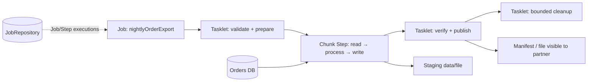
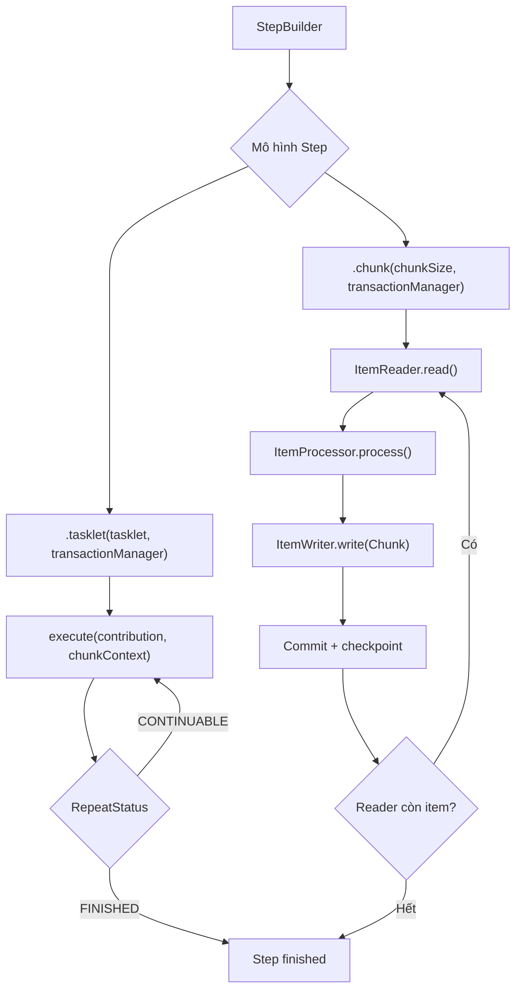
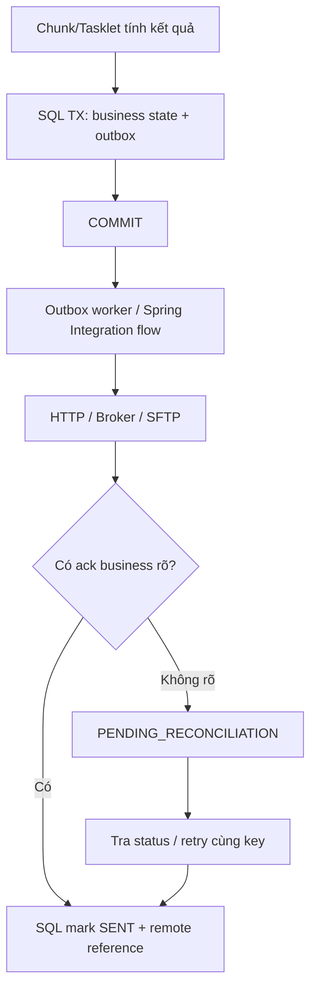
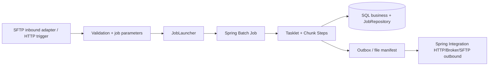

# Tasklet và lựa chọn mô hình bước xử lý

> **Chương:** Spring Batch  
> **Phạm vi:** Module **SPRING_BOOT_INTEGRATION** tổ chức tích hợp trong Spring Boot qua HTTP client, cơ sở dữ liệu, cache, broker thông điệp và các adapter Spring Integration. Bài này hướng dẫn lựa chọn **Tasklet Step** hoặc **chunk-oriented Step** của Spring Batch theo bản chất công việc; giải thích transaction, restart, checkpoint, lỗi, retry, idempotency, kiểm thử và quan sát khi một batch job tương tác với SQL, file, HTTP hoặc broker.

## 1. Tình huống: một job có nhiều kiểu công việc

Một hệ thống bán hàng phải xuất dữ liệu đơn hàng mỗi đêm:

1. Kiểm tra ngày cần xuất và chuẩn bị thư mục staging.
2. Đọc hàng trăm nghìn dòng đơn hàng từ PostgreSQL.
3. Chuẩn hóa dữ liệu, ghi bảng projection hoặc tệp xuất.
4. Kiểm tra row count, checksum và công bố manifest.
5. Dọn các dòng staging cũ đã xuất thành công.

Cả năm việc nằm trong một **Job**, nhưng không có lý do ép chúng sử dụng cùng một mô hình Step:



**Tasklet** phù hợp một đơn vị thao tác có điểm kết thúc rõ, chẳng hạn kiểm tra điều kiện, dọn một lô dữ liệu, đổi tên file hoặc gọi một stored procedure. **Chunk-oriented processing** phù hợp luồng nhiều item cần **reader → processor → writer** với commit/checkpoint theo lô.

**Hai cách đều là Step của Spring Batch**, không phải hai framework tách biệt. Một Job có thể kết hợp cả hai, chạy tuần tự, rẽ nhánh hoặc chia partition khi thực sự cần.

### Mục tiêu học tập

Sau bài này, người học có thể:

- Phân biệt `Job`, `Step`, `Tasklet`, `ItemReader`, `ItemProcessor`, `ItemWriter` và `JobRepository`.
- Viết một Tasklet Step có rollback/restart được thiết kế theo dữ liệu thực.
- Hiểu `RepeatStatus.FINISHED`, `RepeatStatus.CONTINUABLE` và giới hạn của vòng lặp Tasklet.
- Chọn chunk size, transaction manager và restart strategy cho xử lý nhiều bản ghi.
- Phân biệt **Job metadata**, **ExecutionContext checkpoint** và **business state**.
- Nhận ra khi nào SQL transaction không bảo vệ được file, HTTP hoặc broker.
- Kiểm thử crash, retry, duplicate, restart và luồng nhiều Step.

## 2. Kiến trúc Spring Batch cần nắm

| Khái niệm | Vai trò | Ví dụ |
| --- | --- | --- |
| **Job** | Định nghĩa một quy trình batch | `nightlyOrderExport` |
| **JobInstance** | Một lần xử lý logic, xác định bởi **Job name + identifying JobParameters** | Export ngày `2026-11-20` |
| **JobExecution** | Một lần thử chạy của JobInstance; có status, start/end time và lỗi | Lần chạy đầu FAILED, lần restart COMPLETED |
| **Step** | Một giai đoạn độc lập trong Job | `prepareStep`, `projectStep`, `publishStep` |
| **StepExecution** | Thông tin của một lần thử chạy Step, read/write/skip counts và trạng thái | `projectStep` đọc 2.000 item, ghi 1.990 |
| **Tasklet** | Một callback thực thi công việc của một Step | Xóa tối đa 200 dòng staging mỗi lần |
| **ItemReader** | Đọc từng item, trả null khi hết dữ liệu | JDBC cursor/paging, CSV reader |
| **ItemProcessor** | Chuyển đổi/validate/lọc từng item | Chuẩn hóa trường, loại record không đủ điều kiện |
| **ItemWriter** | Ghi một chunk item | JDBC batch writer, file writer |
| **JobRepository** | Lưu metadata về Job/Step executions và execution context | Bảng metadata Spring Batch trong SQL |
| **ExecutionContext** | Map key-value phục vụ state/checkpoint của Job hoặc Step | `lastProcessedId`, tên tệp, offset |
| **JobLauncher / JobOperator** | Khởi chạy và điều khiển Job theo API được cung cấp | Start/restart/stop theo phạm vi được hỗ trợ |

**Đừng nhầm JobRepository với database nghiệp vụ.** JobRepository biết một Step đang `FAILED` hay `COMPLETED` và có checkpoint nào; nó không tự biết phía HTTP đối tác đã ghi nhận thanh toán, file SFTP đã publish đủ hay message Kafka đã được consumer xử lý.

### 2.1. Hai loại Step trong cùng Job



Sơ đồ lược bỏ skip/retry/rollback, exception, stop signal và fault-tolerance policies. Bản chất **transaction boundary của Tasklet và chunk** là điều cần phân biệt trước khi chọn.

## 3. Bảng quyết định: dùng Tasklet hay chunk?

| Đặc điểm công việc | Tasklet thường hợp lý | Chunk thường hợp lý |
| --- | --- | --- |
| Kiểm tra điều kiện trước khi chạy | **Có** | Không cần item pipeline |
| Tạo thư mục, chuyển file từ staging sang published | **Có**, nhưng cần idempotency/atomic publish | Chỉ hợp lý nếu xử lý nội dung từng record |
| Gọi một stored procedure có phạm vi hữu hạn | **Có** | Không cần nếu DB xử lý trọn gói |
| Dọn từng đợt dữ liệu cũ | **Có**, lặp có giới hạn qua `CONTINUABLE` | Có thể, nếu cần item-level policy |
| Đọc 10 triệu record, biến đổi và ghi đích | Không nên nhét toàn bộ vào một callback lớn | **Có** |
| Đọc CSV/JSONL từng dòng để validate | Không nên tự viết vòng lặp/offset khi Spring Batch đã có reader | **Có** |
| Retry/skip một số item sai dữ liệu | Tự cài đặt nhiều thứ | **Chunk** với fault-tolerance rõ |
| Thực hiện một API POST gây side effect | Có thể dùng Tasklet với business idempotency | Chunk khi có nhiều lệnh; **vẫn cần idempotency** |
| Export file lớn có checkpoint | Không nên ghi toàn file trong một transaction/callback | Chunk writer, state/checkpoint phù hợp |
| Đợi external job lâu | Tasklet giám sát trạng thái có thể dùng, nhưng không giữ transaction chờ vô hạn | Cân nhắc orchestration/event/partition thay vì chunk giả |

**Quy tắc chọn nhanh:** Nếu công việc được mô tả tự nhiên là “**làm một thao tác** rồi kết thúc”, bắt đầu bằng Tasklet. Nếu được mô tả là “**đọc N item, xử lý và ghi theo lô**”, bắt đầu bằng chunk. Nếu là “chờ đối tác hàng giờ”, hỏi trước có cần Spring Batch giữ worker hay nên dùng durable workflow với trạng thái để polling.

## 4. Hợp đồng Tasklet: execute và RepeatStatus

Một Tasklet triển khai interface `org.springframework.batch.core.step.tasklet.Tasklet`:

```java
@FunctionalInterface
public interface Tasklet {
    RepeatStatus execute(
            StepContribution contribution,
            ChunkContext chunkContext) throws Exception;
}
```

Đây là chữ ký **minh họa API**, không cần định nghĩa lại interface trong ứng dụng. Hai tham số có mục đích khác nhau:

- `StepContribution` chứa thông tin đóng góp của lần thực thi vào `StepExecution`, bao gồm read/write/filter/skip counts khi thích hợp.
- `ChunkContext` cho phép đọc `StepContext`, `StepExecution`, job parameters và một số execution attributes.

Giá trị trả về:

| Kết quả | Ý nghĩa | Khi nào dùng |
| --- | --- | --- |
| `RepeatStatus.FINISHED` | Lần gọi Tasklet hoàn tất, Step có thể kết thúc | Đã xong việc hoặc không còn dữ liệu |
| `RepeatStatus.CONTINUABLE` | Yêu cầu Step tiếp tục gọi Tasklet | Đã xử lý một đợt nhỏ nhưng còn công việc |
| Exception | Step thất bại hoặc đi qua cơ chế retry/rollback nếu được cấu hình | Lỗi DB, validation, file/remote failure |

**Không return `CONTINUABLE` vô điều kiện.** Một Tasklet không có điều kiện dừng có thể chiếm thread, lặp thao tác gây side effect, giữ Job mãi ở trạng thái chạy và làm tăng tải backend.

### 4.1. Transaction trong TaskletStep

Đối với `TaskletStep` được dựng qua `StepBuilder.tasklet(tasklet, transactionManager)`, framework thường đặt **mỗi lần gọi Tasklet trong một transaction** theo transaction manager đã truyền, đồng thời quản lý step metadata theo cơ chế của Spring Batch.

```text
Tasklet invocation #1:
    BEGIN JDBC TRANSACTION
    xử lý tối đa 200 dòng
    COMMIT
    return CONTINUABLE

Tasklet invocation #2:
    BEGIN JDBC TRANSACTION
    xử lý tối đa 200 dòng
    COMMIT
    return CONTINUABLE

Tasklet invocation #3:
    BEGIN JDBC TRANSACTION
    không còn dòng phù hợp
    COMMIT
    return FINISHED
```

Ranh giới này đúng khi resource thao tác **tham gia transaction manager được cấu hình**. Nó **không** khiến HTTP, SFTP, Redis hay broker tự được rollback cùng JDBC. Nếu Tasklet gọi service `@Async` hoặc chuyển sang thread khác, transaction context dựa trên thread cũng không tự truyền qua.

### 4.2. Tasklet không tương đương “method chỉ gọi một lần”

Một Tasklet có thể:

1. Chạy đúng một lần rồi `FINISHED`.
2. Được gọi nhiều lần khi liên tục trả `CONTINUABLE`.
3. Bị thực thi lại sau rollback/restart theo chính sách JobInstance/Step.
4. Bị một job run mới gọi lại khi JobParameters khác.

Thiết kế side effect phải chấp nhận **có thể gọi lại**, không dựa vào giả định callback chỉ xuất hiện một lần trong toàn đời ứng dụng.

## 5. Thiết lập Spring Boot và Spring Batch

Các ví dụ sử dụng **Spring Boot 3.x + Spring Batch 5.x + Java 17+**, JDBC metadata repository và PostgreSQL. Với Spring Batch 6/Boot 4 hoặc phiên bản khác, cần đối chiếu API/DDL/chữ ký builder của chính BOM đang dùng.

### 5.1. Maven dependencies

```xml
<dependencies>
    <dependency>
        <groupId>org.springframework.boot</groupId>
        <artifactId>spring-boot-starter-batch</artifactId>
    </dependency>
    <dependency>
        <groupId>org.springframework.boot</groupId>
        <artifactId>spring-boot-starter-jdbc</artifactId>
    </dependency>
    <dependency>
        <groupId>org.postgresql</groupId>
        <artifactId>postgresql</artifactId>
        <scope>runtime</scope>
    </dependency>
    <dependency>
        <groupId>org.springframework.boot</groupId>
        <artifactId>spring-boot-starter-test</artifactId>
        <scope>test</scope>
    </dependency>
    <dependency>
        <groupId>org.springframework.batch</groupId>
        <artifactId>spring-batch-test</artifactId>
        <scope>test</scope>
    </dependency>
</dependencies>
```

`spring-boot-starter-batch` tích hợp Spring Batch và auto-configuration của Spring Boot; `spring-batch-test` cung cấp công cụ kiểm thử Job/Step. Driver PostgreSQL cần cho metadata SQL và dữ liệu nghiệp vụ trong ví dụ.

### 5.2. Cấu hình môi trường

```yaml
spring:
  datasource:
    url: ${BATCH_DB_URL:jdbc:postgresql://localhost:5432/batch_dev}
    username: ${BATCH_DB_USER:batch_dev}
    password: ${BATCH_DB_PASSWORD}
    hikari:
      maximum-pool-size: 8
      connection-timeout: 3s

  batch:
    job:
      enabled: false
    jdbc:
      initialize-schema: never
```

**`spring.batch.job.enabled=false`:** không tự chạy mọi Job có bean trong application context lúc startup; job được launcher/scheduler điều khiển tường minh. Nếu không vô hiệu hóa, Spring Boot có thể chạy Job tự động theo startup runner và Job selection rules của phiên bản, gây ngạc nhiên trong service có nhiều Job.

**`spring.batch.jdbc.initialize-schema=never`:** yêu cầu metadata schema đã được **migrate trước**; phù hợp môi trường có Flyway/Liquibase và release pipeline. Ở local/test có thể bật `initialize-schema=always` khi database thử nghiệm cô lập và scripts/version được kiểm soát, **không dùng tùy tiện trên production**.

Không commit secret thật trong YAML. Nếu business DB khác metadata DB, phải cấu hình rõ DataSource và transaction manager cho **JobRepository** và Step, không giả định một `spring.datasource.*` sẽ tự khớp mọi nguồn dữ liệu.

### 5.3. JobRepository không tự xuất hiện từ một bảng ứng dụng

Spring Batch cần những bảng metadata về JobInstance, JobExecution, StepExecution và ExecutionContext. Tên bảng/DDL và index cần dùng **script đúng Spring Batch version và database dialect**. Không tự tạo một bảng `jobs(id, status)` rồi coi nó là JobRepository.

Một bảng **business ledger** như `export_runs(batch_date, manifest_hash, status)` có thể vẫn cần riêng để giải thích kết quả mà đối tác đã nhận; JobRepository không thay thế business contract đó.

## 6. Ví dụ Tasklet thực tế: dọn dữ liệu staging theo đợt

Giả sử bảng `import_staging` chứa những record đã được export; muốn xóa các record `EXPORTED` cũ hơn một ngày cắt cố định, không mở một transaction dài xóa hàng triệu row.

### 6.1. Dữ liệu đầu vào và điều kiện an toàn

```sql
CREATE TABLE import_staging (
    id BIGSERIAL PRIMARY KEY,
    tenant_id VARCHAR(80) NOT NULL,
    status VARCHAR(24) NOT NULL,
    exported_at TIMESTAMPTZ,
    payload_json JSONB NOT NULL
);

CREATE INDEX idx_import_staging_cleanup
    ON import_staging (status, exported_at, id);
```

**Giả định:** chỉ dọn `status='EXPORTED'`, bảng này không phải nguồn sự thật duy nhất, bản export đã được xác nhận theo nghiệp vụ. Trong sản phẩm thật cần kiểm tra retention, legal hold, khả năng rollback từ backup và giới hạn quyền xóa.

### 6.2. Cài Tasklet với số dòng tối đa mỗi lần

```java
package com.example.integration.batch;

import java.sql.Timestamp;
import java.time.LocalDate;
import java.time.ZoneOffset;
import org.springframework.batch.core.StepContribution;
import org.springframework.batch.core.scope.context.ChunkContext;
import org.springframework.batch.core.step.tasklet.Tasklet;
import org.springframework.batch.repeat.RepeatStatus;
import org.springframework.jdbc.core.JdbcTemplate;
import org.springframework.stereotype.Component;

@Component
public class PurgeExportedStagingTasklet implements Tasklet {
    private static final int BATCH_SIZE = 200;
    private final JdbcTemplate jdbc;

    public PurgeExportedStagingTasklet(JdbcTemplate jdbc) {
        this.jdbc = jdbc;
    }

    @Override
    public RepeatStatus execute(
            StepContribution contribution,
            ChunkContext chunkContext) {

        Object raw = chunkContext.getStepContext()
                .getJobParameters()
                .get("cutoffDate");

        if (!(raw instanceof String cutoffText)) {
            throw new IllegalArgumentException(
                    "Required job parameter: cutoffDate");
        }

        LocalDate cutoffDate = LocalDate.parse(cutoffText);
        Timestamp cutoff = Timestamp.from(
                cutoffDate.atStartOfDay(ZoneOffset.UTC).toInstant());

        int deleted = jdbc.update("""
                WITH candidates AS (
                    SELECT id
                      FROM import_staging
                     WHERE status = 'EXPORTED'
                       AND exported_at < ?
                     ORDER BY exported_at, id
                     LIMIT 200
                )
                DELETE FROM import_staging s
                 USING candidates c
                 WHERE s.id = c.id
                """, cutoff);

        return deleted > 0
                ? RepeatStatus.CONTINUABLE
                : RepeatStatus.FINISHED;
    }
}
```

**Cơ chế:** mỗi lần Tasklet xóa tối đa 200 dòng; nếu còn xóa được ít nhất một dòng, trả `CONTINUABLE`. Lần tiếp theo mở transaction mới và xử lý tiếp. Khi không còn dòng phù hợp, trả `FINISHED`.

**Tại sao dùng `cutoffDate` từ JobParameters thay cho `Instant.now()`?** Một Job restart ngày hôm sau phải xử lý **cùng tập dữ liệu mục tiêu theo hợp đồng**, không âm thầm đổi ngày cắt. Cắt theo UTC cũng tránh nhầm local timezone khi nhiều worker ở các múi giờ khác nhau.

**Giới hạn:** SQL dùng CTE/`LIMIT` theo cú pháp PostgreSQL; không copy sang mọi database dialect mà không điều chỉnh. `BATCH_SIZE` là hằng minh họa (SQL hiện ghi số 200); trong dự án thật nên dùng một nơi cấu hình nhất quán thay vì để số ở hai chỗ. Query vẫn cần đo index/lock/IO trên dữ liệu thật.

### 6.3. Chọn điều kiện lặp đúng

Ở đoạn trên:

```text
deleted = 200 -> CONTINUABLE
deleted = 73  -> CONTINUABLE (lặp thêm một lần để xác nhận rỗng)
deleted = 0   -> FINISHED
```

Có thể chọn `deleted == BATCH_SIZE ? CONTINUABLE : FINISHED` để giảm một query khi đợt cuối nhỏ hơn 200, **nhưng chỉ an toàn nếu tập dữ liệu mục tiêu không biến động và logic query không bỏ qua row đủ điều kiện**. Với nhiều worker và transaction đồng thời, việc kết luận “đã hết dữ liệu” cần được kiểm chứng theo isolation/lock policy.

**Tránh vòng lặp vô tận:** nếu bên khác liên tục thêm record đã cũ vào cùng tập, Tasklet có thể không bao giờ thấy 0. Để giải quyết, đóng băng tập theo batch ID/snapshot hoặc đặt deadline và thiết kế job tiếp theo tiếp tục những record mới, không chỉ tăng transaction timeout.

## 7. Gắn Tasklet vào Step và Job

### 7.1. Spring Batch 5 builder API

```java
package com.example.integration.batch;

import org.springframework.batch.core.Job;
import org.springframework.batch.core.Step;
import org.springframework.batch.core.job.builder.JobBuilder;
import org.springframework.batch.core.repository.JobRepository;
import org.springframework.batch.core.step.builder.StepBuilder;
import org.springframework.context.annotation.Bean;
import org.springframework.context.annotation.Configuration;
import org.springframework.transaction.PlatformTransactionManager;

@Configuration(proxyBeanMethods = false)
public class PurgeBatchConfiguration {

    @Bean
    Step purgeExportedStagingStep(
            JobRepository jobRepository,
            PlatformTransactionManager transactionManager,
            PurgeExportedStagingTasklet tasklet) {
        return new StepBuilder(
                "purgeExportedStagingStep", jobRepository)
                .tasklet(tasklet, transactionManager)
                .build();
    }

    @Bean
    Job purgeExportedStagingJob(
            JobRepository jobRepository,
            Step purgeExportedStagingStep) {
        return new JobBuilder(
                "purgeExportedStagingJob", jobRepository)
                .start(purgeExportedStagingStep)
                .build();
    }
}
```

**Chú ý:** Spring Batch 5 yêu cầu truyền `JobRepository` vào `JobBuilder`/`StepBuilder` và truyền transaction manager vào `tasklet(...)`. Đừng copy các constructor hoặc `StepBuilderFactory`/`JobBuilderFactory` đã thay đổi hoặc bị deprecated từ ví dụ Spring Batch 4 mà không kiểm tra.

Ở ví dụ một DataSource, `JdbcTemplate` và `PlatformTransactionManager` được mong đợi quản lý **cùng PostgreSQL**. Nếu có nhiều transaction managers, phải dùng `@Qualifier` cho Step và JDBC source; nếu không, có thể xảy ra ambiguity hoặc **transaction không bao trùm câu DELETE thực tế**.

### 7.2. Chạy với JobParameters mang ý nghĩa nghiệp vụ

```java
JobParameters params = new JobParametersBuilder()
        .addString("cutoffDate", "2026-11-20")
        .toJobParameters();

JobExecution execution = jobLauncher.run(
        purgeExportedStagingJob, params);
```

Đoạn này là **snippet trong launcher/service** có các dependency `JobLauncher` và bean `purgeExportedStagingJob` được inject; cần imports Spring Batch. `jobLauncher.run(...)` có thể được thực thi đồng bộ hoặc bất đồng bộ tùy cấu hình JobLauncher/TaskExecutor, nên không mặc định lệnh return luôn có nghĩa Job đã hoàn tất.

**Quan trọng:** cùng **Job name + identifying parameters** là cùng JobInstance. Nếu instance đã `COMPLETED`, chạy lại y hệt thường bị từ chối theo semantics JobRepository; nếu instance `FAILED`, chạy lại cùng identifying parameters là cơ sở cho **restart**. Tạo `runId` ngẫu nhiên mỗi lần để “chữa lỗi already complete” sẽ tạo **JobInstance mới**, không phải restart, và có thể xóa lại dữ liệu hoặc phát lại side effect.

### 7.3. Ngày cắt là một business parameter

Nếu một lệnh dọn ngày `2026-11-20` thất bại giữa chừng, restart nên dùng chính ngày đó. Lệnh ngày `2026-11-21` là một instance khác. Quy tắc định danh này giúp audit, rollback, đối chiếu khối lượng và tránh việc thay đổi data scope khi operator nhấn “chạy lại”.

Không nhận một SQL expression, table name hay path tùy ý từ JobParameters rồi nối trực tiếp vào SQL. Các tham số cần có **allowlist, type validation, quyền vận hành và bounds**.

## 8. Tasklet lặp lại khác gì vòng for trong một lần execute?

Đây là khác biệt ảnh hưởng lớn đến crash recovery:

| Cách làm | Transaction boundary thường gặp | Hậu quả |
| --- | --- | --- |
| Một `execute()` chạy vòng `while` xóa 1 triệu dòng | Một transaction dài nếu TaskletStep quản lý bao trùm callback | Lock giữ lâu, rollback rất lớn, timeout |
| Một `execute()` xử lý 200 dòng rồi `CONTINUABLE` | Nhiều invocation/transaction nhỏ | Giảm phạm vi rollback, dễ giới hạn tải và restart |
| Chunk Step `chunk(200, transactionManager)` | Một transaction/200 item được write theo policy | Có reader/writer state, checkpoint và fault tolerance theo item/chunk |

Mặc dù Tasklet `CONTINUABLE` có thể làm việc theo “đợt”, **nó không tự trở thành chunk-oriented step**. Bạn vẫn tự quyết định cách lấy dữ liệu, cách resume, điều kiện dừng, error classification và metrics item-level.

### 8.1. Khi nào tasklet lặp theo đợt là đủ?

Khi logic là một **operation SQL có tính idempotent**, ví dụ xóa những record đã hết hạn, mỗi lần gọi có thể xóa một nhóm có giới hạn; việc thực hiện lại query sau rollback/restart vẫn ra kết quả đúng.

Khi công việc gồm parser record, transform, filter, skip một số item sai dữ liệu và ghi batch, chunk với Spring Batch readers/writers là mô hình phù hợp hơn vì cung cấp **các checkpoint/restart contracts chuyên dụng**.

## 9. Chunk-oriented Step: Reader → Processor → Writer

Chunk Step không cần Tasklet nghiệp vụ do bạn tự viết. Framework cung cấp step orchestration:

```text
BEGIN TRANSACTION
  read item #1
  process item #1
  ...
  read item #200
  process item #200
  writer.write(Chunk<ExportRow> size=200)
  update checkpoint/metadata theo framework
COMMIT

BEGIN TRANSACTION
  đọc chunk kế tiếp
  ...
COMMIT
```

**Khả năng rollback của một chunk** phụ thuộc transaction manager và resource thực sự tham gia. Nếu writer gọi HTTP POST hoặc ghi tệp remote, rollback SQL/JobRepository **không tự đảo ngược remote side effect**.

### 9.1. ItemReader trả null nghĩa là hết dữ liệu

Với nhiều `ItemReader`, khi `read()` trả `null`, Spring Batch hiểu **không còn item để đọc**. Đừng dùng `null` để biểu diễn một record không hợp lệ trong reader; validation/filter nên đặt đúng ở processor hoặc reader error policy theo thiết kế.

Một `ItemProcessor<I, O>` có thể trả `null` để **lọc bỏ item** theo Spring Batch semantics; điều đó khác với `reader.read() == null` nghĩa là hết input.

### 9.2. Chọn chunk size

| Chunk size | Lợi ích | Rủi ro |
| --- | --- | --- |
| Nhỏ (10–50) | Transaction ngắn, ít dữ liệu phải xử lý lại khi rollback | Tăng số commit/IO metadata, overhead |
| Vừa (100–1.000) | Cân bằng throughput và rollback trong nhiều workload | Cần benchmark với database/file/broker |
| Rất lớn (10.000+) | Giảm số commit trên giấy | RAM, lock, transaction log, retry cost, writer batch size |

Không có một chunk size đúng cho mọi ứng dụng. Chọn theo **kích thước item, chi phí reader/processor, giới hạn writer, DB lock/transaction timeout, heap và SLA phục hồi**. Quan sát p95 transaction duration và số item phải làm lại sau sự cố.

## 10. Ví dụ chunk: tạo projection báo cáo từ nguồn dữ liệu ổn định

Giả sử bảng `export_source` là dữ liệu đầu vào **bất biến trong thời gian một JobInstance chạy**. Ta đọc từng row, tạo projection và ghi vào bảng `export_projection` có unique key.

### 10.1. Schema minh họa

```sql
CREATE TABLE export_source (
    id BIGINT PRIMARY KEY,
    batch_date DATE NOT NULL,
    amount_minor BIGINT NOT NULL,
    currency VARCHAR(3) NOT NULL
);

CREATE TABLE export_projection (
    source_id BIGINT PRIMARY KEY,
    amount_minor BIGINT NOT NULL,
    currency VARCHAR(3) NOT NULL
);

CREATE INDEX idx_export_source_batch
    ON export_source (batch_date, id);
```

**Assumption quan trọng:** source không bị thêm/xóa/sắp xếp lại đối với batch date đang chạy. Nếu tập đầu vào biến động khi restart, checkpoint theo item count/cursor có thể trượt và làm sót/trùng item. Khi đó cần snapshot/batchId, paging bằng key ổn định hoặc một staging table đã đóng băng.

### 10.2. DTO

```java
package com.example.integration.batch;

public record SourceOrder(
        long id,
        long amountMinor,
        String currency) {}
```

```java
package com.example.integration.batch;

public record ProjectionOrder(
        long sourceId,
        long amountMinor,
        String currency) {}
```

### 10.3. Reader nhận JobParameter tại runtime

```java
package com.example.integration.batch;

import java.sql.Date;
import javax.sql.DataSource;

import org.springframework.batch.core.configuration.annotation.StepScope;
import org.springframework.batch.item.database.JdbcCursorItemReader;
import org.springframework.batch.item.database.builder.JdbcCursorItemReaderBuilder;
import org.springframework.beans.factory.annotation.Value;
import org.springframework.context.annotation.Bean;
import org.springframework.context.annotation.Configuration;

@Configuration(proxyBeanMethods = false)
public class ProjectionReaderConfiguration {

    @Bean
    @StepScope
    JdbcCursorItemReader<SourceOrder> sourceOrderReader(
            DataSource dataSource,
            @Value("#{jobParameters['batchDate']}") String batchDate) {
        return new JdbcCursorItemReaderBuilder<SourceOrder>()
                .name("sourceOrderReader")
                .dataSource(dataSource)
                .sql("""
                    SELECT id, amount_minor, currency
                      FROM export_source
                     WHERE batch_date = ?
                     ORDER BY id
                    """)
                .preparedStatementSetter(ps ->
                        ps.setDate(1, Date.valueOf(batchDate)))
                .rowMapper((rs, rowNum) -> new SourceOrder(
                        rs.getLong("id"),
                        rs.getLong("amount_minor"),
                        rs.getString("currency")))
                .build();
    }
}
```

`@StepScope` cho phép tạo reader khi Step chạy và binding `jobParameters['batchDate']` đã có giá trị. Đừng đánh giá tham số Job ở thời điểm ứng dụng khởi động nếu nó chỉ tồn tại tại **Step execution runtime**.

**Cảnh báo:** `JdbcCursorItemReader` dùng JDBC cursor và có giới hạn về transaction, connection và restart state; query cần thứ tự ổn định. Với dữ liệu rất lớn, cân nhắc `JdbcPagingItemReader` và thiết kế sorting key/index chuẩn, nhưng không mặc định paging tự giải quyết mọi vấn đề khi dữ liệu nguồn thay đổi.

### 10.4. Processor và writer

```java
package com.example.integration.batch;

import java.util.List;
import org.springframework.batch.item.ItemProcessor;
import org.springframework.batch.item.ItemWriter;
import org.springframework.context.annotation.Bean;
import org.springframework.context.annotation.Configuration;
import org.springframework.jdbc.core.JdbcTemplate;

@Configuration(proxyBeanMethods = false)
class ProjectionProcessingConfiguration {

    @Bean
    ItemProcessor<SourceOrder, ProjectionOrder> projectionProcessor() {
        return source -> {
            if (source.amountMinor() < 0) {
                throw new IllegalArgumentException(
                        "Negative amount for source " + source.id());
            }
            return new ProjectionOrder(
                    source.id(), source.amountMinor(), source.currency());
        };
    }

    @Bean
    ItemWriter<ProjectionOrder> projectionWriter(JdbcTemplate jdbc) {
        return chunk -> {
            List<Object[]> rows = chunk.getItems().stream()
                    .map(item -> new Object[] {
                        item.sourceId(),
                        item.amountMinor(),
                        item.currency()
                    })
                    .toList();

            if (!rows.isEmpty()) {
                jdbc.batchUpdate("""
                    INSERT INTO export_projection
                        (source_id, amount_minor, currency)
                    VALUES (?, ?, ?)
                    ON CONFLICT (source_id) DO NOTHING
                    """, rows);
            }
        };
    }
}
```

`ON CONFLICT DO NOTHING` giúp không tạo hai row cùng `source_id` nếu một chunk bị thực thi lại, nhưng **không phát hiện cùng key có payload khác**. Với dữ liệu tài chính hoặc nguồn có thể thay đổi, lưu fingerprint/version, so sánh conflict và quyết định update/reject có chủ đích; không im lặng nuốt nội dung sai.

### 10.5. Tạo chunk Step

```java
package com.example.integration.batch;

import org.springframework.batch.core.Step;
import org.springframework.batch.core.repository.JobRepository;
import org.springframework.batch.core.step.builder.StepBuilder;
import org.springframework.batch.item.ItemProcessor;
import org.springframework.batch.item.ItemWriter;
import org.springframework.batch.item.database.JdbcCursorItemReader;
import org.springframework.context.annotation.Bean;
import org.springframework.context.annotation.Configuration;
import org.springframework.transaction.PlatformTransactionManager;

@Configuration(proxyBeanMethods = false)
class ProjectionStepConfiguration {

    @Bean
    Step projectOrderStep(
            JobRepository jobRepository,
            PlatformTransactionManager transactionManager,
            JdbcCursorItemReader<SourceOrder> sourceOrderReader,
            ItemProcessor<SourceOrder, ProjectionOrder> projectionProcessor,
            ItemWriter<ProjectionOrder> projectionWriter) {
        return new StepBuilder("projectOrderStep", jobRepository)
                .<SourceOrder, ProjectionOrder>chunk(
                        200, transactionManager)
                .reader(sourceOrderReader)
                .processor(projectionProcessor)
                .writer(projectionWriter)
                .build();
    }
}
```

Khi dùng cùng một datasource/transaction manager, câu SQL của writer và metadata/checkpoint có thể tham gia vào cơ chế transaction phù hợp với JobRepository. Nhưng nếu writer dùng một DB khác hoặc external API, **không được suy ra cả hai cùng commit/rollback** chỉ từ `.chunk(200, transactionManager)`.

Các class trên là ví dụ để giải thích mô hình; để chạy trọn project cần đặt packages trong Spring component scan, cấu hình schema Spring Batch, database tables, và Job chứa Step (được minh họa ở phần tiếp theo).

## 11. Kết hợp Tasklet Step và chunk Step trong một Job

Một Job export điển hình gồm prepare, project và finalize:

```java
@Bean
Job nightlyOrderExport(
        JobRepository jobRepository,
        @Qualifier("prepareExportStep") Step prepareExportStep,
        @Qualifier("projectOrderStep") Step projectOrderStep,
        @Qualifier("publishExportStep") Step publishExportStep) {

    return new JobBuilder("nightlyOrderExport", jobRepository)
            .start(prepareExportStep)
            .next(projectOrderStep)
            .next(publishExportStep)
            .build();
}
```

Trong snippet, `prepareExportStep` và `publishExportStep` là các Tasklet Steps **phải được khai báo riêng**, ví dụ qua `new StepBuilder(...).tasklet(..., transactionManager).build()`. Nếu một bước thất bại, Job thường không tự chạy tiếp bước sau như thể mọi việc thành công.

### 11.1. Tasklet prepare nên làm gì?

- Kiểm tra JobParameters: ngày xử lý, tenant, schema version.
- Kiểm tra các điều kiện phụ thuộc và quyền truy cập.
- Tạo staging directory hoặc staging record theo **định danh JobInstance**.
- Nếu phải tạo một bảng snapshot, ghi trạng thái snapshot **bền vững** để restart dùng đúng tập dữ liệu.
- Tránh xóa dữ liệu do một JobInstance khác tạo.

### 11.2. Tasklet finalize nên làm gì?

- Xác minh item count, checksum, schema và file được đóng đúng.
- Công bố manifest hoặc rename từ `.tmp` sang tên chính thức.
- Ghi **business completion record** theo operation ID ổn định.
- Không coi `StepExitStatus.COMPLETED` là bằng chứng đối tác đã tải/nhập file.

**Thiết kế file publish:** nếu file vừa được ghi trên local filesystem, `Files.move(..., ATOMIC_MOVE)` chỉ có semantics mong đợi trong phạm vi filesystem hỗ trợ. SFTP/object storage không tự tham gia JDBC transaction; cần staging + publish marker/manifest phù hợp và retry idempotent.

### 11.3. Flow branching khi không có dữ liệu

Nếu prepare phát hiện không có input, có thể dùng flow transition/JobExecutionDecider để kết thúc Job sớm; không nên buộc chunk reader chạy chỉ để trả `null` rồi Tasklet finalize tạo file rỗng nếu hợp đồng cấm.

Điều kiện đi nhánh nên dựa trên **ExitStatus/decider contract được kiểm thử**, không chỉ đặt `BatchStatus` bằng một chuỗi tùy ý.

## 12. JobInstance, JobExecution và restart

Đây là phần nhiều hệ tích hợp sai khi triển khai scheduler:

```text
Job name = nightlyOrderExport
identifying JobParameter batchDate = 2026-11-20

JobInstance #A
  JobExecution #1 -> FAILED at projectOrderStep
  JobExecution #2 -> restart same parameters -> COMPLETED

Job name = nightlyOrderExport
identifying JobParameter batchDate = 2026-11-21

JobInstance #B (batch date khác)
  JobExecution #3 -> COMPLETED
```

Với restart mặc định, các Step đã `COMPLETED` trong JobInstance thường được **bỏ qua** và Step thất bại được chạy lại theo execution context/restart contract. Một số cấu hình như `allowStartIfComplete(true)` có thể khiến Step hoàn tất vẫn chạy lại; cần quyết định theo nghiệp vụ, không bật chỉ để “cho tiện”.

### 12.1. Phân biệt restart và re-run

| Hành động | Định danh | Rủi ro |
| --- | --- | --- |
| **Restart job FAILED** | Cùng Job name + identifying parameters | Dựa vào checkpoint/step state; phải kiểm thử |
| **Run ngày mới** | Một business key/ngày khác | JobInstance mới, dữ liệu mới |
| **Reprocess cùng ngày đã COMPLETE** | Cần một version/reprocess ID và contract riêng | Có thể ghi đè/xuất trùng/charge lại |
| **Đổi runId ngẫu nhiên sau mỗi failure** | Vô tình tạo JobInstance mới | Bỏ qua restart state, có thể phát lại side effect |

JobParameters nên xác định **bản sắc nghiệp vụ của một lần xử lý**. Có thể thêm tham số không định danh cho logging/tuning, nhưng phải hiểu tham số đó thay đổi có ảnh hưởng kết quả hay không và chính sách JobRepository của version đang dùng.

## 13. ExecutionContext và checkpoint: lưu tiến độ đúng chỗ

Một `ExecutionContext` được lưu cùng metadata Job/Step, có thể chứa vị trí đọc hoặc key cần resume. Ví dụ khái niệm:

```java
StepExecution stepExecution =
        chunkContext.getStepContext().getStepExecution();

ExecutionContext context =
        stepExecution.getExecutionContext();

long lastProcessedId =
        context.getLong("lastProcessedId", 0L);

// Sau khi xử lý ID mới thành công trong phạm vi commit phù hợp:
context.putLong("lastProcessedId", newLastProcessedId);
```

**Snippet minh họa:** `chunkContext`, `newLastProcessedId` và các imports là phần của một Tasklet; code chưa đủ để trở thành reader/step hoàn chỉnh. Chỉ ghi `lastProcessedId` sau khi side effect tương ứng được bảo đảm theo ranh giới transaction/checkpoint. Nếu remote HTTP call không thuộc transaction, ExecutionContext update không tự làm hai hệ thống commit cùng nhau.

### 13.1. Context không phải kho lưu business data lớn

| Nên lưu | Không nên lưu |
| --- | --- |
| Offset, khóa cuối, tên tệp staging, schema version nhỏ | Hàng triệu item hoặc toàn bộ CSV |
| Số lượng đã kiểm tra, ID partition | Access token, password, connection object |
| Ngày bắt đầu/cutoff đã cố định | Mảng lớn các DTO mutable, stream hoặc bean |
| Thông tin để resume khi crash | Business ledger duy nhất của thanh toán/hóa đơn |

Các entry cần **có thể serialize/deserialize theo định dạng của JobRepository**. Việc đổi class, cấu trúc hoặc serializer giữa hai phiên bản có thể khiến Job không restart được. Không coi mọi object Java đặt được vào map đều sẽ được lưu/khôi phục an toàn.

### 13.2. Reader state và dữ liệu nguồn phải cùng ổn định

Chunk readers thực hiện `ItemStream.open/update/close` theo contract nếu hỗ trợ restart. Nếu reader lưu **số item đã đọc** nhưng nguồn SQL bị chèn/xóa/reorder trước restart, việc skip theo số lượng có thể bỏ sót bản ghi.

Các hướng giải quyết:

- Chốt snapshot/batch ID và tập source bất biến trong một JobInstance.
- Dùng keyset paging theo business key ổn định và điều kiện snapshot khi cần.
- Gắn version/time cutoff trong JobParameters đã validate.
- Đảm bảo writer có business unique key để không tạo duplicate khi read lại.
- Kiểm thử restart sau khi đã commit một số chunk, không chỉ test chạy trọn từ đầu.

## 14. Transaction, rollback, retry và skip

### 14.1. Tasklet Step

Với Tasklet, exception làm invocation thất bại và transaction thường rollback nếu cấu hình tương ứng. Nhưng framework **không tự biết item nào trong 200 dòng do bạn tự lặp cần skip/retry**. Nếu muốn item-level error policy phức tạp, dùng chunk sẽ rõ ràng hơn.

### 14.2. Chunk Step

Spring Batch cung cấp fault-tolerance ở cấp Step cho những loại exception được chọn:

```java
new StepBuilder("projectOrderStep", jobRepository)
        .<SourceOrder, ProjectionOrder>chunk(200, transactionManager)
        .reader(reader)
        .processor(processor)
        .writer(writer)
        .faultTolerant()
        .retry(org.springframework.dao.DeadlockLoserDataAccessException.class)
        .retryLimit(3)
        .skip(org.springframework.batch.item.validator.ValidationException.class)
        .skipLimit(20)
        .build();
```

Đây là **mẫu API minh họa fault tolerance**: chỉ bật sau khi phân loại exception của reader/processor/writer thực tế và kiểm thử rollback/retry/skip counters. Không mặc định mọi lỗi deadlock có thể retry không giới hạn; không skip lỗi dữ liệu tài chính chỉ để Job đạt `COMPLETED`.

| Lỗi | Chính sách thường cân nhắc | Điều cần tránh |
| --- | --- | --- |
| Record thiếu field không bắt buộc | Sửa bằng default hợp lệ hoặc reject/skip có audit | Nuốt lỗi mà không biết số item mất |
| Record thiếu business ID bắt buộc | Fail hoặc quarantine theo contract | Tạo ID ngẫu nhiên khi retry |
| SQL deadlock | Retry transaction hữu hạn, backoff khi có cơ chế phù hợp | Retry vô hạn làm DB quá tải |
| Unique conflict do replay | Kiểm tra fingerprint/business idempotency | Coi mọi conflict là duplicate giống nhau |
| HTTP 400/422 | Không retry mù; sửa request hoặc quarantine | Che thành cache miss |
| HTTP timeout sau POST | Outcome **không rõ**, dùng operation ID và status lookup | Gửi POST mới với key mới |
| Broker unavailable | Outbox, retry có giới hạn, quan sát pending | Giữ SQL transaction mở chờ broker nhiều phút |
| File SFTP upload dở | Staging + checksum + manifest, retry idempotent | Công bố file như thể đã hoàn tất |

### 14.3. Retry không có nghĩa exactly-once

Khi writer đã gọi HTTP đối tác nhưng transaction SQL của chunk rollback, Spring Batch có thể thực thi lại cùng chunk. Nếu partner đã commit trước khi response mất, việc gọi lại có thể tạo duplicate.

**Giải pháp là ranh giới nghiệp vụ:** idempotency key cố định, business unique constraint, outbox/inbox và reconciliation. Batch metadata và retry policy không tự biến một side effect từ xa thành atomic.

## 15. Dữ liệu SQL, HTTP, broker và file có biên giao dịch khác nhau

| Tác vụ | Transaction trong Step có bảo vệ được không? | Thiết kế thêm |
| --- | --- | --- |
| JDBC update trên đúng DataSource/manager của Step | Có, theo database isolation/constraint và cách dùng | Commit size, lock timeout, unique key |
| JDBC update ở DataSource khác | **Không tự động** | Manager riêng/điều phối, tránh giả định atomic |
| R2DBC reactive pipeline | Không tự là JDBC transaction | Reactive transaction manager/context phù hợp |
| HTTP POST/PUT tới đối tác | **Không** | Idempotency, timeout, status lookup, reconciliation |
| Kafka/Rabbit/JMS publish | **Không tự chung SQL** | Outbox, broker ack semantics |
| Redis cache put/evict | Không tự rollback cùng JDBC | Invalidation sau commit và TTL/version |
| Local file/SFTP/object storage | **Không** | Staging, manifest, checksum, recoverable publish |

### 15.1. Anti-pattern: gọi remote trong transaction dài

```java
@Transactional
public void exportAndNotify(String batchId) {
    // 1. Update nhiều rows SQL
    // 2. HTTP POST tới partner, chờ 30 giây
    // 3. Ghi file SFTP
    // 4. Commit SQL
}
```

SQL transaction có thể giữ lock/connection suốt thời gian chờ HTTP/SFTP. Nếu commit SQL thất bại ở cuối, remote side effect vẫn có thể xảy ra. Việc thêm `@Transactional` chỉ che dấu ranh giới thực sự.

### 15.2. Mô hình bền vững hơn



Spring Batch có thể là **orchestrator của quá trình tạo và gửi dữ liệu**, còn outbox có thể bảo vệ ý định gửi khi process crash. Nếu callback gửi remote bị gọi hai lần, bên nhận vẫn cần idempotency hoặc khả năng tra cứu trạng thái.

## 16. Tasklet thao tác file: publish an toàn hơn “ghi xong là xong”

Một Tasklet thường phù hợp để **publish** file sau khi chunk writer đã hoàn thành staging. Nhưng file publish có nhiều trường hợp cạnh tranh:

```text
chunk writer: xuất orders_batch-018.csv.tmp
  → close stream, ghi row count + checksum
publish Tasklet:
  → xác minh hash và manifest
  → chuyển file staging sang tên public
  → ghi business status PUBLISHED
partner:
  → chỉ nhập file có manifest/ready marker
```

### 16.1. Code minh họa cho filesystem cùng vùng hỗ trợ atomic move

```java
Path tmp = workDir.resolve("orders_" + batchId + ".csv.tmp");
Path published = workDir.resolve("orders_" + batchId + ".csv");

if (Files.exists(published)) {
    // Kiểm tra checksum/manifest trước khi coi đây là replay hợp lệ.
    verifyAlreadyPublished(published, expectedChecksum);
} else {
    verifyChecksum(tmp, expectedChecksum);
    Files.move(tmp, published, StandardCopyOption.ATOMIC_MOVE);
}
```

Đây là **snippet trong Tasklet**, không phải method hoàn chỉnh: `workDir`, `batchId`, `expectedChecksum` và hai helper phải được triển khai, tham số filename phải được validate để tránh path traversal. `ATOMIC_MOVE` có thể không được hỗ trợ trên filesystem/network share; không tự fallback sang move thường mà không thay đổi protocol hoàn tất file. Với object storage/SFTP, phải dùng staging/manifest/commit marker thích hợp.

**Sau khi file publish nhưng trước khi Batch ghi Step COMPLETED**, restart có thể vào lại Step. Vì vậy Tasklet publish phải **idempotent**: nếu file public đã tồn tại, so sánh checksum/business batch ID thay vì ghi đè hoặc tạo thêm một bản xuất.

### 16.2. Tasklet dành cho cleanup sau publish

Cleanup nên chỉ xóa file staging của **JobInstance đã xác nhận publish**, dựa trên manifest/ledger và retention. Không dọn toàn bộ thư mục `/tmp/exports` bằng một wildcard rộng khi nhiều Job chạy đồng thời.

## 17. Một số lựa chọn khác ngoài Tasklet và chunk

| Mô hình | Khi nào cân nhắc | Giới hạn cần kiểm soát |
| --- | --- | --- |
| **Flow / JobExecutionDecider** | Điều phối rẽ nhánh, skip giai đoạn khi không có dữ liệu | ExitStatus và restart transitions |
| **Partitioned Step** | Chia dữ liệu theo tenant/id range/partition để chạy song song | Partition overlap, unique key, metadata và resource contention |
| **Multi-threaded Step** | Tăng throughput khi reader/processor/writer phù hợp | Thread safety của reader, writer, ExecutionContext |
| **Remote chunking** | Reader/manager điều phối, worker xử lý chunk qua broker | Delivery/ack/duplicate/chunk retry và network |
| **Remote partitioning** | Giao các partition Step cho worker độc lập | Partition assignment và restart consistency |
| **Spring Integration Flow** | HTTP/broker/file adapters và routing/enrichment | Không thay JobRepository/checkpoint của Batch |
| **Scheduler/Kubernetes CronJob** | Định kỳ khởi chạy batch process | JobParameters, concurrency policy và restart/duplicate |

Không bắt đầu bằng partitioning nếu một chunk step đơn luồng đã đáp ứng SLA. Khi scale out, tổng connection pool, SQL lock và số file writers có thể nhân lên rất nhanh, làm throughput giảm thay vì tăng.

### 17.1. Job chia partition theo tenant

Nếu dữ liệu 20 tenant độc lập, có thể chia partition theo tenant, nhưng mỗi partition phải có **định danh dữ liệu rõ** và không ghi chéo. Không dùng một `ExecutionContext` global duy nhất để lưu offset chung giữa các partition. Nếu tenant có quy mô rất khác nhau, chia đều số tenant không đồng nghĩa chia đều tải.

## 18. Kết nối Batch với Spring Integration

Spring Batch xử lý **job/step/restart**, Spring Integration xử lý **message channel/gateway/adapter flow**. Chúng bổ sung cho nhau:



**Một lỗi thường gặp:** HTTP inbound gateway nhận request rồi gọi JobLauncher đồng bộ chờ job 45 phút hoàn tất. Điều này giữ connection HTTP, gây timeout upstream và retry request tạo nhiều JobInstances nếu tham số không ổn định.

Nếu job chạy dài, nên:

1. Xác thực và kiểm tra quyền người yêu cầu.
2. Tạo **business operation ID** ổn định.
3. Ghi nhận yêu cầu và identity của batch một cách bền vững.
4. Khởi động Job theo concurrency policy; trả `202 Accepted` và URI tra cứu trạng thái khi contract cho phép.
5. Ánh xạ JobExecution status sang business status; không chỉ trả raw Batch metadata.
6. Giới hạn retry và đảm bảo cùng operation ID không tạo side effect trùng.

Không dùng Kafka consumer ack như thể Job đã xử lý hoàn tất nếu consumer chỉ vừa **enqueue** một Job không bền vững. Chọn ack semantics đúng với mô hình delivery.

## 19. Lỗi vận hành và cách phân loại

| Dấu hiệu | Nguyên nhân có thể | Hành động |
| --- | --- | --- |
| `JobInstanceAlreadyCompleteException` | Chạy lại cùng identifying parameters của instance đã hoàn tất | Phân biệt reprocess vs restart; không thêm runId ngẫu nhiên để né |
| `JobExecutionAlreadyRunningException` | Cùng JobInstance đang chạy | Kiểm tra scheduler concurrency/duplicate trigger |
| `JobRestartException` | Job/Step bị cấu hình không cho restart hoặc state không nhất quán | Kiểm tra restartable policy và metadata |
| Tasklet không kết thúc | Luôn trả `CONTINUABLE` hoặc source tiếp tục tạo dữ liệu | Điều kiện dừng, time budget, snapshot |
| Tasklet chạy lại sau crash tạo file trùng | Publish chưa idempotent | Stable name + checksum/manifest/ledger |
| Chunk restart bỏ sót record | Nguồn bị reorder, checkpoint chỉ là item count | Snapshot/paging key ổn định, test restart |
| Chunk writer ghi đôi | Remote không hỗ trợ idempotency hoặc writer không có key duy nhất | Business ID + unique constraint/outbox |
| SQL lock kéo dài | Tasklet xử lý quá nhiều dòng trong một invocation/chunk quá lớn | Chia transaction, đo lock và indexes |
| `@StepScope` SpEL không có JobParameter | Bean tạo quá sớm, không ở step context | Scope/proxy và test launch thực |
| Batch metadata schema lỗi | DDL sai version/dialect | Migration/JobRepository setup |
| Job COMPLETED nhưng business chưa hoàn tất | Job chỉ tạo outbox/202, downstream còn pending | Business status và reconciliation riêng |
| CI chạy job khi tạo context | Spring Boot job runner tự động | `spring.batch.job.enabled=false` ở test |

**Không sửa lỗi bằng cách xóa metadata JobRepository thủ công.** Việc này có thể phá restart, audit và đưa hệ thống vào tình huống chạy lại những tác vụ đã có side effect.

## 20. Khả năng quan sát Job/Step

### 20.1. Ba lớp trạng thái

| Lớp | Chỉ số ví dụ | Ý nghĩa |
| --- | --- | --- |
| **Job metadata** | JobExecution status, duration, restart count | Điều phối và lịch sử chạy |
| **Step/chunk** | Read/write/filter/skip counts, rollback count, commit count | Sức khỏe xử lý dữ liệu |
| **Business integration** | Outbox pending, file published, partner acknowledged, idempotency conflicts | Nghĩa vụ nghiệp vụ thực sự hoàn tất đến đâu |

Trong Spring Boot, Actuator/Micrometer và Batch listeners có thể hỗ trợ instrumentation. Không mặc định mọi metric nghiệp vụ hoặc từng Tasklet invocation đã có sẵn; bổ sung có chọn lọc ở service/step listeners/driver.

### 20.2. Metric đáng theo dõi

- Job duration P50/P95/P99, failures, retries, executions đang chạy.
- Step commit/rollback/retry/skip và item throughput.
- Tasklet invocation count, số dòng đã dọn và progress theo business batch.
- Reader latency, processor errors, writer batch latency.
- JDBC connection pool, lock wait, transaction log, CPU/heap/disk.
- Broker publish lag, outbox oldest age, file upload checksum failures.
- Số business operations `UNKNOWN`/`NEEDS_RECONCILIATION`.

**Không dùng jobInstanceId, orderId, tenantId hoặc file name riêng lẻ làm metric label** khi cardinality lớn. Dùng job/step name hữu hạn, outcome/error class; correlation/business ID thuộc tracing/log được truy cập kiểm soát, không phải tag đo liên tục.

### 20.3. Không log nguyên JobParameters

JobParameters đôi khi chứa đường dẫn tệp, tenant ID hoặc dữ liệu nhạy cảm. Tuyệt đối không đặt token/password trong JobParameters hay ExecutionContext chỉ để tiện truyền vào Tasklet. Dùng secret management và identity có scope rõ. Redact logs và giới hạn quyền truy cập Batch metadata tables/Actuator.

## 21. Kiểm thử theo failure boundary

### 21.1. Không chỉ test gọi Tasklet.execute trực tiếp

Unit test gọi `execute(...)` với mock `ChunkContext` chỉ chứng minh SQL/logic của callback, **không chứng minh**:

- StepBuilder gắn đúng transaction manager.
- JobParameters thực được binding đúng khi launch.
- Commit/rollback mỗi lần `CONTINUABLE`.
- JobRepository ghi `StepExecution` và restart state.
- Các Step đã COMPLETED được skip khi restart.
- File publish/HTTP retry không tạo duplicate.

Integration test cần **chạy Job/Step qua Spring Batch infrastructure thật**.

### 21.2. Ví dụ @SpringBatchTest

```java
package com.example.integration.batch;

import static org.assertj.core.api.Assertions.assertThat;

import org.junit.jupiter.api.Test;
import org.springframework.batch.core.BatchStatus;
import org.springframework.batch.core.JobExecution;
import org.springframework.batch.core.JobParametersBuilder;
import org.springframework.batch.test.JobLauncherTestUtils;
import org.springframework.batch.test.context.SpringBatchTest;
import org.springframework.beans.factory.annotation.Autowired;
import org.springframework.boot.test.context.SpringBootTest;

@SpringBatchTest
@SpringBootTest(properties = "spring.batch.job.enabled=false")
class PurgeExportedStagingJobIT {

    @Autowired JobLauncherTestUtils launcher;

    @Test
    void removesOnlyEligibleRecords() throws Exception {
        // Test fixture tạo records EXPORTED và PENDING,
        // kèm dates ở hai phía cutoff, trong PostgreSQL test.

        JobExecution execution = launcher.launchJob(
                new JobParametersBuilder()
                        .addString("cutoffDate", "2026-11-20")
                        .toJobParameters());

        assertThat(execution.getStatus())
                .isEqualTo(BatchStatus.COMPLETED);

        // Assert dữ liệu thật trong DB: chỉ EXPORTED trước cutoff
        // bị xóa; PENDING và records mới hơn được giữ lại.
    }
}
```

Đây là **test skeleton** cần một Spring Boot context có Job phù hợp, SQL fixture, metadata schema, PostgreSQL Testcontainers và cleanup. Với nhiều Job beans, phải **chọn Job dưới test** cho `JobLauncherTestUtils` thay vì để auto-select mơ hồ. Một test chỉ assert `BatchStatus.COMPLETED` nhưng không kiểm tra rows có thể bỏ lọt SQL sai.

### 21.3. Ma trận kiểm thử Tasklet

| Ca thử | Kỳ vọng |
| --- | --- |
| Không có row phù hợp | `FINISHED`, không xóa nhầm |
| Có 450 row phù hợp, batch size 200 | Xóa hết qua nhiều invocation, transaction không quá lớn |
| SQL exception trước commit | Invocation rollback, restart không làm mất row |
| Process crash sau commit đợt đầu | Restart cùng JobParameters chỉ xử lý phần còn lại |
| JobParameters thiếu/sai cutoffDate | Fail rõ, không tự dùng ngày hiện tại |
| Có row `PENDING` cũ | Không bị xóa theo predicate |
| Job chạy đồng thời cùng business key | Scheduler/JobRepository chặn hoặc phối hợp đúng; không xóa ngoài scope |
| Batch metadata DB unavailable | Job không báo success như thể metadata đã commit |
| Thay đổi timezone môi trường | Cutoff theo UTC vẫn ổn định |
| Retry liên tục gặp cùng lỗi permanent | Dừng theo policy, không infinite-loop |

### 21.4. Ma trận kiểm thử chunk

| Ca thử | Kỳ vọng |
| --- | --- |
| 450 source rows, chunk size 200 | Commit theo các chunk, số read/write đúng |
| Processor reject một item | Fail hoặc skip đúng policy, có audit |
| Writer ném exception giữa chunk | Rollback chunk nếu resource thuộc transaction |
| Restart sau 2 chunk commit | Không bỏ sót source/không ghi đôi business projection |
| Source table bị reorder trước restart | Test phát hiện vấn đề snapshot/checkpoint |
| Hai rows cùng business key khác nội dung | Conflict được nhận diện, không im lặng `DO NOTHING` |
| Outbound HTTP timeout sau side effect | Không gửi lệnh mới với key khác |
| Có hai DataSource | Đúng StepTransactionManager, datasource reader/writer và JobRepository |
| Parallel partitions | Key không trùng, result không race, no cross-tenant data |
| Rolling upgrade | ExecutionContext và JobRepository schema tương thích |

### 21.5. Test restart thực tế

Một bài test chất lượng cần:

1. Khởi động Job với **identifying JobParameters cố định**.
2. Inject lỗi **sau khi một chunk/Tasklet invocation đã commit**, nhưng trước khi Job kết thúc.
3. Xác minh JobExecution đầu `FAILED` và backend đang có phần dữ liệu đã commit.
4. Khởi động lại **cùng JobInstance** trên metadata/data còn nguyên.
5. Xác minh StepExecution/checkpoint được khôi phục đúng và business result chỉ xuất hiện một lần.
6. Khi có file/HTTP/broker bên ngoài, giả lập **side effect xảy ra nhưng ack mất**, kiểm tra idempotency/reconciliation.

Chạy test bằng **PostgreSQL thực qua Testcontainers** khi production dùng PostgreSQL; H2/mock JDBC không chứng minh được lock, conflict, isolation và migration behavior giống hệt.

## 22. Bài thực hành lựa chọn mô hình Step

### Đề bài

Thiết kế Job `dailyPartnerSettlement`:

- Hàng ngày xử lý khoảng 800.000 giao dịch đã được xác nhận.
- Đọc SQL để tạo file CSV chia thành các phần hợp đồng.
- Loại một số dòng dữ liệu sai sang quarantine, nhưng không bỏ qua lỗi tiền tệ không hợp lệ.
- Gửi manifest lên SFTP; hệ thống đối tác có thể chỉ xác nhận sau nhiều giờ.
- Khi job crash, không xuất lại cùng file với nội dung khác dưới một tên cũ.
- Có yêu cầu xóa staging quá hạn sau khi đối tác đã xác nhận.

### Phương án đề xuất

| Giai đoạn | Step | Ranh giới và chính sách |
| --- | --- | --- |
| Validate `batchDate`, snapshot ID và quyền | **Tasklet** | Fail sớm, định danh ổn định |
| Tạo snapshot/staging marker | **Tasklet** | SQL transaction, idempotent theo batch ID |
| Đọc 800.000 row và ghi projection/CSV temp | **Chunk** | Reader/writer restartable, chunk size benchmark, checksum |
| Kiểm tra count, checksum, schema | **Tasklet** | Không publish nếu sai |
| Công bố file + manifest | **Tasklet** | Publish idempotent, checksum, staging/ready marker |
| Chờ đối tác xác nhận | **Không giữ Step transaction hàng giờ** | Durable status/polling hoặc event callback |
| Cleanup staging đã được ack | **Tasklet lặp theo đợt** | Retention và cutoff cố định, không xóa bản chưa ack |

### Bài nâng cao

1. Thêm hai tenant và chứng minh job parameters/key tách biệt; không trộn dữ liệu.
2. Mô phỏng crash sau khi file có tên public nhưng trước khi Step ghi `COMPLETED`.
3. Đánh giá chunk size 100/500/1.000 theo throughput, heap và lock duration.
4. Chọn reader cho nguồn biến động và thiết kế snapshot tránh skip khi restart.
5. Định nghĩa một **manifest ID/fingerprint** để đối tác có thể trả lại kết quả cho request trùng.
6. Thêm outbox cho thông báo “file available” mà không phụ thuộc vào một HTTP callback đang mở.
7. Thiết kế cảnh báo khi job metadata `COMPLETED` nhưng đối tác chưa nhập file.

## 23. Những nhầm lẫn cần tránh

1. **“Tasklet chỉ được chạy một lần.”** Sai: `CONTINUABLE` hoặc restart có thể gọi lại.
2. **“Chunk là vòng for Java thông thường.”** Sai: có reader/writer contract, commit, checkpoint, retry/skip.
3. **“Một Tasklet có vòng while lớn là tương đương chunk.”** Sai: transaction và restart semantics khác.
4. **“JobRepository lưu mọi business outcome.”** Sai: nó lưu metadata điều phối, không tự theo dõi remote side effect.
5. **“Chỉ cần Job status COMPLETED là đối tác đã nhận file.”** Sai: business acknowledgment cần cơ chế riêng.
6. **“Dùng runId mới là restart Job thất bại.”** Sai: thường tạo JobInstance mới.
7. **“`@StepScope` là tùy chọn vô ích.”** Sai: giúp bind job/step parameters ở đúng execution time.
8. **“JdbcCursorItemReader restart luôn chính xác dù nguồn SQL thay đổi.”** Sai: cần snapshot và thứ tự ổn định.
9. **“Rollback SQL sẽ thu hồi HTTP POST và SFTP upload.”** Sai: remote không ở cùng transaction.
10. **“Skip mọi exception sẽ làm job ổn định hơn.”** Sai: có thể biến lỗi dữ liệu thành mất dòng không phát hiện.
11. **“Viết file public rồi crash thì chỉ cần restart và ghi lại.”** Sai: phải kiểm tra checksum/version/manifest để không phá dữ liệu đã publish.
12. **“Chunk size càng lớn càng nhanh.”** Sai: RAM/lock/transaction log/rollback cost tăng.
13. **“Tasklet đã xóa được 200 row nghĩa là mọi row còn lại đều đủ điều kiện.”** Sai: còn phụ thuộc predicate, concurrency và source updates.
14. **“Một Step với manager bất kỳ bao trùm mọi DataSource.”** Sai: transaction manager chỉ quản lý resource được gắn đúng.
15. **“Đổi Spring Batch version mà giữ lại ExecutionContext cũ chắc chắn restart được.”** Sai: cần schema/serializer compatibility test.

## 24. Checklist triển khai một Job production

1. **Phân loại công việc:** one-shot/repeatable Tasklet hay item stream dùng chunk?
2. **Chốt business identity:** Job name + identifying parameters theo ngày/batch/tenant.
3. **Chuẩn bị metadata:** JobRepository DDL đúng version, datasource/transaction manager rõ.
4. **Chốt checkpoint:** source snapshot, execution context nhỏ, key resume và mutation policy.
5. **Chốt transaction:** từng Tasklet invocation/chunk tham gia đúng SQL resource.
6. **Giới hạn tải:** chunk size, Tasklet page size, concurrency và connection pool.
7. **Chốt lỗi:** permanent/transient/unknown outcome, retry/skip policy và quarantine.
8. **Bảo vệ side effects:** idempotency key, unique constraint, outbox/inbox và manifest.
9. **Tách orchestration dài hạn:** không giữ HTTP request/SQL transaction khi chờ đối tác nhiều giờ.
10. **Kiểm soát bảo mật:** quyền job trigger, tenant scope, credential/secret và output file.
11. **Quan sát:** Job/Step counts, rollback/skip, backend backlog và business completion.
12. **Kiểm thử restart:** crash trước/sau commit, file publish trùng, record duplicate và schema upgrade.

### Câu hỏi tự kiểm tra

1. Tasklet Step và chunk-oriented Step khác nhau ở đơn vị công việc và transaction boundary nào?
2. `RepeatStatus.CONTINUABLE` có ý nghĩa gì và vì sao có thể gây vòng lặp vô hạn?
3. Khi xóa dữ liệu staging bằng Tasklet, tại sao nên dùng một cutoff trong JobParameters?
4. Tại sao một Tasklet xử lý 10 triệu row trong một callback có thể kém hơn Tasklet lặp theo đợt?
5. Trường hợp nào nên ưu tiên `ItemReader → ItemProcessor → ItemWriter`?
6. JobInstance được xác định bằng những thông tin nào? JobExecution khác nó ra sao?
7. Restart cùng `batchDate` khác gì chạy lại với `runId` mới?
8. Vì sao Reader checkpoint có thể sai nếu source SQL được thêm/xóa bản ghi trước restart?
9. `ExecutionContext` có nên lưu toàn bộ payload của 800.000 records không?
10. Vì sao rollback chunk không tự đảo ngược HTTP POST đã được đối tác xử lý?
11. Cần dùng gì để bảo đảm file sau restart không bị publish trùng với nội dung khác?
12. Khi một Step đã `COMPLETED`, restart Job có chạy lại Step đó mặc định không?
13. Khi nào `@StepScope` có ích cho `batchDate` và đường dẫn tệp?
14. Trong flow kết hợp Tasklet chuẩn bị, chunk tạo file và Tasklet finalize, bước nào cần idempotency riêng?
15. Vì sao metric Job COMPLETED không đủ chứng minh nghĩa vụ đối soát đã hoàn tất?

## 25. Tài liệu tham khảo

- [Spring Batch — Reference](https://docs.spring.io/spring-batch/reference/): mô hình Job, Step, ItemReader/Processor/Writer và các pattern batch.
- [Spring Batch — TaskletStep](https://docs.spring.io/spring-batch/reference/step/tasklet.html): contract `Tasklet`, `RepeatStatus` và tasklet transaction.
- [Spring Batch — Chunk-Oriented Processing](https://docs.spring.io/spring-batch/reference/step/chunk-oriented-processing.html): commit interval, chunk và ItemWriter.
- [Spring Batch — Job Configuring and Running](https://docs.spring.io/spring-batch/reference/job.html): JobInstance, parameters, executions và restart.
- [Spring Batch — Testing](https://docs.spring.io/spring-batch/reference/testing.html): `@SpringBatchTest` và test utilities.
- [Spring Boot — Batch](https://docs.spring.io/spring-boot/reference/io/spring-batch.html): auto-configuration, metadata schema, job startup behavior.
- [Spring Framework — Transaction Management](https://docs.spring.io/spring-framework/reference/data-access/transaction.html): transaction manager và giới hạn local transaction.

**Ghi nhớ:** **Tasklet** phù hợp một thao tác hoặc những đợt thao tác có điều kiện dừng rõ; **chunk-oriented Step** phù hợp xử lý nhiều item qua reader, processor và writer với commit/checkpoint theo chunk. Cả hai hoạt động trong **Job/Step** do Spring Batch điều phối bằng **JobRepository**, nhưng metadata Batch không tự biến HTTP, broker, Redis hay file thành một transaction SQL thống nhất. Để vận hành một luồng tích hợp Spring Boot đáng tin cậy, cần **JobParameters có bản sắc nghiệp vụ, checkpoint đúng nguồn dữ liệu, transaction manager chính xác, retry/skip có chọn lọc, idempotency cho side effect ngoài và kiểm thử crash/restart thực tế**.
