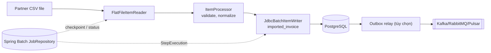
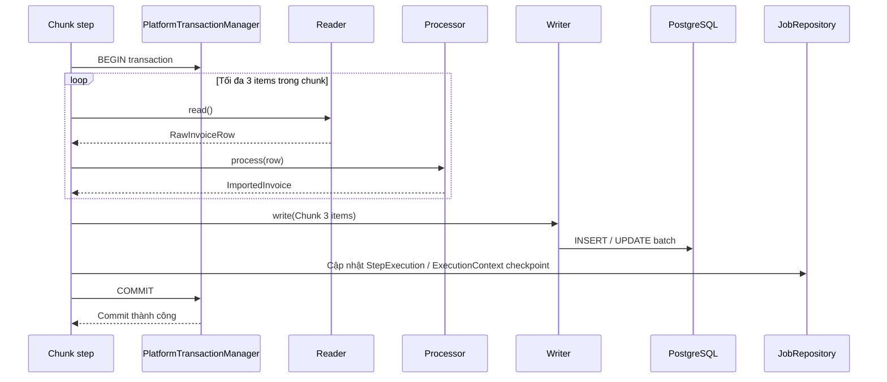
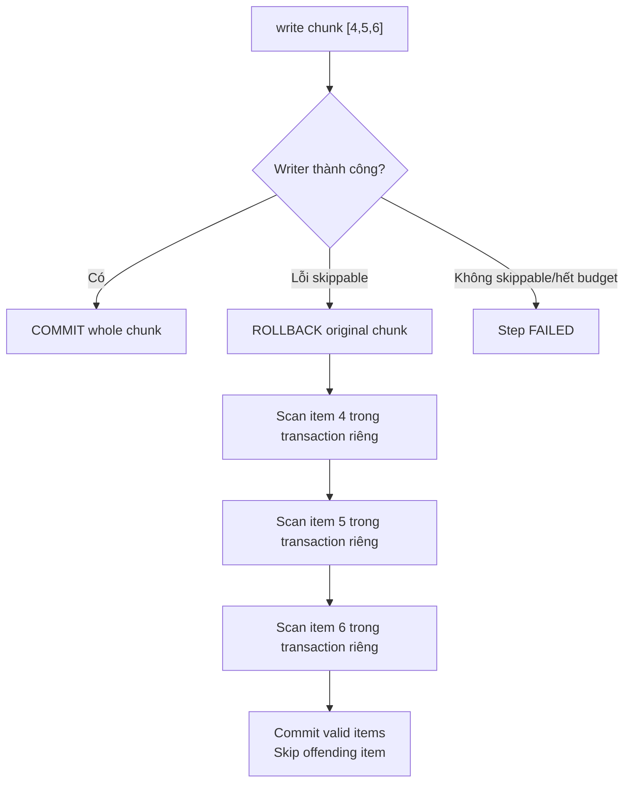
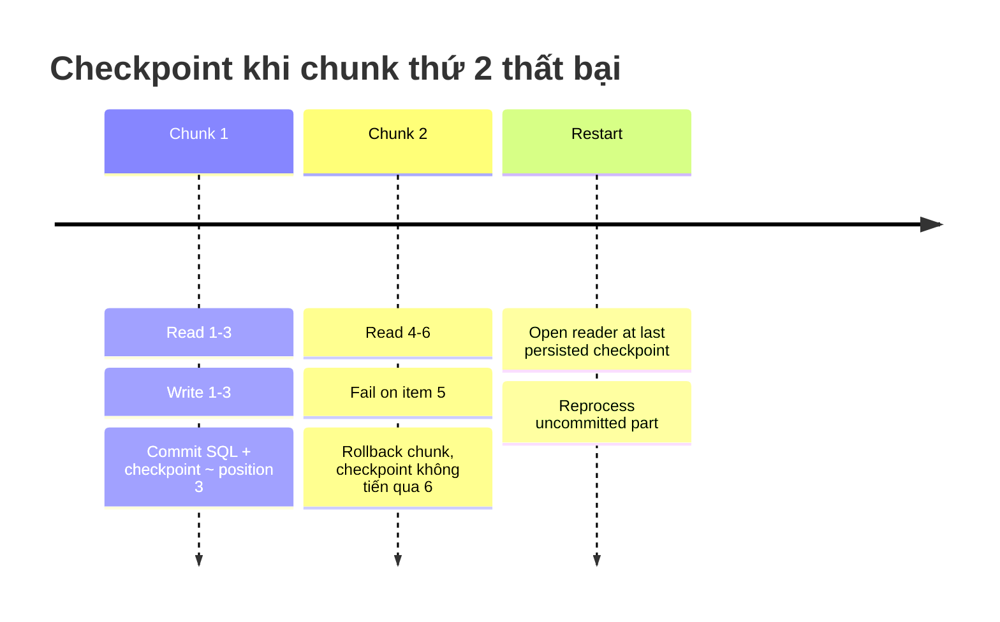
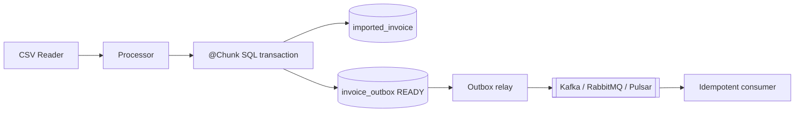

# Giao dịch từng chunk và ảnh hưởng khi bước xử lý thất bại

Một job Spring Batch nhập 100.000 hóa đơn đối tác vào PostgreSQL, mỗi lần ghi 500 dòng. Đến dòng 1.201, đối tác gửi một giá trị tiền sai; hoặc PostgreSQL bị deadlock sau khi `ItemWriter` đã gửi vài câu lệnh INSERT. **Những dòng nào đã tồn tại bền vững trong database? Spring Batch sẽ đọc lại từ đâu khi chạy lại? Có được bỏ qua một dòng hỏng mà vẫn giữ các dòng tốt không?**

Đó là trọng tâm của **chunk-oriented processing**: một `Step` gom dữ liệu thành *chunk*, thực hiện `read → process → write` trong **ranh giới giao dịch** và commit theo chu kỳ. Khi một thao tác thất bại, sự khác biệt giữa *rollback chunk hiện tại*, *retry một item*, *skip một item* và *restart cả Job* quyết định tính đúng đắn của luồng tích hợp.

Bài thuộc chương **Spring Batch** trong module **SPRING_BOOT_INTEGRATION**, nơi Spring Boot tổ chức tích hợp hệ thống qua HTTP client, cơ sở dữ liệu, cache, broker thông điệp và các adapter Spring Integration. Vì vậy, ngoài lý thuyết `StepBuilder`, bài giải thích ranh giới SQL transaction, hợp đồng dữ liệu từ file/HTTP, chống trùng khi restart, phát message ra broker qua outbox, kiểm thử lỗi và observability trong thực tế.

> **Phạm vi phiên bản:** Ví dụ chính dùng Java 17+, Spring Boot **3.5.x**, Spring Batch **5.2.x**, Spring Framework 6.2, PostgreSQL 16. Với Spring Batch 5.x, cấu hình step sử dụng `new StepBuilder(name, jobRepository).<I,O>chunk(size, transactionManager)`. Spring Batch 6.x/Boot 4.x có thay đổi API và cấu hình; không sao chép imports hay builder signatures xuyên major version mà không đối chiếu tài liệu. Những con số chunk size=3, retryLimit=3, skipLimit=5 chỉ phục vụ lab, không phải mặc định production.

## 1. Mục tiêu học tập

Sau bài học, bạn có thể:

1. Phân biệt `Job`, `JobInstance`, `JobExecution`, `Step`, `StepExecution`, `ItemReader`, `ItemProcessor`, `ItemWriter` và `ExecutionContext`.
2. Vẽ chính xác **ranh giới transaction của một chunk**: begin, read, process, write, checkpoint, commit/rollback.
3. Giải thích tại sao **chunk đã commit không rollback theo lỗi ở chunk sau**, còn chunk đang lỗi thường phải chạy lại.
4. Phân biệt lỗi reader, processor, writer, listener và commit; biết mỗi loại ảnh hưởng tới rollback khác nhau.
5. Thiết kế `faultTolerant()` với `retry`, `skip`, `retryLimit`, `skipLimit` và `noRollback` mà không nuốt lỗi nghiệp vụ.
6. Hiểu tại sao lỗi write skippable có thể khiến framework **rollback cả chunk rồi xử lý lại từng item**.
7. Lưu checkpoint trong `JobRepository`/`ExecutionContext` và restart đúng `JobInstance`.
8. Nhận diện khác biệt giữa SQL rollback và tác dụng phụ HTTP, email, Redis hoặc broker **không nằm trong transaction đó**.
9. Sử dụng SQL unique constraint, idempotent writer và outbox để an toàn khi replay/restart.
10. Kiểm thử transaction failure windows trên PostgreSQL thật, quan sát các counters và lập runbook recovery.

## 2. Bối cảnh thực hành: nhập hóa đơn đối tác

Mỗi đêm, một đối tác đặt file CSV `partner-invoices-2026-11-21.csv` vào khu vực đã xác minh. Job đọc file, kiểm tra dữ liệu và ghi vào PostgreSQL:



Một input rút gọn:

```csv
eventId,invoiceId,tenantId,amountMinor,currency
3c626f74-ceaa-40f5-8f4b-4808b7c1a001,08e1c663-f2ae-4132-a016-0731547c0001,tenant-a,125500,VND
3c626f74-ceaa-40f5-8f4b-4808b7c1a002,08e1c663-f2ae-4132-a016-0731547c0002,tenant-a,99000,VND
3c626f74-ceaa-40f5-8f4b-4808b7c1a003,08e1c663-f2ae-4132-a016-0731547c0003,tenant-a,75000,VND
3c626f74-ceaa-40f5-8f4b-4808b7c1a004,08e1c663-f2ae-4132-a016-0731547c0004,tenant-a,85000,VND
3c626f74-ceaa-40f5-8f4b-4808b7c1a005,08e1c663-f2ae-4132-a016-0731547c0005,tenant-a,15000,VND
3c626f74-ceaa-40f5-8f4b-4808b7c1a006,08e1c663-f2ae-4132-a016-0731547c0006,tenant-a,69000,VND
```

Hợp đồng dữ liệu:

| Trường | Ý nghĩa | Quy tắc |
| --- | --- | --- |
| `eventId` | Định danh bất biến của bản ghi nhập | UUID hợp lệ, không đổi khi retry |
| `invoiceId` | Định danh hóa đơn của nghiệp vụ | UUID hợp lệ; cùng tenant không được tạo trùng hóa đơn |
| `tenantId` | Tenant sở hữu | Đã được xác thực theo nguồn file, không chỉ tin chuỗi CSV |
| `amountMinor` | Số tiền theo đơn vị nhỏ nhất | `long >= 0`; không dùng `double` |
| `currency` | Đơn vị tiền | Bài lab chỉ cho `VND` |
| `input` job parameter | File nguồn | Đường dẫn bất biến theo một JobInstance |
| `businessDate` job parameter | Ngày nghiệp vụ | Xác định đúng batch kỳ nhập |

Trong lab, dùng **chunk size 3**, vì dễ quan sát chunk đã commit và chunk rollback. Một file thật có thể gồm hàng triệu rows, nên cần tính kích thước chunk theo memory, latency database và SLA.

## 3. Các khái niệm Spring Batch cần phân biệt

| Khái niệm | Vai trò |
| --- | --- |
| `Job` | Một quy trình batch, gồm các steps |
| `JobInstance` | Danh tính logic của job với **identifying JobParameters** |
| `JobExecution` | Một lần **attempt** chạy một JobInstance |
| `Step` | Một giai đoạn như import CSV, đối soát, xuất báo cáo |
| `StepExecution` | Một lần attempt thực thi Step, có counts và trạng thái |
| `ItemReader<I>` | Lấy một item mỗi lần, trả `null` để báo hết input |
| `ItemProcessor<I,O>` | Biến đổi/validate; `null` nghĩa là **filter**, không phải skip |
| `ItemWriter<O>` | Nhận một `Chunk<? extends O>` để ghi |
| `JobRepository` | Metadata/counters/ExecutionContext, hỗ trợ restart |
| `ExecutionContext` | Checkpoint/state của step hoặc job được persist |
| `PlatformTransactionManager` | Bắt đầu/commit/rollback giao dịch của step |
| `JobLauncher`/`JobOperator` | Khởi chạy, điều khiển hoặc restart job |

**Quan trọng:** `JobRepository` không phải nơi chứa dữ liệu hóa đơn nghiệp vụ. Nó lưu **trạng thái thực thi**, còn bảng `imported_invoice` là business state.

### 3.1. Một JobInstance có thể có nhiều JobExecution

```text
Job: partnerInvoiceImport
Identifying params: input=file:/data/2026-11-21.csv,
                    businessDate=2026-11-21

JobInstance #42
  JobExecution #100: FAILED at chunk 2
  JobExecution #101: COMPLETED after restart

JobInstance #43 (input/date khác)
  JobExecution #102: COMPLETED
```

Tạo thêm `run.id` mới làm **JobInstance mới**, không phải restart JobInstance #42. Điều đó có thể khiến file được nhập lại từ đầu và cần idempotency để chống trùng.

## 4. Chu trình một chunk và transaction boundary

Cấu hình khái niệm:

```java
new StepBuilder("importInvoiceStep", jobRepository)
        .<RawInvoiceRow, ImportedInvoice>chunk(3, transactionManager)
        .reader(invoiceReader)
        .processor(invoiceProcessor)
        .writer(invoiceWriter)
        .build();
```

Với các components phù hợp, một chu kỳ thường là:



Đây là trình tự **khái niệm**, không phải cam kết SQL statements đi theo đúng thứ tự trên mọi repository/transaction topology. Với metadata và business tables **cùng DataSource và cùng transaction manager**, metadata checkpoint và business write có thể tham gia một transaction; khi tách nguồn dữ liệu, đảm bảo đồng bộ phức tạp hơn.

### 4.1. Đừng hiểu chunk size = 3 nghĩa là ba SQL transactions

Thông thường **ba input items được gom vào một chunk transaction**, writer có thể chạy `JdbcBatchItemWriter` hoặc nhiều statements trong cùng transaction. Khi chunk commit, các thay đổi SQL của chunk trở nên bền vững.

```text
transaction #1:
  read 1,2,3 → process → write [1,2,3] → COMMIT

transaction #2:
  read 4,5,6 → process → write [4,5,6] → COMMIT

transaction #3:
  read 7,8,9 → process → write [7,8,9] → COMMIT
```

Một số chi tiết như read filtering, skips, retry, completion detection hoặc các chunk cuối nhỏ hơn có thể làm số transaction/commitCount thực tế khác sơ đồ đơn giản.

### 4.2. Chunk transaction bao phủ tài nguyên nào?

Với một `DataSourceTransactionManager` hoặc `JdbcTransactionManager` gắn PostgreSQL:

- Những SQL writes dùng **cùng DataSource/transaction context** có thể rollback.
- Reader SQL dùng cùng transaction context có thể tuân theo isolation của transaction.
- Redis `SET` riêng, HTTP POST, email, file output, broker `send` **không tự rollback** theo SQL transaction.
- Một transaction manager khác/connection khác có thể không cùng transaction.
- `@Async` chuyển thread thường không chia sẻ thread-bound SQL transaction.
- Spring Cache eviction không mặc định nguyên tử với SQL, ngay cả khi có transaction awareness.

**Một chunk có tính nguyên tử chỉ trong phạm vi resource/transaction manager bảo đảm.**

## 5. Khi chunk thứ hai lỗi, chunk đầu tiên có còn không?

Giả sử input có 9 hóa đơn, `chunk(3)`, writer ghi PostgreSQL trong mỗi transaction:

| Chunk | Items | Hành động | Kết quả |
| --- | --- | --- | --- |
| 1 | 1–3 | Ghi SQL thành công | **COMMIT** |
| 2 | 4–6 | Item 5 gây lỗi, không retry/skip | **ROLLBACK** |
| 3 | 7–9 | Chưa được xử lý | Không có ghi SQL |

Sau khi step thất bại:

```text
Database imported_invoice:
  1, 2, 3                 # đã commit

KHÔNG có:
  4, 5, 6, 7, 8, 9        # chunk 2 rollback, chunk 3 chưa chạy

JobExecution:
  FAILED

StepExecution:
  FAILED, rollbackCount có thể tăng

ExecutionContext:
  checkpoint an toàn cuối cùng của reader ở commit #1
```

Nếu sửa nguyên nhân và **restart cùng JobInstance**, reader restartable được khôi phục từ checkpoint và xử lý tiếp phần chưa commit. Nó không có trách nhiệm rollback những hóa đơn đã commit trong chunk 1.

### 5.1. Lỗi xuất hiện sau khi writer đã INSERT item 4

```text
BEGIN chunk #2
  INSERT item 4    -- chưa commit
  INSERT item 5    -- fail
ROLLBACK
```

Trong cùng transaction PostgreSQL, INSERT item 4 cũng rollback. Việc nhìn thấy log `INSERT item4 succeeded` **không phải** bằng chứng item4 đã commit. Sau rollback, SQL SELECT từ connection khác không thấy item4.

### 5.2. Lỗi sau khi chunk 2 đã commit

Nếu chunk 2 commit thành công, rồi một listener hoặc nguồn ngoài gặp lỗi khi chuyển sang chunk 3, SQL của chunk 2 **không bị rollback ngược thời gian**. Khi step bị đánh dấu FAILED, điều đó **không** đồng nghĩa toàn bộ dữ liệu job đã bị hoàn tác.

## 6. Rollback, failure và restart không phải một sự kiện

| Từ khóa | Phạm vi | Mục tiêu |
| --- | --- | --- |
| `ROLLBACK` | Transaction hiện tại | Hoàn tác các SQL writes chưa commit |
| `retry` | Item/chunk failure path theo policy | Thử lại lỗi tạm thời khi còn budget |
| `skip` | Một item hỏng theo policy | Bỏ qua item được cho phép, tiếp tục |
| `FAILED` | Status StepExecution/JobExecution | Ghi nhận run không thành công |
| `STOPPED` | Run dừng theo điều phối | Có thể restart theo điều kiện |
| `COMPLETED` | Step/job chạy xong theo flow | Không đảm bảo mọi input row đều được ghi nếu có skip/filter |
| `restart` | JobInstance chưa hoàn tất | Tạo JobExecution mới, khôi phục checkpoint |
| `rerun` | JobInstance mới | Xử lý một bộ input logic mới, trừ khi business định nghĩa khác |

Một step có `BatchStatus.COMPLETED` với `processSkipCount=5` vẫn có **5 items không được ghi**. Status COMPLETED có nghĩa là step kết thúc theo **chính sách đã cấu hình**, không chứng minh 100% dữ liệu đầu vào đã được nhập.

## 7. Dependencies Spring Boot 3.5 / Spring Batch 5.2

Ví dụ Gradle Groovy DSL cho lab:

```groovy
plugins {
    id 'java'
    id 'org.springframework.boot' version '3.5.7'
    id 'io.spring.dependency-management' version '1.1.7'
}

java {
    toolchain {
        languageVersion = JavaLanguageVersion.of(17)
    }
}

repositories {
    mavenCentral()
}

dependencies {
    implementation 'org.springframework.boot:spring-boot-starter-batch'
    implementation 'org.springframework.boot:spring-boot-starter-jdbc'
    implementation 'org.springframework.boot:spring-boot-starter-actuator'

    runtimeOnly 'org.postgresql:postgresql'

    testImplementation 'org.springframework.boot:spring-boot-starter-test'
    testImplementation 'org.springframework.batch:spring-batch-test'
    testImplementation 'org.springframework.boot:spring-boot-testcontainers'
    testImplementation 'org.testcontainers:junit-jupiter'
    testImplementation 'org.testcontainers:postgresql'
}

tasks.named('test') {
    useJUnitPlatform()
}
```

- `spring-boot-starter-batch` mang cấu hình Spring Batch 5.x theo Spring Boot BOM; không cần chọn riêng Spring Batch version nếu không có lý do kiểm chứng.
- `spring-boot-starter-jdbc` dùng cho target SQL writer và datasource.
- `spring-batch-test` cung cấp `@SpringBatchTest`, `JobLauncherTestUtils`, `StepScopeTestUtils` tùy version.
- Testcontainers PostgreSQL giúp chứng minh commit/rollback thật; H2 có thể khác PostgreSQL về SQL syntax, isolation và transaction errors.
- Gradle/plugin versions ở đây là **mẫu Boot 3.5**, không đại diện release mới nhất tính tại thời điểm đọc bài.

## 8. JobRepository và schema metadata

Spring Batch dùng các bảng metadata với tên phổ biến:

```text
BATCH_JOB_INSTANCE
BATCH_JOB_EXECUTION
BATCH_JOB_EXECUTION_PARAMS
BATCH_STEP_EXECUTION
BATCH_JOB_EXECUTION_CONTEXT
BATCH_STEP_EXECUTION_CONTEXT
BATCH_JOB_SEQ / BATCH_JOB_EXECUTION_SEQ / BATCH_STEP_EXECUTION_SEQ
```

Tên sequence/table phụ thuộc database platform và version. **Không tự sửa các bảng metadata bằng SQL update thủ công** chỉ để ép job từ FAILED sang COMPLETED; nguy cơ mất checkpoint hoặc tạo duplicate executions.

### 8.1. Cấu hình datasource và job auto-start

```yaml
spring:
  datasource:
    url: ${BATCH_JDBC_URL:jdbc:postgresql://localhost:5432/batchlab}
    username: ${BATCH_DB_USERNAME:batchlab}
    password: ${BATCH_DB_PASSWORD:devonly}
    hikari:
      maximum-pool-size: 10

  batch:
    job:
      enabled: false
    jdbc:
      initialize-schema: always

logging:
  level:
    org.springframework.batch: INFO
```

**Ý nghĩa:**

- `spring.batch.job.enabled=false` tắt khởi chạy tự động `Job` khi application startup; thuận tiện cho lab muốn chạy `JobLauncher` có tham số rõ.
- `spring.batch.jdbc.initialize-schema=always` để Boot tạo schema metadata cần thiết trong **môi trường lab**. Production phải quản lý versioned migrations, quyền DDL và lifecycle riêng; không bật tạo schema tùy tiện.
- `BATCH_DB_PASSWORD:devonly` chỉ phù hợp local. Production dùng secret manager/TLS và least privilege.
- Nếu cấu hình `@EnableBatchProcessing` thủ công hoặc tự khai báo Batch infrastructure, một số auto-configuration của Boot có thể back off; phải kiểm tra bean thực tế.
- **Không** dùng in-memory `ResourcelessJobRepository` nếu cần restart bền vững sau process crash.

### 8.2. Business tables khác metadata tables

Tạo SQL target theo migration do đội sở hữu, ví dụ:

```sql
CREATE TABLE imported_invoice (
    event_id UUID PRIMARY KEY,
    invoice_id UUID NOT NULL,
    tenant_id VARCHAR(64) NOT NULL,
    amount_minor BIGINT NOT NULL CHECK (amount_minor >= 0),
    currency CHAR(3) NOT NULL,
    imported_at TIMESTAMPTZ NOT NULL DEFAULT now(),
    UNIQUE (tenant_id, invoice_id)
);
```

Schema này minh họa idempotency bằng `event_id` và uniqueness hóa đơn. Để phát hiện cùng event ID nhưng payload khác, production cần lưu **payload hash/canonical fields** và so sánh trước khi coi duplicate là thành công.

`BATCH_*` metadata có thể cùng PostgreSQL datasource với `imported_invoice` trong lab; khi phân tách datasource hoặc transaction manager, cần phân tích lại khả năng đồng bộ checkpoint.

## 9. Mô hình dữ liệu trong Java

### 9.1. RawInvoiceRow

```java
package com.example.integration.batch;

public record RawInvoiceRow(
        String eventId,
        String invoiceId,
        String tenantId,
        String amountMinor,
        String currency
) {}
```

Giữ `amountMinor` là `String` ở reader để **lỗi định dạng số nằm trong ItemProcessor** và dễ phân loại. Một dòng CSV lệch cột vẫn có thể fail ngay ở `ItemReader`.

### 9.2. ImportedInvoice

```java
package com.example.integration.batch;

import java.util.UUID;

public record ImportedInvoice(
        UUID eventId,
        UUID invoiceId,
        String tenantId,
        long amountMinor,
        String currency
) {}
```

Hai records đặt ở hai source files theo quy tắc Java nếu dùng `public record`.

### 9.3. Exception nghiệp vụ không nên retry

```java
package com.example.integration.batch;

public class InvalidInvoiceException extends RuntimeException {

    public InvalidInvoiceException(String message) {
        super(message);
    }

    public InvalidInvoiceException(
            String message, Throwable cause) {
        super(message, cause);
    }
}
```

Dùng exception typed thay vì catch tất cả `RuntimeException` và skip, vì lỗi `NullPointerException` do bug code **không đồng nghĩa dữ liệu khách hàng hỏng**.

## 10. ItemReader: FlatFileItemReader có checkpoint

```java
package com.example.integration.batch;

import org.springframework.batch.core.configuration.annotation.StepScope;
import org.springframework.batch.item.file.FlatFileItemReader;
import org.springframework.batch.item.file.builder.FlatFileItemReaderBuilder;
import org.springframework.beans.factory.annotation.Value;
import org.springframework.context.annotation.Bean;
import org.springframework.context.annotation.Configuration;
import org.springframework.core.io.ResourceLoader;

@Configuration(proxyBeanMethods = false)
public class InvoiceReaderConfiguration {

    @Bean
    @StepScope
    FlatFileItemReader<RawInvoiceRow> invoiceReader(
            @Value("#{jobParameters['input']}") String input,
            ResourceLoader resourceLoader) {

        return new FlatFileItemReaderBuilder<RawInvoiceRow>()
                .name("invoiceFileReader")
                .resource(resourceLoader.getResource(input))
                .linesToSkip(1)
                .delimited()
                .names("eventId", "invoiceId",
                       "tenantId", "amountMinor", "currency")
                .fieldSetMapper(fields ->
                        new RawInvoiceRow(
                                fields.readString("eventId"),
                                fields.readString("invoiceId"),
                                fields.readString("tenantId"),
                                fields.readString("amountMinor"),
                                fields.readString("currency")))
                .build();
    }
}
```

**Vì sao `@StepScope`?** `input` chỉ có khi JobExecution/StepExecution được khởi chạy. Scoped proxy cho phép Spring đưa tham số vào reader ở runtime, không tạo reader cố định khi application context khởi tạo.

**Để restart được:**

- Reader phải có tên ổn định `name("invoiceFileReader")` và được quản lý như `ItemStream`.
- `saveState` mặc định của `FlatFileItemReader` cần được giữ bật.
- `ExecutionContext` của step phải lưu thành công tại commit points.
- File nguồn phải **bất biến** trong cùng JobInstance; không sửa/xóa/append file sau khi job fail rồi restart.
- Resource location phải được hạn chế theo directory allowlist; không nhận đường dẫn tùy ý do unauthenticated HTTP client truyền.
- Encoding, CSV quoting/escaping và header format phải được xác nhận với hợp đồng đối tác; example có cấu trúc đơn giản.

### 10.1. ItemReader trả null khi nào?

`ItemReader.read()` trả `null` khi **đã hết input**. Điều này **khác**:

- `ItemProcessor.process(...)` trả `null`: filter một item đã đọc.
- Reader ném exception: read failure, có thể retry/skip theo policy.
- Reader trả item chứa field null: dữ liệu không hợp lệ, phải validation ở processor hoặc reader.

Khi muốn skip dòng CSV lỗi parse, phải cấu hình một exception type cụ thể, không biến mọi read error thành EOF.

## 11. ItemProcessor: validation không có side effect

```java
package com.example.integration.batch;

import java.util.UUID;
import org.springframework.batch.item.ItemProcessor;
import org.springframework.context.annotation.Bean;
import org.springframework.context.annotation.Configuration;

@Configuration(proxyBeanMethods = false)
public class InvoiceProcessorConfiguration {

    @Bean
    ItemProcessor<RawInvoiceRow, ImportedInvoice>
            invoiceProcessor() {

        return raw -> {
            try {
                UUID eventId = UUID.fromString(raw.eventId());
                UUID invoiceId = UUID.fromString(raw.invoiceId());
                long amount = Long.parseLong(raw.amountMinor());

                if (raw.tenantId() == null
                        || raw.tenantId().isBlank()) {
                    throw new IllegalArgumentException("tenantId rỗng");
                }
                if (amount < 0) {
                    throw new IllegalArgumentException("amount âm");
                }
                if (!"VND".equals(raw.currency())) {
                    throw new IllegalArgumentException(
                            "currency không hỗ trợ");
                }

                return new ImportedInvoice(
                        eventId, invoiceId,
                        raw.tenantId(), amount, raw.currency());

            } catch (IllegalArgumentException ex) {
                throw new InvalidInvoiceException(
                        "Dòng hóa đơn không hợp lệ: eventId="
                        + raw.eventId(), ex);
            }
        };
    }
}
```

Processor chủ động không ghi SQL, Redis hay gọi HTTP. **Lý do:** Khi chunk rollback hoặc framework retry/scan, processor có thể được gọi nhiều lần cho cùng item. Nếu processor gửi email/HTTP POST mỗi lần, rollback SQL không hủy các side effects đó.

### 11.1. Filter khác skip

Nếu processor trả `null`:

```java
if ("IGNORED".equals(raw.currency())) {
    return null; // Filter có chủ đích.
}
```

Spring Batch tăng `filterCount`, không tự tăng `processSkipCount`. Dùng filter cho dữ liệu hợp lệ nhưng **không thuộc phạm vi xử lý**; dùng exception skippable khi dòng thực sự vi phạm hợp đồng và cần audit.

## 12. ItemWriter: ghi nhiều items trong một chunk transaction

`JdbcBatchItemWriter` được Spring Batch hỗ trợ và dùng DataSource/JDBC để thực hiện batch SQL:

```java
package com.example.integration.batch;

import javax.sql.DataSource;
import org.springframework.batch.item.database.JdbcBatchItemWriter;
import org.springframework.batch.item.database.builder.JdbcBatchItemWriterBuilder;
import org.springframework.context.annotation.Bean;
import org.springframework.context.annotation.Configuration;
import org.springframework.jdbc.core.namedparam.MapSqlParameterSource;

@Configuration(proxyBeanMethods = false)
public class InvoiceWriterConfiguration {

    @Bean
    JdbcBatchItemWriter<ImportedInvoice>
            invoiceWriter(DataSource dataSource) {

        return new JdbcBatchItemWriterBuilder<ImportedInvoice>()
                .dataSource(dataSource)
                .sql("""
                    INSERT INTO imported_invoice (
                        event_id, invoice_id, tenant_id,
                        amount_minor, currency
                    )
                    VALUES (
                        :eventId, :invoiceId, :tenantId,
                        :amountMinor, :currency
                    )
                    ON CONFLICT (event_id) DO NOTHING
                    """)
                .itemSqlParameterSourceProvider(item ->
                        new MapSqlParameterSource()
                                .addValue("eventId", item.eventId())
                                .addValue("invoiceId", item.invoiceId())
                                .addValue("tenantId", item.tenantId())
                                .addValue("amountMinor", item.amountMinor())
                                .addValue("currency", item.currency()))
                .assertUpdates(false)
                .build();
    }
}
```

`assertUpdates(false)` cho phép một `INSERT ... ON CONFLICT DO NOTHING` trả update count 0 khi cùng `eventId` đã tồn tại. Đây là **dedup đơn giản cho lab**, không đủ để chứng minh bản ghi mới giống hệt bản đã tồn tại. Trong production:

- Lưu hash/contract version và kiểm tra khi duplicate eventId.
- Nếu cùng eventId nhưng amount/tenant khác, báo **data conflict**, không silently ignore.
- Nếu cùng `invoiceId` nhưng eventId khác, unique business key sẽ chặn tạo hóa đơn thứ hai.
- Không skip vô điều kiện mọi `DataIntegrityViolationException`, vì có thể che sai dữ liệu tài chính.
- Cần quyết định writer behavior theo nghiệp vụ: insert-only, update-by-version, merge hay quarantine.

### 12.1. Writer không phải nơi tự commit transaction

**Không** gọi `connection.commit()` trong `ItemWriter`. Spring Batch đã mở transaction cho chunk bằng `PlatformTransactionManager`; manual commit phá atomicity và restart semantics.

Một writer nhận `Chunk<? extends ImportedInvoice>`; JDBC batching có thể gửi nhiều statements trước khi ném exception. SQL của các statements cùng connection/transaction vẫn rollback nếu lỗi khiến transaction rollback.

## 13. Kết nối Step và Job: cấu hình cơ bản chưa retry/skip

```java
package com.example.integration.batch;

import org.springframework.batch.core.Job;
import org.springframework.batch.core.Step;
import org.springframework.batch.core.job.builder.JobBuilder;
import org.springframework.batch.core.repository.JobRepository;
import org.springframework.batch.core.step.builder.StepBuilder;
import org.springframework.batch.item.ItemProcessor;
import org.springframework.batch.item.database.JdbcBatchItemWriter;
import org.springframework.batch.item.file.FlatFileItemReader;
import org.springframework.context.annotation.Bean;
import org.springframework.context.annotation.Configuration;
import org.springframework.transaction.PlatformTransactionManager;

@Configuration(proxyBeanMethods = false)
public class InvoiceJobConfiguration {

    @Bean
    Step importInvoiceStep(
            JobRepository jobRepository,
            PlatformTransactionManager transactionManager,
            FlatFileItemReader<RawInvoiceRow> invoiceReader,
            ItemProcessor<RawInvoiceRow, ImportedInvoice> invoiceProcessor,
            JdbcBatchItemWriter<ImportedInvoice> invoiceWriter) {

        return new StepBuilder("importInvoiceStep", jobRepository)
                .<RawInvoiceRow, ImportedInvoice>chunk(
                        3, transactionManager)
                .reader(invoiceReader)
                .processor(invoiceProcessor)
                .writer(invoiceWriter)
                .build();
    }

    @Bean
    Job partnerInvoiceImport(
            JobRepository jobRepository,
            Step importInvoiceStep) {

        return new JobBuilder(
                "partnerInvoiceImport", jobRepository)
                .start(importInvoiceStep)
                .build();
    }
}
```

Đây là **bản cơ bản fail-fast**, chưa bật skip/retry. Khi một read/process/write exception thoát khỏi step:

1. Chunk chưa commit có thể rollback.
2. `StepExecution` bị đánh dấu FAILED và lưu failure metadata.
3. Job flow theo cấu hình có thể FAILED.
4. Chunk trước đã commit **không bị undo**.
5. Restart với cùng identifying JobParameters có thể tiếp tục từ checkpoint nếu reader/writer state hỗ trợ.

**Chú ý:** Nếu tự thêm `@EnableBatchProcessing` trong ứng dụng Boot đã auto-configure Spring Batch, kiểm tra điều kiện bean và transaction manager. Không thêm chỉ vì tưởng `@Bean Step` không được tìm thấy.

## 14. Lỗi trong ItemReader: chưa chắc rollback cả chunk

Ví dụ dòng CSV có số cột sai, `FlatFileItemReader` có thể ném `FlatFileParseException` trước khi trả `RawInvoiceRow`.

Với một **fault-tolerant Step** và exception được đánh dấu skippable, tài liệu Spring Batch 5.2 mô tả **lỗi reader được skip thường không làm rollback transaction**. Dòng hỏng có thể bị bỏ qua rồi reader tiếp tục lấy dòng tiếp theo trong cùng chunk processing.

```text
read row 4 -> OK
read row 5 -> FlatFileParseException (skippable)
read row 6 -> OK
...
writer ghi các items hợp lệ
commit theo policy
```

Tuy nhiên, cần hiểu:

- Input contract khác nhau: file reader có thể di chuyển qua dòng hỏng, nhưng reader custom có thể luôn ném cùng lỗi tại cùng vị trí.
- Nếu lỗi reader **không skippable** hoặc skipLimit hết, step FAILED.
- Nếu reader là JMS/transactional queue, rollback có thể **trả message lại** về nguồn; không áp dụng suy luận file reader một cách máy móc.
- `readSkipCount` được tăng khi item read error được skip, không giống `filterCount`.
- Một dòng sai số cột có thể làm reader không xây được `RawInvoiceRow` nên không có đầy đủ item object để đưa vào quarantine; cần giữ line number/raw line/error metadata nếu muốn điều tra.

## 15. Lỗi trong ItemProcessor: data validation hay bug code?

Nếu `amountMinor="NaN"`, processor sẽ throw `InvalidInvoiceException`. Khi chưa có skip policy, step fail và chunk hiện tại rollback.

Với skip policy:

```java
.faultTolerant()
.skip(InvalidInvoiceException.class)
.skipLimit(5)
```

Dòng invalid được bỏ qua, các dòng khác có thể tiếp tục và commit. Spring Batch ghi `processSkipCount` và gọi `SkipListener.onSkipInProcess` theo lifecycle tương ứng.

**Không skip mọi `RuntimeException`:** lỗi `NullPointerException` do bug code, `OutOfMemoryError` hay sai serializer cần làm step fail và cảnh báo thay vì tạo một output batch thiếu dữ liệu.

### 15.1. Processor có thể chạy lại sau rollback

Ngay cả khi một lần `process(row)` đã trả success, nếu writer của cùng chunk sau đó fail, Spring Batch có thể xử lý lại row trong retry/scan. Vì vậy processor tốt nhất là:

- Pure function hoặc ít side effect.
- Deterministic theo input/contract version.
- Không gửi HTTP POST/email/broker message trực tiếp.
- Không sinh eventId mới mỗi attempt.
- Không dựa vào clock/random nếu đó là business identity.
- Không thay đổi object được writer tái sử dụng theo cách không an toàn.

## 16. Lỗi trong ItemWriter: rollback và cô lập bản ghi hỏng

Writer nhận **cả chunk**. Nếu nó ném exception sau khi JDBC đã insert một vài rows, framework không tự biết row nào gây lỗi.

Giả sử:

```text
Chunk #2: [4, 5, 6]

write [4,5,6]
  INSERT 4 succeeds (uncommitted)
  INSERT 5 fails
  INSERT 6 not run

ROLLBACK chunk #2
=> 4,5,6 đều chưa commit
```

Nếu exception **không được phép skip**: step FAILED sau retry policy tương ứng; restart vẫn cần xử lý chunk chưa commit.

Nếu exception được cấu hình **skippable ở write phase**, Spring Batch 5.2 có cơ chế **chunk scanning**: rollback batch write ban đầu, rồi thử các items trong failed chunk riêng lẻ để cô lập offending item. Đây là khác biệt quan trọng so với process skip — writer không biết ngay item hỏng.



Từng item scan có thể được xử lý lại và viết trong **transaction riêng**, vì một số resources như JPA persistence context đã bị đánh dấu rollback-only sau flush failure.

### 16.1. Không skip DataIntegrityViolationException một cách rộng

Với PostgreSQL:

- `CHECK (amount_minor >= 0)` hỏng có thể là dữ liệu sai.
- `UNIQUE (tenant_id, invoice_id)` hỏng có thể là duplicate hoặc conflict nghiệp vụ.
- `NOT NULL` hỏng có thể do contract migration.
- Foreign key hỏng có thể do import sai thứ tự.
- SQL permission denied hoặc schema mismatch có thể là outage/migration lỗi.

Tất cả đều có thể quy về DataAccess-related exceptions nhưng **không nên auto-skip giống nhau**. Phân loại theo SQLState/domain cause hoặc validate trước writer, và test cách Spring exception translation hoạt động trên PostgreSQL thật.

## 17. Cấu hình faultTolerant(): retry, skip và giới hạn lỗi

Trong Spring Batch 5.2, có thể thay cấu hình `Step` ở mục 13 bằng một phiên bản **fault-tolerant**, giữ nguyên reader/processor/writer:

```java
@Bean
Step faultTolerantInvoiceStep(
        JobRepository jobRepository,
        PlatformTransactionManager transactionManager,
        FlatFileItemReader<RawInvoiceRow> invoiceReader,
        ItemProcessor<RawInvoiceRow, ImportedInvoice> invoiceProcessor,
        JdbcBatchItemWriter<ImportedInvoice> invoiceWriter) {

    return new StepBuilder("importInvoiceStep", jobRepository)
            .<RawInvoiceRow, ImportedInvoice>chunk(
                    3, transactionManager)
            .reader(invoiceReader)
            .processor(invoiceProcessor)
            .writer(invoiceWriter)
            .faultTolerant()
            .skip(InvalidInvoiceException.class)
            .skip(FlatFileParseException.class)
            .skipLimit(5)
            .retry(CannotAcquireLockException.class)
            .retryLimit(3)
            .build();
}
```

**Không khai báo đồng thời** `importInvoiceStep` ở mục 13 và `faultTolerantInvoiceStep` ở đây trong cùng application context rồi trông chờ job tự biết chọn step. Đây là **hai phương án cấu hình thay thế**, nên chọn một bean step và đặt tên/method rõ ràng. Bổ sung imports `org.springframework.batch.item.file.FlatFileParseException` và `org.springframework.dao.CannotAcquireLockException` cho ví dụ này; những imports còn lại giống mục 13.

| Cấu hình | Ý nghĩa |
| --- | --- |
| `faultTolerant()` | Bật builder hỗ trợ retry/skip |
| `skip(InvalidInvoiceException.class)` | Cho phép bỏ qua lỗi validation đã định nghĩa |
| `skip(FlatFileParseException.class)` | Cho phép bỏ qua dòng file bị lỗi parse |
| `skipLimit(5)` | Tổng số lần skip read/process/write không vượt budget 5 |
| `retry(CannotAcquireLockException.class)` | Retry một loại lỗi SQL contention có thể phục hồi |
| `retryLimit(3)` | Giới hạn retry theo semantics Spring Batch 5.2; kiểm thử số attempts thực tế |

**Cực kỳ quan trọng:** `skipLimit(5)` là hạn mức **toàn StepExecution**, không phải “5 mỗi chunk” hay “5 cho từng phase”. Khi phát sinh lỗi skippable vượt hạn mức, step sẽ FAILED. `readSkipCount`, `processSkipCount`, `writeSkipCount` được đếm riêng để theo dõi, nhưng áp chung giới hạn.

### 17.1. Retry có nghĩa thử lại, không phải tự bỏ qua

Retry dành cho lỗi không tất định:

- SQL deadlock/lock timeout.
- Một phần network hiccup có retry contract an toàn.
- Thao tác idempotent bị lỗi transient.
- Một call có thể thành công khi thử lại với backoff.

Skip dành cho dữ liệu **có thể bỏ qua theo nghiệp vụ**: một dòng CSV lệch format trong báo cáo thống kê có quota lỗi cho phép, không phải một giao dịch chuyển tiền không được phép mất.

Nếu lỗi không retryable, không skippable, hoặc đã hết budget phù hợp, step FAILED. Trường hợp retry hết và exception vẫn được đánh dấu skippable cần được quyết định rõ theo loại lỗi/budget; **không** giả định mọi retry hết đều tự động DLT hoặc success.

### 17.2. Đừng nhầm retryLimit với backoff

`retryLimit(3)` giới hạn attempts theo contract của builder. Nó **không tự đưa ra sleep 1 giây, exponential backoff hoặc deadline tổng thể** cho mọi loại retry. Nếu cần chờ giữa attempts, cấu hình `BackOffPolicy` được Spring Batch/Spring Retry version hỗ trợ và test số calls/elapsed time thực.

Ví dụ minh họa khi library có `FixedBackOffPolicy`:

```java
FixedBackOffPolicy backoff = new FixedBackOffPolicy();
backoff.setBackOffPeriod(1000L); // milliseconds

// Trong fault-tolerant Step builder:
.backOffPolicy(backoff)
```

`FixedBackOffPolicy` nằm trong `org.springframework.retry.backoff`. Không coi retry policy của Spring Batch là retry policy của Kafka/Pulsar/RabbitMQ; các brokers có ack/offset và redelivery riêng.

## 18. Vì sao writer skip khó hơn processor skip?

Nếu processor đã biết item 5 invalid, nó ném `InvalidInvoiceException` và framework có thể skip item 5 trước khi writer nhận chunk. Nhưng writer nhận một **danh sách** 3 items; nếu JDBC batch fail, exception không nhất thiết tiết lộ chính xác item hỏng hoặc đã làm DB transaction rollback-only.

Spring Batch 5.2 mô tả trường hợp **skippable write exception** như sau:

1. Writer thử cả chunk, ví dụ [4,5,6].
2. Exception xảy ra, transaction chunk được rollback.
3. Framework vào **scan/recovery mode**, thử từng item trong transaction riêng.
4. Item hợp lệ được commit; offending item được skip.
5. `writeSkipCount` tăng đúng theo dữ liệu thực sự skipped.
6. Skip listener được gọi theo lifecycle để audit.

```text
original transaction: write([4,5,6]) → ERROR → ROLLBACK
scan transaction:     write([4])     → COMMIT
scan transaction:     write([5])     → ERROR → skip
scan transaction:     write([6])     → COMMIT
```

**Đây là cơ chế recovery của Spring Batch, không phải SQL savepoint ở mỗi item trong chunk gốc.** Khi writer đã mutate object (ví dụ JPA entity được cấp ID trong lần flush thất bại), reusing processed object có thể gây lỗi khác. Spring Batch 5.2 chọn reprocess như mặc định an toàn trong chunk scanning.

### 18.1. Processor re-execution và processorNonTransactional

Builder có lựa chọn `processorNonTransactional()` trong các phiên bản hỗ trợ để cache output của processor trong một số tình huống fault-tolerant scanning. **Không bật mặc định**:

- Nếu writer/JPA đã mutate output object, lần write sau có thể dùng stale object.
- Nếu processor phụ thuộc transaction snapshot/version, cache output có thể không còn đúng.
- Nếu processor gọi external API và bạn muốn tránh gọi lại, giải pháp đúng hơn thường là **tách I/O ra khỏi processor**, không đơn giản cache kết quả ngoài transaction.

`processorNonTransactional()` chỉ phù hợp khi kết quả processor ổn định và có thể được ghi lại an toàn sau rollback, với tests chứng minh điều đó.

### 18.2. Sai lầm: log onWriteError rồi cho là đã skip

`ItemWriteListener.onWriteError(...)` có thể được gọi ngay khi một write attempt thất bại, **ngay cả khi retry sau đó thành công**. Muốn biết item thật sự bị bỏ qua, dùng `SkipListener.onSkipInWrite(...)` và xem step counters.

## 19. noRollback: ngoại lệ cần cân nhắc rất kỹ

Một số exception báo lỗi validation nhưng **không làm trạng thái transaction/resource bị hỏng**. Spring Batch hỗ trợ:

```java
.faultTolerant()
.noRollback(InvalidInvoiceException.class)
```

Tuy nhiên, áp `noRollback` sai chỗ dễ gây lỗi:

- JDBC driver đã báo constraint violation và transaction PostgreSQL có thể ở trạng thái **aborted** cho đến rollback; không thể tùy ý “tiếp tục commit” cùng transaction.
- Writer đã insert một phần rồi phát hiện lỗi logic; nếu không rollback, có thể commit **partial chunk** không mong muốn.
- `@Transactional` của service khác có thể đã đánh dấu rollback-only.
- Retry/skip có thể xử lý các exception ở nhiều phase khác nhau, cần hiểu policy ordering.

**Quy tắc:** Không dùng `noRollback(DataAccessException.class)` hoặc `noRollback(Exception.class)` để “giảm rollbackCount”. Chỉ dùng cho exception chứng minh không làm resource/transaction không nhất quán, và có PostgreSQL integration tests.

### 19.1. Không dùng @Transactional(REQUIRES_NEW) để sửa writer lỗi

Một anti-pattern:

```java
@Transactional(propagation = Propagation.REQUIRES_NEW)
public void writeOneInvoice(ImportedInvoice invoice) {
    jdbc.update(...);
}
```

Nếu `ItemWriter` gọi method qua Spring proxy cho từng item, nó tạo các transactions riêng có thể **commit trước khi chunk cha commit**. Khi item tiếp theo fail, rollback chunk không undo các transactions `REQUIRES_NEW` đã commit. Khả năng restart/dedup cần thiết kế lại.

Trong lab, **không gắn `REQUIRES_NEW` lên writer methods**. Giao dịch của chunk do Step và một `PlatformTransactionManager` rõ ràng điều khiển.

## 20. JobRepository checkpoint và ExecutionContext

`ExecutionContext` là kho key/value do framework persist để hỗ trợ restart. `FlatFileItemReader` thường lưu vị trí đọc bằng key nội bộ dựa trên `name`. Với `chunk(3)`, checkpoint cập nhật sau mỗi commit an toàn.



**Đừng tự xem checkpoint là số thứ tự row cố định** trong mọi cấu hình. Reader có headers, comments, multiline CSV, filtering, skip, buffered items và internal state. Checkpoint là **trạng thái reader/writer do ItemStream duy trì**, không phải công thức `writeCount * chunkSize`.

### 20.1. Khi nào metadata và business write đồng bộ?

Spring Batch cập nhật `StepExecution`/`ExecutionContext` ở commit points. Nếu `JobRepository` và target writer cùng `DataSource`/transaction manager phù hợp, metadata và business write có thể tham gia **cùng local transaction**.

Nếu dùng hai datasources khác nhau:

```text
DataSource A: target imported_invoice
DataSource B: BATCH_* metadata

A commits successfully
B update checkpoint fails
=> restart may replay rows already committed in A
```

Tài liệu Spring Batch 5.2 cảnh báo rõ trường hợp transaction manager của Step và JobRepository khác nhau; khả năng restart có thể tạo duplicate. Cần **idempotency SQL + reconciliation** hoặc một cơ chế phối hợp transactions phù hợp, không chỉ rely on checkpoint.

### 20.2. ExecutionContext không dùng để lưu object tùy tiện

Chỉ lưu state nhỏ, serializable và ổn định theo version:

```text
invoiceFileReader.read.count
lastProcessedLineId (nếu do custom reader quản lý)
fileChecksum (nếu cần immutable-source verification)
partitionId
```

Tránh lưu cả file, JPA entity hoặc HTTP client vào ExecutionContext. Schema serialization/version có thể thay đổi khi deploy. Mọi state tự thêm vào context có thể cần `ItemStream.update(...)`, nên dùng namespaces để tránh key conflicts.

### 20.3. Job ExecutionContext khác Step ExecutionContext

`StepExecution.getExecutionContext()` được checkpoint theo Step; `JobExecution.getExecutionContext()` có lifecycle khác và không nên được coi là “cùng một map”. Khi restart, Step reader thường lấy state từ **StepExecution context** đã persist.

Không sửa `BATCH_STEP_EXECUTION_CONTEXT` thủ công để thay offset hay “bỏ qua dòng lỗi” nếu chưa có quy trình migration checkpoint/version.

## 21. Restart Job: dùng cùng identifying JobParameters

Khi job thất bại, Spring Batch tạo một `JobExecution` mới cho **cùng JobInstance** nếu chạy lại với cùng identifying parameters, theo điều kiện restart. Ví dụ:

```java
JobParameters params = new JobParametersBuilder()
        .addString(
                "input",
                "file:/data/partner-invoices-2026-11-21.csv")
        .addString("businessDate", "2026-11-21")
        .toJobParameters();

JobExecution execution =
        jobLauncher.run(partnerInvoiceImport, params);
```

Các imports:

```java
import org.springframework.batch.core.JobExecution;
import org.springframework.batch.core.JobParameters;
import org.springframework.batch.core.JobParametersBuilder;
```

`jobLauncher` và `partnerInvoiceImport` là beans được inject từ Spring context. Với Boot `spring.batch.job.enabled=false`, application có thể cung cấp CLI/admin service chuyên trách để gọi chúng; không tự đưa `input` từ unauthenticated HTTP request vào `ResourceLoader`.

### 21.1. Kết quả theo lần chạy

| Lần | JobInstance | JobExecution | Kết quả |
| --- | --- | --- | --- |
| 1 | Import ngày 21-11, file X | #501 | FAILED ở chunk 2 |
| 2 (restart) | **Cùng JobInstance** | #502 | Resume từ checkpoint, COMPLETED |
| 3 (tham số `run.id` mới) | **JobInstance mới** | #503 | Xử lý lại từ đầu; idempotency cần bảo vệ |

**Không dùng `RunIdIncrementer` trong thử nghiệm restart** nếu mục tiêu là tiếp tục JobInstance cũ; incrementer làm thay identifying parameters khi được sử dụng để tạo bộ tham số mới.

### 21.2. Không restart một JobInstance COMPLETED như FAILED

Với cùng identifying parameters, một JobInstance đã hoàn thành thường không được chạy lại thông thường; Spring Batch có thể ném `JobInstanceAlreadyCompleteException`. Nếu nghiệp vụ muốn import lại file đã hoàn tất, phải định nghĩa **reprocessing mode hoặc JobInstance mới** với hợp đồng data migration và dedup, không sửa metadata từ COMPLETED thành FAILED.

### 21.3. Restart status và next step

Trong job nhiều steps, Spring Batch thường bỏ qua step đã COMPLETED ở lần trước, rồi chạy lại step chưa hoàn tất. `allowStartIfComplete(true)` chỉ dùng khi một completed step cần chạy lại theo thiết kế; nó có thể tạo side effect trùng nếu không idempotent.

`startLimit` cũng có thể giới hạn số lần một Step được chạy. Một job **được cấu hình restartable** không bảo đảm mọi Step là restartable nếu reader không save state hoặc step có start limit chặt.

## 22. Reader buffer và transactional queues

Với `FlatFileItemReader`, reader thường là **forward-only** và Spring Batch có cơ chế buffer items trong quá trình lỗi/rollback để có thể retry mà không phải tua lại nguồn file ở mỗi attempt.

Với nguồn **transactional queue** như JMS, một transaction rollback có thể làm messages đã consume **quay lại queue**. Khi đó buffer thêm ở framework có thể dẫn tới hành vi không đúng.

Spring Batch 5.2 hỗ trợ:

```java
new StepBuilder("consumeJmsStep", jobRepository)
        .<IncomingMessage, ProcessedMessage>chunk(
                10, transactionManager)
        .reader(jmsItemReader)
        .processor(processor)
        .writer(writer)
        .readerIsTransactionalQueue()
        .build();
```

**Đây là cấu hình thay thế dành cho reader thực sự gắn với transactional queue**, không phải áp dụng cho `FlatFileItemReader` đang nhập CSV. `IncomingMessage`, `ProcessedMessage`, `jmsItemReader` là types/beans của adapter JMS riêng.

Quan trọng hơn:

- Đặt `readerIsTransactionalQueue()` không tự làm Kafka/Pulsar offset commit thành một SQL transaction.
- JMS session transaction, XA và database phải được phối hợp đúng nếu muốn atomicity xuyên resources.
- Broker redelivery vẫn có thể xảy ra sau crash; cần eventId/inbox.
- Không ack JMS/Kafka/Rabbit message trước khi SQL/handoff bền vững theo contract.
- Nếu dùng Spring Integration adapter thay reader trực tiếp, kiểm tra `errorChannel`, acknowledgment và transaction boundary của adapter.

## 23. Chọn chunk size theo độ tin cậy và throughput

### 23.1. Đánh đổi commit interval

| Chunk size | Ưu điểm | Đánh đổi |
| --- | --- | --- |
| 1 | Rollback phạm vi nhỏ, dễ cô lập item lỗi | Commit overhead lớn; throughput thấp hơn |
| 10 | Dễ debug; phù hợp integration lab | Nhiều commits khi file lớn |
| 100 | Cân bằng trong nhiều job SQL đơn giản | Một rollback có thể reprocess 100 items |
| 500–1.000 | Giảm transaction overhead khi DB đủ năng lực | Memory, lock/transaction time, rework và scan cost tăng |
| Rất lớn | Ít commits | Long-running transaction, lock contention, WAL/undo pressure, restart chậm |

Không có chunk size tối ưu cho mọi workflow. Đo:

- Thời gian read/process/write của mỗi item.
- SQL batch latency và commit duration.
- Memory của buffered items.
- Lock contention/deadlock rate.
- Maximum acceptable rework sau crash.
- Retry/skip scanning cost khi writer lỗi.
- Connection pool và database capacity.
- SLA nhập file và thời gian vận hành cho phép.

### 23.2. Chunk size là số items đọc chứ không bằng số SQL rows

Nếu processor filter 15 items trong 100 items đọc, writer chỉ có thể nhận 85 output items. Nếu read/process skips xảy ra, counts lại khác. Đừng lấy `commitCount * chunkSize` làm số rows đã ghi mà không xem `filterCount` và skip counts.

### 23.3. Transaction attributes

Có thể cấu hình isolation, propagation và timeout cho Step:

```java
DefaultTransactionAttribute attributes =
        new DefaultTransactionAttribute();
attributes.setPropagationBehavior(
        Propagation.REQUIRED.value());
attributes.setIsolationLevel(
        Isolation.READ_COMMITTED.value());
attributes.setTimeout(30);

// Trong Step builder trước build():
.transactionAttribute(attributes)
```

Imports:

```java
import org.springframework.transaction.TransactionDefinition;
import org.springframework.transaction.interceptor.DefaultTransactionAttribute;
import org.springframework.transaction.annotation.Propagation;
import org.springframework.transaction.annotation.Isolation;
```

Các options minh họa; `transaction timeout=30s` phải đủ cho chunk DB calls, nhưng không phải deadline toàn Job. Cần driver/network timeouts và performance tests. Việc chọn `READ_COMMITTED` phải phù hợp behavior PostgreSQL và business consistency; không tự giảm isolation để tránh deadlock mà không đánh giá correctness.

## 24. SQL writer idempotency: checkpoint không phải hàng rào chống trùng

Một local SQL transaction đúng vẫn có các cửa sổ lỗi:

1. Database target commit xong nhưng JobRepository khác datasource chưa ghi checkpoint.
2. Process crash giữa commit và listener/report status.
3. Scheduler vô tình khởi tạo JobInstance mới cho cùng file.
4. Một batch partition được chạy lại sau worker restart.
5. External orchestrator gọi lại file đã nhập vì không nhận response.
6. Broker source redeliver event cùng `eventId`.

Vì thế, writer cần **business idempotency**:

```sql
CREATE UNIQUE INDEX ux_imported_invoice_event
    ON imported_invoice (event_id);

CREATE UNIQUE INDEX ux_imported_invoice_business
    ON imported_invoice (tenant_id, invoice_id);
```

Trong schema lab ở mục 8 hai ràng buộc này đã có `PRIMARY KEY` và `UNIQUE`, nên không cần tạo thêm indexes trùng. SQL trên minh họa mục tiêu của unique constraints, **không phải migration nên chạy lại y nguyên**.

### 24.1. Duplicate cùng eventId có hai khả năng

| Trường hợp | Xử lý |
| --- | --- |
| Same eventId + same business payload | Idempotent no-op/verify, không ghi effect lần hai |
| Same eventId + **khác** payload | Contract violation; fail/quarantine, không âm thầm bỏ qua |
| Same invoiceId + khác eventId | Có thể là conflict hoặc update hợp lệ, tùy business version |
| EventId mới cho cùng file do reimport | Có nguy cơ duplicate; cần key theo nguồn/row chính thức |

`ON CONFLICT DO NOTHING` trong lab chỉ bảo đảm **không chèn trùng key**, chưa chứng minh payload giống nhau. Nếu yêu cầu kiểm soát chặt, thêm `payload_hash`, `sourceFileId`, `sourceRowId` và so sánh trong **cùng SQL transaction**.

### 24.2. Đừng đánh dấu business effect dựa vào readCount

`readCount` có thể bao gồm items sau đó bị filter/skip/rollback/retry tùy lifecycle/counters. Ngay cả khi `writeCount` báo N, đó là counter framework, không thay thế đối soát SQL theo invoice/event ID. Khi quyết định phát sự kiện downstream, phải dựa vào **business rows đã commit** hoặc outbox cùng transaction.

## 25. HTTP/API call trong processor hoặc writer là bẫy rollback

Sai:

```java
public ImportedInvoice process(RawInvoiceRow row) {
    partnerHttpClient.createInvoice(row); // External side effect
    return toInvoice(row);
}
```

Nếu writer SQL fail:

```text
T0: Processor gọi POST /invoice -> partner tạo invoice
T1: Writer SQL fail ở item sau
T2: Spring Batch ROLLBACK SQL chunk
T3: Retry chunk → processor gọi POST /invoice lần nữa
T4: Partner có thể tạo hai invoices
```

SQL transaction không hủy HTTP request đã được đối tác xử lý. Tương tự, `KafkaTemplate.send`, RabbitMQ `convertAndSend`, Redis `SET` hoặc email gửi trong processor **không tự rollback theo PostgreSQL**.

### 25.1. Nếu bắt buộc gọi HTTP để enrich dữ liệu?

Nếu API là **read-only GET**, có thể cân nhắc gọi từ processor với timeout/bulkhead/cache và retry budget. Nhưng:

- Response có thể khác giữa hai lần retry/rollback.
- Một GET thực tế có thể có side effect (counter/quota).
- Rate limits và connection pool có thể cạn nếu chunk size lớn.
- Timeout không khẳng định API chưa xử lý.
- Dữ liệu enrich có thể cần một **snapshot/version** để job deterministic.
- Không giữ SQL transaction lâu khi chờ HTTP 30 giây nếu có cách tách giai đoạn.

Phương án tốt là **fetch/stage input ngoài transaction** hoặc staging step riêng rồi chạy validation/write trong local SQL chunk.

### 25.2. Khi nào phải dùng outbox?

Nếu mỗi invoice commit thành công cần phát `InvoiceImported` tới Kafka/RabbitMQ/Pulsar, hãy ghi **outbox row trong cùng transaction** với `imported_invoice` thay vì publish broker trực tiếp trong writer.



### 25.3. Outbox SQL

```sql
CREATE TABLE invoice_outbox (
    event_id UUID PRIMARY KEY,
    invoice_id UUID NOT NULL,
    event_type VARCHAR(80) NOT NULL,
    payload_json JSONB NOT NULL,
    status VARCHAR(24) NOT NULL DEFAULT 'READY',
    attempt_count INTEGER NOT NULL DEFAULT 0,
    created_at TIMESTAMPTZ NOT NULL DEFAULT now(),
    published_at TIMESTAMPTZ
);
```

Một `CompositeItemWriter` có thể gọi hai delegates cùng tham gia local SQL transaction: một writer ghi imported_invoice, một writer ghi outbox. Nhưng nếu invoice writer no-op vì duplicate mà outbox writer vẫn insert, có thể tạo event không tương ứng với business change mới. Cần **thống nhất insert-and-outbox semantics** (ví dụ một SQL statement/CTE hoặc transactional service kiểm tra chính xác row mới được chèn), không đơn giản ghép delegates rồi coi là atomic business logic.

Sau commit, relay gửi broker, chờ confirmation rồi mark published; nó vẫn có thể publish trùng khi crash sau broker ack trước update outbox status. Downstream phải dedup `eventId`.

## 26. Transaction của nhiều resources không tự nối với nhau

Một số job ghi đồng thời:

- PostgreSQL imported_invoice.
- Redis cache/projection.
- Kafka event topic.
- File export/FTP.
- REST API.
- Spring Batch JobRepository trên database riêng.

**Không có một `PlatformTransactionManager` local nào tự rollback tất cả các resources này.**

| Resource | Rollback cùng SQL chunk? | Hướng thiết kế |
| --- | --- | --- |
| Cùng PostgreSQL DataSource/transaction context | Thường có | Local transaction |
| PostgreSQL thứ hai/manager khác | Không tự động | Idempotency, reconciliation hoặc distributed transaction được thiết kế |
| Redis cache | Không tự động | Evict sau commit, outbox/invalidation, TTL |
| HTTP POST | Không | Stable idempotency key + status lookup |
| Kafka/RabbitMQ/Pulsar send | Không mặc định | SQL outbox + at-least-once consumer |
| File ghi ra ngoài | Không | Temp file + atomic rename khi phù hợp, durable checkpoints |
| Email/SMS | Không | Notification outbox, idempotent delivery policy |

Một transaction manager JTA/XA có thể phối hợp các **resources hỗ trợ XA** khi được triển khai đúng; điều đó phức tạp và không áp dụng tùy tiện cho mọi REST/Redis/broker API. Với nhiều hệ thống hiện đại, outbox/inbox và idempotent steps dễ vận hành hơn.

## 27. SkipListener và audit dữ liệu bị bỏ qua

Khi job cho phép skip, cần biết **dòng nào bị bỏ**, vì `StepExecution.status=COMPLETED` không có nghĩa import đủ dữ liệu.

Spring Batch có `SkipListener<I,O>`:

```java
package com.example.integration.batch;

import org.springframework.batch.core.SkipListener;
import org.springframework.stereotype.Component;

@Component
public class InvoiceSkipListener
        implements SkipListener<RawInvoiceRow, ImportedInvoice> {

    @Override
    public void onSkipInRead(Throwable error) {
        // Reader chưa tạo được item; ghi vị trí/nguồn lỗi
        // qua context, nhưng không log raw PII/secret.
    }

    @Override
    public void onSkipInProcess(
            RawInvoiceRow item, Throwable error) {
        // Chỉ ghi audit khi item thực sự bị skip.
    }

    @Override
    public void onSkipInWrite(
            ImportedInvoice item, Throwable error) {
        // Writer failed after chunk rollback/scanning.
    }
}
```

Gắn listener vào fault-tolerant step:

```java
.faultTolerant()
.skip(InvalidInvoiceException.class)
.skipLimit(5)
.listener(invoiceSkipListener)
```

`invoiceSkipListener` là bean được inject; phần ví dụ không phải thêm một builder rời rạc có thể compile độc lập.

### 27.1. Audit transactional là lựa chọn tốt

Theo tài liệu Spring Batch 5.2, skip callbacks được tổ chức để xác nhận skip, khác với error callbacks có thể xảy ra ở attempt thất bại rồi retry thành công. Nếu ghi audit bằng JDBC **cùng transaction** ở lifecycle được framework bảo đảm, record skip có thể đi cùng commit của dữ liệu đã xử lý.

Nhưng:

- Ghi file/log/email trong listener không được SQL rollback.
- Listener ném exception có thể làm step thất bại; không coi listener là “khu vực không thể lỗi”.
- Raw CSV có thể chứa PII; quarantine phải có retention/authorization.
- Audit eventId/row identity cần ổn định khi restart.
- Khi writer scan, cùng input có thể trải qua nhiều callback attempts; dùng `SkipListener` thay vì đếm raw `onWriteError` để tránh số liệu sai.

### 27.2. Audit bảng quarantine

```sql
CREATE TABLE invoice_import_error (
    import_id VARCHAR(120) NOT NULL,
    source_line BIGINT NOT NULL,
    error_category VARCHAR(60) NOT NULL,
    error_hash CHAR(64) NOT NULL,
    first_seen_at TIMESTAMPTZ NOT NULL DEFAULT now(),
    PRIMARY KEY (import_id, source_line, error_category)
);
```

Bảng này chỉ là gợi ý domain; nếu reader không có line index khi parse fail, phải lấy từ `FlatFileParseException` hoặc một reader wrapper. Đặt unique key để restart/duplicate skip callbacks không tạo nhiều audit rows. Dữ liệu lỗi chi tiết có thể được giữ ở storage mã hóa riêng với quyền tối thiểu, thay vì lưu raw payload vào log.

## 28. Các kiểu lỗi tác động ra sao tới transaction?

| Vị trí | Ví dụ | Mặc định / khi fault tolerant | Business effect |
| --- | --- | --- | --- |
| Reader | CSV có field count sai | Không cấu hình skip: fail; configured skippable read error thường không rollback | Chưa có output của item đó |
| Processor | amount âm | Skip configured: bỏ item, những items khác có thể commit | Processor phải không có side effect |
| Writer | JDBC constraint violation | Thường rollback chunk; skippable write error có thể scan từng item | SQL uncommitted bị rollback |
| Writer | SQL deadlock | Retryable theo policy | Có thể rollback rồi thử lại cùng data |
| Skip listener | Audit SQL throw | Có thể làm step fail, không coi là lỗi item thường | Cần transaction/audit policy |
| Chunk commit | DB network failure/unknown commit | Transaction outcome có thể chưa rõ | Cần idempotency/SQL reconciliation |
| JobRepository checkpoint | Metadata DB unavailable | Job có thể fail/restart sai vị trí | Cần consistent transaction/idempotency |
| Broker publish trong processor | Kafka ack rồi SQL rollback | Spring Batch không undo broker send | Có phantom/duplicate event |
| HTTP POST trong writer | Remote side effect thành công rồi SQL lỗi | SQL rollback, remote không rollback | Cần operationId/status lookup |
| @Async fire-and-forget | Worker chạy ngoài thread chunk | Không cùng transaction | Có thể mất task/crash |
| Outbox INSERT cùng SQL | DB transaction rollback | Outbox rollback cùng invoice rows | Không có phantom event do SQL rollback |

**Mấu chốt:** Exception được xử lý bằng retry/skip chỉ có ý nghĩa trong **transaction/resource scope** mà framework điều khiển. Các side effects khác phải được thiết kế consistency riêng.

## 29. JobRepository counters và ý nghĩa đúng

`StepExecution` có các counters quan trọng:

| Counter | Mô tả |
| --- | --- |
| `readCount` | Số items đã đọc thành công theo contract |
| `writeCount` | Số output items được writer xử lý thành công theo step accounting |
| `filterCount` | Items bị processor lọc bằng return `null` |
| `readSkipCount` | Items bị skip ở reader |
| `processSkipCount` | Items bị skip ở processor |
| `writeSkipCount` | Items bị skip ở writer |
| `commitCount` | Số transaction commits được framework ghi nhận |
| `rollbackCount` | Số rollback transactions |
| `status` | `STARTED`/`COMPLETED`/`FAILED`/... |
| `exitStatus` | Mã kết thúc theo job flow/reporting |

Không lấy tổng các counters để suy ra row database một cách cơ học khi có duplicate, `ON CONFLICT DO NOTHING`, filtered items, write scanning, multi-item output hoặc external writers. Test phải đối soát SQL dựa trên eventId/business key.

### 29.1. Ví dụ đọc StepExecution

```java
StepExecution step = jobExecution.getStepExecutions()
        .stream()
        .filter(s -> s.getStepName().equals("importInvoiceStep"))
        .findFirst()
        .orElseThrow();

System.out.println("status=" + step.getStatus());
System.out.println("read=" + step.getReadCount());
System.out.println("write=" + step.getWriteCount());
System.out.println("readSkip=" + step.getReadSkipCount());
System.out.println("processSkip=" + step.getProcessSkipCount());
System.out.println("writeSkip=" + step.getWriteSkipCount());
System.out.println("commits=" + step.getCommitCount());
System.out.println("rollbacks=" + step.getRollbackCount());
```

Các counts là bằng chứng kỹ thuật cho batch attempt; cần ghép với business audit, DLT/quarantine và transaction metrics để kết luận job đã nhập đúng.

## 30. Concurrency: multi-threaded step và partitioning làm đổi giả định

Một single-threaded chunk step dễ suy luận vì reader tiến tuần tự và commit theo chunk. Khi scale:

- Multi-threaded step có nhiều chunks chạy đồng thời.
- Partitioned step có nhiều StepExecutions/ExecutionContexts.
- Remote chunking đưa processing/writing qua messages/brokers.
- Phân bổ thứ tự items không còn đơn giản từ 1 tới N.
- Reader/writer cần thread safety hoặc partition-specific instances.
- Step checkpoint và retry ở mỗi partition.
- Business uniqueness phải được DB/broker bảo vệ.

**Không trộn các tính năng này vào lab đầu tiên mà chưa test restart.** `FlatFileItemReader` không tự an toàn cho mọi multi-threaded access. Nếu dùng `SynchronizedItemStreamReader` hoặc partition file theo ranges, cần hiểu bảo đảm restart có thể thay đổi khi nhiều threads đọc chung state.

### 30.1. Chống duplicate trên parallel chunks

Hai partitions có thể nhận cùng `eventId` do source overlap. SQL unique constraint sẽ ngăn double insert nhưng cả hai workers có thể đụng lỗi/race; nếu dùng `ON CONFLICT DO NOTHING`, cần kiểm tra payload hash/business conflict trước khi ghi downstream event. Lấy `writeCount` của hai StepExecutions cộng lại không tự tương đương số rows mới được insert.

### 30.2. Thứ tự xử lý và aggregateVersion

Nếu import nhiều trạng thái cùng `invoiceId`, items có thể bị xử lý khác thứ tự khi partitioning. Dùng `aggregateVersion` và SQL compare-and-set khi business cần monotonic state transitions, không dựa vào thứ tự file tình cờ còn nguyên sau retry/skip.

## 31. Kiểm thử đơn vị: validator và processor độc lập

Các phép thử đơn vị nên bắt đầu từ **business validation**, không cần Spring context cho pure processor:

```java
import static org.junit.jupiter.api.Assertions.*;

import org.junit.jupiter.api.Test;
import org.springframework.batch.item.ItemProcessor;

class InvoiceProcessorTest {

    @Test
    void negativeAmountIsRejected() throws Exception {
        ItemProcessor<RawInvoiceRow, ImportedInvoice> processor =
                new InvoiceProcessorConfiguration()
                        .invoiceProcessor();

        RawInvoiceRow invalid = new RawInvoiceRow(
                "3c626f74-ceaa-40f5-8f4b-4808b7c1a001",
                "08e1c663-f2ae-4132-a016-0731547c0001",
                "tenant-a", "-10", "VND");

        assertThrows(
                InvalidInvoiceException.class,
                () -> processor.process(invalid));
    }

    @Test
    void validRowIsNormalized() throws Exception {
        ItemProcessor<RawInvoiceRow, ImportedInvoice> processor =
                new InvoiceProcessorConfiguration()
                        .invoiceProcessor();

        RawInvoiceRow raw = new RawInvoiceRow(
                "3c626f74-ceaa-40f5-8f4b-4808b7c1a002",
                "08e1c663-f2ae-4132-a016-0731547c0002",
                "tenant-a", "12000", "VND");

        ImportedInvoice result = processor.process(raw);

        assertNotNull(result);
        assertEquals(12000L, result.amountMinor());
    }
}
```

Đây là **unit test processor**, nên tạo trực tiếp configuration class để lấy pure function không nhằm kiểm tra AOP, transaction hay StepScope. Đối với `@StepScope` reader và Step builder, phải dùng Spring Batch test context thực.

### 31.1. Những trường hợp processor còn thiếu

- Invalid UUID.
- `tenantId` null/blank/độ dài quá giới hạn.
- `amountMinor` không phải số hoặc overflow `long`.
- Currency không được hỗ trợ.
- File encoding/line endings.
- Numeric amount với leading zeros và negative zero nếu business contract cần phân biệt.
- Duplicate eventId với payload khác.
- Dữ liệu quá lớn gây parser/memory pressure.

Không gộp mọi exception kể cả bug code thành `InvalidInvoiceException`. Ví dụ production nên giới hạn domain of input exceptions để operational alerts phân biệt contract failure với programming error.

## 32. Integration test: PostgreSQL transaction thực với Testcontainers

### 32.1. Khởi động PostgreSQL cho JobRepository và business tables

Với dependencies ở mục 7, một test skeleton:

```java
package com.example.integration.batch;

import java.nio.file.Files;
import java.nio.file.Path;
import java.util.UUID;

import org.junit.jupiter.api.BeforeEach;
import org.junit.jupiter.api.Test;
import org.junit.jupiter.api.io.TempDir;
import org.springframework.batch.core.BatchStatus;
import org.springframework.batch.core.Job;
import org.springframework.batch.core.JobExecution;
import org.springframework.batch.core.JobParameters;
import org.springframework.batch.core.JobParametersBuilder;
import org.springframework.batch.test.JobLauncherTestUtils;
import org.springframework.batch.test.context.SpringBatchTest;
import org.springframework.beans.factory.annotation.Autowired;
import org.springframework.boot.test.context.SpringBootTest;
import org.springframework.boot.testcontainers.service.connection.ServiceConnection;
import org.springframework.jdbc.core.JdbcTemplate;
import org.testcontainers.containers.PostgreSQLContainer;
import org.testcontainers.junit.jupiter.Container;
import org.testcontainers.junit.jupiter.Testcontainers;

import static org.assertj.core.api.Assertions.assertThat;

@SpringBootTest(properties = {
        "spring.batch.job.enabled=false",
        "spring.batch.jdbc.initialize-schema=always"
})
@SpringBatchTest
@Testcontainers
class InvoiceChunkTransactionIT {

    @Container
    @ServiceConnection
    static PostgreSQLContainer<?> postgres =
            new PostgreSQLContainer<>("postgres:16-alpine");

    @TempDir
    Path tempDir;

    @Autowired
    Job partnerInvoiceImport;

    @Autowired
    JobLauncherTestUtils jobs;

    @Autowired
    JdbcTemplate jdbc;

    @BeforeEach
    void selectJob() {
        jobs.setJob(partnerInvoiceImport);
    }

    @Test
    void sixValidRowsAreCommitted() throws Exception {
        Path csv = tempDir.resolve("invoices.csv");

        StringBuilder contents = new StringBuilder(
                "eventId,invoiceId,tenantId,amountMinor,currency\n");

        for (int i = 0; i < 6; i++) {
            contents.append(UUID.randomUUID()).append(',')
                    .append(UUID.randomUUID()).append(',')
                    .append("tenant-a,")
                    .append(1000 + i).append(",VND\n");
        }

        Files.writeString(csv, contents.toString());

        JobParameters params = new JobParametersBuilder()
                .addString("input", csv.toUri().toString())
                .addString("businessDate", "2026-11-21")
                .toJobParameters();

        JobExecution execution = jobs.launchJob(params);

        assertThat(execution.getStatus())
                .isEqualTo(BatchStatus.COMPLETED);

        Long rows = jdbc.queryForObject(
                "SELECT COUNT(*) FROM imported_invoice",
                Long.class);

        assertThat(rows).isEqualTo(6L);
    }
}
```

**Điều kiện để test có ý nghĩa:**

1. Spring context chứa `Job`, `Step`, reader/processor/writer beans từ các mục trước.
2. Metadata `BATCH_*` đã được tạo trong test PostgreSQL theo Boot config hoặc migration được kiểm soát.
3. Bảng `imported_invoice` được tạo bằng migration/test fixture (Spring Batch không tự tạo business table).
4. Không có test khác đồng thời cùng sửa dữ liệu SQL hoặc chung identifying JobParameters.
5. File ở `@TempDir` vẫn tồn tại trong suốt job/restart; URI được Spring ResourceLoader giải quyết đúng.
6. `JobLauncherTestUtils` chạy synchronous trong setup phù hợp; nếu custom async launcher, test phải chờ JobExecution hoàn thành với deadline.

Nếu test chỉ assert `BatchStatus.COMPLETED` mà không kiểm SQL rows, nó chưa chứng minh writer đã commit.

### 32.2. Test rollback của chunk thứ hai

Một bài kiểm thử có tính quyết định:

- Tạo file gồm **9 valid rows** với unique eventIds.
- Dùng `chunk(3)`.
- Cấu hình **test-only fault injection** để processor ném `IllegalStateException("synthetic-failure")` cho row số 5.
- Fault này **không** nằm trong skip/retry policies, nên job sẽ FAILED.
- Đợi JobExecution hoàn tất.
- Query SQL: phải có đúng **3 rows** từ chunk 1; không có rows 4–9.
- Inspect `StepExecution.rollbackCount` và checkpoint.
- Tắt fault injection mà **không đổi input file hay identifying JobParameters**.
- Restart cùng JobInstance.
- Query SQL: có đúng **9 distinct eventIds** và JobExecution mới COMPLETED.

```text
First run:
  chunk [1,2,3] → COMMIT
  chunk [4,5,6] → synthetic-failure → ROLLBACK
  job FAILED
  SQL count=3

Restart:
  resume from last committed checkpoint
  chunk [4,5,6] → COMMIT
  chunk [7,8,9] → COMMIT
  job COMPLETED
  SQL count=9, no duplicates
```

Để không làm production processor chứa flag `failOnRow5`, dùng test profile/decorator `ItemProcessor` do test inject; sử dụng `AtomicBoolean`/test gate để điều khiển lỗi chỉ ở lần chạy đầu. Cần bảo đảm **fault không bị cấu hình skip**, nếu không job có thể COMPLETED với 8 rows và test sẽ không đo đúng rollback case.

**Không dùng `Thread.sleep`** để “chờ commit”. Dùng synchronous launcher hoặc polling trạng thái với deadline.

### 32.3. Test writer ném lỗi sau một SQL INSERT

Dùng một test-only `ItemWriter` delegate gọi `jdbc.update(...)` cho item 4 rồi ném exception ở item 5. Vì writer cùng chunk transaction, **item 4 phải rollback**. Không tự thực hiện connection.commit trong test writer. Hãy kiểm tra đồng thời:

- SQL row count sau failed job.
- `StepExecution.rollbackCount`.
- Event IDs của chunks đã commit.
- Batch checkpoint.
- Kết quả restart.

Đây là phép thử dễ bắt lỗi `@Transactional(REQUIRES_NEW)` hoặc custom writer dùng một connection ngoài transaction manager.

### 32.4. Test writer skip/scan

Tạo test-only writer có một **item 5 gây exception có thể skip**, còn item 4/6 bình thường. Bật `.skip(InvalidDestinationRowException.class).skipLimit(1)` trong Step cấu hình test.

Kỳ vọng về mặt nghiệp vụ:

```text
write [4,5,6] → error, rollback
scan item 4 → success/commit
scan item 5 → error/skip
scan item 6 → success/commit
other chunks → success

SQL có 8 rows (mọi item ngoại trừ 5)
writeSkipCount = 1
Job/Step status = COMPLETED nếu không có lỗi khác
```

Đừng assert số lần gọi processor/writer bằng đúng 9: retry/scan có thể làm attempts nhiều hơn số unique items. Hãy assert **committed business effects** và skip counters đúng.

### 32.5. Test processing skip vs filter

Với `amountMinor=-10` và `skip(InvalidInvoiceException.class)`, `processSkipCount` tăng. Nếu processor return `null` cho một loại row hợp lệ nhưng không thuộc phạm vi, `filterCount` tăng. Cùng việc không có row output nhưng **ý nghĩa nghiệp vụ và audit hoàn toàn khác**.

## 33. Test các failure windows của hệ thống tích hợp

| Kịch bản | Kết quả cần chứng minh |
| --- | --- |
| File reader EOF | Chunk cuối được commit, job COMPLETED |
| CSV dòng sai cấu trúc, cho skip | readSkipCount đúng, không tràn skipLimit |
| amount âm, cho skip | processSkipCount đúng, chỉ mất item cho phép |
| SQL deadlock hồi phục | Retry trong budget, dữ liệu cuối đúng |
| SQL deadlock liên tục | Job FAILED hoặc recovery theo policy, không retry vô hạn |
| Writer insert item4 rồi fail item5 | Item4 rollback cùng chunk |
| Writer skippable failure | Framework cô lập item, chỉ item sai bị skip |
| Processor gọi HTTP side effect rồi writer rollback | Test phát hiện duplicate/phantom; refactor outbox |
| JobRepository và target SQL khác datasource | Checkpoint lệch có thể replay; writer idempotent |
| Crash sau SQL commit, trước metadata progress | Không double business effect sau restart |
| Restart cùng identifying params | Resume checkpoint, không xử lý lại mọi row như new instance |
| Tạo JobInstance mới cùng input | Unique constraints bảo vệ, có audit rerun |
| Edit file sau failed run | Phát hiện checksum/source change; không silently restart |
| Cùng eventId, payload khác | Contract conflict/quarantine, không ignore |
| Một chunk SQL rollback, Redis/broker đã nhận | Không giả định tác dụng phụ ngoài tự rollback |
| Skip listener ghi audit thất bại | Step failure/recovery rõ ràng |
| DB unavailable khi commit | Kiểm tra trạng thái SQL thực khi outcome unknown |
| High concurrency/partition | Không duplicate aggregate, restart từng partition an toàn |

### 33.1. PostgreSQL Testcontainers có thể mô phỏng lock timeout

Để mô phỏng transient SQL contention thực, mở hai database transactions trên hai connections riêng, tạo lock theo hàng/key và set timeout giới hạn. Một transaction giữ lock, transaction batch viết vào row liên quan rồi bị timeout. Sau khi giải phóng lock, retry có thể thành công.

Thực hiện với test timeout, `CountDownLatch` và teardown chắc chắn. Không làm fault injection kiểu giữ lock lâu trên production hoặc shared staging. Nếu chỉ cần xác minh logic retry classifier, test double ném đúng `CannotAcquireLockException` có thể gọn hơn, nhưng không thay cho ít nhất một test PostgreSQL thật.

### 33.2. Vấn đề unknown commit

Nếu connection đứt ngay khi PostgreSQL COMMIT, client có thể không biết transaction đã commit hay chưa. Đây không phải lúc thích hợp để “retry toàn bộ job” mà không kiểm tra state. Stable `eventId`, unique constraints và đối soát theo business key cho phép xử lý an toàn hơn khi kết quả commit không chắc chắn.

## 34. Observability và vận hành batch

Một job có thể xử lý 99% rows rồi FAILED ở chunk cuối. Dashboard chỉ nhìn trạng thái “job failed” không cho biết **bao nhiêu rows đã commit, bao nhiêu rows skipped và bao nhiêu đang chờ replay**.

| Metric/tín hiệu | Ý nghĩa |
| --- | --- |
| Job status by name/parameters | COMPLETED/FAILED/STARTED/STOPPED |
| Step duration | Thời gian xử lý từng phase |
| readCount / writeCount | Items được đọc và viết theo step accounting |
| readSkipCount/processSkipCount/writeSkipCount | Chất lượng nguồn và lỗi xử lý |
| filterCount | Dữ liệu hợp lệ bị loại khỏi output theo policy |
| commitCount/rollbackCount | Transaction health/chunk rework |
| Retry attempts by exception category | SQL deadlock, network, contract error |
| Chunk execution latency | Chọn chunk size phù hợp |
| Rows imported per file/tenant | Đối soát với partner manifest |
| SQL lock wait/deadlock rate | Query/transaction pressure |
| JobRepository errors | Checkpoint/restart reliability |
| Outbox oldest pending age | Đã commit invoice nhưng chưa publish broker |
| Quarantine error count/age | Dòng lỗi cần người xử lý |
| Reprocessing/duplicate event count | Replay có đang gây repeated attempts? |
| Source file checksum/version | Phát hiện input bị sửa sau checkpoint |

### 34.1. Đọc dữ liệu từ StepExecution

```java
StepExecution execution = ...; // Lấy từ listener/job explorer.

log.info(
    "step={} status={} read={} write={} "
    + "readSkip={} processSkip={} writeSkip={} "
    + "commit={} rollback={}",
    execution.getStepName(),
    execution.getStatus(),
    execution.getReadCount(),
    execution.getWriteCount(),
    execution.getReadSkipCount(),
    execution.getProcessSkipCount(),
    execution.getWriteSkipCount(),
    execution.getCommitCount(),
    execution.getRollbackCount());
```

`log` là SLF4J Logger của component. Có thể ghi qua `StepExecutionListener.afterStep(...)`/JobExecutionListener và Micrometer theo support của Spring Batch/Boot version. Nhưng **lỗi trước checkpoint có thể khiến counts trong metadata không phản ánh mọi attempt đã diễn ra**, nên log/trace và SQL audit vẫn cần để điều tra.

### 34.2. Structured logs

```text
service=invoice-importer
jobName=partnerInvoiceImport
jobInstanceId=42
jobExecutionId=501
stepName=importInvoiceStep
chunkSize=3
sourceId=partner-feed-2026-11-21
eventId=3c626f74-ceaa-40f5-8f4b-4808b7c1a005
operation=write
result=ROLLED_BACK
errorCategory=DB_DEADLOCK
retryAttempt=2
correlationId=trace-92a0
```

Không log raw PII/địa chỉ thanh toán. Không dùng eventId/jobExecutionId làm metric labels có cardinality cao; đưa chúng vào logs/traces có retention/ACL phù hợp. `retryAttempt` phải được thu từ retry context/hook đúng, không suy từ `rollbackCount`.

### 34.3. Chẩn đoán một JobExecution FAILED

1. Tìm JobInstance và **identifying parameters** (input, businessDate, source ID).
2. Xem StepExecution đầu tiên FAILED, exitStatus và exception cause.
3. Xem `rollbackCount`, skip counts, commitCount và last checkpoint.
4. Xác nhận database business rows theo eventId/source file.
5. Phân loại lỗi: bad input, SQL transient, migration/schema, network, business conflict.
6. Kiểm tra reader input đã bị sửa/chuyển file chưa.
7. Kiểm tra có side effects HTTP/broker/Redis xảy ra trước rollback không.
8. Đối chiếu outbox/inbox, DLT/quarantine và downstream status.
9. Chọn sửa dữ liệu, sửa code/migration, scale capacity hay cancel theo runbook.
10. Restart **đúng JobInstance** khi đã xác minh điều kiện; theo dõi output thực tế, không chỉ job status.

## 35. Bảo mật và dữ liệu lỗi trong batch

- **File path allowlist:** Không cho HTTP client chọn arbitrary `file:/...` hoặc `http://...` resource để job đọc nếu chưa authorization.
- **Integrity:** Ghi file checksum, expected item count, source ID và thời điểm nhận file; không sửa file của một JobInstance khi chưa có quy trình migration.
- **Tenant isolation:** Validate tenant dựa trên authenticated partner/source; không chỉ tin CSV `tenantId`.
- **SQL privileges:** Job account có quyền tối thiểu trên business tables và metadata; tách quyền DDL/migration.
- **Secrets:** JDBC passwords, broker credentials và external API keys qua secret manager.
- **Quarantine:** Record lỗi có thể chứa PII; giới hạn người xem, encryption, retention và audit.
- **No broad skip:** Đừng skip lỗi auth hoặc schema mismatch rồi báo job COMPLETED.
- **Limits:** Chặn file quá lớn, quá nhiều columns/lines, data bombs và memory pressure.
- **Concurrency:** Không để hai job cùng import một manifest không có unique constraints/ownership.
- **Observability:** Logs không chứa raw payment details, access token hay toàn bộ CSV khi exception.
- **Backpressure:** Khi PostgreSQL/partner chậm, điều chỉnh chunk size, rate limit và retry policy thay vì mở thêm threads không giới hạn.

## 36. Anti-pattern thường gặp

1. **Cho rằng một JobExecution FAILED đồng nghĩa rollback toàn bộ các chunk trước.**
2. **Cho rằng writer đã log INSERT thành công nghĩa là row đã commit.**
3. **Tự `connection.commit()` bên trong ItemWriter**, phá transaction của Step.
4. **Dùng `@Transactional(REQUIRES_NEW)` cho mỗi item**, khiến partial commits vượt qua chunk rollback.
5. **Cho rằng chunk size là số SQL rows đã ghi**, bỏ qua filter/skip/dedup.
6. **Lấy `commitCount * chunkSize` làm số invoice imports thực.**
7. **Skip mọi Exception**, che programming bugs và SQL schema failures.
8. **Retry mọi lỗi format CSV**, không thay đổi dữ liệu nhưng tạo retry storm.
9. **Dùng `noRollback(DataAccessException.class)`**, cố commit transaction đã invalid.
10. **Bỏ qua write scan**, tưởng writer skip chỉ cần bỏ một element khỏi list.
11. **Processor tạo random eventId mỗi retry**, khiến idempotency mất tác dụng.
12. **Processor/Writer gửi HTTP POST trước SQL commit**, tạo side effect không thể rollback.
13. **Dùng `@Async` fire-and-forget trong chunk**, không đợi kết quả và không có durable record.
14. **JobRepository trên datasource khác nhưng không thiết kế idempotent replay**.
15. **Ghi state checkpoint chỉ trong biến JVM**, mất khi process crash.
16. **Dùng `RunIdIncrementer` cho restart**, vô tình tạo JobInstance mới.
17. **Thay input file khi job fail rồi restart cùng parameters**, reader seek sai vị trí.
18. **Dùng `readCount` làm evidence business committed**, bỏ qua transaction state.
19. **Gọi `onWriteError` là một skip**, dù retry có thể thành công sau đó.
20. **Đánh dấu job COMPLETED dù skip count vượt tolerance nghiệp vụ**.
21. **Không có audit/quarantine cho skipped financial records**.
22. **Xóa metadata BATCH_* để làm sạch lỗi**, mất lịch sử và restart state.
23. **Đặt tất cả transaction managers/datasources mặc định không rõ ràng**.
24. **Đưa Kafka/JMS reader vào step rồi coi SQL và broker transaction tự nguyên tử**.
25. **Ghi Redis/cache trong processor rồi nghĩ SQL rollback sẽ hoàn tác cache**.
26. **Dùng H2 unit test làm bằng chứng SQL transaction PostgreSQL production**.
27. **Không test unknown commit outcome và duplicate restart**, dẫn tới double effect.
28. **Tăng chunk size vô hạn để giảm commit overhead**, gây lock/memory/retry cost lớn.
29. **Parallelize FlatFileItemReader mà không thiết kế thread-safety/checkpoint**.
30. **Chỉ giám sát JobStatus**, không đo rollbackCount/skipCount/quarantine/outbox lag.

## 37. Checklist trước khi triển khai Step chunk-based

- [ ] Xác định JobInstance identity và identifying JobParameters bất biến.
- [ ] Input file có source ID/checksum/manifest, không bị sửa giữa restart.
- [ ] Có JobRepository bền vững và schema metadata version đúng.
- [ ] Step dùng `PlatformTransactionManager`/`DataSource` đúng cho business writer.
- [ ] Ranh giới SQL transaction đã được kiểm thử ở PostgreSQL thực.
- [ ] Chunk size chọn theo throughput, lock time và allowable rework.
- [ ] Reader implement `ItemStream`/saveState đúng, tên reader ổn định.
- [ ] Processor deterministic và không có external side effect.
- [ ] Writer không gọi commit/REQUIRES_NEW không chủ đích.
- [ ] Có unique constraints/eventId và kiểm tra payload conflict.
- [ ] Biết chính xác exception nào retry, skip, fail-fast.
- [ ] `retryLimit`/`skipLimit` và backoff có tests số attempts/elapsed.
- [ ] Không skip dữ liệu tài chính khi hợp đồng không cho phép.
- [ ] Writer skippable exception được test chunk scan.
- [ ] `noRollback` chỉ dùng khi chứng minh transaction vẫn hợp lệ.
- [ ] Có audit/quarantine cho read/process/write skipped items.
- [ ] Skip listener không làm hỏng transaction hay lộ PII.
- [ ] Có checkpoint/restart test với lỗi chunk 2.
- [ ] Restart cùng identifying parameters, không tự increment run.id.
- [ ] Có fault test crash sau SQL commit trước checkpoint khi metadata tách resource.
- [ ] Outbox cho broker/HTTP side effect bắt buộc và idempotent consumer.
- [ ] Không ack message nguồn trước khi có durable SQL/handoff.
- [ ] Có metrics read/write/skip/filter/rollback/commit và đối soát SQL.
- [ ] Có runbook cho FAILED/STOPPED/STARTED-stuck.
- [ ] Có quy trình thay đổi reader schema, source file format và JobParameters.
- [ ] Có capacity plan cho SQL pool, retry storm và parallel steps.
- [ ] Không tự chạy job ở startup khi thiếu required parameters.

## 38. Câu hỏi tự kiểm tra

1. Chunk-oriented processing khác xử lý một transaction cho toàn Job ở điểm nào?
2. Với `chunk(3)`, khi item 5 fail trong chunk 2, rows 1–3 còn không?
3. Nếu writer INSERT item 4 xong rồi item 5 ném lỗi trong cùng transaction, item 4 có commit không?
4. `JobInstance` và `JobExecution` khác nhau như thế nào?
5. `ExecutionContext` giúp restart từ đâu?
6. Vì sao `writeCount` không nhất thiết bằng số rows INSERT mới khi dùng `ON CONFLICT DO NOTHING`?
7. `ItemProcessor.process()` trả `null` nghĩa là filter hay skip?
8. `readSkipCount` khác `processSkipCount` và `writeSkipCount` ra sao?
9. Vì sao skipLimit áp dụng cho tổng skips thay vì mỗi chunk?
10. Khi writer ném lỗi skippable, vì sao cần rollback rồi scan từng item?
11. `processorNonTransactional()` có lợi và rủi ro gì?
12. Khi nào `noRollback` an toàn? Vì sao nó nguy hiểm với PostgreSQL constraint violation?
13. `retryLimit(3)` có thể thay thế timeout/backoff/deadline tổng thể không?
14. Lỗi SQL deadlock nên retry hay skip? Lỗi UUID sai nên xử lý thế nào?
15. `ItemReader` nhận dữ liệu từ transactional JMS queue có khác file reader không?
16. `readerIsTransactionalQueue()` có tự tạo atomic SQL+Kafka transaction không?
17. Khi target SQL và JobRepository ở hai databases khác nhau, checkpoint mismatch gây rủi ro gì?
18. Vì sao tạo thêm `run.id` mới không phải restart failed JobInstance?
19. Khi nào job có `BatchStatus.COMPLETED` nhưng vẫn thiếu output rows?
20. Vì sao processor không nên gửi HTTP POST?
21. `@Transactional(REQUIRES_NEW)` trong writer phá assumption của chunk transaction thế nào?
22. Nếu HTTP partner timeout sau create, SQL rollback có hủy side effect không?
23. Outbox bảo vệ bước nào giữa SQL commit và broker publish?
24. Nếu relay publish Kafka thành công rồi crash trước mark PUBLISHED, cần gì ở consumer?
25. Vì sao cùng eventId nhưng payload khác phải được coi là conflict?
26. Có thể restart job khi input CSV đã bị thay đổi nội dung nhưng giữ file path không?
27. `onWriteError` và `onSkipInWrite` có cùng nghĩa không?
28. Vì sao metrics rollbackCount cao có thể phản ánh contention hoặc writer scanning?
29. Khi dùng partitioning, checkpoint của mỗi worker nằm ở đâu?
30. Những phép thử nào chứng minh chunks đã commit không bị rollback bởi chunk sau?
31. Khi Spring Batch báo FAILED ngay sau một SQL COMMIT có outcome unknown, cần đối soát gì?
32. Có nên sửa trực tiếp bảng `BATCH_STEP_EXECUTION_CONTEXT` trong production để bỏ qua một record không?
33. Khi nào được chọn chunk size=1, khi nào chọn 500?
34. Làm sao biết skipCount chấp nhận được theo hợp đồng đối tác?
35. Nếu metadata failed run còn STARTED sau process crash, ai sở hữu quy trình recovery?

### Bài tập thực hành

**Bài A — Chunk rollback:** Tạo file 9 hóa đơn, chunk size 3, cho processor ném non-skippable exception ở row 5. Xác minh SQL chỉ có rows 1–3 và JobExecution FAILED.

**Bài B — Restart checkpoint:** Giữ nguyên file và JobParameters của bài A, bỏ fault injection rồi restart. Xác minh 9 invoices cuối cùng tồn tại đúng một lần và JobExecution mới COMPLETED.

**Bài C — Process skip:** Cho row 5 có amount âm, bật `skip(InvalidInvoiceException.class).skipLimit(1)`. Xác minh job có 8 rows, processSkipCount=1, filterCount không tăng và audit có thông tin row 5.

**Bài D — Write skip:** Đặt custom writer lỗi cho một item, config skippable write exception và test chunk scanning. Xác minh SQL ghi tất cả dòng hợp lệ, offending row được skip và rollbackCount tăng.

**Bài E — SQL deadlock:** Inject SQL deadlock/lock acquisition failure hai attempts, thử policy retry và backoff. Kiểm tra những attempts không tạo duplicate business effects.

**Bài F — Two datasources:** Tách JobRepository sang database khác, mô phỏng target commit thành công còn metadata update fail. Chứng minh writer idempotency bảo vệ replay, ghi rõ limitation của transaction coordination.

**Bài G — Broker outbox:** Trong cùng chunk transaction, ghi invoice và outbox event. Relay publish broker với stable eventId; gây crash sau broker ack trước mark published; consumer inbox chứng minh một business effect.

**Bài H — Transactional queue:** Dùng JMS reader có transaction/rollback đúng, so sánh với file reader buffer và không dùng `readerIsTransactionalQueue()` sai bối cảnh.

**Bài I — Observability:** Dashboard hiển thị commit/rollback counts, read/process/write skips, source checksum, SQL rows, quarantine age và outbox backlog.

**Tiêu chí hoàn thành lab:** Chunk rollback đúng ranh giới SQL, checkpoint không nhảy qua dữ liệu chưa commit, restart giữ nguyên JobInstance và không duplicate, skip có audit, retry có giới hạn và mọi side effects ngoài SQL được bảo vệ bằng idempotency/outbox.

## 39. Tài liệu tham khảo chính thức

1. [Spring Batch 5.2 — Chunk-oriented Processing](https://docs.spring.io/spring-batch/reference/5.2/step/chunk-oriented-processing.html)
2. [Spring Batch 5.2 — Configuring a Step](https://docs.spring.io/spring-batch/reference/5.2/step/chunk-oriented-processing/configuring.html)
3. [Spring Batch 5.2 — Commit Interval](https://docs.spring.io/spring-batch/reference/5.2/step/chunk-oriented-processing/commit-interval.html)
4. [Spring Batch 5.2 — Configuring Retry Logic](https://docs.spring.io/spring-batch/reference/5.2/step/chunk-oriented-processing/retry-logic.html)
5. [Spring Batch 5.2 — Configuring Skip Logic](https://docs.spring.io/spring-batch/reference/5.2/step/chunk-oriented-processing/configuring-skip.html)
6. [Spring Batch 5.2 — Controlling Rollback](https://docs.spring.io/spring-batch/reference/5.2/step/chunk-oriented-processing/controlling-rollback.html)
7. [Spring Batch 5.2 — Transaction Attributes](https://docs.spring.io/spring-batch/reference/5.2/step/chunk-oriented-processing/transaction-attributes.html)
8. [Spring Batch 5.2 — Restarting a Step](https://docs.spring.io/spring-batch/reference/5.2/step/chunk-oriented-processing/restart.html)
9. [Spring Batch 5.2 — Job and Step Domain Language](https://docs.spring.io/spring-batch/reference/5.2/domain.html)
10. [Spring Batch 5.2 — Intercepting Step Execution and Skip Listeners](https://docs.spring.io/spring-batch/reference/5.2/step/chunk-oriented-processing/intercepting-execution.html)
11. [Spring Batch 5.2 — Testing](https://docs.spring.io/spring-batch/reference/5.2/testing.html)
12. [Spring Boot 3.5 — Spring Batch Support](https://docs.spring.io/spring-boot/3.5/reference/io/spring-batch.html)
13. [Spring Boot 3.5 — Testcontainers](https://docs.spring.io/spring-boot/3.5/reference/testing/testcontainers.html)
14. [Spring Framework — Transaction Management](https://docs.spring.io/spring-framework/reference/data-access/transaction.html)
15. [Spring Integration — Error Handling](https://docs.spring.io/spring-integration/reference/error-handling.html)

## 40. Ghi nhớ và kết luận

- **Chunk commit là ranh giới transaction**, không phải toàn Job: chunk 1 đã commit vẫn tồn tại nếu chunk 2 rollback.
- **Retry, skip và restart là ba cơ chế khác nhau**. Retry thử lại lỗi transient; skip bỏ item được phép; restart khôi phục progress của failed JobInstance.
- **Reader, processor và writer có failure semantics khác nhau**; writer batch failure có thể rollback cả chunk rồi scan từng item khi lỗi skippable.
- **`ExecutionContext`/`JobRepository` giúp checkpoint**, nhưng metadata ở resource khác hoặc input thay đổi vẫn tạo nguy cơ replay sai.
- **Processor nên deterministic và không có external side effects**; HTTP/broker/Redis không tự rollback cùng PostgreSQL.
- **`noRollback` và `REQUIRES_NEW` dùng sai có thể phá atomicity** của chunk.
- **Idempotency SQL và business eventId** là hàng rào cần thiết ngay cả khi có checkpoint.
- **Outbox** giúp gắn business row và ý định phát broker event trong cùng SQL transaction; downstream consumer vẫn cần inbox/dedup.
- **`JobExecution.COMPLETED` không có nghĩa 100% items được ghi** khi có filter/skip; phải đối soát số liệu và audit.
- **Testcontainers, fault injection, counters và runbook** mới chứng minh hệ thống có thể rollback, phục hồi, restart và xử lý dữ liệu lỗi an toàn.

**Kết luận:** Spring Batch chỉ đảm bảo tính nguyên tử trong **ranh giới của mỗi chunk transaction và các resources tham gia transaction đó**. Khi một bước xử lý thất bại, các chunk đã commit không bị hoàn tác, chunk đang xử lý có thể rollback, và kết quả tiếp theo phụ thuộc vào retry/skip policy cùng trạng thái checkpoint. Trong hệ thống tích hợp Spring Boot qua SQL, HTTP, cache và message broker, cần kết hợp transaction boundaries rõ ràng với business idempotency, durable outbox, kiểm thử restart và observability; không coi một Job FAILED là bằng chứng “chưa có gì xảy ra”, cũng không coi một Job COMPLETED là bằng chứng “không mất bản ghi nào”.


