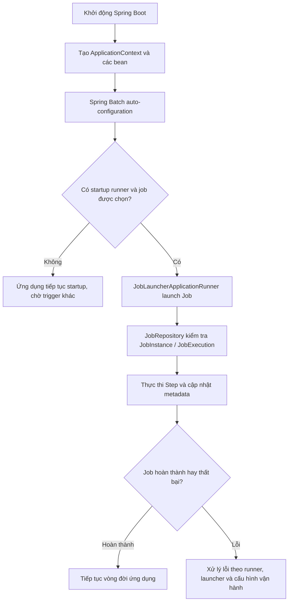

# Khởi chạy job khi ứng dụng bắt đầu và lựa chọn tắt hành vi tự chạy

## 1. Bối cảnh: cùng một job nhưng có nhiều thời điểm khởi chạy

Một ứng dụng Spring Boot có thể dùng Spring Batch để nhập dữ liệu từ file, đồng bộ dữ liệu qua HTTP, cập nhật cơ sở dữ liệu, làm sạch bản ghi hoặc xuất báo cáo định kỳ. Khi khai báo một `Job` thành bean trong ứng dụng, hành vi khởi chạy job lúc startup cần được quyết định có chủ đích.

Ví dụ, service tích hợp `order-sync` có một job `importOrdersJob` đọc dữ liệu đơn hàng từ đối tác và ghi vào PostgreSQL. Có hai cách vận hành:

- **Chạy ngay khi ứng dụng khởi động:** phù hợp với chương trình batch chuyên dụng mà mỗi lần chạy process là một lần xử lý có kiểm soát.
- **Chỉ khởi chạy khi được yêu cầu:** phù hợp với API service luôn hoạt động, hệ thống có lịch chạy riêng, job do orchestration platform điều khiển hoặc nhiều instance của cùng ứng dụng.

Spring Boot có cơ chế tự khởi chạy job được auto-configure khi các điều kiện phù hợp. Nếu không hiểu cơ chế này, một service được triển khai thêm replica hoặc restart sau lỗi có thể vô tình chạy batch vào thời điểm không mong muốn.

Mục tiêu bài học trong module `SPRING_BOOT_INTEGRATION` là xác định **khi nào Spring Boot khởi chạy job, cách tắt cơ chế đó, cách chọn cơ chế khởi chạy thay thế và cách bảo đảm job an toàn khi tích hợp HTTP, database, broker và adapter**. Cần tách biệt quyết định *có tự chạy khi startup không* khỏi những vấn đề khác như job có thể restart hay không, idempotency và dữ liệu checkpoint.

## 2. Những thành phần cần phân biệt

| Thành phần | Nhiệm vụ | Có tự kích hoạt job khi startup? |
| --- | --- | --- |
| `Job` | Định nghĩa quy trình batch gồm một hoặc nhiều `Step` | Bản thân bean `Job` không tự thực thi |
| `Step` | Định nghĩa một giai đoạn xử lý: tasklet, chunk, partitioning… | Chỉ chạy khi job được launch |
| `JobRepository` | Lưu metadata của job instance, execution, step execution và execution context | Không phải bộ lập lịch |
| `JobLauncher` | API để bắt đầu một `JobExecution` với `JobParameters` | Chỉ chạy job khi có lời gọi `run` |
| `JobLauncherApplicationRunner` | Cơ chế Spring Boot có thể dùng để tự launch job khi startup | Có, khi Batch auto-configuration và cấu hình phù hợp |
| `@Scheduled`, API nội bộ, CLI, external scheduler | Tạo **trigger** khởi chạy theo lịch hoặc theo yêu cầu | Độc lập với startup runner; phải được thiết kế riêng |

**Phân biệt quan trọng:** Một `Job` được đăng ký thành bean nghĩa là ứng dụng **biết định nghĩa job**, còn việc job có được thực thi hay không phụ thuộc cơ chế trigger. Tắt startup runner không xóa `Job`, không xóa `Step` và cũng không cấm lời gọi `JobLauncher.run(...)` từ nơi khác.

Trong Spring Boot 3.x với Spring Batch 5.x, khi framework tự cấu hình Spring Batch và có `Job` hợp lệ, Spring Boot có thể khởi chạy job như một bước trong quá trình khởi động ứng dụng. Với nhiều `Job`, cần cấu hình rõ job được chọn. Các điểm cấu hình cơ bản dưới đây dành cho kiểu tích hợp Spring Boot 3.x; luôn kiểm tra API và tên thuộc tính theo phiên bản Spring Boot/Spring Batch đang dùng, đặc biệt khi nâng cấp major version.

## 3. Dòng thời gian khi bật tự chạy



Runner tham gia vào giai đoạn startup ứng dụng, thường thông qua cơ chế `ApplicationRunner`. Không nên cho rằng job đã chạy trong constructor, `@PostConstruct` hoặc ngay lúc Spring tạo bean `Job`.

Một job đồng bộ có thể kéo dài thời gian startup của process. Việc job thật sự chặn startup tới khi hoàn tất hay chỉ được submit bất đồng bộ còn phụ thuộc cấu hình `JobLauncher`. Nếu muốn kiểm soát quy trình batch theo lịch, hãy quản lý riêng trạng thái job và thời điểm process được xem là đã xử lý xong.

Đặc biệt, “tự chạy khi startup” **không đồng nghĩa** “mỗi lần startup đều chạy thành công”. `JobRepository` có thể từ chối chạy lại một `JobInstance` đã hoàn thành nếu job và identifying parameters không thay đổi. Vì vậy, thiết kế `JobParameters` là phần thiết yếu khi chọn auto-run.

## 4. Ví dụ tối thiểu: khai báo một job và để Spring Boot tự khởi chạy

Giả sử job gọi service đồng bộ đơn hàng một lần mỗi khi được khởi chạy. Trong Spring Boot 3.x, có thể định nghĩa một `Job` và một `Step` qua builder API của Spring Batch.

### 4.1. Dependency

Ví dụ Maven nếu project dùng Spring Boot dependency management:

```xml
<dependency>
    <groupId>org.springframework.boot</groupId>
    <artifactId>spring-boot-starter-batch</artifactId>
</dependency>

<dependency>
    <groupId>org.postgresql</groupId>
    <artifactId>postgresql</artifactId>
    <scope>runtime</scope>
</dependency>
```

Ví dụ giả định service dùng PostgreSQL làm nguồn lưu metadata Batch. Nếu job cần gọi HTTP, đọc file, gửi message hoặc dùng JPA, bổ sung dependency tương ứng theo kiến trúc project. **Không cần thêm `@EnableBatchProcessing`** chỉ để bật tính năng Batch khi đang dựa vào Spring Boot Batch auto-configuration: cấu hình thủ công này có thể làm Boot Batch auto-configuration back off và thay đổi hành vi auto-run/khởi tạo metadata.

### 4.2. Định nghĩa `Job`

```java
import org.springframework.batch.core.Job;
import org.springframework.batch.core.Step;
import org.springframework.batch.core.job.builder.JobBuilder;
import org.springframework.batch.core.repository.JobRepository;
import org.springframework.batch.core.step.builder.StepBuilder;
import org.springframework.batch.core.step.tasklet.Tasklet;
import org.springframework.batch.repeat.RepeatStatus;
import org.springframework.context.annotation.Bean;
import org.springframework.context.annotation.Configuration;
import org.springframework.transaction.PlatformTransactionManager;

@Configuration
public class OrderImportBatchConfiguration {

    @Bean
    Tasklet importOrdersTasklet(OrderImportService importService) {
        return (contribution, chunkContext) -> {
            importService.importPendingOrders();
            return RepeatStatus.FINISHED;
        };
    }

    @Bean
    Step importOrdersStep(
            JobRepository jobRepository,
            PlatformTransactionManager transactionManager,
            Tasklet importOrdersTasklet) {

        return new StepBuilder("importOrdersStep", jobRepository)
                .tasklet(importOrdersTasklet, transactionManager)
                .build();
    }

    @Bean
    Job importOrdersJob(JobRepository jobRepository, Step importOrdersStep) {
        return new JobBuilder("importOrdersJob", jobRepository)
                .start(importOrdersStep)
                .build();
    }
}
```

`OrderImportService` là service nghiệp vụ do project tự xây dựng; ví dụ chỉ minh họa cách đăng ký `Job`. Các API `JobBuilder`, `StepBuilder` với `JobRepository` và transaction manager thuộc Spring Batch 5.x. Với chunk processing, có thể thay tasklet bằng reader, processor và writer tương ứng.

Một `Job` bean có tên `importOrdersJob` không có nghĩa job chỉ chạy một lần trong suốt vòng đời hệ thống. Khả năng bắt đầu execution mới tùy thuộc job instance, parameters và trạng thái execution đã lưu trong repository.

### 4.3. Cấu hình bật auto-run

```yaml
spring:
  datasource:
    url: ${DB_URL}
    username: ${DB_USERNAME}
    password: ${DB_PASSWORD}

  batch:
    job:
      enabled: true
    jdbc:
      initialize-schema: never
```

Ở đây `spring.batch.job.enabled=true` thể hiện rõ chủ đích cho phép startup runner. Khi Boot auto-configuration phù hợp và chỉ có một job cần launch, mỗi lần application startup sẽ cố gắng khởi chạy job được xác định.

`spring.batch.jdbc.initialize-schema=never` áp dụng khi các bảng metadata Batch **đã được tạo và quản lý bởi Flyway/Liquibase**. Nếu mới học bằng cơ sở dữ liệu embedded, Spring Boot có lựa chọn tự khởi tạo schema theo cấu hình phù hợp; trong production phải xác nhận các bảng metadata đã tồn tại và có đúng version trước khi chạy job. Không bật `initialize-schema: always` bừa bãi trên database đang vận hành.

**Lưu ý về credentials:** trong triển khai thật, biến môi trường cần được cấp từ secret management; mã ví dụ không cung cấp giá trị tài khoản trực tiếp.

## 5. Tắt tự chạy khi startup bằng một thuộc tính

Nếu ứng dụng là service API hoặc vận hành job theo lịch, cấu hình:

```yaml
spring:
  batch:
    job:
      enabled: false
```

Tương đương khi truyền qua command line:

```bash
java -jar integration-service.jar --spring.batch.job.enabled=false
```

Hoặc dùng biến môi trường Spring Boot relaxed binding:

```bash
SPRING_BATCH_JOB_ENABLED=false java -jar integration-service.jar
```

Hiệu lực của thuộc tính:

- Spring Boot không tự launch các `Job` qua startup runner mặc định.
- Các bean `Job`, `Step`, `JobRepository` và `JobLauncher` vẫn có thể được tạo, nếu điều kiện cấu hình và dependency đầy đủ.
- Một scheduler, HTTP endpoint nội bộ, command-line runner tự viết hoặc service khác **vẫn có thể gọi `JobLauncher.run(...)`**.
- Thuộc tính **không** dừng một job đã được launch trước đó và không ngăn broker consumer, Spring Integration flow, `@Scheduled` hay các job trigger khác chạy.

Điểm cuối rất dễ gây nhầm: nếu source code có một `ApplicationRunner` tự gọi `jobLauncher.run(...)`, thì đặt `spring.batch.job.enabled=false` **không tắt** runner tự viết đó. Phải thiết kế điều kiện bật/tắt cho chính cơ chế trigger tự viết.

## 6. Chọn job khi ứng dụng có nhiều `Job`

Một service có thể khai báo đồng thời `importOrdersJob`, `exportInvoicesJob` và `reconcilePaymentsJob`. Nếu tự chạy khi startup, cần lựa chọn rõ ràng job nào được phép chạy.

Với cấu hình Spring Boot 3.x:

```yaml
spring:
  batch:
    job:
      enabled: true
      name: importOrdersJob
```

`spring.batch.job.name` chỉ định tên job cho startup runner. Khi không lựa chọn job rõ ràng mà có nhiều job trong context, có thể gặp lỗi cấu hình hoặc hành vi không mong muốn tùy phiên bản và cách setup. Đừng dựa vào thứ tự khởi tạo bean để quyết định “job đầu tiên”.

Trong ứng dụng tích hợp có nhiều job cùng phục vụ API, lựa chọn vận hành phổ biến là **tắt auto-run hoàn toàn**, rồi khởi chạy đúng job khi nhận trigger đã được kiểm soát. Nếu deployment mỗi lần chỉ phục vụ một job, nên cấu hình riêng job cụ thể và identifying parameters của lần chạy.

```text
batch-runner.jar
  + profile=import-orders
  + spring.batch.job.enabled=true
  + spring.batch.job.name=importOrdersJob

integration-api.jar
  + spring.batch.job.enabled=false
  + JobLauncher chỉ chạy theo trigger nội bộ
```

Hai deployment có thể dùng chung code và các `Job` bean, nhưng cần khác nhau về cấu hình khởi chạy và phân quyền hạ tầng. Không nên dùng nhiều replica auto-run cùng một job mà chưa đánh giá giới hạn `JobRepository` và yêu cầu một lần chạy cho mỗi kỳ xử lý.

## 7. Khi nào nên bật, khi nào nên tắt?

| Bối cảnh | Khuyến nghị | Giải thích |
| --- | --- | --- |
| Chương trình CLI batch chuyên dụng chạy một job rồi thoát | Cân nhắc **bật** | Startup chính là trigger được orchestrator kiểm soát |
| CronJob trong Kubernetes tạo process riêng theo lịch | Có thể **bật** với cấu hình job/parameters rõ | Mỗi process ứng với một kỳ chạy; vẫn cần xử lý retry và concurrency |
| Spring Boot REST API luôn mở để nhận request | Thường **tắt** | Restart, rolling deploy hoặc scale replica không phải tín hiệu nghiệp vụ để chạy batch |
| Ứng dụng vừa có API vừa xử lý event broker | Thường **tắt** | Batch chạy theo orchestration hoặc sự kiện được kiểm soát |
| Job mất nhiều giờ hoặc cần runbook/manual approval | Thường **tắt** | Job nên có trigger, giám sát và quản lý execution riêng |
| Demo hoặc kiểm thử cục bộ một job ngắn | Có thể **bật** | Giảm cấu hình trigger, dễ quan sát |
| Có nhiều job độc lập với lịch khác nhau | Thường **tắt** | Lịch chạy nên nằm ở scheduler chuyên trách, mỗi job có parameters và quyền riêng |

Không có quy tắc “luôn bật” hoặc “luôn tắt” cho mọi ứng dụng. Cần trả lời: *Ai là nguồn trigger có thẩm quyền? Một lần chạy được nhận diện như thế nào? Nếu deploy lại, job có được tự chạy không?*

## 8. JobParameters, JobInstance và hệ quả khi startup lặp lại

Spring Batch phân biệt các khái niệm sau:

- **`Job`:** định nghĩa luồng thực thi; ví dụ `importOrdersJob`.
- **`JobParameters`:** tham số truyền cho lần chạy; có thể là identifying hoặc non-identifying.
- **`JobInstance`:** danh tính logic của một lần xử lý, được xác định bởi tên `Job` và **các identifying JobParameters**.
- **`JobExecution`:** một nỗ lực thực thi một `JobInstance`; một instance thất bại có thể có execution tiếp theo khi restart hợp lệ.
- **`StepExecution`:** kết quả một lần thực thi của một step nằm trong job execution cụ thể.

Ví dụ:

| Job | Identifying parameters | Hệ quả |
| --- | --- | --- |
| `importOrdersJob` | `businessDate=2026-11-20` | Một `JobInstance` cho kỳ 20/11 |
| `importOrdersJob` | `businessDate=2026-11-21` | Một `JobInstance` khác cho kỳ 21/11 |
| `importOrdersJob` | `businessDate=2026-11-20`, chạy lại | Truy cập **cùng instance**; cần xét trạng thái hoàn thành hoặc thất bại |
| `importOrdersJob` | `businessDate=2026-11-20` + `run.id=2` (identifying) | **Instance mới**, dù cùng kỳ nghiệp vụ; có nguy cơ chạy dữ liệu lần nữa |

### 8.1. Tại sao startup lại không tạo execution mới?

Nếu job `importOrdersJob` chạy với cùng identifying parameters và instance đã `COMPLETED`, lần launch tiếp theo có thể nhận `JobInstanceAlreadyCompleteException`. Đây là cơ chế bảo vệ lịch sử batch, không có nghĩa Spring Boot “đã tắt tự chạy”.

Nếu instance trước `FAILED` hoặc `STOPPED` và job restartable, có thể restart cùng parameters sau khi sửa nguyên nhân lỗi. Với instance đang chạy, `JobExecutionAlreadyRunningException` bảo vệ khỏi launch trùng cùng instance trong tình huống thích hợp. Cần lưu metadata repository bền vững để các cơ chế này có ý nghĩa giữa các lần restart ứng dụng.

**Không tự động tạo `run.id` ngẫu nhiên mỗi lần startup chỉ để tránh lỗi đã hoàn thành.** Việc đó biến mỗi restart thành một job instance mới, dễ nhập trùng dữ liệu, gửi lại HTTP request hoặc publish lại message.

### 8.2. Chọn tham số theo kỳ nghiệp vụ

Ví dụ một job làm reconciliation cho kỳ ngày `2026-11-21`:

```java
JobParameters parameters = new JobParametersBuilder()
        .addString("businessDate", "2026-11-21", true)
        .addString("trigger", "scheduler", false)
        .toJobParameters();
```

`businessDate` là identifying, vì mỗi ngày là một đơn vị xử lý logic. `trigger` là non-identifying để ghi nhận nguồn khởi chạy mà không tạo thêm instance theo nguồn trigger. Khi cùng kỳ đã hoàn thành, chính sách vận hành quyết định giữ nguyên, audit, hay cho phép rerun có điều kiện bằng một thiết kế phiên bản xử lý mới.

Trong tích hợp HTTP và database, chỉ nhận diện `JobInstance` chưa đủ tránh tác dụng phụ trùng lặp. Step/chunk phải có **idempotency key**, checkpoint, unique constraint hoặc cơ chế đối soát theo nguồn dữ liệu.

## 9. Khởi chạy theo yêu cầu khi đã tắt auto-run

Spring Batch cung cấp `JobLauncher` để khởi chạy job với parameters. Một service nội bộ có thể được scheduler, REST controller có phân quyền hoặc một command handler gọi tới.

```java
import org.springframework.batch.core.Job;
import org.springframework.batch.core.JobExecution;
import org.springframework.batch.core.JobExecutionException;
import org.springframework.batch.core.JobParameters;
import org.springframework.batch.core.JobParametersBuilder;
import org.springframework.batch.core.launch.JobLauncher;
import org.springframework.stereotype.Service;

@Service
public class OrderImportTrigger {
    private final JobLauncher jobLauncher;
    private final Job importOrdersJob;

    public OrderImportTrigger(JobLauncher jobLauncher, Job importOrdersJob) {
        this.jobLauncher = jobLauncher;
        this.importOrdersJob = importOrdersJob;
    }

    public JobExecution launchForDate(String businessDate)
            throws JobExecutionException {

        JobParameters parameters = new JobParametersBuilder()
                .addString("businessDate", businessDate, true)
                .toJobParameters();

        return jobLauncher.run(importOrdersJob, parameters);
    }
}
```

Cấu hình ứng dụng:

```yaml
spring:
  batch:
    job:
      enabled: false
```

Một lời gọi `launchForDate("2026-11-21")` vẫn chạy job vì service gọi trực tiếp `JobLauncher`. Trong production, nên bổ sung:

1. **Authorization:** chỉ trigger từ scheduler/service nội bộ hoặc endpoint có xác thực, không mở API launch tùy ý ra internet.
2. **Validate parameters:** kiểm tra định dạng ngày, phạm vi dữ liệu, điều kiện sẵn sàng và version của hợp đồng.
3. **Concurrency policy:** xác định có cho phép hai kỳ khác nhau chạy cùng lúc không; repository ngăn một số trường hợp chạy trùng instance nhưng không tự khóa tất cả tài nguyên nghiệp vụ dùng chung.
4. **Kết quả async/sync:** `JobLauncher.run` trả về `JobExecution`, nhưng tùy cấu hình launcher, việc xử lý có thể đã hoàn tất hoặc đang chạy. Theo dõi status từ repository thay vì mặc định return là thành công nghiệp vụ.
5. **Giới hạn tải:** tránh đồng thời chạy quá nhiều job gây bão kết nối DB, HTTP hoặc broker.

Nếu dùng `@Scheduled` làm trigger, phải tính đến **nhiều replica**: mỗi instance có thể kích hoạt cùng một lịch. Có thể dùng scheduler tập trung, khóa phân tán có ngữ nghĩa phù hợp hoặc chỉ một bản sao đóng vai trò batch scheduler. Không dựa vào `@Scheduled` đơn lẻ để bảo đảm toàn cụm chỉ có một trigger.

## 10. Tự chạy bằng cấu hình hay runner tự viết?

### 10.1. Startup runner mặc định của Spring Boot

```yaml
spring:
  batch:
    job:
      enabled: true
      name: importOrdersJob
```

Ưu điểm: ít mã, lý tưởng cho app chuyên chạy job. Hạn chế: startup gắn với điều kiện launch, việc cấu hình parameters và xử lý process exit cần được thiết kế thêm, đặc biệt với nhiều deployment.

### 10.2. Runner do ứng dụng tự viết

Một số project viết `CommandLineRunner` hoặc `ApplicationRunner` rồi gọi `JobLauncher.run` thủ công. Cách này cho phép xác định parameters hoặc luồng khởi chạy đặc thù, nhưng **không được bật đồng thời startup runner mặc định** nếu cả hai cùng khởi chạy một job.

Ví dụ một runner chủ động chỉ chạy trong profile chuyên batch:

```java
import org.springframework.batch.core.JobExecution;
import org.springframework.boot.ApplicationArguments;
import org.springframework.boot.ApplicationRunner;
import org.springframework.context.annotation.Profile;
import org.springframework.stereotype.Component;

@Component
@Profile("batch-cli")
public class ImportOrdersCliRunner implements ApplicationRunner {
    private final OrderImportTrigger trigger;

    public ImportOrdersCliRunner(OrderImportTrigger trigger) {
        this.trigger = trigger;
    }

    @Override
    public void run(ApplicationArguments args) throws Exception {
        String businessDate = parseBusinessDate(args);
        JobExecution execution = trigger.launchForDate(businessDate);
        // Tùy job launcher có thể async: không mặc định status đã là COMPLETED.
        monitorAndReport(execution);
    }

    private String parseBusinessDate(ApplicationArguments args) {
        if (!args.containsOption("businessDate")) {
            throw new IllegalArgumentException("Thiếu --businessDate");
        }
        var values = args.getOptionValues("businessDate");
        if (values == null || values.size() != 1 || values.get(0) == null) {
            throw new IllegalArgumentException("Cần đúng một --businessDate");
        }
        return values.get(0);
    }

    private void monitorAndReport(JobExecution execution) {
        // Thiết kế riêng: chờ/quan sát status, ánh xạ exit code và thông báo lỗi.
    }
}
```

Ví dụ trên chỉ minh họa cơ chế; khi viết ứng dụng thực tế phải thay `monitorAndReport` bằng logic theo dõi trạng thái và exit code thật, kiểm tra `businessDate` và xử lý ngoại lệ phù hợp. Nên cấu hình `spring.batch.job.enabled=false` để chỉ runner tự viết là nguồn trigger khi dùng profile `batch-cli`.

**Cảnh báo tình huống:** Nếu đặt một `CommandLineRunner` chung trong module thư viện được dùng cả ở API và batch app, job có thể bị launch ngoài ý muốn từ API service. Hãy khoanh vùng bean theo profile/conditional property rõ ràng.

## 11. Khởi chạy job không đồng nghĩa hoàn tất thành công

Giả sử job xử lý 10.000 dòng, ở dòng thứ 8.000 API đối tác trả HTTP 503. Spring Batch có thể ghi `FAILED` và checkpoint step, cho phép restart từ vị trí thích hợp nếu reader/writer, repository và execution context hỗ trợ.

Các kết quả cần phân biệt:

| Trạng thái | Ý nghĩa vận hành | Phản ứng phù hợp |
| --- | --- | --- |
| `STARTING` / `STARTED` | Job đang được chuẩn bị hoặc đang xử lý | Theo dõi tiến độ, chưa báo thành công |
| `COMPLETED` | Job execution đã kết thúc thành công theo flow | Đối soát kết quả nghiệp vụ và metric, ghi nhận kỳ chạy |
| `FAILED` | Một phần của job thất bại | Kiểm tra exception/step, sửa nguyên nhân, restart có kiểm soát |
| `STOPPED` | Job được dừng theo cơ chế Batch | Xác định chính sách restart và checkpoint |
| `UNKNOWN` | Framework không xác định được trạng thái chắc chắn | Điều tra repository/log trước khi retry để tránh tác dụng phụ trùng |

Spring Batch có cả `BatchStatus` và `ExitStatus`. `BatchStatus` mô tả trạng thái thực thi, `ExitStatus` thể hiện mã thoát theo logic flow/step. Process exit code của Spring Boot là chuyện khác; job `FAILED` không mặc nhiên đồng nghĩa scheduler đã nhận được mã thoát khác 0 nếu ứng dụng không ánh xạ kết quả đúng.

Với CLI batch, nên điều phối lifecycle process như sau:

```text
Trigger một JobInstance có identifying parameters rõ ràng
    ↓
Đợi JobExecution kết thúc (hoặc truy vấn repository khi launcher async)
    ↓
Đọc BatchStatus + ExitStatus + số dòng thực tế
    ↓
Ghi metric/audit và trả exit code phù hợp cho orchestrator
```

Tránh lập lịch lại chỉ vì service còn đang chạy, hoặc dựa duy nhất vào việc HTTP request gửi trigger đã trả về `200 OK`.

## 12. Metadata repository và migration schema

Để kiểm soát startup/restart giữa các deployment, JobRepository phải lưu metadata bền vững. Với JDBC-based repository, Spring Batch có những bảng metadata phổ biến như:

- `BATCH_JOB_INSTANCE`: danh tính các job instance.
- `BATCH_JOB_EXECUTION` và `BATCH_JOB_EXECUTION_PARAMS`: các execution và parameters.
- `BATCH_STEP_EXECUTION`: trạng thái từng step.
- `BATCH_JOB_EXECUTION_CONTEXT` và `BATCH_STEP_EXECUTION_CONTEXT`: execution context/checkpoint.

Tên bảng thực tế có thể có prefix được cấu hình; số lượng và cấu trúc phụ thuộc phiên bản Spring Batch. Việc lưu metadata cho phép phát hiện job instance đã hoàn tất, chạy trùng, execution thất bại và khả năng restart.

Với hệ thống tích hợp production, nên dùng **một công cụ migration đã được chọn cho schema** (Flyway *hoặc* Liquibase) để quản lý cả bảng metadata và bảng nghiệp vụ cần thiết. Ví dụ:

```yaml
spring:
  batch:
    jdbc:
      initialize-schema: never

  flyway:
    enabled: true

  liquibase:
    enabled: false

  sql:
    init:
      mode: never

  jpa:
    hibernate:
      ddl-auto: validate
```

Đoạn `jpa` chỉ phù hợp nếu ứng dụng thực sự dùng JPA; bỏ nếu không có. Migration phải tạo đủ các bảng/sequence/index metadata tương ứng phiên bản Spring Batch và database engine. Không dùng script metadata của version khác mà không đối chiếu.

Nếu đang dùng `@EnableBatchProcessing` hay kế thừa `DefaultBatchConfiguration` để tự cấu hình Batch, một phần auto-configuration mặc định của Spring Boot sẽ nhường chỗ. Khi đó phải kiểm tra lại nguồn tạo `JobRepository`, datasource và cơ chế launch; thuộc tính `spring.batch.job.enabled` không bảo đảm có hiệu lực như trường hợp Boot tự cấu hình.

## 13. Những rủi ro khi khởi chạy job cùng quá trình startup

### 13.1. Rolling deploy hoặc tự động restart

Kubernetes Deployment có thể restart container vì liveness probe, OOM hoặc rolling update. Nếu app bật auto-run, mỗi restart lại tạo ra một nỗ lực launch job. Nếu JobParameters tự sinh ID mới, những lần restart có thể làm lại nghiệp vụ.

Giải pháp: tắt startup auto-run trong long-running service, dùng JobRepository bền vững và quyết định business period ở scheduler/job orchestration layer.

### 13.2. Nhiều replica cùng khởi chạy

Một cluster có ba instance cùng bật auto-run có thể đồng thời cố launch job. JobRepository giúp ngăn một số tình huống launch trùng **cùng instance**, nhưng không tự ngăn hai instance sử dụng **khác identifying parameters** để xử lý cùng dữ liệu nghiệp vụ. Cần một nguồn trigger có thẩm quyền, quy tắc phân quyền và khóa/constraint cho dữ liệu.

### 13.3. Startup phụ thuộc cơ sở dữ liệu hoặc hệ thống ngoài

Batch có thể cần PostgreSQL, object storage, HTTP API, SFTP hoặc broker. Nếu tự chạy khi startup mà đối tác gián đoạn, thời gian khởi động hoặc trạng thái process bị ảnh hưởng. Cần xác định việc batch thất bại có khiến service API phải unavailable hay không. Với service luôn phục vụ request, việc tách trigger/job worker thường giúp phân lập trách nhiệm.

### 13.4. Retry ở tầng Batch có thể tạo side effect trùng

Một job chunk đã gọi API bên ngoài rồi lỗi trước khi DB checkpoint được commit có thể gọi lại API khi restart. Tương tự, ghi DB và publish Kafka không tự nằm trong một transaction chung. Sử dụng idempotency key, transactional outbox, transaction boundary và reconciliation phù hợp; metadata Batch không tự biến các hệ thống bên ngoài thành exactly-once.

## 14. Kiểm thử cấu hình auto-run và manual trigger

Một bộ kiểm thử đáng tin cậy nên tách **kiểm thử logic job** khỏi **kiểm thử điều kiện khởi chạy khi bootstrap**.

| Kịch bản | Kết quả mong đợi |
| --- | --- |
| Chỉ một `Job`, `spring.batch.job.enabled=true`, repository được chuẩn bị | Startup cố launch job theo cấu hình |
| `spring.batch.job.enabled=false`, không có trigger khác | Startup không tạo `JobExecution` mới |
| Tắt auto-run nhưng gọi `JobLauncher.run` | Job vẫn chạy với parameters đã truyền |
| Có nhiều `Job`, chọn `spring.batch.job.name` | Chỉ job được chỉ định cho startup runner |
| Restart với cùng identifying parameters và job đã `COMPLETED` | Không tạo một execution xử lý mới cho instance đã hoàn tất |
| Restart job `FAILED` khi restartable | Framework có thể tạo execution tiếp theo, step tiếp tục theo checkpoint phù hợp |
| Hai instance cùng trigger một kỳ | Không làm trùng side effect hoặc xung đột dữ liệu; behavior phù hợp concurrency policy |
| Mất kết nối API/DB giữa chunk | Job có trạng thái lỗi rõ; retry/restart không gây dữ liệu trùng |
| Bật `@Scheduled` khi auto-run đã tắt | Scheduler vẫn khởi chạy nếu có cấu hình; test phát hiện trigger ngoài ý muốn |
| Thay đổi profile/biến môi trường trong CI/CD | Không vô tình bật startup runner ở môi trường API |

Có thể dùng `@SpringBootTest(properties = "spring.batch.job.enabled=false")` để khởi tạo context kiểm thử mà không tự chạy toàn bộ batch, sau đó dùng công cụ kiểm thử Spring Batch phù hợp để launch với parameters kiểm soát. Để kiểm tra metadata transaction/restart, dùng Testcontainers với cùng hệ database như production thay vì chỉ mock `JobRepository`.

Cần xác nhận cả thứ tự: datasource và bảng metadata phải sẵn sàng **trước khi runner cố launch**. Nếu job truy cập database riêng hoặc adapter HTTP, các connector và chính sách timeout cũng phải được kiểm thử.

## 15. Quan sát và vận hành job

Các metric/log quan trọng:

- `jobName`, identifying business period, `jobInstanceId`, `jobExecutionId` và nguồn trigger.
- Thời gian startup ứng dụng và thời điểm bắt đầu/kết thúc job; phân biệt startup chậm với xử lý batch chậm.
- `BatchStatus`, `ExitStatus`, tổng số read/write/skip/retry theo step.
- Độ trễ và lỗi dependency HTTP, database, object storage hoặc broker mà job đang tích hợp.
- Số lần launch bị từ chối vì đã hoàn tất, đã chạy, parameters sai hoặc không thể restart.
- Các job tồn tại ở trạng thái `STARTED` quá lâu, execution context/checkpoint không tiến, thiếu dữ liệu đầu ra sau job báo thành công.

Bảo vệ cardinality của metric: `jobExecutionId` và `businessDate` thường nên xuất hiện trong log/tracing hoặc dữ liệu audit; không mặc định gắn chúng làm label metric có số lượng không giới hạn.

Khi có sự cố, quy trình kiểm tra thực dụng:

1. Xác nhận property cuối cùng của deployment (`spring.batch.job.enabled`, profile và biến môi trường).
2. Kiểm tra `JobLauncherApplicationRunner` có được auto-configure và có chọn đúng `Job` không.
3. Đọc `JobRepository` để phân biệt chưa launch, đã hoàn tất, đang chạy và thất bại.
4. Đối chiếu identifying `JobParameters` với kỳ nghiệp vụ.
5. Kiểm tra toàn bộ nguồn trigger khác: `@Scheduled`, custom runner, cronjob, API, pipeline.
6. Quyết định restart/rerun/repair dựa trên tình trạng dữ liệu thật và idempotency, không tự sửa/xóa metadata để ép job chạy lại.

## 16. Tình huống tổng hợp: service đồng bộ hóa đơn với hệ thống kế toán

Giả sử ứng dụng Spring Boot cung cấp API tra cứu hóa đơn và có batch `syncInvoicesJob` đồng bộ sang hệ thống kế toán lúc 01:00 mỗi ngày.

**Thiết kế có rủi ro:** bật `spring.batch.job.enabled=true` trong API Deployment, đồng thời có ba replica để phục vụ traffic. Mỗi khi rolling deploy, ba instance đều có thể cố launch batch. Nếu mỗi lần launch gắn `run.id` mới, các kỳ đồng bộ có thể bị chạy lại và gửi trùng hóa đơn.

**Thiết kế có kiểm soát:**

1. API Deployment đặt `spring.batch.job.enabled=false`, chỉ phục vụ request, không tự launch batch lúc startup.
2. Một scheduler phát trigger có `businessDate` định danh kỳ đồng bộ. Trigger này có cơ chế giới hạn concurrency theo kỳ.
3. Batch worker có `JobRepository` bền vững, dùng một `JobInstance` cho mỗi kỳ; các lần retry có cùng identifying parameters.
4. Reader và writer có checkpoint/transaction phù hợp. Lời gọi đến API kế toán mang idempotency key theo invoice ID và loại thao tác; response và trạng thái đồng bộ được ghi để đối soát.
5. Quan sát `JobExecution` tới kết thúc, gửi kết quả về scheduler, cảnh báo nếu quá hạn hoặc thất bại; retry theo runbook.
6. Các schema nghiệp vụ và Batch metadata được quản lý qua migration chính thức, không tự tạo bảng khi startup.

Nếu thay API Deployment bằng một **Kubernetes CronJob chuyên dụng** mà mỗi process chỉ chạy một kỳ rồi kết thúc, có thể chọn bật auto-run. Khi đó cần cấp `businessDate` cho mỗi process một cách rõ ràng, theo dõi kết quả job và phản ánh exit status thành exit code để CronJob biết thành công hay thất bại.

## 17. Checklist chọn hành vi khởi chạy Spring Batch

- [ ] Định nghĩa service đang chạy kiểu API/consumer lâu dài hay batch CLI/CronJob chuyên dụng.
- [ ] Chọn **một nguồn trigger chính**: startup runner mặc định, custom runner, scheduler, API nội bộ hoặc orchestrator.
- [ ] Cấu hình `spring.batch.job.enabled` nhất quán với lựa chọn; tránh hai runner cùng launch.
- [ ] Nếu có nhiều job, chọn đúng job theo phiên bản Spring Boot và cấu hình triển khai.
- [ ] Có `JobRepository` bền vững cùng schema metadata đúng version.
- [ ] Thiết kế `JobParameters` định danh theo đơn vị nghiệp vụ, tránh run ID ngẫu nhiên khi restart.
- [ ] Có chính sách xử lý `COMPLETED`, `FAILED`, `STOPPED` và concurrency.
- [ ] Có idempotency/checkpoint/đối soát khi job gọi HTTP, ghi DB hoặc publish broker.
- [ ] Test startup với enabled/disabled, manual trigger, nhiều replica và restart.
- [ ] Theo dõi execution ID, status, tiến độ step, kết quả nghiệp vụ và exit code scheduler.

**Ghi nhớ:** `spring.batch.job.enabled=false` chỉ tắt cơ chế **tự khởi chạy job khi Spring Boot bắt đầu chạy** trong trường hợp Boot Batch auto-configuration đang điều khiển runner. Job vẫn có thể được launch có chủ đích qua `JobLauncher`. Quyết định bật/tắt nên xuất phát từ mô hình vận hành và ràng buộc dữ liệu, không chỉ từ việc ứng dụng có khai báo bean `Job`.
