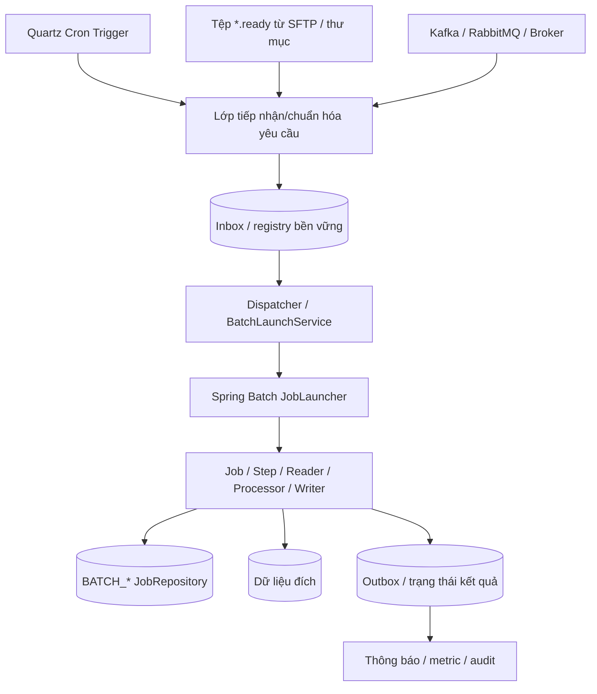
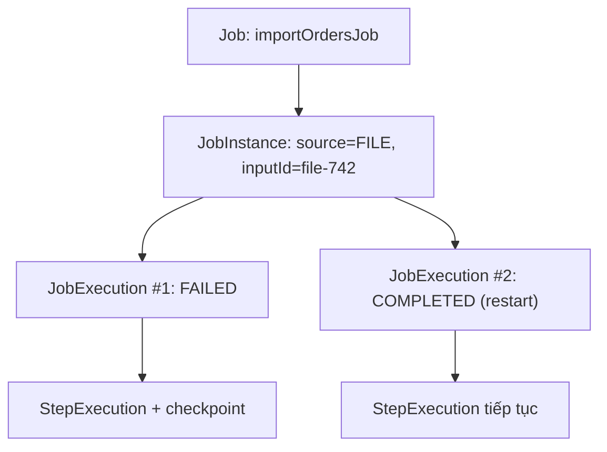
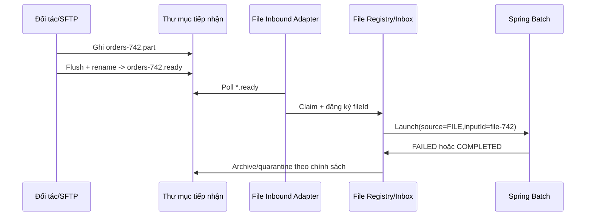
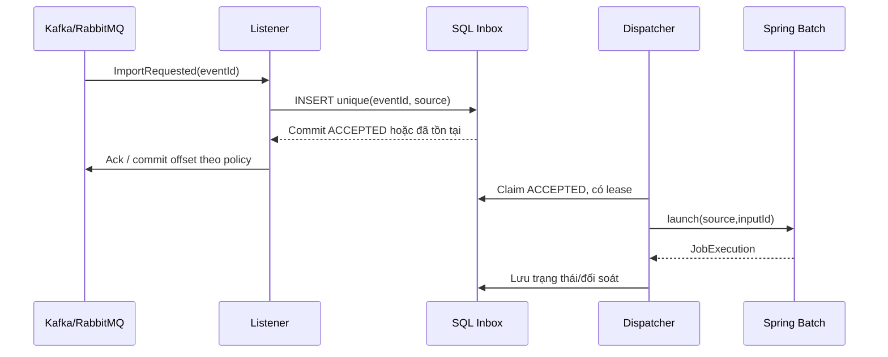
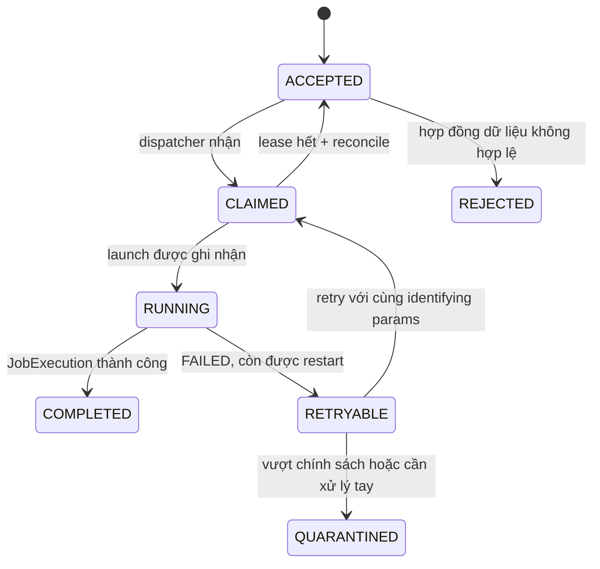

# Kết nối batch với lịch Quartz, tệp hoặc thông điệp

Một hệ thống tích hợp Spring Boot thường cần xử lý dữ liệu hàng loạt từ nhiều nguồn: lịch đối soát chạy mỗi đêm, tệp CSV đối tác vừa chuyển tới thư mục dùng chung, hoặc thông điệp `ImportRequested` trên Kafka/RabbitMQ. Ba cách kích hoạt này khác nhau về thời điểm nhận tín hiệu, khả năng gửi lại, kiểm soát tải và độ bền. Tuy nhiên, chúng nên dẫn về **cùng một cơ chế thực thi Spring Batch** để dùng chung quy tắc đọc dữ liệu, giao dịch, checkpoint, retry và theo dõi tiến độ.

Bài thuộc chương **Spring Batch** của mô-đun **SPRING_BOOT_INTEGRATION**. Mục tiêu của mô-đun là tổ chức tích hợp hệ thống trong Spring Boot qua HTTP client, cơ sở dữ liệu, cache, broker thông điệp và các adapter Spring Integration; vì thế bài này đặt Spring Batch trong luồng thực tế gồm **bộ kích hoạt → bàn giao công việc → Batch Job → cập nhật kết quả**, cùng các yêu cầu về cấu hình, hợp đồng dữ liệu, lỗi, xử lý trùng lặp, kiểm thử và quan sát.

Sau bài học, bạn có thể:

- Lựa chọn khi nào dùng Quartz, file inbound adapter, Kafka/RabbitMQ hoặc cơ chế bàn giao công việc trung gian.
- Cấu hình Spring Boot, Spring Batch, Quartz và Spring Integration để nhiều nguồn kích hoạt gọi một `JobLauncher` theo một hợp đồng tham số rõ ràng.
- Thiết kế `JobParameters`, `JobInstance`, `JobExecution` và checkpoint để restart đúng dữ liệu, chống chạy trùng và không đánh đồng lịch Quartz với lần chạy Batch.
- Xử lý file chưa ghi xong, broker redelivery, cron misfire, lịch chạy chồng, lỗi ở cửa sổ crash, giới hạn tài nguyên và trạng thái sau commit.
- Viết kiểm thử tích hợp cho các luồng kích hoạt, thất bại, gửi trùng, restart và hồi phục; theo dõi bằng metadata, metric và log có correlation ID.

> **Ngữ cảnh phiên bản:** các ví dụ dùng API Spring Batch 5.x và mô hình cấu hình Spring Boot 3.x, Spring Integration Java DSL và Quartz 2.x. Ý tưởng vẫn áp dụng cho các phiên bản tương thích mới hơn, nhưng tên lớp, auto-configuration, yêu cầu Java, trường trạng thái và chế độ xác nhận có thể khác. Các lớp repository/adapter nghiệp vụ được ghi rõ là interface minh họa; không coi snippet là ứng dụng production hoàn chỉnh.

## 1. Tách ba khái niệm: kích hoạt, thực thi và hoàn tất

### 1.1. Sơ đồ tổng quan



Sơ đồ minh họa kiến trúc có **inbox/registry bền vững**, phù hợp hệ thống cần chống thất lạc khi tiến trình chết. Với tác vụ ít quan trọng và đơn giản, Quartz hoặc file poller có thể gọi `JobLauncher` trực tiếp; tuy nhiên vẫn phải có chính sách khi không thể launch, trùng tham số hoặc tiến trình dừng giữa hai bước.

Ba phần có trách nhiệm độc lập:

| Thành phần | Câu hỏi cần trả lời | Ví dụ |
|---|---|---|
| **Trigger** | Khi nào hệ thống phát hiện có công việc? | Cron lúc 02:00, xuất hiện file `.ready`, broker gửi `ImportRequested` |
| **Launch/dispatch** | Công việc cụ thể nào được chạy, được nhận trùng hay không, có vượt tải không? | Xác định `inputId` và `source`; lưu inbox; kiểm tra giới hạn đồng thời |
| **Spring Batch** | Đọc, biến đổi, ghi, checkpoint, rollback, retry và báo kết quả ra sao? | `Job` gồm các `Step` xử lý theo chunk, lưu metadata vào `JobRepository` |

**Nhận trigger ≠ Batch đã chạy thành công.** Quartz fire thành công có thể chỉ là gọi `JobLauncher`, broker acknowledge có thể chỉ xác nhận yêu cầu đã ghi vào inbox, còn Spring Batch `COMPLETED` mới là kết quả thực thi của một `JobExecution` tương ứng. Nếu cần xác nhận dữ liệu nghiệp vụ đã được gửi tới đối tác, còn phải định nghĩa thêm điều kiện xác nhận tại adapter/đích ngoài.

### 1.2. Khi nào nên dùng từng nguồn?

| Nguồn | Phù hợp nhất | Vấn đề bắt buộc xử lý |
|---|---|---|
| **Quartz** | Chạy theo lịch, lịch phức tạp, yêu cầu lưu trigger hoặc chạy trên cluster | Cron/timezone, misfire, job concurrency, failover, JobParameters theo kỳ |
| **File** | Đối tác giao CSV/XML/JSON trên thư mục, SFTP hoặc object storage | File đã ghi xong chưa, claim nguyên tử, đổi tên/phiên bản, restart file, xử lý file trùng |
| **Thông điệp** | Hệ thống khác yêu cầu import qua event/command, phản ứng gần thời gian thực | At-least-once delivery, ack, redelivery, inbox/idempotency, offset/visibility timeout, backpressure |
| **Inbox/dispatcher** | Nhiều nguồn, cần ghi nhận bền vững trước khi chạy, cluster hoặc giới hạn tải | Transaction của inbox, trạng thái claim, lease, hồi phục các yêu cầu đã nhận |

Thường không cần ba `Job` khác nhau chỉ vì có ba trigger. Hợp đồng tham số và chiến lược xử lý dữ liệu có thể giống nhau, trong khi adapter đầu vào chịu trách nhiệm xác minh nguồn và dựng tham số phù hợp.

## 2. Nắm vững metadata và định danh Spring Batch

### 2.1. Job, JobInstance, JobExecution và StepExecution

Spring Batch phân biệt:

- `Job`: định nghĩa quy trình như `importOrdersJob`.
- `JobParameters`: tham số đầu vào, mỗi tham số có thể là **identifying** hoặc **non-identifying**.
- `JobInstance`: một lần xử lý **logic**, được xác định bởi **tên Job + tập tham số identifying**.
- `JobExecution`: mỗi lần thực thi thực tế của JobInstance, gồm trạng thái, thời gian, lỗi; restart một JobInstance thất bại tạo `JobExecution` khác.
- `StepExecution`: lần thực thi của từng Step trong một JobExecution, chứa read/write/skip counts và trạng thái tương ứng.
- `ExecutionContext`: vùng trạng thái được lưu ở Job/Step nhằm phục vụ restart, ví dụ checkpoint dòng đọc; không thay thế database nghiệp vụ hay kho lưu dữ liệu bền vững.



Nếu lần đầu đã `COMPLETED`, gọi `JobLauncher.run` lại với **cùng identifying parameters** thường sinh `JobInstanceAlreadyCompleteException` (trừ trường hợp Job được cấu hình đặc biệt). Nếu lần trước `FAILED` và Job restartable, chạy lại đúng tập identifying parameters sẽ tạo lần thực thi mới cho JobInstance cũ.

### 2.2. Thiết kế tham số nhất quán qua ba nguồn

Giả sử hợp đồng chung:

| Tham số | Ý nghĩa | Identifying? |
|---|---|---|
| `source` | `QUARTZ`, `FILE`, `KAFKA` hoặc `RABBIT` | Có |
| `inputId` | ID bất biến của lần nhập logic: ngày đối soát, mã file, ID yêu cầu | Có |
| `requestedAt` | Thời điểm nhận/khởi động yêu cầu, dùng chẩn đoán | Không |
| `traceId` | Tham chiếu quan sát, log/trace | Không, nếu lưu dưới dạng JobParameter |
| `inputPath` | Đường dẫn nội bộ của file đã claim | Cân nhắc; nếu thay đổi khi restart có thể sai input |
| `schemaVersion` | Phiên bản hợp đồng dữ liệu | Theo nghiệp vụ; thay version có cần JobInstance mới không? |

Ví dụ `inputId=2026-11-21` cho batch chạy theo ngày; bản ghi trùng do cron fire lại trong cùng ngày không tạo một công việc mới. Với file, `inputId` có thể là ID file do đối tác cung cấp kết hợp phiên bản nội dung, hoặc ID đăng ký file trong inbox; không nên chỉ dựa vào tên file nếu đối tác có thể ghi đè nội dung mà vẫn giữ tên. Với thông điệp, dùng event ID/business request ID **ổn định qua redelivery**.

**Không đặt `System.currentTimeMillis()` làm identifying parameter theo mặc định.** Khi mỗi trigger dùng timestamp mới, hệ thống coi mọi lần retry/redelivery là JobInstance khác, làm mất cơ chế kiểm soát trùng và restart có ý nghĩa. Chỉ dùng run ID mới nếu nghiệp vụ thật sự muốn chạy một lô độc lập, và phải xác định quan hệ của nó với input bất biến.

### 2.3. Kết quả và các lỗi thường gặp khi launch

| Kết quả/ngoại lệ | Ý nghĩa thực tế | Cách phản ứng |
|---|---|---|
| `JobExecution` có trạng thái `COMPLETED` | Lần thực thi Batch đã hoàn tất theo Job/Step | Ghi kết quả, lưu báo cáo; gửi event hậu xử lý nếu cần |
| `JobExecutionAlreadyRunningException` | Cùng JobInstance đang chạy | Không khởi chạy bản song song trùng; theo dõi execution hiện tại |
| `JobInstanceAlreadyCompleteException` | JobInstance đã hoàn tất | Thường coi là duplicate/no-op; không tạo timestamp identifying mới để “lách” |
| `JobRestartException` | Không thể restart theo trạng thái/cấu hình Job | Điều tra metadata và điều kiện restart |
| `JobParametersInvalidException` | Tham số không qua validator | Trả lỗi hợp đồng đầu vào, không retry vô hạn |
| `FAILED`, `STOPPED`, `UNKNOWN` | Batch không hoàn tất thành công | Phân biệt có thể restart, cần đối soát hay cần sửa dữ liệu |

Với `JobLauncher` chạy **đồng bộ**, `run()` trả kết quả sau khi thực thi xong; với `JobLauncher` được cấu hình **bất đồng bộ**, `run()` có thể trả `JobExecution` còn `STARTING`/`STARTED`. Không được đánh dấu `COMPLETED`, archive file hoặc ack kết quả nghiệp vụ chỉ vì đã gọi `run()` thành công.

## 3. Cấu hình nền cho Spring Boot + Spring Batch

### 3.1. Dependency

Ví dụ với Gradle Kotlin DSL:

```kotlin
dependencies {
    implementation("org.springframework.boot:spring-boot-starter-batch")
    implementation("org.springframework.boot:spring-boot-starter-quartz")
    implementation("org.springframework.boot:spring-boot-starter-integration")
    implementation("org.springframework.boot:spring-boot-starter-actuator")
    implementation("org.springframework.boot:spring-boot-starter-jdbc")

    runtimeOnly("org.postgresql:postgresql")

    testImplementation("org.springframework.boot:spring-boot-starter-test")
    testImplementation("org.springframework.batch:spring-batch-test")

    // Chỉ bổ sung khi thật sự dùng nguồn thông điệp tương ứng:
    // implementation("org.springframework.kafka:spring-kafka")
    // implementation("org.springframework.boot:spring-boot-starter-amqp")
}
```

Dependency của broker cần chọn theo nguồn thực tế; dùng Kafka không bắt buộc có RabbitMQ và ngược lại. Với Spring Boot BOM, nên để Boot quản lý version tương thích thay vì tự ghép các phiên bản Batch/Integration/Quartz khác dòng.

### 3.2. application.yml

```yaml
spring:
  datasource:
    url: jdbc:postgresql://db.internal.example:5432/integration
    username: ${DB_USERNAME}
    password: ${DB_PASSWORD}

  batch:
    job:
      enabled: false
    jdbc:
      initialize-schema: never

  quartz:
    job-store-type: jdbc
    jdbc:
      initialize-schema: never
    properties:
      org.quartz.scheduler.instanceName: integration-imports
      org.quartz.scheduler.instanceId: AUTO
      org.quartz.jobStore.isClustered: true

management:
  endpoints:
    web:
      exposure:
        include: health,info,metrics
```

Giải thích:

- `spring.batch.job.enabled=false` ngăn auto-launch các Batch Job khi Spring Boot startup, để nguồn Quartz/file/message điều khiển thời điểm chạy. Điều này rất quan trọng khi có một `Job` trong context nhưng chỉ muốn chạy khi có trigger.
- `initialize-schema=never` dành cho môi trường đã quản lý schema bằng migration. Phải **tạo/upgrade các bảng Spring Batch và Quartz đúng phiên bản trước khi chạy**; nếu là thử nghiệm mới có thể dùng cơ chế bootstrap phù hợp.
- `spring.quartz.job-store-type=jdbc` cho phép Quartz giữ lịch/triggers trong DB. Để cluster thực sự, các node phải trỏ tới **cùng scheduler store**, cấu hình cluster đúng, đồng bộ đồng hồ và dùng schema Quartz nhất quán.
- Spring Batch metadata (thường bảng `BATCH_*`) và Quartz scheduler metadata (thường bảng `QRTZ_*`) là **hai hệ metadata riêng**. Một bảng không thay thế bảng kia.
- Bật JDBC Quartz job store chưa bảo đảm toàn bộ hệ thống exactly-once. Quartz ghi và kích hoạt lịch; Spring Batch ghi trạng thái việc thực thi; còn side effect SQL/HTTP/broker có transaction và retry riêng.

Nếu toàn hệ thống chỉ có một instance, cấu hình `isClustered=true` không bắt buộc. Không bật cluster tùy tiện nếu nhiều nhóm scheduler không thực sự dùng chung cấu hình đúng; cấu hình Quartz phải khớp DB và chiến lược triển khai.

### 3.3. Một Job dùng chung cho mọi adapter kích hoạt

Định nghĩa đơn giản sau đây minh họa cách các trigger chuyển vào **cùng Batch Job**. Phần `InputImportService` là giao diện nghiệp vụ; triển khai cụ thể có thể đọc tệp theo chunk, lấy các row từ database hoặc tải object đã đăng ký.

```java
import org.springframework.batch.core.Job;
import org.springframework.batch.core.Step;
import org.springframework.batch.core.configuration.annotation.StepScope;
import org.springframework.batch.core.job.builder.JobBuilder;
import org.springframework.batch.core.repository.JobRepository;
import org.springframework.batch.core.step.builder.StepBuilder;
import org.springframework.batch.core.step.tasklet.Tasklet;
import org.springframework.batch.repeat.RepeatStatus;
import org.springframework.beans.factory.annotation.Value;
import org.springframework.context.annotation.Bean;
import org.springframework.context.annotation.Configuration;
import org.springframework.transaction.PlatformTransactionManager;

@Configuration
public class ImportBatchConfiguration {

    public interface InputImportService {
        void importById(String inputId);
    }

    @Bean("importJob")
    public Job importJob(JobRepository repository, Step importStep) {
        return new JobBuilder("importJob", repository)
                .start(importStep)
                .build();
    }

    @Bean
    public Step importStep(
            JobRepository repository,
            PlatformTransactionManager transactionManager,
            Tasklet importTasklet) {
        return new StepBuilder("importStep", repository)
                .tasklet(importTasklet, transactionManager)
                .build();
    }

    @Bean
    @StepScope
    public Tasklet importTasklet(
            @Value("#{jobParameters['inputId']}") String inputId,
            InputImportService importService) {
        return (contribution, chunkContext) -> {
            importService.importById(inputId);
            return RepeatStatus.FINISHED;
        };
    }
}
```

Ý nghĩa các điểm chính:

- `JobRepository` lưu metadata và trạng thái chạy Batch; nó thường sử dụng SQL database cấu hình cho Batch.
- `JobBuilder` / `StepBuilder` với `JobRepository` và `PlatformTransactionManager` là kiểu cấu hình thường dùng từ Spring Batch 5.
- `@StepScope` giúp tham số `inputId` được bind **khi Step thực thi**; tránh đọc `JobParameters` ở thời điểm bean singleton khởi tạo.
- Ví dụ `Tasklet` làm rõ kiến trúc launch, **không phải lời khuyên xử lý một triệu bản ghi trong một transaction**. Khi nhập dữ liệu lớn, dùng chunk-oriented Step với `ItemReader`, `ItemProcessor` và `ItemWriter`; checkpoint và ranh giới commit phù hợp.
- `inputId` phải trỏ tới input đã đăng ký và bất biến; không đưa đường dẫn do người gửi tùy ý kiểm soát thẳng vào thao tác đọc file.

### 3.4. Một dịch vụ launch tập trung

```java
import org.springframework.batch.core.Job;
import org.springframework.batch.core.JobExecution;
import org.springframework.batch.core.JobParameters;
import org.springframework.batch.core.JobParametersBuilder;
import org.springframework.batch.core.launch.JobLauncher;
import org.springframework.beans.factory.annotation.Qualifier;
import org.springframework.stereotype.Service;

@Service
public class BatchLaunchService {

    private final JobLauncher launcher;
    private final Job importJob;

    public BatchLaunchService(
            JobLauncher launcher,
            @Qualifier("importJob") Job importJob) {
        this.launcher = launcher;
        this.importJob = importJob;
    }

    public JobExecution launch(
            String source, String inputId, long requestedAtMillis)
            throws Exception {
        JobParameters parameters = new JobParametersBuilder()
                .addString("source", source, true)
                .addString("inputId", inputId, true)
                .addLong("requestedAt", requestedAtMillis, false)
                .toJobParameters();

        return launcher.run(importJob, parameters);
    }
}
```

Đây là **điểm hội tụ** cho Quartz, file và message. Trong ứng dụng thật, nên thêm validator cho `source`/`inputId`, quyền gọi, giới hạn đồng thời, context quan sát, trạng thái inbox và phân loại các ngoại lệ Batch. Phương thức ví dụ khai báo `throws Exception` để ngắn gọn; ở lớp adapter cần bắt từng tình huống có ý nghĩa và quyết định retry/ack.

Việc truyền `requestedAt` dưới dạng **non-identifying** giữ nguyên JobInstance khi redelivery hay restart. Nếu cần metadata thời điểm bắt đầu của từng JobExecution, Spring Batch cũng lưu thời gian của lần thực thi; giá trị `requestedAt` ở đây là timestamp của trigger/đầu vào.

## 4. Nguồn 1 — Quartz kích hoạt Batch theo lịch

### 4.1. Quartz Job không phải Spring Batch Job

Hai framework đều có khái niệm `Job`, nhưng không phải cùng kiểu:

| Quartz | Spring Batch |
|---|---|
| `org.quartz.Job` hoặc `QuartzJobBean` | `org.springframework.batch.core.Job` |
| `JobDetail`, `Trigger`, `Scheduler` | `JobRepository`, `JobInstance`, `JobExecution`, `Step` |
| Tính giờ fire, lưu lịch và misfire policy | Xử lý dữ liệu, giao dịch theo Step, checkpoint, restart |
| `JobExecutionContext` của Quartz | `JobExecution`/`ExecutionContext` của Batch |

Quartz Job **chỉ đóng vai trò adapter** gọi `BatchLaunchService`; không đặt code import dữ liệu lớn trong `executeInternal()` của Quartz.

### 4.2. Cấu hình JobDetail và CronTrigger

```java
import java.util.TimeZone;

import org.quartz.CronScheduleBuilder;
import org.quartz.JobBuilder;
import org.quartz.JobDetail;
import org.quartz.Trigger;
import org.quartz.TriggerBuilder;
import org.springframework.beans.factory.annotation.Qualifier;
import org.springframework.context.annotation.Bean;
import org.springframework.context.annotation.Configuration;

@Configuration
public class QuartzImportSchedule {

    @Bean("importQuartzDetail")
    public JobDetail importQuartzDetail() {
        return JobBuilder.newJob(LaunchImportQuartzJob.class)
                .withIdentity("dailyImport", "integration")
                .storeDurably()
                .build();
    }

    @Bean
    public Trigger importQuartzTrigger(
            @Qualifier("importQuartzDetail") JobDetail detail) {
        return TriggerBuilder.newTrigger()
                .forJob(detail)
                .withIdentity("dailyImportAt02", "integration")
                .withSchedule(
                        CronScheduleBuilder
                                .cronSchedule("0 0 2 * * ?")
                                .inTimeZone(
                                        TimeZone.getTimeZone("Asia/Ho_Chi_Minh"))
                                .withMisfireHandlingInstructionDoNothing())
                .build();
    }
}
```

Cron `0 0 2 * * ?` thuộc cú pháp Quartz (giây, phút, giờ, ngày tháng, tháng, ngày tuần), không phải cron UNIX năm trường. `inTimeZone()` giúp lịch chạy theo múi giờ kinh doanh thay vì ngầm dựa vào timezone JVM/container. `withMisfireHandlingInstructionDoNothing()` minh họa chính sách **bỏ qua lượt đã lỡ**, chờ lượt tiếp theo; nếu nghiệp vụ phải bù chạy, cần chọn chiến lược khác và thiết kế định danh kỳ bù.

Tạo `JobDetail` và `Trigger` bean trong ứng dụng là cách đăng ký với Spring Boot Quartz auto-configuration. Khi dùng persistent store, xác định rõ chiến lược cập nhật job/trigger khi triển khai phiên bản mới, đặc biệt khi thay cron/timezone: không suy đoán rằng một bean mới sẽ luôn ghi đè lịch đã lưu trong DB.

### 4.3. Adapter Quartz gọi Batch

```java
import java.time.LocalDate;
import java.time.ZoneId;

import org.quartz.DisallowConcurrentExecution;
import org.quartz.JobExecutionContext;
import org.quartz.JobExecutionException;
import org.springframework.beans.factory.annotation.Autowired;
import org.springframework.scheduling.quartz.QuartzJobBean;

@DisallowConcurrentExecution
public class LaunchImportQuartzJob extends QuartzJobBean {

    private static final ZoneId BUSINESS_ZONE =
            ZoneId.of("Asia/Ho_Chi_Minh");

    @Autowired
    private BatchLaunchService batchLaunchService;

    @Override
    protected void executeInternal(JobExecutionContext context)
            throws JobExecutionException {
        // Định danh kỳ theo thời điểm dự kiến fire,
        // tránh dùng thời điểm thực thi nếu scheduler bị trễ.
        LocalDate businessDate = LocalDate.ofInstant(
                context.getScheduledFireTime().toInstant(),
                BUSINESS_ZONE);

        try {
            batchLaunchService.launch(
                    "QUARTZ",
                    businessDate.toString(),
                    System.currentTimeMillis());
        } catch (org.springframework.batch.core.repository
                .JobInstanceAlreadyCompleteException duplicate) {
            // Bản chạy logic này đã hoàn tất; ghi log mức phù hợp.
        } catch (org.springframework.batch.core.repository
                .JobExecutionAlreadyRunningException running) {
            // Đang xử lý cùng JobInstance; không tạo bản chạy khác.
        } catch (Exception failure) {
            throw new JobExecutionException(
                    "Cannot launch batch for " + businessDate,
                    failure);
        }
    }
}
```

**Lưu ý cho mã mẫu:** Khả năng tiêm `BatchLaunchService` vào instance do Quartz tạo phụ thuộc `JobFactory` được cấu hình. Trong dự án Spring Boot, kiểm tra việc autowire vào Quartz Job bằng một integration test; nếu bạn tùy biến `SchedulerFactoryBean`/`JobFactory`, phải bảo đảm Quartz Job nhận bean từ Spring. Ví dụ tập trung vào việc ánh xạ lịch → identifying JobParameters, không thay thế chính sách quản lý lifecycle Spring Boot Quartz.

`@DisallowConcurrentExecution` ngăn hai lần fire của **cùng một Quartz JobDetail (JobKey)** chạy đồng thời theo cơ chế Quartz. Nó **không khóa toàn bộ mọi JobInstance Spring Batch**, không ngăn launch thủ công từ REST/file/broker, và không thay thế giới hạn chung cho database/CPU. Vì thế cùng identifying parameters vẫn phải được bảo vệ bởi `JobRepository` và idempotency nghiệp vụ.

Đoạn `launch()` cũng **chưa xác nhận Batch COMPLETED**. Nếu JobLauncher đồng bộ, có thể kiểm tra trạng thái trả về và báo lỗi Quartz khi `FAILED`; nếu bất đồng bộ, phải theo dõi JobExecution qua repository/listener hoặc dispatcher riêng. Xử lý ngoại lệ khởi chạy thành công khác với xử lý lỗi trong Step sau khi đã khởi chạy.

### 4.4. Misfire, downtime và cluster

Giả sử lịch chạy 02:00 nhưng ứng dụng dừng từ 01:50 đến 03:10:

- **DoNothing**: bỏ lần fire bị lỡ, đợi lần tiếp theo. Phù hợp công việc có thể bỏ qua kỳ nhưng phải ghi nhận skipped kỳ nếu nghiệp vụ cần.
- **FireAndProceed** (hoặc chính sách misfire thích hợp): có thể kích hoạt bù ngay khi scheduler phục hồi. Phải tránh gộp nhầm ngày xử lý khi `scheduledFireTime` và thời điểm hiện tại khác nhau.
- **Backfill chủ động**: dựa trên bảng lịch nghiệp vụ/inbox, quét các kỳ chưa hoàn tất và tạo yêu cầu mới với `inputId` của từng kỳ. Cần giới hạn tốc độ để tránh chạy dồn hàng chục kỳ.

Quartz JDBC cluster giải quyết điều phối fire giữa các scheduler cùng store theo cấu hình phù hợp; **không cung cấp bảo đảm exactly-once cho side effect Batch** nếu node chết giữa khi nhận trigger và khi hoàn tất logic. Thiết kế thêm reconciliation cho kỳ đã phát nhưng chưa có `JobExecution`, hoặc JobExecution dừng bất thường. Cũng cần quản lý clock drift và tài nguyên cơ sở dữ liệu của cả Quartz lẫn Batch.

## 5. Nguồn 2 — kích hoạt Batch khi nhận tệp

### 5.1. Chỉ chạy khi tệp đã sẵn sàng

Luồng thực tế:



**Điều kiện quan trọng:** tệp `*.ready` chỉ xuất hiện **sau khi** nguồn hoàn tất ghi. Cách phổ biến là ghi `*.part` rồi đổi tên nguyên tử sang `*.ready` trên **cùng filesystem**. Với SFTP hoặc object storage, semantics atomic rename/visibility khác nhau; nếu không bảo đảm, cần manifest, done marker, checksum hoặc xác nhận độc lập từ bên gửi.

Nếu chỉ poll thư mục và chọn mọi `*.csv`, có thể đọc trúng file đang ghi. Các cách đo kích thước ổn định sau vài lần poll chỉ là heuristic và không thay cho giao thức “producer báo hoàn tất”.

### 5.2. Spring Integration File inbound adapter

```java
import java.io.File;
import java.time.Duration;

import org.springframework.context.annotation.Bean;
import org.springframework.context.annotation.Configuration;
import org.springframework.integration.dsl.IntegrationFlow;
import org.springframework.integration.dsl.Pollers;
import org.springframework.integration.file.dsl.Files;

@Configuration
public class FileArrivalConfiguration {

    public interface FileArrivalService {
        void accept(File file);
    }

    @Bean
    public IntegrationFlow importFileArrivalFlow(
            FileArrivalService arrivals) {
        return IntegrationFlow
                .from(
                    Files.inboundAdapter(new File("/data/inbox"))
                            .patternFilter("*.ready"),
                    endpoint -> endpoint.poller(
                            Pollers.fixedDelay(Duration.ofSeconds(5))))
                .handle(File.class, (file, headers) -> {
                    arrivals.accept(file);
                    return null; // kết thúc flow tiếp nhận
                })
                .get();
    }
}
```

Đây là **inbound adapter nhận tín hiệu có file**, chưa phải reader xử lý toàn bộ nội dung. `FileArrivalService.accept()` phải thực hiện nhận diện, claim, đăng ký input, giới hạn tải và bàn giao Batch theo chính sách.

Không coi `patternFilter("*.ready")` hay bộ lọc “accept once” mặc định của file poller là cơ chế idempotency **bền vững qua restart**. Filter có thể dựa trên trạng thái trong bộ nhớ hoặc metadata store tùy cấu hình; production cần cơ chế ghi nhận bền vững và xử lý lại được khi tiến trình dừng.

### 5.3. Claim file và đăng ký input bền vững

Một mô hình dễ kiểm soát:

1. Nhận file có suffix `.ready`; kiểm tra đường dẫn canonical nằm trong thư mục đã cho phép.
2. Chuyển file sang `processing/` với tên đích duy nhất bằng rename/move có tính nguyên tử trong phạm vi filesystem hỗ trợ. Không ghi đè file đang xử lý.
3. Ghi một bản ghi `file_inbox` có `file_id`, đường dẫn claimed, checksum/size, trạng thái `ACCEPTED` và khóa unique chống nhận trùng.
4. Dispatcher lấy các record còn cần xử lý, ánh xạ `inputId=file_id` rồi gọi `BatchLaunchService.launch("FILE", fileId, ...)`.
5. Khi Batch đã `COMPLETED`, chuyển thành `DONE` và archive theo chính sách; khi `FAILED`, giữ file bất biến để restart cùng JobInstance, hoặc chuyển quarantine sau khi đã ghi lý do.
6. Có job reconciliation phát hiện record `CLAIMED` quá lâu, file ở processing nhưng chưa có record, record có JobExecution `UNKNOWN`/`FAILED` hoặc file đã archive nhưng trạng thái metadata chưa đồng bộ.

Ví dụ thao tác claim **chỉ trên filesystem hỗ trợ atomic move trong cùng store**:

```java
import java.io.IOException;
import java.nio.file.Path;
import java.nio.file.StandardCopyOption;

public final class FileClaim {

    public static Path claim(Path readyFile, Path processingDir)
            throws IOException {
        Path claimed = processingDir.resolve(
                readyFile.getFileName().toString());

        return java.nio.file.Files.move(
                readyFile,
                claimed,
                StandardCopyOption.ATOMIC_MOVE);
    }
}
```

Đây là ví dụ cho **một thao tác**: production phải xử lý xung đột tên, đường dẫn không tin cậy, quyền truy cập, `AtomicMoveNotSupportedException`, tiến trình crash và đích ở filesystem khác. Không tự fallback sang copy-then-delete mà vẫn quảng bá thao tác là nguyên tử. Filesystem move và DB insert cũng **không chung transaction**; reconciliation là cách xử lý cửa sổ crash giữa hai bước.

### 5.4. Dùng file ở Step với late binding

Nếu Step đọc CSV, tên file nên được resolve từ `file_id` đã đăng ký, không lấy đường dẫn thô từ payload của message. Sau khi kiểm tra và cố định resource, có thể tạo reader ở `@StepScope`:

```java
@Bean
@StepScope
public FlatFileItemReader<OrderRow> ordersReader(
        @Value("#{jobParameters['inputId']}") String inputId,
        FileRegistry files) {

    Path file = files.resolveClaimedPath(inputId);

    return new FlatFileItemReaderBuilder<OrderRow>()
            .name("ordersReader")
            .resource(new FileSystemResource(file))
            .delimited()
            .names("orderId", "amount", "currency")
            .fieldSetMapper(fieldSet -> new OrderRow(
                    fieldSet.readString("orderId"),
                    fieldSet.readBigDecimal("amount"),
                    fieldSet.readString("currency")))
            .build();
}
```

Trong ví dụ, `OrderRow` là kiểu dữ liệu ứng dụng (có thể là record), `FileRegistry` là interface ánh xạ `inputId` sang file đã kiểm soát. Các import chính là `FlatFileItemReader`, `FlatFileItemReaderBuilder`, `FileSystemResource`, `Path`, `@StepScope` và `@Value`; lựa chọn xử lý dòng lỗi/header, encoding, multiline CSV, validation và chunk writer là cấu hình bổ sung theo hợp đồng thực tế.

Để restart an toàn, file cần **giữ nguyên nội dung và thứ tự record** trong suốt chu kỳ thất bại/khôi phục. Với input có thể thay đổi, phải tạo snapshot/version và dùng khóa định danh mới khi nội dung thực sự là một batch khác. `ExecutionContext` có thể lưu vị trí đọc khi reader được đặt tên và cấu hình lưu trạng thái tương ứng; khả năng restart chính xác còn phụ thuộc reader/writer, commit interval và tính idempotent của đích.

### 5.5. Vì sao không archive ngay sau `JobLauncher.run()`?

Nếu launcher bất đồng bộ, `run()` chỉ báo công việc được nhận/đã bắt đầu. Nếu chương trình chuyển hoặc xóa file ngay, Step có thể không còn tìm thấy resource. Ngay cả với launcher đồng bộ, cần kiểm tra `BatchStatus.COMPLETED` và hoàn tất cập nhật trạng thái bền vững trước khi archive. Mỗi bước di chuyển file/ghi database cần phục hồi nếu xảy ra crash giữa chừng.

Đối với tệp lớn, hãy xử lý bằng chunk (ví dụ commit mỗi 100–1000 item **sau đo đạc thực tế**) thay vì giữ một transaction dài. Tệp lỗi định dạng và record nghiệp vụ lỗi là hai loại khác nhau: tùy hợp đồng, có thể fail toàn bộ hoặc skip có giới hạn và ghi file báo lỗi có thể đối soát.

## 6. Nguồn 3 — thông điệp Kafka/RabbitMQ kích hoạt Batch

### 6.1. Phân biệt thông điệp yêu cầu và dữ liệu hàng loạt

Một message nên là **lệnh hoặc thông báo có dữ liệu sẵn sàng**, không nhất thiết chứa hàng triệu bản ghi:

```json
{
  "eventId": "import-request-5a82",
  "source": "partner-erp",
  "schemaVersion": 2,
  "inputId": "dataset-2026-11-21-v2",
  "objectKey": "partner-erp/orders/2026-11-21-v2.csv",
  "requestedAt": "2026-11-21T01:30:00Z"
}
```

`eventId` là khóa chống lặp ở tầng nhận sự kiện; `inputId` xác định batch dữ liệu logic. Hai ID có thể giống hoặc khác nhau tùy nghiệp vụ: nhiều event khác nhau có thể tham chiếu cùng dataset; phải định nghĩa rõ có được khởi chạy lặp hay không. `schemaVersion` giúp consumer đọc đúng hợp đồng và xử lý tương thích phiên bản.

Không để producer gửi đường dẫn filesystem tùy ý rồi nối chuỗi và mở file. Nếu payload chỉ ra object key, adapter phải xác thực quyền, namespace, version, checksum và kích thước trước khi ghi nhận công việc.

### 6.2. Vì sao nên dùng transactional inbox?

Broker thường có **at-least-once delivery**: một message đã được xử lý nhưng ack/offset commit chưa kịp hoàn tất có thể được gửi lại. Ngoài ra, chạy Batch trong thread listener quá lâu có thể dẫn đến Kafka consumer poll timeout/rebalance hoặc giữ RabbitMQ message chưa ack trong thời gian dài.

Mô hình tin cậy:



Nguyên tắc: **ack sau khi đã ghi bền vững yêu cầu**, không nhất thiết chờ Batch xử lý xong. Listener trả nhanh và Batch có vòng đời riêng. Nếu tiến trình chết trước ack nhưng sau commit inbox, broker redeliver; unique key đảm bảo không tạo lệnh trùng. Nếu chết sau ack nhưng trước khi launch, dispatcher vẫn tìm thấy record `ACCEPTED` và xử lý.

Điểm quan trọng: transaction insert trong SQL inbox và transaction commit offset/ack của broker thường **khác nhau**. Vì vậy không suy luận đây là một giao dịch nguyên tử trên cả SQL và broker. Tính đúng đạt được nhờ thứ tự commit, redelivery, unique constraint và reconciliation.

### 6.3. Ví dụ Kafka listener nhận yêu cầu

Giả sử consumer đã được cấu hình deserializer/converter cho `ImportRequested`, và container listener dùng manual acknowledgment:

```java
import org.apache.kafka.clients.consumer.ConsumerRecord;
import org.springframework.kafka.annotation.KafkaListener;
import org.springframework.kafka.support.Acknowledgment;
import org.springframework.stereotype.Component;

@Component
public class ImportRequestedKafkaListener {

    private final ImportInboxService inbox;

    public ImportRequestedKafkaListener(ImportInboxService inbox) {
        this.inbox = inbox;
    }

    @KafkaListener(
            topics = "batch-import-requests",
            groupId = "batch-import-dispatch")
    public void onMessage(
            ConsumerRecord<String, ImportRequested> record,
            Acknowledgment ack) {

        ImportRequested request = record.value();

        // accept() cam kết transaction lưu inbox trước khi trả về.
        // Duplicate eventId hợp lệ được coi là đã nhận; lỗi tạm thời
        // hoặc dữ liệu không hợp lệ xử lý theo error/DLT policy.
        inbox.accept(request);

        ack.acknowledge();
    }
}
```

Các kiểu ứng dụng minh họa:

```java
public record ImportRequested(
        String eventId,
        String source,
        int schemaVersion,
        String inputId,
        String objectKey) { }

public interface ImportInboxService {
    void accept(ImportRequested request);
}
```

Trong ứng dụng thật, `ImportInboxService.accept()` phải validate payload, ghi bản ghi với unique constraint và **commit transaction trước khi method trả về** (ví dụ thông qua service proxy có `@Transactional`). Nếu `accept()` ném lỗi tạm thời thì không ack thành công; container error handler và retry/DLT chịu trách nhiệm. Nếu nhận event trùng với cùng nội dung, có thể trả thành công để ack; **eventId trùng nhưng nội dung khác** nên bị báo xung đột dữ liệu, không bỏ qua im lặng.

Đoạn mã giả định listener container đã cấu hình `AckMode.MANUAL` hoặc `MANUAL_IMMEDIATE` phù hợp, không dùng cơ chế auto-ack. Khi đổi cấu hình consumer, kiểm tra lại semantic thực tế của `ack.acknowledge()` và policy xử lý lỗi. Nếu dùng Spring Kafka transaction/ack riêng, điều chỉnh theo framework và yêu cầu commit offset.

### 6.4. Với RabbitMQ thì sao?

RabbitMQ listener sử dụng ack/nack, prefetch, requeue và dead-letter theo cách riêng, song tư duy bàn giao tương tự:

1. Nhận message, validate contract và event ID.
2. Ghi inbox trong DB transaction; xử lý duplicate hợp lệ bằng khóa unique.
3. Khi commit inbox thành công, ack message theo chế độ manual ack đã cấu hình.
4. Khi lỗi tạm thời, dùng nack/requeue/backoff có giới hạn; với payload lỗi vĩnh viễn, định tuyến dead-letter theo quy định.
5. Dispatcher xử lý `ACCEPTED` độc lập; Batch thất bại không nhất thiết đồng nghĩa yêu cầu nhận message phải đưa trở lại broker vô hạn.

Ví dụ Spring AMQP cần chọn listener container, ack mode, concurrency/prefetch và xử lý channel delivery tag cụ thể; không sao chép API `Acknowledgment` của Spring Kafka cho RabbitMQ.

### 6.5. Không nhầm idempotency của trigger với idempotency của writer

Inbox unique eventId xử lý trùng **ở cửa nhận**. `JobRepository` xử lý trùng **JobInstance**. Nhưng một Step gọi HTTP sang ERP rồi commit metadata sau đó có thể bị crash giữa hai bước. Khi restart, writer có thể gửi yêu cầu HTTP lại. Vì vậy mỗi side effect phải có hợp đồng idempotency (idempotency key, upsert/unique key, compare-and-set, transactional outbox hoặc đối soát), đặc biệt khi kết nối tới broker/HTTP không cùng transaction JDBC.

Spring Batch không biến tất cả việc ghi ra hệ thống bên ngoài thành exactly-once chỉ vì có checkpoint. Có thể đạt **effectively once** ở cấp nghiệp vụ bằng thiết kế key, dedup và reconciliation phù hợp.

## 7. Thiết kế inbox và dispatcher cho cả ba nguồn

### 7.1. Registry công việc bền vững

Một bảng ví dụ (PostgreSQL):

```sql
CREATE TABLE import_inbox (
    id              BIGSERIAL PRIMARY KEY,
    source          VARCHAR(32) NOT NULL,
    request_key     VARCHAR(180) NOT NULL,
    input_id        VARCHAR(180) NOT NULL,
    schema_version  INTEGER NOT NULL,
    status          VARCHAR(24) NOT NULL,
    attempts        INTEGER NOT NULL DEFAULT 0,
    lease_owner     VARCHAR(100),
    lease_until     TIMESTAMPTZ,
    created_at      TIMESTAMPTZ NOT NULL DEFAULT now(),
    updated_at      TIMESTAMPTZ NOT NULL DEFAULT now(),
    UNIQUE (source, request_key)
);
```

`request_key` có thể là `eventId` từ broker, ID file đã đăng ký hoặc kỳ Quartz; `input_id` là định danh JobInstance. Hợp đồng nghiệp vụ quyết định có dùng unique thêm trên `(source,input_id)` để tránh hai request khác nhau cùng chạy một dataset hay không. Bảng này là **registry nghiệp vụ**, khác với bảng metadata `BATCH_*` của Spring Batch.

Một số trạng thái gợi ý:



Một sơ đồ trạng thái chỉ hữu ích khi có quy tắc cụ thể để xử lý crash. Ví dụ worker đã đặt `RUNNING` nhưng không có `JobExecution`, hoặc `COMPLETED` trong metadata Batch nhưng inbox chưa cập nhật: reconciliation phải đọc trạng thái thực và sửa registry **một cách idempotent**.

### 7.2. Claim công việc trên nhiều replica

Ở PostgreSQL, có thể claim một nhóm record để nhiều dispatcher tránh lấy cùng một hàng:

```sql
WITH picked AS (
    SELECT id
    FROM import_inbox
    WHERE status = 'ACCEPTED'
    ORDER BY created_at, id
    FOR UPDATE SKIP LOCKED
    LIMIT 10
)
UPDATE import_inbox i
SET status = 'CLAIMED',
    lease_owner = :worker_id,
    lease_until = now() + INTERVAL '2 minutes',
    attempts = attempts + 1,
    updated_at = now()
FROM picked
WHERE i.id = picked.id
RETURNING i.id, i.source, i.input_id, i.attempts;
```

Câu lệnh là ví dụ cho PostgreSQL; tham số `:worker_id` phải bind qua client JDBC phù hợp, không chèn chuỗi SQL trực tiếp. Giao dịch claim nên **commit nhanh**, rồi launcher mới được gọi ngoài transaction claim để tránh giữ lock lâu. Cần cơ chế lease renewal/reclaim và không phát lại mù quáng khi một Batch JobInstance vẫn đang chạy ở instance khác.

**Không mặc định lease hết là Batch đã chết.** Job có thể kéo dài hợp lệ; dispatcher phải dùng `JobExplorer`/`JobRepository` và heartbeat hoặc trạng thái Batch đáng tin cậy để quyết định có được launch lại hay chỉ theo dõi. Nếu JobExecution còn `STARTED` nhưng node mất kết nối, cần quy trình đánh giá job thực tế đã ngừng và xử lý metadata/restart theo hướng dẫn vận hành; không sửa bảng `BATCH_*` tùy tiện.

### 7.3. Gọi Batch rồi cập nhật kết quả

Có hai mô hình:

**Đồng bộ:** dispatcher gọi `JobLauncher.run`, chờ Batch thực thi, nhận `JobExecution` và cập nhật inbox. Dễ hiểu nhưng chiếm thread dispatcher trong suốt job; giới hạn đồng thời và thời gian shutdown phải rõ.

**Bất đồng bộ:** dispatcher launch, lưu `jobExecutionId` và chuyển `RUNNING`. Sau đó dùng `JobExecutionListener`, event sau commit hoặc một reconciliation worker đọc `JobExplorer` để cập nhật `COMPLETED`/`FAILED`. Phải xử lý trường hợp callback cập nhật inbox lỗi trong khi Batch đã hoàn tất, tránh tạo JobInstance mới chỉ vì chưa cập nhật trạng thái.

Một listener minh họa:

```java
import org.springframework.batch.core.JobExecution;
import org.springframework.batch.core.JobExecutionListener;
import org.springframework.stereotype.Component;

@Component
public class ImportJobCompletionListener implements JobExecutionListener {

    private final ImportCompletionService completion;

    public ImportJobCompletionListener(ImportCompletionService completion) {
        this.completion = completion;
    }

    @Override
    public void afterJob(JobExecution execution) {
        completion.recordResult(
                execution.getJobParameters().getString("source"),
                execution.getJobParameters().getString("inputId"),
                execution.getId(),
                execution.getStatus().name());
    }
}
```

`ImportCompletionService` là interface ứng dụng; việc update status nên idempotent và có retry/reconciliation. Listener phải được gắn vào định nghĩa Job (ví dụ `new JobBuilder(...).listener(listener).start(step).build()`) mới được gọi. Một lỗi trong callback không nên làm mất dấu kết quả Batch; cần log và có cách khôi phục từ `JobRepository`. Cũng phải chú ý thứ tự commit của repository/business DB khi thiết kế phát event hoàn tất.

## 8. Restart, retry và xử lý trùng lặp ở từng tầng

### 8.1. Không có một nút “retry” chung cho cả hệ thống

| Tầng | Ví dụ lỗi | Cơ chế phù hợp | Điều cần tránh |
|---|---|---|---|
| Quartz | Node down đúng giờ fire | Misfire/backfill | Dùng current timestamp làm identifying key dẫn tới chạy lại sai kỳ |
| File inbound | Đối tác gửi lặp cùng file | Inbox/file registry + version/checksum | Coi filter trong bộ nhớ là dedup vĩnh viễn |
| Kafka/RabbitMQ | Redelivery khi ack thất bại | Unique eventId + ack sau commit | Chạy Batch trực tiếp trước ack quá lâu rồi chạy lại vô hạn |
| Batch JobInstance | Job FAILED | Restart **cùng identifying params** | Tạo run ID mới để chạy lại toàn bộ dữ liệu từ đầu |
| Batch Step | Lỗi tạm thời ở writer | Retry có giới hạn, backoff, rollback/skip theo nghiệp vụ | Retry lỗi dữ liệu vĩnh viễn |
| HTTP/broker side effect | Gửi thành công nhưng mất phản hồi | Idempotency key/outbox/reconciliation | Giả định gọi lại luôn an toàn |

**Restart và chạy lại từ đầu là hai thao tác khác nhau.** Restart dựa trên metadata và checkpoint của JobInstance cũ. Muốn reprocess hoàn toàn một input đã hoàn tất, phải định nghĩa một yêu cầu nghiệp vụ mới (ví dụ `reprocessVersion` identifying), đánh giá side effect cũ và cơ chế đối soát; không chỉ xóa metadata Batch hoặc đổi timestamp tùy tiện.

### 8.2. Chuỗi crash điển hình

**Trường hợp A — broker → inbox:** DB insert đã commit nhưng chưa ack. Broker redeliver; unique key khiến lần nhận thứ hai thành no-op hợp lệ, rồi ack.

**Trường hợp B — file → processing:** file đã move nhưng DB inbox chưa ghi. Reconciler phát hiện orphan trong `processing/`, xác minh checksum và đăng ký/đưa về trạng thái phù hợp. Không xóa file chỉ vì không có record.

**Trường hợp C — Quartz → launcher:** trigger đã fire nhưng JVM chết trước khi JobRepository ghi JobExecution. Với kỳ bắt buộc xử lý, backfill quét các business date còn thiếu và tạo yêu cầu cùng identifying key.

**Trường hợp D — Step ghi external HTTP:** API bên ngoài thành công nhưng tiến trình chết trước checkpoint. Restart có thể gọi lại; dùng idempotency key và đối soát phía đích.

**Trường hợp E — Batch hoàn tất → inbox update:** JobExecution đã `COMPLETED`, nhưng cập nhật registry thất bại. Reconciler dựa trên JobExplorer/JobExecution và marking idempotent để đồng bộ registry; không khởi chạy JobInstance mới.

### 8.3. Chunk transaction và side effect

Đối với SQL writer thuộc cùng transaction manager, chunk commit thường giúp đảm bảo các bản ghi trong chunk được commit/rollback theo ranh giới transaction. Nhưng nếu writer còn gọi HTTP, gửi Kafka hoặc ghi object storage, side effect đó thường không rollback cùng transaction JDBC. Cần lựa chọn:

- **Transactional outbox** khi cần phát message sau khi SQL đã commit.
- **Idempotency key** cho API bên ngoài khi có khả năng retry/timeout.
- **Staging table** và bước publish riêng khi dữ liệu đầu vào lớn, cần validate toàn bộ trước khi công bố.
- **Skip/retry policy có giới hạn** để phân biệt lỗi tạm thời với dữ liệu sai hợp đồng.
- **Compensation/reconciliation** khi có thay đổi ở nhiều hệ thống không thể giao dịch nguyên tử.

Spring Batch cung cấp nền tảng restart và transaction boundaries; tính nhất quán đầu-cuối phụ thuộc cách triển khai adapter và hợp đồng dữ liệu.

## 9. Giới hạn tải và tránh chạy chồng

### 9.1. Ba nguồn có thể đồng thời đổ công việc vào cùng một Job

Ví dụ một instance vừa có cron 02:00, vừa nhận 30 file `.ready`, vừa nhận 200 message import. Nếu mỗi signal gọi `JobLauncher` ngay và chạy chunk SQL nặng, database, CPU, heap, network và connection pool có thể quá tải.

Thiết kế giới hạn:

- Tách **số trigger tiếp nhận** khỏi **số Batch Job được chạy đồng thời**.
- Dùng inbox hoặc queue bounded để giữ việc chờ; theo dõi backlog age và request rate.
- Đặt concurrency toàn cục và theo loại nguồn/đối tác (quota), tránh một nguồn chiếm hết tài nguyên.
- Với job nặng, cân nhắc partitioning/chunk tuning theo đo đạc thay vì khởi chạy nhiều JobInstance cùng lúc.
- Tính tổng SQL connections của các instance, dispatcher, Quartz, Batch worker và các service khác.
- Không làm listener Kafka/RabbitMQ giữ message chưa ack suốt thời gian chạy job nếu đã có inbox bền vững.

### 9.2. `@DisallowConcurrentExecution` không đủ để khóa Batch

Annotation đó chỉ có hiệu lực trong phạm vi JobDetail Quartz. JobInstance từ file hoặc broker vẫn có thể chạy đồng thời nếu key khác. Nếu yêu cầu "mỗi tenant chỉ có một import tại một thời điểm", tạo **quy tắc concurrency ở cấp dispatcher** hoặc khóa nghiệp vụ có lease, không trông chờ vào annotation của Quartz.

`JobRepository` kiểm soát lần thực thi cùng JobInstance; không tự cấm hai JobInstance khác nhau chạy và sửa cùng bảng. Với dữ liệu chia sẻ, phải xác định conflict key (tenant, partition, kỳ chốt số liệu) và chọn policy queue/skip/serialize rõ ràng.

### 9.3. Timeout và năng lực phục hồi

Một chu kỳ batch có thể kéo dài hàng giờ. Quartz thread dành để gọi JobLauncher đồng bộ cũng có thể bị chiếm hàng giờ, làm giảm số trigger scheduler phục vụ. Nếu chọn async launcher, phải lưu ID và theo dõi completion đúng cách; không cho rằng method return có nghĩa đã xong.

Đặt timeout riêng cho HTTP/SFTP/object storage, JDBC query, broker publish và transaction. Timeout quá dài làm nghẽn worker; timeout quá ngắn gây retry liên tục. Các retry phải có jitter/backoff và ngân sách chung, đồng thời không tạo JobInstance mới cho cùng dữ liệu một cách vô hạn.

## 10. Quan sát từ trigger đến kết quả

### 10.1. Trường cần gắn vào log/tracing

Một bộ trường hữu ích:

| Trường | Nguồn | Mục đích |
|---|---|---|
| `source` | Quartz/FILE/KAFKA/RABBIT | Nhận biết adapter |
| `requestKey/eventId` | Trigger/inbox | Đối chiếu và phát hiện redelivery |
| `inputId` | Registry | Tra dữ liệu bất biến |
| `jobName` | Spring Batch | Phân loại pipeline |
| `jobInstanceId` | `JobRepository` | Liên kết lần chạy logic |
| `jobExecutionId` | `JobExecution` | Liên kết một lần thử thực thi |
| `stepName/stepExecutionId` | `StepExecution` | Xác định bước lỗi |
| `businessDate` | Nghiệp vụ | Kỳ dữ liệu mà batch đại diện |
| `traceId/correlationId` | Trace/headers | Theo luồng tích hợp, tránh nhầm với định danh JobInstance |

Không để ID có cardinality cao như `eventId` hay `jobExecutionId` thành label cho mọi metric; chúng phù hợp hơn ở log/trace. Metric thường dùng label hữu hạn như `jobName`, `source`, `status`, `stepName`.

### 10.2. Các tín hiệu vận hành cần có

- **Trigger acceptance:** số request nhận, trùng, từ chối do lỗi hợp đồng, số file được claim, số cron kỳ bị miss.
- **Inbox:** backlog, tuổi record `ACCEPTED` lâu nhất, claim lease hết hạn, bản ghi cần reconciliation.
- **Batch:** số lần launch, `STARTED/COMPLETED/FAILED/STOPPED`, thời gian job/step, read/write/skip/retry counts.
- **Nguồn/đích:** độ trễ DB, connection pool, HTTP status/timeout, broker publish/ack, số tệp chờ/processing/quarantine.
- **Bàn giao kết quả:** Batch complete nhưng inbox chưa cập nhật, event downstream còn pending, retry/DLT và số việc quá hạn SLO.

Trong Spring Boot, Actuator/Micrometer và Spring Batch observability có thể cung cấp timer/counter theo cấu hình/phiên bản. Hãy kiểm tra metric thực tế của ứng dụng; không mặc định bật Actuator là tự có dashboard hoàn chỉnh. Dùng `JobExplorer`/`JobOperator` cùng metadata để truy vấn trạng thái lịch sử, restart và vận hành qua giao diện có kiểm soát; không truy cập/mutate trực tiếp bảng `BATCH_*` để sửa trạng thái.

### 10.3. Alert có hướng xử lý

| Alert | Kiểm tra đầu tiên |
|---|---|
| Kỳ Quartz đáng lẽ chạy nhưng không có inbox/JobExecution | Trigger state, misfire, cluster store, scheduler thread, backfill policy |
| File đã `.ready` lâu nhưng chưa launch | File poller, claim collision, permission, registry, dispatcher |
| Broker lag tăng nhưng Batch chưa chạy | Listener failure, consumer rebalance, DB inbox, ack/retry, dispatcher capacity |
| Nhiều `JobInstanceAlreadyCompleteException` | Đối chiếu duplicate trigger, stable ID, có phải redelivery hợp lệ? |
| Job `FAILED` lặp lại | Step/skip/retry logs, dữ liệu đầu vào, external side effects, checkpoint |
| Inbox `RUNNING` quá lâu | JobExplorer, live process, lease/heartbeat, DB lock và tiến trình worker |
| Job `COMPLETED` nhưng downstream thiếu dữ liệu | Outbox publish, adapter ACK, idempotency key, trạng thái đích |

Luôn phân biệt "chưa nhận yêu cầu", "đã nhận nhưng chưa launch", "đang chạy", "đã hoàn tất Batch" và "đích bên ngoài đã xác nhận". Các trạng thái này phục vụ quyết định khôi phục khác nhau.

## 11. Kiểm thử toàn bộ đường tích hợp

### 11.1. Những ca kiểm thử quan trọng

| Tình huống | Cách mô phỏng | Kết quả mong đợi |
|---|---|---|
| Cùng kỳ Quartz fire hai lần | Gọi adapter với cùng business date | Một JobInstance logic; không xử lý dữ liệu hai lần sau `COMPLETED` |
| Scheduler down khi đến hạn | Tạm dừng scheduler thử nghiệm, khởi động lại | Misfire/backfill khớp chính sách đã định |
| File đang được ghi | Chỉ có `.part` chưa có `.ready` | Không có Batch Job nào khởi chạy |
| File hoàn tất | Rename sang `.ready` sau flush | Claim đúng một lần, đăng ký input rồi launch |
| Cùng file được phát hiện lại | Restart poller, scan lại thư mục | Không tạo batch mới ngoài ý muốn; trạng thái được đối soát |
| Broker redelivery | Gửi cùng `eventId` hai lần | Inbox có một request hợp lệ; ack trùng theo policy |
| Broker crash sau inbox commit trước ack | Mô phỏng commit rồi throw/không ack | Redelivery được dedup mà công việc không thất lạc |
| Batch FAILED giữa file | Gây lỗi ở item N sau một số chunk commit | Restart cùng parameters từ checkpoint hợp lệ; không nhân đôi side effect |
| Node chết sau Batch hoàn tất trước cập nhật inbox | Chặn cập nhật registry | Reconciler đồng bộ `COMPLETED` từ metadata Batch |
| Nhiều nguồn cùng lúc | Quartz + file + message đổ vào dispatcher | Không vượt limit đồng thời, backlog không bị mất |
| Adapter downstream timeout | Stub HTTP/broker gây timeout sau khi nhận | Retry/idempotency ngăn double side effect |

### 11.2. Phân lớp kiểm thử

**Unit test:** kiểm tra ánh xạ trigger → `source`/`inputId`, bộ chuẩn hóa JobParameters, validator, unique key và chính sách phân loại exception; không cần Quartz/database thật cho logic thuần.

**Integration test với DB thật:** dùng Testcontainers PostgreSQL hoặc môi trường CI cô lập để kiểm tra metadata Batch, khóa unique inbox, giao dịch claim, restart/rollback, Quartz JDBC store và hai dispatcher cạnh tranh nhau. H2 có thể khác PostgreSQL về locking/SQL `SKIP LOCKED` và transaction semantics.

**Component test cho Quartz:** kiểm tra cron theo timezone, misfire và `@DisallowConcurrentExecution` trên JobKey; xác nhận JobFactory thực sự inject dịch vụ vào Quartz Job và scheduler cluster chỉ được test trong mô hình nhiều node phù hợp.

**Component test cho file:** tạo thư mục tạm, ghi `.part`, đổi tên sang `.ready`; kích hoạt poller; gây crash ở các ranh giới move/DB insert/archive; kiểm tra reconciliation. Không thao tác trên file thật của đối tác trong CI.

**Component test cho Kafka/RabbitMQ:** dùng broker test phù hợp, cấu hình manual ack/prefetch, gây redelivery và consumer restart. Xác nhận event duplicate không tạo hai lần thực thi Batch có cùng nghiệp vụ và không mất công việc sau commit inbox.

### 11.3. Kiểm tra restart thay vì chỉ kiểm tra chạy thành công

Một test có giá trị cần cho thấy:

1. Job xử lý một số chunk rồi thất bại có kiểm soát.
2. `JobRepository` giữ JobInstance và checkpoint.
3. Chạy lại **cùng identifying JobParameters**.
4. JobExecution mới bắt đầu từ phần phù hợp theo reader/writer, không chạy lại side effect đã commit ngoài ý muốn.
5. Hệ thống ghi nhận `COMPLETED`; job hoàn tất được trigger lại bằng cùng identifying parameters thì trở thành duplicate/no-op theo chính sách.

Có thể dùng `@SpringBatchTest` và công cụ test của Spring Batch ở phiên bản phù hợp, nhưng phải cấu hình metadata DB và các service giả lập đúng với tình huống. Với external side effects, đơn thuần assert số dòng DB đích là chưa đủ: cần đếm số lần call HTTP/broker và xác minh idempotency key.

## 12. Ba tình huống thiết kế thực tế

### Tình huống A — đối soát theo lịch 02:00

**Bài toán:** mỗi ngày tổng hợp trạng thái thanh toán ngày trước, xuất báo cáo, gửi sang hệ thống kế toán.

**Đề xuất:** Quartz CronTrigger theo timezone nghiệp vụ, tính `businessDate` theo kỳ dữ liệu cần đối soát, ghi request vào inbox có unique key kỳ; dispatcher chạy Batch với identifying parameters `source=QUARTZ` và `inputId=businessDate`. Step đầu truy vấn snapshot theo kỳ; các Step sau tổng hợp, ghi staging, xuất file đã phiên bản hóa và phát sự kiện qua outbox.

**Điểm cần làm rõ:** nếu doanh nghiệp tính kỳ “ngày trước” theo ngày địa phương, đừng mặc định `scheduledFireTime` chính là ngày cần đối soát; phải trừ ngày theo luật nghiệp vụ, và xử lý các kỳ lịch sử được chạy bù. Khi chạy lại một kỳ `COMPLETED` để sửa số liệu, dùng quy trình reprocess có version và đối soát kết quả trước đó.

### Tình huống B — nhập CSV lớn từ đối tác qua SFTP

**Bài toán:** đối tác chuyển 3 GB CSV, có thể gửi lại cùng tên nếu lần đầu lỗi.

**Đề xuất:** adapter SFTP đưa file về staging, xác nhận transfer đã hoàn tất, rename sang `.ready`, file inbound flow claim và đăng ký `fileId` cùng checksum/đối tác/version. Batch chunk reader đọc file bất biến, validate schema, dùng staging table + upsert idempotent để ghi kết quả. Nếu fail, giữ file trong processing để restart; chỉ archive sau Batch `COMPLETED` và cập nhật registry.

**Điểm cần làm rõ:** 3 GB không nên truyền trong một message hay đưa toàn bộ vào heap. Với file bị thay nội dung nhưng giữ tên, checksum/version phải quyết định đó là **input mới** hay lỗi vi phạm hợp đồng.

### Tình huống C — message yêu cầu import trong giờ cao điểm

**Bài toán:** đối tác phát 500 sự kiện `ImportRequested` trong một phút, broker có thể redeliver.

**Đề xuất:** Kafka/RabbitMQ listener chỉ validate, ghi inbox với unique event ID và ack sau commit; dispatcher lấy batch request theo quota, không để 500 Batch Job đồng thời tạo kết nối SQL và gọi API. Job dùng cùng Step/reader/writer, idempotency theo input ID; kết quả được publish từ outbox hoặc trạng thái hoàn tất đáng tin cậy.

**Điểm cần làm rõ:** ack là dấu hiệu **đã nhận trách nhiệm xử lý bền vững**, không phải dấu hiệu đã nhập dữ liệu xong. API/UI theo dõi tiến độ nên đọc registry và Batch JobExecution để trả trạng thái chính xác cho người gửi.

## 13. Checklist triển khai và vận hành

### Trước khi triển khai

- [ ] Đã xác định ai phát tín hiệu: Quartz, file adapter, broker hoặc API; mỗi loại có hợp đồng đầu vào và timeout.
- [ ] `spring.batch.job.enabled=false` khi batch chỉ được kích hoạt theo trigger; có chiến lược startup rõ ràng.
- [ ] Spring Batch `BATCH_*` và Quartz `QRTZ_*` được migrate theo đúng version, có phân quyền và backup phù hợp.
- [ ] `JobParameters` xác định JobInstance bằng khóa ổn định; non-identifying parameters không phá restart.
- [ ] Quartz timezone, cron, misfire, cluster và lịch backfill được kiểm thử.
- [ ] File chỉ xuất hiện khi hoàn tất ghi; claim, checksum/version, archive và reconciliation được thiết kế.
- [ ] Broker listener ack theo kết quả commit inbox; dead-letter/retry có giới hạn.
- [ ] Dispatcher có concurrency cap, lease, khả năng khôi phục khi worker crash và trạng thái idempotent.
- [ ] Reader/processor/writer có checkpoint, transaction và chính sách retry/skip phù hợp.
- [ ] External side effect có idempotency/outbox hoặc đối soát; không tuyên bố exactly-once thiếu căn cứ.
- [ ] Có metric/log/alert cho trigger, inbox, JobInstance, JobExecution, StepExecution và downstream.
- [ ] Đã kiểm thử duplicate, restart, misfire, file partial, broker redelivery, crash window và quá tải.

### Khi có sự cố

1. **Tìm yêu cầu gốc** theo `source + requestKey/inputId`; xác định đã nhận vào inbox hay chưa.
2. **Tìm Batch JobInstance/JobExecution** từ identifying parameters; không tự tạo tham số timestamp mới chỉ để vượt trạng thái.
3. **Phân loại nơi lỗi**: trigger, claim, launch, Step, SQL/HTTP/broker adapter, callback cập nhật kết quả hay kho tệp.
4. **Kiểm tra idempotency** và side effect đã thành công trước khi retry/restart.
5. **Khôi phục có kiểm soát**: cùng identifying params nếu restart, hoặc nghiệp vụ duyệt reprocess version mới nếu cần chạy lại dữ liệu đã hoàn tất.
6. **Xác nhận hậu quả thực tế**: hàng dữ liệu, file, broker event, trạng thái đích, metadata Batch/inbox và metric trở về mức dự kiến.

## 14. Tóm lược kiến trúc và tham khảo

Spring Batch nên là **bộ máy xử lý dữ liệu có thể restart và theo dõi**, còn Quartz, file poller và message listener là **các cách phát hiện công việc đến hạn hoặc sẵn sàng**. Quyết định khó nhất thường nằm ở **định danh input**, **ranh giới giao dịch** và **cửa sổ crash giữa trigger, inbox, Batch và hệ thống đích**. Một Batch Job chạy thành công trong điều kiện lý tưởng chưa đủ để đảm bảo hệ thống không mất việc hoặc không tạo side effect trùng khi có lỗi thực tế.

Các nguồn chính thức để đối chiếu theo phiên bản:

- [Spring Batch — Job, JobInstance, JobExecution và JobParameters](https://docs.spring.io/spring-batch/reference/job.html).
- [Spring Batch — Chunk-oriented Processing](https://docs.spring.io/spring-batch/reference/step/chunk-oriented-processing.html).
- [Spring Batch — Configuring and Running a Job](https://docs.spring.io/spring-batch/reference/job/running.html).
- [Spring Boot — Quartz Scheduler](https://docs.spring.io/spring-boot/reference/io/quartz.html).
- [Spring Integration — File Support](https://docs.spring.io/spring-integration/reference/file.html).
- [Spring Kafka — Receiving Messages](https://docs.spring.io/spring-kafka/reference/kafka/receiving-messages.html).
- [Quartz Scheduler — CronTrigger Tutorial](https://www.quartz-scheduler.org/documentation/quartz-2.3.0/tutorials/crontrigger.html).

Khi triển khai, chọn tài liệu trùng version với dependency thật và xác minh các cơ chế quan trọng bằng integration test có database, broker và filesystem giống môi trường sản xuất nhất có thể.
