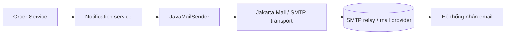
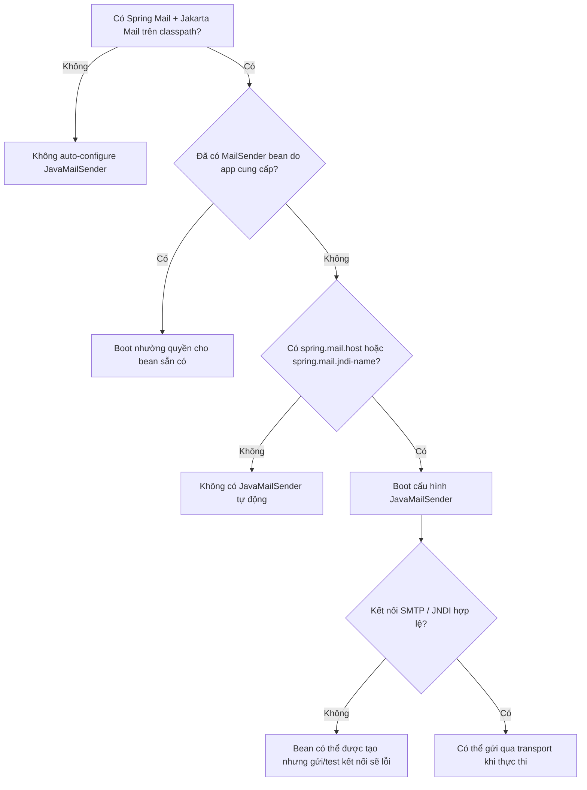
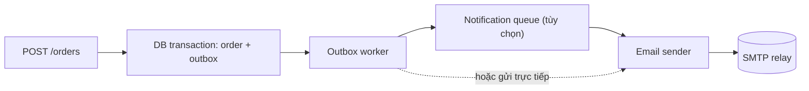

# spring-boot-starter-mail và điều kiện tạo JavaMailSender

## 1. Email là một luồng tích hợp bên ngoài Spring Boot

Trong mô-đun **SPRING_BOOT_INTEGRATION**, ứng dụng Spring Boot kết nối nhiều hệ thống qua HTTP client, cơ sở dữ liệu, cache, broker thông điệp và các adapter tích hợp. Email là một kênh đầu ra đặc thù: ứng dụng tạo thông báo, chuyển nó tới SMTP server hoặc dịch vụ gửi thư, rồi theo dõi kết quả gửi và phản hồi từ hạ tầng mail.

Một ví dụ thường gặp: sau khi đặt hàng thành công, Order Service gửi email xác nhận. Nếu thực hiện gửi SMTP trực tiếp trong HTTP request, độ trễ hoặc sự cố SMTP server có thể làm request kéo dài hoặc thất bại dù đơn hàng đã được ghi thành công. Vì vậy, ngoài cách gọi API gửi email, cần hiểu cấu hình, vòng đời kết nối, lỗi, retry, ranh giới giao dịch và kiểm thử.



`spring-boot-starter-mail` giúp một ứng dụng Spring Boot **gửi thư qua Jakarta Mail** bằng các abstraction của Spring. Nó không tự cài đặt SMTP server và không cung cấp hộp thư nhận. `JavaMailSender` chủ yếu phục vụ **outbound email**; đọc mailbox qua IMAP/POP3 là luồng khác, có thể dùng Jakarta Mail hoặc adapter tương ứng của Spring Integration khi phù hợp.

**Mục tiêu bài học:**

1. Biết starter mail cung cấp gì và phân biệt Spring Mail với Jakarta Mail và SMTP relay.
2. Giải thích chính xác **khi nào Spring Boot tự tạo bean `JavaMailSender`**, và khi nào không.
3. Cấu hình SMTP, TLS, authentication, timeout và cách lấy secret.
4. Gửi text và HTML/MIME, kiểm soát hợp đồng dữ liệu và nội dung.
5. Xử lý lỗi gửi thư, giao dịch, gửi trùng, kiểm thử và quan sát trong một luồng tích hợp thật.

Các ví dụ dưới đây dùng **Spring Boot 3.x / Spring Framework 6** và namespace `jakarta.mail.*`. Với Spring Boot major version khác, cần kiểm tra lại metadata cấu hình và điều kiện auto-configuration của đúng phiên bản đang chạy.

## 2. Starter, thư viện mail và SMTP server khác nhau như thế nào?

| Thành phần | Vai trò | Có tự gửi thư ra Internet không? |
| --- | --- | --- |
| `spring-boot-starter-mail` | Tập hợp dependency Spring Mail và Jakarta Mail implementation phù hợp BOM | Không; chỉ đưa thư viện vào classpath |
| `org.springframework.mail.javamail.JavaMailSender` | Interface Spring để tạo MIME message và gửi thư | Không độc lập; cần implementation và mail transport |
| `JavaMailSenderImpl` | Implementation gửi thư thông qua Jakarta Mail `Session` | Cần host/server và cấu hình hợp lệ |
| Jakarta Mail | API/implementation để xây dựng message và trao đổi với mail protocol | Có thể nói chuyện SMTP server khi kết nối phù hợp |
| SMTP relay/provider | Nhận, kiểm tra, chuyển tiếp email theo chính sách | Là hạ tầng thực sự thực hiện giao nhận tiếp theo |
| Hệ thống nhận | Mail transfer agent và mailbox của người nhận | Có thể tiếp tục lọc spam, từ chối hoặc trì hoãn giao |

**Đừng nhầm “gửi thành công” với “đã đến inbox”.** `JavaMailSender.send(...)` hoàn tất không chứng minh người nhận đã đọc hoặc email chắc chắn được giao cuối cùng. SMTP relay có thể chấp nhận thư rồi phát sinh bounce, delay, spam filtering hoặc rejection ở bước sau. Nếu ứng dụng cần xác nhận trạng thái phân phối, phải tích hợp webhook, bounce mailbox hoặc API sự kiện do nhà cung cấp email hỗ trợ.

## 3. Thêm starter đúng cách

Một dự án Maven đã được quản lý phiên bản bằng Spring Boot parent/BOM chỉ cần:

```xml
<dependency>
    <groupId>org.springframework.boot</groupId>
    <artifactId>spring-boot-starter-mail</artifactId>
</dependency>
```

Khi dùng Gradle:

```groovy
dependencies {
    implementation 'org.springframework.boot:spring-boot-starter-mail'
}
```

Starter cung cấp các lớp cần thiết để dùng `MailSender`, `JavaMailSender` và triển khai Jakarta Mail. Trong Spring Boot 3.x, API mail chuyển sang package `jakarta.mail.*`; đoạn code hay dependency dùng `javax.mail.*` từ Spring Boot 2.x cần được kiểm tra khi nâng cấp. Không khai báo lẫn nhiều phiên bản provider Jakarta Mail/Javamail tùy tiện vì có thể gây lỗi runtime hoặc classpath.

**Chỉ thêm starter chưa đủ để luôn xuất hiện bean `JavaMailSender`.** Tự động tạo bean cần điều kiện cấu hình ở phần tiếp theo.

## 4. Điều kiện Spring Boot tự tạo `JavaMailSender`

Trong Spring Boot 3.x, `MailSenderAutoConfiguration` kiểm tra sự hiện diện của các lớp cần thiết và có cấu hình để biết mail session sẽ kết nối đến đâu. Các nhánh điển hình là **SMTP host** hoặc **JNDI Mail Session**; auto-configuration cũng tránh tạo bean khi ứng dụng đã cung cấp `MailSender` riêng.

Nhìn từ góc độ người dùng, có thể kiểm tra theo thứ tự:



Lưu ý rằng một số trường hợp sai JNDI resource khiến **khởi tạo bean đã thất bại**; sơ đồ là mô hình tư duy, không cam kết mọi lỗi kết nối đều chỉ phát sinh khi gọi `send`.

### 4.1. Bảng kiểm tra điều kiện

| Classpath và cấu hình | Có `JavaMailSender` tự động? | Giải thích |
| --- | --- | --- |
| Chưa có thư viện Spring Mail/Jakarta Mail | Không | Thiếu lớp cần thiết cho mail auto-configuration |
| Đã thêm starter nhưng không có `spring.mail.host` hoặc `spring.mail.jndi-name` | Không | Boot chưa có địa chỉ hoặc mail session để cấu hình |
| Có starter + `spring.mail.host` + không có `MailSender` bean tự định nghĩa | Có, thông thường | Nhánh cấu hình bằng host tạo `JavaMailSenderImpl` |
| Có starter + `spring.mail.jndi-name` + không có `MailSender` bean tự định nghĩa | Có nếu JNDI khả dụng | Sử dụng Mail Session được lookup qua JNDI |
| Chỉ có `spring.mail.username` và `spring.mail.password` | Không đủ | Credential không thay thế host/JNDI |
| Đã khai báo bean `MailSender` tùy chỉnh | Không tạo thêm bean mặc định | Auto-configuration back off để tránh chồng chéo |
| `spring.mail.test-connection=true` nhưng thiếu host/JNDI | Không | Thuộc tính kiểm tra kết nối không kích hoạt tạo bean |

`MailSender` là interface cấp trên; `JavaMailSender` mở rộng khả năng gửi MIME. Đây là một chi tiết quan trọng: nếu ứng dụng tự tạo bean chỉ implement `MailSender` mà **không implement `JavaMailSender`**, auto-configuration vẫn có thể back off, trong khi code inject `JavaMailSender` lại không có bean phù hợp.

Tương tự, việc có bean `JavaMailSender` **không đồng nghĩa** đã xác thực thành công tới SMTP server. Với startup bình thường, một số lỗi mạng/đăng nhập chỉ phát sinh khi dùng client; nếu bật kiểm tra kết nối lúc khởi động, hành vi startup sẽ khác.

### 4.2. Khi nào nên tự định nghĩa bean?

Trong phần lớn ứng dụng chỉ dùng một SMTP relay, **ưu tiên cấu hình `spring.mail.*`** và inject bean do Spring Boot tạo. Tự khai báo `JavaMailSender` khi thực sự cần cấu hình nhiều provider, nhiều tài khoản, routing theo tenant, hoặc chính sách custom mà các property mặc định không biểu diễn được.

Nếu có nhiều bean sender, hãy phân biệt tên và dùng `@Qualifier` tại điểm inject; đừng dựa vào lựa chọn mặc định mơ hồ. Một bean do ứng dụng tự tạo phải chịu trách nhiệm cho host/JNDI, credential, timeout, TLS, resource lifecycle và khả năng test tương ứng. Không tạo `new JavaMailSenderImpl()` rải rác trong từng controller.

## 5. Cấu hình SMTP phổ biến qua `application.yml`

Ví dụ sau sử dụng **SMTP submission qua cổng 587 và STARTTLS**. Chỉ sử dụng với một provider thực sự hỗ trợ và yêu cầu cách kết nối này:

```yaml
spring:
  mail:
    host: ${SMTP_HOST}
    port: ${SMTP_PORT:587}
    username: ${SMTP_USERNAME}
    password: ${SMTP_PASSWORD}
    protocol: smtp
    default-encoding: UTF-8
    properties:
      "[mail.smtp.auth]": true
      "[mail.smtp.starttls.enable]": true
      "[mail.smtp.starttls.required]": true
      "[mail.smtp.connectiontimeout]": 5000
      "[mail.smtp.timeout]": 5000
      "[mail.smtp.writetimeout]": 5000

app:
  mail:
    from: ${APP_MAIL_FROM:no-reply@example.org}
```

Các trường chính:

- `spring.mail.host`: địa chỉ SMTP relay, ví dụ hostname do tổ chức hoặc provider cung cấp.
- `spring.mail.port`: cổng SMTP; 587 thường phục vụ submission với STARTTLS, nhưng hãy dùng giá trị thực tế của nhà cung cấp.
- `username`, `password`: thông tin xác thực nếu relay yêu cầu; lấy từ secret manager/biến môi trường, không commit mật khẩu thật.
- `protocol`: trong ví dụ là `smtp`; không biến MailSender thành IMAP client khi đổi tùy ý protocol.
- `default-encoding`: bộ mã hóa mặc định khi tạo nội dung thư.
- `spring.mail.properties`: tập thuộc tính Jakarta Mail truyền xuống transport. Dùng khóa có dấu ngoặc vuông trong YAML để giữ nguyên tên property chứa dấu chấm khi Spring bind map.
- `app.mail.from`: property **tự định nghĩa của ứng dụng**, không phải phần được Spring Boot tự áp dụng làm From. Service gửi mail phải dùng giá trị này khi tạo thư.

Ba giá trị timeout trên có đơn vị **mili-giây** theo thuộc tính SMTP của Jakarta Mail:

| Thuộc tính | Giới hạn thao tác |
| --- | --- |
| `mail.smtp.connectiontimeout` | Thời gian chờ mở kết nối socket |
| `mail.smtp.timeout` | Thời gian chờ đọc dữ liệu từ socket |
| `mail.smtp.writetimeout` | Thời gian chờ ghi dữ liệu qua socket |

Nếu không cấu hình timeout, tùy phiên bản/transport một số thao tác có thể chờ quá lâu hoặc không có giới hạn hữu ích cho SLA request. Các giá trị 5 giây chỉ là **ví dụ để bắt đầu**, cần hiệu chỉnh theo network, provider và policy timeout tổng của luồng gọi.

### 5.1. STARTTLS và implicit TLS không giống nhau

- **STARTTLS**: kết nối ban đầu theo SMTP rồi nâng cấp lên TLS; thường gặp ở port 587. `mail.smtp.starttls.enable=true` yêu cầu client thử nâng cấp, còn `starttls.required=true` buộc quá trình nâng cấp phải thành công trước khi gửi.
- **Implicit TLS/SMTPS**: kết nối được mã hóa TLS ngay từ đầu; thường dùng port 465 với `mail.smtp.ssl.enable=true` khi provider hỗ trợ. Không copy cả hai kiểu TLS vào cùng một cấu hình mà không kiểm tra tài liệu provider.
- **Trust store**: xác thực chứng chỉ TLS theo chính sách bảo mật; không vô hiệu hóa kiểm tra chứng chỉ hoặc trust mọi host để “sửa lỗi kết nối” ở production.

Dù bật TLS, ứng dụng vẫn cần kiểm soát quyền gửi, địa chỉ sender được provider cho phép, và quy tắc bảo vệ nội dung nhạy cảm.

### 5.2. Sử dụng JNDI Mail Session thay cho host

Một số môi trường application server quản lý Jakarta Mail `Session` bằng JNDI. Spring Boot có thể dùng cấu hình:

```yaml
spring:
  mail:
    jndi-name: java:comp/env/mail/Session
```

Ứng dụng **phải chạy trong môi trường có JNDI resource tương ứng** và provider Jakarta Mail tương thích. `spring.mail.jndi-name` không tự đăng ký Mail Session hay tạo SMTP server. Khi dùng JNDI Session, cấu hình từ resource JNDI có thể được ưu tiên so với các thuộc tính mail session thông thường; nên để một nơi chịu trách nhiệm cấu hình host, authentication và TLS, tránh hai nguồn mâu thuẫn.

Trong container/ứng dụng Boot chạy độc lập thông thường, nhánh `spring.mail.host` dễ vận hành hơn nếu hạ tầng không cấp JNDI resource.

## 6. Gửi email text thuần với `JavaMailSender`

`JavaMailSender` cung cấp API gửi thư text cơ bản thông qua `SimpleMailMessage`; Spring tạo và quản lý implementation từ configuration nếu các điều kiện ở mục 4 thỏa.

```java
import org.springframework.beans.factory.annotation.Value;
import org.springframework.mail.SimpleMailMessage;
import org.springframework.mail.javamail.JavaMailSender;
import org.springframework.stereotype.Service;

@Service
public class OrderMailService {

    private final JavaMailSender mailSender;
    private final String from;

    public OrderMailService(
            JavaMailSender mailSender,
            @Value("${app.mail.from}") String from) {
        this.mailSender = mailSender;
        this.from = from;
    }

    public void sendOrderConfirmation(String to, String orderId) {
        SimpleMailMessage message = new SimpleMailMessage();
        message.setFrom(from);
        message.setTo(to);
        message.setSubject("Xác nhận đơn hàng " + orderId);
        message.setText(
            "Đơn hàng " + orderId + " đã được ghi nhận. "
                + "Chúng tôi sẽ thông báo khi trạng thái thay đổi."
        );
        mailSender.send(message);
    }
}
```

Phần code này giả định địa chỉ người nhận đã được xác thực/validate theo quy tắc nghiệp vụ và `orderId` có định dạng đáng tin cậy. Không truyền dữ liệu chưa kiểm soát vào subject, header hoặc địa chỉ email; không gửi nội dung nhạy cảm mà không cân nhắc chính sách bảo mật của kênh email.

**`SimpleMailMessage` chỉ dành cho nội dung text đơn giản**, không có HTML formatting, inline image hoặc attachment. Nếu muốn HTML/MIME, dùng Jakarta Mail `MimeMessage`.

Đây là lệnh blocking gọi SMTP transport. Nếu thực hiện trực tiếp trong REST controller, thời gian xử lý HTTP có thể chịu latency của SMTP server; cần thiết kế rõ timeout và điểm đặt trách nhiệm gửi email.

## 7. Gửi HTML/MIME và attachment

`JavaMailSender.createMimeMessage()` cùng `MimeMessageHelper` hỗ trợ nội dung UTF-8, HTML, file đính kèm và nhiều phần nội dung.

Ví dụ gửi HTML đã được hệ thống render thành nội dung an toàn:

```java
import java.nio.charset.StandardCharsets;

import org.springframework.mail.javamail.JavaMailSender;
import org.springframework.mail.javamail.MimeMessageHelper;
import org.springframework.stereotype.Service;

@Service
public class HtmlMailService {

    private final JavaMailSender mailSender;

    public HtmlMailService(JavaMailSender mailSender) {
        this.mailSender = mailSender;
    }

    public void sendHtml(String to, String subject, String safeHtml) {
        mailSender.send(mimeMessage -> {
            MimeMessageHelper helper = new MimeMessageHelper(
                mimeMessage, StandardCharsets.UTF_8.name()
            );
            helper.setFrom("no-reply@example.org");
            helper.setTo(to);
            helper.setSubject(subject);
            helper.setText(safeHtml, true);
        });
    }
}
```

Lời gọi `send(MimeMessagePreparator)` cho phép tạo MIME message trong callback rồi để Spring thực hiện gửi và chuyển đổi lỗi phù hợp. Trong production, nên lấy địa chỉ From từ cấu hình ứng dụng hoặc một sender policy tập trung thay vì hard-code như ví dụ tối giản.

`helper.setText(html, true)` xác định nội dung là HTML; **không tự escape dữ liệu đầu vào**. Khi gắn tên khách hàng, địa chỉ hoặc dữ liệu người dùng vào template, cần HTML-escape đúng ngữ cảnh và chỉ cho phép nội dung tin cậy. Với email transactional, nên cung cấp cả phần plain text và HTML nếu client/khả năng tiếp cận yêu cầu.

Nếu cần attachment, khởi tạo `MimeMessageHelper` ở chế độ multipart:

```java
MimeMessageHelper helper =
    new MimeMessageHelper(mimeMessage, true, "UTF-8");
helper.setFrom("no-reply@example.org");
helper.setTo(to);
helper.setSubject("Hóa đơn");
helper.setText("<p>Hóa đơn đính kèm.</p>", true);
helper.addAttachment("invoice.pdf", invoiceResource);
```

`invoiceResource` là một Spring `InputStreamSource` thích hợp. Khi gửi nhiều file, phải kiểm soát dung lượng, định dạng, antivirus/malware scanning nếu cần và thời gian tạo tài nguyên. Đừng ghi attachment chứa thông tin nhạy cảm vào log. Khi dùng attachment mà stream chỉ mở được một lần, hãy chọn resource có thể cung cấp stream mới theo yêu cầu của mail implementation.

## 8. Gỡ lỗi khi không inject được `JavaMailSender`

Triệu chứng thường gặp:

```text
No qualifying bean of type
'org.springframework.mail.javamail.JavaMailSender' available
```

Đây là **lỗi wiring/auto-configuration**; không nhất thiết liên quan mạng hoặc mật khẩu SMTP. Thực hiện theo trình tự:

1. Kiểm tra starter mail có nằm trên **runtime classpath** của module chạy hay không.
2. Kiểm tra profile thực sự được kích hoạt và file cấu hình đó có `spring.mail.host` hoặc `spring.mail.jndi-name` không.
3. Kiểm tra lỗi indent YAML, biến môi trường chưa được định nghĩa hoặc khai báo sai namespace (ví dụ viết `mail.host` thay vì `spring.mail.host`).
4. Kiểm tra project có custom bean `MailSender` nào khiến auto-configuration back off không.
5. Kiểm tra package Jakarta Mail tương thích với Spring Boot 3.x, tránh xung đột dependency `javax.mail`.
6. Xem `ConditionEvaluationReport` qua startup log khi bật chế độ debug của Spring Boot hoặc endpoint `conditions` của Actuator trong môi trường được cấp quyền.

Ví dụ thông báo phân biệt loại lỗi:

| Triệu chứng | Nguyên nhân có thể | Hướng kiểm tra |
| --- | --- | --- |
| `NoSuchBeanDefinitionException` cho `JavaMailSender` | Thiếu starter/host/JNDI, bị custom bean chặn, classpath không phù hợp | Auto-configuration conditions và property nguồn |
| Không lookup được JNDI mail session | Không có resource hoặc tên sai | Application server JNDI bindings |
| `MailAuthenticationException` | Sai username/password hoặc provider không cho phép phương thức auth | Credential, auth policy, account permissions |
| `MailSendException` với connection refused/timeout | Sai host/port, firewall, SMTP relay tạm lỗi | DNS, network, timeout, provider status |
| TLS handshake/STARTTLS failed | Port/TLS mode hoặc chứng chỉ không phù hợp | Transport properties, certificate chain, clock/trust store |
| Sender address rejected | Email From không được provider ủy quyền | Domain/verified sender và chính sách relay |
| Sender chạy nhưng người nhận không thấy mail | Bounce, spam, delay, provider delivery issue | Event/bounce logs của nhà cung cấp |

### 8.1. `spring.mail.test-connection` dùng để làm gì?

Có thể bật kiểm tra kết nối ở startup:

```yaml
spring:
  mail:
    test-connection: true
```

Trong môi trường phù hợp, Spring Boot cố gắng kiểm tra mail server khi khởi động. Điều này hữu ích để phát hiện lỗi sớm nhưng cũng có thể khiến ứng dụng **không khởi động được khi SMTP tạm không khả dụng**. Đối với dịch vụ mà mail là chức năng phụ, cần cân nhắc mục tiêu availability trước khi bật trong production.

Đừng hiểu đây là test người nhận sẽ nhận được thư: kết nối SMTP thành công không kiểm chứng deliverability, DNS SPF/DKIM/DMARC, danh sách suppression hoặc mailbox người nhận.

## 9. Giao dịch, retry và gửi email trùng lặp

Giả sử xử lý đặt hàng:

```text
1. Ghi đơn hàng vào PostgreSQL.
2. Gửi email xác nhận qua SMTP.
3. Trả HTTP 200.
```

Nếu DB đã commit nhưng gửi mail thất bại, đơn hàng vẫn tồn tại và người dùng chưa nhận được thư. Nếu gửi mail trước khi DB commit, email có thể báo một đơn hàng sau đó bị rollback. `@Transactional` của database **không bao phủ SMTP transaction**. Việc gọi `mailSender.send(...)` trong cùng method có `@Transactional` không tạo ra distributed transaction.

Một hướng tổ chức phù hợp với hệ tích hợp:



Ghi business data và bản ghi outbox trong cùng DB transaction. Worker đọc outbox, gửi mail và đánh dấu trạng thái sau khi provider chấp nhận. Nếu worker crash giữa send và update trạng thái, mail có thể được gửi lặp khi retry. Vì thế chiến lược này thường bảo đảm **cố gắng gửi lại có kiểm soát**, không tự động đảm bảo exactly-once delivery.

Để giảm duplicate:

- Đặt `notificationId` hoặc `(orderId, templateVersion, eventType)` làm khóa nghiệp vụ cho một thông báo; quản lý trạng thái `PENDING`, `SENDING`, `SENT`, `FAILED` trong database.
- Chỉ một worker được claim công việc tại thời điểm thích hợp; giải quyết trường hợp worker crash và lease hết hạn.
- Nếu provider hỗ trợ idempotency key hoặc API transactional send, sử dụng theo đúng hợp đồng của provider; giao thức SMTP thông thường không cung cấp một cơ chế idempotency toàn cục cho mọi relay.
- Áp dụng retry có giới hạn và exponential backoff cho lỗi tạm thời; phân loại sai địa chỉ, tài khoản bị chặn hoặc template lỗi là tình huống cần xử lý riêng.
- Bảo toàn nội dung/template version đã dùng khi retry để tránh cùng một thông báo được gửi nhiều phiên bản khác nhau ngoài ý muốn.

**Giới hạn:** `Message-ID` theo chuẩn email là header phục vụ nhận diện/truy vết, không bảo đảm các mail server chặn email gửi trùng với cùng Message-ID. Muốn semantics chặt hơn, cần thiết kế state machine và đối soát với nhà cung cấp.

### 9.1. Gửi bất đồng bộ không đồng nghĩa giao bền vững

Gắn `@Async` cho method gửi email giúp trả lời HTTP nhanh hơn, nhưng một task đang nằm trong memory của ứng dụng có thể mất khi process crash hoặc redeploy. Nếu thông báo mang ý nghĩa nghiệp vụ cần gửi lại, dùng durable queue, outbox hoặc job store thay vì chỉ dựa vào executor in-memory.

Đặt rate limit và concurrency phù hợp với quota SMTP provider để tránh lỗi throttle, áp dụng backpressure khi số công việc gửi tăng. Tránh retry ngay lập tức hàng loạt khi provider đang có sự cố.

## 10. Kiểm thử đúng tầng: bean, SMTP và workflow

Các nhóm kiểm thử trả lời những câu hỏi khác nhau:

| Loại test | Kiểm tra được | Chưa kiểm tra được |
| --- | --- | --- |
| Unit test mock `JavaMailSender` | Service xây dựng recipient, subject, body đúng; nhánh xử lý lỗi | SMTP transport và provider thật |
| Application context test | Auto-configuration tạo bean khi có host và starter | Gửi mail thật, TLS/auth |
| Integration test với SMTP giả lập | Tương tác SMTP, message text/MIME, header, attachment | Policy deliverability của provider production |
| Staging test với SMTP/provider được phép | Authentication, TLS, network, hạn mức và chính sách relay | Vẫn không bảo đảm email đến inbox mọi người nhận |
| Workflow test | Outbox/retry/idempotency, lỗi gửi, khởi động lại worker | Các tình huống chưa mô phỏng trong môi trường test |

### 10.1. Kiểm tra auto-configuration tạo bean

Ví dụ kiểm tra wiring với `spring-boot-starter-test` trong một project đã có starter mail:

```java
import static org.assertj.core.api.Assertions.assertThat;

import org.junit.jupiter.api.Test;
import org.springframework.beans.factory.annotation.Autowired;
import org.springframework.boot.test.context.SpringBootTest;
import org.springframework.mail.javamail.JavaMailSender;

@SpringBootTest(properties = {
    "spring.mail.host=127.0.0.1",
    "spring.mail.port=1025"
})
class MailWiringTest {

    @Autowired
    JavaMailSender mailSender;

    @Test
    void createsJavaMailSenderWhenHostIsConfigured() {
        assertThat(mailSender).isNotNull();
    }
}
```

Test này **không gọi gửi thư**, vì vậy không yêu cầu SMTP server thực sự chạy ở port 1025 nếu ứng dụng không tự bật `spring.mail.test-connection=true` hoặc có bean khác chủ động kết nối trong startup. Nếu project có custom `MailSender`, kết quả cần được đánh giá theo thiết kế thực tế.

### 10.2. Kiểm thử outbound mail bằng SMTP test server

Có thể dùng GreenMail, Mailpit/MailHog hoặc một SMTP test server tương đương trong môi trường test/CI; ánh xạ `spring.mail.host` và `spring.mail.port` đến endpoint test đó. Khi gửi thư, assert:

1. Đúng người nhận, sender, subject và content UTF-8.
2. Body HTML được escape/sanitize đúng và cấu trúc MIME hợp lệ.
3. Attachment có filename, MIME type và nội dung mong đợi.
4. Khi server từ chối kết nối hoặc xác thực thất bại, ứng dụng ghi trạng thái retry/failure đúng.
5. Không gửi hai email do consumer nhận lặp cùng business event, theo chính sách chống trùng của ứng dụng.
6. Tách biệt dữ liệu test, không gửi thử vào email thật của khách hàng.

Nếu cần xác thực kỹ hơn tính đúng đắn của Spring Boot mail auto-configuration, có thể dùng test context riêng với các tổ hợp: không host, có host, JNDI, custom `MailSender`. Mỗi trường hợp phải chạy trên classpath và profile đúng với cấu hình định kiểm tra.

## 11. Quan sát, bảo mật và vận hành

Email là một luồng tích hợp dài hơn một lời gọi `send`. Nên theo dõi:

- **Application:** số yêu cầu gửi, send latency p50/p95/p99, lỗi xác thực/kết nối/timeout, retry count, outbox backlog, tuổi công việc tồn đọng.
- **SMTP/provider:** số message được chấp nhận, bị từ chối, throttle, bounce, deferred, complaint, suppression và trạng thái delivery khi provider cung cấp dữ liệu đó.
- **Business:** xác nhận đơn hàng chưa được tạo thông báo, thời gian từ lúc đặt hàng đến khi provider nhận mail, thông báo lặp và thông báo vượt SLA.

Không ghi mật khẩu SMTP, access token, toàn bộ body chứa thông tin cá nhân, link có mã bảo mật hoặc attachment vào log. Dùng correlation ID, notification ID, order ID đã được phép log và mã lỗi phân loại để truy vết. Các địa chỉ người nhận cũng có thể là dữ liệu cá nhân; cân nhắc hash/mask khi log hay đưa vào metric label.

Về bảo mật và deliverability, cần phối hợp với đội vận hành mail để quản lý domain gửi, SPF, DKIM, DMARC, suppression list, bounce handling, chính sách retention và quota của SMTP provider. Đây là yếu tố ngoài phạm vi `JavaMailSender`; thêm dependency không thể tự giải quyết chúng.

## 12. Tình huống lựa chọn cấu hình

### Tình huống A: một ứng dụng nhỏ gửi mail giao dịch

Ứng dụng Web MVC chỉ có một SMTP relay. Thêm `spring-boot-starter-mail`, cấu hình `spring.mail.host` cùng port, credentials, TLS và timeout; inject `JavaMailSender` vào service. Dùng `SimpleMailMessage` cho text, `MimeMessageHelper` cho HTML/attachment. Nếu email chỉ là tiện ích phụ, tách lỗi gửi khỏi việc ghi đơn hàng theo quy tắc nghiệp vụ rõ ràng.

### Tình huống B: deployment trên application server cung cấp JNDI Session

Hạ tầng đã quản lý mail host và credentials bằng JNDI Mail Session. Dùng `spring.mail.jndi-name` và kiểm tra resource lookup ở đúng môi trường triển khai. Chỉ sử dụng nhánh này khi JNDI thực sự được cung cấp và quản lý. Không giả định một Spring Boot executable JAR chạy độc lập có sẵn resource JNDI.

### Tình huống C: nhiều SMTP provider hoặc multi-tenant

Ứng dụng cần chọn provider theo tenant, vùng hoặc loại thông báo. Cấu hình nhiều `JavaMailSender` bean có tên rõ ràng; chọn bằng service routing được kiểm soát, tránh đưa credential vào payload hoặc log. Cần kiểm thử failover và chính sách địa chỉ From của từng provider; không cho phép tenant tùy ý gửi qua danh tính của tenant khác.

### Tình huống D: thông báo phải được gửi dù hệ thống có sự cố

Order Service cần sự kiện outbox hoặc message queue bền vững; Notification Worker gửi email qua `JavaMailSender`, lưu trạng thái, retry có giới hạn và hỗ trợ xử lý thủ công khi lỗi kéo dài. Áp dụng idempotency theo business notification ID và giám sát backlog để thông báo không bị mất âm thầm.

### Checklist triển khai

1. Đảm bảo starter mail và các dependency Jakarta Mail tương thích với phiên bản Spring Boot.
2. Xác nhận `spring.mail.host` hoặc `spring.mail.jndi-name` được nạp từ đúng profile; kiểm tra không có custom bean `MailSender` gây xung đột.
3. Chọn đúng cổng SMTP, TLS mode, xác thực chứng chỉ, credential và địa chỉ From.
4. Cấu hình timeout hữu hạn, quota/rate limit và retry policy phù hợp SLA.
5. Xác định hợp đồng email: recipient, template version, encoding, dữ liệu được phép đưa vào body, attachment và địa chỉ reply.
6. Phân biệt provider chấp nhận mail với delivery cuối cùng; thiết kế đo bounce và complaint nếu cần.
7. Đối với thông báo quan trọng, dùng durable queue/outbox, chống gửi trùng và có đường xử lý lỗi kéo dài.
8. Kiểm thử wiring `JavaMailSender`, SMTP test server và workflow lỗi/retry; giám sát xuyên suốt ứng dụng đến provider.

**Điểm cần nhớ:** `spring-boot-starter-mail` đưa khả năng gửi email vào classpath; Spring Boot chỉ tự tạo `JavaMailSender` khi đủ điều kiện auto-configuration, thường là có **`spring.mail.host` hoặc `spring.mail.jndi-name`** và chưa có `MailSender` bean tùy chỉnh. Từ đó đến việc gửi email ổn định còn cần thiết kế transport bảo mật, timeout, hợp đồng nội dung, xử lý giao dịch, chống trùng lặp và quan sát luồng tích hợp.
