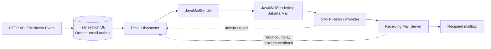
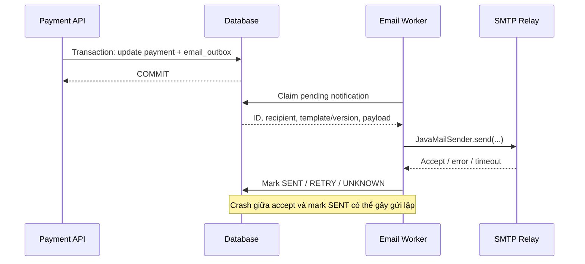
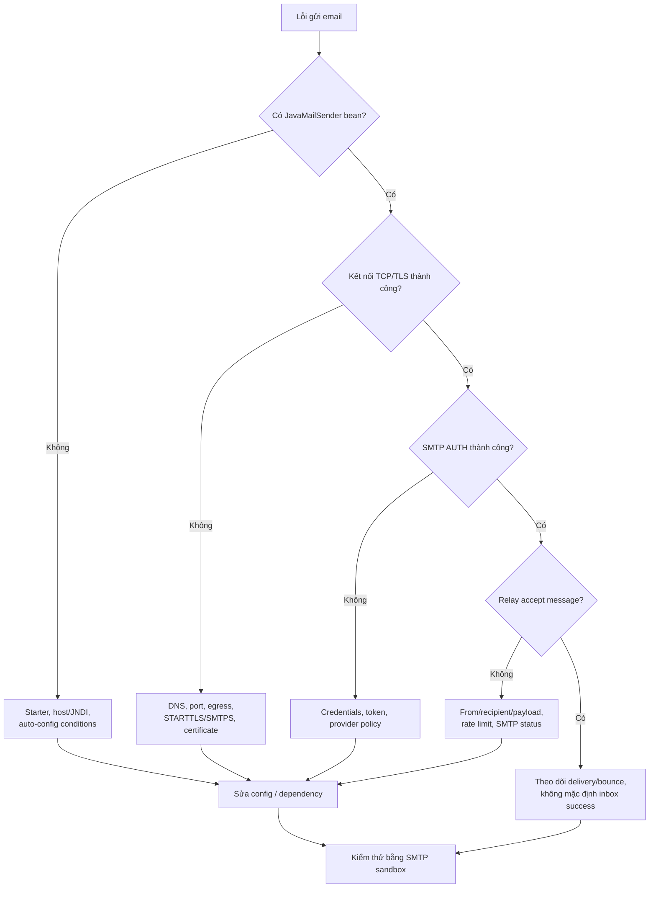

# Cấu hình spring.mail.* và Jakarta Mail

## 1. Email nằm ở đâu trong luồng Spring Boot Integration?

Trong module **SPRING_BOOT_INTEGRATION**, một dịch vụ Spring Boot thường trao đổi dữ liệu qua HTTP client, cơ sở dữ liệu, cache, message broker và các adapter của Spring Integration. **Email** là một kênh tích hợp khác: hệ thống tạo thông báo, chuyển nội dung tới máy chủ SMTP, rồi theo dõi kết quả gửi và các lỗi phát sinh.

Ví dụ: khi thanh toán hoàn tất, dịch vụ ghi trạng thái đơn hàng vào PostgreSQL, tạo một bản ghi yêu cầu gửi hóa đơn, rồi một worker gửi email xác nhận cho khách. Ở đây email là **tác động ra hệ thống ngoài**, tương tự publish message hoặc gọi API đối tác: thời gian phản hồi biến động, có thể lỗi hoặc timeout, và một lần gửi không rõ kết quả có thể bị thực hiện lại.

Hai nhóm khái niệm tạo nên trọng tâm bài học:

- **`spring.mail.*`**: các thuộc tính để Spring Boot tự cấu hình hạ tầng gửi mail, gồm host, port, tài khoản, password, encoding, protocol, cấu hình Jakarta Mail và kiểm tra kết nối.
- **Jakarta Mail**: API Java để biểu diễn email, MIME message, địa chỉ, session, transport và giao thức mail; trên đó Spring Framework xây dựng abstraction như `JavaMailSender`, `MimeMessageHelper`.

Mục tiêu: biết thêm dependency đúng, cấu hình SMTP an toàn, gửi email text/HTML/attachment, nhận diện ranh giới giữa “SMTP server chấp nhận” và “người nhận đã nhận email”, thiết kế timeout/retry/idempotency, kiểm thử mà không gửi thư thật, và quan sát luồng gửi email trong production.

## 2. Kiến trúc SMTP: ứng dụng không gửi thẳng vào hộp thư

Đường đi phổ biến của email:



Trong luồng này, cần phân biệt **nhiều mức kết quả**:

| Mốc | Bằng chứng có được | Chưa được phép kết luận |
| --- | --- | --- |
| Ứng dụng tạo được `MimeMessage` | Đã tạo cấu trúc message trong bộ nhớ | Chưa có network request hay thư được gửi |
| `JavaMailSender.send(...)` trả về bình thường | SMTP transport đã hoàn thành thao tác gửi theo cơ chế của thư viện/provider | Không chứng minh email vào inbox hay người nhận đọc |
| SMTP relay trả phản hồi chấp nhận | Relay nhận trách nhiệm xử lý theo giao thức | Relay có thể giao trễ, bounce hoặc bị chính sách chặn |
| Provider báo delivered | Đã có tín hiệu giao tới mail server nhận theo định nghĩa của provider | Không chứng minh thư không vào spam hoặc đã được mở |
| Người dùng xác nhận hành động | Có business acknowledgement | Chỉ đúng nếu sản phẩm thực sự thu thập và xác thực hành động |

**SMTP không cung cấp giao dịch ACID dùng chung với database** và không bảo đảm exactly-once effect. Một `send()` bị timeout sau khi SMTP relay đã chấp nhận có thể khiến ứng dụng gửi lại cùng thông báo. Việc lưu outbox, gắn notification ID và xử lý trạng thái gửi là trách nhiệm ứng dụng.

### Các vai trò khác nhau

- **Spring Boot**: tự cấu hình bean và bind properties.
- **Spring Framework Mail**: định nghĩa `MailSender`, `JavaMailSender`, `SimpleMailMessage`, `MimeMessageHelper` và exception hierarchy.
- **Jakarta Mail**: làm việc với `jakarta.mail.Session`, `jakarta.mail.internet.MimeMessage`, địa chỉ và transport.
- **SMTP server/provider**: xác thực, nhận thư, xếp hàng giao và cung cấp phản hồi SMTP hoặc webhook.
- **Business service/outbox worker**: quyết định gửi cho ai, nội dung gì, gửi lúc nào, retry khi nào và lưu audit/trạng thái.

## 3. Thêm spring-boot-starter-mail

### Maven

Với ứng dụng có Spring Boot parent hoặc BOM quản lý dependency:

```xml
<dependency>
    <groupId>org.springframework.boot</groupId>
    <artifactId>spring-boot-starter-mail</artifactId>
</dependency>
```

### Gradle

```groovy
dependencies {
    implementation 'org.springframework.boot:spring-boot-starter-mail'
}
```

Starter thường kéo vào **Spring Context Support** và implementation Jakarta Mail phù hợp với dependency management của Spring Boot. Không cố định phiên bản Jakarta Mail/Spring Framework khác BOM khi không có lý do cụ thể: trộn `javax.mail` đời cũ với `jakarta.mail` đời mới dễ gây lỗi class incompatibility.

Để kiểm tra dependency thực tế:

```bash
# Maven
./mvnw dependency:tree

# Gradle
./gradlew dependencies --configuration runtimeClasspath

# Gradle: tìm dependency mail thực sự
./gradlew dependencyInsight --dependency jakarta.mail --configuration runtimeClasspath
```

Trong project đa module, dependency phải có trong **runtime classpath của ứng dụng được triển khai**. Chỉ thêm starter vào module unit test hoặc module thư viện không bảo đảm ứng dụng chạy có `JavaMailSender`.

> **Starter không cài SMTP server.** Bạn cần SMTP relay/provider bên ngoài hoặc SMTP test server chạy riêng. `spring.mail.host` là nơi ứng dụng kết nối tới; nó không làm máy đó tự khởi động SMTP.

## 4. Spring Boot tự tạo những bean nào?

Khi `spring-boot-starter-mail` có mặt, các lớp cần thiết nằm trên classpath và điều kiện cấu hình thỏa mãn, Spring Boot có thể tạo một bean kiểu `JavaMailSenderImpl` có thể inject qua interface `JavaMailSender`.

Các điều kiện quan trọng gồm:

1. Có lớp hỗ trợ Jakarta Mail và Spring Mail trên classpath.
2. Có thông tin để tạo mail session, thông dụng nhất là `spring.mail.host` hoặc cấu hình JNDI session thích hợp.
3. Không có bean `MailSender` do ứng dụng cung cấp khiến auto-configuration mặc định nhường chỗ.
4. Không bị loại trừ auto-configuration hoặc vô hiệu hóa qua ngữ cảnh cấu hình đặc biệt.

Do đó, **chỉ thêm starter nhưng không cấu hình SMTP host không nhất thiết tạo `JavaMailSender`**. Ngược lại, application context có bean `JavaMailSender` cũng chưa chắc xác thực/kết nối SMTP thành công: lỗi mạng có thể xuất hiện khi gọi `send` lần đầu.

Khi tiêm dependency:

```java
import org.springframework.mail.javamail.JavaMailSender;
import org.springframework.stereotype.Service;

@Service
public class EmailGateway {
    private final JavaMailSender sender;

    public EmailGateway(JavaMailSender sender) {
        this.sender = sender;
    }
}
```

Nếu startup báo `No qualifying bean of type JavaMailSender`, kiểm tra runtime dependencies, `spring.mail.host`, JNDI, bean custom, profile và Conditions Evaluation Report. Đừng tạo một bean `JavaMailSenderImpl` không có host chỉ để loại bỏ lỗi dependency injection.

### Spring Mail khác Jakarta Mail như thế nào?

| Lớp / interface | Package thường dùng | Vai trò |
| --- | --- | --- |
| `JavaMailSender` | `org.springframework.mail.javamail` | Abstraction gửi simple mail và MIME mail |
| `JavaMailSenderImpl` | `org.springframework.mail.javamail` | Implementation dùng Jakarta Mail transport/session |
| `MimeMessageHelper` | `org.springframework.mail.javamail` | Dựng MIME message, HTML, inline và attachments thuận tiện |
| `SimpleMailMessage` | `org.springframework.mail` | Email text đơn giản, không có MIME attachment |
| `MimeMessage` | `jakarta.mail.internet` | Đối tượng MIME message theo Jakarta Mail |
| `Session` | `jakarta.mail` | Cấu hình provider/properties cho hoạt động mail |
| `MailException` | `org.springframework.mail` | Base exception của Spring Mail khi gửi |

Trong Spring Boot 3+ theo hệ sinh thái Jakarta EE, import MIME classes từ **`jakarta.mail.*`**. Một ví dụ cũ dùng `javax.mail.internet.MimeMessage` không thể sao chép nguyên sang ứng dụng hiện đại nếu library đang yêu cầu kiểu `jakarta.mail.internet.MimeMessage`.

## 5. Các nhóm thuộc tính spring.mail.*

Spring Boot bind các thuộc tính bắt đầu bằng `spring.mail` vào `MailProperties` và sử dụng để cấu hình mail sender/session khi auto-configuration áp dụng.

| Thuộc tính | Chức năng | Điều cần lưu ý |
| --- | --- | --- |
| `spring.mail.host` | Host SMTP relay | Địa chỉ phải truy cập được từ máy/container chạy ứng dụng |
| `spring.mail.port` | Cổng SMTP | Thường dùng 587 STARTTLS hoặc 465 implicit TLS; theo provider |
| `spring.mail.username` | Tài khoản SMTP | Có provider dùng username dạng địa chỉ email, có provider dùng token |
| `spring.mail.password` | Bí mật xác thực | Đọc từ secret manager/env, không commit vào git |
| `spring.mail.protocol` | Giao thức transport Jakarta Mail | Thường dùng `smtp` |
| `spring.mail.default-encoding` | Mã hóa mặc định cho email/MIME | Khuyến nghị `UTF-8` với nội dung tiếng Việt |
| `spring.mail.properties` | Properties của Jakarta Mail provider | Ví dụ `mail.smtp.auth`, STARTTLS, timeout |
| `spring.mail.test-connection` | Có thử kết nối SMTP khi khởi động | Có thể làm ứng dụng fail startup khi SMTP chưa sẵn sàng |
| `spring.mail.jndi-name` | Lấy `jakarta.mail.Session` từ JNDI | Dùng cho môi trường quản trị Session bên ngoài, có thể ưu tiên hơn cấu hình Session thông thường |

**Lưu ý:** `spring.mail.properties.*` là bản đồ thuộc tính Jakarta Mail được chuyển vào Session, không phải một bộ cờ mới do Spring Boot tự diễn giải về SMTP. Tên như `mail.smtp.starttls.enable` thuộc phía mail provider. Cần chọn đúng các khóa theo giao thức và phiên bản provider.

### Các giá trị khác nhau theo môi trường

Cấu hình local thường trỏ tới fake SMTP server; staging có thể trỏ tới sandbox SMTP của nhà cung cấp; production dùng relay thật với TLS, authentication, sender domain và rate limit. Cần externalize tất cả giá trị có thể thay đổi, đặc biệt host, port, credentials, địa chỉ gửi và timeouts.

Ví dụ cấu hình `integration.mail.from` là **property của ứng dụng tự định nghĩa**, không thuộc `spring.mail.*`:

```yaml
integration:
  mail:
    from: ${MAIL_FROM:no-reply@example.test}
```

Giá trị này cần là địa chỉ sender được provider cho phép sử dụng; cấu hình đúng SMTP credentials không tự cấp quyền giả mạo một địa chỉ From bất kỳ.

## 6. Cấu hình SMTP với STARTTLS trên cổng 587

Ví dụ `application.yml` cho provider yêu cầu SMTP AUTH và STARTTLS:

```yaml
spring:
  mail:
    host: ${SMTP_HOST}
    port: ${SMTP_PORT:587}
    username: ${SMTP_USERNAME}
    password: ${SMTP_PASSWORD}
    protocol: smtp
    default-encoding: UTF-8
    test-connection: false
    properties:
      "[mail.smtp.auth]": "true"
      "[mail.smtp.starttls.enable]": "true"
      "[mail.smtp.starttls.required]": "true"
      "[mail.smtp.ssl.checkserveridentity]": "true"
      "[mail.smtp.connectiontimeout]": "5000"
      "[mail.smtp.timeout]": "10000"
      "[mail.smtp.writetimeout]": "10000"

integration:
  mail:
    from: ${MAIL_FROM}
```

Trong YAML trên, các khóa dạng `"[mail.smtp.auth]"` được viết bằng **bracket notation** để giữ nguyên dấu chấm của key trong map `spring.mail.properties`. Giá trị cuối cùng được chuyển tới Jakarta Mail Session dưới tên `mail.smtp.auth` và tương tự.

### Ý nghĩa các thuộc tính Jakarta Mail chính

| Thuộc tính | Ý nghĩa | Hành vi cần nắm |
| --- | --- | --- |
| `mail.smtp.auth=true` | Yêu cầu SMTP AUTH | Phải có cơ chế xác thực mà provider hỗ trợ |
| `mail.smtp.starttls.enable=true` | Cho phép nâng kết nối SMTP lên TLS qua STARTTLS | Một mình cờ này chưa buộc server phải hỗ trợ STARTTLS |
| `mail.smtp.starttls.required=true` | Yêu cầu STARTTLS khả dụng trước khi tiếp tục | Phù hợp khi chính sách cấm gửi plaintext |
| `mail.smtp.ssl.checkserveridentity=true` | Kiểm tra danh tính/hostname TLS theo cơ chế provider | Phải có chain chứng chỉ/trust phù hợp |
| `mail.smtp.connectiontimeout=5000` | Timeout khi thiết lập kết nối (mili giây) | Tránh kết nối treo vô thời hạn |
| `mail.smtp.timeout=10000` | Timeout đọc từ socket (mili giây) | Khác với timeout toàn bộ business workflow |
| `mail.smtp.writetimeout=10000` | Timeout ghi socket (mili giây) | Hữu ích khi server/network không tiếp nhận dữ liệu |
| `mail.debug` | Bật debug Jakarta Mail | Không bật thường xuyên trong production vì có nguy cơ lộ thông tin |

Không để nguyên thông số `5000/10000` chỉ vì ví dụ có sẵn: chọn theo SLO của workflow, tải thực tế, network, giới hạn provider và ngân sách thời gian của worker. Một thao tác gửi có thể trải qua nhiều pha SMTP; thời gian tổng có thể lớn hơn từng timeout đơn lẻ.

Với cổng 587, client thường bắt đầu kết nối SMTP rồi yêu cầu **STARTTLS** để nâng lên TLS. Nếu provider không hỗ trợ TLS hoặc handshake/certificate sai, cấu hình `starttls.required=true` nên khiến thao tác thất bại thay vì lặng lẽ gửi plaintext.

### Các biến môi trường

Trong Spring Boot, có thể dùng trực tiếp các biến như `SPRING_MAIL_HOST` và `SPRING_MAIL_PORT` thông qua relaxed binding. Cấu hình mẫu dùng `${SMTP_HOST}` để tách tên biến hạ tầng khỏi property Spring. Dù chọn cách nào, ghi rõ nguồn cấu hình được phép ưu tiên khi có nhiều property sources.

**Không gắn giá trị mặc định cho mật khẩu thật.** Nếu `SMTP_PASSWORD` chưa được cấp, ứng dụng nên báo lỗi hoặc bị giữ ở trạng thái không sẵn sàng theo chính sách vận hành, tránh fallback về credential demo.

## 7. STARTTLS và SMTPS (implicit TLS) khác nhau thế nào?

Hai kiểu kết nối thường bị cấu hình lẫn:

| Kiểu | Cổng thường gặp | Cách TLS được bắt đầu | Cấu hình trọng tâm |
| --- | --- | --- | --- |
| SMTP submission + STARTTLS | 587 | Kết nối SMTP trước, sau đó nâng lên TLS bằng lệnh STARTTLS | `mail.smtp.starttls.enable`, thường thêm `required=true` |
| SMTP over implicit TLS / SMTPS | 465 | TLS handshake ngay khi mở kết nối | `mail.smtp.ssl.enable=true` với provider SMTP phù hợp |
| SMTP relay nội bộ | 25 hoặc cổng riêng | Tùy chính sách relay | Có thể bắt buộc STARTTLS hoặc mạng tin cậy; phải kiểm tra chính sách cụ thể |

Ví dụ implicit TLS trên cổng 465:

```yaml
spring:
  mail:
    host: ${SMTP_HOST}
    port: 465
    username: ${SMTP_USERNAME}
    password: ${SMTP_PASSWORD}
    properties:
      "[mail.smtp.auth]": "true"
      "[mail.smtp.ssl.enable]": "true"
      "[mail.smtp.ssl.checkserveridentity]": "true"
      "[mail.smtp.connectiontimeout]": "5000"
      "[mail.smtp.timeout]": "10000"
      "[mail.smtp.writetimeout]": "10000"
```

Đây là **cấu hình thay thế** cho ví dụ STARTTLS, không phải phần thêm vào đồng thời. Nếu client đòi implicit TLS trên endpoint chỉ hiểu STARTTLS, handshake thường thất bại; nếu client nói plaintext SMTP tới endpoint TLS ngay từ đầu, cũng không thể giao tiếp.

Không khắc phục lỗi chứng chỉ bằng việc tin tưởng mọi server hoặc tắt hostname verification. Hãy kiểm tra FQDN, certificate chain, trusted CA, thời hạn chứng chỉ và proxy/LB. Ở môi trường có SMTP gateway doanh nghiệp, cần phối hợp với vận hành để biết chính sách TLS và xác thực thực tế.

### Xác thực bằng password hoặc token

Nhiều nhà cung cấp hỗ trợ SMTP AUTH với credential riêng dành cho ứng dụng; có nơi yêu cầu OAuth2/XOAUTH2 hoặc API key theo định dạng đặc thù. `spring.mail.username/password` không tự triển khai toàn bộ quy trình cấp và refresh OAuth token. Nếu dùng cơ chế phức tạp hơn, cần cấu hình Jakarta Mail authenticator/provider hoặc dùng API chính thức của nhà cung cấp theo thiết kế.

## 8. Gửi email text bằng JavaMailSender

Với nội dung thuần văn bản không có attachment, `SimpleMailMessage` là cách dùng đơn giản:

```java
import org.springframework.beans.factory.annotation.Value;
import org.springframework.mail.SimpleMailMessage;
import org.springframework.mail.javamail.JavaMailSender;
import org.springframework.stereotype.Service;

@Service
public class NotificationMailService {

    private final JavaMailSender sender;
    private final String from;

    public NotificationMailService(
            JavaMailSender sender,
            @Value("${integration.mail.from}") String from) {
        this.sender = sender;
        this.from = from;
    }

    public void sendOrderNotice(
            String recipient,
            String orderId) {

        SimpleMailMessage message = new SimpleMailMessage();
        message.setFrom(from);
        message.setTo(recipient);
        message.setSubject("Xác nhận đơn hàng " + orderId);
        message.setText(
            "Đơn hàng " + orderId
                + " đã được ghi nhận. Cảm ơn bạn."
        );

        sender.send(message);
    }
}
```

Ví dụ giả định `recipient` và `orderId` đã được kiểm tra trước khi gọi service; trong production nên có lớp validate domain dữ liệu, kiểm tra tài khoản nhận và chống injection vào header/nội dung.

**Hành vi cần hiểu:**

- `JavaMailSender.send(SimpleMailMessage)` là lệnh gửi **đồng bộ**, có thể chờ SMTP network và ném `MailException`.
- `SimpleMailMessage` phù hợp text đơn giản. Nó không phải container MIME cho HTML + inline image + attachment.
- Sender có thể gửi tới nhiều người bằng `setTo(String...)`, nhưng không nên tự gom email của nhiều khách hàng không liên quan vào trường `To` vì lộ địa chỉ người nhận.
- Giá trị `from` là header From của message. Envelope sender/bounce address là khái niệm khác và có thể do provider/quy tắc SMTP quyết định.
- Lệnh gửi trả về bình thường nghĩa là quá trình SMTP hoàn tất theo provider, **chưa** có xác nhận người nhận đã đọc.

Cần xác định xem loại email là **transactional** (biên nhận, reset password, thông báo giao dịch) hay **marketing** để áp dụng chính sách consent, unsubscribe, rate limit và bảo mật thích hợp.

## 9. Gửi MIME email: HTML, attachment và UTF-8

Khi cần hóa đơn PDF, nội dung HTML hoặc nội dung thay thế text/HTML, dùng `MimeMessage` và `MimeMessageHelper`. Chúng sử dụng các lớp Jakarta Mail làm nền.

Ví dụ gửi hóa đơn PDF bằng dữ liệu đã được tạo và kiểm tra:

```java
import java.nio.charset.StandardCharsets;

import jakarta.mail.MessagingException;
import jakarta.mail.internet.MimeMessage;

import org.springframework.beans.factory.annotation.Value;
import org.springframework.core.io.ByteArrayResource;
import org.springframework.mail.javamail.JavaMailSender;
import org.springframework.mail.javamail.MimeMessageHelper;
import org.springframework.stereotype.Service;

@Service
public class InvoiceMailService {

    private final JavaMailSender sender;
    private final String from;

    public InvoiceMailService(
            JavaMailSender sender,
            @Value("${integration.mail.from}") String from) {
        this.sender = sender;
        this.from = from;
    }

    public void sendInvoice(
            String recipient,
            String invoiceNumber,
            byte[] pdfBytes) throws MessagingException {

        MimeMessage mimeMessage = sender.createMimeMessage();

        MimeMessageHelper helper = new MimeMessageHelper(
            mimeMessage,
            true,
            StandardCharsets.UTF_8.name()
        );

        helper.setFrom(from);
        helper.setTo(recipient);
        helper.setSubject("Hóa đơn " + invoiceNumber);

        // Nội dung cố định để minh họa; mọi dữ liệu động đưa
        // vào HTML production cần được escape/sanitize.
        helper.setText(
            "<p>Hóa đơn đã được phát hành.</p>"
                + "<p>Vui lòng xem tệp đính kèm.</p>",
            true
        );

        helper.addAttachment(
            "invoice.pdf",
            new ByteArrayResource(pdfBytes),
            "application/pdf"
        );

        sender.send(mimeMessage);
    }
}
```

`MimeMessageHelper(mimeMessage, true, charset)` bật chế độ multipart để thêm attachment. Các lớp được phân vai:

- `sender.createMimeMessage()` khởi tạo MIME message dùng Session đã được JavaMailSender cấu hình.
- `MimeMessageHelper` tạo headers, recipients, body và các phần MIME.
- `ByteArrayResource` cung cấp dữ liệu attachment từ bộ nhớ.
- `sender.send(mimeMessage)` thực hiện giao tiếp SMTP thật.

Nếu tạo PDF lớn, cần cân nhắc memory pressure, kích thước message tối đa của provider, thời gian SMTP upload và thời hạn lưu dữ liệu nhạy cảm. Có thể gửi đường dẫn tải hóa đơn được bảo vệ và có hạn sử dụng thay vì đính kèm tài liệu chứa thông tin nhạy cảm.

### HTML và text fallback

Nhiều email client không hiển thị HTML hoặc người dùng chọn text-only. `MimeMessageHelper` cho phép tạo thông điệp **multipart alternative**:

```java
MimeMessage mime = sender.createMimeMessage();
MimeMessageHelper helper =
    new MimeMessageHelper(mime, true, "UTF-8");

helper.setFrom("no-reply@example.test");
helper.setTo("buyer@example.test");
helper.setSubject("Trạng thái đơn hàng");

helper.setText(
    "Đơn hàng của bạn đã được xác nhận.",
    "<p><strong>Đơn hàng</strong> của bạn đã được xác nhận.</p>"
);

sender.send(mime);
```

Phương thức `setText(plainText, htmlText)` giúp cung cấp cả hai phiên bản. Đối với HTML động, hãy **escape hoặc sanitize dữ liệu đầu vào**, tránh đưa trực tiếp tên người dùng, tên hàng hóa hoặc giá trị từ hệ thống đối tác vào HTML không kiểm soát.

Không giả định email client sẽ thực thi JavaScript hoặc hỗ trợ CSS/HTML như trình duyệt. Thiết kế email template cần phù hợp các email clients và có bản text dễ đọc.

## 10. Jakarta Mail Session, MimeMessage và Transport

Jakarta Mail API hoạt động với các đối tượng như:

| Thành phần Jakarta Mail | Chức năng |
| --- | --- |
| `jakarta.mail.Session` | Chứa provider properties, authenticator và môi trường xử lý email |
| `jakarta.mail.Message` | Abstraction email message |
| `jakarta.mail.internet.MimeMessage` | Email theo chuẩn MIME với headers, multipart và attachments |
| `jakarta.mail.internet.InternetAddress` | Biểu diễn/kiểm tra cú pháp địa chỉ email ở cấp API |
| `jakarta.mail.Transport` | Gửi message qua transport provider |
| `jakarta.mail.MessagingException` | Exception của Jakarta Mail ở các thao tác chuẩn bị/giao tiếp |
| `jakarta.mail.internet.MimeMultipart` | Container của nhiều body parts theo chuẩn MIME |

Một đoạn mã Jakarta Mail thuần có thể tự tạo Session, MimeMessage và Transport. Trong ứng dụng Spring Boot, **ưu tiên `JavaMailSender`** vì nó tích hợp cấu hình từ `spring.mail.*`, dễ mock trong test và chuyển lỗi sang abstraction Spring Mail phù hợp.

### Không tự tạo Session nếu đã dùng auto-configuration

Ví dụ **khái niệm** (không cần đưa vào ứng dụng có JavaMailSender sẵn):

```java
import java.util.Properties;
import jakarta.mail.Session;

Properties properties = new Properties();
properties.put("mail.smtp.host", "smtp.example.test");
properties.put("mail.smtp.port", "587");

Session session = Session.getInstance(properties);
```

Đoạn mã chỉ tạo Session và chưa cấu hình authentication/TLS/timeout đầy đủ, cũng chưa gửi email. Nếu tạo Session mới trong từng business request, bạn dễ làm lệch cấu hình, log khó kiểm soát và không tận dụng abstraction do Spring Boot đã chuẩn bị.

Khi thật sự cần tích hợp với Session do application server quản trị, hãy dùng thuộc tính `spring.mail.jndi-name` như ở mục tiếp theo.

## 11. JNDI Mail Session và quyền sở hữu cấu hình

Một ứng dụng triển khai trong môi trường enterprise có thể được cung cấp một `jakarta.mail.Session` qua JNDI. Khi đó có thể dùng:

```properties
spring.mail.jndi-name=java:comp/env/mail/Session
```

Đường dẫn trên chỉ là ví dụ; resource thực tế phải được application server/container khai báo. Cấu hình JNDI Session có thể được Spring Boot ưu tiên hơn các thuộc tính Session thông thường như host/port do môi trường cung cấp bên ngoài.

Cần xác nhận:

1. JNDI resource có tồn tại và có đúng kiểu Jakarta Mail Session của phiên bản đang chạy không?
2. SMTP host/port, authentication, TLS và timeouts do application server quản lý ở đâu?
3. Ứng dụng còn cần cung cấp những gì như header From, template, MIME codec?
4. Thông tin bí mật được quản lý/cấp quyền ra sao?
5. Các môi trường local/test có cơ chế thay thế hay profile riêng không?

Nếu JNDI lookup thất bại, không nên thêm một `JavaMailSender` tự tạo với credential hardcode để che lỗi. Hãy sửa resource binding hoặc chọn mô hình cấu hình `spring.mail.host` rõ ràng.

## 12. Timeout và hành vi lỗi cần thiết kế trước

Không thiết lập timeout có thể khiến một worker kẹt lâu khi SMTP server hoặc mạng gặp sự cố. Jakarta Mail sử dụng các thuộc tính timeout ở đơn vị **mili giây**; đừng nhầm chúng với kiểu `Duration` của các thuộc tính Spring Boot khác.

Ví dụ tương đương trong `application.properties`:

```properties
spring.mail.properties[mail.smtp.connectiontimeout]=5000
spring.mail.properties[mail.smtp.timeout]=10000
spring.mail.properties[mail.smtp.writetimeout]=10000
```

Ba giới hạn này giải quyết các pha khác nhau. Khi một email có attachment lớn, thời gian gửi tổng cộng phụ thuộc network, kích thước payload, thời gian handshake/TLS/auth, phản hồi SMTP và giới hạn provider. Cần quản lý thêm **thời hạn công việc** và khả năng cancel/retry ở tầng worker.

### Phân loại lỗi qua Spring Mail

| Tín hiệu / exception | Nguyên nhân thường gặp | Hướng xử lý |
| --- | --- | --- |
| `MailAuthenticationException` | Sai credential, cơ chế AUTH không hỗ trợ, token hết hạn | Sửa secret/provider config; không retry nóng |
| `MailSendException` | Lỗi transport, network, SMTP server, hoặc gửi một phần | Kiểm tra nguyên nhân Jakarta Mail, SMTP response và trạng thái từng người nhận |
| `MailParseException` | Parse/format message có vấn đề | Kiểm tra địa chỉ, header, MIME |
| `MailPreparationException` | Lỗi trong bước chuẩn bị MIME message | Sửa template, attachment, encoding hoặc input |
| `MessagingException` | Lỗi Jakarta Mail khi dựng/đọc MIME | Xem root cause cụ thể và bước thao tác |
| SMTP 4xx | Thường là lỗi tạm thời như quá tải/greylisting | Retry có giới hạn, backoff và jitter theo provider |
| SMTP 5xx | Thường là lỗi lâu dài như mailbox không hợp lệ hoặc policy reject | Không retry vô hạn; phân loại và cách ly/điều tra |

**Không đủ cơ sở để quyết định retry chỉ từ tên exception bên ngoài.** Ví dụ `MailSendException` có thể chứa nguyên nhân khác nhau; hãy đọc nested exception, SMTP status/provider code và tình trạng người nhận. Một số thao tác gửi nhiều người nhận có thể xảy ra **partial failure**: không được đánh dấu toàn bộ batch thành công nếu chưa hiểu những địa chỉ nào được chấp nhận.

### Lỗi “chưa biết đã gửi chưa”

Nếu transport timeout sau khi SMTP relay nhận nội dung, ứng dụng có thể không biết message đã được relay chấp nhận hay chưa. Gửi lại có thể tạo email trùng. Vì vậy:

- Dùng notification ID ổn định (ví dụ `(businessEventId, notificationType, recipient)`) và bảng lưu trạng thái.
- Khi timeout, ghi trạng thái `UNKNOWN` hoặc chờ xác minh theo chính sách, thay vì xóa dấu vết.
- Nếu nhà cung cấp hỗ trợ API idempotency key hoặc tra cứu event/message ID, cân nhắc sử dụng.
- Chấp nhận rằng SMTP truyền thống không tự cung cấp exactly-once effect end-to-end.

## 13. Kiểm tra kết nối khi startup: spring.mail.test-connection

Khi đặt:

```yaml
spring:
  mail:
    test-connection: true
```

Spring Boot có thể thực hiện bước kiểm tra kết nối mail server khi application context khởi tạo và thông báo lỗi nếu không liên lạc được. Điều này phù hợp nếu gửi email là năng lực **bắt buộc** để ứng dụng phục vụ lưu lượng ngay tại startup.

Nhưng cần cân nhắc:

- Nếu email chỉ là chức năng nền và toàn bộ HTTP API vẫn có thể xử lý các nghiệp vụ khác, một SMTP outage ngắn không nhất thiết phải làm toàn bộ pod fail startup.
- Kiểm tra startup thành công **không bảo đảm** SMTP sẽ sẵn sàng tại thời điểm gửi.
- Một số lỗi xác thực, hạn mức hoặc policy có thể chỉ xảy ra khi thực sự gửi tới người nhận.
- Bật test connection trên mọi replica có thể tạo nhiều lần kết nối kiểm tra cùng lúc khi deploy.

Lựa chọn phải dựa trên **dependency criticality** và readiness policy của hệ thống. Không dùng `test-connection=true` như phép kiểm duy nhất; worker gửi mail vẫn cần metrics/alert về backlog, timeout và lỗi thực tế.

## 14. Vì sao @Transactional không bao trùm SMTP?

Giả sử một controller hoặc service làm như sau:

```java
@Transactional
public void confirmPayment(String paymentId) {
    paymentRepository.markConfirmed(paymentId);
    notificationMailService.sendOrderNotice(
        "buyer@example.test",
        paymentId
    );
}
```

Đoạn mã trên có khoảng hở:

- Nếu email đã được SMTP chấp nhận nhưng SQL transaction rollback, khách có thể nhận thông báo cho một giao dịch chưa hoàn tất.
- Nếu database commit thành công nhưng app crash trước khi gửi, khách không nhận được thông báo.
- Nếu email gửi thành công nhưng app không nhận được phản hồi, việc retry nghiệp vụ có thể gửi trùng.
- SMTP call có thể kéo dài, giữ transaction/database connection lâu hơn mức cần thiết.

`@Transactional` thông thường chỉ điều phối transaction của resource manager được gắn vào Spring transaction manager (ví dụ database). **SMTP không tự tham gia local database transaction.** Việc dùng `@TransactionalEventListener(phase = AFTER_COMMIT)` có thể tránh gửi trước commit, nhưng listener trong cùng tiến trình không tự bền vững nếu process crash sau commit và trước khi callback chạy.

### Transactional outbox cho email

Thiết kế đáng tin cậy hơn:



Một bảng outbox minh họa cho PostgreSQL:

```sql
CREATE TABLE email_outbox (
    id                BIGINT GENERATED BY DEFAULT AS IDENTITY PRIMARY KEY,
    business_event_id VARCHAR(128) NOT NULL,
    notification_type VARCHAR(80) NOT NULL,
    recipient         VARCHAR(320) NOT NULL,
    template_version  VARCHAR(40) NOT NULL,
    payload_json      JSONB NOT NULL,
    status            VARCHAR(20) NOT NULL DEFAULT 'PENDING',
    attempt_count     INT NOT NULL DEFAULT 0,
    next_attempt_at   TIMESTAMPTZ NOT NULL DEFAULT CURRENT_TIMESTAMP,
    last_error_code   VARCHAR(80),
    created_at        TIMESTAMPTZ NOT NULL DEFAULT CURRENT_TIMESTAMP,
    UNIQUE (business_event_id, notification_type, recipient)
);

CREATE INDEX ix_email_outbox_dispatch
    ON email_outbox (status, next_attempt_at);
```

Đây là cấu trúc minh họa; production còn cần cân nhắc trạng thái `IN_PROGRESS`, lease expiry, `provider_message_id`, thời điểm gửi, retention, encryption/PII, trường hợp nhiều locale và việc có chủ đích gửi lại cùng loại thông báo.

Quy trình cơ bản:

1. Business service ghi thay đổi nghiệp vụ và yêu cầu gửi email trong **cùng database transaction**.
2. Worker claim một lô notification cần gửi bằng cơ chế lock/lease hoặc `FOR UPDATE SKIP LOCKED` thích hợp để nhiều instance không lấy cùng bản ghi đồng thời.
3. Worker render template có version, kiểm tra địa chỉ người nhận, tạo MIME message và gọi SMTP với timeout.
4. Worker ghi kết quả: `SENT`, `RETRY`, `FAILED`, `UNKNOWN` tùy trường hợp; ghi attempt count và `nextAttemptAt`.
5. Job khác hoặc worker lặp lại các bản ghi đến hạn, có backoff, jitter và giới hạn số lần thử.
6. Quan sát backlog, tuổi thông báo chưa gửi, lỗi provider và bounce/delivery events khi có tích hợp webhook.

**Tránh giữ transaction khóa outbox trong suốt thao tác SMTP kéo dài.** Claim với lease, commit, gửi ngoài transaction dài, rồi cập nhật trạng thái bằng transaction riêng và kiểm tra ownership/lease version trước khi ghi. Thiết kế này còn cần xử lý khi worker chết hoặc lease hết hạn trước khi nhận kết quả.

## 15. Đồng bộ, @Async, broker và Spring Integration Mail

`JavaMailSender.send` là lệnh blocking. Gọi trực tiếp trong HTTP request có thể khiến latency phụ thuộc SMTP và làm giảm throughput ứng dụng khi provider chậm.

Có một số lựa chọn vận hành:

| Cách gửi | Khi nào phù hợp | Giới hạn |
| --- | --- | --- |
| Gửi trực tiếp trong HTTP request | Demo, công cụ nội bộ, mail không ảnh hưởng SLO | Request thread chờ SMTP; dễ timeout |
| `@Async` hoặc executor riêng | Tác vụ không cần bền vững sau process crash | Task trong RAM có thể mất khi ứng dụng dừng; cần quan sát exception |
| Queue RabbitMQ/Kafka trước mail worker | Tách tải, retry, scale consumer | Cần bảo vệ giao nhận ít nhất một lần và idempotency |
| DB transactional outbox + mail worker | Gắn ý định gửi với business transaction | Thêm bảng trạng thái, claim/retry/cleanup |
| Spring Integration Mail outbound adapter | Gắn email vào `IntegrationFlow`, channel/error handling | Cần module Spring Integration Mail riêng và cấu hình flow |

Nếu sử dụng Spring Integration Mail, cần bổ sung dependency tương ứng với `spring-integration-mail` theo BOM và phiên bản đang dùng. **`spring-boot-starter-mail` không tự tạo Spring Integration outbound flow** và cũng không tự cấu hình inbound IMAP/POP3 adapter.

Một flow có thể là: HTTP → validate → transaction ghi outbox → message broker → email worker → `JavaMailSender`. Dù sử dụng Spring Integration DSL, bạn vẫn phải quản lý SMTP credentials, MIME converter, retry, transaction boundaries và DLQ/poison message theo hợp đồng.

### Reactive application

Nếu API dùng WebFlux, không gọi `JavaMailSender.send` trực tiếp trên event-loop thread. Có thể chuyển blocking work qua bounded worker pool hoặc tốt hơn đẩy yêu cầu gửi vào outbox/broker rồi phản hồi HTTP sớm. Việc tự gọi `subscribe()` trên một `Mono` gửi email mà không có chủ sở hữu lỗi/cancellation có thể khiến lỗi bị mất dấu.

## 16. Template email, địa chỉ người nhận và header an toàn

Một email sản phẩm thường được dựng từ template như `payment-confirmed-v3` với dữ liệu `paymentId`, `amount`, `locale`, `customerDisplayName`. Cần phân biệt:

- **Business payload**: dữ liệu đã kiểm chứng để đưa vào thông báo.
- **Template version**: mã và phiên bản mẫu email, giúp tái lập nội dung trong quá trình điều tra.
- **Envelope recipient**: người nhận theo SMTP RCPT TO.
- **Header To/Cc/Bcc**: thông tin người nhận hiển thị/không hiển thị trong MIME message.
- **Header From/Reply-To**: người gửi hiển thị và địa chỉ phản hồi; cần được provider/domain ủy quyền.
- **Message-ID**: định danh message theo chuẩn email, không thay cho notification ID nghiệp vụ.

### Address validation không chỉ là regex

Kiểm tra email ở ranh giới đầu vào: cú pháp, giới hạn độ dài, chính sách domain/allowlist (nếu có), consent và người nhận có quyền nhận nội dung đó hay không. `InternetAddress` có thể hỗ trợ kiểm tra cú pháp, nhưng không xác nhận địa chỉ có thực hoặc người dùng sở hữu mailbox đó.

Không đưa người nhận không liên quan vào cùng trường `To` hoặc `Cc`. Nếu cần phát hàng loạt, tạo từng thông báo hoặc dùng batch API của provider có cơ chế bảo vệ quyền riêng tư; dùng Bcc đúng trường hợp, đồng thời đánh giá các chính sách chống spam.

### Nội dung HTML

- Dữ liệu từ HTTP, DB hoặc đối tác phải được escape cho HTML context trước khi render.
- Không cho dữ liệu người dùng tự quyết định tùy tiện `From`, `Reply-To` hoặc MIME headers.
- Cân nhắc sử dụng template engine với escaping mặc định, nhưng kiểm tra các chỗ cố tình render HTML thô.
- Link hành động bảo mật như reset password cần token ngắn hạn, một lần dùng nếu phù hợp, và URL HTTPS thuộc domain sản phẩm.
- Không đặt token nhạy cảm hoặc toàn bộ dữ liệu cá nhân vào log và trace.

### Email quốc tế hóa

Sử dụng `UTF-8`, kiểm thử subject/nội dung tiếng Việt, tên người gửi có dấu và các ký tự đặc biệt. Nếu gửi nhiều ngôn ngữ, lưu `locale` cùng notification record để retry sau này dùng đúng phiên bản template và ngôn ngữ đã quyết định lúc tạo sự kiện.

## 17. Domain reputation, SPF/DKIM/DMARC và bounce

Cấu hình SMTP kết nối thành công mới là một phần nhỏ của deliverability. Đối với email ra ngoài tổ chức, cần có:

| Thành phần | Mục đích |
| --- | --- |
| **SPF** | Công bố các máy chủ được phép gửi cho một domain theo cơ chế SPF |
| **DKIM** | Ký thông điệp để phía nhận có thể kiểm tra chữ ký domain |
| **DMARC** | Quy định/quan sát chính sách xử lý message có vấn đề về xác thực và alignment |
| **Bounce handling** | Nhận sự kiện địa chỉ không nhận được, lỗi vĩnh viễn/tạm thời |
| **Suppression list** | Tránh gửi tiếp tới địa chỉ đã hard-bounce hoặc bị chặn theo chính sách |
| **Rate limiting** | Không vượt quota provider hoặc gây phản ứng chống spam |
| **Complaint / unsubscribe processing** | Tôn trọng yêu cầu người nhận và quy định phù hợp loại thông báo |

Các thành phần như SPF/DKIM/DMARC thường do đội quản trị domain/provider cấu hình. `spring.mail.*` không tự tạo DNS records, DKIM signing infrastructure hay hệ thống bounce webhook. Nếu provider có API báo bounce/delivered/complaint, hãy tích hợp các sự kiện này vào trạng thái notification và quan sát.

Đừng đồng nhất `SMTP 250 OK` với trạng thái “đã vào inbox”. SMTP relay có thể chấp nhận message rồi sau đó xảy ra bounce, bị spam filtering hoặc chậm trễ. Tùy yêu cầu nghiệp vụ, định nghĩa kết quả rõ ràng: `QUEUED`, `ACCEPTED_BY_PROVIDER`, `DELIVERED`, `BOUNCED` hoặc `OPENED` nếu có cơ chế tracking được phép.

## 18. Nhiều tài khoản SMTP và JavaMailSender tự định nghĩa

Một ứng dụng có thể gửi mail qua hai nhà cung cấp: email giao dịch và email vận hành. Khi đó một bean `JavaMailSender` mặc định không đủ để thể hiện cả hai cấu hình.

Ví dụ **minh họa** một sender thứ hai, giả định các giá trị đã được bind/validated:

```java
import java.util.Properties;

import org.springframework.mail.javamail.JavaMailSender;
import org.springframework.mail.javamail.JavaMailSenderImpl;
import org.springframework.context.annotation.Bean;
import org.springframework.context.annotation.Configuration;

@Configuration(proxyBeanMethods = false)
public class OperationsMailConfiguration {

    @Bean("operationsMailSender")
    JavaMailSender operationsMailSender(
            OperationsSmtpProperties properties) {

        JavaMailSenderImpl sender = new JavaMailSenderImpl();
        sender.setHost(properties.host());
        sender.setPort(properties.port());
        sender.setUsername(properties.username());
        sender.setPassword(properties.password());
        sender.setDefaultEncoding("UTF-8");

        Properties mailProperties = new Properties();
        mailProperties.put("mail.smtp.auth", "true");
        mailProperties.put("mail.smtp.starttls.enable", "true");
        mailProperties.put("mail.smtp.starttls.required", "true");
        mailProperties.put("mail.smtp.connectiontimeout", "5000");
        mailProperties.put("mail.smtp.timeout", "10000");
        mailProperties.put("mail.smtp.writetimeout", "10000");
        sender.setJavaMailProperties(mailProperties);

        return sender;
    }
}
```

`OperationsSmtpProperties` ở đây là kiểu cấu hình do dự án định nghĩa, cung cấp `host()`, `port()`, `username()`, `password()`; ví dụ không tự định nghĩa file/class này và giả định bean đã tồn tại.

**Cảnh báo về back-off:** khi người dùng tự cung cấp một `MailSender`/`JavaMailSender`, Spring Boot có thể không tạo sender mặc định. Để có hai sender, cần thiết kế rõ bean nào là mặc định, bean nào dùng `@Qualifier`, và đảm bảo cả hai được bind đầy đủ host/port/TLS/timeout. Một bean custom không tự nhận mọi cấu hình `spring.mail.*` của sender mặc định.

Nếu chỉ cần tùy biến một sender, ưu tiên thuộc tính hoặc tùy biến được hỗ trợ thay vì tự dựng tất cả từ đầu. Nếu bắt buộc có nhiều SMTP providers, dùng nhóm properties ứng dụng riêng như `integration.mail.operations.*` và `integration.mail.transactional.*` với ranh giới credential rõ ràng.

## 19. Kiểm thử: không gửi thư thật từ CI

### Unit test nội dung và địa chỉ

Đối với `SimpleMailMessage`, có thể mock `JavaMailSender` và dùng `ArgumentCaptor` để kiểm tra headers/body:

```java
import static org.assertj.core.api.Assertions.assertThat;
import static org.mockito.Mockito.verify;

import org.junit.jupiter.api.Test;
import org.mockito.ArgumentCaptor;
import org.mockito.Mockito;
import org.springframework.mail.SimpleMailMessage;
import org.springframework.mail.javamail.JavaMailSender;

class NotificationMailServiceTest {

    @Test
    void buildsVietnameseOrderNotice() {
        JavaMailSender sender = Mockito.mock(JavaMailSender.class);
        NotificationMailService service =
            new NotificationMailService(
                sender,
                "no-reply@example.test"
            );

        service.sendOrderNotice(
            "buyer@example.test",
            "ORD-501"
        );

        ArgumentCaptor<SimpleMailMessage> captor =
            ArgumentCaptor.forClass(SimpleMailMessage.class);
        verify(sender).send(captor.capture());

        SimpleMailMessage actual = captor.getValue();
        assertThat(actual.getFrom())
            .isEqualTo("no-reply@example.test");
        assertThat(actual.getTo())
            .containsExactly("buyer@example.test");
        assertThat(actual.getSubject())
            .contains("ORD-501");
        assertThat(actual.getText())
            .contains("Đơn hàng ORD-501");
    }
}
```

Test này không mở network. Nó chỉ xác minh **định dạng message ở tầng ứng dụng**, chưa chứng minh SMTP auth, STARTTLS hoặc MIME attachments hoạt động.

### Integration test với SMTP giả

Dùng SMTP test server cô lập như GreenMail, SubEthaSMTP/Wiser, MailHog, Mailpit hoặc một provider sandbox theo chính sách dự án. Khi cần kiểm thử trên CI:

1. Khởi chạy một fake SMTP server chỉ dành cho test, với cổng riêng được cấp động.
2. Cấu hình `spring.mail.host/port` trỏ tới server test và **không dùng credentials production**.
3. Gọi service gửi email thật qua `JavaMailSender`.
4. Kiểm tra số message server nhận, recipients, From, subject, text/HTML, encoding tiếng Việt và attachment content type.
5. Kiểm tra negative cases: server ngừng hoạt động, lỗi xác thực, timeout, partial failure nếu fake server hỗ trợ mô phỏng.
6. Dọn inbox/mail server test sau mỗi test hoặc dùng session riêng để tránh test ảnh hưởng nhau.

Ví dụ `application-test.yml` tối giản, giả định SMTP test server đã chạy ở cổng 1025 và không yêu cầu AUTH/TLS:

```yaml
spring:
  mail:
    host: 127.0.0.1
    port: 1025
    username:
    password:
    test-connection: false
    properties:
      "[mail.smtp.auth]": "false"
      "[mail.smtp.starttls.enable]": "false"
      "[mail.smtp.connectiontimeout]": "1000"
      "[mail.smtp.timeout]": "2000"
      "[mail.smtp.writetimeout]": "2000"
```

Đây chỉ là cấu hình **test cô lập**; không sao chép việc tắt TLS/AUTH sang SMTP public. Trong CI, nên khai báo server test như container/service dependency và chờ nó sẵn sàng trước khi chạy integration test.

### Kiểm thử cho outbox email

Một test có giá trị hơn việc chỉ gửi mail là mô phỏng lỗi theo thời điểm:

| Sự cố | Hành vi cần kiểm chứng |
| --- | --- |
| Database commit thành công, worker chưa chạy | `PENDING` còn trong outbox và được gửi ở vòng sau |
| SMTP fail trước khi nhận message | Retry có backoff, không mất notification record |
| SMTP nhận message nhưng worker chết trước `SENT` | Hệ thống phát hiện trạng thái chưa chắc chắn và có chính sách chống trùng hoặc chấp nhận duplicate có kiểm soát |
| Hai replica cùng quét outbox | Claim/lease tránh gửi đồng thời cùng notification khi còn ownership hợp lệ |
| Người nhận không hợp lệ | Thông báo được ghi lỗi phù hợp, không retry vô hạn |
| Provider rate limit | Worker giảm tốc/đặt `nextAttemptAt`, không tạo request storm |
| Thay template version | Notification cũ được render theo version đã lưu hoặc theo chiến lược migration xác định |

Không cần một SMTP server thật trên internet để thực hiện các kiểm thử trên. Dùng mock cho business logic và fake SMTP cho tích hợp transport.

## 20. Chẩn đoán lỗi spring.mail.* và Jakarta Mail

Bảng triệu chứng thường gặp:

| Triệu chứng | Nguyên nhân có thể | Kiểm tra ưu tiên |
| --- | --- | --- |
| `No qualifying bean of type JavaMailSender` | Thiếu starter, thiếu host/JNDI, bean custom/auto-config bị loại | Runtime dependency tree, Conditions Evaluation Report |
| `Connection refused` | Sai host/port, SMTP chưa chạy, network/egress bị chặn | DNS, cổng TCP từ pod/container, firewall |
| `Could not connect to SMTP host` | DNS, timeout, sai implicit TLS/STARTTLS | Host/port, TLS mode, log root cause |
| `AuthenticationFailedException` | Sai credential, account bị khóa, provider yêu cầu auth khác | SMTP AUTH mechanism, secret, policy provider |
| `STARTTLS is required but host does not support STARTTLS` | Endpoint không hỗ trợ STARTTLS hoặc proxy làm thay đổi session | Kết nối đúng cổng 587/relay, kiểm tra EHLO capabilities |
| TLS handshake / certificate error | Chứng chỉ sai tên, CA chưa tin cậy, expired, protocol mismatch | Hostname verification, trust chain, TLS version |
| `Sender address rejected` | Domain/From chưa được provider ủy quyền | Domain verification, From, envelope sender và policy |
| `Recipient address rejected` | Địa chỉ không hợp lệ hoặc provider policy | Recipient validation và SMTP response code |
| `MessagingException` khi tạo MIME | Attachment resource, charset hoặc header lỗi | Nội dung message, helper, null/invalid input |
| Timeout khi upload attachment | Network chậm, dung lượng message quá lớn | File size, SMTP write timeout, provider limits |
| Gửi hai lần | Retry sau timeout, worker crash, event duplicate | Notification ID, outbox state, lease, policy retry |
| Gửi thành công nhưng khách không nhận | Bounce, spam filtering, block policy, relay delay | Provider delivery/bounce events, SPF/DKIM/DMARC |
| Ứng dụng WebFlux chậm khi gửi mail | Blocking SMTP trên event loop | Đưa vào worker/executor hoặc outbox |

### Quy trình chẩn đoán



Kiểm tra từ **bean → network → TLS → auth → SMTP response → delivery status**. Đừng thay đổi cùng lúc host, port, TLS, credential và template: khó xác định bản sửa nào thực sự giải quyết vấn đề.

Bật Jakarta Mail debug chỉ trong môi trường được bảo vệ; log giao thức có thể lộ địa chỉ, cấu trúc mail, metadata hoặc dữ liệu nhạy cảm. Redact credentials và payload trước khi lưu, giới hạn thời gian bật debug và quyền truy cập log.

## 21. Nâng cấp Spring Boot: javax.mail sang jakarta.mail

Khi chuyển từ stack Spring Boot 2.x/Spring Framework 5.x sang Spring Boot 3.x/Spring Framework 6.x, nhiều API Java EE được chuyển từ namespace `javax.*` sang **`jakarta.*`**.

Ví dụ import cũ:

```java
// Cú pháp thuộc stack JavaMail/Jakarta Mail đời cũ:
import javax.mail.MessagingException;
import javax.mail.internet.MimeMessage;
```

Trên stack Jakarta hiện đại:

```java
import jakarta.mail.MessagingException;
import jakarta.mail.internet.MimeMessage;
```

Những điều cần kiểm tra khi nâng cấp:

1. Starter `spring-boot-starter-mail` và mail provider implementation thuộc đúng BOM.
2. Không còn thư viện/adapter nội bộ biên dịch theo `javax.mail` nhưng phải dùng đối tượng `jakarta.mail`.
3. Các phương thức dựng `MimeMessageHelper`, converters và custom JavaMailSender còn tương thích.
4. Property keys `spring.mail.*` và các vendor keys `mail.smtp.*` được bind đúng; property map không bị lỗi do dấu chấm.
5. TLS, OAuth/authentication mechanisms, codec và kiểm thử MIME vẫn hoạt động.
6. Các provider-specific APIs hoặc module Spring Integration Mail đã nâng phiên bản tương thích.
7. Test khởi động context và gửi thử qua SMTP sandbox trong pipeline trước deploy.

Không xử lý lỗi namespace bằng cách thêm cả bản JavaMail `javax.mail` và Jakarta Mail mới vào runtime để “đủ class” mà chưa kiểm tra xung đột. Các class có tên tương tự nhưng **kiểu dữ liệu khác nhau**, không thể tự chuyển đổi trong chữ ký API.

## 22. Bảo mật, quyền riêng tư và quan sát production

Các tín hiệu đáng theo dõi:

| Nhóm | Chỉ số / log cần có |
| --- | --- |
| Gửi | Số notification được tạo, attempt count, accept/error/timeout |
| Latency | Thời gian SMTP connect, auth, tổng send, thời gian nằm trong outbox |
| Backlog | Số `PENDING`/`RETRY`/`UNKNOWN`, tuổi thông báo lâu nhất |
| Provider | Rate limit, accepted, deferred, bounce, complaint và suppression events |
| Template | Notification type, template version, locale, lỗi render/attachment |
| Độ tin cậy | Tỷ lệ duplicate theo business notification ID, lease timeout, retry exhausted |
| Bảo mật | Lỗi authentication/TLS, thay đổi secret, vi phạm policy From/sender domain |

Nguyên tắc logging:

- Ghi `notificationId`, `businessEventId`, `templateKey`, code lỗi và duration.
- Tránh ghi email đầy đủ, token reset password, attachment, MIME body hoặc credentials nếu không có yêu cầu và cơ chế bảo vệ hợp lệ.
- Với địa chỉ người nhận cần tra soát, cân nhắc lưu dữ liệu theo retention/encryption riêng hoặc dùng hash/ID nội bộ trong log.
- Không dùng số lần `send()` thành công làm metric duy nhất; cần thêm backlog và delivery/bounce nếu provider hỗ trợ.
- Đặt cảnh báo khi mail queue chậm bất thường, liên tục SMTP 5xx, tỷ lệ 4xx tăng, authentication thất bại hoặc gửi trùng bất thường.

### Tách thông báo giao dịch và marketing

Email liên quan giao dịch, bảo mật tài khoản và email marketing có chính sách khác nhau về ưu tiên, đồng ý nhận, unsubscribe, rate limiting và mẫu nội dung. Không để một campaign lớn làm nghẽn các email quan trọng như xác minh tài khoản hoặc reset password; có thể tách queue, provider account, worker pool hoặc quota theo loại.

## 23. Checklist trước khi triển khai

- [ ] Đúng `spring-boot-starter-mail` ở runtime classpath; version Jakarta Mail và Spring Boot tương thích.
- [ ] Có `spring.mail.host` hoặc JNDI Session hợp lệ; ứng dụng inject được `JavaMailSender`.
- [ ] Host/port/transport mode chính xác; STARTTLS 587 hay implicit TLS 465 theo nhà cung cấp.
- [ ] TLS bắt buộc và xác thực certificate/hostname đúng với policy; không trust tất cả host.
- [ ] Credentials từ secrets, có cơ chế rotation; From domain được ủy quyền.
- [ ] Timeout kết nối/đọc/ghi hợp lý; SMTP quota, rate limit và backoff được xác định.
- [ ] Nội dung MIME, UTF-8, HTML escaping, attachment limits và data classification được kiểm thử.
- [ ] Có notification ID, trạng thái outbox, retry và giới hạn số lần thử; không giả định exactly-once SMTP.
- [ ] Gửi mail không giữ transaction DB mở quá lâu và không block WebFlux event-loop.
- [ ] Có fake SMTP/integration test và các test failure scenario; CI không gửi email tới người dùng thật.
- [ ] Theo dõi accept, bounce, suppression, backlog, latency và lỗi security/TLS.
- [ ] Nếu dùng nhiều sender/providers, có qualifier và cấu hình rõ bean ownership; không làm auto-config back off ngoài ý muốn.
- [ ] Khi nâng cấp, kiểm tra `javax.mail` → `jakarta.mail` và API Spring Mail của phiên bản mới.

## 24. Tình huống tự đánh giá

Một ứng dụng Spring Boot nhận webhook thanh toán, cập nhật `payment_status` trong PostgreSQL, rồi gửi email thông báo. Sau khi triển khai, nhóm vận hành phát hiện:

- Một số lần khởi động báo `No qualifying bean of type JavaMailSender`.
- Trên production, SMTP server chỉ hỗ trợ implicit TLS cổng 465, nhưng ứng dụng cấu hình STARTTLS cổng 587.
- Email tiếng Việt bị lỗi ký tự trong subject.
- Khi SMTP timeout, khách đôi lúc nhận hai email cùng nội dung.
- Số lệnh `send()` thành công cao, nhưng có nhiều khách báo chưa nhận được thư.

Hướng xử lý:

1. **Bean creation:** kiểm tra starter, runtime classpath, `spring.mail.host`/JNDI, custom sender và Conditions Evaluation Report.
2. **Kết nối/TLS:** dùng đúng endpoint cổng 465 với `mail.smtp.ssl.enable=true`, kiểm tra certificate/hostname; không trộn chế độ STARTTLS nếu provider không yêu cầu.
3. **Encoding:** dùng `spring.mail.default-encoding=UTF-8` và `MimeMessageHelper(..., "UTF-8")` khi dựng MIME; test tên người nhận, subject và body tiếng Việt.
4. **Trùng lặp:** sử dụng outbox + notification ID ổn định, quản lý `PENDING/RETRY/UNKNOWN/SENT`, không retry vô hạn và hiểu tình huống timeout sau khi relay đã nhận.
5. **Delivery:** phân biệt **SMTP accept** với **delivered/bounced**; tích hợp webhook hoặc dashboard provider, kiểm tra SPF/DKIM/DMARC, sender reputation và suppression.
6. **Kiểm thử:** gửi qua SMTP sandbox với MIME attachment, mô phỏng auth/TLS fail, timeout, restart worker sau accept và dùng metrics/audit theo notification ID.

**Ghi nhớ:** `spring.mail.*` giúp Spring Boot cấu hình gửi email thông qua `JavaMailSender` và Jakarta Mail. Nhưng trong một hệ thống **Spring Boot Integration**, gửi được email chỉ là một phần: hợp đồng nội dung, transaction, xử lý trùng lặp, timeout/retry, bảo mật, kiểm thử và observability mới tạo nên một luồng thông báo đáng tin cậy.

## Tài liệu tham khảo

- [Spring Boot Reference – Sending Email](https://docs.spring.io/spring-boot/reference/io/email.html): starter Mail, `spring.mail.*`, JNDI và timeout.
- [Spring Framework Reference – Email](https://docs.spring.io/spring-framework/reference/integration/email.html): `MailSender`, `JavaMailSender`, `MimeMessageHelper`.
- [Jakarta Mail Specification](https://jakarta.ee/specifications/mail/): `Session`, MIME, transport và kiểu API Jakarta Mail.

Hãy đối chiếu phiên bản Spring Boot/Spring Framework/Jakarta Mail mà dự án đang sử dụng trước khi sao chép ví dụ thuộc tính, import hoặc API provider cụ thể.
