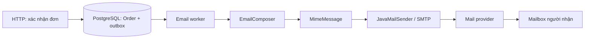
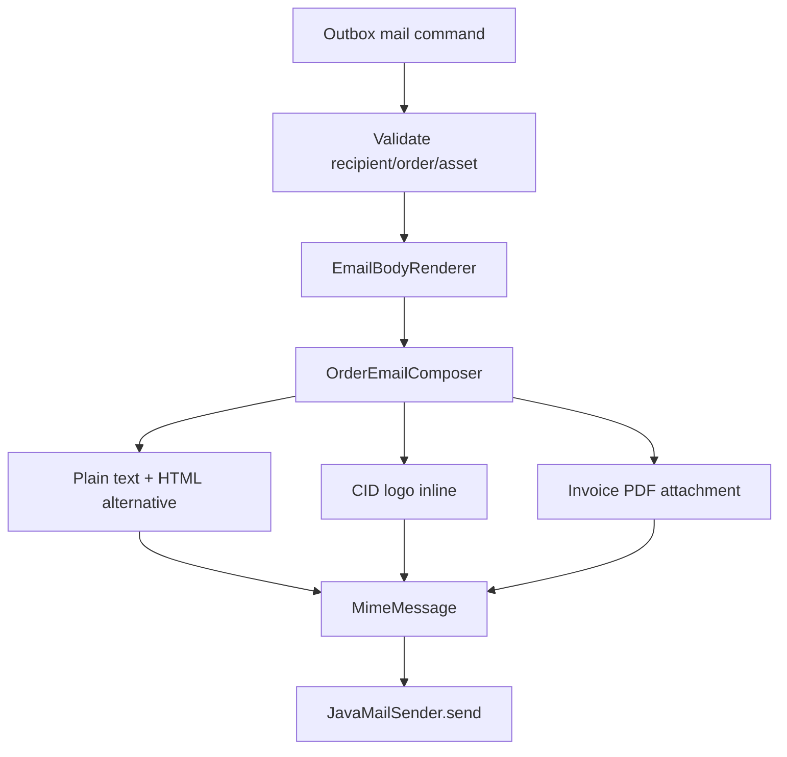
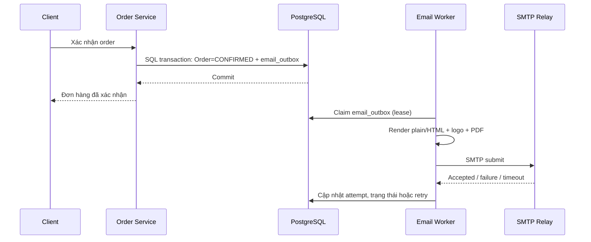

# Nội dung văn bản, HTML, tài nguyên nội tuyến và tệp đính kèm

## 1. Mục tiêu và bối cảnh tích hợp

Trong hệ thống Spring Boot, email thường được phát sinh từ một sự kiện nghiệp vụ: đơn hàng đã xác nhận, tài khoản cần xác minh, giao dịch cần đối soát hoặc một công việc định kỳ đã hoàn tất. Email có thể chỉ gồm **văn bản thuần**; cũng có thể có **HTML**, **hình ảnh xuất hiện ngay trong nội dung** và **tệp đính kèm** như hóa đơn PDF. Mỗi hình thức có cách mã hóa và giới hạn riêng. Việc SMTP server chấp nhận email không bảo đảm thư đã đến hộp thư người nhận hoặc dữ liệu nhạy cảm đã được bảo vệ đúng cách.

Bài học thuộc chương **Email** của module **SPRING_BOOT_INTEGRATION**. Module tổ chức tích hợp Spring Boot qua HTTP client, cơ sở dữ liệu, cache, broker thông điệp và các adapter Spring Integration, nhấn mạnh **cấu hình, hợp đồng dữ liệu, giao dịch, lỗi, xử lý trùng lặp, kiểm thử và quan sát**. Vì thế, bài đi từ cấu trúc email MIME đến thiết kế luồng gửi email **sau commit**, kiểm soát file đính kèm, retry và kiểm thử với SMTP giả lập.

Sau bài học, bạn có thể:

- Phân biệt email `text/plain`, `text/html` và `multipart/*` trong giao thức MIME.
- Dùng `SimpleMailMessage` cho thư văn bản thuần; dùng `JavaMailSender`, `MimeMessage` và `MimeMessageHelper` khi cần HTML, inline resource hoặc attachment.
- Gửi đồng thời hai phiên bản **plain text + HTML** bằng `multipart/alternative` để email client chọn cách hiển thị phù hợp.
- Nhúng ảnh qua **Content-ID (CID)**, phân biệt tài nguyên nội tuyến và tệp đính kèm thật sự.
- Dùng `ByteArrayResource` hoặc `FileSystemResource` an toàn, chọn MIME type, tên file, giới hạn kích thước và validate nội dung.
- Cấu hình SMTP AUTH, STARTTLS, timeout, lỗi gửi, outbox/idempotency và kiểm thử cấu trúc email mà **không gửi thư ra Internet**.

> **Phạm vi phiên bản:** Ví dụ hướng đến Java 17+, Spring Boot 3.2+, Spring Framework 6.1+ và **Jakarta Mail** (`jakarta.mail.*`). Với Spring Boot 3+, không trộn import `javax.mail.*` từ hướng dẫn Spring Boot 2.x. Các lớp/thư viện có thể có chi tiết khác khi nâng version; mã ví dụ rút gọn các import phổ biến.

### 1.1. Bài toán xuyên suốt: email xác nhận đơn hàng

**Order Service** ghi đơn đã xác nhận vào PostgreSQL. Sau khi database transaction commit, một worker gửi email cho khách:

1. **Tiêu đề:** Xác nhận đơn hàng `O-1001`.
2. **Văn bản thuần:** vẫn đọc được trong email client không hiển thị HTML.
3. **HTML:** trình bày mã đơn, lời chào và thông tin hỗ trợ dưới dạng email template.
4. **Logo công ty:** hiển thị trong thân HTML bằng một tài nguyên **inline** qua `cid:brandLogo`.
5. **Hóa đơn:** PDF được đính kèm với tên `invoice-O-1001.pdf`.



Đường **Order + outbox** được commit trong database; worker gửi SMTP **sau commit**. Nếu gửi thất bại, email job có thể được thử lại theo chính sách. Nếu SMTP đã nhận nhưng worker crash trước khi lưu trạng thái, một lần thử lại có thể gửi **email trùng**; vì vậy không được hứa “exactly-once delivery” chỉ vì đã dùng transaction hoặc SMTP.

## 2. MIME: nội dung văn bản, HTML, inline và attachment

SMTP vận chuyển email ở mức giao thức gửi. Để một email chứa nhiều kiểu nội dung, ứng dụng dùng **MIME (Multipurpose Internet Mail Extensions)** và các header như `Content-Type`, `Content-Transfer-Encoding`, `Content-Disposition` và `Content-ID`.

### 2.1. Các thành phần MIME thường gặp

| Nội dung | MIME type/đặc tính | Ý nghĩa |
|---|---|---|
| Văn bản thuần | `text/plain; charset=UTF-8` | Nội dung đọc được không cần HTML |
| HTML | `text/html; charset=UTF-8` | Email client hiển thị định dạng và liên kết |
| Nhiều phiên bản cùng thông điệp | `multipart/alternative` | Các dạng thay thế nhau, thường plain text và HTML |
| Tài nguyên gắn với HTML | `multipart/related` | HTML đi kèm ảnh hoặc tài nguyên được tham chiếu qua CID |
| Tệp đính kèm | `multipart/mixed` | Nội dung chính kết hợp một hay nhiều attachment |
| Ảnh/logo | `image/png`, `image/jpeg`, ... | Có thể inline hoặc attachment tùy disposition/reference |
| Hóa đơn | `application/pdf` | Thường có `Content-Disposition: attachment` và filename |

Một email có thể dùng **các MIME multipart lồng nhau**. Không phải mọi email client dựng đúng cùng một cây hiển thị; mục tiêu là tạo cấu trúc standards-based và kiểm tra trên các client thực tế.

### 2.2. Hình dung cây MIME của bài tập

```text
MimeMessage
└─ multipart/mixed
   ├─ multipart/related
   │  ├─ multipart/alternative
   │  │  ├─ text/plain; charset=UTF-8
   │  │  └─ text/html; charset=UTF-8
   │  │      
   │  └─ image/png
   │     Content-ID: <brandLogo>
   │     Content-Disposition: inline
   └─ application/pdf
      Content-Disposition: attachment
      filename="invoice-O-1001.pdf"
```

Sơ đồ thể hiện **cấu trúc khái niệm** khi dùng chế độ MIME hỗn hợp và liên quan. Trong thực tế, `MimeMessageHelper` và Jakarta Mail có thể tạo cách lồng multipart cụ thể khác tùy `multipartMode`; không viết test phụ thuộc cứng vào đúng số cấp của cây nếu không cần thiết. Hãy kiểm tra **tính hiện diện/đúng vai trò** của text, HTML, inline part và attachment.

### 2.3. Vì sao gửi cả plain text lẫn HTML?

Một số email client, bộ lọc thư hoặc chính sách accessibility ưu tiên plain text. HTML cũng có thể bị tắt, các ảnh có thể bị chặn và CSS có thể không được hỗ trợ. Gửi cả hai phiên bản cho phép client chọn:

- **Plain text:** câu chữ đầy đủ, URL rõ ràng, không dựa vào màu sắc hoặc ảnh để truyền ý chính.
- **HTML:** trình bày có cấu trúc, dùng CSS email-safe, văn bản thay thế cho ảnh, link có domain rõ ràng.

Hai phiên bản nên diễn đạt **cùng một thông tin nghiệp vụ**, không để nội dung chính chỉ tồn tại trong ảnh hoặc tệp PDF. `multipart/alternative` không có nghĩa gửi hai email riêng; đó là các phiên bản của cùng một thông điệp.

### 2.4. Inline resource khác attachment ở đâu?

**Inline resource** được tham chiếu bởi phần HTML qua `cid:<contentId>` và thường mang `Content-Disposition: inline`, ví dụ logo. **Attachment** mang filename và `Content-Disposition: attachment` để email client hiển thị như tệp có thể tải. Cả hai đều là MIME part chứa bytes và có thể được mã hóa để vận chuyển; sự khác nhau chính là **vai trò hiển thị**.

Việc thêm inline image không bảo đảm mọi client sẽ hiện ảnh: có client chặn remote image, có client chặn/mất cách hiển thị CID, có client hiển thị thêm inline image trong danh sách attachments. Vì vậy luôn có `alt` và thông điệp văn bản thay thế; không để thông tin bảo mật quan trọng chỉ nằm trong ảnh.

## 3. Dependency và SMTP configuration trong Spring Boot

### 3.1. Starter và thư viện template tùy chọn

Với Maven và Spring Boot parent/BOM:

```xml
<dependencies>
    <dependency>
        <groupId>org.springframework.boot</groupId>
        <artifactId>spring-boot-starter-mail</artifactId>
    </dependency>
    <!-- Chỉ cần nếu render HTML bằng Thymeleaf. -->
    <dependency>
        <groupId>org.springframework.boot</groupId>
        <artifactId>spring-boot-starter-thymeleaf</artifactId>
    </dependency>
    <dependency>
        <groupId>org.springframework.boot</groupId>
        <artifactId>spring-boot-starter-test</artifactId>
        <scope>test</scope>
    </dependency>
</dependencies>
```

`spring-boot-starter-mail` tích hợp **`JavaMailSender`** với Jakarta Mail. Khi dependency và các điều kiện cấu hình phù hợp (đặc biệt thông tin SMTP host/JavaMail session), Spring Boot auto-configure sender. `spring-boot-starter-thymeleaf` chỉ cần khi dùng Thymeleaf làm HTML template engine; email MIME không bắt buộc phải có Thymeleaf.

### 3.2. SMTP local và production

Ví dụ local dùng một **SMTP test server** nghe cổng `1025`, không gửi thư ra ngoài:

```yaml
# application-mail-local.yml
spring:
  mail:
    host: localhost
    port: 1025
    protocol: smtp
    default-encoding: UTF-8
    properties:
      mail.smtp.connectiontimeout: 3000
      mail.smtp.timeout: 5000
      mail.smtp.writetimeout: 5000
```

Khi deploy production với SMTP submission hỗ trợ STARTTLS ở cổng `587`:

```yaml
# application-mail-prod.yml
spring:
  mail:
    host: ${SMTP_HOST}
    port: ${SMTP_PORT:587}
    username: ${SMTP_USERNAME}
    password: ${SMTP_PASSWORD}
    protocol: smtp
    default-encoding: UTF-8
    properties:
      mail.smtp.auth: true
      mail.smtp.starttls.enable: true
      mail.smtp.starttls.required: true
      mail.smtp.ssl.checkserveridentity: true
      mail.smtp.connectiontimeout: 3000
      mail.smtp.timeout: 5000
      mail.smtp.writetimeout: 5000
```

| Cấu hình | Ý nghĩa |
|---|---|
| `spring.mail.host/port` | SMTP relay/server được phép kết nối |
| `username/password` | Credential SMTP, được cấp qua secret manager/môi trường |
| `mail.smtp.auth` | Bật SMTP AUTH khi relay yêu cầu |
| `starttls.enable` | Cho phép nâng kết nối SMTP thường lên TLS bằng STARTTLS |
| `starttls.required` | Bắt buộc STARTTLS thành công, tránh tiếp tục truyền credentials khi không có TLS |
| `ssl.checkserveridentity` | Yêu cầu kiểm tra danh tính host/certificate theo hỗ trợ Jakarta Mail |
| `connectiontimeout` | Giới hạn thời gian kết nối mạng |
| `timeout` | Giới hạn thời gian chờ đọc dữ liệu SMTP |
| `writetimeout` | Giới hạn thời gian chờ ghi dữ liệu SMTP |
| `default-encoding` | Charset mặc định cho nội dung email theo Spring Boot |

**Quan trọng:** port `465` thường dùng **implicit TLS**, không phải cùng chế độ STARTTLS của `587`. Nếu nhà cung cấp yêu cầu SMTP SSL trực tiếp, cấu hình `mail.smtp.ssl.enable=true` và trust/certificate phù hợp theo tài liệu provider; không sao chép mọi cờ trong ví dụ `587` sang `465` mà chưa kiểm tra.

Timeout giúp tránh một lời gọi `send()` chờ vô thời hạn nhưng **không** tự đảm bảo deadline tổng của một batch nhiều recipient/attachment hoặc thời gian queueing của mail provider. Khi gửi email từ HTTP endpoint, không giữ request/SQL transaction trong lúc chờ SMTP; sử dụng background worker/outbox.

### 3.3. Kiểm tra cấu hình hiệu lực và bảo mật

`JavaMailSenderImpl` thường là implementation của `JavaMailSender` được Spring Boot cung cấp. Nếu ứng dụng tự khai báo sender riêng, Boot có thể không tạo sender mặc định; phải kiểm tra những property nào đã được áp. `spring.mail.test-connection` có thể dùng để kiểm tra kết nối lúc startup theo điều kiện phù hợp, nhưng điều đó có thể khiến ứng dụng không khởi động khi SMTP tạm lỗi; quyết định theo SLA và môi trường.

Không bật Jakarta Mail debug ở production nếu log có thể chứa địa chỉ người nhận, metadata email, đường dẫn nội bộ hoặc thông tin xác thực. Chỉ dùng tài khoản SMTP có quyền phù hợp; xác minh domain người gửi và cấu hình SPF, DKIM, DMARC ở hệ thống mail/provider theo chính sách tổ chức. **TLS bảo vệ kết nối gửi; SPF/DKIM/DMARC giúp xác thực danh tính domain; chúng không thay thế nhau.**

## 4. Email văn bản thuần với SimpleMailMessage

### 4.1. Ví dụ gửi nội dung text/plain

`SimpleMailMessage` phù hợp khi email chỉ gồm subject và text body, không cần HTML hoặc các MIME part phức tạp:

```java
// PlainTextNotificationSender.java — imports rút gọn
@Service
public class PlainTextNotificationSender {
    private final JavaMailSender mailSender;

    public PlainTextNotificationSender(JavaMailSender mailSender) {
        this.mailSender = mailSender;
    }

    public void sendStatus(String recipient, String orderId) {
        SimpleMailMessage mail = new SimpleMailMessage();
        mail.setFrom("orders@example.org");
        mail.setTo(recipient);
        mail.setSubject("Cập nhật đơn hàng " + orderId);
        mail.setText(
                "Đơn hàng " + orderId + " đã được xác nhận.\n"
                + "Bạn có thể theo dõi trạng thái trên tài khoản.\n"
                + "Nếu không thực hiện đơn hàng, vui lòng liên hệ hỗ trợ.");

        mailSender.send(mail);
    }
}
```

`JavaMailSender` của Spring có overload `send(SimpleMailMessage)` dành cho tình huống này. `SimpleMailMessage` **không phải** công cụ tạo `multipart/related` hay attachment; để gửi HTML, inline image hoặc file, chuyển sang `MimeMessage`.

Địa chỉ `orders@example.org` chỉ để minh họa; production cần dùng domain đã xác minh và cấu hình sender identity của provider. Không lấy tùy ý địa chỉ `From` từ HTTP request do người dùng cung cấp.

### 4.2. Text/plain vẫn cần hợp đồng nội dung

Ngay cả với email văn bản thuần, cần chú ý:

- Charset UTF-8 để gửi tiếng Việt có dấu; không dựa vào charset mặc định của hệ điều hành.
- Subject, `From`, `To`, `Reply-To` phải là dữ liệu header được validate và đặt qua API, không nối raw MIME headers từ chuỗi người dùng.
- Văn bản phải nói rõ trạng thái nghiệp vụ; nếu email xác nhận đơn đã commit, không dùng ngôn ngữ “đã giao hàng” khi chỉ mới tạo đơn.
- Link trong plain text cần domain chính thức, token ngắn hạn nếu là link thao tác, và không đưa credential hay dữ liệu định danh nhạy cảm vào URL không cần thiết.
- Lời gọi `send()` là I/O đồng bộ. Không thực hiện ngay trong transaction database dài hoặc trên Netty event-loop.

## 5. Tạo MimeMessage với nội dung văn bản và HTML

### 5.1. Tại sao dùng MimeMessageHelper?

`MimeMessage` là đối tượng Jakarta Mail đại diện cho email đầy đủ với headers, recipients, content và MIME part. `MimeMessageHelper` của Spring hỗ trợ xây dựng message dễ hơn khi cần gửi Unicode, HTML, multipart, inline hay attachment.

```java
// Mẫu cơ bản với text + HTML, chưa có ảnh/file
MimeMessage message = mailSender.createMimeMessage();
MimeMessageHelper helper = new MimeMessageHelper(
        message, true, StandardCharsets.UTF_8.name());

helper.setFrom("orders@example.org");
helper.setTo("customer@example.net");
helper.setSubject("Xác nhận đơn hàng O-1001");

String plainText =
        "Xin chào! Đơn O-1001 đã được xác nhận.";
String htmlText = """
        <html><body>
          <h1>Xác nhận đơn hàng</h1>
          <p>Đơn O-1001 đã được xác nhận.</p>
        </body></html>
        """;

helper.setText(plainText, htmlText);
mailSender.send(message);
```

Đoạn trên dùng `helper.setText(plainText, htmlText)` để tạo **hai phiên bản alternative** của cùng thông điệp. Nếu chỉ gọi `helper.setText(htmlText, true)`, message có HTML nhưng không có fallback plain text riêng. Nếu gọi `helper.setText(plainText)`, đó là nội dung văn bản thuần.

**Thứ tự các lệnh tạo nội dung quan trọng:** đặt body bằng `setText(...)` trước, sau đó mới gọi `addInline(...)` khi có tài nguyên nội tuyến. `MimeMessageHelper` hướng dẫn thứ tự này để không làm mất/cấu hình sai MIME part trong một số cách triển khai.

### 5.2. Chọn multipart mode phù hợp

`MimeMessageHelper` có các chế độ multipart và cách chọn chế độ ảnh hưởng đến cấu trúc part:

| Chế độ | Khi dùng | Lưu ý |
|---|---|---|
| `MULTIPART_MODE_NO` | Không tạo multipart | Không thích hợp cho ảnh inline/file |
| `MULTIPART_MODE_MIXED` | Các part hỗn hợp, thường attachment | Một số email client xử lý inline khác nhau |
| `MULTIPART_MODE_RELATED` | HTML với tài nguyên liên quan | Có thể khác cách attachment được hiển thị |
| `MULTIPART_MODE_MIXED_RELATED` | Email vừa HTML/inline vừa attachment | Thường phù hợp cho bài toán xác nhận đơn có logo và PDF |

Constructor `new MimeMessageHelper(message, true, "UTF-8")` sử dụng chế độ multipart mặc định của helper; để minh bạch và dễ kiểm thử khi cần **cả ảnh và PDF**, có thể chọn tường minh:

```java
MimeMessageHelper helper = new MimeMessageHelper(
        message,
        MimeMessageHelper.MULTIPART_MODE_MIXED_RELATED,
        StandardCharsets.UTF_8.name()
);
```

Không nên chỉnh MIME structure bằng thao tác cấp thấp sau khi helper đã lắp xếp các part trừ khi thực sự cần: dễ vô tình đặt attachment vào `multipart/alternative` hoặc làm HTML không tìm thấy inline resource. Cần thử trên Gmail, Outlook, Apple Mail hoặc email client thực tế của người dùng trước khi coi lựa chọn MIME mode là hoàn chỉnh.

### 5.3. Dùng mẫu thông điệp có kiểu dữ liệu rõ ràng

```java
// OrderMailCommand.java
public record OrderMailCommand(
        String mailRequestId,
        String recipient,
        String orderId,
        String customerName,
        long totalCents
) {}
```

`mailRequestId` là **ID logic của email yêu cầu gửi**, không phải SMTP Message-ID và không phải operation ID của lệnh giữ hàng. Dùng ID này để ghi bản ghi outbox, track attempt và tránh nhiều worker cùng chọn một email job. `orderId` có thể xuất hiện trong subject/file name sau khi validate; `customerName` chỉ xuất hiện trong body qua template đã escape.

Với hóa đơn, giá `totalCents` cần được format theo **đơn vị tiền tệ của order**. Ví dụ sẽ không thực hiện tính giá từ số thực; khi triển khai thực tế, đưa currency/locale vào DTO theo hợp đồng và dùng `BigDecimal`/`Currency` hoặc số nguyên đơn vị nhỏ nhất tùy quy định.

## 6. HTML template an toàn và nhất quán với plain text

### 6.1. Không nối HTML trực tiếp từ input người dùng

Một cách dễ làm nhưng nguy hiểm là:

```java
// Không làm: dữ liệu customerName có thể chứa HTML tùy ý.
String html = "<p>Xin chào " + customerName + "</p>";
```

Nếu tên chứa ký tự `<`, `>`, `&` hoặc markup, email HTML có thể bị vỡ cấu trúc hoặc chèn nội dung không mong đợi. Nhiều email client chặn JavaScript, nhưng không được coi đó là một cơ chế escaping của server. Dùng template engine có **HTML escaping mặc định**, đồng thời validate dữ liệu, link và những HTML fragment được phép.

### 6.2. Thymeleaf HTML template

Ví dụ một tệp template **cần được dự án triển khai tạo riêng** tại `src/main/resources/templates/mail/order-confirmed.html`:

```html
<!DOCTYPE html>
<html lang="vi" xmlns:th="http://www.thymeleaf.org">
<head>
  <meta charset="UTF-8">
  <title>Xác nhận đơn hàng</title>
</head>
<body style="font-family: Arial, sans-serif; color: #222;">
  <table role="presentation" width="100%" cellspacing="0" cellpadding="0">
    <tr>
      <td>
        
      </td>
    </tr>
    <tr>
      <td>
        <h1>Đơn hàng đã được xác nhận</h1>
        <p>Xin chào <span th:text="${customerName}">Khách hàng</span>!</p>
        <p>Mã đơn:
          <strong th:text="${orderId}">O-1001</strong>
        </p>
        <p>Tổng tiền:
          <strong th:text="${formattedTotal}">199.900 ₫</strong>
        </p>
        <p>Hóa đơn PDF được đính kèm trong thư này.</p>
        <p>Nếu cần hỗ trợ, hãy trả lời email này hoặc
          truy cập website chính thức.</p>
      </td>
    </tr>
  </table>
</body>
</html>
```

`th:text` escape nội dung được bind theo ngữ cảnh HTML. Không thay bằng `th:utext` cho `customerName` hoặc dữ liệu từ HTTP/database không đáng tin, vì `th:utext` cho phép chèn HTML không escape. Khi cần fragment HTML có cấu trúc, chỉ dùng nguồn tin cậy được allowlist/sanitize bằng chính sách chặt chẽ.

### 6.3. Render HTML và plain text cùng một snapshot dữ liệu

```java
// EmailBodyRenderer.java — imports rút gọn
@Component
public class EmailBodyRenderer {
    private final SpringTemplateEngine templates;

    public EmailBodyRenderer(SpringTemplateEngine templates) {
        this.templates = templates;
    }

    public String renderHtml(
            OrderMailCommand command, String formattedTotal
    ) {
        Context context = new Context(
                Locale.forLanguageTag("vi-VN"));
        context.setVariable(
                "customerName", command.customerName());
        context.setVariable(
                "orderId", command.orderId());
        context.setVariable(
                "formattedTotal", formattedTotal);

        return templates.process("mail/order-confirmed", context);
    }

    public String renderPlain(
            OrderMailCommand command, String formattedTotal
    ) {
        return "Xin chào " + command.customerName() + "!\n"
                + "Đơn hàng " + command.orderId()
                + " đã được xác nhận.\n"
                + "Tổng tiền: " + formattedTotal + "\n"
                + "Hóa đơn PDF được đính kèm.\n"
                + "Nếu cần hỗ trợ, hãy liên hệ cửa hàng.";
    }
}
```

`SpringTemplateEngine` và `Context` thuộc Thymeleaf. Cùng một `OrderMailCommand` và `formattedTotal` được dùng để render HTML/plain text, tránh một bản nói “đã xác nhận” trong khi bản kia ghi “đang xử lý”. Nội dung plain text không được làm mất phần thông tin bắt buộc về giá, điều kiện thanh toán hay cảnh báo bảo mật.

### 6.4. Các giới hạn của HTML email

Email HTML **không phải một trang web thông thường**. Nhiều client giới hạn CSS, font, media query, background image và script; `<script>` không có giá trị sử dụng đáng tin cậy và thường bị loại bỏ. Một số hệ thống đổi URL ảnh/link qua proxy an ninh; kết quả render cũng khác nhau giữa desktop/mobile và Outlook/Gmail.

Để email dễ đọc:

- Ưu tiên HTML đơn giản, bảng trình bày khi cần tương thích email client, inline CSS có kiểm soát.
- Dùng link HTTPS tới domain chính thức; không dùng `javascript:`, `data:` hoặc protocol không được phép cho link người dùng.
- Đảm bảo tương phản, font dễ đọc và `alt` cho ảnh.
- Nội dung quan trọng vẫn có trong text/plain.
- Test rendering tại các client mà tổ chức thực sự hỗ trợ, không chỉ trên Chrome.

## 7. Tài nguyên nội tuyến: logo và hình ảnh qua Content-ID

### 7.1. CID hoạt động như thế nào?

Tài nguyên **inline** là một MIME part liên quan tới nội dung HTML. Email body tham chiếu nó qua scheme `cid:`:

```html

```

Phần ảnh bên trong MIME message có header khái niệm:

```text
Content-Type: image/png
Content-ID: <brandLogo>
Content-Disposition: inline
Content-Transfer-Encoding: base64
```

Giá trị `brandLogo` là **content ID**, không phải tên file trên đĩa, đường dẫn hệ thống, URL HTTP hay ID trong database. Khi dùng `MimeMessageHelper.addInline("brandLogo", ...)`, helper tạo MIME part có content ID tương ứng. HTML phải tham chiếu đúng `cid:brandLogo` (khớp ID). Một message có nhiều ảnh phải có các ID phân biệt trong phạm vi message.

### 7.2. Thêm inline image bằng ClassPathResource

Giả sử dự án có file `src/main/resources/mail/assets/logo.png` và email template `mail/order-confirmed.html` đã dùng `cid:brandLogo`:

```java
MimeMessage message = mailSender.createMimeMessage();
MimeMessageHelper helper = new MimeMessageHelper(
        message,
        MimeMessageHelper.MULTIPART_MODE_MIXED_RELATED,
        "UTF-8"
);

helper.setFrom("orders@example.org");
helper.setTo("customer@example.net");
helper.setSubject("Xác nhận đơn O-1001");
helper.setText(plainText, htmlText);

// Đặt setText(...) TRƯỚC addInline(...).
ClassPathResource logo =
        new ClassPathResource("mail/assets/logo.png");
helper.addInline("brandLogo", logo, "image/png");

mailSender.send(message);
```

`ClassPathResource` thuộc `org.springframework.core.io`. Resource phải tồn tại trên **runtime classpath** (trong JAR cũng cần được đóng gói), không phải đọc bằng đường dẫn tương đối của working directory. Với resource không tồn tại, bài test nên thất bại rõ thay vì gửi email HTML có tham chiếu `cid:brandLogo` nhưng không có part tương ứng.

### 7.3. Thêm nội dung ảnh từ bytes thay vì file

Khi logo được lấy từ kho tài nguyên hợp lệ, có thể chuyển bytes thành `ByteArrayResource`:

```java
byte[] logoPng = logoAssetService.loadApprovedLogoPng();

helper.addInline(
        "brandLogo",
        new ByteArrayResource(logoPng),
        "image/png"
);
```

Đây là ví dụ sử dụng một `logoAssetService` giả định: ứng dụng cần định nghĩa interface/implementation và bảo đảm dữ liệu thực sự là PNG hợp lệ, có giới hạn dung lượng. `ByteArrayResource` giữ bytes trong bộ nhớ và có thể cung cấp **InputStream mới cho mỗi lần đọc**; đó là đặc điểm hữu ích vì Jakarta Mail có thể cần đọc content nhiều lần khi xây/sending MIME.

**Tránh `InputStreamResource` cho luồng chỉ đọc được một lần** nếu JavaMail cần gọi `getInputStream()` nhiều lần; Spring `MimeMessageHelper` khuyến nghị `InputStreamSource` có khả năng cung cấp stream tươi cho mỗi lần truy cập. Dùng `ByteArrayResource` cho dữ liệu đã nằm trong RAM và `FileSystemResource`/resource lặp lại được cho tệp lưu trên đĩa.

### 7.4. Inline image và ảnh qua URL

| Cách | Ưu điểm | Hạn chế |
|---|---|---|
| `cid:brandLogo` | Ảnh nằm trong MIME message, không cần tải từ web server của ứng dụng | Tăng kích thước email; client có thể chặn/hiện dưới dạng attachment |
| HTTPS URL | Giảm dung lượng email, thay ảnh server-side dễ hơn | Client có thể chặn remote image, proxy/cache ảnh, phát sinh request ngoài |
| Data URI/Base64 trực tiếp trong HTML | Tự chứa trong markup | Hỗ trợ không đồng nhất ở email client; làm HTML lớn |

Logo tĩnh nhỏ thường phù hợp inline nếu phải hiển thị khi người dùng offline. Ảnh marketing lớn thường phù hợp URL HTTPS nhưng có thể bị chặn và cần chính sách quyền riêng tư. Không nhúng ảnh được tạo từ input không kiểm soát mà không kiểm tra loại file, kích thước, nội dung và quyền sử dụng.

## 8. Tệp đính kèm: PDF, CSV và giới hạn MIME

### 8.1. Đính kèm PDF từ ByteArrayResource

Nếu Invoice Service đã tạo `byte[] pdfBytes` hợp lệ, `MimeMessageHelper` hỗ trợ đính kèm:

```java
helper.addAttachment(
        "invoice-O-1001.pdf",
        new ByteArrayResource(pdfBytes),
        "application/pdf"
);
```

| Tham số | Ý nghĩa |
|---|---|
| `"invoice-O-1001.pdf"` | Tên file hiển thị cho người nhận; không phải đường dẫn hệ thống |
| `ByteArrayResource(pdfBytes)` | Content bytes, có thể cung cấp stream lặp lại |
| `"application/pdf"` | MIME content type được khai báo cho attachment |

MIME type và phần mở rộng `.pdf` chỉ là **metadata**; không chứng minh bytes là PDF lành tính. Nếu file đến từ người dùng hoặc một hệ thống ngoài, cần kiểm tra signature/content, quyền truy cập, malware scan và chính sách lưu giữ. Không tin vào filename/Content-Type do client upload gửi lên.

### 8.2. FileSystemResource và rủi ro đường dẫn

```java
FileSystemResource reportFile =
        new FileSystemResource(
                Path.of("/srv/app-generated/reports/invoice-O-1001.pdf"));

helper.addAttachment(
        "invoice-O-1001.pdf",
        reportFile,
        "application/pdf"
);
```

Đoạn này chỉ minh họa khi ứng dụng **đã tự tạo** file vào thư mục được phép và có lifecycle cleanup. Tuyệt đối không nối trực tiếp request parameter vào path như `"/srv/.../" + userInput` để tránh path traversal hoặc đọc nhầm file bí mật. Với tên file trả cho người nhận, cần chuẩn hóa Unicode, loại ký tự điều khiển/CRLF, separator và đặt giới hạn độ dài.

Nếu ứng dụng chạy trên container/serverless có filesystem tạm thời, đường dẫn local có thể không còn khi job thực sự gửi hoặc khi worker được chuyển sang node khác. Phương án thường tốt hơn là **lưu file trong object storage được phân quyền**, để outbox chỉ chứa **reference** và worker tải file tại thời điểm gửi; có cơ chế hết hạn và xóa an toàn.

### 8.3. Tệp đính kèm có thể chứa dữ liệu riêng tư

Một hóa đơn PDF thường có tên, địa chỉ, khoản tiền và thông tin thanh toán. Trước khi attach:

1. Xác thực `orderId`, quyền truy cập và **recipient gắn đúng order**.
2. Dựng tài liệu từ bản ghi đã commit; không lấy hóa đơn từ request body do người gọi tự chỉ định.
3. Kiểm tra file thuộc order/tenant chính xác, không trộn dữ liệu của hai khách hàng.
4. Áp giới hạn dung lượng, số lượng và loại file; quét mã độc nếu nội dung có nguồn không đáng tin.
5. Không ghi bytes attachment vào application log hoặc metrics.
6. Có retention policy rõ ràng cho PDF trong object storage và trong SMTP/mail provider.

Email là phương tiện chuyển thông tin không đảm bảo end-to-end encryption trong mọi chặng. Khi dữ liệu cực kỳ nhạy cảm hoặc file quá lớn, nên gửi **link HTTPS đến trang xác thực** thay vì đưa toàn bộ file vào email. Link cần có quyền, thời hạn và logging/rate limit phù hợp; không dùng URL có token dài hạn bị ghi vào lịch sử/log.

### 8.4. Kích thước email thực tế không bằng kích thước file gốc

Email có attachment thường dùng `Content-Transfer-Encoding: base64`, làm kích thước MIME tăng đáng kể so với bytes gốc (mức thường khoảng một phần ba, chưa tính line breaks, headers và HTML/inline resources). Các provider có **giới hạn tổng kích thước thư**, không chỉ giới hạn một attachment. Ngoài tổng bytes, cần giới hạn:

- Số attachment và độ dài filename.
- Loại tệp cho phép, kích thước sau khi giải nén nếu có archive.
- Tổng memory khi dùng `ByteArrayResource`; các bytes PDF/logo cùng lúc có thể lớn trên nhiều worker.
- Thời gian tạo/tải attachment từ object storage.
- Chi phí scan/security validation và thời gian truyền qua SMTP.

Không tạo một email 30 MB rồi mong relay có giới hạn 20 MB sẽ tự sửa; nếu provider từ chối, job cần báo lỗi có phân loại và chuyển sang phương án link/tệp nhỏ hơn.

### 8.5. Nhiều attachment

```java
helper.addAttachment(
        "invoice-O-1001.pdf",
        new ByteArrayResource(invoicePdfBytes),
        "application/pdf"
);
helper.addAttachment(
        "order-items-O-1001.csv",
        new ByteArrayResource(csvBytes),
        "text/csv; charset=UTF-8"
);
```

CSV có nguy cơ **formula injection** nếu dữ liệu từ người dùng bắt đầu bằng `=`, `+`, `-` hoặc `@` và người nhận mở trong spreadsheet; cần chuẩn hóa/escape theo chính sách xuất file trước khi tạo `csvBytes`. MIME type đúng không xử lý rủi ro đó. Cũng không nên tạo attachment HTML động từ dữ liệu chưa sanitize rồi gửi như một file với quyền thực thi tùy client.

## 9. Ghép email hoàn chỉnh bằng một composer

### 9.1. Phân tách compose và send

Thực hành tốt là có một thành phần **compose MIME** và một thành phần **gửi**. Composer nhận dữ liệu đã được xác thực, render nội dung từ cùng snapshot, thêm tài nguyên và attachment. Sender chịu trách nhiệm kết nối SMTP, theo dõi attempt và xử lý ngoại lệ. Cách tách này giúp test MIME mà **không cần SMTP**.



### 9.2. Một OrderEmailComposer có thể kiểm thử

```java
// OrderEmailComposer.java — imports rút gọn
@Component
public class OrderEmailComposer {
    private final JavaMailSender mailSender;
    private final EmailBodyRenderer renderer;

    public OrderEmailComposer(
            JavaMailSender mailSender,
            EmailBodyRenderer renderer
    ) {
        this.mailSender = mailSender;
        this.renderer = renderer;
    }

    public MimeMessage compose(
            OrderMailCommand command,
            String formattedTotal,
            byte[] logoPng,
            byte[] invoicePdf
    ) throws MessagingException {
        validate(command, logoPng, invoicePdf);

        MimeMessage message = mailSender.createMimeMessage();
        MimeMessageHelper helper = new MimeMessageHelper(
                message,
                MimeMessageHelper.MULTIPART_MODE_MIXED_RELATED,
                StandardCharsets.UTF_8.name()
        );

        helper.setFrom("orders@example.org");
        helper.setTo(command.recipient());
        helper.setReplyTo("support@example.org");
        helper.setSubject(
                "Xác nhận đơn hàng " + command.orderId());

        String plain = renderer.renderPlain(
                command, formattedTotal);
        String html = renderer.renderHtml(
                command, formattedTotal);

        // 1) Text alternative trước khi thêm inline/attachment.
        helper.setText(plain, html);

        // 2) Tài nguyên dùng trong HTML qua cid:brandLogo.
        helper.addInline(
                "brandLogo",
                new ByteArrayResource(logoPng),
                "image/png");

        // 3) Hóa đơn là attachment, không phải inline image.
        helper.addAttachment(
                "invoice-" + command.orderId() + ".pdf",
                new ByteArrayResource(invoicePdf),
                "application/pdf");

        return message;
    }

    private static void validate(
            OrderMailCommand command,
            byte[] logoPng,
            byte[] invoicePdf
    ) {
        if (command == null
                || command.orderId() == null
                || !command.orderId().matches("[A-Za-z0-9_-]{1,40}")
                || command.mailRequestId() == null
                || command.mailRequestId().isBlank()) {
            throw new IllegalArgumentException(
                    "Thiếu hoặc sai định danh email/order");
        }
        if (command.recipient() == null
                || command.recipient().isBlank()) {
            throw new IllegalArgumentException(
                    "Thiếu địa chỉ nhận email");
        }
        if (logoPng == null || logoPng.length == 0
                || logoPng.length > 200_000
                || invoicePdf == null || invoicePdf.length == 0
                || invoicePdf.length > 8_000_000) {
            throw new IllegalArgumentException(
                    "Tài nguyên email trống hoặc quá kích thước");
        }
        // Production: xác minh recipient với email address parser,
        // kiểm tra PNG/PDF signature + malware policy,
        // recipient có quyền nhận hóa đơn của order này.
    }
}
```

Ở đây `formattedTotal` và `EmailBodyRenderer` được sử dụng lại cho cả plain/HTML để không sinh hai con số khác nhau. `logoPng` giới hạn 200 KB, `invoicePdf` giới hạn 8 MB chỉ là **ngưỡng ví dụ**; cần kiểm tra tổng size MIME thực và provider limit. `validate` chưa phải đầy đủ: địa chỉ recipient cần parser/validation, hóa đơn phải được xác nhận đúng order, file phải được kiểm tra content và authorization.

**Đừng đặt logic gửi SMTP trong composer.** Mục tiêu của `compose` là trả một đối tượng MIME có thể inspect/test. Nếu `mailSender.send(message)` bị gọi trước khi kiểm tra template, file hoặc quyền nhận, application có thể gửi nhầm email mà không thu hồi được.

### 9.3. Sender gọi JavaMailSender và báo lỗi rõ

```java
// OrderEmailSender.java
@Service
public class OrderEmailSender {
    private final JavaMailSender mailSender;
    private final OrderEmailComposer composer;

    public OrderEmailSender(
            JavaMailSender mailSender,
            OrderEmailComposer composer
    ) {
        this.mailSender = mailSender;
        this.composer = composer;
    }

    public void send(
            OrderMailCommand command,
            String formattedTotal,
            byte[] logoPng,
            byte[] invoicePdf
    ) {
        try {
            MimeMessage message = composer.compose(
                    command, formattedTotal, logoPng, invoicePdf);
            mailSender.send(message);
        } catch (MessagingException ex) {
            throw new IllegalStateException(
                    "Không tạo được MIME email hợp lệ", ex);
        }
    }
}
```

`JavaMailSender.send(MimeMessage)` có thể ném `MailException` (unchecked) khi kết nối SMTP/gửi thất bại; ví dụ không bắt/nuốt nó, để worker ở lớp ngoài phân loại retry và ghi trạng thái. `MessagingException` trong composer đại diện lỗi khi xây MIME. Những ngoại lệ checked/unchecked có nguồn gốc khác nhau giúp phân biệt **compose failure** với **SMTP transport failure**, nhưng worker cần kiểm tra cause của `MailException` để xác định lỗi tạm thời hay vĩnh viễn.

### 9.4. Recipient và header validation

Một số quy tắc gửi có thể được đặt tại boundary trước `compose`:

- Chuẩn hóa và kiểm tra email address bằng API `jakarta.mail.internet.InternetAddress`, quy tắc domain/recipient và policy riêng; cú pháp hợp lệ **không đồng nghĩa** địa chỉ tồn tại hoặc đã xác minh quyền nhận dữ liệu.
- `From` phải thuộc domain/tài khoản tổ chức được relay cho phép, không dùng `From` giả mạo do caller cung cấp.
- `Reply-To` chỉ rõ kênh hỗ trợ; không nhập nhằng với người nhận/nhóm Bcc.
- Giới hạn subject, orderId, tên file, tên khách và loại bỏ ký tự điều khiển nguy hiểm trong dữ liệu dùng ở header.
- Không ghi recipient list, subject chứa PII hoặc MIME raw vào log theo mặc định.
- Khi gửi nhiều người, cân nhắc **mỗi recipient một message** để không làm lộ danh sách địa chỉ trong `To`/`Cc`. `Bcc` có thể ẩn địa chỉ khỏi recipient khác nhưng không nên thay thế cơ chế gửi riêng khi cá nhân hóa nội dung và phân quyền.

Đặc biệt, gửi hóa đơn là hành động có tác động bảo mật. Phải kiểm tra người nhận có quyền đối với order **ngay ở tầng nghiệp vụ** trước khi đưa bytes vào MIME, không chỉ dựa vào một địa chỉ email hợp lệ.

## 10. SMTP, giao dịch, retry và trạng thái gửi

### 10.1. SMTP chấp nhận message không đồng nghĩa đã giao tới inbox

`JavaMailSender.send(...)` gọi SMTP server. Nếu relay phản hồi thành công, ứng dụng biết server đã **chấp nhận yêu cầu gửi** theo giao thức. Điều đó **chưa chứng minh**:

- Email đã được chuyển tới mailbox cuối cùng.
- Email không rơi vào spam/quarantine.
- Người nhận đã mở, đọc hoặc bấm liên kết.
- PDF/inline image hiển thị đúng ở mọi email client.
- Email sẽ không bị bounce hoặc reject sau đó bởi hệ thống nhận.

Nếu dùng provider có API/webhook theo dõi delivered, deferred, bounced hoặc complaint, hãy xây lớp trạng thái riêng. Không gán `DELIVERED` chỉ vì `send()` không ném exception; một trạng thái an toàn hơn là `ACCEPTED_BY_SMTP`, `SUBMITTED` hoặc `SENT_TO_PROVIDER` theo từ vựng nghiệp vụ đã chốt.

### 10.2. Không gọi SMTP trong database transaction

Một anti-pattern thường gặp:

```java
// Không nên dùng như một giao dịch chung.
@Transactional
public void confirmOrderBad(String orderId) {
    orderRepository.markConfirmed(orderId);
    orderEmailSender.send(/* MIME + SMTP ... */);
}
```

Nếu SMTP chậm, transaction SQL có thể giữ connection/lock trong khi gửi email. Nếu email được relay nhận nhưng transaction SQL rollback sau đó, khách nhận thông báo xác nhận cho đơn không tồn tại. Nếu SQL commit nhưng process crash trước email, có thể không gửi được. **`@Transactional` của SQL không bao trùm transaction của SMTP**.

### 10.3. Transactional outbox cho yêu cầu gửi email

Thiết kế gợi ý:



Outbox row có thể gồm:

| Trường | Ý nghĩa |
|---|---|
| `mail_request_id` | Khóa duy nhất cho **logical email request** |
| `event_type` | `ORDER_CONFIRMED` hoặc loại email |
| `order_id` | Tham chiếu dữ liệu order đã commit |
| `recipient_ref` | Định danh người nhận có quyền, không nhất thiết lưu toàn bộ PII nhiều nơi |
| `template_version` | Chọn đúng nội dung/email template khi worker xử lý |
| `status` | `PENDING`, `IN_PROGRESS`, `ACCEPTED_BY_SMTP`, `FAILED` hoặc trạng thái cụ thể hơn |
| `attempt_count` / `next_attempt_at` | Retry có giới hạn và backoff |
| `lease_owner` / `lease_until` | Ngăn hai worker cùng claim trong điều kiện bình thường và cho phép phục hồi crash |
| `last_error_code` | Mã lỗi vận hành an toàn, không chứa password/raw MIME |

Một SQL unique constraint như `UNIQUE(mail_request_id)` giúp không tạo hai outbox rows cho cùng yêu cầu nghiệp vụ. Nếu nhiều worker xử lý, claim có thể dùng row locking/lease với transaction SQL ngắn. Không giữ transaction trong lúc render PDF hoặc kết nối SMTP.

**Giới hạn quan trọng:** Sau khi SMTP chấp nhận message, worker có thể crash **trước khi lưu `ACCEPTED_BY_SMTP`**. Khi lease hết hạn, worker khác gửi lại → khách có thể nhận email trùng. Tại mức SMTP relay thông thường, không có atomic commit chung với PostgreSQL; một mail request ID trong database không bảo đảm exactly-once inbox delivery. Một số provider có API hỗ trợ idempotency key, cần kiểm tra semantics thực tế nếu muốn giảm duplicate ở bên gửi.

### 10.4. Phân loại lỗi để quyết định retry

| Tình huống | Phân loại | Cách xử lý khuyến nghị |
|---|---|---|
| Không kết nối được SMTP, lỗi DNS tạm thời | Có thể transient | Retry ít lần, exponential backoff + jitter, giám sát |
| Relay trả SMTP `4xx` | Thường tạm thời | Dựa trên mã/chính sách provider để đặt retry; tránh bão gửi |
| Relay trả SMTP `5xx` | Thường permanent hoặc cấu hình sai | Không retry vô hạn; cảnh báo/cách ly theo mã lỗi |
| SMTP AUTH fail, sender domain không được phép | Config/security | Dừng thử tự động liên tục; sửa credential/domain |
| TLS certificate/hostname sai | Security/config | Không tắt TLS validation; điều tra CA/certificate |
| Template không render được | Lỗi nội dung/triển khai | Sửa template/data; không retry SMTP trước khi compose hợp lệ |
| PDF vượt kích thước/provider limit | Permanent cho payload đó | Chuyển sang link, giảm dung lượng, không lặp cùng attachment |
| SMTP timeout sau bước DATA | Kết quả **không rõ** | Có thể đã nhận, cần trạng thái `UNKNOWN`/đối soát provider nếu có |
| Bounce sau khi relay accepted | Giao thư thất bại ở giai đoạn sau | Xử lý webhook/DSN, cập nhật trạng thái, tránh gửi lặp vô nghĩa |

Các SMTP reply code có ý nghĩa chuẩn chung nhưng một số provider thêm mã mở rộng hoặc quy định riêng. Lớp adapter nên giữ **mã lỗi được phép ghi log**, không chỉ bắt `MailException` rồi retry mọi loại lỗi.

### 10.5. Một email khác một command nghiệp vụ

Email là một kênh thông báo. Việc gửi thành công **không** phải bằng chứng Order Service đã xử lý đúng transaction hoặc đối tác đã giữ hàng. Ngược lại, email gửi thất bại thường không phải lý do rollback đơn hàng đã commit. Phần nghiệp vụ nên có trạng thái riêng, còn email worker là tiến trình độc lập quan sát được.

Nếu cần thông báo qua nhiều kênh (email, SMS, push), có thể đưa event ra RabbitMQ/Kafka hoặc Spring Integration flow với router/adapter, nhưng consumer vẫn phải có deduplication, retry, DLQ và transaction boundary rõ. Không đưa bytes PDF/HTML rất lớn vào mọi broker message nếu chỉ cần reference object storage an toàn.

## 11. Quyền riêng tư, HTML và tệp đính kèm an toàn

### 11.1. Các mối nguy cần kiểm soát

| Nguy cơ | Hệ quả | Biện pháp |
|---|---|---|
| HTML injection qua tên khách/hàng hóa | Nội dung email sai, link giả, hiển thị ngoài ý muốn | Escaping `th:text`, sanitize fragment cho phép |
| Header injection qua subject/address/filename | Header MIME không đúng, thay recipient hoặc spoofing | Validate CR/LF/control chars, dùng Jakarta Mail API thay vì raw headers |
| IDOR khi chọn order/recipient | Hóa đơn khách A gửi cho khách B | Authorization kiểm tra quan hệ recipient–order từ dữ liệu đã commit |
| Attachment độc hại/giả loại | Malware, khai thác viewer, social engineering | Allowlist file type, signature check, scan, size limit |
| SMTP relay không mã hóa | Lộ credential/nội dung trên đường truyền | STARTTLS bắt buộc/SMTPS, verify CA/hostname |
| Secret trong template, log, URL | Lộ token/password/PII | Secrets management, log redaction, không đặt token dài hạn |
| Gửi thư lặp do retry | Spam, trải nghiệm xấu, khiếu nại | Outbox dedup/lease, backoff, chống gửi nhiều trong thời gian ngắn |
| Tracking pixel/remote asset | Ảnh có thể tiết lộ hành vi mở thư | Chính sách privacy, đồng ý của người dùng khi cần |

Email **không có cùng mô hình bảo mật** với API JSON trong mạng nội bộ. Nội dung có thể được lưu/chuyển tiếp trong nhiều hệ thống, người nhận có thể forward, attachment có thể tồn tại lâu. Khi phải gửi dữ liệu có độ nhạy cao, kiểm tra yêu cầu pháp lý/chính sách tổ chức và ưu tiên **cổng tải tài liệu có xác thực**.

### 11.2. Liên kết và xác thực người dùng

Không để HTML email yêu cầu nhập password trên website không được kiểm chứng; dùng domain chính thức rõ ràng. Đối với link xác nhận tài khoản, reset password hoặc xem hóa đơn:

1. Token nếu có phải có entropy đủ, hạn ngắn, một mục đích và quy trình thu hồi phù hợp.
2. Không ghi raw token vào logs/traces/analytics URL không cần thiết.
3. Không cho email worker tùy ý ghép hostname từ request không tin cậy.
4. Nội dung plain text và HTML phải liên kết **cùng một đích hợp lệ**.
5. Mọi thao tác nhạy cảm ở URL đích vẫn cần validate token, quyền và trạng thái; email không phải yếu tố xác thực đủ cho mọi trường hợp.

### 11.3. Gửi nhiều người và dữ liệu cá nhân

`MimeMessageHelper.setTo(String...)`, `setCc` và `setBcc` tồn tại để chọn recipients nhưng không phù hợp với mọi mẫu email cá nhân hóa. Nếu nội dung có tên/đơn hàng/hóa đơn riêng, **mỗi recipient phải nhận MIME riêng**. Không gửi một PDF chứa dữ liệu khách này cho nhiều recipient rồi hy vọng `Bcc` ẩn được nội dung. Với email thông báo nhóm, cần chốt danh sách người được nhận và policy về hiện/ẩn địa chỉ.

Lưu trạng thái email/job chỉ ở mức cần cho audit và hỗ trợ khách hàng. Tránh lưu full HTML/attachment bytes trong database vô thời hạn nếu không có yêu cầu retention. Khi người dùng yêu cầu xóa dữ liệu, phải xét cả bản sao tệp, provider, log và queue theo chính sách lưu trữ và pháp luật áp dụng.

## 12. Kiểm thử email: MIME trước, SMTP sau

Một lỗi phổ biến khi kiểm thử email là mock `JavaMailSender.send(...)` rồi khẳng định “HTML, logo và PDF đã đúng”. Mock chỉ chứng minh sender được gọi, **không kiểm tra nội dung MIME**, charset, CID hoặc cách email client hiển thị. Ngược lại, dùng một SMTP server test có thể chứng minh server nhận bytes nhưng chưa chứng minh thư đến inbox thật.

Nên chia kiểm thử thành các lớp:

| Cấp | Mục tiêu | Điều chưa chứng minh |
|---|---|---|
| Unit test renderer | Escape HTML, plain/HTML có cùng nội dung, format tiền/locale | MIME tree và SMTP |
| MIME composition test | `Content-Type`, text/plain, text/html, CID, attachment, filename, bytes | Mạng SMTP và deliverability |
| SMTP integration test | Gửi qua socket, AUTH/TLS nếu cấu hình, relay test nhận email | Inbox thật, spam/bounce production |
| Provider contract/integration | Sender domain, template, rate limit, mã lỗi và webhook | Tất cả mail client đều hiển thị giống nhau |
| Rendering/visual test | Gmail/Outlook/mobile, dark mode, ảnh bị chặn, accessibility | Độ tin cậy của outbox và duplicate retry |
| Failure/chaos test | Timeout sau DATA, SMTP 4xx/5xx, job crash và resend | Exactly-once inbox delivery nếu provider không hỗ trợ |

### 12.1. Test composer không cần SMTP server

`JavaMailSenderImpl.createMimeMessage()` có thể tạo `MimeMessage` mà chưa gửi qua mạng. Tạo composer với renderer giả, gọi `compose(...)` rồi kiểm tra MIME parts bằng Jakarta Mail.

```java
// OrderEmailComposerTest.java — imports/static imports lược bỏ
class OrderEmailComposerTest {

    @Test
    void buildsAlternativeHtmlInlineImageAndPdf()
            throws Exception {
        JavaMailSenderImpl sender = new JavaMailSenderImpl();
        EmailBodyRenderer renderer = mock(EmailBodyRenderer.class);
        OrderMailCommand command = new OrderMailCommand(
                "mail-1001",
                "customer@example.net",
                "O-1001",
                "Khách hàng",
                199900
        );

        when(renderer.renderPlain(any(), anyString()))
                .thenReturn(
                        "Đơn O-1001 đã được xác nhận. "
                        + "Hóa đơn PDF được đính kèm.");
        when(renderer.renderHtml(any(), anyString()))
                .thenReturn("""
                        <html><body>
                          <p>Đơn O-1001 đã được xác nhận.</p>
                          
                        </body></html>
                        """);

        byte[] logo = { (byte) 0x89, 0x50, 0x4e, 0x47 };
        byte[] pdf = "%PDF-1.4\n".getBytes(
                StandardCharsets.US_ASCII);

        OrderEmailComposer composer =
                new OrderEmailComposer(sender, renderer);
        MimeMessage message = composer.compose(
                command, "199.900 đ", logo, pdf);
        message.saveChanges();

        assertEquals("Xác nhận đơn hàng O-1001",
                message.getSubject());
        assertEquals("customer@example.net",
                message.getRecipients(
                    Message.RecipientType.TO)[0].toString());

        List<Part> leaves = new ArrayList<>();
        collectLeaves(message, leaves);

        int plainCount = 0;
        int htmlCount = 0;
        int inlineCount = 0;
        int pdfCount = 0;

        for (Part part : leaves) {
            if (part.isMimeType("text/plain")) {
                plainCount++;
                assertTrue(part.getContent().toString()
                        .contains("O-1001"));
            }
            if (part.isMimeType("text/html")) {
                htmlCount++;
                assertTrue(part.getContent().toString()
                        .contains("cid:brandLogo"));
            }
            if (part.isMimeType("image/png")) {
                String[] ids = part.getHeader("Content-ID");
                if (ids != null && ids.length > 0
                        && ids[0].contains("brandLogo")) {
                    inlineCount++;
                }
            }
            if (part.isMimeType("application/pdf")
                    && Part.ATTACHMENT.equalsIgnoreCase(
                            part.getDisposition())) {
                pdfCount++;
                assertEquals("invoice-O-1001.pdf",
                        part.getFileName());
                assertArrayEquals(
                        pdf, part.getInputStream().readAllBytes());
            }
        }

        assertEquals(1, plainCount);
        assertEquals(1, htmlCount);
        assertEquals(1, inlineCount);
        assertEquals(1, pdfCount);
    }

    private static void collectLeaves(
            Part part, List<Part> leaves) throws Exception {
        if (part.isMimeType("multipart/*")) {
            Multipart multipart = (Multipart) part.getContent();
            for (int i = 0; i < multipart.getCount(); i++) {
                collectLeaves(multipart.getBodyPart(i), leaves);
            }
        } else {
            leaves.add(part);
        }
    }
}
```

`Part`, `Multipart`, `Message`, `MimeMessage` thuộc `jakarta.mail`/`jakarta.mail.internet`; `JavaMailSenderImpl` thuộc Spring mail. `collectLeaves` đi qua các phần multipart bất kể số cấp lồng nhau, nên test không phụ thuộc cứng vào một MIME tree duy nhất. Test kiểm tra:

- Hai biến thể `text/plain` và `text/html` xuất hiện.
- HTML có tham chiếu `cid:brandLogo`, MIME có part ảnh với `Content-ID` tương ứng.
- PDF có `Content-Disposition: attachment`, filename và bytes đúng.
- Header `Subject` và recipient được đặt phù hợp.

**Giới hạn cố ý của test:** bytes logo/PDF ở đây chỉ là dữ liệu mẫu nhỏ đủ cho kiểm tra MIME composition, **không phải file PNG/PDF hợp lệ để mở bằng viewer**. Để kiểm thử render thực, thay bằng fixture ảnh và hóa đơn thật được kiểm soát rồi dùng email client test. Đừng kết luận “đã scan malware” vì unit test chỉ so sánh bytes.

### 12.2. Kiểm tra escaping HTML và nội dung thay thế

Test template nên cố ý truyền đầu vào chứa markup:

```java
OrderMailCommand command = new OrderMailCommand(
        "mail-test-1",
        "customer@example.net",
        "O-1001",
        "<b>Khách & hàng</b>",
        199900
);

String html = renderer.renderHtml(command, "199.900 đ");

assertTrue(html.contains("&lt;b&gt;"));
assertFalse(html.contains("<b>Khách & hàng</b>"));
assertTrue(html.contains("cid:brandLogo"));
```

Đây là **một đoạn trong test renderer có Thymeleaf thật**, không phải test với renderer mock. Cũng cần kiểm tra plain text thể hiện tên theo chính sách: việc chuỗi text/plain chứa ký tự `<` và `>` không biến nó thành HTML, nhưng có thể cần làm sạch newline/control characters nếu chuỗi được đưa sang header hoặc hệ thống khác.

Thêm test đối chiếu rằng orderId, trạng thái, số tiền và thông điệp hỗ trợ xuất hiện trong **cả hai** phần. Dùng snapshot/golden test cho HTML đã render nếu hữu ích, nhưng tránh snapshot quá cứng về whitespace khi cập nhật template engine.

### 12.3. Integration test với SMTP test server

Một lựa chọn là **Mailpit/MailHog** hoặc **GreenMail** chạy trong test environment. Chúng nhận email qua SMTP và cho test đọc message đã nhận qua API hoặc Jakarta Mail; **không gửi thật ra Internet**. GreenMail bản dùng với Spring Boot 3 phải hỗ trợ Jakarta Mail; tránh chọn nhầm bản cũ chỉ tương thích `javax.mail`.

Ví dụ mô hình kiểm thử bằng Mailpit trong Testcontainers (image và tag cần được tổ chức pin/kiểm tra trong CI):

```java
// MailSmtpIT.java — minh họa khởi tạo mail server test
@Testcontainers
class MailSmtpIT {
    @Container
    static GenericContainer<?> smtpServer =
            new GenericContainer<>(
                    DockerImageName.parse("axllent/mailpit:v1.21"))
                    .withExposedPorts(1025, 8025);

    @Test
    void submitsEmailToTestRelay() throws Exception {
        JavaMailSenderImpl sender = new JavaMailSenderImpl();
        sender.setHost(smtpServer.getHost());
        sender.setPort(smtpServer.getMappedPort(1025));
        sender.setDefaultEncoding("UTF-8");

        MimeMessage mime = sender.createMimeMessage();
        MimeMessageHelper helper = new MimeMessageHelper(
                mime, true, "UTF-8");
        helper.setFrom("orders@example.org");
        helper.setTo("customer@example.net");
        helper.setSubject("Email SMTP integration test");
        helper.setText("Test bằng SMTP relay riêng.");

        sender.send(mime);

        // Bước tiếp theo của test hoàn chỉnh:
        // Gọi API/đọc mailbox của Mailpit qua mapped port 8025,
        // chờ message bằng polling có timeout,
        // assert recipient, subject, body và MIME parts.
    }
}
```

Đoạn này kiểm tra thành công **SMTP submit đến relay test**, chưa assert message qua Mailpit API. Để biến thành integration test hoàn chỉnh, gọi đúng REST API của phiên bản Mailpit đang dùng hoặc truy xuất message bằng SMTP test fixture hỗ trợ inbox, sau đó assert dữ liệu **đã được relay nhận**. Dùng polling với deadline thay vì `Thread.sleep` cố định; tránh phụ thuộc vào thời điểm xử lý mail bất đồng bộ.

Thêm `org.testcontainers:junit-jupiter` trong test dependencies, Docker/runtime tương thích và image đã được pin/phê duyệt. Nếu không thể chạy container, có thể dùng GreenMail embedded trong test với cấu hình port ngẫu nhiên và kiểm tra message đã nhận. Không test bằng tài khoản SMTP production hoặc gửi tới email cá nhân.

### 12.4. Test TLS, AUTH và lỗi SMTP không thể chỉ mock

| Kiểm thử | Thiết lập | Kỳ vọng |
|---|---|---|
| SMTP local plaintext | Test relay không auth | Thử thành công khi profile local được chọn |
| STARTTLS bắt buộc | SMTP test server hỗ trợ TLS + chứng chỉ tin cậy | Client gửi thành công qua TLS |
| Relay không hỗ trợ STARTTLS | `starttls.required=true` | Kết nối/gửi bị từ chối, không downgrade im lặng |
| Sai CA hoặc hostname | TLS test endpoint với trust sai | Bị từ chối; không tắt checkserveridentity |
| Sai credential | SMTP AUTH test | Thất bại có mã lỗi, không retry vô hạn |
| SMTP `4xx` | Relay giả trả lỗi tạm thời | Outbox ghi retry theo budget và backoff |
| SMTP `5xx` | Relay giả trả lỗi vĩnh viễn | Lưu trạng thái failed/permanent theo chính sách |
| Timeout sau DATA | Relay đóng/chậm vào thời điểm nhạy cảm | Trạng thái không rõ, có đường đối soát và hạn chế duplicate |
| Hóa đơn quá lớn | Size vượt giới hạn ứng dụng/provider | Từ chối compose/send hoặc chuyển link, không gây OOM |

Kiểm thử TLS phải dùng **socket/handshake thật** với certificate fixture phù hợp; Mockito hay việc chỉ inspect `MimeMessage` không xác minh cipher, hostname hoặc ca certificate. Ngoài ra, một relay test chấp nhận email không chứng minh SPF/DKIM/DMARC của domain production đã được cấu hình.

### 12.5. Test luồng outbox và chống gửi lặp

Các bài test nghiệp vụ cần bao gồm:

1. Xác nhận order commit thành công → đúng một **logical mail request** với `mailRequestId` duy nhất trong outbox.
2. SQL rollback → không phát email; worker không đọc được một outbox row chưa commit.
3. Hai worker cùng claim → chỉ một worker sở hữu lease hợp lệ tại một thời điểm.
4. SMTP `4xx` → tăng attempt, đặt `next_attempt_at` và không tạo outbox row thứ hai.
5. SMTP `5xx` permanent → lưu nguyên nhân và cảnh báo; không retry vô hạn.
6. Crash sau SMTP accepted nhưng trước trạng thái DB → có thể có duplicate; hệ thống log/cảnh báo và quản lý trạng thái `UNKNOWN` theo khả năng provider.
7. Customer đổi email giữa lúc đặt đơn và lúc worker gửi → contract phải quyết định người nhận dựa trên **snapshot đã xác minh** hay thông tin mới nhất có quyền.
8. File invoice đổi/xóa trong object storage → worker phát hiện inconsistency, không gửi nhầm file và có quy trình khôi phục.

Thử toàn luồng với PostgreSQL Testcontainers, fake SMTP relay và asset storage test sẽ bao phủ các boundary tốt hơn so với một unit test mock `send()`. Không cần mọi test chạy toàn bộ hệ thống, nhưng mỗi giả định quan trọng phải có một test tương ứng.

## 13. Khả năng quan sát và vận hành email worker

### 13.1. Những metric và log thực sự hữu ích

| Nhóm | Metric/sự kiện | Câu hỏi cần trả lời |
|---|---|---|
| Outbox | Số `PENDING`, `IN_PROGRESS`, `FAILED`; tuổi bản ghi cũ nhất | Email có bị tồn đọng, worker có ngừng chạy? |
| Compose | Render latency, lỗi template, lỗi dữ liệu, attachment quá lớn | Lỗi xảy ra **trước** SMTP hay trong lúc gửi? |
| SMTP | Submit attempt/success/failure, connect/auth/TLS timeout, latency p95/p99 | Relay có nhận message không, lỗi có gia tăng? |
| Retry | Số lần thử, backoff, retry exhausted, `UNKNOWN` outcome | Có bão retry hoặc rủi ro gửi trùng? |
| Deliverability | Accepted, bounced, complaint, delivered nếu provider có bằng chứng | Email tới hộp thư được chấp nhận hay tiếp tục bị reject? |
| Kích thước | Total MIME size, số attachment, số email bị chặn size limit | File/inline image có gây quá tải? |
| Nghiệp vụ | Email order confirmation trễ, số order thiếu thông báo | Thông báo có đáp ứng SLA nghiệp vụ? |

Spring Boot Actuator/Micrometer có thể cung cấp nền tảng đo metric ứng dụng, nhưng **không mặc định** mọi chỉ số SMTP, inbox delivery hoặc bounce tự xuất hiện chỉ vì thêm `spring-boot-starter-mail`. Cần instrumentation ở composer/worker, SMTP adapter và webhook provider theo yêu cầu vận hành.

### 13.2. Correlation ID không thay thế privacy

Một luồng gửi email nên có:

- `mailRequestId` cố định xuyên các attempt.
- `orderId`/business event ID làm correlation trong hệ thống có quyền.
- Attempt number, provider response ID (nếu có), thời gian submit và lỗi phân loại.
- Trạng thái từ outbox và từ provider **tách biệt**.

Không dùng raw recipient address, subject chứa tên/địa chỉ, order ID có cardinality cao hoặc mailRequestId làm metric label. Đặt label hữu hạn như `mail_type=order_confirmed`, `channel=smtp`, `outcome=accepted/error` và `error_class=authentication/timeout/permanent`. Nếu cần truy vết một email cụ thể, dùng log bảo vệ truy cập có correlation ID, hạn chế PII và retention theo chính sách.

### 13.3. Vận hành retry và tránh queue backlog

Khi SMTP provider tạm ngừng:

1. Worker dừng gửi quá nhanh, bật backoff/jitter và rate-limit theo quota provider.
2. Outbox giữ message chờ retry trong database hoặc một queue bền phù hợp; không để HTTP endpoint gọi SMTP liên tục.
3. Giới hạn số job được claim đồng thời và số SMTP connections theo service instance/cụm.
4. Với message quá cũ, xác minh email còn **có ý nghĩa** trước khi gửi: email “mã OTP có hiệu lực 5 phút” không nên gửi sau vài giờ.
5. Cảnh báo khi oldest pending age vượt SLA hoặc tỷ lệ SMTP `4xx/5xx` tăng.
6. Khi khôi phục, tăng throughput dần theo quota, không replay toàn bộ backlog cùng lúc.

Đối với email có tài nguyên lớn, có thể render **ngay trước lúc gửi** nhưng cần kiểm soát dữ liệu snapshot. Nếu order/invoice thay đổi giữa thời điểm outbox tạo và worker gửi, phải xác định rõ **bản hóa đơn nào** là bản được phép gửi, và khóa định danh/version trong dữ liệu nghiệp vụ.

### 13.4. Một số lỗi xuất hiện chỉ ở email client

- **Logo không hiện:** `cid` trong HTML khác `Content-ID`, inline part được thêm sai thứ tự, client chặn ảnh, content type sai.
- **PDF hiện thành file lạ:** sai MIME type, filename encoding, bytes không phải PDF thật hoặc helper tạo disposition không đúng.
- **Tiếng Việt lỗi ký tự:** body/subject/filename không được mã hóa UTF-8 đúng cách; dữ liệu nguồn đã sai encoding.
- **HTML hiển thị như text:** gọi `setText(html)` thay vì `setText(html, true)` hoặc `setText(plain, html)`.
- **Plain text trống:** chỉ đặt HTML part, không tạo `multipart/alternative` dù yêu cầu accessibility có fallback.
- **CSS vỡ trên Outlook:** HTML quá giống web page, dùng style/script không hỗ trợ.
- **Ảnh hiển thị thêm như attachment:** một số client xử lý inline CID theo cách riêng; kiểm tra trên client mục tiêu.
- **Email vào spam:** domain authentication, nội dung, reputation, rate/bounce/complaint cần phân tích; MIME đúng không bảo đảm inbox placement.

Không sửa tất cả lỗi hiển thị bằng cách đổi SMTP provider. Cần phân biệt **transport accepted**, **MIME formed**, **provider deliverability** và **client rendering**.

## 14. Lựa chọn nội dung và checklist hoàn thiện

### 14.1. Bảng quyết định

| Nhu cầu | Cách làm | Lưu ý |
|---|---|---|
| Gửi thông báo trạng thái rất đơn giản | `SimpleMailMessage` + `JavaMailSender` | `text/plain`, không có inline/file |
| Gửi email có bố cục HTML | `MimeMessageHelper.setText(html, true)` | Nếu cần accessibility, thêm plain alternative |
| Gửi HTML và plain text | `setText(plain, html)` | Hai phần phải chứa cùng thông tin nghiệp vụ |
| Nhúng logo trong nội dung | `addInline("brandLogo", resource, "image/png")` | Đặt sau `setText`, HTML dùng `cid:brandLogo` |
| Đính kèm hóa đơn PDF | `addAttachment("invoice.pdf", resource, "application/pdf")` | Kiểm tra đúng khách/order, size và content |
| Có cả HTML, inline logo và PDF | `MULTIPART_MODE_MIXED_RELATED` | Kiểm thử MIME part và client rendering |
| Tệp lớn/nhạy cảm | Link tải HTTPS có xác thực thay vì attachment | Token ngắn hạn, authorization, audit |
| Phải gửi sau database commit | Transactional outbox + worker | Tránh I/O SMTP trong SQL transaction |
| Cần tránh gửi lặp khi retry | Logical mailRequestId, lease, provider dedup nếu hỗ trợ | Không mặc định exactly-once SMTP |
| Ứng dụng WebFlux cần gửi mail | Worker/blocking scheduler hoặc API/provider async được hỗ trợ | `JavaMailSender` là blocking API, không chạy trực tiếp trên event loop |

### 14.2. Checklist trước khi đưa vào production

- [ ] `spring-boot-starter-mail` và cấu hình sender đúng phiên bản Spring Boot/Jakarta Mail.
- [ ] SMTP host/port/protocol, SMTP AUTH, STARTTLS/SMTPS và certificate trust được kiểm tra trên môi trường gần production.
- [ ] Connect/read/write timeout cùng overall retry budget hữu hạn; không nuốt lỗi gửi.
- [ ] `From`/`Reply-To`/domain SPF/DKIM/DMARC phù hợp và secrets không xuất hiện trong code/log.
- [ ] Thư có plain text thay thế cho HTML, charset UTF-8, template escape input.
- [ ] HTML có link hợp lệ, `alt` cho ảnh, CSS tương thích email client mục tiêu.
- [ ] `cid:brandLogo` khớp `addInline`; mọi inline resource có MIME type và bytes hợp lệ.
- [ ] Hóa đơn/tệp đính kèm thuộc đúng order/recipient/tenant; giới hạn loại, số lượng, kích thước và quét nội dung nếu cần.
- [ ] `ByteArrayResource`/`FileSystemResource` có lifecycle và cung cấp stream lặp lại khi Jakarta Mail cần đọc nhiều lần.
- [ ] Không tạo email trước khi order transaction commit; có outbox, worker/lease, trạng thái attempt và dead-letter/cảnh báo khi cần.
- [ ] Biết rõ trạng thái `ACCEPTED_BY_SMTP` khác `DELIVERED`; xử lý bounce/provider webhook nếu có.
- [ ] Có unit test HTML escaping và MIME parts, integration test SMTP test relay và test các lỗi TLS/timeouts/provider.
- [ ] Quan sát backlog, độ trễ, retry, size limit, bounce và tỷ lệ gửi trùng.

### 14.3. Lỗi thường gặp và cách khắc phục

| Hiện tượng | Nguyên nhân khả dĩ | Cách xử lý |
|---|---|---|
| `NoSuchBeanDefinitionException: JavaMailSender` | Thiếu mail starter, host/session config chưa kích hoạt auto-configuration hoặc sender bị cấu hình sai | Kiểm tra dependency, property, bean custom và condition report |
| `MessagingException` khi compose | Địa chỉ/header không hợp lệ, resource không sẵn, MIME setup sai | Validate input, kiểm tra template/resource và cấu trúc MIME |
| SMTP authentication fail | Sai credential, cơ chế auth hoặc provider policy | Kiểm tra secret rotation, account permissions, auth setting |
| STARTTLS fail | Relay không hỗ trợ, CA/SAN sai, cấu hình mode/port không khớp | Bật required TLS đúng mode, xác minh cert và endpoint |
| `MailSendException` với timeout | Network/SMTP chậm, read/write/connect timeout | Đo transport, retry có budget, outbox |
| Email trống hoặc chỉ hiện HTML tags | Dùng `setText` sai overload/mode | `setText(plain, html)` hoặc `setText(html,true)` |
| Ảnh CID không hiện | Content-ID mismatch, addInline trước setText, client không hỗ trợ | Kiểm tra MIME part, CID và thử client thật |
| File PDF không mở được | Bytes sai, tệp bị cắt, wrong MIME type | So sánh checksum/size, kiểm tra PDF signature và test viewer |
| Ký tự tiếng Việt bị lỗi | Charset/header encoding không đúng | UTF-8 trong helper/renderer, test Unicode |
| Một khách nhận email hai lần | Crash sau SMTP accepted trước DB status, retry vô điều kiện | Outbox/lease, phát hiện duplicate, provider idempotency nếu có |
| Email chậm nhiều giờ sau outage | Outbox backlog, quota relay, thiếu concurrency control | Dashboard oldest age, backoff/quota, quy tắc hết hạn nghiệp vụ |
| Email accepted nhưng khách không nhận | Bounce, spam/quarantine, provider delivery deferred | Kiểm tra webhook/DSN/provider, không coi submit là delivered |

### 14.4. Bài tập mở rộng

**Bài tập A — MIME có hai phiên bản:** xây thư plain+HTML cho cùng một đơn, dùng test đệ quy qua `Multipart` để xác minh có đúng một part `text/plain` và một `text/html`, cả hai chứa orderId.

**Bài tập B — Inline + attachment:** nhúng logo bằng `cid:brandLogo` và đính kèm PDF. Kiểm tra part `image/png` có `Content-ID`, phần `application/pdf` có `attachment` disposition và filename đúng. Thử gửi qua Mailpit/GreenMail, mở trong các email client mục tiêu.

**Bài tập C — Tình huống lỗi:** mô phỏng SMTP `4xx`/`5xx` và timeout sau khi relay đã nhận. Thiết kế worker ghi `mailRequestId`/attempt và nêu rõ tại sao không thể đảm bảo mỗi người nhận đúng một email chỉ bằng PostgreSQL unique constraint.

**Bài tập D — Tệp riêng tư:** thay PDF đính kèm bằng link tải tài liệu có xác thực, hết hạn và audit; so sánh UX, mức độ bảo vệ dữ liệu, retention và rủi ro link bị forward.

### Câu hỏi tự kiểm tra

1. Vì sao `SimpleMailMessage` không phù hợp để gửi logo inline và file PDF?
2. MIME `multipart/alternative`, `multipart/related` và `multipart/mixed` khác nhau về ý nghĩa gì?
3. `setText(html, true)` khác `setText(plain, html)` thế nào?
4. Tại sao phải gọi `setText` trước `addInline` trong ví dụ dùng `MimeMessageHelper`?
5. `cid:brandLogo` trong HTML liên hệ với `Content-ID` của MIME part thế nào?
6. Inline image và attachment khác nhau ở `Content-Disposition` và cách email client hiển thị ra sao?
7. Vì sao `ByteArrayResource` thường phù hợp hơn một `InputStreamResource` một lần đọc cho MIME attachment?
8. Chỉ kiểm tra extension `.pdf` và `Content-Type: application/pdf` đã đủ xác thực một hóa đơn an toàn chưa?
9. Vì sao HTML template cần escaping dù email client thường chặn JavaScript?
10. SMTP STARTTLS cổng 587 khác implicit TLS cổng 465 như thế nào?
11. `JavaMailSender.send` không ném lỗi có chứng minh người nhận đã đọc thư không?
12. Vì sao không gửi SMTP trong SQL transaction xác nhận đơn?
13. Outbox và unique `mailRequestId` bảo đảm điều gì, và không thể bảo đảm điều gì khi worker crash sau SMTP accepted?
14. Test MIME composer bằng Jakarta Mail khác integration test gửi qua SMTP relay giả ở ranh giới nào?
15. Nếu một PDF được gửi nhầm cho tenant khác, lớp bảo vệ nào đã thất bại và cần thêm test nào?

**Ghi nhớ:** Email Spring Boot có hai mức xử lý: `SimpleMailMessage` dùng cho **text/plain** đơn giản; `JavaMailSender` + `MimeMessageHelper` dùng để tạo **MIME multipart** với plain text, HTML, tài nguyên nội tuyến **CID** và tệp đính kèm. Gửi được email chưa đủ: ứng dụng phải thiết kế **UTF-8 và HTML escaping, nguồn tệp và quyền người nhận, giới hạn dung lượng, SMTP TLS/timeouts, outbox/idempotency, kiểm thử MIME/SMTP và theo dõi trạng thái sau khi provider chấp nhận**. Một email đáng tin cậy là kết quả của hợp đồng nội dung, bảo mật và quy trình tích hợp, không chỉ của một lời gọi `mailSender.send(...)`.
