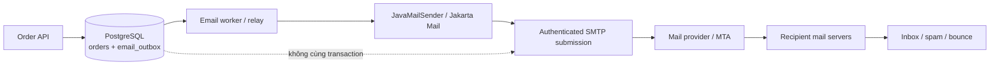
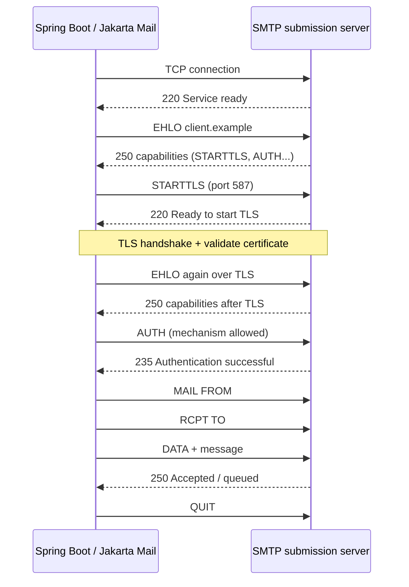
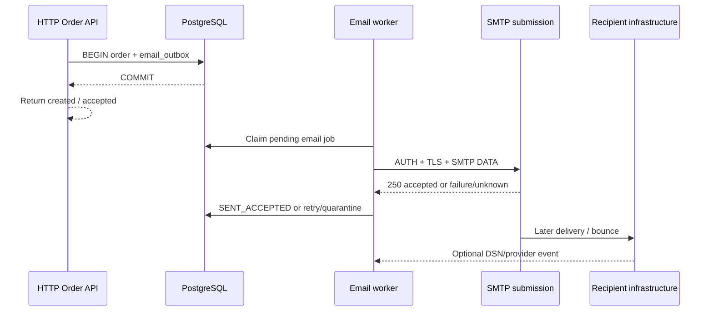
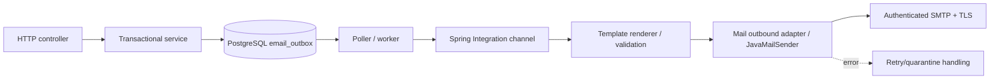
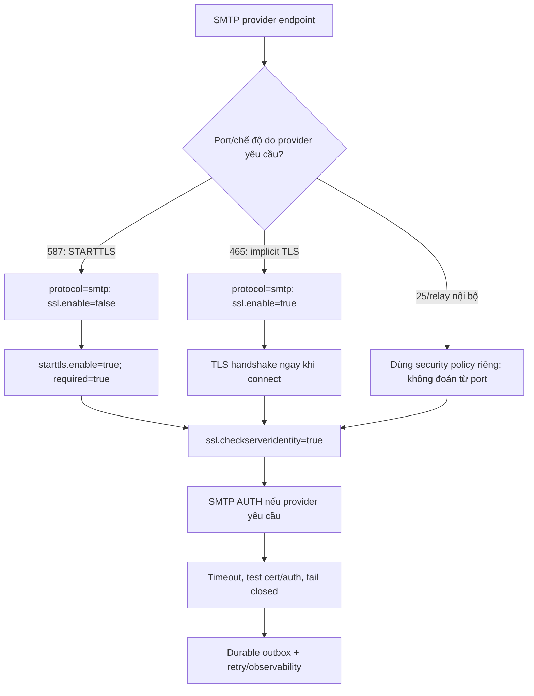

# SMTP authentication, STARTTLS và SSL

> **Chương:** Email  
> **Module:** `SPRING_BOOT_INTEGRATION` — tổ chức tích hợp hệ thống Spring Boot qua HTTP client, cơ sở dữ liệu, cache, broker thông điệp và adapter Spring Integration; trọng tâm là quản lý cấu hình, hợp đồng dữ liệu, giao dịch, lỗi, xử lý trùng lặp, kiểm thử và quan sát các luồng tích hợp thực tế.
>
> **Phạm vi kỹ thuật:** Java 17+, Spring Boot 3+, Spring Framework Mail và **Jakarta Mail** (package `jakarta.mail.*`). Ví dụ minh họa cấu hình máy chủ SMTP hỗ trợ gửi mail từ ứng dụng; nhà cung cấp có thể yêu cầu password ứng dụng, OAuth 2.0, IP allowlist hoặc cơ chế xác thực riêng. Cần đối chiếu version JavaMail provider/Spring Boot và chính sách SMTP của đơn vị vận hành. Không đặt mật khẩu thật trong tài liệu hoặc source.

## 1. Bài toán: gửi email xác nhận đơn hàng nhưng bảo mật và độ tin cậy chưa rõ

Order Service cung cấp HTTP API tạo đơn. Sau khi transaction PostgreSQL commit, hệ thống phải gửi email xác nhận đến khách. Một implementation ban đầu thường làm như sau:

```text
POST /orders
  -> INSERT orders
  -> gọi mailSender.send(...)
  -> trả HTTP 201
```

Khi đưa lên môi trường thật, nhiều vấn đề xuất hiện:

- Máy chủ SMTP chỉ cho phép gửi khi đã xác thực bằng username/password hoặc OAuth token.
- Cấu hình port `587` nhưng ứng dụng quên STARTTLS, có nguy cơ lộ thông tin xác thực trên đường truyền.
- Chuyển sang port `465` nhưng vẫn dùng kết nối plaintext trước khi gọi STARTTLS, làm TLS handshake thất bại.
- Server có chứng chỉ không khớp hostname, nhưng cấu hình lại vô hiệu hóa certificate validation để “chạy cho được”.
- Request bị giữ lâu vì SMTP connect/read timeout không cấu hình.
- Database đã commit nhưng SMTP timeout; người dùng retry HTTP và có thể nhận nhiều email.
- SMTP trả `250 OK` khi nhận message nhưng email vẫn chưa chắc vào inbox người nhận.
- Email gửi trong cùng Java method `@Transactional` nhưng **SMTP không tự tham gia** database transaction.

Bài học giải thích đúng vai trò của **SMTP AUTH**, **STARTTLS**, **implicit TLS/SMTPS**, cấu hình an toàn với `JavaMailSender`, và cách đặt email trong luồng tích hợp HTTP–database–broker có xử lý lỗi và gửi lặp có kiểm soát.

### Mục tiêu học tập

Sau bài này, bạn có thể:

1. Giải thích SMTP client submission, EHLO, AUTH, STARTTLS và TLS handshake.
2. Phân biệt port `25`, `587` và `465` trong các trường hợp thường gặp.
3. Cấu hình Spring Boot gửi mail bằng **STARTTLS bắt buộc** hoặc **implicit TLS** mà không trộn hai chế độ.
4. Hiểu các property `mail.smtp.auth`, `starttls.enable`, `starttls.required`, `ssl.enable`, `ssl.checkserveridentity` và timeout.
5. Xác định đúng ranh giới xác thực server, xác thực tài khoản và xác minh sender.
6. Tạo email đơn giản/MIME bằng `JavaMailSender`, xử lý encoding, HTML, recipient và attachment an toàn.
7. Phân loại lỗi SMTP tạm thời/vĩnh viễn, retry có backoff và giới hạn.
8. Tổ chức gửi email qua outbox/job bền vững, biết vì sao SMTP **không bảo đảm exactly-once**.
9. Kiểm thử TLS, authentication, failure modes và quan sát độ trễ/kết quả gửi.

## 2. SMTP làm gì trong hệ thống tích hợp?

SMTP (*Simple Mail Transfer Protocol*) là giao thức chuyển thư điện tử từ **mail user agent/application tới mail submission server**, và giữa các **mail transfer agent**. Trong ứng dụng Spring Boot, máy chủ SMTP được gọi là **outbound mail server/relay/provider**.



Một message có thể trải qua nhiều trạng thái:

1. Ứng dụng **tạo ý định gửi**.
2. Worker kết nối và xác thực với SMTP submission server.
3. Server **chấp nhận** message ở mức giao thức SMTP.
4. Provider thử chuyển thư tới miền người nhận.
5. Thư có thể được phát vào inbox, spam folder, bị trì hoãn hoặc bounce.

**SMTP `250` từ máy chủ submission không đồng nghĩa người nhận đã đọc hoặc chắc chắn nhận được email.** Việc nhận thư thực tế phụ thuộc DNS, policy của recipient, SPF/DKIM/DMARC, reputation, spam filtering và bounce handling.

### 2.1. Không nhầm các loại địa chỉ

| Khái niệm | Vai trò | Ví dụ |
|---|---|---|
| SMTP host | Máy chủ ứng dụng kết nối để gửi | `smtp.provider.example` |
| SMTP account | Danh tính được server xác thực | `mailer@shop.example` |
| Header `From:` | Người gửi hiển thị trong email | `Orders <orders@shop.example>` |
| Envelope MAIL FROM | Địa chỉ envelope/return-path khi gửi | `bounces@shop.example` |
| RCPT TO | Recipient trong SMTP envelope | `customer@example.net` |
| Header `To:`/`Cc:`/`Bcc:` | Thông tin địa chỉ ở MIME message | Người nhận hiển thị / ẩn |
| `Message-ID` | Header định danh email ở mức mail | `<id@shop.example>` |

SMTP account, From header và envelope sender **không bắt buộc là cùng một chuỗi**, nhưng provider có thể yêu cầu chúng thuộc domain/identity đã xác minh. Việc chúng khác nhau cần có lý do và chính sách deliverability rõ.

## 3. Kiến trúc SMTP submission: EHLO, STARTTLS, AUTH và DATA

Một luồng gửi cơ bản:



Đây là **mô hình STARTTLS**; với implicit TLS trên `465`, TLS handshake xảy ra **ngay khi thiết lập kết nối**, rồi mới trao đổi lời chào SMTP/EHLO/AUTH. Thứ tự và những command cụ thể có thể khác theo provider hoặc cơ chế xác thực.

Các thành phần có trách nhiệm riêng:

- **EHLO**: client giới thiệu và nhận danh sách extension mà server công bố.
- **STARTTLS**: yêu cầu nâng một kết nối SMTP plaintext hiện có thành TLS.
- **TLS**: bảo vệ kênh truyền và xác thực danh tính máy chủ nếu cấu hình kiểm tra chứng chỉ đúng.
- **AUTH**: máy chủ kiểm tra thông tin đăng nhập của client; đây là **xác thực tài khoản**, không phải mã hóa đường truyền.
- **MAIL FROM / RCPT TO**: envelope sender và recipient.
- **DATA**: gửi nội dung MIME; chỉ sau phản hồi thành công của server mới biết nó đã chấp nhận message tại boundary đó.

## 4. Port 25, 587 và 465: vì sao không thể hoán đổi tùy ý?

| Port phổ biến | Mục đích thường gặp | Bắt đầu bằng TLS? | Ghi chú |
|---|---|---|---|
| `25` | SMTP relay giữa MTA; một số relay nội bộ | Thường plaintext rồi STARTTLS nếu hỗ trợ | Không mặc định phù hợp cho ứng dụng gửi qua Internet |
| `587` | **Message submission** cho client/application | Thường plaintext, nâng cấp bằng STARTTLS | Lựa chọn thông dụng cho SMTP AUTH + STARTTLS |
| `465` | **Submissions với implicit TLS** | **TLS ngay sau TCP connect** | Không dùng trình tự STARTTLS plaintext ban đầu |

Port chỉ là **quy ước phổ biến**, không tự chứng minh server hỗ trợ chính sách gì. Một tổ chức có thể cấu hình relay nội bộ trên port khác; phải dùng hướng dẫn của provider và xác minh thực tế.

- `587 + STARTTLS`: client kết nối SMTP, gọi STARTTLS, sau khi TLS thành công mới AUTH.
- `465 + implicit TLS`: TLS handshake đầu tiên, sau đó SMTP giao tiếp trong kênh TLS.
- `25`: thường dùng relay giữa mail servers; một số cloud network chặn outbound TCP/25 nhằm giảm spam.

Không dùng port `465` mà chỉ bật `mail.smtp.starttls.enable=true`. Cũng không giả định port `587` tự mã hóa khi chưa bật yêu cầu STARTTLS đúng.

### 4.1. "SSL" trong config JavaMail thường là implicit TLS

Trong thuộc tính Jakarta Mail, tên `mail.smtp.ssl.enable` có chữ “SSL” do lịch sử API, nhưng **mục đích phổ biến hiện nay là SMTP trên kênh TLS ngay từ đầu**. Đừng suy ra phải bật giao thức TLS 1.0/SSLv3 cũ. TLS phiên bản được phép phải tuân theo JDK, security policy và provider.

## 5. SMTP authentication: ai được quyền gửi?

SMTP AUTH là extension cho phép client trình bày danh tính để gửi email qua máy chủ submission/relay. Trong Spring Boot, các thông tin điển hình gồm:

```text
spring.mail.username
spring.mail.password
mail.smtp.auth=true
```

Server có thể cung cấp nhiều cơ chế:

| Cơ chế | Ý tưởng | Lưu ý |
|---|---|---|
| `PLAIN` | Credentials trong giao thức AUTH, không tự mã hóa | Chỉ dùng qua TLS đã xác minh |
| `LOGIN` | Cơ chế phổ biến ở một số server | Cũng cần TLS; không phải lợi thế bảo mật tự thân |
| `XOAUTH2` | Bearer access token/OAuth2 để xác thực SMTP | Cần cấp, làm mới và quản lý token đúng |
| `CRAM-MD5` hoặc cơ chế cũ | Challenge/response trong một số hệ thống legacy | Provider/JDK có thể không hỗ trợ hoặc không khuyến khích |
| Không AUTH | Relay dựa trên IP/mTLS/trust policy | Chỉ chấp nhận nếu security team thiết kế rõ, không coi là open relay |

**Quan trọng:** `mail.smtp.auth=true` chỉ bật cơ chế xác thực, **không bảo đảm thông tin đăng nhập được mã hóa khi truyền**. TLS và kiểm tra danh tính máy chủ là các yêu cầu tách biệt.

### 5.1. AUTH PLAIN/LOGIN qua TLS vẫn phải bảo vệ mật khẩu

Dù TLS bảo vệ dữ liệu trên đường truyền, credential vẫn có thể bị lộ qua:

- File cấu hình/CI/CD logs.
- `application.yml` được commit vào Git.
- Debug logs có AUTH command hoặc mail headers.
- Tracing/exception messages chứa connection URL.
- Process dumps hoặc secret không được rotation.
- Quyền SMTP account quá rộng, cho phép gửi giả mạo From domain.

Dùng secret manager/Kubernetes Secret/biến môi trường với phân quyền tối thiểu, rotation và kiểm soát truy cập. Không đưa password hoặc OAuth access token vào message payload hay correlation headers.

## 6. STARTTLS: nâng cấp kết nối hiện có

STARTTLS cho phép bắt đầu với SMTP plaintext rồi **nâng cấp kênh** sang TLS trên cùng kết nối. Trong JavaMail:

```properties
mail.smtp.starttls.enable=true
mail.smtp.starttls.required=true
mail.smtp.ssl.checkserveridentity=true
```

Hai thuộc tính đầu **không tương đương**:

- `starttls.enable=true`: cho phép/đề nghị STARTTLS nếu server hỗ trợ.
- `starttls.required=true`: yêu cầu STARTTLS; nếu server không hỗ trợ hoặc TLS negotiation thất bại, **không gửi mail qua plaintext** theo chính sách này.

Dùng **cả hai** khi security policy yêu cầu encryption đối với SMTP submission ở port `587`. Tùy phiên bản mail provider, `required=true` cũng ngụ ý cần TLS; việc khai báo hai flag tường minh giúp review dễ hơn.

### 6.1. STARTTLS stripping và downgrade

Một attacker hoặc proxy can thiệp kết nối plaintext ban đầu có thể làm extension STARTTLS không xuất hiện. Nếu chỉ `starttls.enable=true` và không bắt buộc, client có thể tiếp tục giao tiếp không mã hóa trong một số cấu hình.

**Không chấp nhận “có STARTTLS thì tốt, không có cũng gửi”** khi ứng dụng truyền credential/dữ liệu nhạy cảm qua submission. `starttls.required=true` đóng đường downgrade này bằng cách fail nếu TLS không thể được kích hoạt.

Đây là yêu cầu bảo vệ kênh **từ ứng dụng tới SMTP server**; nó không bảo đảm tất cả các chặng MTA tiếp theo luôn TLS hoặc email được mã hóa end-to-end cho người nhận.

### 6.2. Sau STARTTLS phải nhận capability mới

Theo cách vận hành SMTP, client thường gọi `EHLO` lần nữa **sau TLS handshake** để nhận extension trong kênh đã mã hóa, gồm cơ chế AUTH mà server chỉ công bố sau TLS. Thư viện mail xử lý chi tiết giao thức; không cần tự gửi SMTP command khi dùng `JavaMailSender`.

## 7. Implicit TLS trên 465: TLS trước, SMTP sau

Với implicit TLS, server mong chờ **TLS ClientHello ngay từ đầu**. Chỉ sau khi handshake thành công client mới trao đổi lời chào SMTP.

Các thuộc tính nền tảng:

```properties
mail.smtp.ssl.enable=true
mail.smtp.ssl.checkserveridentity=true
mail.smtp.auth=true
```

Không phối hợp với việc cố phát `STARTTLS` plaintext trước handshake. Nếu provider yêu cầu cổng `465`, cấu hình thông thường là `protocol=smtp`, `port=465` và `mail.smtp.ssl.enable=true`; bạn không cần đổi `spring.mail.protocol` thành một giá trị tùy tiện chỉ vì gọi là “SMTPS”.

### 7.1. STARTTLS và implicit TLS đều có thể an toàn

Cả hai cơ chế có thể bảo vệ **kênh SMTP submission** bằng TLS được cấu hình đúng. Không kết luận “465 luôn bảo mật hơn 587” chỉ dựa vào số port. Những yếu tố quyết định gồm:

1. Chính sách **bắt buộc** TLS.
2. Kiểm tra certificate chain và hostname.
3. TLS protocol/cipher theo JDK/security policy.
4. Credential/auth mechanism phù hợp.
5. Provider/host được tin cậy và hoạt động đúng.
6. Không có fallback plaintext ngoài ý muốn.

## 8. Chứng chỉ TLS: mã hóa không đủ nếu xác thực server sai

TLS cần xác minh **mình đang nói chuyện với đúng SMTP host**. Nếu bỏ qua kiểm tra chứng chỉ, một điểm trung gian có thể giả danh server ngay cả khi kết nối vẫn “có TLS”.

Những kiểm tra thiết yếu:

- Certificate còn hạn và chain tới trust anchor được chấp nhận.
- Hostname bạn kết nối trùng với SAN/danh tính hợp lệ của chứng chỉ.
- TLS version và cipher phù hợp security policy.
- Không bị proxy TLS interception ngoài policy của tổ chức.
- Client sử dụng truststore/JDK CA hoặc truststore riêng đã quản trị.

Trong Jakarta Mail, nên bật:

```properties
mail.smtp.ssl.checkserveridentity=true
```

Tên property áp dụng cho **SSL/TLS sockets**, bao gồm luồng SMTP dùng STARTTLS theo provider tương thích.

### 8.1. Những “cách sửa” không an toàn

Không khắc phục `PKIX path building failed` hoặc lỗi hostname bằng cách:

```properties
# Các ví dụ KHÔNG được khuyến nghị cho production:
mail.smtp.ssl.trust=*
mail.smtp.ssl.checkserveridentity=false
```

`ssl.trust=*` trong provider phù hợp có thể tin mọi certificate server, làm vô hiệu hóa ý nghĩa xác thực CA. `checkserveridentity=false` bỏ qua kiểm tra hostname. Cả hai tạo điều kiện cho man-in-the-middle.

Cách đúng: dùng SMTP hostname/provider có chứng chỉ hợp lệ; sửa DNS/CA chain/truststore và ghi nhận việc cài CA nội bộ theo quy trình bảo mật. Nếu server dùng chứng chỉ nội bộ, phân phối **CA cụ thể** được phê duyệt thay vì tắt kiểm tra toàn bộ.

### 8.2. TLS protocol và JDK

Có thể giới hạn TLS protocols nếu chính sách yêu cầu, ví dụ property `mail.smtp.ssl.protocols`. Tuy nhiên không đặt một chuỗi protocol cố định mà JDK/provider không hỗ trợ; việc disable TLS 1.0/1.1, lựa chọn TLS 1.2/1.3 và cipher suites phải phù hợp security baseline hiện tại. Khi cần điều tra, xem TLS handshake/cert details và JDK security properties, không vội downgrade.

## 9. Spring Boot: dependency gửi email

Spring Boot cung cấp starter mail, tích hợp Spring Framework `JavaMailSender` và Jakarta Mail implementation phù hợp:

```gradle
dependencies {
    implementation("org.springframework.boot:spring-boot-starter-mail")

    // Ví dụ khi ứng dụng còn có database/outbox:
    implementation("org.springframework.boot:spring-boot-starter-jdbc")
    runtimeOnly("org.postgresql:postgresql")

    testImplementation("org.springframework.boot:spring-boot-starter-test")
}
```

Spring Boot có thể tự cấu hình `JavaMailSenderImpl` khi starter/classpath và `spring.mail.*` phù hợp. Chỉ khi cần custom behavior đặc thù mới tự khai báo `JavaMailSender`; một bean tự khai báo có thể khiến auto-configuration **back off**, dẫn đến property/TLS/timeout không được áp như trước.

### 9.1. Jakarta Mail vs javax.mail

Trong hệ Spring Boot 3+, imports điển hình là:

```java
import jakarta.mail.MessagingException;
import jakarta.mail.internet.MimeMessage;
import org.springframework.mail.javamail.JavaMailSender;
import org.springframework.mail.javamail.MimeMessageHelper;
```

Các ví dụ `javax.mail.*` thuộc thế hệ JavaMail/Jakarta EE trước và **không thể trộn tùy tiện** với Spring Boot 3. Khi nâng cấp, cần đồng bộ BOM, mail provider, Jakarta namespaces và test thực tế.

### 9.2. JavaMailSender không phải email queue

`JavaMailSender.send(...)` là API gửi email từ ứng dụng đến mail server, về bản chất là I/O có thể chặn. Nó không tự lưu một hàng đợi bền vững, không cung cấp dedup hay retry sau restart, và không tự nhận bounce/complaint. Những trách nhiệm này thuộc application service, outbox, worker, provider API và quy trình vận hành.

## 10. Cấu hình Spring Boot với AUTH + STARTTLS trên 587

Ví dụ `application.yml`:

```yaml
spring:
  mail:
    host: ${SMTP_HOST}
    port: 587
    protocol: smtp
    username: ${SMTP_USERNAME}
    password: ${SMTP_PASSWORD}
    default-encoding: UTF-8
    properties:
      "[mail.smtp.auth]": "true"
      "[mail.smtp.starttls.enable]": "true"
      "[mail.smtp.starttls.required]": "true"
      "[mail.smtp.ssl.enable]": "false"
      "[mail.smtp.ssl.checkserveridentity]": "true"
      "[mail.smtp.connectiontimeout]": "5000"
      "[mail.smtp.timeout]": "10000"
      "[mail.smtp.writetimeout]": "10000"

app:
  email:
    from-address: no-reply@shop.example
    from-name: Shop Orders
```

Ở đây:

- `spring.mail.host/port`: địa chỉ máy chủ submission.
- `spring.mail.username/password`: credentials được cấp riêng cho ứng dụng.
- `mail.smtp.auth=true`: dùng SMTP AUTH nếu provider yêu cầu.
- `starttls.enable/required=true`: **bắt buộc nâng cấp sang TLS** trước khi gửi.
- `ssl.enable=false`: không bật implicit TLS ở giai đoạn kết nối ban đầu.
- `ssl.checkserveridentity=true`: kiểm tra server hostname.
- `connectiontimeout/timeout/writetimeout`: timeout **mili giây** của Jakarta Mail; không phải property `Duration` có hậu tố `5s`.
- `app.email.*`: **property tùy chỉnh của ứng dụng**, không tự tạo bean hay thay `From` header nếu code không đọc nó.

Cú pháp bracket `"[mail.smtp.auth]"` giúp Spring Boot binder giữ nguyên dấu chấm trong map key. Nếu dự án dùng kiểu trình bày property khác, cần xác minh bằng integration test rằng JavaMail nhận được **đúng tên mail.smtp.***, tránh cấu hình hiển thị đúng trên YAML nhưng không có tác dụng.

### 10.1. Không ghi password literal vào Git

`SMTP_PASSWORD` phải được cấp qua secret store, secret mount hoặc biến môi trường được bảo vệ. Đừng đưa giá trị mặc định kiểu `${SMTP_PASSWORD:changeme}` vào production vì khi quên secret, hệ thống có thể chạy với credential yếu hoặc gây log lỗi khó kiểm soát.

### 10.2. Cấu hình cho từng môi trường

| Môi trường | SMTP target | Credential/TLS |
|---|---|---|
| Local developer | Mail catcher hoặc fake SMTP | Không dùng production credential; test bằng server có policy phù hợp |
| CI integration test | SMTP test server do test kiểm soát | Kiểm tra cả auth/TLS và failure path |
| Staging | Provider staging/sandbox | TLS, certificate và secret tương tự production |
| Production | Provider submission thật | AUTH, TLS bắt buộc, hostname validation, timeout, ACL |

Không cho phép config local không có TLS vô tình đi theo profile production. Nên dùng profile/CI validation/health checks và test cấu hình bắt buộc ở môi trường đích.

## 11. Cấu hình implicit TLS trên 465

Nếu SMTP provider yêu cầu implicit TLS:

```yaml
spring:
  mail:
    host: ${SMTP_HOST}
    port: 465
    protocol: smtp
    username: ${SMTP_USERNAME}
    password: ${SMTP_PASSWORD}
    default-encoding: UTF-8
    properties:
      "[mail.smtp.auth]": "true"
      "[mail.smtp.ssl.enable]": "true"
      "[mail.smtp.ssl.checkserveridentity]": "true"
      "[mail.smtp.starttls.enable]": "false"
      "[mail.smtp.connectiontimeout]": "5000"
      "[mail.smtp.timeout]": "10000"
      "[mail.smtp.writetimeout]": "10000"
```

**Đừng copy cả hai block 587 và 465 vào một profile rồi để property chồng nhau.** Chọn đúng **một chế độ** dựa trên provider:

| Nhóm property | Port 587 | Port 465 |
|---|---|---|
| `spring.mail.protocol` | `smtp` | `smtp` |
| `mail.smtp.auth` | `true` | `true` |
| `mail.smtp.starttls.enable` | `true` | `false` |
| `mail.smtp.starttls.required` | `true` | Không cần |
| `mail.smtp.ssl.enable` | `false` | `true` |
| `mail.smtp.ssl.checkserveridentity` | `true` | `true` |

Nếu server hỗ trợ cả hai, lựa chọn theo SLA, bảo mật và hướng dẫn provider; không cần bật hai cách trên cùng kết nối.

## 12. Ưu tiên cấu hình và thay đổi bean mặc định

Một hệ tích hợp có thể có nhiều SMTP account: email giao dịch, email marketing, tenant riêng hoặc provider failover.

Các tình huống:

- Chỉ **một SMTP provider**: để Boot auto-configure `JavaMailSender` từ `spring.mail.*` thường đơn giản nhất.
- Nhiều provider: tạo các `JavaMailSenderImpl` riêng, dùng `@Qualifier` hoặc adapter map theo tenant/service, có cấu hình/credential riêng.
- Provider dùng OAuth token ngắn hạn: cần strategy refresh token / custom authenticator, không gắn token tĩnh mãi như password.
- Thay provider runtime: kiểm soát connection/auth/TLS per provider và chính sách retry/circuit breaker.

Khi tự khai báo `JavaMailSender`, không dựa vào việc Boot sẽ tự gán host, username, password, TLS và timeout cho bean mới. Test exact properties của instance sử dụng ở mỗi flow. Đặc biệt **không chia sẻ mutable `JavaMailSenderImpl` rồi đổi username/password trước từng lần gửi** khi nhiều thread, vì dễ gửi nhầm tài khoản/tenant.

### 12.1. Không bỏ qua mail template config

`spring.mail.*` chỉ cấu hình **kết nối**. `From`, reply-to, template name/version, locale, allowed recipients, tenant và branding là hợp đồng ứng dụng, nên có `@ConfigurationProperties` và validation riêng (đặc biệt với from-address).

## 13. Gửi email văn bản bằng JavaMailSender

Dùng `SimpleMailMessage` cho email text/plain đơn giản:

```java
import org.springframework.mail.SimpleMailMessage;
import org.springframework.mail.javamail.JavaMailSender;
import org.springframework.stereotype.Service;

@Service
public class PlainOrderEmailSender {

    private final JavaMailSender mailSender;

    public PlainOrderEmailSender(JavaMailSender mailSender) {
        this.mailSender = mailSender;
    }

    public void sendReceipt(String recipient, String orderNumber) {
        SimpleMailMessage message = new SimpleMailMessage();
        message.setFrom("no-reply@shop.example");
        message.setTo(recipient);
        message.setSubject("Xác nhận đơn hàng " + orderNumber);
        message.setText(
            "Đơn hàng " + orderNumber + " đã được ghi nhận.");
        mailSender.send(message);
    }
}
```

`SimpleMailMessage` phù hợp plain text, không hỗ trợ MIME attachment/HTML phức tạp. `send` là lời gọi **có thể chặn** cho tới khi hoàn thành hoặc lỗi I/O/SMTP. Không gọi trực tiếp trên Reactor/Netty event-loop và không giả định nó sẽ “tự async”.

### 13.1. Dữ liệu đầu vào vẫn cần kiểm tra

- `recipient` phải được lấy từ record/identity đã xác thực và kiểm tra theo delivery policy.
- `orderNumber` là dữ liệu đã validate, không chấp nhận CR/LF tùy ý trong subject/header.
- Nếu một API cho phép nhập danh sách recipient, cần xác thực quyền gửi, rate limit và chống lạm dụng/open relay.
- Không cho request tự chọn `From` domain hoặc `Reply-To` tùy ý nếu chưa có allowlist.

`@Email` của Jakarta Bean Validation là phép kiểm tra định dạng hỗ trợ **không đồng nghĩa email tồn tại hoặc có thể nhận thư**; bounce/delivery state nằm ở tầng khác.

## 14. HTML, Unicode và attachment với MimeMessageHelper

Email thực tế thường cần HTML, UTF-8, MIME multipart và file đính kèm. Dùng `MimeMessage`:

```java
import jakarta.mail.MessagingException;
import jakarta.mail.internet.MimeMessage;

import org.springframework.mail.MailPreparationException;
import org.springframework.mail.javamail.JavaMailSender;
import org.springframework.mail.javamail.MimeMessageHelper;
import org.springframework.stereotype.Service;

@Service
public class OrderMimeEmailSender {

    private final JavaMailSender mailSender;
    private final EmailTemplateRenderer templates;

    public OrderMimeEmailSender(
            JavaMailSender mailSender, EmailTemplateRenderer templates) {
        this.mailSender = mailSender;
        this.templates = templates;
    }

    public void sendReceipt(ReceiptEmailJob job) {
        MimeMessage message = mailSender.createMimeMessage();

        try {
            MimeMessageHelper helper =
                new MimeMessageHelper(message, true, "UTF-8");

            helper.setFrom("no-reply@shop.example", "Shop Orders");
            helper.setTo(job.recipient());
            helper.setSubject("Xác nhận đơn hàng " + job.orderNumber());

            // Template do ứng dụng kiểm soát, escape HTML cho data đầu vào.
            String plain = templates.renderPlain(job);
            String html = templates.renderHtmlEscaped(job);
            helper.setText(plain, html);

            // Nếu cần attachment, chỉ thêm file đã được kiểm tra.
            // helper.addAttachment("invoice.pdf", validatedResource);
        } catch (MessagingException | java.io.UnsupportedEncodingException ex) {
            throw new MailPreparationException(
                "Cannot prepare receipt email", ex);
        }

        mailSender.send(message);
    }
}
```

`ReceiptEmailJob` và `EmailTemplateRenderer` là type ứng dụng định nghĩa. `renderHtmlEscaped(...)` phải escape dữ liệu từ đơn hàng/đối tác trước khi chèn vào HTML; không nối thẳng input vào HTML rồi coi MIME encoding là XSS/sanitization.

**Ghi chú API:** `MimeMessageHelper.setFrom(String, String)` có thể ném `UnsupportedEncodingException`, các setter khác ném `MessagingException`. Cách bắt đa ngoại lệ trên phù hợp với helper overload được dùng; nếu thay overload cần biên dịch theo version.

### 14.1. Multipart và content type

- `text/plain` giúp client đơn giản và accessibility.
- `text/html` cung cấp định dạng nhưng có nguy cơ liên kết/ảnh ngoài và phishing nếu template không kiểm soát.
- `multipart/alternative` chứa cả plain và HTML.
- `multipart/mixed` thường dùng cho attachments.
- UTF-8 giải quyết mã hóa ký tự tiếng Việt; không thay hợp đồng MIME, escaping hay xác thực domain.

Dùng template engine được quản trị và test render của các trường hợp có dấu tiếng Việt, ký tự `&`, `<` và dữ liệu dài.

## 15. SMTP AUTH và OAuth 2.0: password không phải lựa chọn duy nhất

Nhiều provider cho phép hoặc yêu cầu OAuth 2.0 thay cho username/password truyền thống. Với SMTP, cơ chế thường gặp là `XOAUTH2`. Tuy nhiên:

- Có provider **không hỗ trợ SMTP AUTH bằng username/password thường**, dù có tài khoản đăng nhập web.
- Có provider yêu cầu “application password” riêng cho SMTP.
- OAuth access token có thời gian sống ngắn, cần refresh trước hoặc khi server từ chối.
- Không đưa refresh token vào SMTP password property dưới dạng tĩnh.
- Scope/permission, tenant, account delegation và sender identity phải được provider cho phép.
- Khi chuyển sang OAuth, cơ chế xác thực thay đổi nhưng **TLS vẫn bắt buộc**.

`mail.smtp.auth.mechanisms=XOAUTH2` là ví dụ property thường dùng trong Jakarta Mail provider có hỗ trợ; **không đủ** để tự implement refresh token hay authorization flow. Cần custom credentials/authenticator adapter hoặc SDK/provider API theo hướng dẫn chính thức.

### 15.1. Không tự sinh code OAuth giả định

Mỗi provider có token endpoint, scope và security controls khác nhau. Một hướng dẫn chung không thể cung cấp chuỗi OAuth đúng cho mọi SMTP host. Giữ lớp gửi email phụ thuộc `MailSender`/`JavaMailSender` hoặc adapter abstraction, để authentication strategy được thay thế và kiểm thử độc lập.

## 16. Timeout: tránh treo request và cạn worker threads

SMTP send thường đi qua ba loại chờ:

| Property Jakarta Mail | Điều khiển | Đơn vị ví dụ |
|---|---|---|
| `mail.smtp.connectiontimeout` | Thời gian chờ thiết lập TCP connect | milliseconds |
| `mail.smtp.timeout` | Read/socket timeout khi chờ phản hồi | milliseconds |
| `mail.smtp.writetimeout` | Thời gian chờ socket write | milliseconds |

Ví dụ:

```properties
mail.smtp.connectiontimeout=5000
mail.smtp.timeout=10000
mail.smtp.writetimeout=10000
```

Không dựa vào default timeout “vô hạn” hoặc chỉ đặt một timeout chung ở HTTP client. Một lần gửi email có nhiều command/recipient, nên **tổng thời gian gửi** vẫn có thể dài hơn một giá trị timeout riêng của socket. Với SLA nghiêm ngặt, giới hạn thêm worker execution budget, batch size, executor capacity và monitoring.

### 16.1. Timeout không chứng minh message chưa được server nhận

Kịch bản:

```text
Ứng dụng gửi DATA + dấu kết thúc.
SMTP server nhận và xếp hàng.
Server phản hồi 250 nhưng response bị mất trên đường mạng.
JavaMailSender thấy timeout / connection closed.
Worker retry và gửi lại cùng nội dung.
Người nhận có thể thấy hai email.
```

Vì vậy, **SMTP thường chỉ cho phép at-least-once ở tầng ứng dụng**, không bảo đảm exactly-once delivery khi có network failure. Lưu trạng thái “outcome unknown” và quy trình reconciliation/giới hạn resend cho email nhạy cảm.

### 16.2. SMTP là blocking I/O

`JavaMailSender.send(...)` là lời gọi đồng bộ; nếu gọi trên WebFlux event-loop sẽ chặn. Trong kiến trúc reactive, đẩy việc gửi mail ra **durable outbox worker** thường tốt hơn. Nếu buộc bridge trực tiếp với legacy API, dùng `Mono.fromCallable(...).subscribeOn(Schedulers.boundedElastic())` có giới hạn, nhưng cách đó **chỉ chuyển blocking call sang thread khác**, không làm SMTP nonblocking hoặc email durable.

## 17. Phản hồi SMTP: 2xx, 4xx, 5xx không cùng ý nghĩa

SMTP status codes phản ánh trạng thái tại một bước protocol, thường có:

| Nhóm | Ý nghĩa tổng quát | Chính sách gợi ý |
|---|---|---|
| `2xx` | Thành công ở command đang xử lý | Tiếp tục; `250` sau DATA = server accepted |
| `3xx` | Server mong client gửi thêm dữ liệu | Ví dụ `354` trước nội dung DATA |
| `4xx` | Lỗi tạm thời/transient | Retry có backoff và deadline |
| `5xx` | Lỗi vĩnh viễn theo lần gọi/điều kiện hiện tại | Phân loại, sửa cấu hình/địa chỉ trước retry |

Ví dụ chẩn đoán thường gặp:

| Mã/tình huống | Diễn giải hay gặp | Hành động |
|---|---|---|
| `220` | SMTP server ready / sẵn sàng TLS | Tiếp tục đúng handshake |
| `235` | AUTH thành công | Tiếp tục envelope |
| `250` | Command accepted; sau DATA có thể là queued | Ghi nhận accepted, không coi delivered |
| `354` | Server sẵn sàng nhận DATA | Gửi MIME body |
| `421` | Service not available, closing | Retry tạm thời có backoff |
| `450/451/452` | Mailbox/processing/resource temporary failure | Retry bounded, xem provider quotas |
| `530` | Authentication required | Kiểm tra AUTH/TLS/account policy |
| `535` | Authentication failed | Kiểm tra credential/token/scope/khóa tài khoản |
| `550` | Rejected mailbox/policy | Kiểm tra recipient, sender domain và policy |
| `552` | Quota/message size vượt giới hạn | Giảm attachment hoặc xử lý theo provider |

**Mã enhanced status** dạng `5.7.8`, `4.7.0` có thể bổ sung ngữ cảnh; mapping cụ thể phụ thuộc provider. Không chỉ đọc một số `550` rồi kết luận email không tồn tại: cũng có thể bị block do policy, sender reputation hoặc domain authentication.

### 17.1. Một gửi nhiều recipient có thể thành công một phần

Nếu gửi một message tới nhiều `RCPT TO`, server có thể chấp nhận một recipient và từ chối recipient khác. Jakarta Mail có property/hành vi liên quan `mail.smtp.sendpartial`; dùng nó đòi hỏi tracking **theo từng recipient** và hiểu exception sau khi gửi một phần.

Với email giao dịch quan trọng, thường dễ quản lý trạng thái khi tạo **một job/recipient** hoặc một đơn vị delivery rõ. Không gom 1000 người vào một message rồi retry toàn bộ khi chỉ một số người bị từ chối.

## 18. Exception của Spring Mail và cách phân loại

Spring Framework Mail dùng hierarchy dưới `org.springframework.mail.MailException`. Những loại thường gặp:

- `MailAuthenticationException`: lỗi xác thực tài khoản.
- `MailSendException`: lỗi gửi sau khi chuẩn bị message, có thể gồm lỗi của một hoặc nhiều message.
- `MailPreparationException`: lỗi chuẩn bị MIME message.
- `MailParseException`: lỗi parse thông điệp.
- `MailException`: lớp chung của lỗi mail phía Spring.

Các nested exceptions có thể gồm Jakarta Mail `MessagingException` hoặc exception phụ thuộc SMTP provider với mã trả về. Không giả định mọi `MailSendException` đều có một status code duy nhất.

### 18.1. Phân loại theo chính sách thay vì retry mọi MailException

```java
public enum EmailFailureCategory {
    TRANSIENT_SMTP,
    AUTHENTICATION,
    INVALID_RECIPIENT_OR_MESSAGE,
    CONFIGURATION_OR_TLS,
    UNKNOWN_OUTCOME
}
```

Ví dụ hướng xử lý:

- `MailAuthenticationException`: **không retry liên tục từng giây**; alert chủ sở hữu credentials/token, tránh lock account.
- Certificate/hostname handshake error: configuration/security incident, fail closed; sửa truststore/host.
- `4xx` provider rõ ràng: transient, backoff và retry budget.
- `5xx` recipient/policy rõ ràng: permanent/quarantine cho job đó, không lặp vô hạn.
- Connection lost sau DATA: **unknown outcome**, nên có đánh giá resend và dedup theo provider/business workflow.
- `MailPreparationException`: thường là lỗi template/data; sửa payload trước retry.

Sự phân loại phải dựa trên **exception chain, SMTP stage và provider response thực tế**; không parse một đoạn message tự do rồi coi đó là hợp đồng ổn định.

## 19. From, envelope sender, Reply-To và chính sách gửi

Một email có nhiều lớp danh tính:

1. SMTP AUTH account: ai được phép đăng nhập.
2. `MAIL FROM`: nơi nhận phản hồi delivery/bounce ở envelope.
3. `From:`: sender hiển thị cho người nhận.
4. `Reply-To:`: địa chỉ nhận khi người dùng chọn Reply.
5. `Message-ID:`: mã tham chiếu thư trong MIME header.

Có thể đặt `From: orders@shop.example` dù SMTP AUTH dùng `mailer-service@shop.example` nếu provider cho phép domain/sender tương ứng. **Không** để tenant/HTTP request tự chọn tùy ý một `From` domain rồi gửi ra ngoài; có thể trở thành công cụ phishing/spoofing.

Property `mail.smtp.from` có thể ảnh hưởng SMTP envelope sender theo Jakarta Mail provider; nó **không tự thay** `From:` trong MIME. Cần quản lý danh tính gửi, domain bounce, reply-to và audit theo thiết kế provider.

### 19.1. Bcc và quyền riêng tư

- `To`: người nhận hiển thị.
- `Cc`: người nhận hiển thị sao chép.
- `Bcc`: người nhận ẩn trong thông điệp mà người nhận khác thấy.

Dùng `MimeMessageHelper.setBcc(...)` hoặc API phù hợp để tránh lộ danh sách người nhận, nhưng **không giả định Bcc giải quyết mọi yêu cầu riêng tư**. Email giao dịch/marketing có thể cần gửi riêng từng cá nhân để quản lý unsubscribe, personalization, tracking, consent và retries.

### 19.2. Header injection

Một subject hoặc display name từ dữ liệu không tin cậy có chứa CR/LF có thể gây nguy cơ header injection nếu code tự ghép raw MIME headers. Dùng API `MimeMessageHelper`/`InternetAddress` và validate độ dài/format; không tự tạo SMTP/MIME raw text từ HTTP request.

## 20. SPF, DKIM, DMARC và TLS giải quyết vấn đề khác nhau

| Công nghệ | Mục đích chính | Không thay thế |
|---|---|---|
| **SMTP AUTH** | Client chứng minh quyền gửi qua submission server | Không chứng minh recipient đã nhận |
| **TLS/STARTTLS** | Bảo vệ kênh client → SMTP server | Không bảo đảm end-to-end encryption |
| **SPF** | Domain công bố IP/server có thể gửi mail cho envelope identity | Không mã hóa message |
| **DKIM** | Chữ ký mật mã xác minh nội dung/header theo domain signing key | Không thay SMTP client authentication |
| **DMARC** | Policy/alignment cho domain hiển thị `From` dựa trên SPF/DKIM | Không bảo đảm email sẽ vào inbox |
| **MTA-STS/DANE** | Tăng bảo đảm TLS giữa các mail servers khi được triển khai | Không thay AUTH ở application submission |

Một ứng dụng có `mail.smtp.starttls.required=true` vẫn có thể vào spam vì SPF/DKIM/DMARC chưa đúng. Ngược lại, SPF/DKIM đúng **không cho phép gửi plaintext mật khẩu SMTP**.

### 20.1. DNS và deliverability là phần vận hành

Cần phối hợp với nhà cung cấp email hoặc nhóm quản trị DNS để:

- Xác minh From domain/sender identity.
- Cấu hình SPF, DKIM, DMARC và bounce/return-path theo provider.
- Theo dõi complaint, bounce, suppression list, rate limit và reputation.
- Phân biệt email **accepted by provider** với **delivered**, **bounced**, **opened**.
- Bảo vệ địa chỉ người nhận và tuân thủ yêu cầu consent/opt-out áp dụng cho từng loại email.

## 21. Đừng gửi SMTP trực tiếp trong transaction HTTP + database

Anti-pattern:

```java
@Transactional
public Order createOrder(CreateOrderRequest request) {
    Order order = repository.insert(request);
    mailSender.send(buildReceipt(order)); // External I/O trong DB TX.
    return order;
}
```

Vấn đề:

- SMTP chậm kéo dài thời gian giữ JDBC connection/transaction/row locks.
- SMTP có thể **chấp nhận email** rồi database rollback; khách nhận xác nhận cho đơn không tồn tại.
- Database có thể commit nhưng ứng dụng crash trước send; email không được phát.
- Retry HTTP có thể tạo thêm email nếu request idempotency chưa rõ.
- `@Transactional` mặc định không quản lý được việc SMTP server đã gửi thư.

Dùng **transactional outbox** cho email là phương án dễ vận hành:



**Outbox giữ ý định gửi sau khi đơn đã commit**, nhưng vẫn không loại bỏ khả năng gửi email lặp trong tình huống mất kết quả SMTP. Cần xác định mức trùng chấp nhận được và quy trình reconciliation.

## 22. Thiết kế bảng email_outbox và business key

Ví dụ PostgreSQL:

```sql
CREATE TABLE email_outbox (
    id BIGINT GENERATED BY DEFAULT AS IDENTITY PRIMARY KEY,
    business_key VARCHAR(180) NOT NULL UNIQUE,
    recipient VARCHAR(320) NOT NULL,
    template_code VARCHAR(80) NOT NULL,
    template_version INTEGER NOT NULL,
    template_data_json TEXT NOT NULL,
    state VARCHAR(32) NOT NULL DEFAULT 'PENDING',
    attempts INTEGER NOT NULL DEFAULT 0,
    next_attempt_at TIMESTAMPTZ NOT NULL DEFAULT CURRENT_TIMESTAMP,
    locked_by VARCHAR(120),
    locked_until TIMESTAMPTZ,
    smtp_accepted_at TIMESTAMPTZ,
    last_error_category VARCHAR(80),
    created_at TIMESTAMPTZ NOT NULL DEFAULT CURRENT_TIMESTAMP,
    updated_at TIMESTAMPTZ NOT NULL DEFAULT CURRENT_TIMESTAMP
);

CREATE INDEX idx_email_outbox_pending
    ON email_outbox (state, next_attempt_at, id);
```

**`business_key` phải ổn định qua retry**, ví dụ:

```text
receipt:order-1042:customer-392:v1
```

Nó biểu diễn *một ý định gửi email nghiệp vụ*, không phải SMTP message ID ngẫu nhiên. Nếu cùng đơn hàng phải gửi lại thông báo mới theo policy (ví dụ sửa hóa đơn), cần **business key/version mới có chủ đích**, không luôn tạo khóa mới sau mỗi HTTP retry.

### 22.1. Bảo vệ dữ liệu trong outbox

Địa chỉ email và template variables có thể chứa PII. Cần:

- Chỉ lưu dữ liệu cần thiết; tránh gửi full order/payment object.
- Encryption at rest/quyền DB tối thiểu khi phù hợp.
- Chính sách retention và cleanup sau khi kết thúc job.
- Không log `template_data_json` nguyên văn.
- Version template và policy thay đổi recipient để replay có thể tái hiện đúng.
- Nếu recipient cần thay đổi do sai địa chỉ, lưu audit quyết định sửa job.

## 23. Ghi order và email intent trong cùng DB transaction

Một service application có thể tạo bản ghi order và outbox cùng lúc.

```java
import org.springframework.stereotype.Service;
import org.springframework.transaction.annotation.Transactional;

@Service
public class OrderApplicationService {

    private final OrderRepository orders;
    private final EmailOutboxRepository emailOutbox;

    public OrderApplicationService(
            OrderRepository orders,
            EmailOutboxRepository emailOutbox) {
        this.orders = orders;
        this.emailOutbox = emailOutbox;
    }

    @Transactional
    public OrderId createOrder(CreateOrderCommand command) {
        OrderId orderId = orders.insertOnce(command);

        String emailBusinessKey =
            "receipt:" + orderId.value() + ":" + command.customerId() + ":v1";

        emailOutbox.insertIfAbsent(
            emailBusinessKey,
            command.customerEmail(),
            "ORDER_RECEIPT",
            1,
            OrderEmailData.from(command, orderId)
        );

        return orderId;
    }
}
```

`OrderRepository`, `EmailOutboxRepository`, `OrderId`, `CreateOrderCommand` và `OrderEmailData` là các thành phần của ứng dụng. Hai repository phải sử dụng **cùng datasource/transaction manager** và constraint unique để chống trùng ở DB.

Nếu `orders.insertOnce` chỉ là tên method mà không có unique request key/invariant phù hợp, HTTP retry vẫn có thể tạo nhiều order khác nhau; email outbox không thể tự sửa duplication của **nghiệp vụ order**.

### 23.1. Không gửi mail trong @TransactionalEventListener BEFORE_COMMIT

Nếu listener event chạy trước DB commit rồi gửi mail, lỗi sau đó vẫn có thể rollback DB mà email đã được SMTP chấp nhận. `@TransactionalEventListener(phase = AFTER_COMMIT)` tránh gửi trước commit, nhưng **gửi bằng callback in-memory vẫn có thể bị mất khi process crash sau commit**. Outbox bền vững giải quyết phần “đã commit rồi mà chưa kịp gửi”.

## 24. Email worker: claim có lease, không giữ DB lock khi gửi

Một hệ có nhiều instance cần tránh hai worker lấy cùng một job đang chờ. PostgreSQL hỗ trợ `FOR UPDATE SKIP LOCKED` để **claim nhanh**:

```sql
WITH picked AS (
    SELECT id
    FROM email_outbox
    WHERE
      (state = 'PENDING' AND next_attempt_at <= CURRENT_TIMESTAMP)
      OR
      (state = 'SENDING' AND locked_until < CURRENT_TIMESTAMP)
    ORDER BY created_at, id
    LIMIT :batchSize
    FOR UPDATE SKIP LOCKED
)
UPDATE email_outbox AS e
SET state = 'SENDING',
    locked_by = :workerId,
    locked_until = CURRENT_TIMESTAMP + INTERVAL '2 minutes',
    attempts = e.attempts + 1,
    updated_at = CURRENT_TIMESTAMP
FROM picked
WHERE e.id = picked.id
RETURNING e.id, e.business_key, e.recipient,
          e.template_code, e.template_version, e.template_data_json,
          e.attempts;
```

Quy trình:

1. Trong **transaction ngắn**, claim tối đa N jobs, đánh dấu owner + lease, commit.
2. Thực hiện SMTP send **ngoài** DB transaction.
3. Nếu server xác nhận `250` sau DATA, ghi `SENT_ACCEPTED` (không phải `DELIVERED`).
4. Nếu lỗi 4xx có thể retry, đặt `PENDING` với `next_attempt_at` tăng và lưu failure category.
5. Nếu permanent error, đưa vào `FAILED_PERMANENT`/quarantine theo policy.
6. Nếu mất kết quả sau DATA, đưa vào trạng thái `UNKNOWN_OUTCOME` hoặc retry có kiểm soát, có lịch sử để đối soát.
7. Khi worker crash, lease quá hạn có thể được claim lại.

### 24.1. Lease hết hạn tạo rủi ro gửi trùng

Worker A claim job 2 phút rồi SMTP bị treo 3 phút; worker B claim lại khi lease hết và cũng gửi. Vì vậy cần:

- Timeout SMTP/worker nhỏ hơn lease budget hoặc heartbeat gia hạn lease.
- Chặn một owner cũ cập nhật state sau khi lease được chuyển, bằng owner token/fencing trong câu UPDATE.
- Khi outcome không chắc chắn, áp dụng duplicate-sensitive policy và kiểm tra provider nếu có API.
- Đo số job reclaim và alert khi tăng.

Lease giúp tránh **đồng thời ở trường hợp thông thường**, không tự bảo đảm exactly-once side effect ở mail server.

## 25. SMTP retry: at-least-once và trạng thái không chắc chắn

Phân loại hành động theo giai đoạn:

| Giai đoạn thất bại | Khả năng email đã được nhận | Chính sách |
|---|---|---|
| TCP connect fail trước SMTP | Chưa gửi DATA | Retry bounded khi hạ tầng phục hồi |
| TLS handshake/cert fail | Chưa gửi DATA, security/config lỗi | Fail closed, alert, sửa cert/host |
| AUTH `535` | Chưa được phép gửi | Không retry dồn dập; sửa credential/token |
| RCPT TO bị 5xx | Recipient không được chấp nhận ở bước đó | Permanent/quarantine cho recipient |
| `4xx` trước DATA | Chưa được accept theo command đó | Retry bounded có backoff |
| Connection lost giữa DATA/response | **Có thể** đã được server nhận | Mark unknown, cân nhắc resend/reconcile |
| `250` sau DATA | Server submission đã chấp nhận | Mark accepted; chờ delivery status nếu có |

### 25.1. Message-ID có chống email trùng không?

Không thể dựa vào `Message-ID` để bảo đảm provider/mailbox tự loại thư trùng. Một số hệ có thể thread/dedup theo header, nhưng SMTP không cung cấp exactly-once contract trên đó. Bạn có thể dùng một stable business correlation header được kiểm soát để hỗ trợ audit/reconciliation, song **đừng coi header này là idempotency key được mọi mail server thực thi**.

Nếu provider có HTTP email API hỗ trợ idempotency key hoặc lookup theo request ID, có thể cân nhắc adapter đó khi cần giảm trùng mạnh hơn SMTP thuần; vẫn cần xác minh contract của provider.

### 25.2. Không retry vô hạn email giao dịch

Với email xác nhận đơn, có thể chấp nhận một lần retry có kiểm soát để tăng khả năng gửi. Với email cấp mã OTP, gửi trùng hoặc gửi trễ có thể tạo rủi ro an ninh và nhầm lẫn; policy retry/expiry cần gắn với token validity và hạn thời gian.

**Business policy, không phải một generic SMTP exception handler**, phải quyết định mức chấp nhận gửi trùng cho từng template.

## 26. Backoff, rate limiting và SMTP quotas

Một provider có thể áp dụng quota theo account/domain/IP, giới hạn recipients/ngày hoặc transactions/giây. Nếu 1.000 jobs retry cùng lúc sau outage, ứng dụng có thể tự tạo retry storm.

Nguyên tắc:

- Exponential backoff + jitter và max attempts/deadline.
- Giới hạn concurrency theo worker, provider và tenant.
- Bulkhead cho SMTP không chiếm hết DB/HTTP threads.
- Circuit breaker hoặc tạm ngừng queue khi AUTH/TLS/config lỗi kéo dài.
- Phân nhóm template để email critical có SLA riêng.
- Theo dõi throttle/`4xx`, provider quota và oldest pending age.
- Không tăng pool size vô hạn khi provider đang rate-limit.

Ví dụ lịch retry minh họa:

```text
Attempt 1: immediately
Attempt 2: after 30s ± jitter
Attempt 3: after 2m ± jitter
Attempt 4: after 10m ± jitter
Attempt 5: after 30m ± jitter
Then: quarantine / operator review
```

Các thời gian này **không phải tiêu chuẩn SMTP**; chúng phải theo SLA, provider retry hints và loại email. Không retry lỗi permanent/sender configuration cho tới khi có thay đổi điều kiện.

## 27. Spring Integration: SMTP outbound adapter không thay durability

Trong Spring Integration, một flow có thể nhận message từ channel, transform thành MIME message rồi chuyển tới **mail outbound adapter/handler**.



Cần phân biệt:

- `DirectChannel`: dispatch đồng bộ trong JVM, sender có thể thấy lỗi SMTP.
- `QueueChannel` mặc định: thường lưu RAM, không bảo đảm job còn sau crash.
- `PublishSubscribeChannel`: fan-out trong JVM, không phải broker/subscription bền vững.
- Poller từ **email_outbox DB**: tiến độ có thể phục hồi nếu job state/lease được thiết kế đúng.
- `errorChannel`: nơi nhận lỗi trong Spring Integration, không tự là DLQ bền vững.

Không tạo HTTP endpoint trả `202` ngay sau khi chỉ `send` tới QueueChannel RAM rồi cam kết email sẽ được gửi. **Commit outbox trước**, channel dùng làm tín hiệu tối ưu hoặc điều phối.

### 27.1. Khi nào cần Spring Integration?

Nếu flow email có nhiều bước EIP (routing theo tenant, filter, template transformer, scheduler, mail adapter, retry advice, error channel), IntegrationFlow có thể diễn đạt topology rõ. Nếu chỉ có một worker đọc DB rồi gọi `JavaMailSender`, một service/adaptor thuần có thể **đơn giản và dễ kiểm thử hơn**.

## 28. Broker và email: consumer ACK ở ranh giới nào?

Một kiến trúc khác là Order Service publish `OrderCreated` vào Kafka/RabbitMQ/Pulsar, Email Service nhận và gửi thư. Nhưng “consumer nhận event” không đồng nghĩa “đã gửi mail”:

```text
Broker delivers OrderCreated
  -> Email consumer validates event
  -> INSERT email_outbox with unique business key
  -> DB COMMIT
  -> Broker ACK/offset commit
  -> Email worker sends SMTP later
```

Cách này an toàn hơn việc consumer gọi SMTP rồi ACK trực tiếp nếu muốn có **job state durable riêng**.

- Consumer có thể crash sau insert outbox nhưng trước ACK: broker redeliver; unique key đảm bảo không tạo job lặp.
- Worker có thể crash sau SMTP accepted nhưng trước mark sent: vẫn có nguy cơ gửi trùng nếu retry.
- Broker ACK xác nhận event đã được **tiếp nhận bền vững bởi Email Service**, không phải email đã vào mailbox.
- SMTP failure/retry policy nằm ở worker/email domain, không nhất thiết bắt broker retry toàn message và gây nóng partition.

### 28.1. Không dùng Redis cache làm business inbox duy nhất

Đánh dấu `email:sent:eventId` trong Redis trước DB commit có thể gây mất email khi transaction rollback. Redis có thể hỗ trợ rate-limit/lock tối ưu, nhưng **database unique constraint + trạng thái job** nên là nguồn dữ liệu chính cho quyết định gửi và recovery nếu SLA yêu cầu.

## 29. Bảo mật SMTP và quyền gửi trong môi trường nhiều tenant

Các biện pháp cần thiết:

1. Chỉ cấp quyền SMTP cho mail sender service; không để ứng dụng tùy ý gửi mọi From domain.
2. Giữ TLS bắt buộc, kiểm tra hostname/certificate; không cho phép fallback plaintext khi dùng credentials.
3. Dùng credential riêng môi trường và rotate theo policy.
4. Kiểm soát From/Reply-To/recipient/template qua allowlist và tenant authorization.
5. Tránh open relay từ API công khai: xác thực caller, rate limit, chống gửi spam và xác minh recipient ownership nếu cần.
6. Không ghi full body, password, access token, auth headers hoặc raw SMTP AUTH exchange vào log.
7. Kiểm tra và giới hạn attachment size/type; không đọc file hoặc URL tùy ý từ user input.
8. Nếu dùng multi-tenant SMTP credentials, phân biệt sender adapter theo tenant và dùng DI an toàn thay vì mutate shared singleton.
9. Bảo vệ bounce/complaint webhook từ provider bằng signature validation.
10. Có policy unsubscribe/consent cho email marketing; không áp logic unsub chung một cách mù quáng cho mọi email giao dịch.

### 29.1. STARTTLS không bảo vệ khỏi mọi rủi ro nội dung

STARTTLS chỉ bảo vệ transport hop từ app đến SMTP server. Provider và downstream MTA có thể xử lý nội dung plaintext. Nếu email chứa dữ liệu cực nhạy cảm, cân nhắc **không gửi trực tiếp nội dung đó**; gửi link xác thực có thời hạn hoặc dùng end-to-end encryption theo nhu cầu.

## 30. Kiểm thử đơn vị: không gọi SMTP thật trong unit test

Unit test nên kiểm tra lớp policy/template, không cần network:

- Đúng From/recipient/subject theo template.
- Escaping HTML cho giá trị đầu vào.
- Không nhận recipient/From không được phép.
- Business key outbox ổn định khi request được gửi lại.
- Lỗi permanent được phân loại và không retry vô hạn.
- Trạng thái job chỉ chuyển sang accepted khi adapter báo kết quả tương ứng.

Có thể tách mail adapter:

```java
public interface EmailTransport {
    void send(PreparedEmail email);
}

public record PreparedEmail(
    String recipient,
    String subject,
    String plainBody,
    String htmlBody
) {}
```

Trong unit test, dùng fake `EmailTransport` lưu `PreparedEmail` được gửi và ném exception có kiểm soát để kiểm tra worker/state machine. **Đừng bắt unit test phải mock chi tiết mọi lệnh Jakarta Mail** nếu business cần kiểm tra template và retry policy, không phải implementation của SMTP protocol.

### 30.1. Không test mail gửi thật bằng cách assert `JavaMailSender.send` không ném

Nếu chỉ mock `JavaMailSender`, bạn không kiểm tra:

- Credentials được server chấp nhận.
- STARTTLS/implicit TLS được thiết lập đúng.
- Certificate chain/hostname được validate.
- Server chấp nhận recipient.
- MIME encoding được server/client nhận đúng.
- Timeout và lỗi kết nối trên network.

Các điều này thuộc integration test SMTP thực tế hoặc server test được cấu hình để mô phỏng đúng handshake và response.

## 31. Integration test với fake SMTP server

Dùng SMTP test server như GreenMail hoặc một SMTP catcher chạy qua Testcontainers theo dependency/version phù hợp; mục đích kiểm tra gửi nhận trong môi trường cô lập, **không gửi email ra Internet**.

Một test nên:

1. Khởi động fake SMTP và cấu hình `spring.mail.host/port` động.
2. Tạo tài khoản AUTH test nếu server hỗ trợ.
3. Kích hoạt STARTTLS hoặc implicit TLS theo test server.
4. Dùng test CA/truststore phù hợp và bật hostname verification.
5. Gọi `JavaMailSender` qua adapter thật.
6. Assert server nhận đúng To/From/Subject/UTF-8/MIME body.
7. Cho server từ chối AUTH, tắt STARTTLS hoặc trả lỗi 4xx/5xx.
8. Kiểm tra application retry classification/outbox status và alert.
9. Thử server chậm/đóng kết nối giữa DATA và response để xác minh trạng thái outcome unknown.
10. Bảo đảm không có email test được gửi tới địa chỉ thật.

### 31.1. Test TLS phải thực sự hỗ trợ TLS

Một số mail catcher chỉ nhận plaintext hoặc không hỗ trợ AUTH/STARTTLS. Những công cụ này rất hữu ích để xem nội dung MIME nhưng **không chứng minh cấu hình TLS production đúng**. Cần test riêng bằng SMTP server test có chứng chỉ và hỗ trợ protocol tương ứng.

### 31.2. Test certificate failure

Test một server sử dụng chứng chỉ:

- Self-signed không nằm trong truststore.
- Hostname không khớp `spring.mail.host`.
- Chứng chỉ hết hạn theo mô phỏng.
- STARTTLS không được quảng bá trong khi `starttls.required=true`.

Kết quả mong đợi là **fail closed**, không tự chuyển sang plaintext hoặc chấp nhận certificate bất kỳ.

## 32. Kiểm tra endpoint SMTP và TLS handshake khi troubleshooting

Khi có quyền vận hành và công cụ TLS phù hợp, có thể xem SMTP/TLS theo hai chế độ. Ví dụ dùng OpenSSL tại môi trường được phép:

```bash
# STARTTLS: gửi lệnh STARTTLS trên SMTP rồi handshake.
openssl s_client -starttls smtp \
  -connect smtp.provider.example:587 \
  -servername smtp.provider.example

# Implicit TLS: handshake ngay khi connect.
openssl s_client \
  -connect smtp.provider.example:465 \
  -servername smtp.provider.example
```

Những lệnh này minh họa cách **xem handshake và certificate chain**, không tự kiểm thử SMTP AUTH hoặc quyền gửi thư; cú pháp/version OpenSSL có thể khác. Cần xác minh certificate chain, hostname và exit/verification result bằng công cụ có hỗ trợ kiểm tra tên host chính xác; việc in một certificate ra màn hình **không đồng nghĩa đã validate thành công**.

Không nhập SMTP password trực tiếp trong console command mà shell history/log có thể lưu. Không thử `AUTH PLAIN` trên kết nối chưa xác thực TLS.

### 32.1. Debug Jakarta Mail có thể lộ thông tin nhạy cảm

Các option như `spring.mail.properties["mail.debug"]` hoặc `session.setDebug(true)` giúp xem lệnh SMTP, nhưng có thể xuất headers, addresses và metadata nhạy cảm. Chỉ bật trong môi trường và thời gian được kiểm soát, mask secrets và hạn chế quyền đọc logs. Không log body/recipient list đầy đủ ở production chỉ để tìm một lỗi auth.

## 33. SMTP connection health, fail-fast và readiness

Spring Boot có property `spring.mail.test-connection` trong các nhánh hỗ trợ; khi bật, ứng dụng có thể thử kết nối tới mail server khi startup.

```yaml
spring:
  mail:
    test-connection: true
```

Nó hữu ích phát hiện một số lỗi kết nối/auth lúc khởi động, nhưng:

- Không chứng minh mọi recipient được chấp nhận.
- Không chứng minh SPF/DKIM/DMARC/delivery đúng.
- Không bảo đảm server sẽ luôn sẵn sàng sau startup.
- Không thay một **end-to-end gửi email kiểm thử** theo policy.
- Có thể làm startup phụ thuộc provider outage; chọn fail-fast hay degraded mode theo vai trò hệ thống.

Nếu email chỉ là xử lý background từ outbox, có thể để API tiếp tục tiếp nhận đơn hàng khi SMTP tạm down và báo readiness/metric theo **khả năng xử lý email** riêng. Nếu email là chức năng duy nhất của service, tình trạng worker không hoạt động có thể cần phản ánh ở readiness.

### 33.1. Một health check không được spam SMTP server

Không gửi email thật mỗi vài giây chỉ để kiểm tra health. Phân biệt lightweight connectivity test, provider availability và canary gửi thư có giới hạn theo lịch. Alert từ backlog/outbox age và error rates thường phản ánh tác động nghiệp vụ chính xác hơn một probe connect-only.

## 34. Observability từ HTTP đến mail server và mailbox

| Mốc | Metric/event | Ý nghĩa |
|---|---|---|
| Order commit | `orders_created_total` | Đơn hàng được ghi nhận |
| Email intent created | `email_outbox_enqueued_total` | Có job gửi bền vững |
| Outbox backlog | Pending count/oldest age | Email chờ lâu hay provider down |
| Worker claim | Jobs claimed/lease expired | Worker có đang nhận việc? |
| SMTP connect/auth/TLS | Latency và failure category | Network/cert/credential |
| SMTP send | Accepted/failure/unknown outcome | Server submission có chấp nhận? |
| Retry | Attempt count, delay, exhausted | Outage/retry storm |
| Bounce/complaint | Provider webhook/event | Recipient không nhận hoặc từ chối |
| Delivery | Delivered event nếu provider hỗ trợ | Thư đã được provider xác nhận phát theo contract |
| Business outcome | Email SLA/notification acknowledged | Kết quả cần theo dõi của nghiệp vụ |

### 34.1. Log tối thiểu, có cấu trúc

Ví dụ field nên có:

```text
emailJobId, businessKey, templateCode, templateVersion,
smtpProvider, environment, attempt, failureCategory,
smtpStage, result, elapsedMs, correlationId
```

Không dùng địa chỉ email nguyên văn, email body, token hoặc message ID có cardinality cao làm metrics label. Với logs, mask/hash recipient và lưu theo retention/permission phù hợp; `correlationId` phục vụ tracing nhưng không thay business key.

### 34.2. SMTP accepted khác delivered

Dashboard phải phân biệt:

- `PENDING`: chờ gửi.
- `SENDING`: worker đang thử.
- `SENT_ACCEPTED`: SMTP server đã nhận message theo command response.
- `UNKNOWN_OUTCOME`: không biết server đã nhận hay chưa.
- `BOUNCED`/`COMPLAINED`: provider báo trạng thái sau gửi.
- `DELIVERED`: chỉ dùng khi có nguồn xác nhận đúng theo provider contract.
- `FAILED_PERMANENT`: không retry đến khi có can thiệp hoặc dữ liệu được sửa.

Không báo “100% email delivered” chỉ dựa trên số lần `JavaMailSender.send(...)` trả bình thường.

## 35. Troubleshooting: triệu chứng, nguyên nhân và cách xử lý

| Triệu chứng | Nguyên nhân hay gặp | Hướng xử lý |
|---|---|---|
| `Connection refused` | Host/port sai, firewall, provider down | Kiểm tra DNS, network ACL, port |
| `Read timed out` | Server chậm, quá tải, response mất | Timeout, capacity, trạng thái gửi không chắc chắn |
| `Could not convert socket to TLS` | STARTTLS handshake/protocol/certificate | Kiểm tra port, TLS support và truststore |
| `STARTTLS is required but host does not support STARTTLS` | Port/server không quảng bá STARTTLS | Dùng đúng endpoint/policy, không tắt required |
| Port `465` báo giao thức lỗi | Client gửi plaintext trước TLS | Bật `mail.smtp.ssl.enable=true` |
| Port `587` báo protocol/TLS lỗi | Client dùng implicit TLS nhầm port | Bật STARTTLS, tắt implicit TLS |
| `PKIX path building failed` | CA chain không được tin | Sửa truststore/certificate, không `trust=*` |
| `No subject alternative names matching...` | Hostname sai/mismatch | Dùng đúng SMTP host/chứng chỉ |
| `535 Authentication failed` | Password/token/app password/scope sai | Quản lý credentials, OAuth, khóa tài khoản |
| `530 Authentication required` | Chưa AUTH hoặc server chỉ cho AUTH sau TLS | Kiểm tra AUTH và trình tự STARTTLS |
| `550 Sender rejected` | Domain/sender chưa verify hoặc policy | Kiểm tra From, envelope, SPF/DKIM/DMARC |
| `550 Recipient rejected` | Địa chỉ/policy mailbox | Quarantine đúng recipient, đừng retry mãi |
| `421/451` khi burst | Quota/throttling/provider outage | Backoff/jitter, giới hạn concurrency |
| Mail send OK nhưng không có trong inbox | Spam/bounce/delayed delivery | Provider logs, DNS auth, recipient filters |
| Một đơn tạo hai email | HTTP/broker retry hoặc worker mất ACK | Outbox business key, unknown outcome policy |
| Pod restart làm mất email | Chỉ gửi async trong RAM | Persistent outbox/job và recovery |
| Outbox `SENDING` lâu | Worker chết/lease stale/SMTP timeout | Reclaim lease, metric oldest age |
| DB rollback nhưng email đã tới người dùng | Gửi SMTP trong DB transaction | Outbox sau commit |
| Thread pool HTTP cạn | Gọi `JavaMailSender` đồng bộ trong request | Background worker/queue bền vững |
| BCC lộ recipient | Tự ghép To/Cc headers sai | Dùng MimeMessageHelper và test MIME |
| Logs chứa AUTH/recipient | Mail debug không kiểm soát | Tắt/mask, kiểm toán quyền truy cập |

Không “sửa” lỗi bằng cách tắt TLS verification, bỏ `starttls.required`, hard-code password hoặc retry vô hạn. Những cách đó có thể chuyển lỗi nhìn thấy thành **rủi ro mất dữ liệu, lộ credential hoặc spam**.

## 36. Quyết định cấu hình theo nhu cầu

| Tình huống | Điểm khởi đầu | Cần kiểm tra thêm |
|---|---|---|
| Provider yêu cầu submission port `587` | SMTP AUTH + STARTTLS enable+required | Certificate hostname, timeout |
| Provider yêu cầu `465` | SMTP AUTH + implicit TLS `ssl.enable=true` | Đừng dùng STARTTLS plaintext |
| Relay nội bộ chỉ dựa IP allowlist | Cấu hình relay theo chính sách bảo mật | TLS/mTLS, ACL, chống open relay |
| Provider chuyển sang OAuth | XOAUTH2/authenticator adapter | Token refresh/scope, TLS |
| Email text thông thường | `SimpleMailMessage` | UTF-8, From/recipient policy |
| Email HTML/attachment | `MimeMessageHelper` | HTML escaping, multipart, size limits |
| Gửi email sau DB commit | Transactional email outbox + worker | Business key, lease, retry, monitoring |
| Nhận event từ Kafka/Rabbit | Consumer ghi email_outbox rồi ACK | Dedup/unique key và broker semantics |
| Hệ thống reactive WebFlux | Outbox worker riêng hoặc boundedElastic bridge | Không chặn event-loop |
| Email quan trọng nhạy với duplicate | Provider idempotency API nếu có + outbox | SMTP unknown outcome và reconciliation |
| Cần delivery/bounce status | Provider webhook/API được xác thực | Không suy từ SMTP `250` |
| Muốn dùng Spring Integration | Mail outbound adapter trong flow | Channel không mặc định durable |

### 36.1. Sơ đồ lựa chọn TLS



## 37. Checklist trước khi triển khai production

1. **Host/port:** dùng đúng SMTP submission endpoint, phân biệt `587 STARTTLS` và `465 implicit TLS`?
2. **Authentication:** account, mechanisms, app password/OAuth token, quyền gửi và rotation rõ?
3. **TLS bắt buộc:** với port 587, `starttls.enable=true` và `starttls.required=true`?
4. **Implicit TLS:** với port 465, `ssl.enable=true` và không gửi SMTP plaintext trước handshake?
5. **Certificate:** kiểm tra hostname, CA chain, expiry; không `ssl.trust=*`/skip validation?
6. **Credentials:** không hard-code, không commit, không log, quản lý qua secrets?
7. **Timeout:** connect/read/write timeouts và tổng worker deadline có giới hạn?
8. **From/Reply-To:** sender identity, envelope sender, SPF/DKIM/DMARC đã được provider chấp thuận?
9. **Recipient:** authorization, validation, Bcc/privacy, rate limit, chống open relay?
10. **MIME:** UTF-8, plain+HTML, escaping, attachments và size limits?
11. **Transactional boundary:** email intent được commit sau khi business state hợp lệ, không gửi SMTP trong DB TX?
12. **Idempotency:** outbox business key ổn định; HTTP/broker retry không tạo jobs lặp?
13. **Claim/lease:** nhiều workers không claim đồng thời, có recovery và fencing khi lease hết?
14. **Unknown outcome:** quy trình riêng cho timeout sau DATA, không tuyên bố exactly-once?
15. **Retries:** 4xx vs 5xx/credential/TLS phân loại, backoff+jitter và max attempts?
16. **DLQ/quarantine:** job lỗi vĩnh viễn có owner, audit và cơ chế replay có kiểm soát?
17. **Provider response:** `SENT_ACCEPTED` khác `DELIVERED`, có bounce/complaint handling?
18. **Observability:** latency SMTP, error category, oldest pending, quota/throttle và delivery SLA?
19. **Testing:** fake SMTP, AUTH failure, STARTTLS required, cert mismatch, timeout, duplicate và restart?
20. **Runbook:** provider outage, credential expiry, TLS certificate rotation, retry storm và sender suspension có quy trình?

## 38. Tự kiểm tra kiến thức

**Câu 1:** `mail.smtp.auth=true` có đồng nghĩa kết nối được mã hóa không?  
**Trả lời:** Không. AUTH xác thực client, còn TLS mã hóa và xác thực kênh. Với STARTTLS nên bật `enable` và `required` cùng kiểm tra chứng chỉ.

**Câu 2:** Sử dụng port `587` và `starttls.enable=true` nhưng `required=false` có rủi ro nào?  
**Trả lời:** Nếu STARTTLS không có hoặc bị downgrade, client có thể tiếp tục không TLS theo provider/client configuration. Dùng `required=true` khi encryption bắt buộc.

**Câu 3:** Vì sao port `465` cần `mail.smtp.ssl.enable=true`?  
**Trả lời:** 465 thường là implicit TLS: TLS handshake phải diễn ra ngay khi kết nối, trước các SMTP commands.

**Câu 4:** `ssl.checkserveridentity=true` kiểm tra gì?  
**Trả lời:** Kiểm tra hostname server đối chiếu chứng chỉ, kết hợp với certificate chain validation; giúp ngăn giả mạo server.

**Câu 5:** Có nên đặt `mail.smtp.ssl.trust=*` khi chứng chỉ bị lỗi không?  
**Trả lời:** Không. Nó có thể bỏ qua kiểm tra độ tin cậy CA; cần sửa host/chain/truststore theo chính sách.

**Câu 6:** SMTP trả `250` sau DATA có nghĩa email đã ở hộp thư người nhận chưa?  
**Trả lời:** Chưa. Server SMTP hiện tại đã chấp nhận message; delivery/bounce xảy ra sau đó.

**Câu 7:** Vì sao không gọi `mailSender.send` trong `@Transactional` tạo đơn hàng?  
**Trả lời:** SMTP không tham gia DB transaction; DB rollback sau khi SMTP đã nhận có thể khiến người dùng nhận email cho đơn không tồn tại.

**Câu 8:** Outbox có bảo đảm email đúng một lần không?  
**Trả lời:** Không tuyệt đối. Nếu server đã nhận DATA nhưng response mất, worker có thể retry và gửi lặp; cần policy unknown outcome/reconciliation.

**Câu 9:** `MailAuthenticationException` nên retry vô hạn không?  
**Trả lời:** Không. Cần kiểm tra password/token/scope, cảnh báo cấu hình và tránh lock account.

**Câu 10:** Có thể dùng Redis key `sent:orderId` thay DB unique outbox không?  
**Trả lời:** Không nên làm nguồn chân lý. Redis TTL/eviction và transaction khác DB có thể khiến mất hoặc lặp email; dùng durable job state/unique business key.

**Câu 11:** `JavaMailSender` có nonblocking khi dùng Spring WebFlux không?  
**Trả lời:** Không. Nó là API I/O đồng bộ; nên gửi trong worker riêng hoặc offload có giới hạn mà không hứa durability giả.

**Câu 12:** DKIM, SPF, DMARC có thay SMTP AUTH/STARTTLS không?  
**Trả lời:** Không. Chúng liên quan xác thực/ủy quyền domain và deliverability, không tự mã hóa mật khẩu submission hoặc xác thực client SMTP.

**Câu 13:** Tại sao cần test STARTTLS bằng server có TLS thật?  
**Trả lời:** Mail catcher plaintext chỉ chứng minh nội dung MIME; nó không phát hiện lỗi handshake, certificate validation hoặc bắt buộc TLS.

**Câu 14:** Worker gửi email xong nhưng crash trước mark `SENT_ACCEPTED` thì sao?  
**Trả lời:** Job có thể được claim lại và gửi lặp; cần lease/recovery, audit, đối soát và policy xử lý kết quả không chắc chắn.

**Câu 15:** Vì sao không đánh đồng `From:` với `MAIL FROM`?  
**Trả lời:** `From:` là header hiển thị, `MAIL FROM` là envelope return-path/bounce; chúng có thể khác và chịu các policy domain/provider khác nhau.

### Tài liệu tham khảo để đối chiếu theo phiên bản

- [Spring Boot — Sending Email](https://docs.spring.io/spring-boot/reference/io/email.html).
- [Spring Framework — Email](https://docs.spring.io/spring-framework/reference/integration/email.html).
- [Eclipse Angus Mail — Jakarta Mail implementation](https://eclipse-ee4j.github.io/angus-mail/).
- [Jakarta Mail API — Jakarta EE](https://jakarta.ee/specifications/mail/).
- [RFC 3207 — SMTP Service Extension for Secure SMTP over TLS](https://www.rfc-editor.org/rfc/rfc3207).
- [RFC 8314 — Use of TLS for Email Submission and Access](https://www.rfc-editor.org/rfc/rfc8314).
- [RFC 4954 — SMTP Service Extension for Authentication](https://www.rfc-editor.org/rfc/rfc4954).
- [RFC 5321 — Simple Mail Transfer Protocol](https://www.rfc-editor.org/rfc/rfc5321).

Bài không pin một provider cụ thể; cần chọn documentation/SMTP policy theo deployment thật, đối chiếu JDK TLS settings, Jakarta Mail provider và phiên bản Spring Boot. Những property và mã SMTP minh họa phải được xác nhận bằng integration tests khi yêu cầu reliability/security cao.

---

Trong chương **Email** của `SPRING_BOOT_INTEGRATION`, hãy nhớ: **SMTP AUTH xác minh quyền gửi, STARTTLS nâng một phiên SMTP hiện có thành TLS, còn implicit TLS thiết lập TLS ngay từ đầu**. Cấu hình đúng phải **bắt buộc TLS và kiểm tra danh tính server**, bảo vệ credentials, giới hạn timeout và phân loại lỗi SMTP. Để gắn email vào luồng HTTP–database–cache–broker đáng tin cậy, cần lưu ý định gửi bằng outbox trong transaction, xử lý retry/unknown outcome có kiểm soát, theo dõi SMTP accepted khác delivery thực tế và không hứa exactly-once chỉ vì `JavaMailSender.send` trả thành công.
