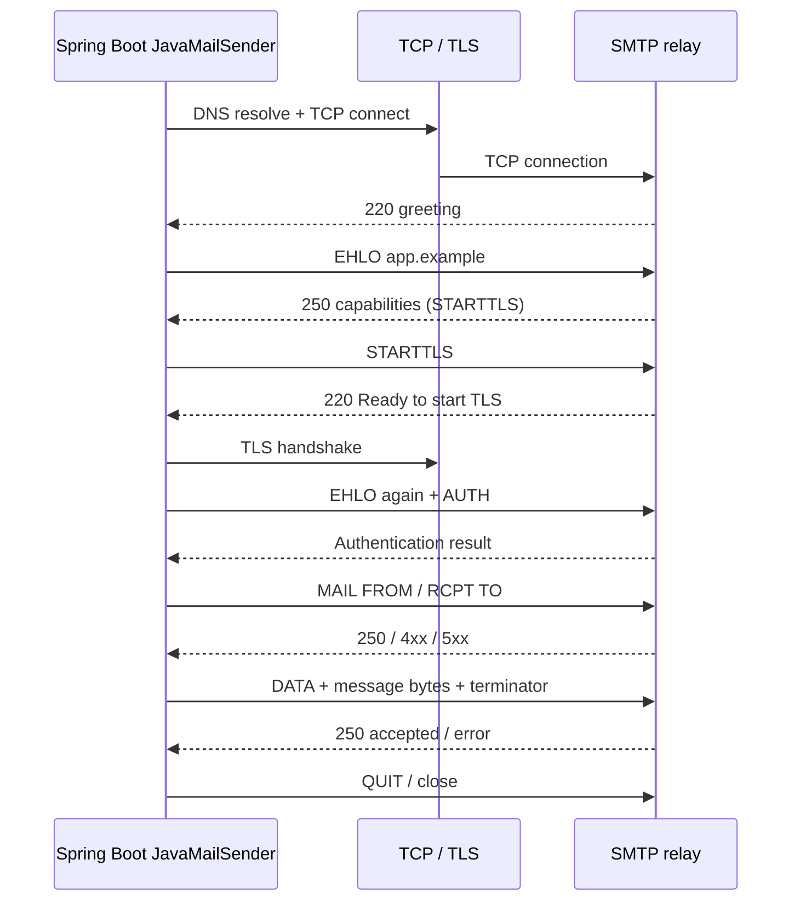
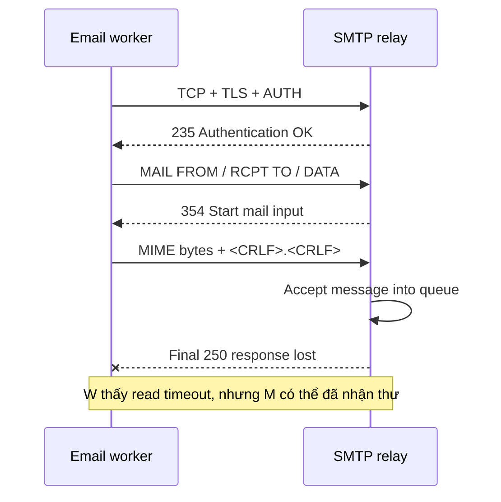
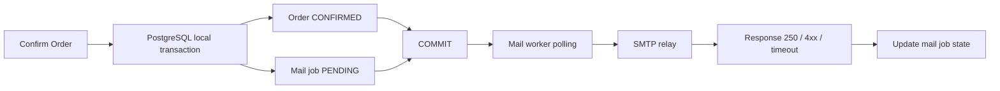

# Giới hạn thời gian kết nối, đọc và ghi tới SMTP server

## 1. Tại sao SMTP timeout là một phần của thiết kế tích hợp?

Trong một ứng dụng Spring Boot, email thường không phải chức năng duy nhất. Order Service có thể ghi đơn hàng vào PostgreSQL, phát sự kiện qua RabbitMQ rồi gửi email xác nhận. Nếu SMTP server chậm hoặc ngừng phản hồi, một lệnh gửi thư tưởng như đơn giản có thể giữ thread nhiều giây, thậm chí chờ rất lâu nếu timeout không được cấu hình.

**Ba timeout phải phân biệt là:**

1. **Connection timeout:** thời gian chờ thiết lập kết nối TCP đến SMTP server.
2. **Read timeout:** thời gian chờ nhận dữ liệu hoặc phản hồi SMTP từ server sau khi đã có kết nối.
3. **Write timeout:** thời gian cho phép thao tác ghi dữ liệu từ client lên socket trước khi coi là bị kẹt.

Trong Jakarta Mail (trước đây là JavaMail), các property SMTP cốt lõi tương ứng là `mail.smtp.connectiontimeout`, `mail.smtp.timeout` và `mail.smtp.writetimeout`. Spring Boot truyền chúng qua cấu hình `spring.mail.properties[...]` đến Jakarta Mail, không phải qua một annotation `@Transactional` hay một HTTP client timeout.

Bài học thuộc chương **Email** của module **SPRING_BOOT_INTEGRATION**. Module hướng đến tổ chức tích hợp Spring Boot qua HTTP client, database, cache, broker thông điệp và adapter Spring Integration, nhấn mạnh cấu hình, hợp đồng dữ liệu, giao dịch, lỗi, xử lý trùng lặp, kiểm thử và khả năng quan sát. Vì vậy, ta sẽ đi từ cấu hình socket đến những cửa sổ lỗi nghiệp vụ như **SMTP server đã nhận thư nhưng client bị timeout trước khi thấy phản hồi**.

### 1.1. Mục tiêu học tập

Sau bài học, bạn có thể:

- Nhận biết các giai đoạn SMTP gây chờ: DNS, TCP connect, TLS, SMTP greeting, `EHLO`, authentication, `MAIL FROM`, `RCPT TO`, `DATA`, phản hồi cuối và đóng kết nối.
- Cấu hình ba timeout ở Spring Boot bằng đúng key và đơn vị **milli­second** của Jakarta Mail.
- Giải thích vì sao ba timeout không phải một **deadline cho toàn bộ hoạt động gửi email**.
- Phân biệt STARTTLS trên cổng 587 với implicit TLS/SMTPS thường dùng cổng 465, không nhầm TLS failure với read timeout.
- Phân loại SMTP 4xx/5xx, network timeout, lỗi authentication và trạng thái **UNKNOWN** khi server có thể đã chấp nhận thư.
- Thiết kế gửi mail ngoài transaction database bằng durable email outbox/job, retry có giới hạn và deduplication.
- Viết unit/integration test cho property binding, SMTP command/response, lỗi kết nối, chờ đọc, chờ ghi và kiểm tra không phát trùng khi retry.
- Đặt metrics, tracing và log an toàn; xác định pool/thread saturation khi SMTP outage.

> **Phạm vi phiên bản:** Ví dụ sử dụng Java 17+, Spring Boot 3.2+, Spring Framework 6.x, Jakarta Mail thông qua `spring-boot-starter-mail`. Jakarta Mail/Angus Mail là thư viện thực thi ở các tổ hợp Spring Boot 3.x hiện đại; phiên bản dependency cụ thể do Boot BOM quản lý. Các key `mail.smtp.*` và behavior thực của provider cần kiểm tra theo phiên bản library nếu nâng cấp. Các đoạn Java lược bỏ import, một số domain classes và schema; code mẫu minh họa ranh giới và được bổ sung theo dự án trước khi chạy.

### 1.2. Tình huống xuyên suốt

Giả sử Order Service cần gửi email:

```text
Subject: Xác nhận đơn hàng O-1001
To: customer@example.test
Attachment: invoice-O-1001.pdf
```

Hệ thống có SMTP relay tại `smtp.dev.example.test`, cổng `587`, yêu cầu `STARTTLS` và authentication. Khi SMTP không phản hồi:

- HTTP request tạo đơn **không được chờ vô hạn**.
- Transaction PostgreSQL cập nhật Order **không nên giữ connection/lock** trong lúc SMTP gửi email.
- Retry **không được tự động suy rằng thư chưa gửi** chỉ vì client timeout.
- Có thể phải đối soát với mail provider hoặc chấp nhận khả năng duplicate theo SLA thực tế.

## 2. SMTP là giao thức nhiều bước, không phải một thao tác ghi duy nhất

### 2.1. Dòng thời gian SMTP submission

Một phiên SMTP submission thường diễn ra như sau:



Không phải provider nào cũng dùng mọi lệnh theo đúng chuỗi minh họa: authentication mechanism, pipelining, TLS policy, partial recipient acceptance và server extensions có thể thay đổi. Nhưng sơ đồ cho thấy một lần gửi mail có **nhiều lượt đọc/ghi** trên cùng connection, không phải một HTTP request/response.

### 2.2. Phân vùng thời gian

```text
T0 - DNS: phân giải smtp.dev.example.test
T1 - TCP: kết nối host:port
T2 - Greeting: chờ SMTP 220
T3 - EHLO / STARTTLS / TLS handshake
T4 - AUTH và nhận xác nhận
T5 - MAIL FROM và RCPT TO
T6 - DATA: ghi headers + body + attachments
T7 - Chờ phản hồi cuối (thường 250)
T8 - QUIT / socket close
```

| Giai đoạn | Timeout thường liên quan | Điều cần hiểu |
|---|---|---|
| DNS | Resolver/OS/network policy | Không mặc định được bảo vệ bởi TCP connect timeout |
| Thiết lập TCP | `mail.smtp.connectiontimeout` | Kiểm soát chờ connect theo socket provider |
| Greeting/EHLO/AUTH/SMTP command replies | `mail.smtp.timeout` | Chờ đọc từ server, có thể lặp nhiều lần |
| STARTTLS/TLS handshake | Network/TLS read/write behavior | Có thể chịu tác động socket timeouts, nhưng không đồng nghĩa có deadline tổng |
| Gửi DATA/attachment lên socket | `mail.smtp.writetimeout` | Có tác dụng khi socket write bị nghẽn |
| Nhận final 250/4xx/5xx | `mail.smtp.timeout` | Timeout ở đây có thể là kết quả giao thư **UNKNOWN** |
| Đóng/QUIT | Transport/provider behavior | Cần kiểm soát cleanup, không mặc định cùng một deadline tổng |

### 2.3. Cổng 25, 587 và 465

- **25:** chủ yếu cho chuyển tiếp mail giữa servers; nhiều mạng cloud/ISP hạn chế outbound port 25. Không mặc định dùng cho ứng dụng gửi thư có authentication.
- **587:** SMTP submission, thường dùng **STARTTLS**; đầu tiên là TCP/SMTP rồi nâng lên TLS sau lệnh STARTTLS. Đặt yêu cầu TLS theo chính sách.
- **465:** implicit TLS (thường gọi SMTPS), TLS bắt đầu ngay khi socket kết nối; cấu hình khác STARTTLS.

Port không tự xác định giao thức an toàn: SMTP server có thể được vận hành với port custom. Phải đọc hợp đồng của provider và kiểm thử thực tế thay vì chọn `465` rồi vẫn dùng STARTTLS theo mẫu `587`.

### 2.4. Thư được “accepted” khác “delivered”

`250 OK` sau DATA thường chỉ chứng minh SMTP relay **đã chấp nhận trách nhiệm xử lý/giao tiếp thư** theo chính sách của nó. Nó **không** chứng minh mail đã vào inbox người nhận, không bị bounce, không nằm ở spam, hoặc đã được đọc.

Nếu Order Service cần biết “khách đã nhận thư”, phải có delivery/bounce webhook, status API hoặc cơ chế đối soát do mail provider cung cấp. Đừng dùng `JavaMailSender.send(...)` trả về bình thường như bằng chứng cuối cùng về delivery.

## 3. Ba SMTP timeout của Jakarta Mail

### 3.1. Bảng thuộc tính chuẩn

| Jakarta Mail property | Đơn vị | Điều chỉnh | Khi không cấu hình |
|---|---|---|---|
| `mail.smtp.connectiontimeout` | milliseconds | Socket TCP connect timeout | Provider mặc định có thể chờ vô hạn |
| `mail.smtp.timeout` | milliseconds | Socket read timeout khi chờ dữ liệu SMTP | Provider mặc định có thể chờ vô hạn |
| `mail.smtp.writetimeout` | milliseconds | Socket write timeout khi gửi dữ liệu | Provider mặc định có thể chờ vô hạn |

Các giá trị thường là **số nguyên milliseconds**, không phải `Duration` dạng `3s` bên trong raw Jakarta Mail properties. Với Boot app config, cách an toàn là đặt các giá trị numeric rõ ràng:

```properties
spring.mail.properties[mail.smtp.connectiontimeout]=3000
spring.mail.properties[mail.smtp.timeout]=5000
spring.mail.properties[mail.smtp.writetimeout]=5000
```

**Không** tự giả định value `0` tương đương “timeout ngay”; trong nhiều Java socket configurations, zero mang nghĩa **không giới hạn**. Đặt giá trị dương, validate và chọn dựa trên SLA thực tế.

### 3.2. Connection timeout: chờ kết nối TCP

`mail.smtp.connectiontimeout` được dùng khi SMTP transport tạo socket và kết nối tới host/port. Ví dụ `3000` yêu cầu không chờ TCP connect quá thời gian tương ứng theo implementation.

Tuy nhiên:

- DNS lookup có thể xảy ra **trước** connect và không nhất thiết cùng timeout.
- Proxy/SOCKS/tunnel và nhiều địa chỉ IP có thể làm tổng thời gian khác một lần connect.
- TCP connect thành công nhưng server chưa gửi greeting `220` là **read timeout**, không phải connect timeout.
- TLS handshake xảy ra sau hoặc trong quá trình thiết lập transport tùy STARTTLS/SMTPS, không tự được giới hạn bởi cùng deadline tổng.
- Nếu OS trả `Connection refused` ngay, thời gian lỗi có thể ngắn hơn 3 giây; đây là behavior đúng.

### 3.3. Read timeout: chờ phản hồi SMTP

`mail.smtp.timeout` dùng cho hoạt động đọc dữ liệu trên socket. Với `5000`, client có thể fail nếu server không gửi dữ liệu trong thời gian chờ đọc theo implementation.

Điểm thường bị hiểu sai: đó **không phải “toàn bộ email phải gửi xong trong 5 giây”**. Nếu một cuộc trao đổi có nhiều lệnh/response hoặc server gửi dữ liệu từng phần trước khi timeout, tổng thời gian có thể dài hơn nhiều lần read timeout. Server có thể nhận message body rồi chậm trả final `250`; client thấy read timeout nhưng **không thể kết luận thư chưa được relay chấp nhận**.

### 3.4. Write timeout: khi phía nhận không đọc dữ liệu

`mail.smtp.writetimeout` xử lý tình huống socket write bị nghẽn: network buffer đầy, remote SMTP server không tiếp tục đọc hoặc connection hỏng. Điều này đặc biệt dễ bộc lộ với **attachment lớn**, throughput mạng thấp và nhiều emails đồng thời.

Jakarta Mail SMTP provider có implementation cho write timeout dựa trên việc theo dõi timeout và đóng socket khi write vượt ngưỡng; ở một số phiên bản nó dùng **ScheduledExecutorService/thread cho từng connection**, nên bật write timeout trong workload có rất nhiều kết nối đồng thời có thể tăng chi phí thread/resource. Kiểm tra provider version và giám sát concurrency thực, không coi việc đặt write timeout bằng 1 ms là một chiến lược an toàn.

Write timeout **không phải** quota tốc độ upload, không giới hạn tổng kích thước file và không tự bảo đảm server đã chấp nhận DATA. Gửi thành công bytes chưa đồng nghĩa đã nhận final `250`.

### 3.5. Tổng thời gian có thể vượt cả ba timeout

Ví dụ cấu hình:

```text
connectiontimeout = 3000 ms
timeout           = 5000 ms
writetimeout      = 5000 ms
```

Một send có thể gồm DNS 1 s, connect 2 s, greeting 1 s, EHLO 2 s, STARTTLS 2 s, AUTH 2 s, gửi DATA 4 s và chờ final 250 4 s. Không có quy tắc chung nào khiến tổng chỉ bằng `max(3000,5000)` hay `3000+5000+5000`; một số timeout áp dụng cho **từng blocking operation** trong một phiên nhiều bước.

Để có **overall mail attempt deadline**, cần một cơ chế điều phối ở mức job/worker cùng giới hạn concurrency và rủi ro cancel đang diễn ra. `Future.cancel(true)`/`CompletableFuture.orTimeout(...)` riêng lẻ thường **không bảo đảm hủy được socket write/TLS đang blocking**; timeout của chính transport vẫn rất cần thiết.

### 3.6. Exception nào có thể xuất hiện?

Spring `JavaMailSenderImpl` thường chuyển các lỗi từ Jakarta Mail thành họ `MailException` như `MailSendException`, `MailAuthenticationException` hoặc `MailPreparationException` tùy giai đoạn. Bên dưới có thể có `MessagingException`, `MailConnectException`, `SocketTimeoutException` hay `SocketException` qua cause/nextException.

**Không phân loại chỉ dựa trên chuỗi lỗi** như “Read timed out”. Cần xét phase, SMTP reply code khi có, exception chain, correlation ID, và sau cùng là **provider status** nếu kết quả không rõ. Timeout trước khi connect thành công thường có khác biệt về nguy cơ gửi trùng so với timeout sau DATA.

## 4. Cấu hình Spring Boot đúng property, đúng protocol

### 4.1. Dependency và auto-configuration

Với Maven sử dụng Spring Boot parent/BOM:

```xml
<dependency>
    <groupId>org.springframework.boot</groupId>
    <artifactId>spring-boot-starter-mail</artifactId>
</dependency>
```

Starter đưa Spring Mail abstraction và Jakarta Mail implementation phù hợp vào classpath. Khi điều kiện auto-configuration thỏa mãn, Spring Boot tạo `JavaMailSender` từ các property `spring.mail.*`. Nếu ứng dụng tự tạo bean `JavaMailSender`, auto-configuration có thể **back off**; khi ấy cần kiểm tra chính bean custom có đọc đúng ba timeout không.

**Không cần** thêm `spring-boot-starter-web` để gửi SMTP. Controller HTTP, scheduled job, Rabbit listener hoặc Spring Integration flow có thể gọi một application mail service riêng; hành vi `JavaMailSender.send` vẫn đồng bộ tại nơi thực thi.

### 4.2. Ví dụ application-local.yml cho SMTP submission cổng 587

```yaml
spring:
  mail:
    host: smtp.dev.example.test
    port: 587
    protocol: smtp
    username: local-mailer
    password: example-only-not-a-real-secret
    default-encoding: UTF-8
    properties:
      "[mail.smtp.auth]": true
      "[mail.smtp.starttls.enable]": true
      "[mail.smtp.starttls.required]": true
      "[mail.smtp.ssl.checkserveridentity]": true
      "[mail.smtp.connectiontimeout]": 3000
      "[mail.smtp.timeout]": 5000
      "[mail.smtp.writetimeout]": 5000
```

Trong Spring Boot YAML, việc đặt các key có dấu chấm trong `spring.mail.properties` theo dạng **quoted bracket notation** giúp giữ nguyên tên property cho Jakarta Mail. Thực chất provider cần nhận chuỗi key chính xác `mail.smtp.connectiontimeout` chứ không phải object lồng `mail → smtp → connectiontimeout`.

Ví dụ mật khẩu chỉ dùng để **minh họa cấu trúc**, không sử dụng trong service thật và không được commit credentials thực vào repository. Production nên lấy credential từ secret manager/environment cùng cơ chế rotation, tách SMTP credentials cho từng application/tenant khi cần.

### 4.3. Environment variables và profile

Một cấu hình thực dụng dùng placeholders:

```yaml
spring:
  mail:
    host: ${SMTP_HOST:localhost}
    port: ${SMTP_PORT:1025}
    username: ${SMTP_USERNAME:}
    password: ${SMTP_PASSWORD:}
    properties:
      "[mail.smtp.connectiontimeout]": ${SMTP_CONNECT_TIMEOUT_MS:3000}
      "[mail.smtp.timeout]": ${SMTP_READ_TIMEOUT_MS:5000}
      "[mail.smtp.writetimeout]": ${SMTP_WRITE_TIMEOUT_MS:5000}
```

Trong profile local không cần authentication/TLS nếu server test là Mailpit/GreenMail plaintext trên loopback, có thể tắt `mail.smtp.auth`/`mail.smtp.starttls.enable` **chỉ trong profile test/local được kiểm soát**. Đừng mang cấu hình plaintext/anonymous sang staging/production. Placeholder có default là tiện lợi cho local, nhưng môi trường production nên fail fast khi SMTP host/secret bắt buộc chưa được cung cấp.

Nếu một environment variable có giá trị không hợp lệ (ví dụ `SMTP_READ_TIMEOUT_MS=abc`), Jakarta Mail có thể không diễn giải timeout như mong muốn. Kiểm tra ngay khi startup qua configuration validation và test để tránh dựa vào fallback không rõ ràng.

### 4.4. Vì sao không dùng nhầm các timeout khác của Boot?

| Property | Thuộc hệ thống | Có giới hạn SMTP send không? |
|---|---|---|
| `server.tomcat.connection-timeout` | HTTP inbound Tomcat | **Không** |
| `spring.mvc.async.request-timeout` | Async HTTP request phía MVC | **Không trực tiếp** |
| `spring.datasource.hikari.connection-timeout` | Chờ lấy JDBC connection từ pool | **Không** |
| `spring.kafka.consumer.properties.*` | Kafka consumer | **Không** |
| `spring.mail.properties[mail.smtp.connectiontimeout]` | SMTP TCP connect | **Có**, ở giai đoạn kết nối |
| `spring.mail.properties[mail.smtp.timeout]` | SMTP socket read | **Có**, ở giai đoạn đọc |
| `spring.mail.properties[mail.smtp.writetimeout]` | SMTP socket write | **Có**, ở giai đoạn ghi |

Một request HTTP inbound bị gateway timeout sau 10 giây không có nghĩa `JavaMailSender` đã dừng. Nếu mail được gửi đồng bộ từ controller, thread gửi có thể vẫn chờ SMTP dù caller đã bỏ kết nối. Cần giới hạn SMTP ở đúng transport và tốt hơn là **không đồng bộ gửi mail trên đường response nghiệp vụ**.

### 4.5. Đọc lại property thực đi vào JavaMailSenderImpl

Trong test:

```java
@SpringBootTest(properties = {
        "spring.mail.host=localhost",
        "spring.mail.port=1025",
        "spring.mail.properties[mail.smtp.connectiontimeout]=3000",
        "spring.mail.properties[mail.smtp.timeout]=5000",
        "spring.mail.properties[mail.smtp.writetimeout]=5000"
})
class MailPropertiesIT {
    @Autowired
    JavaMailSender mailSender;

    @Test
    void timeoutPropertiesReachJakartaMail() {
        JavaMailSenderImpl sender =
                assertInstanceOf(JavaMailSenderImpl.class, mailSender);

        Properties props = sender.getJavaMailProperties();
        assertEquals("3000", String.valueOf(
                props.get("mail.smtp.connectiontimeout")));
        assertEquals("5000", String.valueOf(
                props.get("mail.smtp.timeout")));
        assertEquals("5000", String.valueOf(
                props.get("mail.smtp.writetimeout")));
    }
}
```

Test này xác minh binding và bean auto-configured có chứa timeout keys; **chưa chứng minh network timeout có tác dụng** vì không mở socket thật. Ngoài ra, nếu project dùng `JavaMailSender` custom thay cho `JavaMailSenderImpl`, kiểu bean khác là điều cần chẩn đoán, không ép test cast khi architecture chủ ý dùng adapter khác.

Đừng đưa full JavaMail `Properties` vào log vì có thể chứa username, OAuth/token hoặc cấu hình endpoint nhạy cảm.

### 4.6. JavaMailSenderImpl custom: khi nào cần?

Nếu ứng dụng có nhiều mail providers với SLA/credential khác nhau hoặc có transport customization đặc thù, có thể tự tạo `JavaMailSenderImpl`:

```java
@Configuration(proxyBeanMethods = false)
class MailSenderConfiguration {

    @Bean("receiptMailSender")
    JavaMailSender receiptMailSender(
            ReceiptMailProperties config) {
        JavaMailSenderImpl sender = new JavaMailSenderImpl();
        sender.setHost(config.host());
        sender.setPort(config.port());
        sender.setProtocol("smtp");
        sender.setUsername(config.username());
        sender.setPassword(config.password());
        sender.setDefaultEncoding("UTF-8");

        Properties mail = sender.getJavaMailProperties();
        mail.put("mail.smtp.auth", "true");
        mail.put("mail.smtp.starttls.enable", "true");
        mail.put("mail.smtp.starttls.required", "true");
        mail.put("mail.smtp.ssl.checkserveridentity", "true");
        mail.put("mail.smtp.connectiontimeout", "3000");
        mail.put("mail.smtp.timeout", "5000");
        mail.put("mail.smtp.writetimeout", "5000");
        return sender;
    }
}
```

`ReceiptMailProperties` là `@ConfigurationProperties` class/record **cần định nghĩa riêng** để bind trusted config. Nếu dự án có hai senders, dùng `@Qualifier("receiptMailSender")`/`@Primary` một cách tường minh. Đặt hai bean JavaMailSender có cùng mục đích và không chọn đúng provider có thể khiến thư gửi sai tenant/account.

Trong trường hợp phổ biến **một SMTP relay cho cả ứng dụng**, ưu tiên Boot auto-configuration để tránh duplicate config. Custom bean đồng nghĩa bạn chịu trách nhiệm sao chép đầy đủ TLS/auth/timeouts/observability chính sách.

### 4.7. Startup test connection có phù hợp không?

Spring Boot có property `spring.mail.test-connection` để thực hiện kiểm tra kết nối SMTP khi startup theo cấu hình auto-configuration được hỗ trợ:

```yaml
spring:
  mail:
    test-connection: false
```

Bật kiểm tra có thể hữu ích trong môi trường staging hoặc developer muốn fail fast nếu mail server không truy cập được. Nhưng SMTP outage ngắn khi deploy có thể làm **toàn application không khởi động**, dù service chính vẫn có thể nhận đơn và lưu email jobs chờ retry. Đối với hệ thống mail gửi bất đồng bộ qua outbox, thường nên để app boot, đo tình trạng mail worker/dependency bằng health/metrics và backpressure; quyết định bật startup test theo yêu cầu vận hành.

Test connection không xác minh thư đã được chấp nhận sau `DATA`, không kiểm tra nội dung, người nhận, quota hay khả năng deliver vào inbox. Đây chỉ là một kiểm tra kết nối/auth ở thời điểm startup theo behavior thư viện.

## 5. STARTTLS và SMTPS: timeout không thay thế bảo mật

### 5.1. STARTTLS trên port 587

```yaml
spring:
  mail:
    host: smtp.example.test
    port: 587
    protocol: smtp
    properties:
      "[mail.smtp.auth]": true
      "[mail.smtp.starttls.enable]": true
      "[mail.smtp.starttls.required]": true
      "[mail.smtp.ssl.checkserveridentity]": true
      "[mail.smtp.connectiontimeout]": 3000
      "[mail.smtp.timeout]": 5000
      "[mail.smtp.writetimeout]": 5000
```

`mail.smtp.starttls.enable=true` cho phép nâng cấp kết nối bằng STARTTLS khi server hỗ trợ; thêm `mail.smtp.starttls.required=true` để **không âm thầm tiếp tục plaintext** khi SMTP endpoint yêu cầu TLS. Phải kiểm tra hostname/certificate hợp lệ bằng `mail.smtp.ssl.checkserveridentity=true` và truststore đúng CA.

Nếu provider không công bố STARTTLS, kết nối cần fail theo policy thay vì gửi credential trên kênh không bảo vệ. Không giải quyết SSL handshake failure bằng cách bật chế độ trust-all.

### 5.2. Implicit TLS trên port 465

Một cách dùng protocol `smtp` nhưng bật SSL ngay khi connect:

```yaml
spring:
  mail:
    host: smtp.example.test
    port: 465
    protocol: smtp
    properties:
      "[mail.smtp.auth]": true
      "[mail.smtp.ssl.enable]": true
      "[mail.smtp.ssl.checkserveridentity]": true
      "[mail.smtp.connectiontimeout]": 3000
      "[mail.smtp.timeout]": 5000
      "[mail.smtp.writetimeout]": 5000
```

Một số code/config dùng protocol `smtps`. Khi `spring.mail.protocol=smtps`, namespace provider properties cần tương thích `mail.smtps.*` theo Jakarta Mail; không đổi duy nhất protocol rồi giữ nguyên mọi `mail.smtp.*` một cách thiếu kiểm chứng. Đặc biệt, SSL/STARTTLS là **hai chế độ khác nhau**: cổng 465 implicit TLS thường không cần gửi lệnh STARTTLS sau khi connect.

### 5.3. TLS handshake và socket deadline

TLS handshake có hoạt động đọc/ghi và có thể bị ảnh hưởng bởi socket timeout của provider. Tuy nhiên không suy rằng `connectiontimeout=3000` đã bảo đảm toàn bộ DNS + TCP + TLS trong đúng 3 giây. Những hạ tầng có proxy/SSL inspection, auth chậm hoặc renegotiation (tùy TLS/library) cần thử nghiệm thực tế để đo các giai đoạn.

**Không nên chỉ tăng `mail.smtp.timeout` để che TLS certificate error.** Phân biệt `SSLHandshakeException` (CA/hostname/protocol), `AuthenticationFailedException` (credential/token) và `SocketTimeoutException` (server/network không phản hồi đúng hạn).

### 5.4. Truststore, hostname validation và secrets

Trong production:

- Dùng CA truststore được quản lý, rotation và kiểm thử certificate chain.
- Bật hostname verification, không đặt `mail.smtp.ssl.trust=*` hoặc trust-all socket factory như giải pháp tạm thời.
- Kiểm soát SMTP username/password/OAuth2 token; không viết chúng trong YAML commit vào Git.
- Hạn chế egress từ service chỉ tới SMTP relays cho phép, tránh SSRF qua SMTP host do request người dùng cung cấp.
- Gửi email với `From`/domain được phép, tuân SPF/DKIM/DMARC và hợp đồng relay.
- Không log `AUTH` payload, raw SMTP transcript khi có credentials hoặc nội dung cá nhân.

Timeout và TLS là **hai lớp độc lập**: một kết nối nhanh nhưng không xác minh certificate vẫn không an toàn; một kết nối mã hóa đúng nhưng chờ vô hạn vẫn làm cạn worker threads.

## 6. Gửi email bằng JavaMailSender và phân biệt lớp nghiệp vụ

### 6.1. SimpleMailMessage dùng cho email văn bản đơn giản

Spring cung cấp `JavaMailSender` và `SimpleMailMessage`:

```java
@Component
public class SimpleNotificationSender {
    private final JavaMailSender mailSender;

    public SimpleNotificationSender(
            JavaMailSender mailSender) {
        this.mailSender = mailSender;
    }

    public void sendWelcome(
            String recipient, String displayName) {
        SimpleMailMessage mail = new SimpleMailMessage();
        mail.setFrom("noreply@example.test");
        mail.setTo(recipient);
        mail.setSubject("Chào mừng");
        mail.setText("Xin chào " + displayName + "!");

        mailSender.send(mail); // Blocking SMTP I/O
    }
}
```

Mã chỉ minh họa cách sử dụng API; production cần validate email address và nội dung từ nguồn tin cậy, không cho caller tự quyết định `From` hoặc arbitrary recipient mà thiếu quyền. `send(...)` là lời gọi **đồng bộ**, có thể block thread. Timeout Jakarta Mail được cấu hình ở `JavaMailSenderImpl`, không truyền qua method `send` theo từng lần gọi.

Không gọi `sendWelcome` trực tiếp bên trong transaction ghi dữ liệu người dùng nếu mục tiêu là tránh gửi thư khi database rollback. Ghi một durable mail job trong local transaction rồi gửi bên ngoài bằng worker.

### 6.2. MIME message cho HTML và attachment

```java
@Component
public class ReceiptMimeSender {
    private final JavaMailSender mailSender;

    public ReceiptMimeSender(JavaMailSender mailSender) {
        this.mailSender = mailSender;
    }

    public void sendReceipt(
            String recipient, String orderId,
            byte[] pdfBytes) {
        try {
            MimeMessage message = mailSender.createMimeMessage();
            MimeMessageHelper helper =
                    new MimeMessageHelper(
                            message, true,
                            StandardCharsets.UTF_8.name());

            helper.setFrom("receipts@example.test");
            helper.setTo(recipient);
            helper.setSubject("Hóa đơn " + orderId);
            helper.setText(
                    "<p>Đơn hàng đã được xử lý.</p>", true);

            helper.addAttachment(
                    "invoice-" + orderId + ".pdf",
                    new ByteArrayResource(pdfBytes),
                    "application/pdf");

            mailSender.send(message);
        } catch (MessagingException ex) {
            throw new IllegalStateException(
                    "Không tạo được MIME message", ex);
        }
    }
}
```

`MimeMessageHelper` giúp thiết lập encoding, HTML và attachment; `ByteArrayResource` chỉ phù hợp khi file nhỏ và đã nằm trong bộ nhớ. Với nhiều email có file 20–50 MB, sao chép attachments vào heap có thể làm memory tăng mạnh, trong khi SMTP socket write cũng kéo dài. Dùng nguồn nội dung có thể đọc lại (file/object storage reference hoặc resource đúng semantics), giới hạn kích thước và lưu metadata/content hash để retry tái tạo **cùng phiên bản tài liệu**.

Nếu `orderId` được sử dụng làm filename/header, validate ký tự, không để CR/LF hoặc ký tự path tùy ý gây header injection; nội dung HTML từ người dùng phải được escape/sanitize. Ví dụ không nhằm cung cấp một template engine, chính sách gửi nhiều recipients hay API attachment streaming hoàn chỉnh.

### 6.3. Phân biệt lỗi chuẩn bị thư và lỗi khi gửi

| Giai đoạn | Ví dụ lỗi | Có thể SMTP đã nhận thư chưa? |
|---|---|---|
| Validate recipient/content | Email address sai, thiếu orderId | Chưa gọi SMTP |
| Tạo MIME parts | Attachment không tồn tại, encoding, converter lỗi | Thường chưa gọi SMTP |
| DNS/TCP connect | Host không phân giải, connect refused/timeout | Trong lần thử này thường chưa vào phiên SMTP |
| SMTP greeting/STARTTLS/AUTH | TLS fail, credential sai, greeting timeout | Chưa hoàn tất DATA trong phiên hiện tại |
| `MAIL FROM/RCPT TO` | Envelope bị server từ chối | Chưa nhận toàn bộ DATA; có thể chỉ vài recipients hợp lệ |
| Ghi `DATA` | Write timeout, connection reset | Có thể gửi một phần, chưa biết server nhận kết thúc DATA chưa |
| Chờ phản hồi cuối sau `DATA` | Read timeout/mất kết nối | **UNKNOWN**: server có thể đã chấp nhận thư |
| Sau response `250` | Worker crash trước khi ghi DB trạng thái | SMTP đã xác nhận acceptance, DB chưa ghi nhận |

Không biến tất cả `MailException` thành cùng một `RETRY_NOW`. Lỗi cấu hình (sai SMTP host, TLS trust, authentication) cần sửa hệ thống; lỗi 4xx transient có thể retry; lỗi timeout sau DATA cần **trạng thái không chắc chắn**, theo dõi và quy tắc gửi lại có ý thức.

### 6.4. Khi nào đóng kết nối và quản lý sender instance?

Trong sử dụng thông thường, `JavaMailSenderImpl` quản lý việc kết nối/đóng transport cho lời gọi `send`, và có thể tái sử dụng transport trong một batch theo implementation. Không tự tạo `JavaMailSenderImpl` mới cho mỗi email hoặc thay `host/username/password` trên một singleton đang được nhiều threads dùng chỉ để gửi cho tenant khác.

Với nhiều nhà cung cấp:

- Tạo sender beans riêng có cấu hình immutable sau startup.
- Chọn provider theo tenant/notification type qua application gateway có quyền kiểm soát.
- Áp concurrency limits vì nhiều SMTP connections đồng thời gây tải lên relay và thread pool, nhất là khi `writetimeout` cần tài nguyên bổ sung.
- Không mặc định mọi SMTP provider cung cấp connection pooling cho send mail; đo connect overhead trước khi áp một transport reuse/pooling tùy biến.

### 6.5. Không lẫn địa chỉ thư với tài khoản kết nối

`spring.mail.username` thường là tài khoản SMTP authentication, còn `MimeMessageHelper.setFrom(...)` là địa chỉ sender trong email. Provider có thể áp chính sách bắt buộc chúng thuộc cùng account/domain, hoặc cho phép các sender đã xác minh. Login thành công **không** chứng minh `From`/`Reply-To`/recipient có thể gửi theo quota/policy. Test relay acceptance riêng.

### 6.6. Multi-recipient và gửi một phần

Với nhiều recipients, một SMTP server có thể chấp nhận một số `RCPT TO` và từ chối số khác. Jakarta Mail có các exception và property ảnh hưởng partial send behavior (ví dụ `mail.smtp.sendpartial` trong provider hỗ trợ). Không bật chế độ partial send chỉ để “không fail cả batch” khi ứng dụng chưa quyết định semantics.

Nếu yêu cầu là “mỗi khách hàng có một thông báo độc lập”, thường tốt hơn là tạo **một mail job định danh riêng cho từng người nhận/notification**. Khi đó retry/đối soát biết chính xác người nhận nào đã được relay chấp nhận thay vì resend cả batch và vô tình gửi trùng cho những recipients đã thành công.

### 6.7. SMTP Message-ID không phải idempotency key được thực thi

Header `Message-ID` trong email có thể giúp correlation/threading/diagnostics, nhưng chuẩn SMTP **không yêu cầu mọi relay deduplicate email theo Message-ID**. Gửi hai SMTP transactions có cùng Message-ID vẫn có thể tạo hai bản thư trong hộp thư người nhận.

Một mail job nên có `notificationId` nội bộ ổn định, có thể gắn `X-Notification-Id` hay Message-ID phù hợp policy để truy vết, nhưng **không được khẳng định** header đó mang lại exactly-once. Nếu provider có HTTP/email API với idempotency key/delivery status, đó là hợp đồng khác với SMTP thuần.

## 7. Phân loại SMTP lỗi, retry và kết quả UNKNOWN

### 7.1. 4xx và 5xx không đồng nghĩa một chính sách retry tuyệt đối

SMTP reply codes thường có lớp:

- **4xx:** thất bại tạm thời, ví dụ relay quá tải, tạm không có tài nguyên, mailbox tạm không khả dụng.
- **5xx:** thất bại thường được coi là lâu dài đối với command hiện tại, ví dụ recipient không tồn tại hoặc command bị từ chối do policy.

Nhưng mã cụ thể cùng **enhanced status code** và hợp đồng provider quyết định retry/alert. Một 5xx authentication/policy lỗi có thể được khắc phục bằng thay credentials/config; không nên tự retry nguyên lệnh hàng trăm lần. Một 4xx kéo dài nhiều ngày cũng phải có max age/dead-letter/manual review chứ không retry vô tận.

| Tình huống mẫu | Ý nghĩa thường gặp | Hướng xử lý |
|---|---|---|
| `421` | Service tạm không khả dụng / đóng kết nối | Retry có backoff nếu workload cho phép |
| `450` / `451` | Mailbox/action không khả dụng tạm thời | Retry có giới hạn theo enhanced code |
| `452` | Không đủ tài nguyên tạm thời | Giảm concurrency/throughput, retry sau |
| `530` | Authentication/TLS required theo server policy | Sửa handshake/auth, không retry mù |
| `535` | Credentials bị từ chối | Không retry liên tục; alert/rotate secrets |
| `550` | Recipient/mailbox/policy bị từ chối | Kiểm tra địa chỉ, quyền, domain và enhanced code |
| `552` | Quota/message too large theo server | Giảm attachment, không tiếp tục gửi cùng payload |
| Timeout chờ final `250` | Chưa có reply kết luận | Mark `UNKNOWN`, reconcile hoặc retry có ý thức |
| TLS certificate error | Trust/hostname/TLS policy sai | Sửa truststore/certificate; không tắt validation |

SMTP codes chỉ là ví dụ phổ biến; provider có thể trả enhanced codes cụ thể và những thông điệp policy khác. Không xây code “mọi 4xx => 3 retries trong vòng 1 giây, mọi 5xx => bỏ không log” mà thiếu quy tắc theo class/operation.

### 7.2. Read timeout trước và sau DATA là hai mức rủi ro khác nhau

Ví dụ:



Nếu client fail **trước khi connect**, nó không gửi nội dung thư trong lần thử đó. Nếu fail **sau khi đã ghi end-of-DATA** và server có thể đã nhận, trạng thái có thể là `ACCEPTED` hoặc `NOT_ACCEPTED`. Đây là trường hợp **UNKNOWN**, không nên mặc định `FAILED_PERMANENT` và cũng không thể đảm bảo “retry không tạo bản sao”.

### 7.3. Có thể đối soát tình trạng đã nhận thư bằng cách nào?

Tùy provider:

1. **SMTP relay nội bộ có log/queue ID** có thể tra cứu dựa trên correlation, Message-ID và thời gian.
2. **Email provider API** có endpoint tìm message/delivery event và webhook acceptance/bounce/delivery.
3. **Notification store nội bộ** ghi trạng thái cố gắng gửi/accepted, nhưng chỉ biết những gì client đã quan sát; nó không thể tự suy ra response bị mất.
4. Khi không có API tra cứu, doanh nghiệp phải lựa chọn chính sách: retry và chấp nhận nguy cơ gửi trùng, hoặc tạm đưa `UNKNOWN` vào hàng đợi kiểm tra/giám sát để tránh spam.

Không hứa SMTP thuần có một operation-ID transaction API tiêu chuẩn như một payment gateway. Một header tùy chỉnh có thể giúp provider tìm kiếm log, nhưng không buộc relay loại duplicate.

### 7.4. Retry budget và exponential backoff

Một ví dụ policy:

```text
max_attempts            = 5
initial_backoff         = 30s
max_backoff             = 15m
max_notification_age    = 24h
retry_jitter            = enabled
max_parallel_smtp_sends = 10 (ví dụ)

on transient SMTP 4xx -> RETRY_SCHEDULED
on auth/TLS config     -> BLOCKED_CONFIG / ALERT
on permanent 5xx       -> FAILED_PERMANENT
on post-DATA timeout   -> UNKNOWN + reconcile/controlled retry
```

Số liệu là **ví dụ thiết kế**, không phải chuẩn bắt buộc. Hãy tính theo SLA, quota và nhà cung cấp thật; nhiều tác vụ email marketing, transactional receipt và bảo mật OTP có thời hạn khác nhau. Với OTP, retry sau 24 giờ thường vô nghĩa; nên có hạn dùng và tránh gửi mã đã hết hiệu lực.

### 7.5. Vì sao không retry ngay trong SMTP call vô hạn?

```java
// Anti-pattern: làm nghẽn thread và có nguy cơ trùng thư.
while (true) {
    try {
        mailSender.send(message);
        return;
    } catch (MailException ex) {
        Thread.sleep(1000);
    }
}
```

Đoạn code này giữ worker không giới hạn, không phân loại permanent error/TLS/auth, không giới hạn số attempts, không lưu trạng thái qua crash và có thể gửi duplicate khi server đã nhận thư nhưng response mất. Retry nên được **lập lịch qua durable job state** và có max attempts/TTL/circuit breaker.

### 7.6. Timeout có thể kết hợp thành sự cố tài nguyên

Nếu có 200 emails đồng thời và mỗi send giữ thread chờ SMTP read timeout 30 giây:

```text
Peak active SMTP send tasks = 200
Blocking duration          = up to many SMTP phases
Potential blocked threads  = ~200 (theo scheduling/concurrency)
```

Không suy rằng mọi timeout độc lập cộng lại chính xác 30 giây. Nhưng chỉ cần số task chờ lớn là executor, heap, SMTP connection quota và database connection pool có thể bị ảnh hưởng. Tách SMTP worker pool nhỏ có giới hạn, có queue bền/backpressure và alert theo backlog thay vì tạo một async task/thread cho mỗi email mà không có giới hạn.

## 8. Không giữ transaction database trong lúc chờ SMTP

### 8.1. Anti-pattern: gửi mail bên trong @Transactional

```java
@Service
public class UnsafeOrderConfirmationService {
    private final OrderRepository orders;
    private final JavaMailSender mailSender;

    @Transactional
    public void confirm(String orderId) {
        OrderEntity order = orders.findById(orderId)
                .orElseThrow();
        order.confirm();

        SimpleMailMessage mail = new SimpleMailMessage();
        mail.setFrom("receipts@example.test");
        mail.setTo(order.customerEmail());
        mail.setSubject("Order " + orderId);
        mail.setText("Đã xác nhận.");
        mailSender.send(mail); // Blocking SMTP I/O bên trong SQL TX.
    }
}
```

Có nhiều cửa sổ lỗi:

1. PostgreSQL đã cập nhật entity trong transaction nhưng SMTP bị timeout; transaction có thể bị rollback tùy exception, dù server có thể đã nhận thư.
2. SMTP trả `250 accepted`, nhưng PostgreSQL commit lỗi sau đó; khách nhận email cho một order không được xác nhận.
3. Database transaction giữ connection/persistence context/lock trong lúc SMTP chờ nhiều giây.
4. HTTP caller retry confirm vì timeout; ứng dụng có thể gửi cùng email lần nữa nếu không có notification key bền.

`@Transactional(rollbackFor=Exception.class)` chỉ điều khiển **local transaction manager**, không tạo rollback cho SMTP relay. SMTP không cung cấp một XA participant có thể enlist theo JPA trong lời gọi `send(...)` thông thường.

### 8.2. @TransactionalEventListener(AFTER_COMMIT) tốt hơn nhưng chưa đủ bền

```java
public record OrderConfirmed(String orderId) {}

@Component
public class MailOnCommitListener {
    private final ReceiptMimeSender receipts;

    @TransactionalEventListener(
            phase = TransactionPhase.AFTER_COMMIT)
    public void sendAfterCommit(OrderConfirmed event) {
        // Minh họa callback; ứng dụng cần tải recipient,
        // tài liệu hóa đơn và xử lý lỗi theo hợp đồng riêng.
    }
}
```

`AFTER_COMMIT` tránh gửi thư **trước khi transaction commit thành công**, nhưng callback là công việc trong process, không mặc nhiên bền qua JVM crash. Nếu process chết sau database commit nhưng trước callback, mail có thể không được gửi. Nếu callback đã gửi thành công rồi chết trước khi cập nhật trạng thái, retry có thể gửi trùng.

Callback cũng có thể chạy trên thread transaction synchronization và gây trễ request/cleanup; thêm `@Async` chỉ di chuyển công việc sang executor (có thể mất task khi crash), không tạo durable queue. Nếu yêu cầu notification quan trọng, lưu **email job/outbox cùng transaction business**, để worker gửi sau commit.

### 8.3. Local mail outbox bảo vệ điều gì?



Trong transaction Order, chỉ cần ghi **ý định gửi thư** thành một row. Mail worker ngoài transaction ấy xử lý SMTP. Nếu application crash sau SQL commit, row PENDING vẫn còn để worker đọc lại. Nếu gửi mail thất bại, Order không bị rollback ngược; notification có trạng thái retry/failure riêng.

Điểm không thể hứa: PostgreSQL và SMTP không cùng commit. Worker gửi mail được relay chấp nhận nhưng crash trước khi ghi `ACCEPTED` thì lần retry có thể gửi trùng. Email outbox tạo **at-least-once attempt với durability và deduplication trước khi gửi**, không bảo đảm exactly-once delivery tới người nhận.

## 9. Thiết kế mail job có trạng thái, deadline và idempotency

### 9.1. Schema PostgreSQL minh họa

```sql
CREATE TABLE mail_job (
    id                   UUID PRIMARY KEY,
    notification_key     VARCHAR(180) NOT NULL UNIQUE,
    recipient_address    VARCHAR(320) NOT NULL,
    template_code        VARCHAR(80) NOT NULL,
    template_version     INT NOT NULL,
    payload_json         JSONB NOT NULL,
    status               VARCHAR(24) NOT NULL DEFAULT 'PENDING',
    attempt_count        INT NOT NULL DEFAULT 0,
    next_attempt_at      TIMESTAMPTZ NOT NULL
                         DEFAULT CURRENT_TIMESTAMP,
    claimed_until        TIMESTAMPTZ,
    claim_token          UUID,
    last_error_category  VARCHAR(80),
    last_attempt_at      TIMESTAMPTZ,
    smtp_accepted_at     TIMESTAMPTZ,
    created_at           TIMESTAMPTZ NOT NULL
                         DEFAULT CURRENT_TIMESTAMP,
    CONSTRAINT chk_mail_job_status CHECK (
       status IN (
         'PENDING', 'CLAIMED', 'RETRY_SCHEDULED',
         'UNKNOWN', 'ACCEPTED', 'FAILED_PERMANENT'
       )
    )
);

CREATE INDEX idx_mail_job_ready
    ON mail_job(status, next_attempt_at, claimed_until);
```

Thiết kế chỉ là một khung. Với nhiều tenants, bổ sung `tenant_id`/unique key phù hợp, quyền truy cập, retention và data minimization. `recipient_address` và `payload_json` có thể chứa PII; cần mã hóa/quản lý quyền trong database/logs theo chính sách.

Với hóa đơn file lớn, không đặt full PDF base64 vào `payload_json`: lưu immutable object key/content hash cùng quyền truy cập, template/locale và thông tin cần để dựng lại MIME khi retry. Không để một job retry tải “phiên bản hiện tại” của hóa đơn đã bị sửa sau lần gửi trước.

### 9.2. Notification key khác SMTP Message-ID

Ví dụ:

```text
notification_key = "order-confirmed:TENANT-A:O-1001:v1"
job_id           = 28f... (UUID, cố định)
recipient        = customer@example.test
```

Unique constraint trên `notification_key` giúp ứng dụng tránh tạo hai mail jobs cho **cùng logical notification** khi HTTP command/broker event redeliver. Nhưng nếu một job đã gửi SMTP rồi crash trước khi cập nhật DB, unique job key không ngăn **attempt SMTP thứ hai**. Cần xác định khả năng reconcile với provider hoặc chính sách xử lý trạng thái UNKNOWN.

Nếu một đơn có nhiều người nhận, nên định nghĩa notification key theo **recipient + loại notification + business event version**, không gom tất cả thành một job khó theo dõi partial send.

### 9.3. Lưu job cùng giao dịch xác nhận Order

```java
// OrderEmailOutboxService.java — imports rút gọn
@Service
public class OrderEmailOutboxService {
    private final JdbcTemplate jdbc;
    private final ObjectMapper mapper;

    public OrderEmailOutboxService(
            JdbcTemplate jdbc, ObjectMapper mapper) {
        this.jdbc = jdbc;
        this.mapper = mapper;
    }

    @Transactional
    public void confirm(
            String orderId, String recipient,
            String notificationKey, UUID jobId) {

        int changed = jdbc.update("""
            UPDATE order_record
               SET status = 'CONFIRMED'
             WHERE id = ? AND status = 'PENDING'
            """, orderId);

        if (changed == 0) {
            // Contract: đối soát nếu already confirmed;
            // không gửi mail lần 2 chỉ vì retry.
            throw new IllegalStateException(
                    "Order không ở trạng thái PENDING");
        }

        String payload;
        try {
            payload = mapper.writeValueAsString(
                    Map.of("orderId", orderId));
        } catch (JsonProcessingException ex) {
            throw new IllegalStateException(
                    "Không tạo được mail job payload", ex);
        }

        jdbc.update("""
            INSERT INTO mail_job(
                id, notification_key, recipient_address,
                template_code, template_version, payload_json
            )
            VALUES (?, ?, ?, 'ORDER_CONFIRMED', 1, ?::jsonb)
            ON CONFLICT (notification_key) DO NOTHING
            """, jobId, notificationKey, recipient,
                payload);
    }
}
```

Đây là đoạn mã **minh họa transaction boundary**, chưa phải một application service production hoàn chỉnh: cần validate `orderId`/recipient/notification key, chọn template đúng và kiểm tra payload trùng key theo hợp đồng. JSON được serialize bằng Jackson `ObjectMapper` thay vì ghép chuỗi chứa input. `ON CONFLICT DO NOTHING` có thể che một job trước đó có recipient/template khác; production phải so sánh nội dung/canonical hash và từ chối conflict. Với retry lệnh xác nhận order đã `CONFIRMED`, logic nên đọc kết quả đã có và trả idempotent outcome thay vì luôn ném exception.

**Điểm atomic:** khi dùng cùng `JdbcTemplate`/DataSource/`PlatformTransactionManager` và method gọi qua Spring proxy, SQL update Order và insert mail job cùng commit hoặc cùng rollback. Nếu có hai databases/transaction managers khác nhau, không suy rằng annotation này bảo vệ cả hai.

### 9.4. Worker lấy job trong transaction ngắn

Một pattern PostgreSQL cho nhiều workers:

```sql
-- Chạy trong một SQL transaction ngắn:
WITH ready AS (
    SELECT id
      FROM mail_job
     WHERE (
           status IN ('PENDING', 'RETRY_SCHEDULED')
           AND next_attempt_at <= CURRENT_TIMESTAMP
     ) OR (
           status = 'CLAIMED'
           AND claimed_until <= CURRENT_TIMESTAMP
     )
     ORDER BY created_at, id
     LIMIT :batch_size
     FOR UPDATE SKIP LOCKED
)
UPDATE mail_job AS job
   SET status = 'CLAIMED',
       claim_token = :claim_token,
       claimed_until = CURRENT_TIMESTAMP + INTERVAL '60 seconds',
       last_attempt_at = CURRENT_TIMESTAMP,
       attempt_count = attempt_count + 1
  FROM ready
 WHERE job.id = ready.id
RETURNING job.id, job.notification_key, job.recipient_address,
          job.template_code, job.template_version,
          job.payload_json, job.attempt_count;
```

Sau claim, **commit transaction SQL**, rồi mới gọi SMTP. Điều này tránh giữ database row locks/connection trong nhiều giây SMTP outage. Khi gửi xong, mở một transaction ngắn khác để cập nhật trạng thái, kèm điều kiện `claim_token`/`status='CLAIMED'` để worker cũ không ghi đè kết quả của owner mới.

Lease `60 seconds` chỉ là ví dụ: SMTP send có thể kéo dài qua nhiều phase, attachment upload hoặc retries. Cần chọn lease/heartbeat sao cho worker không bị claim lại sớm trong khi vẫn đang thực sự gửi, và nhận biết nếu lease hết thì **cả hai workers có thể gửi duplicate SMTP attempts**; fencing DB không thể ngăn SMTP relay nhận thư từ worker cũ.

### 9.5. Chuyển trạng thái sau SMTP response

```text
PENDING / RETRY_SCHEDULED
   |
   v
CLAIMED (worker sở hữu job với token)
   |                 |                   |
   | final 250       | 4xx transient     | timeout after DATA
   v                 v                   v
ACCEPTED         RETRY_SCHEDULED       UNKNOWN
                                         |
                                  reconcile / manual

5xx permanent/config failure:
   -> FAILED_PERMANENT hoặc BLOCKED/ALERT theo policy
```

**Không tự xóa job `UNKNOWN` rồi tạo job mới**; điều đó làm mất audit/correlation. Khi có provider status API, truy vấn theo định danh có thể giúp chuyển UNKNOWN sang ACCEPTED hoặc retry. Nếu chỉ có SMTP thuần và không có reconciliation, cần chính sách nghiệp vụ rõ về ưu tiên không mất mail hay ưu tiên tránh duplicate.

### 9.6. Update có fencing token

```sql
-- Chỉ dùng sau khi đã có SMTP acceptance signal đáng tin:
UPDATE mail_job
   SET status = 'ACCEPTED',
       smtp_accepted_at = CURRENT_TIMESTAMP,
       claim_token = NULL,
       claimed_until = NULL,
       last_error_category = NULL
 WHERE id = :job_id
   AND status = 'CLAIMED'
   AND claim_token = :claim_token;
```

Luôn kiểm tra số row cập nhật. Nếu bằng 0, lease/owner có thể đã đổi; không đánh dấu job “chắc chắn ACCEPTED” mà bỏ qua conflict. Với SMTP timeout ambiguous, **không** chạy statement `ACCEPTED` chỉ vì lời gọi `mailSender.send` đã bắt đầu; phân loại kết quả trước.

### 9.7. Tối ưu latency bằng đánh thức worker sau commit

Có thể dùng `@TransactionalEventListener(AFTER_COMMIT)` để báo một local signal “có job mới” và đánh thức worker nhằm giảm độ trễ. Nhưng vẫn cần **periodic polling/CDC/replay** từ `mail_job`: nếu process crash trước khi local signal chạy, job tồn tại để được scan lại.

Khi dùng RabbitMQ/Kafka để xử lý email jobs, Order transaction ghi outbox event/notification job rồi publisher phát message; consumer thực hiện job idempotent. Broker delivery cũng có thể redeliver, nên cần unique notification key và các điều kiện trạng thái job.

### 9.8. Khi nào không nên giữ SMTP credentials ở từng job?

Không lưu raw password/token SMTP trong `mail_job` để phục vụ retry. Job chỉ lưu **provider profile/tenant routing key** đã được phân quyền; worker lấy credential hiện tại từ secret manager khi gửi. Điều đó hỗ trợ secret rotation và tránh sao chép thông tin xác thực vào hàng triệu rows. Khi provider profile thay đổi, cần policy retry theo đúng sender identity/`From` ban đầu, không âm thầm chuyển mail của tenant A sang provider/account B.

## 10. Kiểm thử timeout: property test, SMTP fixture và real socket

### 10.1. Đừng coi mock JavaMailSender là test socket timeout

```java
@Test
void mocksOnlyBusinessInteraction() {
    JavaMailSender sender = mock(JavaMailSender.class);
    SimpleNotificationSender notifications =
            new SimpleNotificationSender(sender);

    notifications.sendWelcome(
            "person@example.test", "An");

    verify(sender).send(any(SimpleMailMessage.class));
}
```

Test trên chỉ chứng minh application service gọi `send`; nó **không** mở TCP connection, nhận SMTP greeting, viết MIME bytes hay xác minh ba property timeout. Cần hai nhóm test khác:

1. **Configuration binding test**: kiểm tra `JavaMailSenderImpl#getJavaMailProperties()` có đúng keys/values.
2. **SMTP integration/socket test**: điều khiển SMTP server/proxy để tạo chờ connect/read/write, xác minh exception, latency có giới hạn và worker state.

Nếu user story liên quan “mail vẫn chưa đến”, phải kiểm tra thêm provider acceptance/delivery state, không chỉ `verify(sender).send(...)`.

### 10.2. Read timeout test bằng ServerSocket thực

Một cách tái hiện ổn định là cho server **chấp nhận TCP connection nhưng không gửi SMTP greeting**. Client đã connect thành công và phải chờ `220`, vì vậy read timeout phù hợp.

```java
// SmtpGreetingTimeoutIT.java — imports/static imports rút gọn
@Test
void readTimeoutWhenSmtpGreetingNeverArrives()
        throws Exception {
    try (ServerSocket server = new ServerSocket(
            0, 1, InetAddress.getByName("127.0.0.1"))) {

        ExecutorService fakeServer =
                Executors.newSingleThreadExecutor();

        try {
            Future<?> accepted = fakeServer.submit(() -> {
                try (Socket peer = server.accept()) {
                    // Không gửi SMTP greeting.
                    Thread.sleep(1_000);
                } catch (InterruptedException interrupted) {
                    Thread.currentThread().interrupt();
                } catch (IOException io) {
                    throw new UncheckedIOException(io);
                }
            });

            JavaMailSenderImpl sender =
                    new JavaMailSenderImpl();
            sender.setHost("127.0.0.1");
            sender.setPort(server.getLocalPort());
            Properties config =
                    sender.getJavaMailProperties();
            config.setProperty(
                    "mail.smtp.connectiontimeout", "1000");
            config.setProperty(
                    "mail.smtp.timeout", "200");
            config.setProperty(
                    "mail.smtp.writetimeout", "500");

            assertThrows(MessagingException.class,
                    sender::testConnection);

            accepted.get(3, TimeUnit.SECONDS);
        } finally {
            fakeServer.shutdownNow();
        }
    }
}
```

`JavaMailSenderImpl.testConnection()` mở SMTP transport và thử kết nối; vì server cố ý không gửi greeting, Jakarta Mail có thể ném `MessagingException` có cause là `SocketTimeoutException`. Test có thể kiểm tra **cause chain** để xác định read timeout thay vì generic SMTP failure, nhưng tránh phụ thuộc message text locale cụ thể.

Đây là real socket test cho **chờ đọc greeting**, không phải full SMTP transaction. Thời gian thực có jitter từ scheduler/CI; deadline test lớn hơn read timeout nhưng hữu hạn, không assert đúng 200 ms tuyệt đối. Đảm bảo đóng ServerSocket/executor ngay cả khi assertion fail.

### 10.3. Vì sao connect timeout khó kiểm thử bằng cổng localhost không mở?

Nếu mở connection tới `127.0.0.1:65534` khi không có listener, hệ điều hành thường trả `Connection refused` gần như lập tức. Điều đó **không chứng minh** `mail.smtp.connectiontimeout=3000` đã chặn một kết nối bị drop SYN.

Để test connect timeout xác định hơn, dùng:

- Một network namespace/container fixture có firewall **drop** packets tới đích test (không dùng địa chỉ Internet ngoài).
- Một proxy độc hại có hành vi chặn connect hoặc Toxiproxy với toxic/network rules phù hợp.
- Một infrastructure integration test được CI quản lý và có timeout giới hạn.

Test phải phân biệt **fail fast refused** với **connect timeout**. Đừng biến một thử nghiệm connect tới một IP ngẫu nhiên ngoài mạng thành test bắt buộc vì kết quả phụ thuộc VPN/DNS/firewall và có thể truy cập tài nguyên không mong muốn.

### 10.4. Test write timeout cần làm đầy buffer một cách có kiểm soát

Một fake SMTP server gửi `220`, trả lời `EHLO`, `MAIL FROM`, `RCPT TO` và `354` cho `DATA`, sau đó **dừng đọc socket**. Client gửi một message đủ lớn qua một network proxy có thể bị kẹt khi TCP send buffer đầy, rồi write timeout đóng connection.

Mẫu kịch bản:

```text
Client JavaMailSender
    -> SMTP test proxy (giới hạn downstream throughput)
    -> Fake SMTP server (ngừng đọc DATA)

Given  mail.smtp.writetimeout = 500ms
And    client gửi attachment cỡ vừa trong giới hạn CI
When   TCP write bị nghẽn có kiểm soát
Then   mail.send(...) kết thúc bằng lỗi I/O/SMTP
And    worker không giữ thread vô thời hạn
And    mail job trạng thái retry/UNKNOWN phù hợp phase
```

**Tránh test ngây thơ:** server ngừng đọc nhưng attachment 1 KiB có thể nằm gọn trong socket buffer; client write thành công ngay và test không chạm timeout. Ngược lại, tạo file hàng GB chỉ để đầy buffer có thể làm CI OOM. Dùng proxy/toxic để kiểm soát throughput/buffer và một payload test có giới hạn, sau đó assert behavior, không chỉ đo thời gian. Trên một số platform/provider, exception cause có thể là socket closed/I/O error sau timeout handler, nên phải kiểm tra hiệu ứng và cause chain phù hợp.

### 10.5. Test timeout chờ final reply sau DATA

Đây là kịch bản nghiệp vụ quan trọng:

```text
Server:
  220 ready
  250 EHLO capabilities
  250 MAIL FROM accepted
  250 RCPT TO accepted
  354 start DATA
  [đọc đủ body và end-of-DATA]
  [ghi mail vào store của fake provider]
  [không gửi 250 final acceptance]

Client:
  gửi hết DATA
  mail.smtp.timeout hết hạn
  quan sát exception
  mail job -> UNKNOWN (không kết luận chưa gửi)
```

Test nên assert **cả hai phía**: client bị read timeout và fake provider đã ghi nhận message trong store. Nếu code retry ngay với một SMTP session mới, fake provider sẽ nhận hai copies; test đó minh họa vì sao Message-ID/notification key trong database không tự ngăn duplicate ở relay.

### 10.6. Mailpit/GreenMail/Testcontainers: kiểm tra SMTP contract

Một SMTP test server như Mailpit, GreenMail hoặc một SMTP fake service được kiểm soát có thể nhận email mà không giao thư thật ra Internet. Với Testcontainers, image SMTP custom thường **không được Boot tự nhận diện thành `JavaMailSender`**; cấp host/mapped port qua `@DynamicPropertySource`.

```java
// MailpitIntegrationTest.java — imports rút gọn
@SpringBootTest(
        webEnvironment = SpringBootTest.WebEnvironment.NONE,
        properties = {
                "spring.mail.properties[mail.smtp.auth]=false",
                "spring.mail.properties[mail.smtp.starttls.enable]=false",
                "spring.mail.properties[mail.smtp.connectiontimeout]=1000",
                "spring.mail.properties[mail.smtp.timeout]=2000",
                "spring.mail.properties[mail.smtp.writetimeout]=2000"
        }
)
@Testcontainers
class MailpitIntegrationTest {

    @Container
    static GenericContainer<?> smtp =
            new GenericContainer<>(
                DockerImageName.parse(
                    "axllent/mailpit:v1.22.3"))
                .withExposedPorts(1025, 8025);

    @DynamicPropertySource
    static void smtpConnection(
            DynamicPropertyRegistry registry) {
        registry.add("spring.mail.host", smtp::getHost);
        registry.add("spring.mail.port",
                () -> smtp.getMappedPort(1025));
    }

    @Autowired
    JavaMailSender sender;

    @Test
    void sendsToSmtpFixture() {
        SimpleMailMessage mail = new SimpleMailMessage();
        mail.setFrom("noreply@example.test");
        mail.setTo("person@example.test");
        mail.setSubject("SMTP integration fixture");
        mail.setText("Hello from integration test.");

        assertDoesNotThrow(() -> sender.send(mail));
        // Test end-to-end cần đọc Mailpit API/web interface
        // trên mapped port 8025, xác minh 1 message
        // với recipient/subject và correlation ID.
    }
}
```

Image/tag chỉ là fixture minh họa: cần kiểm tra registry, provenance và pin version theo chính sách CI trước khi chạy. Test trên chỉ chứng minh SMTP relay test chấp nhận một send; để khẳng định nội dung/recipient, đọc API của phiên bản Mailpit/GreenMail đang sử dụng, poll có deadline ngắn thay vì sleep cố định và xác minh expected message. **Không** dùng credential SMTP production trong test.

### 10.7. Test TLS thực

Để kiểm tra STARTTLS/SMTPS:

1. Dựng test server có certificate và hostname đúng.
2. Cho client trust CA hợp lệ, bật `mail.smtp.ssl.checkserveridentity=true`.
3. Assert gửi thành công qua TLS theo mode đã cấu hình.
4. Đổi hostname sai hoặc trust CA không hợp lệ → assert handshake fail.
5. Với STARTTLS required, cho fake server **không quảng bá STARTTLS** → assert fail, không gửi AUTH plaintext.
6. Với port 465 implicit TLS, test TLS handshake ngay sau TCP thay vì gửi greeting plaintext.

Không kiểm thử bảo mật bằng cách đặt `mail.smtp.ssl.trust=*` hoặc disable hostname validation; test như vậy sẽ cho kết quả xanh nhưng vô nghĩa về an toàn.

### 10.8. Ma trận test timeout và nghiệp vụ

| Tình huống | Kỳ vọng kỹ thuật | Kỳ vọng mail job |
|---|---|---|
| SMTP host không resolve | Lỗi DNS/connect có giới hạn/quản lý | Retry có policy/alert cấu hình |
| TCP bị drop | `connectiontimeout` có tác dụng | Retry theo deadline |
| TCP refused | Fail nhanh, không cần chờ connect timeout | Retry/alert tùy outage |
| TCP connected, không có greeting | `mail.smtp.timeout` kết thúc read | Retry nếu chưa có DATA |
| STARTTLS required nhưng server không hỗ trợ | Fail TLS policy, không gửi plaintext | Blocked/config alert |
| SMTP auth bị từ chối | Không retry liên tục cùng credential | Config/auth failure |
| Server ngừng đọc DATA | `writetimeout` giúp tránh treo vô hạn | UNKNOWN hoặc retry theo phase/provider |
| Gửi DATA xong, final 250 mất | Read timeout | UNKNOWN và reconciliation |
| SMTP 250 rồi worker crash | Mail có thể đã accepted, job chưa update | Recovery cân nhắc duplicate |
| Server trả 450/451 | Phân loại temporary reply | RETRY_SCHEDULED với backoff |
| Server trả 550 recipient invalid | Permanent reply cho recipient đó | FAILED_PERMANENT/đối soát địa chỉ |
| Gửi quá nhiều jobs đồng thời | Worker concurrency/broker limit | Backpressure, không OOM |
| Mailpit/GreenMail nhận mail hợp lệ | SMTP contract đúng | Job chuyển ACCEPTED khi worker ghi state |

## 11. Giới hạn concurrency, timeout budget và backpressure

### 11.1. Mỗi SMTP send có thể chiếm một worker thread

`JavaMailSender.send` là blocking I/O. Khi một scheduled worker hoặc Rabbit consumer gọi SMTP trực tiếp, thread đó thường chờ tới khi send hoàn tất hoặc có lỗi. Nếu SMTP relay chậm:

- Worker pool có thể cạn.
- Queue/mail jobs pending tăng.
- Broker consumer có thể giữ message unacked lâu, sinh redelivery/rebalance theo cấu hình.
- HTTP inbound threads có thể bị giữ nếu gửi đồng bộ từ controller.
- Nếu connection/write timeout đang dùng thread/scheduler phụ trợ, số threads thực có thể tăng theo số concurrent SMTP connections.

Do đó, ngay cả khi ba timeout đã được cấu hình, ứng dụng vẫn cần **bounded concurrency**, rate limiting và durable backlog. Timeout là giới hạn thời gian của thao tác I/O, không phải cơ chế admission control.

### 11.2. Bảng tính ngân sách thời gian

Giả sử hệ thống cho phép gửi tối đa 10 connections đồng thời, mỗi email có:

```text
connect timeout       3s
read timeout          5s
write timeout         5s
SMTP command roundtrips = nhiều lần
business attempt SLA  20s (ví dụ)
```

SLA tổng 20 giây **không suy ra trực tiếp** từ `3 + 5 + 5`. Một email có thể có nhiều read operations, TLS negotiation, attachment processing và delays khác. Hãy:

1. Đo p50/p95/p99 của một SMTP attempt trên mạng/test server thật.
2. Chọn socket timeouts đủ để loại các thao tác treo mà không làm gián đoạn gửi attachment hợp lệ.
3. Quy định **attempt deadline**/worker lease và không coi việc cancel task là xác nhận socket đã dừng.
4. Quy định **notification deadline** qua nhiều attempts, khác timeout của mỗi lần gửi.
5. Khi overall deadline hết, chuyển job sang trạng thái terminal/reconciliation phù hợp thay vì tiếp tục retry vô hạn.

### 11.3. Ví dụ cấu hình worker pool giới hạn

```java
@Configuration(proxyBeanMethods = false)
class EmailWorkerExecutorConfiguration {

    @Bean("emailWorkerExecutor")
    ThreadPoolTaskExecutor emailWorkerExecutor() {
        ThreadPoolTaskExecutor executor =
                new ThreadPoolTaskExecutor();
        executor.setCorePoolSize(4);
        executor.setMaxPoolSize(10);
        executor.setQueueCapacity(50);
        executor.setThreadNamePrefix("smtp-worker-");
        executor.setRejectedExecutionHandler(
                new ThreadPoolExecutor.AbortPolicy());
        executor.initialize();
        return executor;
    }
}
```

Đây là **executor bound** cho tác vụ được submit sau khi mail job đã được lưu bền. Nếu queue đầy và `AbortPolicy` ném `RejectedExecutionException`, mail job **phải vẫn nằm trong DB** để scanner thử lại; không đánh dấu ACCEPTED hoặc xóa job chỉ vì task đã được enqueue.

Khi muốn chạy background jobs, có thể dùng `@Async("emailWorkerExecutor")` ở worker bean, nhưng không coi `@Async` là độ bền. Với nhiều replicas, tổng số concurrent connections là giới hạn **mỗi instance × số instance**; phải tính theo quota của SMTP provider toàn cụm.

### 11.4. Không để mỗi HTTP request tự chờ SMTP

Thay vì:

```text
POST /orders/confirm
  -> SQL update
  -> SMTP send (có thể chờ nhiều phase)
  -> HTTP 200
```

nên dùng:

```text
POST /orders/confirm
  -> SQL TX: Order + MailJob
  -> HTTP response (accepted/confirmed theo business contract)

Background:
  -> claim MailJob
  -> SMTP send
  -> update job ACCEPTED/RETRY/UNKNOWN
  -> webhook/status dashboard nếu cần
```

HTTP response chỉ nói Order transaction/việc **lên lịch thông báo bền** đã hoàn tất, **không nên nói “email đã delivered”** nếu worker chưa có provider confirmation. Nếu product yêu cầu người dùng bấm “gửi lại”, hãy tra cứu trạng thái notification key để tránh tạo job thứ hai không chủ đích.

### 11.5. Ảnh hưởng tới RabbitMQ/Kafka và Spring Integration

Email worker có thể là:

- Một `@Scheduled` poller đọc database mail jobs.
- Một RabbitMQ/Kafka listener nhận `SendMailRequested` từ outbox publisher.
- Một Spring Integration flow nhận message rồi gọi mail adapter.

Trong cả ba trường hợp, **transaction/ack của nguồn message và SMTP acceptance là hai ranh giới độc lập**. Nếu consumer ack broker sau khi SMTP gửi, crash sau SMTP accepted nhưng trước ack có thể redeliver và gửi trùng; nếu ack trước khi SMTP gửi, crash có thể mất công việc. Tốt hơn là xử lý message bằng một durable mail job, ack sau khi job đã được ghi/nhận diện trong local DB transaction; worker SMTP chịu trách nhiệm riêng, có trạng thái retry và policy UNKNOWN.

Trong Spring Integration, adapter mail outbound có thể dựa trên `MailSender` và flow channel/poller riêng; không suy rằng một `JavaMailSenderImpl` cấu hình custom luôn được mọi adapter sử dụng nếu adapter đã inject sender khác. Kiểm tra bean wiring, error channel, concurrency và transaction advice của flow thực.

### 11.6. Gửi một batch nhiều emails

`JavaMailSender.send(SimpleMailMessage...)` hoặc `send(MimeMessage...)` có thể giảm overhead do gửi theo batch tùy implementation; nhưng “một batch call” không biến nhiều recipients/messages thành một atomic transaction. Khi thư thứ ba lỗi sau hai thư trước đã accepted, một exception tổng không chứng minh mọi mail đều chưa gửi.

Với những nghiệp vụ cần audit theo recipient, duy trì **job state per message/recipient** và phân loại partial failures. Không tự retry cả batch gồm các thư đã thành công chỉ vì một lời gọi Java trả exception.

## 12. Khả năng quan sát và vận hành SMTP

### 12.1. Những metric hữu ích

| Metric đề xuất | Mục đích | Cần chú ý |
|---|---|---|
| `mail_job_pending_count` | Số jobs chưa gửi | Tách trạng thái PENDING/RETRY/UNKNOWN |
| `mail_job_oldest_pending_age_seconds` | Email tồn đọng lâu nhất | Phản ánh SLA hơn chỉ số lượng |
| `smtp_attempt_total` | Tổng số lần thử gửi | Có thể lớn hơn số notification keys |
| `smtp_attempt_duration_seconds` | Latency thực của một SMTP attempt | Phân tích p95/p99 theo provider |
| `smtp_attempt_outcome_total` | Accepted, 4xx, 5xx, timeout, auth/TLS, unknown | Không gộp lỗi thiếu nguồn |
| `smtp_read_timeout_total` | Số send/read chờ quá lâu | Phân biệt greeting và post-DATA nếu ghi nhận được |
| `smtp_write_timeout_total` | Network/backpressure/large attachment | Kiểm tra provider và thread cost |
| `smtp_connect_failure_total` | DNS/connect/TCP lỗi | Tách refused/timeout và TLS |
| `smtp_worker_active_tasks` | Worker threads đang thực thi | Alert khi sát max pool |
| `smtp_worker_queue_depth` | Hàng đợi task đang chờ | Phối hợp DB mail job backlog |
| `mail_job_unknown_count` | Các kết quả chưa thể xác định | Cần reconciliation/manual review |
| `mail_job_retry_exhausted_total` | Email không thể tiếp tục retry | Cảnh báo theo notification type |
| `smtp_provider_delivery_bounce_total` | Provider trả bounce/delivery state nếu hỗ trợ | Không lấy `250` làm delivery |

Không phải các metric trên tự xuất hiện chỉ vì Spring Boot có `spring-boot-starter-mail`. Cần instrumentation ở mail worker/SMTP adapter, JDBC job store và provider webhook. Micrometer/Actuator có thể hỗ trợ metric collection, nhưng app phải định nghĩa outcome semantics cho các trạng thái nghiệp vụ.

### 12.2. Không dùng người nhận hoặc Message-ID làm metric tags

Các tag hữu hạn:

```text
provider_profile=transactional_smtp
template=order_receipt
outcome=accepted|transient|permanent|unknown
phase=connect|greeting|tls|auth|envelope|data|final_reply
```

Không đưa `recipient`, email address, `orderId`, `notificationKey`, `Message-ID`, raw SMTP host từng tenant hoặc tên attachment làm metric labels. Những giá trị này có thể tạo cardinality cực cao và lộ PII. Khi cần điều tra một mail job cụ thể, dùng structured log có quyền truy cập hạn chế, correlation ID nội bộ và retention phù hợp.

### 12.3. Khi nào bật Jakarta Mail debug?

Jakarta Mail có debug output (ví dụ `mail.debug` trong provider Session) giúp kiểm tra SMTP protocol flow trong môi trường dev/test:

```properties
# Chỉ cho môi trường chẩn đoán được bảo vệ
spring.mail.properties[mail.debug]=true
```

**Cực kỳ thận trọng:** transcript có thể chứa recipients, sender, MIME headers, provider responses, thông tin cơ chế AUTH và metadata nhạy cảm. Tùy cấu hình/library, authentication details có thể bị log nếu bật debug auth không phù hợp. Không bật debug mail toàn cục ở production hoặc gửi raw transcripts vào hệ thống log public. Tắt ngay sau điều tra.

Thường chỉ cần log của ứng dụng:

```text
event=mail_send_attempt
notification_type=order_receipt
provider=transactional_smtp
attempt=2
outcome=read_timeout
phase=final_reply
elapsed_ms=5200
correlation_id=<internal-redacted-id>
```

`phase` trong ví dụ chỉ đáng tin nếu adapter thực sự có instrumentation biết phase. JavaMailSenderImpl generic exception có thể **không cho biết chính xác** server đã nhận end-of-DATA hay chưa; khi không xác định được phải ghi `phase=unknown` và xử lý bảo thủ, không suy từ message lỗi.

### 12.4. Cảnh báo theo SLA và tình trạng UNKNOWN

Một SMTP outage có thể biểu hiện:

- `mail_job_oldest_pending_age_seconds` tăng nhưng số errors ít vì worker bị treo.
- `smtp_worker_active_tasks` chạm trần và queue đầy.
- `smtp_read_timeout_total` tăng khi relay không gửi greeting/final response.
- `mail_job_unknown_count` tăng sau timeout post-DATA, nguy cơ duplicate nếu retry.
- `smtp_attempt_outcome{outcome=auth_failure}` tăng đột ngột sau secret rotation.
- `smtp_provider_delivery_bounce_total` tăng dù `smtp_attempt_outcome{outcome=accepted}` vẫn cao.

Alert cần có runbook riêng: sửa DNS/TLS/auth, điều chỉnh quota/backpressure, retry/transient, đối soát UNKNOWN, xử lý permanent bounce và thông báo cho team vận hành. Không dùng một cảnh báo “mail errors” chung khiến người trực phải đoán mọi lỗi.

### 12.5. SMTP startup availability khác business delivery

Một health check có thể xác nhận SMTP connect/auth lúc startup, nhưng:

1. Không đo được khả năng gửi DATA lớn khi network nghẽn.
2. Không khẳng định provider còn quota gửi cho recipient/domain cụ thể.
3. Không chứng minh provider deliver tới inbox sau accepted.
4. Không bảo đảm mail worker còn đang tiến triển khi JDBC jobs bị kẹt.

Nếu mail là chức năng phụ trợ, không nên làm liveness probe kill toàn bộ Order Service mỗi lần relay ngừng phản hồi. Theo dõi separate readiness/business progress, áp queue capacity và có phương án degrade có kiểm soát.

## 13. Troubleshooting: SMTP chậm, timeout hay từ chối?

### 13.1. Runbook tám bước

**Bước 1 — Chốt tình huống và mốc thời gian.** Xác định một `notificationKey`, loại thư, kích thước MIME/attachment, thời điểm gửi và kết quả quan sát. Không lộ recipient/body trong ticket hoặc log public.

**Bước 2 — Kiểm tra Boot property binding.** `JavaMailSenderImpl#getJavaMailProperties()` có đủ `mail.smtp.connectiontimeout`, `mail.smtp.timeout`, `mail.smtp.writetimeout` dưới dạng milliseconds không? Có custom JavaMailSender bean, JNDI Session hay property source ghi đè không?

**Bước 3 — Kiểm tra network topology.** Hostname/DNS, egress firewall, SMTP port 25/587/465, proxy/VPN, container network và certificate trust. Cùng tên `localhost` trong Docker container không đồng nghĩa máy host.

**Bước 4 — Xác nhận TLS/auth mode.** STARTTLS required hay implicit TLS? Server quảng bá STARTTLS không? Hostname/SAN/certificate hợp lệ không? Credential/token còn hạn/quota không?

**Bước 5 — Phân loại giai đoạn chờ.** Connect stalled, SMTP greeting chưa có, AUTH/RCPT reply chậm, DATA write bị nghẽn, hay chờ final 250? Nếu không biết phase, ghi UNKNOWN thay vì đoán.

**Bước 6 — Kiểm tra resource/concurrency.** Worker threads, pool queue, SMTP connections, attachment size, memory, mail job backlog, broker lag và database locks có tăng không?

**Bước 7 — Kiểm tra retry/commit boundary.** Mail job được commit trước send chưa? Có broker redelivery hoặc worker lease expiry không? Nếu server accepted mà job vẫn CLAIMED, có nguy cơ retry gửi trùng không?

**Bước 8 — Test tái hiện trên fixture.** Fake SMTP server tạo chờ greeting, ngừng đọc DATA hoặc ngừng trả final 250; xác minh behavior và điều chỉnh đúng timeout/concurrency/idempotency. Đừng chỉ tăng thời gian chờ để che misconfiguration.

### 13.2. Bảng triệu chứng

| Triệu chứng | Nguyên nhân có thể | Kiểm tra |
|---|---|---|
| Không kết nối được SMTP | DNS, firewall, port sai, relay down | Host/port/net, lỗi refused vs timeout |
| Timeout ngay sau TCP connect | Server không gửi `220 greeting` | Fake server greeting stall, `mail.smtp.timeout` |
| Server yêu cầu STARTTLS nhưng client không bật | TLS policy khác | `mail.smtp.starttls.required`, EHLO capabilities |
| TLS handshake thất bại | CA/hostname/SSL protocol sai | Certificate chain, hostname verification |
| Kết nối TLS thành công nhưng AUTH 535 | Credential/token/quyền account sai | Secret rotation, auth mechanism |
| Send không dừng dù có connect timeout | Đã connect nhưng đang chờ read/write, DNS hoặc phase khác | Kiểm tra cả ba timeout + overall budget |
| Write timeout không tái hiện với mail 1 KiB | Socket buffer chưa bị đầy | Controlled slow reader + payload phù hợp |
| Test GreenMail pass nhưng prod SMTP timeout | Local fixture quá nhanh/plaintext, network/proxy/TLS khác | Socket/network fault injection production-like |
| JavaMailSender.send ném lỗi sau attachment | DATA write/final reply, kích thước message/relay quota | SMTP phase, provider log, job UNKNOWN |
| Bị gửi hai email sau restart | Mail accepted, crash trước DB mark ACCEPTED | Provider reconciliation/controlled retry |
| Một batch gửi vài recipients rồi báo lỗi | Partial RCPT acceptance/send behavior | Per-recipient job state, SendFailedException |
| Web request treo khi SMTP lỗi | Đang gửi đồng bộ trong controller/SQL transaction | Durable mail job + bounded worker |
| Worker pool đầy dù timeout được cấu hình | Nhiều SMTP phases, retries, attachment chậm | Active tasks, queue, retry/backoff |
| SMTP accepted nhưng khách không thấy mail | Provider delivery/bounce/spam policy | Delivery events, not just final 250 |
| `mail.smtp.timeout` không có hiệu lực | Sai key/nesting, `smtps` protocol namespace, custom Session/sender | Inspect JavaMail properties và provider thực |
| Spring Integration mail outbound dùng cấu hình khác | Adapter inject sender khác hoặc session riêng | Bean qualifier, adapter factory config |
| Test connection lúc boot làm app không khởi động | `spring.mail.test-connection=true` và SMTP outage | Tách dependency readiness khỏi liveness |

### 13.3. “Tôi đã đặt read timeout 5 giây, sao gửi mail mất 18 giây?”

Giả sử:

```text
connect = 2.5s
EHLO reply = 3s
STARTTLS handshake = 2s
AUTH reply = 3s
MAIL/RCPT replies = 3s
DATA write = 2s
final 250 reply = 2.5s
total ~= 18s
```

Một read timeout khoảng 5 giây áp trên **mỗi thao tác đọc bị chặn**, không có nghĩa toàn bộ SMTP conversation chỉ được 5 giây. Giải pháp là thiết kế send attempt budget và cảnh báo latency theo full send, không giảm ngẫu nhiên `mail.smtp.timeout=1` rồi gây lỗi với relay hợp lệ có latency cao.

### 13.4. “Mail đã gửi nhưng worker vẫn thử lại”

Đây có thể là:

```text
SMTP accepted 250
  -> process crash trước UPDATE mail_job SET status='ACCEPTED'
  -> lease CLAIMED hết hạn
  -> worker khác claim
  -> gửi SMTP thêm lần nữa
```

Hoặc client đã hoàn tất DATA nhưng mất phản hồi final `250`, mark UNKNOWN và retry theo policy. Cả hai là các **cửa sổ bất đồng bộ giữa SMTP và database**. Thêm unique constraint cho mail job giúp chặn tạo jobs trùng, nhưng **không loại cửa sổ gửi SMTP lặp**. Phải dùng reconciliation provider khi có, idempotency API nếu provider hỗ trợ, hoặc SLA chọn giữa bỏ sót và gửi trùng.

### 13.5. “Đã tăng timeout, vì sao không hết lỗi?”

Tăng timeout chỉ hợp lý khi mail server thực sự chậm nhưng vẫn đáp ứng trong một giới hạn đáng tin. Nó không sửa được:

- Authentication credentials sai/expired.
- STARTTLS/implicit TLS config nhầm hoặc CA sai.
- SMTP relay từ chối gửi do quota, spam/policy, recipient invalid.
- Proxy/firewall chặn SMTP ở tầng network.
- Hàng trăm SMTP sends cùng lúc làm pool/worker nghẽn.
- Attachment quá lớn, băng thông thấp hoặc memory pressure.
- Logic retry gây bão request và tạo duplicate.

Sửa đúng tầng và dùng fault-injection test để chứng minh behavior thay đổi, không chỉ nhìn số `MailException` trong logs.

## 14. Chọn cấu hình và chính sách phù hợp theo use case

### 14.1. Không có bộ timeout “chuẩn cho mọi SMTP provider”

Các giá trị `3000/5000/5000 ms` trong bài chỉ nhằm minh họa, không phải SLO bắt buộc. Một SMTP relay gần ứng dụng trong cùng mạng có latency khác provider ở xa hoặc qua corporate proxy/TLS inspection. Email text vài KB khác email có attachment 15 MB. Nếu đặt read/write timeout quá ngắn, ứng dụng có thể tạo nhiều UNKNOWN và retry không cần thiết.

Hãy khảo sát:

1. Thời gian DNS/connect/TLS/SMTP handshake thực ở staging.
2. SMTP response latency theo giai đoạn và thời điểm tải cao.
3. Kích thước email tối đa và băng thông upload.
4. Quota messages/connections/throughput mỗi account.
5. Khả năng tra cứu provider acceptance/delivery khi client mất response.
6. Mức độ chấp nhận gửi trùng hay bỏ sót theo notification type.
7. SLO tổng của notification và thời hạn hết hiệu lực của nội dung.

Chỉ sau đó mới chốt connect/read/write timeout và worker concurrency. Với OTP/hệ thống nhạy thời gian, deadline và expiry logic còn quan trọng hơn việc retry nhiều lần sau khi mã đã hết hạn.

### 14.2. Ma trận lựa chọn

| Trường hợp | Cấu hình/thiết kế ưu tiên | Ghi chú |
|---|---|---|
| Developer gửi test mail qua SMTP fixture localhost | Ba timeout thấp, `auth=false`/TLS off trong profile local | Không gửi ra Internet |
| Transactional receipt qua relay 587 | STARTTLS required, hostname validation, auth, ba timeouts | Durable job + bounded worker |
| Provider dùng implicit TLS 465 | `mail.smtp.ssl.enable=true` cùng protocol/key tương ứng | Test TLS handshake |
| Gửi attachment lớn | Write timeout theo băng thông, attachment limit, concurrency thấp | Không buffer toàn bộ nếu có thể |
| SMTP server có nhiều 4xx | Retry scheduled/backoff, quota/circuit breaker | Không retry vòng lặp tight |
| Post-DATA read timeout | UNKNOWN + reconciliation/manual policy | Không suy “chắc chắn chưa gửi” |
| Thông báo không được mất sau SQL commit | Mail job/outbox cùng local transaction | Có thể duplicate send khi crash |
| Thông báo chỉ best-effort/cache-like | AFTER_COMMIT hoặc async có chấp nhận loss | Ghi rõ mức bảo đảm |
| Nhiều providers/tenants | Sender beans/profile riêng, scoped credentials/quota | Không mutate singleton theo recipient |
| Cần chứng minh timeout | Real socket SMTP server/proxy faults | Mockito không đủ |
| Cần biết mail tới inbox | Delivery/bounce webhook hoặc provider API | `250` không chứng minh delivered |

### 14.3. Quy trình nâng cấp Spring Boot/Jakarta Mail

Khi đổi Spring Boot, Angus/Jakarta Mail provider, runtime Java hoặc SMTP relay:

- Kiểm tra dependency tree/BOM để biết implementation đang dùng; `jakarta.mail.*` khác `javax.mail.*` của hệ cũ.
- Kiểm tra ba property `mail.smtp.connectiontimeout`, `mail.smtp.timeout`, `mail.smtp.writetimeout` vẫn được transport đang chọn tiêu thụ. Nếu đổi `protocol=smtps`, kiểm tra namespace `mail.smtps.*`.
- Test STARTTLS required/implicit TLS và hostname verification; không giữ lại `mail.smtp.ssl.trust=*` từ code legacy.
- Chạy real socket test read/write/connect với fixture cùng phiên bản provider.
- Đo số threads và resource overhead khi write timeout được bật dưới concurrency thực.
- Xác minh exception mapping không chỉ dựa vào một subtype hoặc error message string của bản thư viện cũ.
- Kiểm thử retry/UNKNOWN và email job state với network/SMTP fault injection.
- Không kết hợp nâng phiên bản provider và thay đổi toàn bộ retry policy mà thiếu regression test để biết thay đổi nào tạo lỗi.

Một Spring Boot context load thành công chỉ chứng minh bean khởi động, không bảo đảm server phản hồi đúng, TLS bảo mật hay write timeout thực thi như mong đợi.

### 14.4. Khi nào chuyển từ SMTP sang email provider API?

SMTP là giao thức phổ biến, dễ tích hợp, nhưng **không có transaction idempotency/status query tiêu chuẩn** cho mọi relay. Nếu hệ thống yêu cầu:

- API key riêng cho từng logical notification;
- Tra cứu trạng thái provider acceptance theo operation ID;
- Webhook cho delivered/bounced/complained;
- Quota/throttling thông minh;
- Đối soát mạnh để giảm gửi trùng sau timeout;

thì một email provider HTTP API có thể phù hợp hơn nếu nhà cung cấp thực sự hỗ trợ các chức năng ấy. Khi chuyển, phải thiết kế lại timeout/retry theo **HTTP client** (`RestClient`/`WebClient`), không tiếp tục dùng `mail.smtp.timeout` với kỳ vọng nó giới hạn request HTTP. Bản chất ranh giới cross-system và nhu cầu durable outbox vẫn còn.

### 14.5. Đo trước khi tối ưu pooling/kết nối tái sử dụng

Một SMTP transaction có overhead connect/TLS/AUTH, nên gửi batch hoặc reuse transport có thể cải thiện throughput. Tuy nhiên:

- Cần biết nhà cung cấp cho phép số emails/session và thời gian idle.
- Một transport bị server đóng có thể fail ở lần dùng tiếp theo.
- Credential/tenant isolation phải bảo đảm một connection không bị tái sử dụng sai tài khoản.
- Kết nối idle/pooled có lifecycle, heartbeat, TLS/session policy.
- Code tùy biến `Transport` có thể không còn theo semantics chuẩn của `JavaMailSenderImpl` khi gửi batch.

Ưu tiên cấu hình **bounded workers + durable jobs + timeouts** trước khi tự viết một SMTP connection pool phức tạp.

## 15. Bài thực hành và tự kiểm tra

### 15.1. Bài tập A — Sửa một cấu hình SMTP có nguy cơ treo

Ứng dụng có:

```yaml
spring:
  mail:
    host: smtp.example.test
    port: 587
    properties:
      "[mail.smtp.auth]": true
      "[mail.smtp.starttls.enable]": true
```

Yêu cầu: bổ sung connect/read/write timeout, yêu cầu STARTTLS thực sự, hostname verification, nguồn secrets và một integration test kiểm tra ba values trong `JavaMailSenderImpl`. Giải thích vì sao default timeout provider có thể chờ quá lâu và vì sao một timeout riêng không giới hạn toàn bộ SMTP send.

**Tiêu chí đạt:** ba property đi tới Jakarta Mail với giá trị milliseconds dương; STARTTLS policy có fail-closed; không đưa password vào Git.

### 15.2. Bài tập B — Phân biệt connect và read

Dùng fake server:

1. Case 1: không có listener trên loopback port → nhận `Connection refused` nhanh.
2. Case 2: TCP connection được accept nhưng không có `220` → `mail.smtp.timeout` có tác dụng.
3. Case 3: connect packets bị drop qua test network được kiểm soát → `mail.smtp.connectiontimeout` có tác dụng.

Với mỗi case, ghi lại underlying exception/cause, thời gian và mail job state. Không dùng một IP Internet bất kỳ làm test cố định.

### 15.3. Bài tập C — Write timeout với attachment

Dùng SMTP fixture có thể dừng đọc DATA và một proxy điều khiển tốc độ. Gửi một MIME message có attachment kích thước vừa phải, giới hạn CI memory. Đặt `mail.smtp.writetimeout` hữu hạn, assert thread không block vô thời hạn và kiểm tra sender/worker cleanup.

Sau đó tăng `writetimeout` trong một profile riêng và ghi rõ lý do tăng theo băng thông/attachment size. Không “giải quyết” bằng cách tắt timeout hoàn toàn.

### 15.4. Bài tập D — Lost final 250 và duplicate risk

Fake SMTP relay đọc đầy đủ DATA, lưu email vào store test nhưng không trả `250`. Client bị read timeout. Worker phải chuyển `mail_job` sang UNKNOWN; một chức năng reconcile giả lập phát hiện thư đã được accepted và không gửi lại.

Đối chiếu với phương án retry mù: fake relay nhận hai bản thư có cùng Message-ID. Chứng minh vì sao unique `notification_key` trong database chỉ ngăn tạo job trùng, không ngăn duplicate SMTP transactions.

### 15.5. Bài tập E — Mail outbox trong một Order transaction

Tạo hai bảng `order_record` và `mail_job`. Trong một `@Transactional` JDBC service:

1. Đổi Order từ PENDING sang CONFIRMED.
2. Insert mail job PENDING với notification key unique.
3. Cố tình ném unchecked exception sau cả hai SQL statements.
4. Kiểm tra cả Order update và mail job insert đều rollback.
5. Chạy happy path rồi crash process trước SMTP send; job vẫn còn PENDING và worker có thể tiếp tục.

**Tiêu chí đạt:** database transaction chỉ bao local SQL; SMTP I/O xảy ra ngoài transaction; test đọc trạng thái từ một connection/transaction mới.

### 15.6. Bài tập F — Backpressure và broker redelivery

Tạo 1.000 mail jobs test nhưng giới hạn worker chỉ có 5 SMTP sends đồng thời; fake relay chậm 2 giây. Kiểm tra:

- Active workers không vượt max concurrency.
- Jobs còn lại bền trong database, không mất nếu executor queue đầy.
- Broker redelivery không tạo hai mail jobs cùng notification key.
- Sau khi relay phục hồi, backlog giảm theo tốc độ có giới hạn.
- UNKNOWN jobs không bị retry tự động theo policy không mong muốn.

### 15.7. Câu hỏi tự kiểm tra

1. Ba property `mail.smtp.connectiontimeout`, `mail.smtp.timeout` và `mail.smtp.writetimeout` điều khiển giai đoạn nào?
2. Ba giá trị timeout có cộng lại thành **overall send deadline** không? Vì sao?
3. DNS resolution và TLS handshake có luôn bị connect timeout giới hạn không?
4. Cổng 587 với STARTTLS khác cổng 465 implicit TLS ở giai đoạn bắt đầu TLS thế nào?
5. Vì sao cần `mail.smtp.starttls.required=true` nếu production bắt buộc mã hóa?
6. Khi dùng protocol `smtps` thay vì `smtp`, phải kiểm tra namespace properties nào?
7. Vì sao một server nhận TCP nhưng chưa gửi `220` là bài test **read timeout**?
8. Vì sao fake SMTP server không đọc DATA chưa chắc làm write timeout với email 1 KiB?
9. `mail.smtp.writetimeout` có thể làm tăng loại resource nào ở Jakarta Mail provider?
10. Vì sao Spring HTTP server timeout hoặc JDBC pool timeout không giới hạn SMTP?
11. `JavaMailSenderImpl.testConnection` có chứng minh delivery vào inbox không?
12. SMTP `250` sau DATA bảo đảm điều gì và không bảo đảm điều gì?
13. Read timeout sau end-of-DATA có thể để lại những trạng thái nào?
14. Tại sao SMTP Message-ID không tự bảo đảm idempotency?
15. Vì sao cần phân loại SMTP 4xx/5xx theo provider/enhanced code, không retry tất cả?
16. Vì sao `@Transactional` JPA không rollback được email đã được SMTP relay accepted?
17. `@TransactionalEventListener(AFTER_COMMIT)` có bền qua JVM crash không?
18. Một mail job unique notification key chặn được loại duplicate nào, và còn cửa sổ nào?
19. Vì sao worker phải claim job trong SQL transaction ngắn rồi **gửi SMTP ngoài transaction**?
20. Khi SMTP send thành công nhưng update `mail_job ACCEPTED` fail, worker nên ghi nhận tình trạng gì?
21. Một mock `JavaMailSender` chứng minh được gì và không chứng minh được gì?
22. Vì sao số worker SMTP phải có giới hạn dù đã đặt ba timeout?
23. Làm sao phân biệt SMTP acceptance với provider delivered/bounced event?
24. Khi chuyển sang email HTTP API, ba `mail.smtp.*` timeouts còn áp dụng không?

### 15.8. Checklist trước khi vận hành

- [ ] `spring-boot-starter-mail` và Jakarta Mail implementation phù hợp BOM/runtime.
- [ ] Đã xác định SMTP host/port/protocol theo provider và kiểm tra network/egress.
- [ ] `mail.smtp.connectiontimeout`, `mail.smtp.timeout`, `mail.smtp.writetimeout` đều được đặt bằng milliseconds dương.
- [ ] Có test đọc lại JavaMail properties từ **bean sender thực**, không chỉ đọc YAML.
- [ ] Có read timeout socket test khi server accept TCP nhưng không gửi greeting.
- [ ] Có connect timeout test với network fixture và không nhầm với `Connection refused`.
- [ ] Có write timeout test có backpressure thực, không dựa vào attachment quá nhỏ.
- [ ] STARTTLS/SMTPS, auth, CA trust và hostname verification được cấu hình đúng theo port/protocol.
- [ ] Không bật debug AUTH hoặc trust-all TLS trong production.
- [ ] Secrets/recipient/body/attachment được kiểm soát truy cập, không log raw dữ liệu nhạy cảm.
- [ ] Không gửi SMTP blocking từ HTTP controller hoặc trong transaction Order nếu nghiệp vụ không cho phép.
- [ ] Notification intent/mail job được commit bền cùng business state khi yêu cầu không mất email.
- [ ] Worker có bounded concurrency/queue, retry budget, max age, backoff và quota theo provider.
- [ ] Lỗi SMTP permanent, transient, auth/TLS và UNKNOWN được xử lý khác nhau.
- [ ] Có chính sách khi timeout sau DATA hoặc crash sau SMTP acceptance, không tuyên bố exactly-once.
- [ ] SMTP Message-ID dùng để correlation chứ không coi là idempotency key chuẩn.
- [ ] Gửi nhiều recipients có chính sách partial success/per-recipient job rõ.
- [ ] Metrics phân biệt attempt, accepted, delivered/bounced, timeout và UNKNOWN backlog.
- [ ] Testcases mô phỏng network outage, final 250 lost, broker redelivery và worker crash.
- [ ] Có runbook kiểm tra provider status, replay/cancel job an toàn và cảnh báo backlog theo SLA.

**Ghi nhớ:** Giới hạn SMTP cần được đặt ở **ba giai đoạn socket**: `mail.smtp.connectiontimeout` cho TCP connect, `mail.smtp.timeout` cho socket read, `mail.smtp.writetimeout` cho socket write. Ba timeout này **không tạo deadline tổng** và không ngăn mọi cửa sổ mất kết quả: khi SMTP relay đã nhận DATA nhưng phản hồi cuối bị mất, email có thể đã được accepted dù client thấy timeout. Hãy kết hợp cấu hình đúng STARTTLS/SMTPS, bounded mail workers, durable outbox/job, retry có giới hạn, trạng thái UNKNOWN và kiểm thử socket thực để tích hợp email an toàn, quan sát được và không giữ transaction database trong lúc chờ SMTP.
