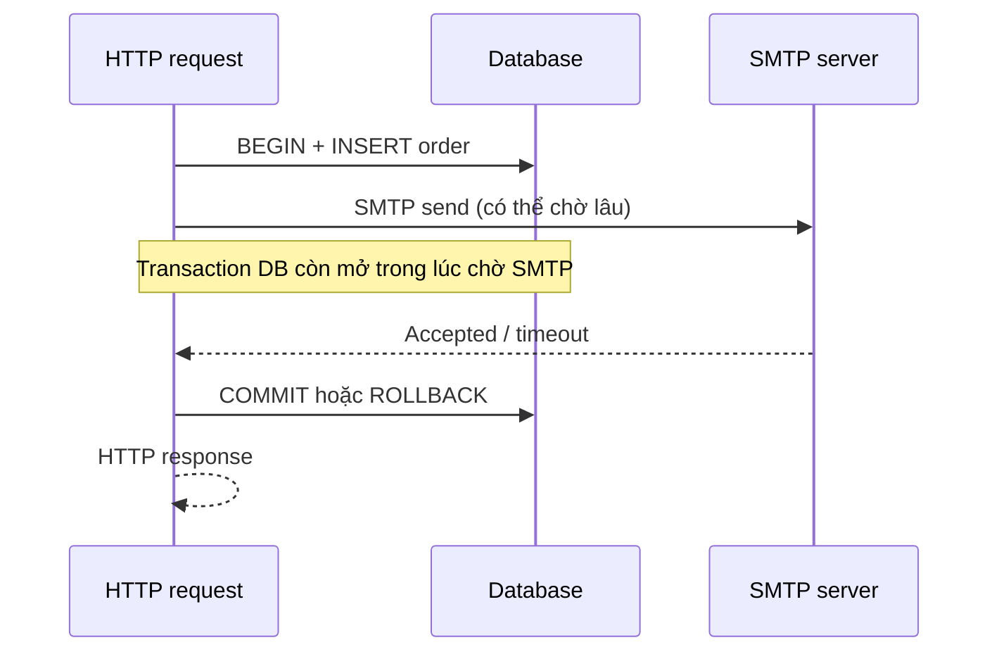
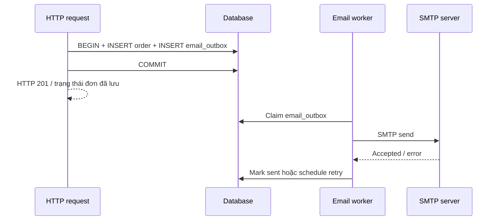
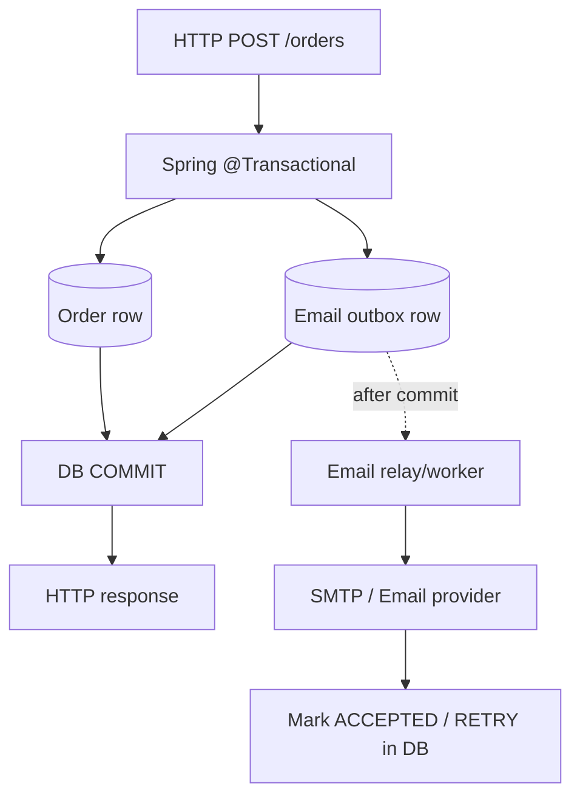
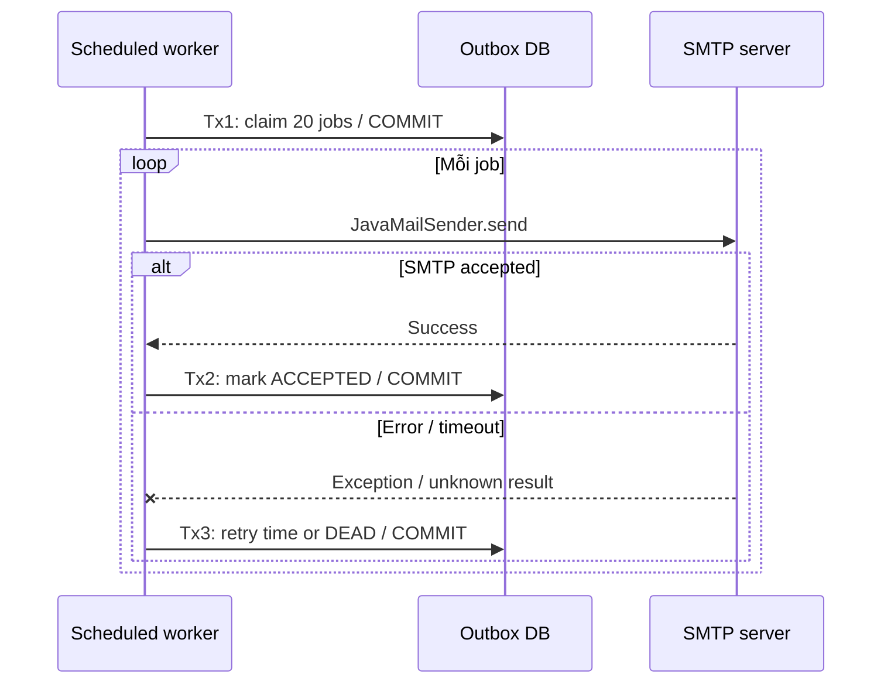
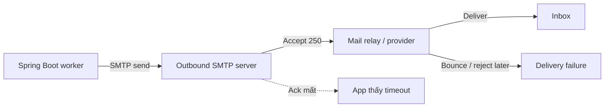
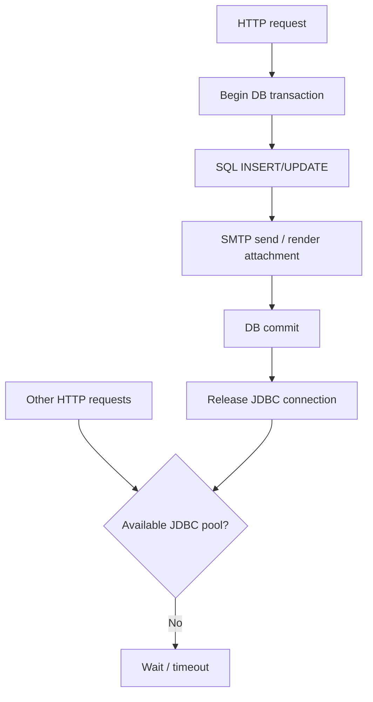
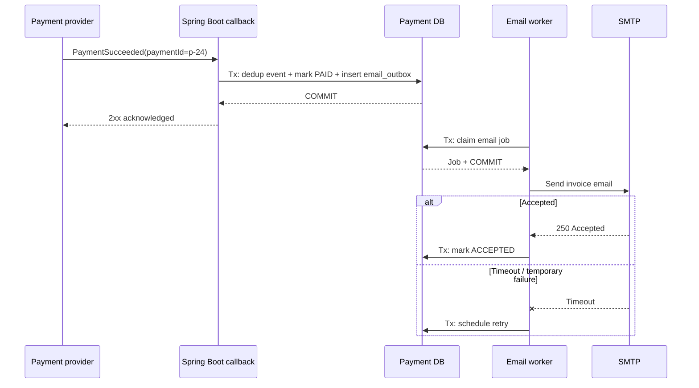

# Gửi thư ngoài giao dịch nghiệp vụ và tránh giữ kết nối cơ sở dữ liệu

Trong ứng dụng Spring Boot, một yêu cầu HTTP có thể vừa tạo đơn hàng, cập nhật trạng thái trong cơ sở dữ liệu, vừa gửi email xác nhận cho người mua. Nếu đặt lời gọi SMTP trong một phương thức `@Transactional`, thời gian chờ mail server có thể kéo dài transaction, giữ kết nối JDBC, giữ lock và làm cạn connection pool. Ngược lại, nếu gửi email **trước khi DB commit**, người dùng có thể nhận thông báo “đơn hàng đã tạo” trong khi transaction thực tế rollback.

Bài học thuộc chương **Email** trong mô-đun `SPRING_BOOT_INTEGRATION`. Trọng tâm là xác định ranh giới giữa **giao dịch nghiệp vụ bền vững** và **tác vụ gửi email có I/O mạng**, lựa chọn giải pháp dựa trên mức độ tin cậy cần thiết, xử lý timeout/duplicate, kiểm thử và quan sát các luồng tích hợp thực tế. Ý tưởng cũng áp dụng cho việc phát sự kiện sang broker, gọi HTTP đối tác hoặc cập nhật cache, nhưng email có đặc thù riêng: SMTP chấp nhận thư chưa đồng nghĩa thư đã được chuyển đến hộp thư của người nhận.

## 1. Vì sao gửi email bên trong transaction là nguy hiểm?

Giả sử ứng dụng nhận một request tạo đơn:

```java
@Service
public class OrderService {
    private final OrderRepository orders;
    private final JavaMailSender mailSender;

    public OrderService(OrderRepository orders, JavaMailSender mailSender) {
        this.orders = orders;
        this.mailSender = mailSender;
    }

    @Transactional
    public void placeOrder(CreateOrder command) {
        Order order = orders.save(new Order(command));

        SimpleMailMessage mail = new SimpleMailMessage();
        mail.setTo(order.getEmail());
        mail.setSubject("Xác nhận đơn hàng");
        mail.setText("Đơn hàng " + order.getId() + " đã được tạo");
        mailSender.send(mail); // SMTP I/O khi transaction chưa hoàn tất
    }
}
```

Đây là **ví dụ cần tránh** khi việc gửi email không thuộc thao tác dữ liệu cần commit nguyên tử. Những vấn đề chính:

1. **Giữ tài nguyên DB lâu hơn:** sau khi transaction đã lấy connection và thực hiện SQL, việc chờ SMTP có thể giữ connection/lock cho tới khi phương thức kết thúc và transaction hoàn tất.
2. **Rollback không thu hồi được email:** SMTP không tự tham gia giao dịch JDBC; nếu gửi xong rồi một bước DB sau đó thất bại, email đã gửi không thể rollback bằng `@Transactional`.
3. **Email lỗi làm hỏng nghiệp vụ:** nếu `mailSender.send(...)` ném runtime exception qua transactional interceptor, giao dịch có thể bị rollback mặc dù tạo đơn hàng là nghiệp vụ cốt lõi và gửi mail chỉ là tác vụ thông báo.
4. **Trạng thái không xác định:** SMTP server có thể đã chấp nhận email trước khi kết nối mất; ứng dụng thấy timeout rồi retry và gửi thêm một bản.
5. **Khả năng phục hồi kém:** thread HTTP bị giữ trong lúc SMTP chậm, làm tăng latency, timeout phía client, số request chờ và nguy cơ client gửi lại.

Một số transaction manager có thể chưa lấy connection cho tới lần SQL đầu tiên; vì vậy không nên tuyên bố **mọi** phương thức mang `@Transactional` đều chiếm connection ngay từ đầu. Tuy nhiên, trong ví dụ đã thực hiện `orders.save(...)` trước khi gọi SMTP, connection và transaction có khả năng đang hoạt động. Connection pool, flush của JPA, isolation và thứ tự thực hiện sẽ quyết định chính xác thời điểm lấy connection hoặc lock.

### 1.1. Dòng thời gian của hai cách triển khai



Thứ tự phù hợp hơn về mặt trách nhiệm:



Sơ đồ thứ hai minh họa **transactional outbox**: ghi yêu cầu gửi thư cùng transaction với dữ liệu nghiệp vụ, rồi worker gửi sau commit. Nó giải quyết cả vấn đề giữ connection trong lúc SMTP chậm lẫn nguy cơ mất yêu cầu gửi thư nếu tiến trình crash ngay sau commit.

## 2. Xác định đúng ranh giới giao dịch

Một cách phân chia rõ ràng:

| Công việc | Có thuộc transaction DB tạo đơn? | Lý do |
| --- | --- | --- |
| Kiểm tra invariant và ghi đơn hàng | **Có** | Cần toàn vẹn dữ liệu nghiệp vụ |
| Ghi email job/outbox cho đơn hàng vừa tạo | **Có**, nếu yêu cầu thông báo phải được lưu bền | Đơn và ý định gửi mail được commit cùng nhau |
| Gọi `JavaMailSender.send(...)` | **Không** | SMTP là I/O bên ngoài, không rollback theo JDBC |
| Render template lớn, tải ảnh/attachment từ storage | **Không** nếu có thể tách | Tránh làm transaction kéo dài; kiểm soát bộ nhớ và deadline |
| Thử gửi lại email khi lỗi | **Không** trong transaction tạo đơn | Cần retry budget, backoff và tracking riêng |
| Cập nhật trạng thái email đã được SMTP chấp nhận | **Transaction DB mới, ngắn** | Ghi nhận kết quả của worker |
| Gửi email từ thông tin vừa commit | Sau commit, qua callback hoặc worker | Tránh thông báo dữ liệu chưa thực sự tồn tại |

Vấn đề “ngoài transaction” có hai tầng khác nhau:

- **Ngoài phạm vi transaction nghiệp vụ:** thao tác SMTP được gọi sau khi dữ liệu nghiệp vụ commit hoặc nằm trong một worker không có transaction DB bao quanh.
- **Ngoài thread xử lý HTTP:** worker hoặc executor gửi email để HTTP request không phải đợi network I/O. Điều này giúp latency nhưng cần kiểm soát lỗi, queue và tình trạng mất job.

Gọi một phương thức `@Async` từ bên trong transaction giúp tách thread, nhưng **không đảm bảo dữ liệu đã commit**; worker có thể chạy trước khi transaction commit và không nhìn thấy đơn. Cách phối hợp cần xác định thời điểm kích hoạt.

### 2.1. Những điều `@Transactional` không tự làm

- Không “commit trước” một lời gọi SMTP nằm trong cùng method.
- Không rollback email đã được remote SMTP nhận.
- Không bảo đảm callback gửi mail xảy ra nếu JVM dừng ngay sau DB commit.
- Không chuyển transaction context qua `@Async`, `ExecutorChannel` hoặc queue ở broker sang thread/process khác.
- Không biến hai tài nguyên DB và SMTP thành transaction phân tán nguyên tử. SMTP thông thường không cung cấp `XAResource` để tham gia JTA/XA.

Nếu email chỉ là tác vụ phụ và được phép mất một số thông báo trong sự cố process, giải pháp callback sau commit có thể đủ. Nếu email bắt buộc phải được lên lịch và có đường phục hồi đáng tin cậy, cần **outbox bền vững** hoặc một cơ chế queue bền được nối đúng với transaction nghiệp vụ.

## 3. Các phương án và mức độ bảo đảm

| Phương án | Điểm mạnh | Hạn chế quan trọng | Phù hợp |
| --- | --- | --- | --- |
| Gửi SMTP trực tiếp **trong** `@Transactional` | Viết ít code | Giữ tài nguyên DB; rollback không thu hồi mail; SMTP lỗi ảnh hưởng DB | Thường nên tránh |
| Gửi trực tiếp **sau khi** method giao dịch trả về | Không giữ DB transaction khi SMTP I/O | HTTP vẫn chờ; crash trước khi gửi sẽ mất ý định gửi | Tác vụ phụ, yêu cầu đơn giản |
| `@TransactionalEventListener(AFTER_COMMIT)` đồng bộ | Chỉ chạy sau commit thành công | Listener vẫn có thể chặn thread trả HTTP; in-memory event có thể mất | Thông báo nhẹ, best effort |
| `@TransactionalEventListener(AFTER_COMMIT)` + `@Async` | Gửi mail trên executor sau commit, giảm latency HTTP | Không bền trước crash; queue đầy/reject; khó đảm bảo retry sau restart | Best effort với giới hạn tài nguyên |
| Ghi outbox trong transaction, worker gửi SMTP | Ý định gửi bền vững, replay được sau crash, quản lý trạng thái/retry | Cần bảng outbox, worker, lease/claim, monitoring; vẫn có khả năng mail gửi trùng | Email nghiệp vụ cần độ tin cậy cao |
| DB outbox + relay đến broker + email consumer | Tách tải, mở rộng consumer, tận dụng DLQ | Thêm broker, hai ranh giới retry, cần dedup và theo dõi kết quả | Lưu lượng lớn, nhiều kênh thông báo |

**Chọn theo yêu cầu nghiệp vụ:** một email quảng bá thử nghiệm có thể chấp nhận best effort; email xác nhận thanh toán hoặc gửi tài liệu bắt buộc thường cần outbox/reconciliation. Ngay cả khi email quan trọng, không nên hứa “exactly-once delivery tới inbox”: SMTP và các hop tiếp theo không hỗ trợ giao dịch chung với DB.

## 4. Phương án gọn: phát event trong transaction, xử lý sau commit

Spring cung cấp `@TransactionalEventListener` để xử lý một sự kiện theo phase của transaction. Khi chọn `TransactionPhase.AFTER_COMMIT`, listener được kích hoạt khi transaction đã commit thành công; nếu rollback thì listener không chạy. Mặc định, nếu phát event **ngoài** transaction, listener không được gọi trừ khi chủ động đặt `fallbackExecution=true`; cần tránh bật fallback mà không hiểu hệ quả.

Ví dụ DTO và service tạo đơn:

```java
public record OrderCreatedNotice(
        UUID orderId,
        String recipientEmail,
        String displayOrderNumber) {
}

@Service
public class OrderApplicationService {
    private final OrderRepository repository;
    private final ApplicationEventPublisher publisher;

    public OrderApplicationService(
            OrderRepository repository,
            ApplicationEventPublisher publisher) {
        this.repository = repository;
        this.publisher = publisher;
    }

    @Transactional
    public UUID createOrder(CreateOrderCommand command) {
        Order order = repository.save(Order.from(command));
        // Chỉ chuyển dữ liệu tối thiểu, không truyền entity JPA lazy.
        publisher.publishEvent(new OrderCreatedNotice(
                order.getId(),
                order.getRecipientEmail(),
                order.getDisplayNumber()));
        return order.getId();
    }
}
```

Mã này giả định `OrderRepository`, `Order` và `CreateOrderCommand` là các loại do ứng dụng định nghĩa; ID và dữ liệu cần thiết đã sẵn sàng khi publish event (với JPA, có thể cần hiểu chiến lược generate ID và thời điểm flush). Lời gọi `publishEvent` diễn ra trong transaction, còn **listener AFTER_COMMIT** mới được kích hoạt sau commit. Sự kiện là Java object trong process hiện tại, không được lưu bền mặc định.

### 4.1. Listener gửi email trên executor

```java
@Configuration(proxyBeanMethods = false)
@EnableAsync
public class EmailAsyncConfiguration {
    @Bean("emailTaskExecutor")
    public ThreadPoolTaskExecutor emailTaskExecutor() {
        ThreadPoolTaskExecutor executor = new ThreadPoolTaskExecutor();
        executor.setCorePoolSize(2);
        executor.setMaxPoolSize(4);
        executor.setQueueCapacity(100);
        executor.setThreadNamePrefix("email-");
        executor.setRejectedExecutionHandler(
                new ThreadPoolExecutor.AbortPolicy());
        executor.initialize();
        return executor;
    }
}

@Component
public class OrderEmailListener {
    private final JavaMailSender mailSender;

    public OrderEmailListener(JavaMailSender mailSender) {
        this.mailSender = mailSender;
    }

    @Async("emailTaskExecutor")
    @TransactionalEventListener(phase = TransactionPhase.AFTER_COMMIT)
    public void sendOrderConfirmation(OrderCreatedNotice notice) {
        SimpleMailMessage message = new SimpleMailMessage();
        message.setFrom("no-reply@example.org");
        message.setTo(notice.recipientEmail());
        message.setSubject("Đã tiếp nhận đơn " + notice.displayOrderNumber());
        message.setText(
                "Đơn " + notice.displayOrderNumber()
                + " đã được ghi nhận. Vui lòng kiểm tra trạng thái trên website.");
        mailSender.send(message);
    }
}
```

Các import quan trọng gồm `org.springframework.scheduling.annotation.EnableAsync`, `org.springframework.scheduling.annotation.Async`, `org.springframework.scheduling.concurrent.ThreadPoolTaskExecutor`, `java.util.concurrent.ThreadPoolExecutor`, `org.springframework.transaction.event.TransactionalEventListener`, `org.springframework.transaction.event.TransactionPhase`, `org.springframework.mail.javamail.JavaMailSender` và `org.springframework.mail.SimpleMailMessage`. Ví dụ sử dụng Spring Mail, cần thêm `spring-boot-starter-mail` và cấu hình SMTP tương ứng.

Vì phương thức listener chạy trên executor khác, nó **không có transaction và persistence context của request**; dữ liệu dùng trong mail nên là snapshot DTO đã được chuẩn bị, không truyền entity lazy rồi truy cập các relationship ở thread khác. Chỉ gửi dữ liệu đã được phép dùng trong nội dung email, tránh lộ thông tin nhạy cảm.

Trong ứng dụng thực tế, cần thêm xử lý exception và logging ở listener để không mất dấu lỗi từ method `void @Async`. Đồng thời, executor có hàng đợi hữu hạn: khi quá tải, lệnh schedule có thể bị từ chối. Với `AbortPolicy`, caller có thể nhìn thấy lỗi sau commit nhưng transaction **không thể được rollback** nữa. Đây là lý do cơ chế event + executor chỉ nên được coi là best effort khi yêu cầu thông báo quan trọng.

### 4.2. AFTER_COMMIT là ranh giới thời điểm, không phải queue bền

Có các cửa sổ lỗi vẫn tồn tại:

- DB đã commit, JVM crash trước khi callback được dispatch: email không được schedule.
- Callback submit thành công vào executor trong bộ nhớ, JVM crash trước khi worker gửi: email bị mất.
- SMTP đã nhận thư, worker timeout rồi retry: có thể gửi trùng.
- Listener lỗi không có retry/quarantine: lỗi có thể chỉ nằm trong log nếu không thu thập đầy đủ.

Ngay cả listener `AFTER_COMMIT` chạy **đồng bộ** cũng không đảm bảo task bền vững: nếu process chết sau commit trước khi gửi, không có record nào để worker khôi phục. `@Async` tách thread chứ không biến executor thành broker có persistence.

Ngoài ra, Spring cảnh báo rằng tại phase `AFTER_COMMIT`, transaction đã hoàn tất nhưng một số resource có thể vẫn được thread gắn/bound cho tới khi hoàn tất cleanup. Nếu listener cần **ghi DB mới**, nên tạo transaction riêng (ví dụ service khác với `@Transactional(propagation = REQUIRES_NEW)`) thay vì dựa vào transaction đã hoàn thành. Không nên gửi SMTP đồng bộ ngay trong transaction synchronization callback nếu mục tiêu là giải phóng thread HTTP càng sớm càng tốt.

## 5. Cấu hình SMTP timeout trước khi nói đến retry

`JavaMailSender` sử dụng Jakarta Mail để giao tiếp với SMTP. Mọi kết nối mạng cần giới hạn thời gian, đặc biệt khi ứng dụng dùng thread pool hoặc job worker. Ví dụ cấu hình phát triển:

```yaml
spring:
  mail:
    host: smtp.example.org
    port: 587
    username: ${SMTP_USER}
    password: ${SMTP_PASSWORD}
    properties:
      "[mail.smtp.auth]": true
      "[mail.smtp.starttls.enable]": true
      "[mail.smtp.starttls.required]": true
      "[mail.smtp.connectiontimeout]": 5000
      "[mail.smtp.timeout]": 10000
      "[mail.smtp.writetimeout]": 10000
```

Các giá trị timeout của JavaMail/Jakarta Mail SMTP là **mili giây**. Ý nghĩa cơ bản:

| Thuộc tính | Giới hạn | Vì sao cần |
| --- | --- | --- |
| `mail.smtp.connectiontimeout` | Chờ thiết lập kết nối TCP | Proxy/SMTP mất kết nối không giữ thread vô hạn |
| `mail.smtp.timeout` | Chờ đọc dữ liệu/SMTP response | Server không trả lời không làm request treo mãi |
| `mail.smtp.writetimeout` | Thời gian chờ ghi lên socket | Gửi nội dung lớn tới server chậm bị giới hạn |
| `mail.smtp.starttls.required` | Bắt buộc nâng lên TLS trước xác thực/gửi | Tránh vô tình gửi thông tin nhạy cảm trên kết nối không mã hóa |

Đây là ví dụ minh họa chính sách STARTTLS. Khi provider yêu cầu SMTPS/TLS trực tiếp ở cổng 465, cấu hình TLS sẽ khác (`mail.smtp.ssl.enable` hoặc phần tương ứng của transport). Cần xác thực hostname và chuỗi chứng chỉ, không cấu hình trust-all. Secret phải lấy từ nguồn bảo mật thay vì hardcode hoặc commit vào repository.

Không nên dùng một timeout cực lớn để “đảm bảo mail đi được”: khi SMTP down, mọi worker có thể bị chiếm. Kết hợp timeout, thread pool có giới hạn, retry backoff và cảnh báo backlog để giữ hệ thống ổn định.

## 6. Transactional outbox: lưu ý định gửi thư cùng giao dịch nghiệp vụ

**Transactional outbox** dùng một bảng DB để ghi nhận *việc cần gửi email* trong cùng transaction với thay đổi nghiệp vụ. Khi commit thành công, một worker riêng quét outbox, gửi SMTP rồi cập nhật trạng thái. Khi transaction rollback, cả đơn hàng lẫn email job đều không tồn tại.



Trong sơ đồ, cạnh từ outbox sang worker là **phân luồng công việc sau commit**; worker chỉ đọc được row đã commit, không cần một event in-memory từ request. Worker vẫn có thể hoạt động nếu API process restart, miễn bảng outbox và lịch chạy còn sẵn sàng.

### 6.1. Thiết kế bảng có trạng thái và khóa nghiệp vụ

Ví dụ PostgreSQL:

```sql
CREATE TABLE email_outbox (
    email_id UUID PRIMARY KEY,
    business_key VARCHAR(220) NOT NULL UNIQUE,
    recipient VARCHAR(320) NOT NULL,
    template_code VARCHAR(100) NOT NULL,
    template_data JSONB NOT NULL,
    status VARCHAR(30) NOT NULL DEFAULT 'PENDING',
    attempts INTEGER NOT NULL DEFAULT 0,
    next_attempt_at TIMESTAMPTZ NOT NULL DEFAULT NOW(),
    locked_by VARCHAR(120),
    locked_until TIMESTAMPTZ,
    accepted_at TIMESTAMPTZ,
    last_error VARCHAR(1000),
    created_at TIMESTAMPTZ NOT NULL DEFAULT NOW(),
    updated_at TIMESTAMPTZ NOT NULL DEFAULT NOW(),
    CONSTRAINT chk_email_outbox_status CHECK (
        status IN ('PENDING', 'SENDING', 'ACCEPTED', 'DEAD')
    )
);

CREATE INDEX ix_email_outbox_ready
    ON email_outbox (next_attempt_at, created_at)
    WHERE status IN ('PENDING', 'SENDING');
```

Ý nghĩa một số trường:

| Cột | Vai trò |
| --- | --- |
| `email_id` | ID duy nhất của yêu cầu gửi; dùng để đối soát log và retry |
| `business_key` | Khóa chống tạo nhiều job do command HTTP được gửi lại; ví dụ `order-created:tenant-7:order-42:recipient-a` |
| `template_code`, `template_data` | Quy định phiên bản/nội dung cần gửi; tránh chỉ lưu một JPA entity ID rồi đọc dữ liệu đã thay đổi không kiểm soát |
| `status` | `PENDING` chờ gửi, `SENDING` đã claim, `ACCEPTED` provider/SMTP chấp nhận, `DEAD` cần xử lý |
| `locked_by`, `locked_until` | Phân công worker và khôi phục khi worker chết |
| `attempts`, `next_attempt_at` | Giới hạn retry và hỗ trợ backoff |
| `accepted_at` | Thời điểm ứng dụng ghi nhận lần SMTP được chấp nhận; **không phải** thời điểm hộp thư người nhận nhận được |

Khóa `business_key` phải phản ánh **một hành động thông báo logic**, không chỉ là địa chỉ email. Cùng người nhận có thể cần nhiều email khác nhau; một đơn hàng có thể có email tạo đơn, thanh toán, hoàn tiền. Dùng unique constraint ở DB để ngăn hai request đồng thời tạo hai job trùng; “kiểm tra tồn tại rồi insert” riêng lẻ vẫn có race.

Không nên đưa toàn bộ dữ liệu cá nhân vào `template_data` nếu không cần thiết. Cân nhắc chỉ lưu những field đã xác minh, thời hạn lưu dữ liệu, mã hóa và quy tắc xóa dữ liệu theo yêu cầu hệ thống. Tên template và phiên bản template nên ổn định; một email job cũ vẫn cần render được sau khi deploy bản mới.

### 6.2. Service ghi business row và outbox row trong một transaction

```java
@Service
public class OrderCheckoutService {
    private final OrderRepository orders;
    private final EmailOutboxRepository emails;

    public OrderCheckoutService(
            OrderRepository orders,
            EmailOutboxRepository emails) {
        this.orders = orders;
        this.emails = emails;
    }

    @Transactional
    public OrderResult checkout(CheckoutCommand command) {
        // Repository dùng unique constraint cho command.idempotencyKey().
        OrderCreation creation = orders.createIdempotently(command);
        Order order = creation.order();

        if (creation.newlyCreated()) {
            String key = "order-created:" + order.getTenantId()
                    + ":" + order.getId() + ":customer";

            emails.insertIfAbsent(
                    UUID.randomUUID(),
                    key,
                    order.getRecipientEmail(),
                    "ORDER_CREATED_V1",
                    new OrderEmailData(
                            order.getId(),
                            order.getDisplayNumber()));
        }
        return new OrderResult(order.getId(), order.getStatus());
    }
}
```

`OrderRepository`, `EmailOutboxRepository`, `OrderCreation`, `CheckoutCommand`, `OrderEmailData` và `OrderResult` là lớp/interface do ứng dụng xây dựng. Phần `insertIfAbsent` là thao tác giả định sử dụng `INSERT ... ON CONFLICT DO NOTHING` hoặc API tương đương, cùng database và transaction manager với `orders.createIdempotently`. Không dùng hai DB độc lập mà tưởng local `@Transactional` bao trùm cả hai.

Với yêu cầu email gửi sau khi **chuyển trạng thái** thay vì sau khi tạo entity, chỉ ghi outbox khi transaction thật sự thực hiện chuyển trạng thái ấy. Việc gọi `checkout` hai lần với cùng idempotency key phải trả kết quả đã tạo và không chèn hai row outbox. Khi unique constraint bị cạnh tranh, cần xử lý exception/re-query theo trạng thái transaction thích hợp thay vì để lỗi xung đột tạo response HTTP bất thường.

**Điều được bảo đảm:** hoặc DB có cả đơn hàng lẫn yêu cầu gửi mail, hoặc không có cả hai. **Điều chưa được bảo đảm:** email được SMTP chấp nhận đúng một lần hay đến inbox đúng thời hạn. Các bước ấy thuộc trách nhiệm worker và nhà cung cấp email.

## 7. Email relay: claim job, gửi SMTP ngoài transaction rồi ghi kết quả

Một worker polling đơn giản có thể chạy qua Spring Scheduling hoặc Spring Integration poller. Nếu có nhiều replica, cần cơ chế claim tránh nhiều worker cùng lấy job tại một thời điểm. Tuy vậy, cơ chế lease không loại trừ hoàn toàn bản gửi trùng: worker A có thể mất quyền khi quá hạn, worker B gửi lại trong lúc A đã kịp gửi SMTP.

### 7.1. Claim một batch trong transaction ngắn

Với PostgreSQL, `FOR UPDATE SKIP LOCKED` cho phép nhiều worker claim các row không bị worker khác khóa. Ví dụ SQL dùng trong transaction:

```sql
WITH candidates AS (
    SELECT email_id
      FROM email_outbox
     WHERE (
          status = 'PENDING'
          OR (status = 'SENDING' AND locked_until < NOW())
     )
       AND next_attempt_at <= NOW()
     ORDER BY next_attempt_at, created_at
     FOR UPDATE SKIP LOCKED
     LIMIT 20
)
UPDATE email_outbox AS e
   SET status = 'SENDING',
       locked_by = :worker_id,
       locked_until = NOW() + INTERVAL '45 seconds',
       attempts = attempts + 1,
       updated_at = NOW()
  FROM candidates AS c
 WHERE e.email_id = c.email_id
RETURNING e.*;
```

`:worker_id` là bind parameter của JDBC/JPA layer, không phải cú pháp PostgreSQL chạy trực tiếp trong `psql`. Claim cần thực hiện bằng transaction ngắn, commit rồi mới gửi SMTP. Thời hạn 45 giây chỉ minh họa; phải phù hợp tổng connect/read/write timeout, kích thước email, số worker và SLA. Nếu tổng thời gian gửi có thể vượt thời hạn, cần gia hạn lease có kiểm tra chủ sở hữu hoặc đặt hạn phù hợp.

Điều kiện `locked_until < NOW()` cho phép lấy lại job của worker đã chết. Không giữ row lock trong suốt quá trình gửi SMTP: nếu mở transaction trong lúc chờ provider, worker lại gây đúng vấn đề “giữ kết nối DB” mà kiến trúc cần loại bỏ.

### 7.2. Phân tách transaction theo lớp



Ứng dụng có thể tổ chức thành các bean:

```java
@Service
public class EmailJobStore {
    private final EmailJobRepository repository;

    public EmailJobStore(EmailJobRepository repository) {
        this.repository = repository;
    }

    @Transactional
    public List<EmailJob> claim(String workerId, int batchSize) {
        return repository.claimReady(workerId, batchSize);
    }

    @Transactional
    public boolean markAccepted(UUID emailId, String workerId) {
        return repository.markAcceptedIfOwned(emailId, workerId) == 1;
    }

    @Transactional
    public boolean markFailed(
            UUID emailId, String workerId, Instant retryAt,
            String errorCode, boolean permanent) {
        return repository.markFailureIfOwned(
                emailId, workerId, retryAt, errorCode, permanent) == 1;
    }
}
```

Các repository method trong đoạn này là API dự kiến do dự án triển khai, không phải phương thức có sẵn của Spring Data. `claimReady` phải chạy SQL atomically; `markAcceptedIfOwned`/`markFailureIfOwned` phải có điều kiện `email_id`, `locked_by`, `status='SENDING'` và nếu dùng version/claim token thì kiểm tra thêm. Một lần cập nhật trả về `0` nghĩa là job không còn do worker đó sở hữu hoặc đã được xử lý; phải ghi nhận để điều tra, không tiếp tục thay đổi trạng thái mù quáng.

Worker thực thi **không có transaction bao quanh SMTP**:

```java
@Component
@EnableScheduling
public class EmailOutboxWorker {
    private final EmailJobStore store;
    private final EmailTransport transport;
    private final String workerId = UUID.randomUUID().toString();

    public EmailOutboxWorker(EmailJobStore store, EmailTransport transport) {
        this.store = store;
        this.transport = transport;
    }

    @Scheduled(fixedDelay = 1000)
    public void poll() {
        List<EmailJob> jobs = store.claim(workerId, 20); // Tx đã commit.
        for (EmailJob job : jobs) {
            try {
                transport.send(job); // SMTP I/O; không có DB transaction.
                store.markAccepted(job.emailId(), workerId);
            } catch (MailException exception) {
                FailureDecision decision = classifyMailFailure(
                        exception, job.attempts());
                store.markFailed(
                        job.emailId(),
                        workerId,
                        decision.nextAttemptAt(),
                        decision.reasonCode(),
                        decision.permanent());
            }
        }
    }
}
```

`EmailTransport`, `EmailJob`, `FailureDecision` và `classifyMailFailure` là các kiểu/hàm nghiệp vụ cần triển khai; ví dụ thể hiện ranh giới transaction và cách phối hợp bean. Nên đặt `@EnableScheduling` ở class `@Configuration` của ứng dụng thay vì gắn trên mỗi worker nếu hệ thống có nhiều worker. Khi một process có nhiều scheduler/thread, cần giới hạn đồng thời, batch size và backpressure.

Trong production, đừng giới hạn xử lý lỗi chỉ trong `MailException`: lỗi render template, IO đọc attachment, timeout ngoài framework và lỗi cập nhật DB cũng cần được phân loại. Nếu `markAccepted` thất bại sau SMTP success, worker phải **giữ được dấu vết trạng thái không xác định** để retry hoặc đối soát; không được tự khẳng định mail chưa gửi. Lỗi DB có thể làm job được claim lại sau lease và phát trùng.

### 7.3. Kết thúc một claim đúng chủ sở hữu

Một câu SQL đánh dấu accepted:

```sql
UPDATE email_outbox
   SET status = 'ACCEPTED',
       accepted_at = NOW(),
       locked_by = NULL,
       locked_until = NULL,
       last_error = NULL,
       updated_at = NOW()
 WHERE email_id = :email_id
   AND locked_by = :worker_id
   AND status = 'SENDING';
```

Nếu lease đã hết hạn nhưng worker khác chưa claim lại, câu lệnh trên vẫn có thể đánh dấu accepted theo điều kiện chủ sở hữu; nếu có tranh chấp nghiêm ngặt, thêm `claim_version` tăng dần và kiểm tra đúng version đã cấp lúc claim. Với worker chạy qua broker thay vì polling DB, logic tương tự áp dụng ở consumer: commit/ack message sau khi trạng thái xử lý đã được ghi bền và theo hợp đồng.

### 7.4. Backoff và poison job

Khi có lỗi tạm thời, cập nhật `status='PENDING'`, `next_attempt_at` theo exponential backoff có jitter và tăng số lần thử. Khi lỗi không thể tự phục hồi hoặc vượt giới hạn thử, cập nhật `status='DEAD'` và phát cảnh báo. Tránh retry vô hạn mỗi giây cho thông tin xác thực SMTP sai hoặc recipient bị reject vĩnh viễn.

Các trạng thái cần có đường vận hành:

| Trạng thái | Ý nghĩa | Thao tác vận hành |
| --- | --- | --- |
| `PENDING` | Job chờ hoặc được lên lịch thử lại | Giám sát tuổi job và hàng chờ |
| `SENDING` | Worker đã claim, có lease | Theo dõi lease hết hạn và worker crash |
| `ACCEPTED` | SMTP/provider API đã chấp nhận request gửi | Theo dõi bounce/delivery status riêng nếu provider hỗ trợ |
| `DEAD` | Không tiếp tục retry tự động | Kiểm tra lỗi, sửa cấu hình/dữ liệu, replay có kiểm soát |

Không xóa job lỗi ngay khi thử lại nhiều lần; cần thông tin đủ để điều tra, sửa và replay. Tuy nhiên, payload mail có thể chứa dữ liệu cá nhân, nên lịch dọn dữ liệu, mã hóa, retention và quyền truy cập phải được thiết kế rõ. Khi cleanup, vẫn giữ được audit tối thiểu nếu chính sách nghiệp vụ yêu cầu.

## 8. SMTP accepted không đồng nghĩa email đến inbox

`JavaMailSender.send(...)` thành công nghĩa là thư viện đã hoàn tất thao tác gửi tới mail server theo giao thức và không thấy lỗi tương ứng. Một SMTP server trả mã `250` có thể đã **nhận trách nhiệm chuyển tiếp thư**, nhưng email vẫn có thể bị trì hoãn, bị từ chối ở hop sau, bounce, lọc spam hoặc bị người nhận chặn.



Phân biệt các mức:

| Mốc | Cách hiểu chính xác |
| --- | --- |
| Job outbox đã tạo | Ứng dụng **có ý định** gửi một email |
| Worker đã thử gửi | Có network attempt; chưa biết kết quả |
| SMTP/provider đã chấp nhận | Hệ thống gửi đã nhận yêu cầu theo hợp đồng của provider |
| Provider báo delivered | Provider có tín hiệu giao tới máy chủ/hệ thống đích theo khả năng của họ |
| Người nhận đọc được email | Không thể suy ra chắc chắn chỉ từ SMTP success hoặc delivery event |

Một SMTP server có thể đã chấp nhận lệnh `DATA` và phản hồi `250`, nhưng kết nối đứt trước khi application đọc được phản hồi. Với phía gọi, đây là **trạng thái không rõ**. Nếu worker retry, người nhận có thể nhận hai email; nếu không retry, email có thể bị mất trong trường hợp server chưa nhận. Bảo đảm “gửi đúng một lần” xuyên DB và SMTP thường không thể đạt bằng local transaction.

### 8.1. Message-ID và idempotency

Email MIME có header `Message-ID` giúp nhận diện thư trong giao tiếp email và có ích để đối soát. Tuy nhiên, việc đặt cùng `Message-ID` cho hai lần gửi **không bắt buộc mọi SMTP provider/recipient server phải loại bỏ bản trùng**. Header tùy chỉnh như `X-Notification-Id` cũng chủ yếu giúp correlation và debugging.

Thiết kế thực tế:

- Tạo `email_id` một lần khi ghi outbox và giữ nguyên qua mọi attempt.
- Ghi lại `email_id`, `business_key`, mã template, provider message ID nếu có.
- Nếu provider có **API idempotency key với cam kết rõ ràng**, dùng cùng key qua retry; đây là khả năng riêng của provider, không phải tính năng chuẩn SMTP.
- Nếu nội dung có thể gây hành động nghiêm trọng, đặt hành động trên **website/API có trạng thái idempotent**; email chỉ chứa thông báo và liên kết an toàn. Người dùng bấm lại đường dẫn không tạo tác dụng phụ trùng.
- Tránh phát thông báo kiểu “đã thanh toán” trước khi DB nghiệp vụ commit hoặc trước khi hệ thống có bằng chứng giao dịch thành công.

Với email xác nhận mã một lần (OTP), không tạo mã mới cho mỗi attempt gửi cùng một job; nếu mã thay đổi khi retry, người nhận có thể nhận nhiều mã không đồng nhất. Cần gắn mã hoặc reference với vòng đời xác thực đã được lưu bền, hạn dùng rõ ràng, không lưu mã thô trong log/outbox.

## 9. Retry SMTP: phân loại lỗi trước khi thử lại

SMTP có cả lỗi tạm thời, lỗi vĩnh viễn và kết quả không xác định. Không nên áp dụng một retry policy cho mọi `MailException`.

| Tín hiệu | Ví dụ | Hướng xử lý |
| --- | --- | --- |
| SMTP reply nhóm `4xx` | Server tạm bận, greylisting, rate limit | Retry với backoff và giới hạn thời gian |
| SMTP reply nhóm `5xx` | Recipient không tồn tại, policy hoặc mailbox reject vĩnh viễn | Thường dừng tự động; sửa địa chỉ hoặc chính sách |
| `MailAuthenticationException` | Tên người dùng, mật khẩu hoặc cơ chế auth sai | Cảnh báo cấu hình, tránh retry nóng |
| `MailParseException` | Nội dung/địa chỉ mail bị sai định dạng | Lỗi dữ liệu hoặc render; đưa vào xử lý riêng |
| Network timeout | Chưa rõ server đã nhận thư hay chưa | Retry có nguy cơ gửi trùng; ghi nhận kết quả mơ hồ |
| Mail server từ chối vì hạn ngạch | Thông số/mức gửi vượt quota | Throttle, backoff, kiểm tra quota và cảnh báo |
| Provider báo bounce sau khi đã accepted | Thư đã vào hệ thống mail nhưng không deliver đến đích | Cập nhật delivery status riêng, không tự phát lại vô hạn |

Trong Spring Mail, `MailSendException` có thể bọc nhiều nguyên nhân từ Jakarta Mail. Muốn phân loại chính xác, xem exception cause và mã SMTP cụ thể nếu adapter/provider cung cấp; không dựa chỉ vào chuỗi exception message. Một số lỗi `5xx` liên quan cấu hình hay chính sách có thể phục hồi sau khi thay đổi cấu hình, nhưng **không nên thử lại nhanh liên tục với cùng dữ liệu**.

### 9.1. Ví dụ tính thời gian retry

Với lần thất bại thứ `attempt`, một chính sách đơn giản:

```java
public static Instant nextRetry(
        Instant now, int attempt, ThreadLocalRandom random) {
    int cappedAttempt = Math.min(Math.max(attempt, 1), 7);
    long baseSeconds = Math.min(
            3600L,
            5L * (1L << (cappedAttempt - 1)));
    long jitterSeconds = random.nextLong(
            Math.max(1L, baseSeconds / 4L + 1L));
    return now.plusSeconds(baseSeconds + jitterSeconds);
}
```

Đây là ví dụ *exponential backoff có jitter* với mức trần ở thời gian nền, không phải thuật toán retry chuẩn của Spring Mail. Các import là `java.time.Instant` và `java.util.concurrent.ThreadLocalRandom`. Hãy giới hạn `attempts`, thời gian sống tối đa của job và lượng job đồng thời theo SLA; khi quá ngưỡng chuyển sang `DEAD` hoặc một quy trình can thiệp riêng.

Nếu đã nhận response SMTP vĩnh viễn từ phía provider, việc retry cùng người nhận/cấu hình có thể gây hậu quả về uy tín tên miền gửi thư. Cũng cần tôn trọng hạn ngạch, cửa sổ gửi và quy định unsubscribe/consent đối với email thương mại.

### 9.2. Cẩn trọng khi retry ở nhiều tầng

Một luồng Spring Integration hoặc broker consumer có thể tự retry message khi handler ném exception. Đồng thời, email worker còn retry theo outbox. Nếu cả hai đều lặp lại mà không có giới hạn chung, số lần gửi tăng theo tích các retry policy.

Ví dụ, broker redeliver ba lần, mỗi lần handler lại thử SMTP bốn lần: một email logic có thể tạo tới mười hai network attempts. Nên có **một nơi sở hữu quyết định retry**, lưu trạng thái theo `email_id` và các ranh giới retry khác chỉ đưa công việc về đúng nơi chịu trách nhiệm. Khi broker dùng để kích hoạt email worker, việc nhận message cần idempotent với outbox job và acknowledgement phải theo hợp đồng rõ ràng.

## 10. Tránh giữ connection và lock trong lúc xử lý email

Nhiều hệ thống gặp lỗi connection pool exhaustion dù CPU và DB còn tài nguyên. Nguyên nhân là thread đã mượn JDBC connection nhưng chờ SMTP hoặc tác vụ render file chậm trong cùng transaction.

### 10.1. Nhìn vào đường đi của connection



Nếu connection pool có `N=10` connection, mười request đồng thời giữ transaction trong lúc SMTP chờ 15 giây thì những request cần DB tiếp theo có thể bị xếp hàng hoặc timeout. Đây là ví dụ về **khả năng cạn pool**; thời điểm chính xác một connection được lấy/trả phụ thuộc driver, transaction manager, JPA flush, pool và mã ứng dụng. Mấu chốt là không làm network I/O không liên quan khi đã giữ transaction.

Một số điều chỉnh:

1. Rút ngắn transaction về đúng phần kiểm tra invariant, ghi dữ liệu và outbox.
2. Tách service gửi mail ra bean khác không có `@Transactional` bao quanh.
3. Truyền snapshot dữ liệu cần render thay vì giữ persistence context để đọc lazy property ngoài transaction.
4. Không tải attachment lớn, gọi HTTP hoặc đợi template service bên trong transaction. Nếu cần lấy dữ liệu để tạo file, đọc và lưu snapshot/reference ổn định trong lúc cần thiết rồi thực hiện tác vụ nặng sau commit.
5. Dùng pool/thread giới hạn và timeout để bảo vệ email worker; không tăng JDBC pool chỉ để che việc giữ connection quá lâu.

### 10.2. Không giữ transaction qua toàn bộ batch

Ví dụ cần tránh:

```java
@Transactional
public void sendAllPending() {
    List<EmailJob> jobs = repository.findPending();
    for (EmailJob job : jobs) {
        mailSender.send(render(job));
        repository.markAccepted(job.emailId());
    }
}
```

Đoạn này có thể giữ một connection và nhiều row lock trong suốt batch. Nếu batch có 200 email, một lỗi/timeout có thể kéo dài cả transaction; nhiều email đã được SMTP chấp nhận trước khi DB rollback trạng thái. Khi retry, hệ thống lại gửi chúng.

Thay bằng **claim batch trong transaction ngắn**, **gửi SMTP không có transaction**, **cập nhật kết quả từng job trong transaction ngắn**. Một số ứng dụng có thể tối ưu bằng batch update sau khi một nhóm gửi xong, nhưng khi cập nhật thất bại sẽ tăng khoảng kết quả mơ hồ; cần cân nhắc và kiểm thử.

### 10.3. Các cấu hình connection pool và transaction timeout

HikariCP thường là connection pool mặc định trong nhiều dự án Spring Boot dùng JDBC. Có thể theo dõi `active`, `idle`, `pending` và thời gian chờ connection. Tăng pool size chỉ phù hợp sau khi đo workload và năng lực DB; mở quá nhiều connection đồng thời có thể làm DB quá tải.

Transaction timeout nên giới hạn công việc DB có dự kiến thời lượng ngắn. Nó **không phải** giải pháp xử lý mọi SMTP timeout: ngay cả khi transaction bị mark rollback, Java thread có thể vẫn chờ thao tác socket; email đã được remote nhận không thể hoàn tác. Phải giới hạn SMTP timeout trực tiếp.

## 11. Email có template, attachment và dữ liệu nhạy cảm

Gửi email HTML và attachment thường dùng `MimeMessage`, `MimeMessageHelper` với `JavaMailSender`:

```java
@Component
public class SmtpEmailTransport implements EmailTransport {
    private final JavaMailSender sender;
    private final EmailTemplateRenderer renderer;

    public SmtpEmailTransport(
            JavaMailSender sender, EmailTemplateRenderer renderer) {
        this.sender = sender;
        this.renderer = renderer;
    }

    @Override
    public void send(EmailJob job) {
        sender.send(mime -> {
            MimeMessageHelper helper = new MimeMessageHelper(
                    mime, true, StandardCharsets.UTF_8.name());
            helper.setFrom("no-reply@example.org");
            helper.setTo(job.recipient());
            helper.setSubject(renderer.subject(job));
            helper.setText(renderer.renderHtml(job), true);

            // Nếu cần attachment, thêm từ immutable object storage
            // sau khi kiểm tra quyền truy cập và giới hạn kích thước.
            mime.setHeader("X-Notification-Id",
                    job.emailId().toString());
        });
    }
}
```

Các import: `org.springframework.mail.javamail.JavaMailSender`, `org.springframework.mail.javamail.MimeMessageHelper`, `java.nio.charset.StandardCharsets`. `EmailTemplateRenderer` và `EmailTransport` là abstraction do dự án viết. Ví dụ sử dụng `MimeMessagePreparator` qua lambda mà `JavaMailSender` hỗ trợ; provider có thể bổ sung/sửa một số header theo quy tắc giao thức. Header `X-Notification-Id` hỗ trợ đối soát, **không tự loại bỏ duplicate**.

Để giữ tài nguyên DB ngắn:

- Không truyền trực tiếp entity JPA còn gắn persistence context sang async worker.
- Nếu attachment sinh từ dữ liệu DB, cân nhắc tạo tệp ở object storage trước và ghi immutable reference/version vào job. Cần bảo đảm file đã sẵn sàng và quyền truy cập phù hợp khi worker chạy.
- Worker chỉ mở stream/tải file khi thực sự gửi, giới hạn kích thước và thời gian tải; không giữ transaction DB trong khi stream.
- Template có thể được version hóa để job cũ render nhất quán. Nếu template không còn tồn tại, đưa job vào lỗi cấu hình có thể sửa thay vì retry SMTP.
- Header `To`/`Cc`/`Bcc` và nội dung HTML phải được tạo từ dữ liệu đã validate; encode/escape biến đưa vào HTML để tránh nội dung không mong muốn trong email.

Nếu email bao gồm link có token hoặc mã xác thực, tạo token có thời hạn, giới hạn phạm vi, kiểm tra phía server và không log token hay lưu thô không cần thiết. Email không phải kênh lưu trữ bí mật bền vững: hộp thư người nhận có thể bị chuyển tiếp, bị lộ hoặc được truy cập từ thiết bị khác.

## 12. Một tình huống đầy đủ: thanh toán thành công và email hóa đơn

Giả sử API thanh toán nhận callback từ đối tác. Nó cần cập nhật `payment_status=PAID`, ghi email hóa đơn và trả HTTP response ngay, sau đó worker gửi email.



Các invariant quan trọng:

1. Callback có event ID/payment ID ổn định và unique constraint để retry của đối tác không tạo nhiều lần chuyển trạng thái hoặc nhiều email job.
2. Payment đã được xác thực và commit trước khi hệ thống có ý định gửi thông báo “đã thanh toán”.
3. Row email outbox được ghi trong cùng transaction với thay đổi payment, tránh commit thanh toán nhưng quên lên lịch email.
4. HTTP callback có thể trả thành công sau DB commit theo hợp đồng của provider mà không chờ SMTP, giảm latency và giảm khả năng provider retry vì timeout HTTP.
5. Worker có thể chết và được phục hồi; job còn chờ trong DB. Tuy nhiên, email có thể gửi trùng nếu provider đã chấp nhận nhưng kết quả worker ghi DB bị mất.
6. Nếu gửi mail thất bại kéo dài, trạng thái payment vẫn đúng; email backlog/DLQ có cảnh báo riêng và người vận hành có thể replay có kiểm soát.

Trường hợp doanh nghiệp yêu cầu phát hành hóa đơn điện tử qua hệ thống có API riêng, **phát hành hóa đơn** có thể là một nghiệp vụ có tính pháp lý cần quản lý trạng thái và idempotency riêng; email đính kèm hoặc dẫn link đến hóa đơn chỉ là kênh thông báo. Không coi thành công của SMTP là bằng chứng phát hành hóa đơn hợp lệ.

## 13. Kiểm thử các điểm lỗi và xác minh không giữ DB transaction

Kiểm thử tốt cần cả business transaction, worker, timeout và cơ chế phục hồi. Unit test chỉ mock `JavaMailSender` rồi verify `send()` được gọi một lần chưa chứng minh được outbox không mất job hoặc không giữ DB connection khi SMTP chậm.

| Kịch bản | Kết quả cần chứng minh |
| --- | --- |
| Service ghi đơn rồi ném exception trước commit | Không có order **và** không có email job |
| Service commit thành công | Order và outbox job cùng tồn tại; HTTP không phải chờ gửi SMTP |
| Callback `AFTER_COMMIT` khi transaction rollback | Listener không chạy |
| Event sau commit nhưng executor queue đầy | Có dấu vết/reject policy; biết cơ chế in-memory không bảo đảm delivery |
| Worker claim rồi SMTP chờ lâu | DB transaction claim đã commit, JDBC connection được trả trước lúc SMTP kết thúc |
| SMTP không kết nối được | Job giữ trạng thái cần retry, có backoff và attempt count |
| SMTP trả lỗi permanent | Job vào DEAD/quarantine, không retry nóng |
| Worker chết sau claim trước gửi | Lease hết hạn và job được worker khác tiếp quản |
| SMTP chấp nhận nhưng worker crash trước khi `markAccepted` | Job có thể được gửi lại; hành vi trùng được nhận diện và vận hành được |
| Hai replica claim cùng lúc | Không giữ job cùng thời điểm nếu claim thành công; có unique/lease |
| Request nghiệp vụ bị retry với cùng idempotency key | Chỉ một business transition và một email job logic |
| SMTP trả thành công nhưng sau đó bounce | `ACCEPTED` không bị hiểu thành `DELIVERED`; thông tin bounce được xử lý riêng |
| Template hoặc attachment lỗi | Job có kết quả lỗi rõ, không giữ transaction DB và không mất stack trace cần điều tra |
| 1.000 email cùng được lên lịch | Pool SMTP/worker hữu hạn, backlog tăng có thể quan sát, API và JDBC pool không bị nghẽn bởi SMTP |

### 13.1. Test transaction rollback và outbox

Ví dụ tích hợp với database thật hoặc Testcontainers:

```java
@Test
void rollbackDoesNotLeaveEmailJob() {
    CheckoutCommand command = newCheckoutCommand();
    arrangeBusinessRuleToFailAfterInsert();

    assertThatThrownBy(() -> checkoutService.checkout(command))
            .isInstanceOf(RuntimeException.class);

    assertThat(orders.existsByRequestId(command.idempotencyKey()))
            .isFalse();
    assertThat(emailJobs.existsForBusinessKey(
            expectedBusinessKey(command))).isFalse();
}
```

Các helper/repository trong snippet là test fixture do dự án định nghĩa. Điều kiện quan trọng là kiểm thử **đúng transaction manager và datasource** mà ứng dụng thật sử dụng, xác minh outbox write được commit/rollback cùng đơn hàng. Test chạy trong một transaction do framework test tự rollback có thể che lỗi nếu không hiểu ranh giới commit của service; cần sắp xếp fixture phù hợp.

### 13.2. Test xác nhận SMTP ở ngoài transaction

Có thể dùng một SMTP test server như GreenMail hoặc thư viện tương đương để giữ/hủy response, mô phỏng downtime và ghi lại message. Với kiểm tra giữ connection, đo pool active/pending, dùng interceptor/metrics để biết transaction claim đã kết thúc trước khi worker gọi `send`.

Ví dụ ý tưởng thử:

1. Khởi động database và SMTP test server.
2. Tạo order, xác nhận DB commit và có outbox job.
3. Cố tình trì hoãn SMTP response 5–10 giây, trong lúc đó gửi một truy vấn DB độc lập.
4. Xác nhận truy vấn DB vẫn lấy connection bình thường khi pool đã được giới hạn phù hợp; transaction claim không kéo dài theo thời gian SMTP.
5. Cho SMTP chấp nhận nhưng dừng worker trước lúc cập nhật trạng thái; khởi động lại và xác minh outbox tiếp tục retry, ghi nhận khả năng có hai bản email.

Một mock JDBC connection hoặc mock mail sender đơn thuần không đủ để chứng minh các tương tác mạng/transaction trong các điểm lỗi này. Khi test email thực, luôn dùng mailbox thử nghiệm hoặc SMTP test server, không gửi đến người nhận thật.

## 14. Quan sát và điều hành hệ thống email

Outbox giúp lưu trạng thái bền vững, nhưng sẽ không tự giải quyết được backlog nếu không có giám sát:

| Chỉ số | Ý nghĩa | Hành động khi bất thường |
| --- | --- | --- |
| `email_outbox_pending` | Số job chờ gửi | Kiểm tra throughput và scheduler |
| `oldest_pending_age` | Tuổi job chưa hoàn tất lâu nhất | Cảnh báo vi phạm SLA gửi mail |
| `smtp_send_duration` | Thời gian gọi provider | Điều chỉnh timeout, kết nối, hạn mức |
| `smtp_accepted_count` | Số lần provider chấp nhận | Theo dõi thông lượng; không hiểu là delivered |
| `email_retry_count` | Retry theo nguyên nhân và template | Phát hiện lỗi mạng, cấu hình hoặc quota |
| `email_dead_count` | Số job cần can thiệp | Runbook reprocess và kiểm tra dữ liệu |
| `email_duplicate_suspected` | Job được gửi lại sau kết quả không xác định | Đối soát và đánh giá nguy cơ email trùng |
| JDBC pool active/pending | Connection bị giữ hoặc backlog DB | Xác định có vô tình gửi SMTP trong transaction không |
| Executor active/queue/rejected | Sức tải gửi bất đồng bộ | Chỉnh concurrency và bảo vệ HTTP |

Log nên có `emailId`, `businessKey` (nếu không chứa PII), `templateCode`, `attempt`, `workerId`, trạng thái, thời gian xử lý và mã lỗi đã phân loại. Không ghi SMTP password, bearer token, đầy đủ email body, attachment, OTP, địa chỉ người nhận nếu chính sách riêng tư không cho phép. Nếu cần tra cứu recipient, cân nhắc hash được bảo vệ hoặc thông tin truy vấn được phân quyền.

### 14.1. Runbook khi queue email kẹt

1. Kiểm tra `oldest_pending_age` và số job PENDING/SENDING/DEAD, xác định phạm vi template hoặc provider.
2. Xem log worker, lỗi SMTP gần nhất và tình trạng network/TLS/credential/quota; không in secret ra công cụ hỗ trợ.
3. Kiểm tra các job `SENDING` có lease quá hạn, worker còn sống và có nhiều instance cùng claim hay không.
4. Phân biệt lỗi cấu hình vĩnh viễn, lỗi tạm thời và kết quả gửi không xác định; tránh replay hàng loạt khi provider đã nhận nhiều bản.
5. Sau khi sửa nguyên nhân, đưa các job đủ điều kiện về PENDING với cùng `email_id`/`business_key` và retry budget mới theo quy trình có audit.
6. Đối soát số job accepted với tín hiệu bounce/delivery của provider nếu có; không đánh đồng trạng thái ACCEPTED với người nhận đã đọc.

## 15. Checklist thiết kế gửi email ngoài giao dịch nghiệp vụ

1. **Ranh giới:** business method có thực hiện SMTP, render file lớn hoặc HTTP I/O trong `@Transactional` không? Có thể rút transaction về ghi dữ liệu và ý định gửi không?
2. **Mức tin cậy:** email là best effort hay phải có đường khôi phục sau crash? Chọn `AFTER_COMMIT` event hoặc outbox theo yêu cầu thực tế chưa?
3. **Thời điểm:** chỉ phát thông báo “đã hoàn tất” sau khi nghiệp vụ thật sự commit? Rollback có bảo đảm không tạo outbox job không?
4. **Độ bền:** outbox có nằm cùng DB/transaction với business row và có unique business key bảo vệ HTTP/event retry không?
5. **Worker:** claim/mark transaction ngắn, SMTP I/O ngoài transaction, lease/claim version, retry/backoff và DEAD/quarantine rõ ràng chưa?
6. **Tính lặp:** khi SMTP accepted nhưng ứng dụng timeout, job có thể gửi lại. Có nhận diện theo email ID và đường xử lý người dùng nhận trùng không?
7. **Tài nguyên:** SMTP connect/read/write timeout, thread pool hữu hạn, batch size và JDBC pool metrics đã được kiểm tra dưới tải chưa?
8. **Nội dung:** template/version, attachment, PII, OTP, địa chỉ recipient, TLS và secrets có chính sách an toàn và lưu giữ phù hợp chưa?
9. **Trạng thái:** phân biệt PENDING, SENDING, ACCEPTED, DEAD với delivered/bounced/đã đọc chưa? Có tích hợp provider webhook khi cần không?
10. **Kiểm thử:** đã thử rollback, crash sau claim, crash sau SMTP accept, concurrent worker, timeout và trường hợp pool DB cạn chưa?
11. **Vận hành:** có cảnh báo job quá hạn, retry tăng, dead job, SMTP auth failure và runbook replay/đối soát chưa?

**Nguyên tắc thực hành:** transaction Spring Boot nên chỉ giữ tài nguyên DB trong thời gian ngắn cần thiết để bảo đảm invariant nghiệp vụ và ghi yêu cầu gửi thư. Hãy thực hiện SMTP sau commit bằng executor khi chấp nhận best effort, hoặc dùng **transactional outbox và worker** khi cần khôi phục sau crash. Cả hai hướng đều phải xử lý timeout, khả năng gửi trùng, bảo vệ dữ liệu và kiểm thử đúng ranh giới giữa database và hệ thống email bên ngoài.
