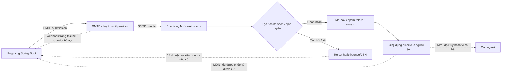
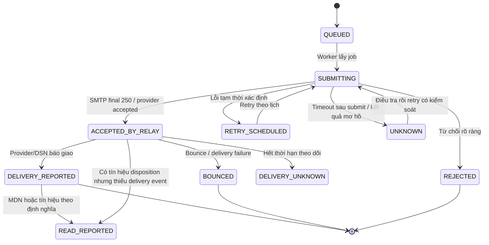
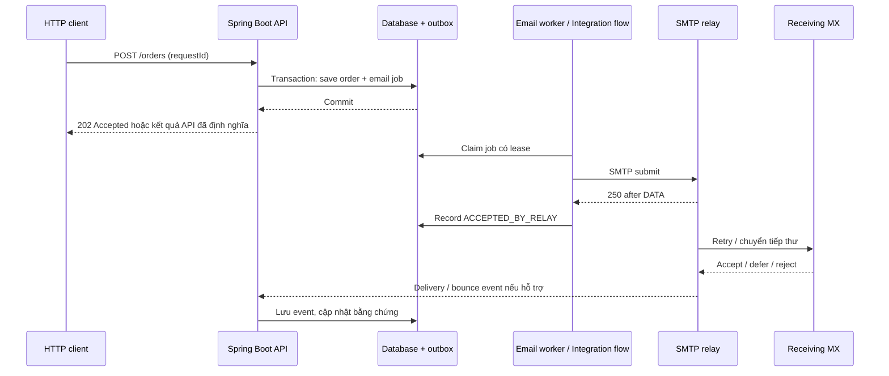

# Phân biệt SMTP chấp nhận thư với người nhận đã nhận hoặc đọc

## 1. Bài toán thực tế: “Gửi email thành công” nghĩa là gì?

Một dịch vụ **Spring Boot** gọi `JavaMailSender.send(...)` để gửi email xác nhận giao dịch. Method trả về bình thường và hệ thống ghi log `sent successfully`. Sau đó khách hàng phản hồi rằng họ không thấy thư, hoặc hệ thống phát hiện địa chỉ không tồn tại. Đây không nhất thiết là lỗi của `JavaMailSender`: **SMTP server chấp nhận trách nhiệm xử lý thư** khác với **thư được chuyển đến hệ thống đích**, và càng khác với **con người đã mở, đọc hoặc hiểu nội dung**.

Bài học thuộc chương **Email** của module **SPRING_BOOT_INTEGRATION**, nơi các luồng tích hợp kết nối HTTP client, cơ sở dữ liệu, cache, broker thông điệp và adapter của Spring Integration. Trong một flow thực tế, việc hiểu chính xác ranh giới SMTP ảnh hưởng trực tiếp đến hợp đồng API, trạng thái nghiệp vụ, retry, chống gửi trùng, giao dịch, kiểm thử và quan sát.

Sau bài này, người học có thể:

- Giải thích ý nghĩa của `250` sau `RCPT TO` và sau `DATA`, không đánh đồng việc relay nhận thư với người nhận nhận/đọc thư.
- Phân biệt thông báo **SMTP acceptance**, **delivery event**, **bounce/DSN**, **MDN/read receipt** và các chỉ báo mở thư như tracking pixel.
- Thiết kế trạng thái email có mức bảo đảm rõ ràng, kể cả trường hợp không thể xác định kết quả sau timeout.
- Triển khai cách gửi bằng Spring Boot, lưu yêu cầu bằng outbox, xử lý retry và quan sát vòng đời email mà không báo thành công sai.
- Kiểm thử đúng ranh giới giữa **SMTP server giả lập chấp nhận thư** và **bằng chứng thư được giao/đọc ở phía nhận**.

## 2. Hành trình của một email gồm nhiều mốc

Một thư có thể đi qua nhiều mail transfer agent (MTA), dịch vụ lọc spam và máy chủ mailbox trước khi người đọc thấy nó:



| Mốc | Điều thực sự biết được | Điều **chưa** thể kết luận |
|---|---|---|
| Ứng dụng ghi job email vào database | Yêu cầu gửi đã được lưu theo transaction của ứng dụng. | SMTP đã nhận, người nhận có thư. |
| SMTP relay trả `250` kết thúc pha `DATA` | Relay được kết nối đã chấp nhận thư để xử lý/chuyển tiếp theo chính sách của nó. | Receiving MX đã nhận, thư vào inbox, người dùng đã đọc. |
| Receiving MX phản hồi chấp nhận | Server phía đích hoặc một hệ thống thay mặt đích đã tiếp nhận chuyển giao SMTP. | Thư đã xuất hiện trong inbox thay vì spam, đã hiển thị, đã được người đọc xem. |
| Dịch vụ email phát event `delivered` | Theo định nghĩa của provider, một chặng giao thư đã được xác nhận, thường là phía mail server nhận chấp nhận. | Con người đã đọc; mọi provider có cùng định nghĩa “delivered”. |
| Có thông báo đã mở/đọc | Một tín hiệu MDN hoặc tương tác theo cơ chế cụ thể đã được ghi nhận. | Danh tính, việc đọc toàn bộ nội dung hoặc hiểu nội dung được chứng minh chắc chắn. |

Thuật ngữ “đã nhận” cần đi kèm **chủ thể nhận**: relay của hệ thống gửi, mail server bên nhận, mailbox hay con người. Nếu không chỉ rõ, một nhãn `DELIVERED` trong dashboard có thể khiến đội vận hành hoặc khách hàng hiểu sai mức bảo đảm.

## 3. SMTP chấp nhận thư ở giai đoạn nào?

SMTP trao đổi theo các bước cơ bản: chào máy chủ, xác định người gửi phong bì (`MAIL FROM`), người nhận phong bì (`RCPT TO`), truyền nội dung (`DATA`) và nhận phản hồi kết thúc phiên truyền dữ liệu.

Ví dụ transcript **minh họa**, đã lược bỏ EHLO extensions, STARTTLS và xác thực:

```text
C: EHLO app.example
S: 250-mailrelay.example
S: 250 SIZE 10485760
C: MAIL FROM:<bounce@example.com>
S: 250 2.1.0 Sender OK
C: RCPT TO:<customer@example.net>
S: 250 2.1.5 Recipient OK
C: DATA
S: 354 End data with <CRLF>.<CRLF>
C: From: no-reply@example.com
C: To: customer@example.net
C: Subject: Your order update
C:
C: Your order is being processed.
C: .
S: 250 2.0.0 Queued as Q-1248
```

Hai phản hồi `250` trong transcript có ý nghĩa khác nhau:

1. **`250` sau `RCPT TO`:** server đồng ý xử lý địa chỉ người nhận trong giao dịch SMTP hiện tại. Nó **chưa** nhận xong nội dung thư, chưa chứng minh mailbox tồn tại hoặc mail server cuối đã giao thư. Một số server chấp nhận cả địa chỉ chưa xác minh ở bước này để xử lý sau hoặc hạn chế việc dò tìm địa chỉ.
2. **`250` sau dấu chấm kết thúc `DATA`:** server đang kết nối đã **chấp nhận thông điệp** để xử lý tiếp. Nếu đó là relay trung gian, thư vẫn có thể bị chậm, bị từ chối ở chặng sau, hết thời hạn retry hoặc bị phát sinh bounce.

`354` chỉ là tín hiệu cho phép **bắt đầu gửi phần dữ liệu**, chưa phải kết quả chấp nhận thư. Phản hồi `250` cuối cùng thường có queue ID của relay, giúp truy vết log phía provider/MTA; queue ID này không phải bằng chứng người nhận đã đọc.

### Mã SMTP và cách diễn giải

| Lớp mã | Ý nghĩa khái quát | Hướng xử lý |
|---|---|---|
| `2xx` | Bước/lệnh được server chấp nhận hoặc hoàn tất; cần xem **đang ở lệnh nào**. | Nếu `250` kết thúc `DATA`: ghi nhận accepted-by-relay. |
| `3xx` | Chờ thêm thông tin hoặc dữ liệu, như `354` sau `DATA`. | Tiếp tục giao thức; chưa xác nhận thư đã được nhận. |
| `4xx` | Lỗi tạm thời ở bước đang thực hiện, ví dụ `421`, `450`, `451` hoặc `452` tùy bối cảnh. | Đánh giá retry có giới hạn, backoff và độ ưu tiên; tránh retry tức thì gây quá tải. |
| `5xx` | Lỗi vĩnh viễn đối với yêu cầu tại server ở thời điểm đó, ví dụ `550` hoặc `553`. | Không retry mù quáng; xác minh địa chỉ, quyền gửi, policy và nguyên nhân thực tế. |

Mã nâng cao như `4.2.2` hoặc `5.1.1` bổ sung thông tin về bản chất lỗi. Tuy nhiên, cách triển khai và nội dung phản hồi tùy server. Không suy nguyên nhân chỉ từ một câu chữ tự do trong phản hồi, và không coi mọi lỗi `4xx` là chắc chắn sẽ thành công sau khi thử lại.

**Một email có nhiều người nhận** phức tạp hơn: SMTP có thể chấp nhận một số `RCPT TO` và từ chối số khác. SDK có thể thông báo lỗi gửi một phần; trạng thái phải được quản lý **theo từng recipient/envelope** khi ứng dụng cần xác minh từng người.

## 4. “Giao thành công” cũng có nhiều định nghĩa

Sau khi relay chấp nhận, nó có thể chuyển thư trực tiếp đến receiving MX hoặc chuyển qua nhiều relay khác. Kết quả có thể là:

- Receiving MX chấp nhận thư và chuyển vào hệ thống xử lý nội bộ.
- Mailbox tồn tại nhưng thư bị lọc vào spam/quarantine hoặc bị quy tắc người dùng chuyển tiếp, xóa.
- Receiving MX tạm từ chối, relay đưa thư vào hàng đợi và thử lại.
- Địa chỉ, domain hoặc policy không hợp lệ, dẫn đến reject hoặc bounce.
- Nhà cung cấp không gửi sự kiện callback hoặc callback bị mất/chậm, khiến ứng dụng không nhận được tín hiệu kết quả cuối.

**Delivery event** do nhà cung cấp gửi thường nghĩa là mail server nhận đã chấp nhận chuyển giao. Cần đọc định nghĩa event của provider đang sử dụng: `processed`, `accepted`, `sent` và `delivered` có thể phản ánh các thời điểm khác nhau. Một webhook ghi `delivered` không mặc nhiên chứng minh thư đã nằm ở thư mục Inbox; không chứng minh người nhận đã mở.

Nếu cần cam kết về việc **người nhận thực sự đã tiếp nhận thông tin**, email đơn thuần không đủ. Với hợp đồng quan trọng, có thể yêu cầu người dùng đăng nhập cổng thông tin, mở thông báo và thực hiện hành động xác nhận; đây là **bằng chứng tương tác trong hệ thống có xác thực**, độc lập với SMTP.

## 5. Bounce, DSN và MDN: ba loại tín hiệu khác nhau

### 5.1. Bounce và Delivery Status Notification (DSN)

Khi không thể giao thư, hệ thống email có thể tạo **bounce** hoặc **DSN** (Delivery Status Notification) gửi về địa chỉ envelope sender hoặc qua event API của provider. DSN có thể báo tình trạng như **failed**, **delayed** hoặc trong một số tình huống **delivered/relayed/expanded**. Không phải mọi MTA đều hỗ trợ yêu cầu DSN theo cùng cách.

Các điểm cần nhớ:

- Bounce có thể đến **sau khi** relay trả `250`, do đó `accepted-by-relay` và `bounced` không mâu thuẫn nhau.
- Một `5xx` ngay trong cuộc hội thoại SMTP là **từ chối đồng bộ**; bounce phát sinh sau là **phản hồi bất đồng bộ**. Hai luồng cần được theo dõi riêng.
- **Không nhận được bounce không phải bằng chứng thư đã đến đích.** Bounce có thể thất lạc, bị chặn, không phát sinh hoặc không được ứng dụng thu thập.
- DSN là tín hiệu phải được liên kết đúng message/recipient. Một số DSN có thể giả mạo; cần kiểm chứng nguồn và không tin toàn bộ nội dung làm căn cứ tự động cho tác vụ nhạy cảm.
- Email có thể có đường chuyển tiếp/alias khiến thông báo cuối khác mong đợi. Sự kiện `relayed` không đồng nghĩa `delivered` vào mailbox cuối.

### 5.2. Message Disposition Notification (MDN) và “read receipt”

**MDN** mô tả một hành vi xử lý/hiển thị được mail user agent báo lại, ví dụ thông báo `displayed`. Một thư có thể đề nghị nhận thông báo disposition, nhưng:

- Người dùng hoặc phần mềm mail **có thể từ chối, bỏ qua hoặc chặn** yêu cầu.
- Một ứng dụng có thể báo đã hiển thị dù người dùng không đọc kỹ; người dùng cũng có thể đọc mà không gửi MDN.
- MDN không chứng minh người nhận đã hiểu, đồng ý hoặc có khả năng thực hiện yêu cầu.
- Tín hiệu MDN có thể đi qua email và cần xác thực/liên kết cẩn thận như các thông báo khác.

Vì vậy không nên coi `read receipt received` là bằng chứng pháp lý hoặc xác nhận nghiệp vụ tuyệt đối nếu chưa có quy trình xác thực phù hợp.

### 5.3. Open tracking bằng ảnh và click tracking

Một số dịch vụ gửi email ghi nhận “open” khi client tải ảnh theo dõi, hoặc “click” khi có request đến URL được gắn tracking:

| Tín hiệu | Điều có thể quan sát | Giới hạn |
|---|---|---|
| Tracking pixel tải thành công | Có một yêu cầu tải ảnh, có thể từ ứng dụng mail hoặc proxy. | Prefetch, proxy, cơ chế bảo vệ riêng tư, cache, bot hoặc chặn ảnh khiến số liệu không đại diện việc con người mở thư. |
| Click tracking | Có request đi qua link theo dõi. | Link preview, công cụ quét bảo mật, forward hoặc automation có thể tạo click; click không đồng nghĩa đã đọc toàn bộ thư. |
| MDN/read receipt | Client/người dùng đã tạo một thông báo disposition. | Tùy chính sách và hành vi bên nhận; không phải lúc nào cũng gửi và không có bảo đảm người đọc hiểu nội dung. |
| Xác nhận trong ứng dụng đã đăng nhập | Tài khoản thực hiện thao tác xác nhận được ghi nhận. | Cần chính sách định danh, xác thực và audit; vẫn không tự chứng minh sự hiểu biết của người thao tác. |

Việc đo mở thư phải tuân theo chính sách bảo vệ dữ liệu và kỳ vọng riêng tư của người dùng; trong nhiều nghiệp vụ có thể bỏ hẳn chỉ số này và đo kết quả từ hành động đã xác thực.

## 6. Spring Boot và `JavaMailSender` bảo đảm đến đâu?

Trong Spring Boot, dependency thường dùng để gửi SMTP là:

```kotlin
dependencies {
    implementation("org.springframework.boot:spring-boot-starter-mail")
}
```

Với Spring Boot 3.x, starter mail thường dùng Spring Framework Mail và **Jakarta Mail**. Khi đủ điều kiện, Spring Boot cấu hình `JavaMailSender` từ các thuộc tính `spring.mail.*`; adapter SMTP của Spring Integration nếu được dùng phải được cấu hình để dùng sender/session thích hợp.

Ví dụ cấu hình SMTP submission qua STARTTLS trên port 587:

```yaml
spring:
  mail:
    host: ${SMTP_HOST}
    port: ${SMTP_PORT:587}
    username: ${SMTP_USERNAME}
    password: ${SMTP_PASSWORD}
    properties:
      "[mail.smtp.auth]": "true"
      "[mail.smtp.starttls.enable]": "true"
      "[mail.smtp.starttls.required]": "true"
      "[mail.smtp.connectiontimeout]": "5000"
      "[mail.smtp.timeout]": "5000"
      "[mail.smtp.writetimeout]": "5000"
```

Các thuộc tính JavaMail ở trên là ví dụ cho SMTP server hỗ trợ STARTTLS và authentication. Cấu hình thực tế phải theo yêu cầu của provider (TLS, cổng, chứng chỉ, cơ chế xác thực, quota). Không hard-code mật khẩu hoặc ghi phiên SMTP chứa credential vào log.

Ví dụ gửi một thư cho **một** recipient:

```java
import org.springframework.mail.SimpleMailMessage;
import org.springframework.mail.javamail.JavaMailSender;
import org.springframework.stereotype.Service;

@Service
public class OrderEmailSubmitter {
    private final JavaMailSender mailSender;

    public OrderEmailSubmitter(JavaMailSender mailSender) {
        this.mailSender = mailSender;
    }

    /**
     * Trả về nghĩa là JavaMailSender không báo lỗi ở lần submit này.
     * Không có nghĩa người nhận đã nhận, mở hay đọc thư.
     */
    public void submit(OrderEmailCommand command) {
        SimpleMailMessage message = new SimpleMailMessage();
        message.setFrom("no-reply@example.com");
        message.setTo(command.recipient());
        message.setSubject("Cập nhật đơn hàng");
        message.setText("Đơn hàng " + command.orderId()
                + " đang được xử lý.");

        mailSender.send(message);
        // Chỉ ghi nhận kết quả của lần submit SMTP; không đặt READ.
    }
}

record OrderEmailCommand(String orderId, String recipient) {
}
```

Nếu `send(...)` trả về mà không exception trong tình huống gửi SMTP thông thường, ứng dụng có thể ghi nhận **lần submit đã thành công theo client/server SMTP hiện tại**. Nó **không cung cấp một lời hứa end-to-end** về việc nhận hoặc đọc. Nếu SMTP relay là provider của bạn, kết quả này phù hợp với trạng thái như `ACCEPTED_BY_RELAY`; không nên gọi ngay `DELIVERED` hay `READ`.

Khi `send(...)` ném `MailException` hoặc exception tầng thấp, cần phân tích nguyên nhân:

- Reject ở bước SMTP (ví dụ địa chỉ/permission) có thể cho biết server chưa chấp nhận cho recipient tương ứng.
- Timeout hoặc connection reset, đặc biệt **sau khi client đã gửi hết `DATA` nhưng chưa nhận final response**, có thể khiến kết quả **không xác định**. Server có thể đã queue thư, còn ứng dụng tưởng thất bại.
- Với nhiều người nhận hoặc nhiều message trong cùng một lời gọi, lỗi gửi một phần có thể xảy ra; không gán một trạng thái thành công/thất bại tuyệt đối cho cả nhóm mà chưa đọc chi tiết.

Không biến mọi exception thành `FAILED_PERMANENT` hoặc retry ngay; cần phân biệt **definitive rejection** với **unknown outcome** và giữ ngữ cảnh attempt.

## 7. State machine nên phản ánh bằng chứng, không phản ánh hy vọng

Một hệ thống thông báo email cần ít nhất hai trục thông tin: **trạng thái job gửi** và **các bằng chứng delivery/disposition**. Ví dụ một state machine đơn giản hóa cho mỗi recipient:



Đây là **mô hình ứng dụng tự định nghĩa**, không phải enum của Spring hay SMTP. Sự kiện có thể đến không theo thứ tự; ví dụ delivery event đến sau bounce, hoặc email được báo mở mà hệ thống chưa nhận event giao. Vì thế trong hệ thống lớn, lưu **bảng event/attempt riêng** rồi suy ra trạng thái hiển thị sẽ an toàn hơn việc ghi đè một cột trạng thái một cách mù quáng.

| Trạng thái ứng dụng minh họa | Điều có thể công bố | Không được suy ra |
|---|---|---|
| `QUEUED` | Đã lưu yêu cầu gửi để worker xử lý. | SMTP đã nhận. |
| `SUBMITTING` | Có attempt đang thực hiện; có thể hết lease/crash và cần phục hồi. | Attempt chắc chắn sẽ có kết quả. |
| `ACCEPTED_BY_RELAY` | Relay/provider được gọi đã chấp nhận thư theo giao thức hoặc API tương ứng. | Đến inbox hoặc được đọc. |
| `RETRY_SCHEDULED` | Đang chờ retry sau lỗi được phân loại; thời gian và số lần đã được lưu. | Chắc chắn chưa có email nào đến đích nếu lỗi trước đó mơ hồ. |
| `UNKNOWN` | Không xác định có được SMTP server chấp nhận hay chưa. | Thư thất bại hoặc an toàn khi gửi lại vô hạn. |
| `REJECTED` | Có bằng chứng rõ ràng rằng lần submit bị từ chối. | Mọi địa chỉ hoặc mọi attempt khác cũng thất bại. |
| `DELIVERY_REPORTED` | Có bằng chứng giao ở mức định nghĩa bởi nguồn báo cáo. | Vào inbox, được nhìn thấy, đã đọc. |
| `BOUNCED` | Có tín hiệu thất bại giao thư cho recipient/attempt liên quan. | Không có attempt khác hoặc forward nào đã được nhận. |
| `READ_REPORTED` | Có tín hiệu MDN hoặc hành vi theo cơ chế theo dõi được định nghĩa. | Đã đọc/hiểu một cách chắc chắn. |
| `DELIVERY_UNKNOWN` | Hết thời gian theo dõi nhưng chưa có tín hiệu quyết định. | Đã giao hoặc thất bại. |

Ứng dụng nên có **mốc thời gian, nguồn chứng cứ và từng attempt** (ví dụ `acceptedAt`, `bounceReceivedAt`, `providerEventId`, `smtpResponseCode` khi có). Với email gửi nhiều người, nên tạo **delivery record theo từng recipient** để một recipient bị từ chối không làm sai báo cáo của recipient khác.

### Đặt tên API/UI cho đúng nghĩa

| Nhãn dễ gây hiểu nhầm | Tên hoặc mô tả chính xác hơn |
|---|---|
| “Email sent” ngay sau khi tạo outbox job | “Yêu cầu gửi đã được tiếp nhận và xếp hàng”. |
| “Delivered” ngay sau `JavaMailSender.send` | “Đã được SMTP relay chấp nhận”. |
| “Customer received” khi provider có delivered event | “Máy chủ email đích đã chấp nhận theo báo cáo của provider”. |
| “Customer read” từ tracking pixel | “Có tín hiệu mở thư từ hệ thống theo dõi, có thể không phản ánh việc đọc thực tế”. |
| “Failed” sau client read timeout | “Chưa xác định kết quả gửi; đang đối soát/thử lại theo chính sách”. |

## 8. Kết hợp transaction, outbox và worker gửi mail

Một mẫu tích hợp thực tế là HTTP API nhận sự kiện đặt hàng, lưu cơ sở dữ liệu và **xếp job email trong cùng transaction DB**. Sau commit, worker xử lý job qua SMTP; provider có thể gửi webhook/DSN về ứng dụng.



**Lợi ích outbox:** không mất yêu cầu gửi chỉ vì API process chết sau khi commit đơn hàng nhưng trước lúc gọi SMTP. Đây là phương pháp quản lý ý định gửi bền vững; **không làm email trở thành giao dịch nguyên tử với database**.

Trường hợp lỗi quan trọng:

1. Worker gửi SMTP; relay trả `250`.
2. Worker crash **trước khi** cập nhật `ACCEPTED_BY_RELAY` vào DB.
3. Sau khi lease hết hạn, worker khác nhặt lại job và có thể gửi thêm một bản.

SMTP thông thường **không có primitive idempotency key chuẩn cho submission**. `Message-ID` trong MIME header giúp liên hệ thư và có thể hỗ trợ một số bộ lọc/phân tích, nhưng **không bảo đảm** mọi relay và mailbox loại trùng. Nếu provider có API gửi mail hỗ trợ idempotency key thực sự, cần kiểm tra hợp đồng cụ thể; việc tái dùng một `Message-ID` không tương đương cơ chế đó.

Những biện pháp nên kết hợp:

- Có `notificationId` ổn định theo nghiệp vụ, unique constraint để không tạo job email trùng từ cùng một sự kiện HTTP/broker.
- Outbox worker claim bằng cơ chế lease/lock phù hợp; lưu attempt ID, số lần thử, thời gian thử kế tiếp và kết quả quan sát.
- Phân loại lỗi rõ ràng; với **unknown outcome** cần đối soát qua provider/queue log nếu có trước khi retry tác vụ nhạy cảm.
- Nếu phải gửi lại, lưu rõ “có thể gửi trùng” và chọn nội dung email chịu được at-least-once, ví dụ thông báo trạng thái, không tạo tác động tài chính khi đọc.
- Không dựa vào cache hoặc khóa in-memory để chống trùng giữa nhiều instance và sau restart.
- Phân biệt xác nhận broker đã publish event “send-email” với SMTP đã nhận, nhận ở đích và người dùng đã đọc.

## 9. Webhook và DSN: nhận sự kiện bất đồng bộ an toàn

Nếu nhà cung cấp có webhook delivery/bounce/open, ứng dụng phải coi webhook là **dữ liệu đầu vào từ bên ngoài**:

1. **Xác thực nguồn:** kiểm tra chữ ký, token, thời gian hợp lệ hoặc phương án xác minh do provider quy định; không chấp nhận một HTTP request tự xưng “delivered”.
2. **Chuẩn hóa event:** ánh xạ loại sự kiện của provider sang trạng thái nội bộ với định nghĩa rõ. `processed` không đồng nghĩa `delivered`; `open` không đồng nghĩa `read`.
3. **Liên kết chính xác:** lưu mapping giữa `notificationId`, recipient, provider message ID, envelope recipient và attempt. `Message-ID` header có thể khác ID riêng của provider.
4. **Chống xử lý trùng:** dùng unique key trên provider event ID hoặc khóa tổng hợp có giới hạn phù hợp vì webhook có thể gửi lại.
5. **Xử lý out-of-order:** lưu event và timestamp nguồn; không chỉ ghi đè status bởi event đến muộn. Một bounce cũ không được tự ý xóa kết quả của attempt mới.
6. **Phản hồi HTTP theo hợp đồng:** chỉ ack sau khi lưu sự kiện an toàn hoặc có cơ chế durable queue. Việc xử lý nặng có thể giao cho worker.
7. **Bảo vệ dữ liệu:** giới hạn lưu recipient address, headers, message body và thông tin click/open; mã hóa và retention theo nhu cầu.

Nếu provider chỉ hỗ trợ SMTP và gửi bounce về `Return-Path`, cần một quy trình nhận/parse mail phù hợp (ví dụ inbound mail adapter) và kiểm tra header/cấu trúc DSN. Không coi email bounce gửi đến địa chỉ bất kỳ là một webhook đã xác thực; cần xác nhận tương quan và nguồn.

### Vì sao không có webhook vẫn phải có “unknown”?

Không phải mọi SMTP relay cung cấp event delivery; nhiều email được xử lý qua hạ tầng mà ứng dụng không quan sát được từng bước. Sau `250`, trạng thái đúng có thể vẫn chỉ là `ACCEPTED_BY_RELAY` rất lâu. Nếu quá thời hạn giám sát mà không có event, chuyển sang `DELIVERY_UNKNOWN` hoặc giữ trạng thái acceptance kèm nhãn “chưa xác nhận giao”. Không tự nâng cấp thành `DELIVERY_REPORTED` vì đã qua một giờ hay một ngày.

## 10. Phân loại lỗi và chiến lược retry

| Tình huống | Bằng chứng hiện có | Hướng xử lý hợp lý |
|---|---|---|
| Không kết nối được SMTP trước khi truyền dữ liệu | Chưa xác nhận có giao dịch thành công; cần xem nguyên nhân và transport log. | Kiểm tra mạng, DNS, TLS, auth; retry có giới hạn nếu lỗi tạm thời. |
| Server trả `450` / `451` ở bước cần thiết | Từ chối tạm thời theo phản hồi SMTP. | Retry theo lịch, exponential backoff/jitter và giới hạn attempt. |
| Server trả `550` cho recipient | Recipient bị từ chối ở bước đó. | Ngừng retry mù quáng; kiểm tra địa chỉ và suppression policy; ghi lý do theo mã. |
| Server trả `250` sau `DATA` | Relay hiện tại đã chấp nhận thông điệp. | Ghi `ACCEPTED_BY_RELAY`; theo dõi delivery/bounce bất đồng bộ nếu có. |
| Client mất kết nối sau khi gửi `DATA` nhưng trước final response | **Kết quả không xác định**: relay có thể đã chấp nhận. | Đối soát queue/provider event khi có; retry có cân nhắc nguy cơ trùng. |
| Relay đã `250` rồi provider báo hard bounce | Có bằng chứng tiếp nhận ban đầu và bằng chứng không giao được ở chặng sau. | Ghi cả hai sự kiện, cập nhật kết quả delivery, xử lý suppression khi thích hợp. |
| Provider báo delivered | Receiving server hoặc mốc giao theo hợp đồng provider được xác nhận. | Báo cáo đúng phạm vi; không tự đánh dấu read. |
| Không có MDN/open event | Không có tín hiệu đã đọc. | Giữ unknown về việc đọc; không kết luận người nhận đã bỏ qua thư. |
| Nhiều recipient, một số RCPT bị reject | Kết quả hỗn hợp theo recipient. | Tách trạng thái và quyết định retry cho từng recipient; tránh gửi trùng cho người đã được chấp nhận. |

**Quy tắc trọng tâm:** một exception trong client **không** luôn chứng minh email chưa vào queue của SMTP relay. Retry phải dựa trên bước giao thức, phân loại lỗi, bản ghi attempt và khả năng đối soát. Với email xác thực, mã OTP hoặc giao dịch nhạy cảm, phải đánh giá thêm thời hạn hiệu lực, bảo mật và tác động khi gửi trùng hoặc giao chậm.

## 11. Quan sát và chuẩn hóa các mốc thời gian

Để điều tra “mail đã gửi chưa?”, ứng dụng cần lưu đủ mốc theo **notificationId + recipient + attemptId**:

| Mốc thời gian / dữ kiện | Nguồn | Dùng để phân tích |
|---|---|---|
| `queuedAt` | Outbox DB | Thời gian từ nghiệp vụ đến khi sẵn sàng gửi. |
| `attemptStartedAt` | Worker | Thời gian chờ trong queue; số lần thử. |
| `smtpAcceptedAt` / mã SMTP nếu xác minh được | SMTP submit / provider acceptance event | Relay đã nhận lúc nào, có queue ID nào. |
| `deliveryReportedAt` | Provider event hoặc DSN | Độ trễ chuyển giao theo định nghĩa nguồn. |
| `bounceReportedAt` và reason code | Provider/DSN | Phân loại hard/soft bounce và chính sách suppression. |
| `dispositionReportedAt` và loại tín hiệu | MDN/tracking theo chính sách | Có tín hiệu tương tác nào, độ tin cậy ra sao. |
| `lastAttemptErrorKind` | Worker/transport | Timeout, authentication, transient SMTP, recipient reject, unknown. |

Các metric có thể đặt tên theo ý nghĩa nghiệp vụ:

```text
integration_email_jobs_total{channel="transactional",result="queued"}
integration_email_attempts_total{provider="primary",outcome="accepted"}
integration_email_attempts_total{provider="primary",outcome="unknown"}
integration_email_delivery_events_total{type="delivered"}
integration_email_delivery_events_total{type="bounced"}
integration_email_outbox_pending
integration_email_outbox_oldest_age_seconds
integration_email_submission_duration_seconds
integration_email_delivery_latency_seconds
```

Đây là **tên metric minh họa do ứng dụng tự xây dựng**, không phải tên meter mặc định của Spring Boot. Định nghĩa mẫu số phải thống nhất: acceptance rate theo **attempt** khác acceptance rate theo **notification/recipient**; tỉ lệ delivered chỉ tính trên nhóm có provider hỗ trợ delivery event và phải ghi chú dữ liệu thiếu.

Tag nên có số lượng giá trị hữu hạn: `provider`, `channel`, `outcome`, `error_kind`. Không đặt `recipientEmail`, `messageId`, `notificationId` hoặc queue ID vào tag metric vì cardinality và dữ liệu cá nhân; đặt ID đã bảo vệ vào structured log/tracing với chính sách retention và quyền truy cập.

### Một ví dụ nhật ký có thể đối soát

```json
{
  "event": "email.smtp.accepted",
  "notificationId": "notice-1842",
  "attemptId": "attempt-03",
  "provider": "primary-smtp",
  "recipientRef": "recipient-42",
  "smtpPhase": "after-data",
  "smtpReplyCode": 250,
  "state": "ACCEPTED_BY_RELAY",
  "durationMs": 185
}
```

Trong thực tế, `smtpReplyCode` hoặc queue ID có thể không được API `JavaMailSender` trả ra trực tiếp khi gửi thành công; ví dụ trên chỉ được ghi các giá trị đã **thật sự thu thập** từ transport hoặc provider, không tự gán mã 250 nếu không có bằng chứng ở mức đó. Khi chỉ biết `send(...)` không ném lỗi, nên ghi `result=submit_returned_normally`, liên kết với mức bảo đảm tương ứng.

Kết nối observation của Spring Boot, log theo `traceId`/`correlationId` và metrics qua Micrometer với dữ liệu nghiệp vụ email giúp theo dõi từ HTTP/broker ingress đến outbox, SMTP và webhook. Một distributed trace kết thúc khi worker gửi xong **không** có nghĩa vòng đời email đã kết thúc ở phía người nhận.

## 12. Kiểm thử: fake SMTP chấp nhận thư có chứng minh đã giao không?

**Không.** Một SMTP test server như GreenMail, MailHog/Mailpit hoặc công cụ giả lập phù hợp có thể chứng minh ứng dụng **gửi đúng SMTP envelope và MIME content** tới server kiểm thử. Nếu test server lưu thư trong mailbox ảo, đó vẫn là điều kiện môi trường test; chưa chứng minh receiving MX bên ngoài sẽ chấp nhận hay người dùng thật sẽ đọc.

| Kịch bản kiểm thử | Cách tạo điều kiện | Assert đúng |
|---|---|---|
| **Accepted sau DATA** | SMTP stub trả `250` hợp lệ sau khi nhận nội dung. | Sender không báo lỗi; application ghi `ACCEPTED_BY_RELAY` hoặc kết quả submit tương ứng, **không** `DELIVERED`. |
| **Từ chối recipient** | Stub trả `550` ở `RCPT TO`. | Lỗi được phân loại, không đánh dấu accepted cho recipient đó. |
| **Transient failure** | Stub trả `451` hoặc phản hồi lỗi tạm thời. | Retry theo backoff/giới hạn; không loop vô hạn hoặc làm nghẽn flow. |
| **Lost final acknowledgement** | Stub nhận hết `DATA` nhưng ngắt kết nối trước final response. | Ứng dụng đánh dấu kết quả không chắc chắn; retry policy nêu rõ nguy cơ duplicate. |
| **Delayed bounce** | Submit accepted, sau đó bơm webhook/DSN bounce. | Lưu cả acceptance và bounce; kết quả delivery cập nhật đúng recipient/attempt. |
| **Delivered event** | Webhook hợp lệ từ provider giả lập, có id tương quan. | Chuyển sang `DELIVERY_REPORTED` theo định nghĩa provider, **không** tự chuyển `READ_REPORTED`. |
| **Duplicate/out-of-order event** | Gửi cùng webhook hai lần; gửi bounce/delivered khác thứ tự. | Event idempotency và logic hợp nhất state không nhân đôi hoặc làm mất lịch sử. |
| **No MDN/open** | Đã submit và delivered nhưng không có disposition event. | Trạng thái đọc vẫn **unknown**. |
| **Multi-recipient partial success** | SMTP chấp nhận một `RCPT TO` và từ chối một recipient khác. | Trạng thái và retry được ghi độc lập theo recipient. |
| **Worker crash sau acceptance** | Relay `250` rồi dừng worker trước DB status update. | Lease phục hồi đúng; hệ thống ghi nhận khả năng gửi trùng và áp dụng chính sách retry an toàn. |

Các tầng kiểm thử nên tách:

1. **Unit test:** ánh xạ event/exception sang state, xử lý retry, idempotency, deadline và kết quả unknown.
2. **Integration test:** dùng SMTP test server để xác minh kết nối, auth/TLS nếu cấu hình, MIME, timeout, reject, partial delivery và các mã phản hồi.
3. **Contract test:** dùng fixture webhook/DSN theo định dạng thật của provider, xác minh signature/metadata, dedup và tương thích schema.
4. **End-to-end smoke test:** gửi vào mailbox thử nghiệm do đội vận hành quản lý, quan sát điều kiện thực tế có thể chứng minh. Không lấy việc tự mở hộp thư thử nghiệm làm tiêu chí “người dùng sản phẩm đã đọc”.

Một integration test chỉ assert `mailSender.send(...)` không throw là **test đường submission**, không là test giao đến người nhận. Kiểm thử acceptance và delivery là hai lớp riêng.

## 13. Chẩn đoán tình huống “không thấy email”

Ví dụ: 1.000 đơn hàng đã tạo; dashboard ghi “gửi thành công” cho toàn bộ, nhưng có 70 khách báo không thấy email.

1. **Xác định dashboard đang đo gì.** Nếu số 1.000 là `JavaMailSender.send` trả về bình thường, đổi nhãn thành accepted-by-relay/submit succeeded, không dùng làm “đã giao”.
2. **Tìm theo notification ID và recipient.** Đọc outbox, attempt, thời gian, provider message ID và các phản hồi SMTP có thu thập được.
3. **Đối chiếu provider logs/event.** Tách accepted, deferred, delivered, bounced, suppressed, rejected, blocked hoặc unknown theo hợp đồng của provider.
4. **Kiểm tra hạ tầng gửi.** Cấu hình host/port, TLS, authentication, quota, rate limit, domain SPF/DKIM/DMARC, uy tín gửi và suppression list. Cấu hình đúng các yếu tố này giúp giảm lỗi/gian lận, nhưng không bảo đảm một thư vào Inbox.
5. **Xác định thư mục và chính sách phía nhận.** Spam/quarantine, rule forwarding, mailbox đầy, địa chỉ sai, alias hoặc quy tắc của doanh nghiệp nhận.
6. **Theo dõi kết quả bất đồng bộ.** Một số bounce và delivery event đến sau; nếu không có event, ghi trạng thái thiếu bằng chứng thay vì suy diễn.
7. **Khắc phục theo nhóm nguyên nhân.** Với hard bounce, sửa địa chỉ hoặc suppression; với lỗi tạm thời, retry có giới hạn; với trạng thái unknown, đối soát trước khi gửi lại.
8. **Xác nhận hợp đồng người dùng.** Nếu thông báo bắt buộc được nhìn thấy trước hạn, sử dụng thêm thông báo trong ứng dụng có xác nhận hoặc kênh dự phòng phù hợp.

Không gộp “không thấy inbox” với “SMTP không gửi”. Chúng thuộc những mốc khác nhau và cần bằng chứng khác nhau.

## 14. Sai lầm thường gặp

| Sai lầm | Hậu quả | Cách xử lý |
|---|---|---|
| Gán `DELIVERED` khi `JavaMailSender.send` trả về. | Báo cáo sai, bỏ sót bounce và tình trạng giao chậm. | Dùng `ACCEPTED_BY_RELAY`, chỉ nâng cấp trạng thái theo nguồn bằng chứng phù hợp. |
| Gán `READ` khi mail server trả `250`. | Khẳng định không có cơ sở về hành vi con người. | Tách acceptance, delivery và disposition; read phải có định nghĩa và nguồn riêng. |
| Xem `250 RCPT TO` là mailbox đã nhận. | Lầm về ranh giới giao thức trước khi truyền body. | Xem toàn bộ SMTP transaction và final response sau `DATA`. |
| Xem `delivered` từ provider là “đã vào Inbox”. | Tranh chấp khi thư bị lọc spam hoặc người dùng không thấy. | Công bố đúng mốc receiving server acceptance theo provider. |
| Không có bounce thì coi giao thành công. | Thống kê bị thổi phồng khi thiếu telemetry. | Có trạng thái unknown; ghi rõ phạm vi và độ đầy đủ dữ liệu sự kiện. |
| Retry mọi timeout ngay lập tức. | Gửi trùng sau khi relay thực tế đã queue thư. | Xử lý unknown outcome, lưu attempt và đối soát trước retry khi có thể. |
| Cho email gửi trong transaction DB rồi mong rollback cả SMTP. | DB rollback nhưng thư đã gửi ra ngoài. | Outbox + worker + state; chấp nhận và xử lý ranh giới không nguyên tử. |
| Dựa vào MIME `Message-ID` để bảo đảm exactly-once. | Một số relay/mailbox vẫn nhận thư trùng. | Dùng idempotency nghiệp vụ và khả năng nhà cung cấp thật sự hỗ trợ; thiết kế chịu được gửi lặp. |
| Dùng pixel open như bằng chứng người dùng đã đọc. | Sai số do proxy, cache, prefetch, bot và chặn ảnh. | Chỉ coi là tín hiệu tương tác ước lượng; xác nhận nghiệp vụ qua cơ chế có xác thực. |
| Chỉ kiểm tra bằng SMTP test server. | Không biết gì về chuyển tiếp thật, bounce, spam và người dùng cuối. | Tách test submission, provider contract và smoke test vận hành. |

## 15. Checklist thiết kế tích hợp email

- [ ] API, log và dashboard phân biệt rõ `QUEUED`, `ACCEPTED_BY_RELAY`, delivery evidence và read/disposition evidence.
- [ ] Đã hiểu `250` sau `RCPT TO` khác `250` sau `DATA`; không đánh đồng final SMTP acceptance với Inbox hoặc human read.
- [ ] Có định nghĩa cụ thể cho các event `accepted`, `delivered`, `bounced`, `open` của nhà cung cấp đang dùng.
- [ ] Có state `UNKNOWN` cho timeout/mất final acknowledgement và chính sách retry xét nguy cơ gửi trùng.
- [ ] Xử lý lỗi `4xx`/`5xx` theo pha SMTP, recipient và nguyên nhân; không retry vô hạn.
- [ ] Sử dụng notification ID bền vững, outbox/worker khi cần bảo đảm không mất ý định gửi, kèm các bản ghi attempt.
- [ ] Ghi nhận trạng thái theo từng recipient; đối chiếu provider message ID, queue ID và header `Message-ID` đúng vai trò.
- [ ] Webhook/DSN được xác thực, chống trùng, xử lý out-of-order và lưu đủ bằng chứng để điều tra.
- [ ] Có metric queue age, submission latency, accepted, bounce, delivered report, unknown, retries và lỗi theo nhóm.
- [ ] Không coi tracking pixel, click tracking hay MDN là bằng chứng tuyệt đối người dùng đã đọc/hiểu; có xác nhận riêng nếu nghiệp vụ bắt buộc.
- [ ] Có test SMTP acceptance, reject, timeout kết quả mơ hồ, deferred/bounce, duplicate webhook, multi-recipient partial result và crash worker.
- [ ] Cấu hình TLS, xác thực, quyền gửi, SPF/DKIM/DMARC và bảo vệ dữ liệu cá nhân; không log password hoặc toàn bộ nội dung thư.

**Ghi nhớ:** `250` sau `DATA` xác nhận **SMTP server đang kết nối đã chấp nhận trách nhiệm xử lý thư**; nó không chứng minh receiving mailbox đã nhận, người dùng đã mở hoặc đã đọc. Trong Spring Boot, lời gọi gửi email, kết quả giao từ provider và tín hiệu tương tác phải được mô hình hóa, kiểm thử và theo dõi như **những mốc riêng biệt** của một luồng tích hợp bất đồng bộ.
