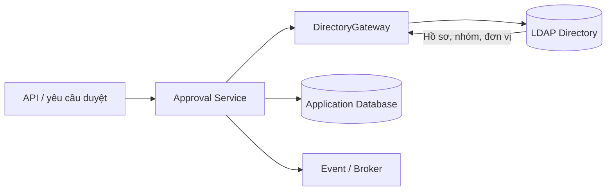
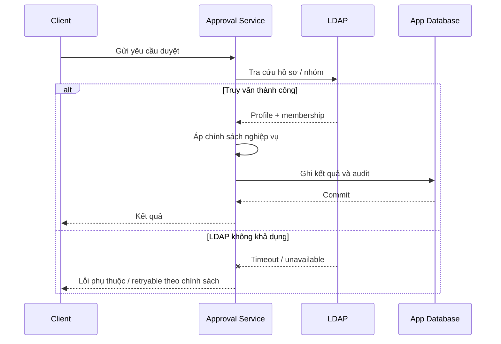

# Vai trò LDAP trong truy vấn hồ sơ, nhóm và cấu hình tổ chức

## 1. LDAP giải quyết bài toán gì trong tích hợp Spring Boot?

Một doanh nghiệp thường có nhiều hệ thống cùng cần biết nhân viên là ai, thuộc bộ phận nào, làm việc ở đơn vị nào và tham gia nhóm nào. Nếu mỗi ứng dụng lưu một bản danh sách nhân viên và nhóm riêng, thông tin dễ lệch khi nhân viên đổi phòng ban, chuyển vai trò hoặc nghỉ việc. **LDAP (Lightweight Directory Access Protocol)** cho phép ứng dụng truy vấn một dịch vụ thư mục tập trung để tra cứu các thông tin có cấu trúc phân cấp này.

Trong module **SPRING_BOOT_INTEGRATION**, LDAP là một kênh tích hợp bên cạnh HTTP client, cơ sở dữ liệu, cache, broker thông điệp và adapter của Spring Integration. Điểm quan trọng là xác định **hợp đồng dữ liệu thư mục, cấu hình kết nối, quyền truy cập, xử lý lỗi, tính nhất quán, kiểm thử và quan sát vận hành**; dùng thư mục làm nguồn thông tin tổ chức có kiểm soát thay vì xem nó là một cơ sở dữ liệu quan hệ thay thế.

Sau bài học, bạn có thể:

- Phân biệt cây thư mục LDAP, DN/RDN, entry, thuộc tính, `objectClass`, base DN và search filter.
- Thiết kế các truy vấn tìm hồ sơ nhân viên, nhóm trực tiếp và đơn vị tổ chức; hiểu vì sao schema LDAP giữa các tổ chức khác nhau.
- Dùng Spring LDAP trong Spring Boot qua `LdapTemplate`, ánh xạ dữ liệu sang DTO/domain và đóng gói trong adapter.
- Xử lý bảo mật, timeout, lỗi kết nối, cache, đồng bộ dữ liệu, kiểm thử và tính nhất quán khi LDAP tham gia luồng nghiệp vụ.

### Bối cảnh xuyên suốt

Giả sử một **Approval Service** trong Spring Boot nhận yêu cầu duyệt đơn mua hàng. Service phải hiển thị hồ sơ người yêu cầu, xác định họ thuộc phòng ban nào và kiểm tra họ có thuộc nhóm có quyền phê duyệt hay không. Thông tin tổ chức nằm trong LDAP directory; đơn mua hàng và các sự kiện phê duyệt nằm trong database/broker riêng.



Kết quả tra cứu thư mục chỉ là **một đầu vào** cho quyết định nghiệp vụ. Quyền phê duyệt cuối cùng vẫn cần chính sách rõ ràng tại ứng dụng (số tiền tối đa, trạng thái đơn, phạm vi bộ phận, chính sách ủy quyền, ...).

## 2. Mô hình dữ liệu: LDAP là cây thư mục

Khác bảng SQL với các hàng liên kết bằng khóa ngoại, dữ liệu LDAP tổ chức thành **các entry trong một cây phân cấp**. Mỗi entry có một **Distinguished Name (DN)** chỉ vị trí tương đối trong cây và một tập thuộc tính được ràng buộc bằng schema.

| Khái niệm | Ví dụ | Vai trò |
|---|---|---|
| DIT (Directory Information Tree) | Cây `dc=example,dc=org` | Không gian tên các entry |
| DN | `uid=an.nguyen,ou=people,dc=example,dc=org` | Định danh vị trí của entry trong cây |
| RDN | `uid=an.nguyen` | Phần tên phân biệt entry với các entry cùng cấp |
| Attribute | `uid`, `cn`, `mail`, `manager`, `member` | Dữ liệu của entry; có thể một hoặc nhiều giá trị |
| `objectClass` | `inetOrgPerson`, `groupOfNames`, `organizationalUnit` | Xác định loại entry và tập thuộc tính theo schema |
| Base DN | `ou=people,dc=example,dc=org` | Gốc phạm vi tìm kiếm |
| Search filter | `(&(objectClass=inetOrgPerson)(uid=an.nguyen))` | Điều kiện lọc entry |

Ví dụ các entry dạng LDIF để hình dung mô hình (không phải cấu trúc bắt buộc của mọi LDAP server):

```ldif
dn: uid=an.nguyen,ou=people,dc=example,dc=org
objectClass: top
objectClass: person
objectClass: organizationalPerson
objectClass: inetOrgPerson
uid: an.nguyen
cn: Nguyen An
sn: Nguyen
displayName: Nguyen An
mail: an.nguyen@example.org
employeeNumber: E0042
manager: uid=lan.tran,ou=people,dc=example,dc=org

dn: cn=purchase-approvers,ou=groups,dc=example,dc=org
objectClass: top
objectClass: groupOfNames
cn: purchase-approvers
member: uid=an.nguyen,ou=people,dc=example,dc=org
member: uid=lan.tran,ou=people,dc=example,dc=org

dn: ou=finance,ou=departments,dc=example,dc=org
objectClass: top
objectClass: organizationalUnit
ou: finance
description: Finance department
```

Trong ví dụ, `person` có `sn`/`cn`, `inetOrgPerson` bổ sung các thuộc tính thường dùng của hồ sơ; `groupOfNames` giữ danh sách DN trong `member`; `organizationalUnit` mô tả một đơn vị. Việc đặt tất cả nhân viên dưới `ou=people` chỉ là **một** cách tổ chức. Có directory phân cấp nhân viên dưới từng chi nhánh hoặc dùng schema vendor riêng.

### DN là địa chỉ của entry, không hẳn là mã nghiệp vụ bất biến

DN có thể thay đổi khi entry được chuyển OU hoặc đổi tên (rename/move). Vì vậy:

- Với hồ sơ, cần chọn khóa danh tính phù hợp như employee ID hoặc ID bất biến do directory quản lý, nếu schema cung cấp. `uid` chỉ duy nhất theo phạm vi và chính sách của thư mục; không mặc nhiên là định danh toàn tổ chức.
- DN vẫn quan trọng vì nhiều nhóm lưu **DN của thành viên**. Không tự suy DN từ `uid` nếu entry thực tế có thể nằm ở OU khác hoặc đã được chuyển vị trí.
- LDAP có quy tắc so sánh, escape và chuẩn hóa DN riêng. Dùng API DN của LDAP/JNDI thay vì ghép `"uid=" + userInput + ",..."` tùy tiện.
- Đừng dùng DN như chuỗi ID lưu cố định trong dữ liệu nghiệp vụ nếu không có chiến lược cập nhật khi rename/move.

## 3. Ba loại truy vấn thường gặp

### 3.1. Tra cứu hồ sơ nhân viên

Từ một mã nhân viên hoặc account name, Approval Service tra cứu `uid`, `displayName`, `mail`, `employeeNumber`, `manager` và các thuộc tính khác được phép đọc.

Ví dụ LDAP filter:

```text
Base DN: ou=people,dc=example,dc=org
Scope: subtree
Filter: (&(objectClass=inetOrgPerson)(uid=an.nguyen))
Attributes: uid,displayName,mail,employeeNumber,manager
```

Trong LDAP, **base** xác định nhánh cần tìm; **scope** có thể là `base object` (chỉ entry tại base), `one level` (các con trực tiếp) hoặc `subtree` (tất cả hậu duệ). Thu hẹp phạm vi và danh sách thuộc tính giúp giảm dữ liệu truyền và chi phí search; các truy vấn có tần suất cao nên được directory admin hỗ trợ index phù hợp.

Kết quả có thể là `0` entry (không tìm thấy), `1` entry (hợp lệ) hoặc nhiều entry (xung đột định danh / cấu hình search). Không nên lấy phần tử đầu tiên khi có nhiều kết quả mà không phát hiện bất thường. Thuộc tính như `mail` hay `manager` có thể vắng mặt tùy schema và mức quyền của tài khoản bind.

### 3.2. Tra cứu nhóm và quyền được gán

LDAP có nhiều cách thể hiện nhóm:

| Mô hình | Ví dụ | Cách đọc thành viên |
|---|---|---|
| `groupOfNames` | `member: uid=an.nguyen,...` | Tìm nhóm có `member` bằng DN của người dùng |
| `groupOfUniqueNames` | `uniqueMember: uid=an.nguyen,...` | Truy vấn thuộc tính `uniqueMember` |
| POSIX group | `posixGroup`, `memberUid: an.nguyen` | Thường dựa trên tên/ID tài khoản, không phải DN |
| Microsoft Active Directory | `group`, `member` và đôi khi `memberOf` | Cần hiểu schema AD, nhóm lồng nhau và chính sách cụ thể |

Ví dụ tìm các nhóm **trực tiếp** kiểu `groupOfNames` có thành viên là một DN đã xác minh:

```text
Base DN: ou=groups,dc=example,dc=org
Filter: (&(objectClass=groupOfNames)(member=uid=an.nguyen,ou=people,dc=example,dc=org))
```

Giá trị DN trong filter cần được **escape theo quy tắc filter LDAP** khi đưa vào truy vấn thực tế. Một số hệ thống cung cấp thuộc tính `memberOf` trên hồ sơ, nhưng `memberOf` không phải trường chuẩn có mặt ở mọi deployment và có thể chỉ biểu diễn nhóm trực tiếp. Nhóm lồng nhau, thành viên động, default group và trạng thái nhóm cần quy định riêng trong hợp đồng dữ liệu.

Không đồng nhất “có group X trong LDAP” với “được làm mọi thao tác X trong ứng dụng”. Chẳng hạn một người ở `purchase-approvers` có thể chỉ được duyệt đơn dưới một hạn mức, thuộc tổ chức phù hợp và không tự duyệt đơn mình tạo. LDAP đóng vai trò **nguồn thuộc tính/nhóm**, còn policy ứng dụng chịu trách nhiệm ra quyết định.

### 3.3. Tra cứu đơn vị và cấu hình tổ chức

Cây `organizationalUnit` có thể mô tả phòng ban, địa điểm, vùng hoạt động hoặc một phần cấu trúc quản trị. Các thuộc tính như `ou`, `description`, `manager`, mã bộ phận hay liên kết nhóm có thể hỗ trợ:

- Hiển thị tên/nhãn đơn vị và tuyến quản lý trong giao diện nội bộ.
- Phân tuyến yêu cầu tới bộ phận phụ trách hoặc chọn một tập quy tắc xử lý theo tổ chức.
- Xác định phạm vi xem dữ liệu và các nhóm tham gia phê duyệt theo đơn vị.
- Cung cấp dữ liệu tham chiếu đồng bộ sang cache hoặc read model của ứng dụng.

Tuy vậy, **không có schema LDAP thống nhất** cho mọi khái niệm “cấu hình tổ chức”. Có nơi lưu phòng ban trong thuộc tính `department`, có nơi trong OU hoặc hệ thống HR riêng. Những cài đặt biến động mạnh như feature flag, rate limit hay cấu hình vận hành ứng dụng thường phù hợp hơn với hệ thống cấu hình chuyên dụng; LDAP hữu ích chủ yếu với danh tính, nhóm và metadata tổ chức đã được quản trị tại directory.

## 4. Tích hợp LDAP trong Spring Boot

### 4.1. Chọn thư viện và cấu hình kết nối

Với Spring Boot 3.x, `spring-boot-starter-data-ldap` cung cấp cơ sở Spring LDAP, cấu hình context source và hỗ trợ `LdapTemplate` khi đủ điều kiện tự cấu hình. Dùng `LdapTemplate` cho adapter truy vấn directory đơn giản; có thể dùng repository Spring Data LDAP hoặc các API thấp hơn khi nhu cầu phù hợp.

Ví dụ Maven:

```xml
<dependency>
    <groupId>org.springframework.boot</groupId>
    <artifactId>spring-boot-starter-data-ldap</artifactId>
</dependency>
```

Ví dụ `application.yml` với một máy chủ directory dùng LDAPS:

```yaml
spring:
  ldap:
    urls: ${DIRECTORY_URL:ldaps://directory.example.org:636}
    base: dc=example,dc=org
    username: ${DIRECTORY_BIND_DN}
    password: ${DIRECTORY_BIND_PASSWORD}
```

- `spring.ldap.urls`: endpoint directory. **LDAPS** dùng TLS từ đầu kết nối; nếu dùng `ldap://` và StartTLS, phải cấu hình StartTLS cụ thể theo client/context source, không tự coi `ldap://` là kết nối bảo mật.
- `spring.ldap.base`: DN gốc chung, thường được tự gắn với các base tương đối trong query. Nếu ứng dụng truy vấn nhiều cây không chung root, phải thiết kế riêng phạm vi và context.
- `username`/`password`: DN và mật khẩu của **service account** dùng để bind, chỉ được cấp quyền đọc những thuộc tính cần thiết. Quản lý mật khẩu qua secret manager hoặc biến môi trường an toàn.
- Máy chủ LDAP có thể giới hạn số bản ghi, search time hoặc áp ACL. Tài khoản truy vấn không nhất thiết nhìn thấy toàn bộ entry.

Không đặt mật khẩu trong git, log, URL hay ví dụ triển khai thật. Với LDAPS, cần tin cậy đúng CA/certificate của directory và kiểm tra tên máy chủ; không vô hiệu hóa kiểm tra chứng chỉ để “sửa” lỗi kết nối. Cấu hình connection/read timeout tại LDAP/JNDI context hoặc transport sử dụng, cùng giới hạn pooling và số lượt truy vấn, để downstream lỗi không khiến request thread chờ vô hạn. Với JNDI LDAP provider, các thuộc tính môi trường `com.sun.jndi.ldap.connect.timeout` và `com.sun.jndi.ldap.read.timeout` có thể áp dụng; cách truyền chúng và ý nghĩa timeout cần được xác minh theo phiên bản/runtime.

### 4.2. Đóng gói truy vấn thành một gateway

Đừng để controller, service và listener broker tự tạo LDAP filter, xử lý `Attributes` hoặc đọc trực tiếp thư mục. Tạo một `DirectoryGateway` làm hợp đồng ứng dụng, giấu schema LDAP phía sau adapter:

```java
public record DirectoryPerson(
        String uid,
        String displayName,
        String email,
        String managerDn
) {}

public interface DirectoryGateway {
    Optional<DirectoryPerson> findPersonByUid(String uid);
    List<String> findDirectGroupNames(String actualUserDn);
}
```

`actualUserDn` ở đây là **DN đầy đủ của entry đã được tra cứu và xác nhận từ directory**; không dựng DN giả định bằng cách ghép `uid` với một OU cố định. Trong hệ thống thực, có thể thiết kế kết quả tra cứu gồm hồ sơ và DN của entry (sử dụng context mapper), hoặc cung cấp một thao tác `findGroupsForUser(uid)` thực hiện cả hai bước trong adapter.

Ví dụ triển khai bằng `LdapTemplate` và `LdapQueryBuilder` (lược bỏ import; dùng các lớp `org.springframework.ldap.core`, `org.springframework.ldap.query`, `javax.naming.directory`, `javax.naming`):

```java
@Service
public class SpringLdapDirectoryGateway implements DirectoryGateway {
    private final LdapTemplate ldap;

    public SpringLdapDirectoryGateway(LdapTemplate ldap) {
        this.ldap = ldap;
    }

    @Override
    public Optional<DirectoryPerson> findPersonByUid(String uid) {
        if (uid == null || uid.isBlank()) {
            throw new IllegalArgumentException("uid phải có giá trị");
        }

        var query = LdapQueryBuilder.query()
                .base("ou=people")
                .where("objectClass").is("inetOrgPerson")
                .and("uid").is(uid);

        List<DirectoryPerson> people = ldap.search(
                query,
                (AttributesMapper<DirectoryPerson>) attrs -> new DirectoryPerson(
                        attribute(attrs, "uid"),
                        attribute(attrs, "displayName"),
                        attribute(attrs, "mail"),
                        attribute(attrs, "manager")
                )
        );

        if (people.size() > 1) {
            throw new IllegalStateException("uid không duy nhất trong phạm vi tìm kiếm");
        }
        return people.stream().findFirst();
    }

    @Override
    public List<String> findDirectGroupNames(String actualUserDn) {
        if (actualUserDn == null || actualUserDn.isBlank()) {
            throw new IllegalArgumentException("DN phải có giá trị");
        }

        var query = LdapQueryBuilder.query()
                .base("ou=groups")
                .where("objectClass").is("groupOfNames")
                .and("member").is(actualUserDn);

        return ldap.search(query,
                (AttributesMapper<String>) attrs -> attribute(attrs, "cn"));
    }

    private static String attribute(Attributes attrs, String key)
            throws NamingException {
        Attribute field = attrs.get(key);
        return field == null ? null : String.valueOf(field.get());
    }
}
```

Đoạn mã minh họa cách truy vấn và ánh xạ, không phải bộ adapter production hoàn chỉnh. Trong thực tế, nên bổ sung `search scope`, giới hạn số kết quả, danh sách thuộc tính cần trả về, validation, timeout, logging và các exception domain. Ở ví dụ này, `search` có thể trả về nhiều người; kiểm tra số lượng giúp phát hiện cấu hình sai thay vì chọn ngẫu nhiên một entry. Một số LDAP server dùng `sAMAccountName`/`userPrincipalName` hoặc schema nhóm khác, nên phải điều chỉnh filter theo contract thực.

**Vì sao dùng query builder?** Các giá trị như `uid` và DN khi đặt bằng `.is(...)` được xử lý theo API tạo filter LDAP. Tránh tạo filter bằng phép nối chuỗi tùy ý như `"(uid=" + input + ")"`, vì các ký tự `*`, `(`, `)`, `\\` và null có ý nghĩa đặc biệt, có thể làm thay đổi điều kiện tìm kiếm nếu không escape đúng. Lưu ý **escape filter value** khác với **escape DN/RDN**.

### 4.3. Ánh xạ DN và định danh ổn định

Ví dụ `AttributesMapper` đọc thuộc tính nhưng không tự đưa DN của entry vào DTO. Khi cần lấy DN thật, `ContextMapper` có thể đọc `DirContextAdapter` và các thông tin tên của context; cần chú ý tên trả về là **relative DN hay full DN** phụ thuộc cách API/context source cung cấp. Chuẩn hóa DN theo schema và base DN đã cấu hình, tránh thêm base hai lần. Trường hợp tương tác phức tạp, nên viết adapter hỗ trợ một DTO nội bộ rõ ràng gồm `directoryId`, `dn`, `attributes`, kiểm thử rename/move để không đứt quan hệ nhóm hoặc dữ liệu tham chiếu.

Đối với cấu hình tổ chức, thường cần mapper riêng `DirectoryOrganization` với mã đơn vị, tên, cấp cha và đường dẫn đơn vị. Mã đơn vị cần được xác định bằng hợp đồng quản trị (ví dụ `departmentNumber` tùy schema), không suy tự động từ `ou` khi có thể trùng tên tại nhiều nhánh.

## 5. LDAP khác xác thực và phân quyền ứng dụng như thế nào?

LDAP có thể tham gia **xác thực** khi một client bind bằng danh tính người dùng, hoặc làm **nguồn thông tin danh tính/nhóm** để kiểm tra quyền. Hai cách dùng có ranh giới khác nhau:

| Nhu cầu | Vai trò LDAP | Trách nhiệm của ứng dụng |
|---|---|---|
| Hiển thị tên, email, quản lý | Cung cấp thuộc tính hồ sơ | Kiểm tra dữ liệu thiếu, ẩn dữ liệu nhạy cảm và cache hợp lý |
| Tra cứu nhóm | Cung cấp membership theo schema | Ánh xạ nhóm thành quyền nghiệp vụ và xử lý lồng nhóm |
| Đăng nhập | Có thể kiểm tra thông tin bind, tùy mô hình IAM | Quản lý phiên/token, MFA/SSO, chính sách xác thực |
| Quyết định phê duyệt | Cung cấp danh tính, đơn vị, nhóm | Kiểm tra tenant, số tiền, quan hệ người tạo/duyệt và điều kiện nghiệp vụ |

Nếu hệ thống đã dùng OIDC/SAML hoặc IdP trung tâm, đừng tự thêm một luồng xác thực mật khẩu LDAP chỉ để đọc hồ sơ hoặc nhóm. Khi dùng Spring Security LDAP, cần cấu hình riêng authentication provider, authorization rules, cách resolve group và lifecycle tài khoản; `LdapTemplate` trong ví dụ là **adapter tra cứu dữ liệu**, không phải thiết lập đăng nhập.

Với ứng dụng đa tổ chức (multi-tenant), đảm bảo service account, search base và chính sách nhóm không cho phép truy xuất chéo tenant. Không để client API truyền tùy ý `base DN`, LDAP URL hoặc tên thuộc tính tìm kiếm mà chưa xác thực/giới hạn.

## 6. Hiệu năng, độ tin cậy và giới hạn của thư mục

### 6.1. Tối ưu search và giới hạn kết quả

LDAP thường được tối ưu cho tra cứu đọc nhiều, nhưng không có nghĩa mọi truy vấn đều rẻ. Một số thực hành cần thiết:

- Dùng base DN đủ hẹp, search scope phù hợp và filter dựa trên thuộc tính được index theo hướng dẫn của directory admin.
- Chỉ lấy các attribute cần thiết, đặc biệt với entry có ảnh, chứng chỉ hoặc danh sách thành viên lớn.
- Với search trả về nhiều entry, áp dụng page control/phân trang nếu server hỗ trợ; xử lý size limit, time limit, cookie, thứ tự và khả năng dữ liệu thay đổi giữa các trang.
- Không duyệt toàn bộ cây thư mục theo từng request để tìm một người hoặc nhóm. Không chạy truy vấn nhóm cho từng người theo mô hình N+1 nếu có thể thiết kế index/read model phù hợp.
- Với nhóm lồng nhau, phải giới hạn độ sâu và phát hiện vòng lặp; cú pháp truy vấn đặc biệt của Active Directory không phải tính năng di động sang mọi LDAP server.

Một số directory có replication và eventual consistency: thay đổi thành viên nhóm trên một nút có thể chưa xuất hiện ngay ở nút khác. Nếu quyền thay đổi khẩn cấp (ví dụ thu hồi quyền), phải đặt yêu cầu độ trễ đồng bộ cụ thể và thiết kế cách kiểm tra/bỏ cache phù hợp.

### 6.2. Chính sách cache

Cache hữu ích cho tên hiển thị, phòng ban và metadata ít thay đổi; nhưng một membership cache quá lâu có thể cho phép sử dụng quyền đã bị thu hồi. Khi dùng cache:

| Dữ liệu | Gợi ý sử dụng cache | Rủi ro cần quản lý |
|---|---|---|
| Tên hiển thị, nhãn phòng ban | TTL có thể dài hơn nếu SLA cho phép | Hiển thị thông tin cũ sau đổi tên/chuyển đơn vị |
| Email/manager | TTL theo yêu cầu đồng bộ của nghiệp vụ | Gửi sai người hoặc sai tuyến duyệt |
| Nhóm/role dùng phân quyền | TTL ngắn, có invalidation khi khả thi | Thu hồi quyền bị trễ |
| Không tìm thấy người | Negative cache TTL rất ngắn hoặc bỏ qua | Tài khoản mới tạo chưa được nhận diện |

Nếu dùng Spring Cache/Redis, cần đặt khóa cache gồm tenant, loại truy vấn, mã định danh ổn định và version của quy tắc mapping khi cần; tránh để khóa chứa mật khẩu hay token. Xác định rõ hành vi khi LDAP lỗi: hiển thị thông tin cache cũ có thể chấp nhận được, **nhưng quyết định bảo mật nhạy cảm nên fail closed** theo chính sách đã duyệt, không tự cấp quyền vì directory tạm thời không truy cập được.

### 6.3. Phân loại lỗi và cách phản ứng

| Trường hợp | Ý nghĩa có thể có | Cách xử lý tại adapter/ứng dụng |
|---|---|---|
| Không tìm thấy hồ sơ trong phạm vi search | Không có entry khớp, hoặc ACL che dữ liệu | Trả kết quả vắng mặt có ngữ nghĩa; ghi nhận các tình huống nghi ngờ ACL |
| `Invalid credentials` khi service bind | Bí mật sai/hết hạn, tài khoản bị khóa | Cảnh báo vận hành; không thử lại vô hạn với cùng credentials |
| Connect/read timeout, server unavailable | Downstream/đường truyền bị lỗi | Giới hạn thời gian; retry đọc có giới hạn và backoff nếu còn deadline |
| `Insufficient access rights` | Service account thiếu quyền | Cấu hình quyền đúng; không coi như một hồ sơ rỗng bình thường |
| Size/time limit exceeded | Search quá rộng hoặc server giới hạn | Thu hẹp filter, thêm phân trang nếu hỗ trợ, xem lại index |
| Partial results / referral | Directory phân tán hoặc referral cần theo | Quy định chính sách referral và phát hiện kết quả chưa đầy đủ |
| Schema/attribute mismatch | Hợp đồng dữ liệu thay đổi | Báo lỗi tích hợp, đo lường và sửa mapper theo phiên bản schema |

Spring LDAP dịch các lỗi JNDI sang hệ exception của Spring LDAP. Nên ánh xạ chúng tại `DirectoryGateway` thành nhóm lỗi ứng dụng như `DirectoryUnavailable`, `DirectoryPermissionDenied`, `DirectoryDataContractViolation`, đồng thời phân biệt **không có kết quả** với **không thể truy vấn**. Đừng `catch(Exception)` rồi trả `List.of()` khi directory đứt kết nối: caller sẽ hiểu nhầm người dùng không có nhóm, có thể dẫn đến lỗi nghiệp vụ hoặc hành vi bảo mật khó giải thích.

Retry có thể hợp lý với **truy vấn đọc** gặp lỗi mạng tạm thời, nhưng nên giới hạn số lần, dùng backoff và có tổng deadline. Với các thao tác ghi LDAP (`add`, `modify`, `delete`, rename), timeout có thể xảy ra **sau** khi server đã thực hiện thay đổi; phải đọc lại trạng thái và thiết kế idempotency/đối soát trước khi thử lại. Trong luồng broker có khả năng phát lại thông điệp, consumer provisioning phải chống áp dụng một thao tác nhiều lần.

## 7. Giao dịch, đồng bộ và tính nhất quán liên hệ thống

Giả sử Approval Service ghi phê duyệt vào PostgreSQL rồi cập nhật một entry LDAP hoặc gửi event về hệ thống nhân sự. Một `@Transactional` trên Spring service quản lý giao dịch database thông thường **không làm thay đổi LDAP tham gia cùng giao dịch ACID**. Một thao tác `modify` LDAP có thể mang tính nguyên tử cho entry tại server, nhưng không bảo đảm atomicity với SQL, HTTP hay broker.

Luồng tham khảo khi chỉ **đọc** directory:



Khi **ghi hoặc đồng bộ** dữ liệu giữa directory và ứng dụng, cân nhắc:

1. Xác định **hệ thống nguồn** cho từng thuộc tính: HR cho hồ sơ nhân sự, IAM cho nhóm/quyền, ứng dụng cho trạng thái đơn. Tránh hai hệ thống cùng sửa một thuộc tính mà không có quy tắc phân xử.
2. Dùng sự kiện thay đổi, outbox hoặc job định kỳ để xây read model nội bộ khi cần giảm phụ thuộc LDAP; có watermark/version/timestamp hoặc cơ chế đối soát để phát hiện bỏ sót.
3. Thiết kế upsert/đồng bộ **idempotent** theo một khóa bất biến thích hợp. Khi replay event, kiểm tra version hoặc trạng thái hiện tại trước khi ghi đè.
4. Khi một bước đã thành công ở LDAP nhưng bước khác thất bại, ghi trạng thái dang dở và có quy trình retry/compensation/đối soát. Không giả định rollback SQL sẽ hoàn tác LDAP.
5. Với nghiệp vụ cần quyền thời gian thực, phân biệt thông tin chỉ để hiển thị với thông tin ra quyết định; chính sách cache và mức độ sẵn sàng có thể khác nhau.

Spring Integration có thể giúp tổ chức luồng đồng bộ/biến đổi thông điệp với channel, transformer, router, retry và error handling, trong khi adapter LDAP chịu trách nhiệm đọc/ghi directory theo hợp đồng riêng. Broker giúp xử lý bất đồng bộ nhưng không tự bảo đảm exactly-once giữa LDAP, database và event publisher.

## 8. Kiểm thử adapter LDAP và hợp đồng thư mục

Nên kiểm tra ở hai ranh giới: **logic nghiệp vụ** của Approval Service và **lời gọi LDAP thực tế** của adapter.

| Lớp kiểm thử | Trọng tâm | Gợi ý |
|---|---|---|
| Unit test nghiệp vụ | Hành vi khi người dùng không thuộc nhóm, thuộc nhiều nhóm, directory lỗi | Fake/mock `DirectoryGateway`; không cần LDAP server |
| Mapper/filter test | Attribute thiếu, nhiều giá trị, ký tự filter đặc biệt, trùng UID | Test adapter với test directory/fixture có dữ liệu kiểm soát |
| Integration test | Bind, schema, search scope, ACL, filter, nhóm lồng nhau, phân trang | OpenLDAP/389 DS/AD test phù hợp deployment, có LDIF fixture và container nếu khả thi |
| Resilience test | Timeout, lỗi TLS, referral, directory không sẵn sàng, cache stale | Mô phỏng lỗi mạng/server và kiểm tra deadline/chính sách fallback |
| Contract/acceptance test | Mapping thuộc tính và quy tắc nhóm tổ chức thực | Bộ dữ liệu test hợp lệ, rà soát định kỳ với directory admin |

Một vài tình huống quan trọng:

- `uid` hợp lệ trả đúng một người; UID không tồn tại trả `Optional.empty()`; nhiều entry cùng `uid` tạo lỗi dữ liệu rõ ràng.
- Tên có dấu, email thiếu, `manager` trống và các thuộc tính đa trị được xử lý theo contract.
- Đầu vào chứa `*`, `(`, `)`, dấu gạch chéo ngược hoặc ký tự đặc biệt không làm filter mở rộng vô ý.
- Group trực tiếp khác nested group; `member` khác `memberUid`; đổi DN/move OU không khiến adapter gán quyền sai.
- Service account thiếu quyền nhìn một thuộc tính; test cần thể hiện khác biệt giữa entry không tồn tại và ACL che giấu, trong giới hạn khả năng của server.
- Khi directory timeout, ứng dụng không vô tình trả nhóm rỗng như một kết quả thành công; fallback cache tuân thủ chính sách bảo mật.

Test dùng embedded LDAP thuận tiện để kiểm tra query và mapper, nhưng không chứng minh được hành vi cụ thể của Active Directory, TLS/ACL, replication hoặc referral production. Cần bổ sung integration test với đúng họ LDAP server đang dùng nếu các khả năng ấy ảnh hưởng nghiệp vụ.

## 9. Bảo mật, quyền riêng tư và khả năng quan sát

Directory thường chứa thông tin cá nhân và dữ liệu nhạy cảm của tổ chức; adapter cần đáp ứng tối thiểu:

- **Least privilege:** service bind account chỉ có quyền đọc nhánh/thuộc tính cần dùng; không dùng tài khoản quản trị LDAP cho tác vụ tra cứu.
- **Bảo vệ kết nối:** LDAPS hoặc StartTLS đúng cấu hình, chứng chỉ đáng tin cậy, không truyền mật khẩu qua kết nối plaintext.
- **Bảo vệ filter và DN:** dùng builder/escaping đúng ngữ cảnh, chặn base DN hoặc attribute name do client tùy ý cung cấp.
- **Giới hạn dữ liệu:** không log password, bind DN kèm secret, token, danh sách thành viên nhạy cảm hoặc toàn bộ entry khi lỗi.
- **Chính sách truy cập:** nhóm LDAP không tự thay thế bước kiểm tra quyền tại domain service; kiểm soát quyền theo tenant, phạm vi dữ liệu và điều kiện nghiệp vụ.

Các chỉ số nên quan sát: độ trễ truy vấn theo **loại thao tác**, số truy vấn thành công/không có kết quả/lỗi, timeout, lỗi bind/ACL, tỷ lệ cache hit/miss, số entry trả về, retry và mức dùng connection pool (nếu có). Dùng tag ít biến thể như `operation=profile_lookup|group_lookup|org_lookup` và `result=success|not_found|error`; **không đưa `uid`, email, DN hoặc group name của từng người vào metric tag** vì bùng nổ cardinality và nguy cơ lộ dữ liệu.

Có thể liên kết log ở Approval Service bằng request ID/trace ID, nhưng LDAP không mặc nhiên hỗ trợ truyền trace context HTTP. Đo timing trong adapter, ghi lỗi có mã tương quan trong ứng dụng và kết hợp log server directory khi điều tra. Sử dụng Spring Boot Actuator/Micrometer để xuất metric tùy biến nếu cần; không mặc định giả định mọi thao tác `LdapTemplate` đều đã có đủ metric chi tiết mà không cần instrumentation.

## 10. Tình huống thực hành và quyết định thiết kế

**Tình huống 1 — Hiển thị hồ sơ nhân viên.** Approval Service cần tên, email và bộ phận khi hiển thị lịch sử phê duyệt. `DirectoryGateway` đọc LDAP, cache thông tin ít thay đổi trong một TTL phù hợp và ghi `directoryId` ổn định vào read model. Khi LDAP tạm lỗi, có thể hiển thị bản sao cũ kèm trạng thái đồng bộ nếu chính sách sản phẩm cho phép.

**Tình huống 2 — Xác định nhóm được duyệt.** Service cần biết người dùng có nằm trong `purchase-approvers` hay không. Adapter lấy **DN thực** rồi tìm membership theo schema, xử lý nhóm lồng nhau khi hợp đồng yêu cầu; service áp thêm hạn mức, chi nhánh và nguyên tắc không tự phê duyệt. Cache membership ngắn, có cơ chế thu hồi quyền phù hợp.

**Tình huống 3 — Phân tuyến theo tổ chức.** Các đơn vị được mô tả bằng OU và thuộc tính tùy biến. Adapter ánh xạ sang `OrganizationUnit` độc lập với schema; domain dùng mã đơn vị đã thống nhất để chọn người xử lý. Khi thay đổi cấu trúc OU, job đồng bộ cập nhật read model hoặc mapping thay vì để domain phụ thuộc DN của LDAP.

**Tình huống 4 — Đồng bộ nhân viên khi nhận event từ HR.** Consumer nhận event có thể lặp; nếu phải tạo/sửa LDAP entry, nó kiểm tra định danh ổn định và version, áp thao tác idempotent, lưu trạng thái lỗi để retry/đối soát. Database transaction không bao trùm LDAP; cần quy trình xử lý khi cập nhật một phía thành công và phía kia thất bại.

### Câu hỏi tự kiểm tra

1. DN và RDN khác gì? Vì sao DN không luôn phù hợp làm khóa nghiệp vụ bất biến?
2. `base DN`, `search scope`, `filter` và `attributes` ảnh hưởng thế nào đến tính đúng và hiệu năng truy vấn?
3. Vì sao không thể viết một truy vấn nhóm duy nhất cho mọi OpenLDAP, POSIX group và Active Directory?
4. Khi LDAP trả về zero entry, làm sao phân biệt “không tìm thấy” với lỗi mạng hoặc quyền đọc bị từ chối?
5. Vì sao `memberOf` và nhóm lồng nhau cần quy tắc cụ thể trước khi dùng cho phân quyền?
6. `@Transactional` của JPA có rollback được thao tác LDAP không? Nếu không, bạn sẽ thiết kế quy trình đồng bộ như thế nào?
7. Những nhóm dữ liệu nào có thể cache lâu hơn và nhóm dữ liệu nào cần thời gian sống ngắn vì rủi ro thu hồi quyền?
8. Khi kiểm thử, làm sao chứng minh query không bị thay đổi ý nghĩa bởi ký tự đặc biệt trong đầu vào?

**Kết luận:** LDAP đặc biệt hữu ích để truy vấn **hồ sơ, membership nhóm và metadata tổ chức** từ directory chung. Trong Spring Boot, thiết kế adapter qua Spring LDAP giúp cô lập schema và cấu hình; sự an toàn và tin cậy của tích hợp phụ thuộc vào DN/filter đúng, phân quyền tối thiểu, timeout, xử lý lỗi, chính sách cache, đồng bộ idempotent, kiểm thử với server tương thích và quan sát rõ ràng.
