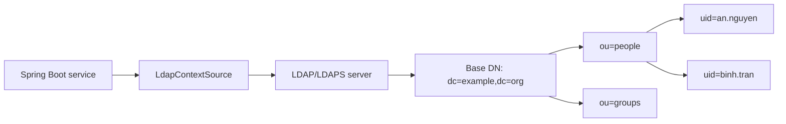
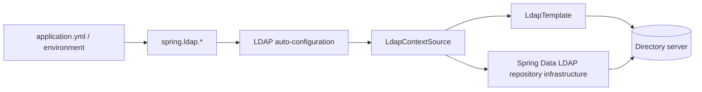
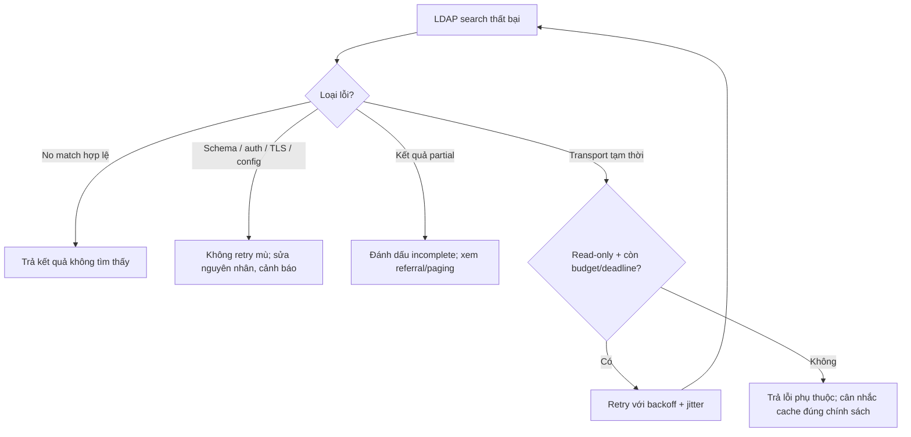
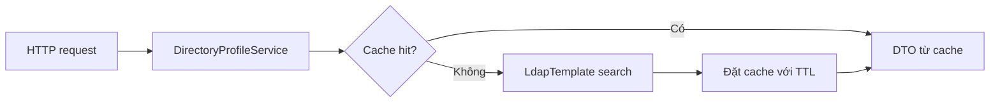

# spring-boot-starter-data-ldap và cấu hình spring.ldap.*

> **Chương:** LDAP và thư mục  
> **Module:** SPRING_BOOT_INTEGRATION — tích hợp các hệ thống qua HTTP client, cơ sở dữ liệu, cache, broker thông điệp và adapter Spring Integration; trọng tâm là cấu hình, hợp đồng dữ liệu, giao dịch, lỗi, xử lý trùng lặp, kiểm thử và quan sát.

## 1. Khi nào ứng dụng Spring Boot cần LDAP?

Một hệ thống quản lý nhân viên thường lưu dữ liệu nghiệp vụ trong PostgreSQL nhưng lấy thông tin tài khoản và tổ chức từ một **directory server**: OpenLDAP, Active Directory (AD) hoặc một dịch vụ LDAP tương thích. Spring Boot có thể cần tra cứu email công ty, tên hiển thị, phòng ban hoặc thuộc tính định danh của nhân viên, đồng thời giữ phần xử lý nghiệp vụ trong ứng dụng của mình.

**LDAP** (*Lightweight Directory Access Protocol*) là giao thức để đọc và thay đổi dữ liệu có cấu trúc phân cấp trong một dịch vụ thư mục. LDAP khác cơ sở dữ liệu quan hệ: dữ liệu tổ chức dưới các *entry*, mỗi entry có *distinguished name* (DN), tập thuộc tính và các *object class* quy định schema.

Ví dụ cây thư mục (*Directory Information Tree* — DIT):

```text
dc=example,dc=org
├── ou=people
│   ├── uid=an.nguyen
│   └── uid=binh.tran
└── ou=groups
    └── cn=engineering
```

Một bản ghi nhân viên có thể có:

```ldif
dn: uid=an.nguyen,ou=people,dc=example,dc=org
objectClass: inetOrgPerson
uid: an.nguyen
cn: An Nguyen
sn: Nguyen
mail: an.nguyen@example.org
```

Đoạn LDIF ở đây chỉ minh họa các thuộc tính. Một entry thật phải thỏa schema và cấu trúc cha của directory cụ thể; các object class phụ trợ như `top`, `person` và `organizationalPerson` có thể được yêu cầu hoặc suy diễn theo triển khai.

### 1.1. Mục tiêu học tập

Sau bài, bạn có thể:

1. Thêm `spring-boot-starter-data-ldap` đúng phiên bản Boot và giải thích các bean tự cấu hình.
2. Hiểu `spring.ldap.urls`, `spring.ldap.base`, `spring.ldap.username`, `spring.ldap.password` và các tùy chọn liên quan.
3. Phân biệt **LDAP server URL**, **base DN**, **bind DN**, **entry DN**, **search base**, **search filter** và **scope**.
4. Tra cứu tài khoản qua `LdapTemplate` hoặc Spring Data LDAP repository, không tạo LDAP injection.
5. Cấu hình LDAPS/TLS, timeout, quyền tối thiểu, cơ chế xử lý lỗi và quan sát an toàn.
6. Kiểm thử hợp đồng dữ liệu directory, hành vi khi mất kết nối và khác biệt giữa OpenLDAP/Active Directory.

## 2. Các khái niệm phải nắm trước khi cấu hình

| Khái niệm | Ví dụ | Ý nghĩa |
| --- | --- | --- |
| LDAP server URL | `ldaps://ldap.example.org:636` | Địa chỉ kết nối tới directory; scheme/cổng thể hiện hình thức kết nối |
| Base DN | `dc=example,dc=org` | Điểm gốc mà ứng dụng xem là phạm vi tra cứu; Spring LDAP thường dùng DN tương đối dưới gốc này |
| Bind DN | `uid=svc-directory,ou=system,dc=example,dc=org` | Danh tính service account dùng để xác thực với directory |
| Entry DN | `uid=an.nguyen,ou=people,dc=example,dc=org` | Định danh vị trí duy nhất của entry trong cây |
| Relative DN | `uid=an.nguyen,ou=people` | DN tương đối tính từ base DN đã cấu hình |
| Search base | `ou=people` | Nhánh con để thực hiện tìm kiếm |
| Search filter | `(&(objectClass=inetOrgPerson)(uid=an.nguyen))` | Điều kiện chọn entry trong phạm vi search |
| Search scope | OBJECT, ONELEVEL, SUBTREE | Mức độ bao phủ: entry gốc, con trực tiếp hoặc toàn bộ nhánh |
| Attribute | `uid`, `cn`, `mail`, `memberOf` | Trường dữ liệu; kiểu và số lượng giá trị phụ thuộc schema |
| Object class | `inetOrgPerson` | Tập quy tắc xác định những attribute hợp lệ và bắt buộc |



**Hai DN dễ bị nhầm:** `spring.ldap.base` là gốc ngữ cảnh của các thao tác. `spring.ldap.username` là tài khoản *bind*, không phải người đang được tra cứu. Một ứng dụng có thể dùng tài khoản dịch vụ chỉ đọc để tìm nhân viên, nhưng điều đó **không phải xác thực người dùng cuối**.

### 2.1. LDAP directory không phải tự động là nguồn dữ liệu nghiệp vụ

Directory thường chứa thông tin danh tính/tổ chức; PostgreSQL hay domain database có thể là nguồn sự thật cho đơn hàng, thanh toán, tồn kho. Nếu directory thay đổi sau khi DB đã ghi, không có giao dịch ACID tự động bao trùm cả hai nơi.

Trước khi kết nối, hãy xác định rõ:

- Directory nào là **source of truth** cho từng thuộc tính?
- Ứng dụng được **đọc**, **ghi** hay chỉ xác minh thông tin?
- Có cần dữ liệu tức thời hay được phép cache trong một thời gian ngắn?
- Nếu LDAP mất kết nối, use case nào phải từ chối, use case nào được phép dùng dữ liệu cache?
- Có trường nào thuộc dữ liệu nhạy cảm, cần giới hạn trả về và ghi log?

## 3. Chọn dependency theo dòng Spring Boot

Với **Spring Boot 3.x / Java 17+**, starter cho Spring Data LDAP:

```groovy
// build.gradle, đã áp dụng Spring Boot plugin / dependency management
dependencies {
    implementation 'org.springframework.boot:spring-boot-starter-data-ldap'
    testImplementation 'org.springframework.boot:spring-boot-starter-test'
}
```

Hoặc Maven:

```xml
<dependency>
    <groupId>org.springframework.boot</groupId>
    <artifactId>spring-boot-starter-data-ldap</artifactId>
</dependency>
```

Starter kéo các thành phần Spring LDAP và Spring Data LDAP thích hợp để ứng dụng sử dụng `LdapTemplate`, mapping entry và repository theo cấu hình. **Để Spring Boot BOM quản lý các phiên bản**, không tự ghép một phiên bản Spring Data/Spring LDAP mới nhất vào Boot cũ mà chưa xác minh tính tương thích.

| Thành phần | Vai trò |
| --- | --- |
| `spring-boot-starter-data-ldap` | Tập hợp thư viện và kích hoạt khả năng auto-configuration thông dụng cho ứng dụng Boot |
| `spring-ldap-core` | API nền cho LDAP operations: `LdapTemplate`, `ContextSource`, query builder, context mapper |
| `spring-data-ldap` | Object-directory mapping, repository abstraction |
| `spring-boot-starter-security` / Spring Security LDAP (nếu dùng) | Xác thực và phân quyền người dùng; **không** phải yêu cầu để chỉ tra cứu directory |

**Phân biệt:** `spring-boot-starter-data-ldap` không tự biến ứng dụng thành hệ thống đăng nhập LDAP. Nếu cần authentication, phải thiết kế Spring Security LDAP riêng: bind của tài khoản người dùng, lọc quyền, mapping role và chính sách phiên đăng nhập.

Các API minh họa dưới đây thuộc hệ sinh thái Spring Boot 3.x; khi nâng lên Boot 4 hoặc thay đổi bản lớn của Spring LDAP/Spring Data, hãy kiểm tra tên package, behavior auto-configuration và tài liệu đúng phiên bản.

## 4. Cấu hình spring.ldap.* trong application.yml

### 4.1. Kết nối cơ bản có tài khoản chỉ đọc

```yaml
# application.yml — ví dụ cho môi trường triển khai có LDAP/LDAPS
spring:
  ldap:
    urls: ${LDAP_URL:ldaps://directory.example.invalid:636}
    base: dc=example,dc=org
    username: ${LDAP_BIND_DN}
    password: ${LDAP_BIND_PASSWORD}
```

Ví dụ giả định directory server cấp một service account có quyền đọc cần thiết. Domain `example.invalid` là tên minh họa, không phải endpoint thật. Trong một ứng dụng chạy production, cung cấp toàn bộ địa chỉ và secret từ cấu hình môi trường hoặc secret manager. Không commit password thật vào Git hay ghi secret trong log.

Ý nghĩa từng property:

| Property | Chức năng | Lỗi cấu hình thường gặp |
| --- | --- | --- |
| `spring.ldap.urls` | Một hoặc nhiều URL của directory server | Sai host, nhầm `ldap://` và `ldaps://`, DNS container không truy cập được |
| `spring.ldap.base` | Base DN của ngữ cảnh Spring LDAP | Nhân đôi `dc=...` khi tạo search base hoặc DN tương đối |
| `spring.ldap.username` | Bind DN / định danh đăng nhập của service account | Dùng `uid` ngắn trong khi directory yêu cầu DN đầy đủ hoặc định dạng đặc thù |
| `spring.ldap.password` | Credential của service account | Password rỗng, hết hạn, không có quyền search, lộ qua biến/log |
| `spring.ldap.base-environment.*` | Thuộc tính JNDI bổ sung khi tạo context | Gõ sai key hoặc giả định các provider đều hỗ trợ như nhau |
| `spring.ldap.template.*` | Một số tùy chọn xử lý lỗi mặc định của `LdapTemplate` | Bỏ qua lỗi gây kết quả tìm kiếm thiếu mà không biết |

Nếu `spring.ldap.urls` được cấu hình nhiều server, **không mặc định** cơ chế chọn/failover luôn đúng yêu cầu SLA của bạn: directory replication, tính nhất quán dữ liệu, TLS, bind permissions và JNDI provider đều ảnh hưởng cách hoạt động. Cần kiểm thử failover thật.

### 4.2. URL, LDAP với TLS và LDAPS

Hai trường hợp thường thấy:

```text
ldap://directory.example.org:389   # LDAP thường (có thể nâng cấp StartTLS nếu chủ động cấu hình)
ldaps://directory.example.org:636  # LDAP qua TLS từ khi kết nối
```

- Ưu tiên **LDAPS hoặc StartTLS đã được cấu hình đúng** cho bind/search chứa dữ liệu nhạy cảm; LDAP thuần qua mạng không bảo vệ password hay payload.
- `ldaps://` chỉ là bắt đầu TLS; Java client **phải xác minh certificate chain và hostname** của server. Cung cấp CA/truststore phù hợp, không tắt kiểm tra chứng chỉ để “chữa” lỗi.
- **StartTLS không tự bật** chỉ nhờ sử dụng `ldap://`. Nếu kiến trúc yêu cầu StartTLS, phải cấu hình cơ chế StartTLS tương thích với Spring LDAP/JNDI và kiểm thử handshake, pooling, referrals. Đừng nhầm kết nối port 389 mặc định với kết nối đã mã hóa.
- LDAP URL không phải HTTP API; `https://...` và các HTTP proxy không thay thế `ldap(s)://...`.

### 4.3. Cấu hình kết nối và read timeout

Với JNDI LDAP provider của Java, có hai thuộc tính hữu ích (giá trị milliseconds). Spring Boot hỗ trợ chuyển chúng qua `spring.ldap.base-environment`:

```yaml
spring:
  ldap:
    base-environment:
      "[com.sun.jndi.ldap.connect.timeout]": "3000"
      "[com.sun.jndi.ldap.read.timeout]": "5000"
```

Các key map được đặt trong dấu ngoặc vuông để **giữ nguyên tên property có dấu chấm** khi Spring Boot bind map. Đây là những thuộc tính do **JNDI provider** diễn giải, không phải một SLA end-to-end. Timeout network, TLS handshake, referral, paging và các retry ở tầng ứng dụng có thể tương tác; hãy kiểm tra bằng integration test với directory thật.

### 4.4. Những cấu hình không nên “chỉnh cho hết lỗi”

- Không đặt `spring.ldap.template.ignore-partial-result-exception=true` chỉ vì truy vấn trả lỗi, trừ khi đã hiểu nguyên nhân và chấp nhận **kết quả thiếu** theo hợp đồng (một số cấu trúc Active Directory referrals có hành vi cần kiểm chứng).
- Không tăng timeout vô hạn khi directory chậm; điều đó có thể tích lũy luồng, connection và request đang chờ.
- Không tăng quyền bind service account lên admin chỉ để truy vấn thành công. Chỉ cấp quyền đọc đúng nhánh và thuộc tính cần thiết.
- Không log `spring.ldap.password`, DN nhạy cảm hoặc giá trị attribute bí mật; cấu hình Actuator phải được bảo vệ và che secrets.
- Không xây DN hoặc LDAP filter bằng cách nối thẳng input chưa escape.

## 5. Auto-configuration của Boot khởi tạo những gì?

Khi thư viện và properties phù hợp, Boot có thể cấu hình các đối tượng thường dùng:

| Bean / abstraction | Trách nhiệm | Điều cần kiểm tra nếu thiếu |
| --- | --- | --- |
| `LdapContextSource` / `ContextSource` | Tạo ngữ cảnh JNDI đã có URL, base DN và thông tin bind | `spring.ldap.*`, các bean custom, điều kiện auto-configuration |
| `LdapTemplate` / `LdapOperations` | Thao tác tìm kiếm, lookup, bind/unbind/modify với exception translation của Spring LDAP | ContextSource được chọn, bean custom, Spring LDAP classpath |
| Spring Data LDAP repositories | Ánh xạ entry thành object qua `@Entry`, `@Attribute`, `@Id` | Scan package, entity mapping, repository activation và schema |
| Exception translation | Chuyển một số `NamingException` thành runtime exception của Spring LDAP | Phân biệt `NameNotFoundException`, auth, network và permission |

Ở ứng dụng chỉ dùng một directory, **ưu tiên cấu hình `spring.ldap.*` và inject `LdapTemplate` sẵn có**. Không nên tự tạo ContextSource và template nếu không cần; khi thay thế bean mặc định, ứng dụng phải chịu trách nhiệm mọi property (TLS, bind, base, timeouts, pooling).



**Có bean không có nghĩa directory đã khỏe.** Tùy việc tạo context, kết nối thường chỉ được mở khi ứng dụng thực hiện lookup/search/bind thật. Kiểm tra context khởi động không thay thế được một truy vấn trong môi trường test.

### 5.1. Nếu có nhiều directory server

Một ứng dụng đôi khi đọc hai miền directory độc lập, ví dụ nhân viên nội bộ và đối tác. Khi đó có thể cần **hai** `ContextSource`, `LdapTemplate`, cấu hình profile và tên bean khác nhau; dùng `@Qualifier` để inject rõ ràng.

Tự khai báo nhiều bean có thể làm auto-configuration mặc định **back off** hoặc tạo ambiguity. Không kỳ vọng chỉ cần thêm hai URL vào `spring.ldap.urls` là có hai domain logic độc lập: nhiều URL đó thường là các endpoint của cùng một directory context, không phải hai namespace khác nhau.

## 6. Tra cứu người dùng bằng LdapTemplate

Đây là lựa chọn dễ bắt đầu khi ứng dụng chỉ cần một vài thao tác search và lookup. Giả sử ứng dụng tìm nhân viên bằng `uid`, muốn trả về một DTO chỉ gồm `uid`, `cn` và `mail`.

### 6.1. Hợp đồng dữ liệu rõ ràng

```java
// DirectoryUser.java
public record DirectoryUser(
        String uid,
        String displayName,
        String email) {
}
```

DTO này cố ý không có `userPassword`, token, group bí mật hoặc toàn bộ attribute của directory. Không đưa raw `Attributes` từ JNDI lên REST API để tránh lộ thông tin và phụ thuộc schema LDAP.

### 6.2. Query bằng LdapQueryBuilder thay vì ghép chuỗi filter

```java
import java.util.List;
import java.util.Optional;
import java.util.regex.Pattern;
import javax.naming.NamingException;
import javax.naming.directory.Attribute;
import javax.naming.directory.Attributes;

import org.springframework.ldap.core.AttributesMapper;
import org.springframework.ldap.core.LdapTemplate;
import org.springframework.ldap.query.LdapQuery;
import org.springframework.ldap.query.LdapQueryBuilder;
import org.springframework.ldap.query.SearchScope;
import org.springframework.stereotype.Service;

@Service
public class DirectoryUserGateway {
    private static final Pattern UID_PATTERN =
            Pattern.compile("[A-Za-z0-9._-]{1,80}");

    private final LdapTemplate ldapTemplate;

    public DirectoryUserGateway(LdapTemplate ldapTemplate) {
        this.ldapTemplate = ldapTemplate;
    }

    public Optional<DirectoryUser> findByUid(String uid) {
        if (uid == null || !UID_PATTERN.matcher(uid).matches()) {
            throw new IllegalArgumentException("Invalid directory uid");
        }

        LdapQuery query = LdapQueryBuilder.query()
                .base("ou=people")
                .searchScope(SearchScope.SUBTREE)
                .attributes("uid", "cn", "mail")
                .countLimit(100)
                .timeLimit(3000)
                .where("objectClass").is("inetOrgPerson")
                .and("uid").is(uid);

        List<DirectoryUser> matches = ldapTemplate.search(
                query,
                (AttributesMapper<DirectoryUser>) attributes ->
                        new DirectoryUser(
                                requiredString(attributes, "uid"),
                                optionalString(attributes, "cn"),
                                optionalString(attributes, "mail")));

        if (matches.size() > 1) {
            throw new IllegalStateException(
                    "Directory contract violation: duplicate uid");
        }
        return matches.stream().findFirst();
    }

    private static String requiredString(
            Attributes attributes, String name)
            throws NamingException {
        String value = optionalString(attributes, name);
        if (value == null || value.isBlank()) {
            throw new IllegalStateException(
                    "Required LDAP attribute is missing: " + name);
        }
        return value;
    }

    private static String optionalString(
            Attributes attributes, String name)
            throws NamingException {
        Attribute attribute = attributes.get(name);
        return attribute == null || attribute.size() == 0
                ? null
                : String.valueOf(attribute.get());
    }
}
```

Giải thích:

1. `LdapTemplate` và `LdapQueryBuilder` thuộc Spring LDAP. Template lấy kết nối từ `ContextSource` do Boot cấu hình.
2. `.base("ou=people")` là base **tương đối với `spring.ldap.base=dc=example,dc=org`**. Nhánh search thực là `ou=people,dc=example,dc=org`. Nếu đặt cả DN đầy đủ vào đây một cách máy móc, dễ bị lặp base DN.
3. `.where(...).is(uid)` dùng API xây dựng filter có cơ chế escape giá trị, thay vì tự nối input thành `(&(objectClass=...)(uid=...))`. Pattern ở trên là **chính sách UID minh họa**, không phải yêu cầu của LDAP; directory cho phép kiểu UID khác thì hãy điều chỉnh validation theo hợp đồng.
4. `.attributes(...)` chỉ yêu cầu các attribute cần thiết, giảm dữ liệu đọc/truyền và nguy cơ lộ thông tin.
5. `.countLimit(100)` và `.timeLimit(3000)` là giới hạn tìm kiếm do client yêu cầu; server có thể áp dụng giới hạn riêng. **Không coi chúng là timeout mạng** hay cơ chế phân trang hoàn chỉnh.
6. Không có kết quả là `Optional.empty()`; nhiều kết quả cho một UID được kỳ vọng duy nhất là dấu hiệu **sai hợp đồng dữ liệu**, không nên tùy ý lấy dòng đầu.

Mặc dù code minh họa giới hạn 100 kết quả, một truy vấn production theo UID cần index và giới hạn chặt hơn theo schema của directory. Khi kết quả vượt giới hạn, một số server có thể trả lỗi size-limit; **không** được chuyển nó thành “không tìm thấy người dùng” vì thực tế danh sách có thể bị cắt.

### 6.3. Không xây LDAP filter từ chuỗi chưa escape

Ví dụ **sai** khi nhận input từ HTTP request:

```java
// KHÔNG LÀM THẾ NÀY: uid là dữ liệu từ bên ngoài.
String unsafeFilter = "(uid=" + uid + ")";
```

Các ký tự như `*`, `(`, `)`, `\`, NUL trong giá trị filter có ý nghĩa đặc biệt theo LDAP filter syntax (RFC 4515). Một giá trị kiểu `*)(|(objectClass=*))` có thể làm thay đổi điều kiện tìm kiếm khi nối chuỗi không kiểm soát.

Ưu tiên `LdapQueryBuilder` hoặc công cụ escape LDAP filter của thư viện. **Escape LDAP filter khác escape DN**: không dùng một cách escape duy nhất cho cả hai định dạng.

### 6.4. Khi cần lookup theo DN, hãy dựng DN bằng API chuyên dụng

Ví dụ một DN tương đối trong phạm vi `dc=example,dc=org`:

```java
import javax.naming.Name;
import org.springframework.ldap.support.LdapNameBuilder;

Name personDn = LdapNameBuilder.newInstance()
        .add("ou", "people")
        .add("uid", uid)
        .build();

// personDn tương ứng uid=<escaped-uid>,ou=people
// Dùng với LdapTemplate.lookup(...) khi đã biết chính xác DN.
```

DN cần được xây theo quy tắc RDN/DN (RFC 4514), **không** ghép `"uid=" + uid + ",ou=people"` từ input tự do. Trong ví dụ, thứ tự `add` đặt thành phần leaf sau parent để tạo DN thích hợp. Cẩn trọng: directory có thể dùng `cn` thay vì `uid` làm RDN; không suy DN từ uid nếu không biết quy tắc tạo entry.

## 7. Dùng Spring Data LDAP repository khi phù hợp

Nếu domain cần nhiều thao tác định danh theo thuộc tính và mô hình entry có cấu trúc ổn định, có thể dùng object-directory mapping (ODM) và repository. Cách này giảm boilerplate so với `LdapTemplate` nhưng **không loại bỏ** nhu cầu hiểu DN, schema và quyền của service account.

### 7.1. Entity ánh xạ một entry

```java
import javax.naming.Name;
import org.springframework.ldap.odm.annotations.Attribute;
import org.springframework.ldap.odm.annotations.Entry;
import org.springframework.ldap.odm.annotations.Id;

@Entry(
        base = "ou=people",
        objectClasses = {
                "top", "person",
                "organizationalPerson", "inetOrgPerson"
        })
public class DirectoryPerson {

    @Id
    private Name dn;

    @Attribute(name = "uid")
    private String uid;

    @Attribute(name = "cn")
    private String commonName;

    @Attribute(name = "mail")
    private String email;

    public DirectoryPerson() {
    }

    public Name getDn() {
        return dn;
    }

    public String getUid() {
        return uid;
    }

    public String getCommonName() {
        return commonName;
    }

    public String getEmail() {
        return email;
    }
}
```

`@Entry(base=...)` mô tả nhánh và loại entry; `@Id` biểu diễn DN; `@Attribute` ánh xạ attribute. Dùng constructor không tham số để framework khởi tạo object. Với thao tác ghi, entity cần quy tắc tạo DN và các trường bắt buộc đúng schema; ví dụ chỉ hướng tới **đọc** nên không trình bày setter/save một cách đơn giản hóa quá mức.

### 7.2. Repository

```java
import java.util.Optional;
import org.springframework.data.ldap.repository.LdapRepository;

public interface DirectoryPersonRepository
        extends LdapRepository<DirectoryPerson> {
    Optional<DirectoryPerson> findByUid(String uid);
}
```

Trong cấu hình Spring Boot hỗ trợ repository scanning, interface được phát hiện theo package và điều kiện auto-configuration. Nếu ứng dụng cấu hình repository thủ công hoặc package nằm ngoài phạm vi scan, cần cấu hình Spring Data LDAP repository scan theo đúng phiên bản.

**Lưu ý sự khác biệt:** các thao tác repository trong LDAP dựa trên DN, attribute, filter và schema của directory, không phải SQL/JPA với join, flush, transaction isolation hay khóa ngoại. Đừng thiết kế repository LDAP như một bản sao của `JpaRepository`.

### 7.3. Chọn Template hay Repository?

| Nhu cầu | Ưu tiên | Lý do |
| --- | --- | --- |
| Tra cứu vài attribute, filter đặc thù, search scope/limits rõ | `LdapTemplate` | Kiểm soát truy vấn, projection, mapper và hành vi tìm kiếm |
| Nhiều thao tác trên một loại entry có schema ổn định | Spring Data LDAP repository | ODM + derived query tiện cho phần lớn CRUD |
| Directory schema vendor-specific hoặc truy vấn LDAP nâng cao | Template và API chuyên biệt | Tránh ép mô hình vào repository không phù hợp |
| Chỉ cần xác thực người dùng LDAP | Spring Security LDAP | Bind authentication là nhiệm vụ security, không phải repository CRUD |

## 8. LDAP authentication khác tra cứu dữ liệu thư mục

Một service account bind để đọc `mail` của nhân viên **không chứng minh** rằng người đang gửi HTTP request là nhân viên ấy. Nếu ứng dụng cần đăng nhập người dùng:

- Dùng **Spring Security LDAP** (hoặc IdP/OIDC ở tầng nhận dạng thích hợp), xác thực credential bằng luồng bind/compare theo contract directory.
- Tách **service bind account** khỏi **user bind**. Không thử đăng nhập bằng cách so sánh chuỗi password do ứng dụng tìm thấy trong LDAP.
- Chỉ ánh xạ role/group sau khi xác minh DN, member/memberOf hoặc nhóm theo schema thực tế. AD có thể khác OpenLDAP về attribute, subtree, nested group và referrals.
- Không trả về password/hash, không lưu plaintext credential từ HTTP vào log, cache hoặc message broker.
- Các lỗi username/password không đúng là **authentication failure**, không nên bị retry tự động như timeout mạng.

Khi tích hợp với AD, account name có thể là `userPrincipalName` hoặc `sAMAccountName` thay vì `uid`; một số nhóm dùng `memberOf` và có quy tắc nhóm lồng nhau. **Không sao chép filter của OpenLDAP sang AD mà không xác minh schema**, kể cả khi cả hai hỗ trợ giao thức LDAP.

## 9. Lỗi kết nối, lỗi dữ liệu và chiến lược phục hồi

LDAP nằm ngoài transaction nghiệp vụ của ứng dụng, nên có thể lỗi ngay cả khi PostgreSQL, Redis và broker vẫn bình thường. Không nên “bắt mọi exception rồi trả danh sách rỗng”: cách đó nhầm **dịch vụ mất kết nối** với **không có nhân viên nào phù hợp**.

| Tín hiệu | Nhóm lỗi ban đầu | Hành động nên cân nhắc |
| --- | --- | --- |
| Search trả danh sách rỗng hợp lệ | Kết quả nghiệp vụ: không tìm thấy | Trả `Optional.empty()`/404 theo hợp đồng; không retry vô cớ |
| `NameNotFoundException` khi lookup DN | DN/nhánh không tồn tại | Xác minh base và DN; chỉ map “not found” nếu đúng ngữ nghĩa |
| `AuthenticationException` khi service bind | Credential sai/hết hạn hoặc chính sách directory | Kiểm tra secret rotation, service account, TLS; không retry vòng lặp |
| `CommunicationException`/mất kết nối | Có thể tạm thời | Retry **search chỉ đọc** giới hạn, backoff + jitter, deadline tổng |
| Kết quả không đầy đủ, referral/partial result | Có thể do topology hoặc cấu hình | Kiểm tra referral policy, domain/forest, quyền và completeness |
| Size/time limit exceeded | Search quá rộng, index không phù hợp hoặc server giới hạn | Thu hẹp filter/scope, index, paging theo control được hỗ trợ |
| Thiếu attribute bắt buộc hoặc objectClass không khớp | Lỗi hợp đồng dữ liệu/schema | Sửa mapper/query, yêu cầu chủ directory thống nhất schema |
| ACL từ chối search/attribute | Lỗi quyền | Cấp quyền cần thiết hoặc điều chỉnh yêu cầu; không cấp quyền admin vô điều kiện |
| TLS hostname/certificate lỗi | Cấu hình/chuỗi tin cậy cần sửa | Kiểm tra hostname, CA, expiry; không tắt xác minh TLS |

Tên exception cụ thể phụ thuộc Spring LDAP exception translation và provider JNDI đang dùng. Khi phân loại nên xem cause gốc, LDAP result code và giai đoạn lỗi, nhưng **không hiển thị thông tin credential hoặc DN nhạy cảm cho người dùng cuối**.

### 9.1. Retry chỉ khi operation phù hợp

Một search chỉ đọc thường có thể retry sau timeout ngắn nếu:

1. Lỗi có khả năng biến mất (connection reset hoặc directory tạm không sẵn sàng).
2. Caller còn deadline và chưa vượt số attempts.
3. Có backoff/jitter và giới hạn số request đồng thời.
4. Không có yêu cầu mạnh về tính nhất quán mà lần retry sang replica khác có thể vi phạm.

Trái lại, **modify/add/delete entry** hoặc đổi password có side effect: nếu kết nối chết sau khi server đã xử lý nhưng trước phản hồi, kết quả có thể chưa rõ. Không retry thao tác ghi tùy tiện, nhất là khi thay đổi DN, password, group membership hoặc trạng thái tài khoản. Cần kiểm tra trạng thái đích, dùng precondition/compare-and-modify khi hệ thống hỗ trợ và quy trình đối soát.



### 9.2. Timeouts, pool và giới hạn concurrency

Khi directory chậm, một HTTP controller chặn luồng khi gọi `LdapTemplate`. Nếu có 500 request đồng thời, không thể chỉ tăng thread count và cho mỗi request mở kết nối LDAP mới vô hạn. Cần:

- Timeout kết nối, đọc và deadline tổng tại application service.
- Giới hạn số search đồng thời/bulkhead; áp dụng circuit breaker nếu directory quá tải kéo dài.
- Backoff có jitter để không tạo retry storm từ nhiều instance.
- Giới hạn scope, attribute projection, count limit và time limit; yêu cầu index phù hợp từ đội quản trị directory.
- Quan sát số connection, latencies và lỗi bind/search; đối với directory lớn cần **LDAP paged results control** hoặc batch phù hợp, thay vì tải toàn bộ entries một lần.

Spring LDAP có lựa chọn context pooling, nhưng bật pool không phải thuốc chữa mọi vấn đề: pooled context có thể giữ kết nối đã chết hoặc ngữ cảnh có quyền khác nhau. **Đặc biệt thận trọng khi kết hợp pooling với StartTLS hoặc bind dưới danh tính người dùng.** Kiểm chứng hỗ trợ provider, validation kết nối, giới hạn pool và cleanup trước khi áp dụng.

### 9.3. Không có giao dịch chung giữa LDAP và SQL

Một luồng đổi phòng ban có thể ghi PostgreSQL rồi sửa attribute `department` trong LDAP:

```text
1. UPDATE employees SET department = ...;
2. LDAP modifyAttributes(department=...);
```

Nếu bước 1 commit và bước 2 lỗi, dữ liệu hai hệ thống khác nhau. `@Transactional` trên JPA service **không tự rollback được LDAP modify**. Cần chọn một nguồn dữ liệu có thẩm quyền, mô hình trạng thái cần đồng bộ và cơ chế phục hồi (sự kiện, outbox, idempotent sync worker, đối soát) theo đặc tính hệ thống.

Khi directory là nguồn xác thực trung tâm, không cho ứng dụng nghiệp vụ tự ý ghi các thuộc tính thuộc quyền quản trị danh tính. Đường thay đổi có thể qua IAM workflow hoặc API riêng có kiểm soát, thay vì LDAP modify trực tiếp.

## 10. Cache dữ liệu thư mục: giảm tải nhưng giữ đúng ngữ nghĩa

Với tích hợp Spring Boot, cache Redis hoặc in-memory có thể hữu ích nếu hàng nghìn request cùng tra cứu tên hiển thị/email:



Tuy nhiên không nên cache mọi thứ cùng một cách:

| Thuộc tính | Cache có thể chấp nhận? | Cảnh báo |
| --- | --- | --- |
| Tên hiển thị, email để hiển thị giao diện | Có, TTL ngắn theo yêu cầu nghiệp vụ | Hiển thị có thể trễ so với directory |
| Chức danh, phòng ban | Có thể, tùy mức chấp nhận độ trễ | Chuyển tổ chức có thể ảnh hưởng luồng phê duyệt |
| Group/role dùng để **phân quyền** | Cẩn trọng, TTL rất ngắn hoặc cơ chế invalidation mạnh | Thay đổi quyền phải có hiệu lực trong thời gian cam kết |
| Account disabled, password, security credential | Không dùng một cache profile thông thường | Nguy cơ tiếp tục cho tài khoản đã bị khóa hoạt động |
| “Không tìm thấy” (*negative cache*) | Chỉ khi có chính sách rõ | User mới tạo có thể bị coi là chưa tồn tại cho tới khi hết TTL |

Nếu LDAP lỗi, việc trả dữ liệu cache cũ là **quyết định nghiệp vụ**. Với màn hình hiển thị danh bạ có thể phù hợp; với kiểm tra quyền truy cập nhạy cảm có thể phải **fail closed**. Tuyệt đối không biến LDAP failure thành “người dùng có tất cả quyền” để tiếp tục xử lý.

## 11. Kiểm thử cấu hình và hợp đồng LDAP

### 11.1. Ba mức kiểm thử

| Mức | Phương pháp | Mục tiêu |
| --- | --- | --- |
| Unit | Mock `LdapOperations` hoặc port `DirectoryGateway` | Kiểm tra mapping, validation UID, response domain, cache/fallback |
| Integration | Embedded LDAP tương thích hoặc directory container riêng | Kiểm tra DN, base, filter, bind, search scope, serializer/mapping |
| End-to-end | Directory staging có ACL/TLS/referrals gần production | Kiểm tra certificate, service account, load, group schema, rotation và failover |

Unit test không thể chứng minh LDAP filter chạy đúng với DIT thực tế. Test khởi tạo Spring context có `LdapTemplate` cũng **không đủ**: cần bind và search tới một server kiểm thử có dữ liệu mẫu.

### 11.2. Ví dụ embedded LDAP cho Boot 3.x

Trong test scope của dự án sử dụng Spring Boot 3.x, có thể dùng UnboundID LDAP SDK cho embedded directory:

```groovy
dependencies {
    testImplementation 'org.springframework.boot:spring-boot-starter-test'
    testImplementation 'com.unboundid:unboundid-ldapsdk'
}
```

Một test profile riêng, **không dùng secret hoặc URL production**, có thể định nghĩa:

```yaml
# application-test.yml — chỉ dùng trong môi trường test
spring:
  ldap:
    base: dc=example,dc=org
    embedded:
      base-dn: dc=example,dc=org
      ldif: classpath:test-directory.ldif
      port: 0
```

Ở profile này, không giữ cấu hình `spring.ldap.urls`, `username`, `password` trỏ production. Nếu các property đó được inject từ cấu hình chung, cần override/loại bỏ phù hợp với test context. `port: 0` cho phép server test chọn cổng động trong trường hợp cơ chế embedded hỗ trợ. Kiểm tra đúng version Boot và điều kiện kích hoạt embedded LDAP.

Nội dung tối thiểu của `src/test/resources/test-directory.ldif` trong một dự án minh họa:

```ldif
dn: dc=example,dc=org
objectClass: top
objectClass: domain
dc: example

dn: ou=people,dc=example,dc=org
objectClass: top
objectClass: organizationalUnit
ou: people

dn: uid=an.nguyen,ou=people,dc=example,dc=org
objectClass: top
objectClass: person
objectClass: organizationalPerson
objectClass: inetOrgPerson
uid: an.nguyen
cn: An Nguyen
sn: Nguyen
mail: an.nguyen@example.org
```

Đây là **ví dụ nội dung test resource**, không yêu cầu lưu một file LDIF bên ngoài bài học này. Một số LDAP server có yêu cầu schema, attribute hoặc base DN riêng, vì vậy test phải chạy trên đúng loại directory đang cần tương thích.

### 11.3. Integration test tìm người dùng

Giả sử cấu hình profile `test` đã khởi tạo embedded directory ở trên:

```java
import org.junit.jupiter.api.Test;
import org.springframework.beans.factory.annotation.Autowired;
import org.springframework.boot.test.context.SpringBootTest;
import org.springframework.test.context.ActiveProfiles;

import static org.assertj.core.api.Assertions.assertThat;

@SpringBootTest
@ActiveProfiles("test")
class DirectoryUserGatewayIntegrationTest {

    @Autowired
    DirectoryUserGateway gateway;

    @Test
    void findsUserInRelativePeopleBase() {
        DirectoryUser result = gateway
                .findByUid("an.nguyen")
                .orElseThrow();

        assertThat(result.displayName()).isEqualTo("An Nguyen");
        assertThat(result.email()).isEqualTo("an.nguyen@example.org");
    }

    @Test
    void missingUidReturnsEmpty() {
        assertThat(gateway.findByUid("unknown.user")).isEmpty();
    }

    @Test
    void rejectsInvalidUidBeforeSearch() {
        org.assertj.core.api.Assertions.assertThatThrownBy(
                () -> gateway.findByUid("*)(objectClass=*)"))
                .isInstanceOf(IllegalArgumentException.class);
    }
}
```

Các kiểm thử trên minh họa **test source cần được đặt vào dự án mẫu**, không phải kết quả build đã thực thi. Trong CI hoặc khi phát triển, kiểm tra:

1. Bind đúng service account và tìm entry khi base/search scope chuẩn.
2. UID không có → empty, trong khi directory không truy cập được → error (không empty).
3. Input chứa ký tự đặc biệt không làm thay đổi search filter; nếu directory cho phép UID ký tự đặc biệt, dùng query builder có escape đúng thay vì chỉ dựa vào regex.
4. Entry thiếu `mail` nhưng vẫn đủ `uid` → DTO xử lý tùy hợp đồng.
5. Sai bind DN/secret, certificate hết hạn, connect/read timeout.
6. Directory trả partial result, size limit, referral hoặc rất nhiều kết quả.
7. Active Directory/LDAP implementation thực sự dùng thuộc tính khác `uid`/`inetOrgPerson`.
8. Kịch bản cache stale và account/role bị thu hồi (nếu dùng dữ liệu directory cho phân quyền).

## 12. Quan sát và chẩn đoán tích hợp LDAP

LDAP query thành công có thể chỉ mất vài mili giây khi filter được index đúng; một query phạm vi rộng hoặc kết nối tới domain controller xa có thể tốn nhiều thời gian. Vì vậy cần đo cả **độ trễ truy vấn**, **lỗi kết nối**, **tính đầy đủ của kết quả** và **tác động lên service gọi**.

### 12.1. Metric và log nên có

| Thông tin | Mục đích | Cách ghi an toàn |
| --- | --- | --- |
| `directory.operation`: search/lookup/bind | Biết loại thao tác đang chậm/lỗi | Dùng operation cố định, không đưa nguyên filter do người dùng cung cấp |
| `directory.result`: found/not-found/error/partial | Phân biệt “không có entry” với lỗi hạ tầng | Các nhãn có cardinality thấp |
| `directory.duration` (p50/p95/p99) | Phát hiện thời gian search tăng, timeout | Quan sát theo tên directory/operation được chuẩn hóa |
| Bind/auth failures | Nhận biết secret rotation hoặc ACL lỗi | Không log password, token hoặc credential |
| Connection errors/timeouts | Phân biệt DNS/TLS/server unavailable | Theo dõi số lần retry và deadline exhausted |
| Cache hits/misses/stale served | Biết LDAP đang được gọi bao nhiêu, có trả stale không | Không dùng UID/email làm metric tag |
| Partial/search limit exceeded | Cảnh báo dữ liệu có thể không đầy đủ | Lưu loại lỗi, search scope và query template đã chuẩn hóa |
| Correlation ID | Liên hệ request HTTP → directory → DB/cache | Dùng định danh truy vết không chứa PII |

Nếu dùng Actuator và hạ tầng observability (Micrometer/OpenTelemetry), cần kiểm tra **phiên bản và instrumentation thực sự có sẵn**; không giả định toàn bộ LDAP search latency/connection pool metric tự động xuất hiện chỉ nhờ `spring-boot-starter-data-ldap`. Có thể bọc adapter với Timer/Observation do ứng dụng định nghĩa để đo thời gian, trạng thái và mã lỗi theo danh mục cố định.

Không gắn `uid`, email, DN đầy đủ hoặc raw filter vào metric tags vì dữ liệu có thể nhạy cảm và tạo cardinality rất cao. Đối với log cần chẩn đoán từng trường hợp, áp dụng chính sách kiểm soát truy cập, thời hạn lưu và masking phù hợp.

### 12.2. Bảng chẩn đoán nhanh

| Triệu chứng | Khả năng | Kiểm tra |
| --- | --- | --- |
| Không có `LdapTemplate` bean | Thiếu starter, bean custom hoặc auto-config không match | Dependency tree, bean definitions, `--debug` |
| Connect timeout khi chạy container | `localhost` trỏ nhầm container, DNS/port/firewall | `spring.ldap.urls` và network từ chính container |
| `AuthenticationException` khi bind | Bind DN/password không đúng, account locked, TLS policy | Secret injection, account state, directory logs |
| TLS handshake/certificate lỗi | CA không tin cậy, SAN hostname sai, chứng chỉ hết hạn | Truststore, hostname, chain; không tắt xác minh |
| Query luôn rỗng dù LDAP có entry | Base DN sai, search base lặp, scope quá hẹp, filter sai attribute | In cấu trúc DIT test, kiểm tra `base` và filter template |
| Search chậm/size limit | Search subtree quá lớn hoặc thiếu index | Search scope, projection, limit, index, paged results |
| OpenLDAP chạy được nhưng AD không tìm thấy uid | Schema/attribute khác hoặc referrals | `userPrincipalName`/`sAMAccountName`, domain/forest, group model |
| Service trả “không có user” lúc directory lỗi | Exception bị nuốt và chuyển về danh sách rỗng | Tách not-found khỏi unavailable |
| Quyền bị thu hồi nhưng app vẫn cho phép | Cache thông tin quyền quá lâu | TTL, invalidation, fail-closed policy |
| Lỗi xảy ra khi directory ghi thành công nhưng client timeout | Kết quả thao tác ghi không rõ | Tra cứu lại trạng thái và dùng reconciliation, không retry mù |

Trong môi trường phát triển, có thể chạy Boot với:

```bash
java -jar app.jar --debug
```

*Conditions Evaluation Report* giúp lý giải bean nào được tự cấu hình và điều kiện nào không match, nhưng **không chứng minh** LDAPS handshake, bind permission hoặc search query đã hoạt động. Phải dùng integration test hoặc phép kiểm tra với directory test có dữ liệu mẫu.

## 13. Checklist production khi kết nối directory

### 13.1. Kết nối và bảo mật

- [ ] `spring.ldap.urls` dùng hostname có thể truy cập từ môi trường chạy ứng dụng, không dựa vào `localhost` sai ngữ cảnh.
- [ ] LDAPS/StartTLS đúng chính sách bảo mật; certificate chain, SAN và truststore được xác minh.
- [ ] Service account chỉ có quyền đọc những nhánh/attribute cần thiết, không dùng tài khoản quản trị directory.
- [ ] Password/secret được lấy từ secret manager hoặc biến môi trường an toàn; có quy trình rotation và cảnh báo khi hết hạn.
- [ ] Connect/read timeout, giới hạn concurrency và retry budget được kiểm chứng dưới tải.
- [ ] Referral policy, paging, server-side index và search scope được xác minh với đội quản trị directory.

### 13.2. Hợp đồng dữ liệu và hệ thống

- [ ] Đã xác định `spring.ldap.base` và relative DN/search base; không nhân đôi gốc DN.
- [ ] Có chuẩn định danh người dùng (`uid`, UPN, sAMAccountName...) và mapping role/group theo directory thực.
- [ ] Search filter được tạo bằng API escape an toàn; DN được tạo bằng API DN builder, không nối chuỗi input.
- [ ] Chỉ lấy attribute cần dùng, có validation và xử lý thiếu trường/multiple values.
- [ ] Không đồng nhất “not found”, “directory unavailable” và “invalid bind credentials”.
- [ ] Không giả định cập nhật LDAP và commit SQL/Kafka là một transaction nguyên tử.
- [ ] Nếu dùng cache, đã xác định TTL, invalidate, loại dữ liệu không được cache và chính sách fail closed cho authorization.
- [ ] Có integration test TLS/bind/search và test lỗi/referral/partial results trên server tương thích production.
- [ ] Có metric/log/trace có cấu trúc nhưng không rò rỉ password, DN nhạy cảm hoặc PII.

## 14. Tình huống thực hành và câu hỏi tự kiểm tra

**Đề bài:** service nhân sự Spring Boot đọc danh bạ doanh nghiệp từ LDAP; HTTP endpoint `GET /employees/{uid}/profile` trả `DirectoryUser(uid, displayName, email)`, được cache 5 phút nếu nghiệp vụ chấp nhận. PostgreSQL lưu thông tin hồ sơ công việc độc lập; broker phát `EmployeeProfileRefreshed` khi một workflow đồng bộ hoàn tất.

Thực hiện theo các bước:

1. Thêm `spring-boot-starter-data-ldap` cùng BOM Spring Boot đúng phiên bản.
2. Cấu hình `spring.ldap.urls/base/username/password` qua environment và dùng LDAPS có truststore hợp lệ.
3. Viết `DirectoryUserGateway` bằng `LdapTemplate`, search đúng `ou=people`, escape filter, projection chỉ gồm `uid/cn/mail`.
4. Trả empty cho UID không tồn tại nhưng **trả lỗi phụ thuộc** khi LDAP không truy cập được; không biến lỗi TLS/auth thành HTTP 404.
5. Bổ sung Redis cache có TTL cho tên/email, không cache password hoặc quyết định quyền nhạy cảm.
6. Nếu cập nhật PostgreSQL rồi phát sự kiện, cân nhắc transactional outbox để không mất event khi broker lỗi; việc đọc LDAP không tạo giao dịch chung với DB.
7. Tạo embedded LDAP test có entry và test các nhánh: user tồn tại, user không tồn tại, UID không hợp lệ, kết nối lỗi, service bind sai, attribute thiếu.
8. Thu thập latency và kết quả search theo operation/loại lỗi, không gắn UID/email vào metric tags.

Câu hỏi tự kiểm tra:

1. `spring.ldap.base` khác `spring.ldap.username` ở chỗ nào? Vì sao không phải cùng một DN?
2. Khi base DN là `dc=example,dc=org`, truyền search base `ou=people` có ý nghĩa gì?
3. Vì sao `spring-boot-starter-data-ldap` chưa đủ để triển khai đăng nhập bằng tài khoản LDAP?
4. `ldaps://` và `ldap://` khác nhau thế nào? StartTLS có tự bật khi dùng port 389 không?
5. Vì sao không nên nối input thành `"(uid=" + uid + ")"` và vì sao cách escape filter khác cách escape DN?
6. Khi nào chọn `LdapTemplate` và khi nào dùng Spring Data LDAP repository?
7. Nếu search trả rỗng và nếu kết nối bị timeout, API nên trả cùng “không tìm thấy” hay khác nhau?
8. Điều gì xảy ra nếu service cache role 60 phút nhưng LDAP vừa thu hồi quyền của nhân viên?
9. Vì sao không có giao dịch chung khi một service update PostgreSQL rồi modify LDAP?
10. Khởi động Spring context thành công có chứng minh service bind và search hoạt động được không?

**Ghi nhớ:** `spring-boot-starter-data-ldap` tạo nền tảng truy cập directory trong Spring Boot; `spring.ldap.*` quản lý endpoint, base DN, bind identity và tùy chọn JNDI; `LdapTemplate`/repository cung cấp API tra cứu. Một tích hợp LDAP đáng tin cậy phải xử lý **DN/filter đúng, TLS và quyền tối thiểu, hợp đồng schema, timeout, lỗi không đầy đủ, cache, kiểm thử và quan sát** — đồng thời không nhầm việc đọc directory với xác thực người dùng hay transaction xuyên hệ thống.

### Tài liệu tham khảo

- [Spring Boot — Working with LDAP](https://docs.spring.io/spring-boot/reference/data/nosql.html#data.nosql.ldap)
- [Spring LDAP — Reference Documentation](https://docs.spring.io/spring-ldap/reference/)
- [Spring LDAP — LDAP Query Builder](https://docs.spring.io/spring-ldap/reference/query-builder-advanced.html)
- [Spring Data LDAP — Reference Documentation](https://docs.spring.io/spring-data/ldap/reference/)
- [Spring Security — LDAP Authentication](https://docs.spring.io/spring-security/reference/servlet/authentication/passwords/ldap.html)
- [RFC 4515 — String Representation of Search Filters](https://www.rfc-editor.org/rfc/rfc4515)
- [RFC 4514 — String Representation of Distinguished Names](https://www.rfc-editor.org/rfc/rfc4514)
