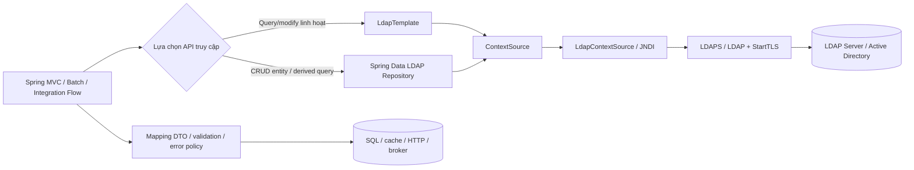
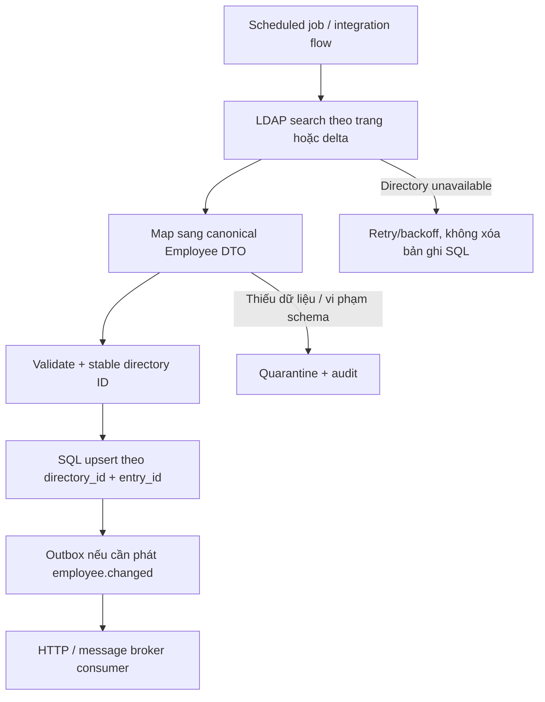

# LdapContextSource, LdapTemplate và Spring Data LDAP repository

> **Chương:** LDAP và thư mục  
> **Phạm vi:** Trong module **SPRING_BOOT_INTEGRATION**, Spring Boot kết nối với các hệ thống ngoài qua HTTP client, SQL, cache, broker và adapter Spring Integration. LDAP là một nguồn dữ liệu danh tính/thư mục thường cần được tra cứu, đồng bộ sang SQL hoặc sử dụng làm đầu vào cho các luồng tích hợp. Bài này tập trung vào **`LdapContextSource`, `LdapTemplate` và Spring Data LDAP repository**, cùng các quyết định về cấu hình, hợp đồng dữ liệu, giao dịch, lỗi, chống trùng, kiểm thử và quan sát.

## 1. Bài toán: dữ liệu người dùng nằm trong một directory

Một doanh nghiệp quản lý tài khoản nhân viên bằng LDAP/Active Directory. Dịch vụ Spring Boot phải:

1. Kết nối directory bằng một tài khoản dịch vụ có quyền chỉ đọc.
2. Tìm nhân viên theo `uid` hoặc một định danh đã chuẩn hóa.
3. Lấy `displayName`, `mail`, trạng thái và thông tin đơn vị; ánh xạ sang DTO nội bộ.
4. Có thể đồng bộ bản chụp dữ liệu vào database SQL để phục vụ các tác vụ khác.
5. Xử lý khi directory chậm, từ chối bind, thay đổi DN, trả nhiều kết quả hoặc không có kết quả.

Để làm việc này, cần phân biệt **directory protocol**, **connection management**, **API truy vấn** và **mapping repository**. Chúng không phải cùng một thành phần.

### LDAP là gì?

**LDAP** (*Lightweight Directory Access Protocol*) là giao thức truy cập dữ liệu có cấu trúc phân cấp theo entry và attribute, thường dùng cho danh tính, nhóm, tổ chức và policy. Một entry có **Distinguished Name (DN)**:

```text
dn: uid=linh.nguyen,ou=people,dc=example,dc=org
objectClass: inetOrgPerson
uid: linh.nguyen
cn: Linh Nguyen
sn: Nguyen
mail: linh.nguyen@example.org
```

Trong ví dụ, `dc=example,dc=org` là base DN, `ou=people` là organizational unit, còn `uid=linh.nguyen` là RDN (*Relative Distinguished Name*) của entry. **DN không nhất thiết là ID bất biến**: có thể thay đổi khi entry được chuyển OU hoặc đổi tên. Với đồng bộ dài hạn, ưu tiên thuộc tính định danh ổn định do directory cung cấp, ví dụ `entryUUID` ở một số LDAP server hoặc `objectGUID` trong Active Directory, sau khi kiểm tra hợp đồng/kiểu dữ liệu thực tế.

### Sơ đồ các lớp ứng dụng



`LdapContextSource` không phải database repository; `LdapTemplate` không tự biến LDAP thành SQL; và repository không tự chứng minh người dùng được phép đăng nhập.

## 2. Ba thành phần chính khác nhau thế nào?

| Thành phần | Loại và vai trò | Khi nào dùng? | Lưu ý |
| --- | --- | --- | --- |
| **`LdapContextSource`** | Implementation `ContextSource` của Spring LDAP, quản lý cách tạo `DirContext` từ URL, base DN và bind credentials | Cấu hình connection, TLS, bind và môi trường JNDI | Cấp kết nối; không định nghĩa business query |
| **`LdapTemplate`** | Template bao bọc thao tác search, lookup, bind, modify, unbind qua `ContextSource` | Cần query/filter/attributes linh hoạt, mapping tùy chỉnh, thao tác directory chi tiết | API **imperative/blocking** qua JNDI |
| **Spring Data LDAP repository** | Repository abstraction + entity mapping bằng annotation, ví dụ `LdapRepository<PersonEntry>` | CRUD và truy vấn phổ biến trên entry có cấu trúc ổn định | Không phải JPA, không có toàn bộ semantics của relational repository |

**Quy tắc chọn nhanh:** bắt đầu với `LdapTemplate` nếu chỉ cần vài query directory hoặc directory schema phức tạp; cân nhắc repository khi entry có mapping rõ và ứng dụng có nhiều thao tác CRUD/query có thể biểu diễn bằng model. Cả hai thường dùng cùng một `ContextSource` do Spring Boot cấu hình.

## 3. Dependency và auto-configuration trong Spring Boot

Với ứng dụng **Spring Boot 3.x / Java 17+**, dependency Maven dành cho Spring Data LDAP:

```xml
<dependency>
    <groupId>org.springframework.boot</groupId>
    <artifactId>spring-boot-starter-data-ldap</artifactId>
</dependency>
```

Starter này đưa các thành phần Spring Data LDAP/Spring LDAP cần thiết lên classpath theo quản lý phiên bản của Spring Boot; dự án không cần tự pin từng phiên bản library khi đã dùng BOM của Boot. Nếu ứng dụng chỉ cần `LdapTemplate`, có thể cân nhắc dependency Spring LDAP trực tiếp cùng auto-configuration phù hợp, thay vì dùng toàn bộ abstraction repository.

Khi dependency và thuộc tính phù hợp, Spring Boot có thể cấu hình `ContextSource`, `LdapTemplate` và hạ tầng Spring Data LDAP/repositories theo điều kiện hiện hành. Nếu ứng dụng đã tự khai báo bean tương ứng, auto-configuration có thể **back off**. Không suy đoán bean chỉ từ tên starter; kiểm tra application context và *Condition Evaluation Report* trên phiên bản đang dùng.

### Phân biệt package Java

- `org.springframework.ldap.core.support.LdapContextSource`: cấu hình context nguồn.
- `org.springframework.ldap.core.LdapTemplate`: API truy vấn và cập nhật directory.
- `org.springframework.data.ldap.repository.LdapRepository`: Spring Data LDAP repository.
- `javax.naming.Name`, `javax.naming.directory.Attributes`: **JNDI thuộc JDK**; vẫn mang namespace `javax.naming.*` trong ứng dụng Spring Boot 3.x.

Không nhầm `javax.naming.*` của Java SE với sự chuyển đổi `javax.servlet.*` → `jakarta.servlet.*` hoặc `javax.persistence.*` → `jakarta.persistence.*` của Jakarta EE.

## 4. Cấu hình `spring.ldap.*` và LdapContextSource

Ví dụ môi trường production dùng **LDAPS** tới LDAP server bên ngoài:

```yaml
spring:
  ldap:
    urls: ${LDAP_URL:ldaps://ldap.example.org:636}
    base: dc=example,dc=org
    username: ${LDAP_BIND_DN:cn=service-reader,ou=services,dc=example,dc=org}
    password: ${LDAP_BIND_PASSWORD}
```

| Thuộc tính | Chức năng | Cần chú ý |
| --- | --- | --- |
| `spring.ldap.urls` | Một hoặc nhiều URL tới directory server | Dùng `ldap://` hoặc `ldaps://` theo cơ chế bảo mật được yêu cầu |
| `spring.ldap.base` | Base DN chung, ví dụ `dc=example,dc=org` | DN trong `LdapTemplate`/repository thường được diễn giải tương đối với base này |
| `spring.ldap.username` | DN của tài khoản dùng để bind | Tài khoản dịch vụ có quyền tối thiểu; khác định danh nhân viên đang tra cứu |
| `spring.ldap.password` | Secret bind của service account | Lấy từ môi trường/secret; không đưa vào log |
| `spring.ldap.base-environment.*` | Các JNDI environment property bổ sung | Tên property và behavior phụ thuộc LDAP provider |

Trong môi trường production, không dùng tài khoản quản trị directory cho ứng dụng chỉ cần tra cứu. Nếu chưa cấp quyền đọc một attribute nhạy cảm, đừng xử lý thiếu attribute bằng cách nâng toàn bộ tài khoản lên quyền admin.

### 4.1. Base DN và DN tương đối

Khi cấu hình `spring.ldap.base=dc=example,dc=org`:

```text
Search base trong code: ou=people
Full search base:        ou=people,dc=example,dc=org

Relative DN:            uid=linh.nguyen,ou=people
Full DN:                uid=linh.nguyen,ou=people,dc=example,dc=org
```

Không tự nối chuỗi DN từ dữ liệu người dùng, vì dấu phẩy, dấu bằng và dấu gạch chéo ngược có quy tắc escape riêng. Dùng API xây dựng `Name`/`LdapNameBuilder` khi cần tạo DN động.

### 4.2. Kết nối, SSL và timeout

**LDAPS** dùng kết nối TLS ngay từ đầu, ví dụ `ldaps://directory.example.org:636`. **StartTLS** là nâng cấp một kết nối LDAP sang TLS theo quy trình khác, không thể coi việc đặt URL `ldap://` là đã có bảo vệ đường truyền. Phải kiểm tra client/driver, hostname verification, certificate trust chain, TLS policy và behavior khi failover.

Khi dùng JNDI LDAP provider của JDK, có thể truyền các key timeout dạng provider-specific qua `spring.ldap.base-environment`, ví dụ:

```yaml
spring:
  ldap:
    base-environment:
      "[com.sun.jndi.ldap.connect.timeout]": "3000"
      "[com.sun.jndi.ldap.read.timeout]": "5000"
```

Các con số là **mili-giây** theo cách hiểu của JNDI LDAP provider này; cần kiểm tra hỗ trợ trong môi trường đang chạy. `connect.timeout` giới hạn bước tạo kết nối, còn `read.timeout` giới hạn thời gian đọc đáp ứng. Một timeout cấp request nghiệp vụ có thể nhỏ hơn tổng thời gian của nhiều query, nên tránh để một request HTTP gọi hàng trăm truy vấn LDAP tuần tự không có giới hạn.

**Không phải mọi lỗi timeout đều chứng minh thao tác ghi LDAP chưa xảy ra.** Nếu ứng dụng hỗ trợ modify/bind/unbind, một lần mất response có thể làm trạng thái kết quả không rõ. Khi đó dùng định danh ổn định, kiểm tra lại trạng thái trước khi retry thao tác có side effect.

## 5. LdapContextSource: tạo và quản lý ContextSource

`LdapContextSource` hiện thực `ContextSource` và dùng JNDI dưới lớp Spring LDAP. Nó thiết lập thông số như server URL, base DN, service bind DN, password và một số tùy chọn môi trường, rồi cung cấp context để thao tác LDAP.

Trong Spring Boot thường **không cần tạo bean thủ công** nếu `spring.ldap.*` đã đáp ứng đủ; một `LdapTemplate` có thể được inject để Spring quản lý context lifecycle cho từng thao tác. Khi có nhu cầu nhiều directory độc lập, hoặc cách cấu hình đặc thù, có thể tạo `LdapContextSource` riêng:

```java
package com.example.integration.directory;

import org.springframework.context.annotation.Bean;
import org.springframework.context.annotation.Configuration;
import org.springframework.ldap.core.LdapTemplate;
import org.springframework.ldap.core.support.LdapContextSource;

@Configuration
class SecondaryDirectoryConfiguration {

    @Bean("secondaryDirectoryContextSource")
    LdapContextSource secondaryDirectoryContextSource() {
        LdapContextSource source = new LdapContextSource();
        source.setUrl("ldaps://secondary.example.org:636");
        source.setBase("dc=secondary,dc=example,dc=org");
        source.setUserDn("cn=reader,ou=services,dc=secondary,dc=example,dc=org");
        source.setPassword("REPLACE_WITH_SECRET_PROVIDER");
        return source;
    }

    @Bean("secondaryDirectoryTemplate")
    LdapTemplate secondaryDirectoryTemplate(
            @org.springframework.beans.factory.annotation.Qualifier(
                    "secondaryDirectoryContextSource")
            LdapContextSource source) {
        return new LdapTemplate(source);
    }
}
```

**Chỉ minh họa cấu trúc**: không dùng mật khẩu literal trong production. Nếu triển khai thật, bind thông tin thứ cấp bằng `@ConfigurationProperties` hoặc secret manager, xác minh TLS và phân biệt bean bằng `@Qualifier`. Một cấu hình `ContextSource` custom có thể thay đổi điều kiện Boot auto-configuration và Spring Data repository scanning; nếu có nhiều directory, phải xác định repository nào gắn với template/factory nào, không giả định toàn bộ repository tự chia đúng kết nối.

**Không tạo nhiều context source chỉ để tăng concurrency.** Connection handling/pooling và giới hạn truy vấn nên được cấu hình theo workload, không biến mọi request thành một bean mới.

### 5.1. LdapContextSource và authentication

Service bind DN ở `spring.ldap.username` dùng để tra cứu directory với quyền đã cấp. Nó **không tự chứng minh mật khẩu người dùng đăng nhập hợp lệ**. Nếu cần xác thực user/password, dùng cơ chế **Spring Security LDAP** hoặc nhà cung cấp danh tính/SSO phù hợp với thiết kế bảo mật; cần bind/kiểm chứng qua luồng xác thực chuẩn, quản lý khóa tài khoản, lockout, group mapping và MFA theo chính sách tổ chức.

Không đọc `userPassword` rồi so sánh chuỗi trong Java. Directory có thể chỉ hỗ trợ bind authentication, password được lưu hash hoặc không được phép đọc. Không dùng kết quả “tìm thấy entry” làm bằng chứng user đã được xác thực hay có quyền truy cập nghiệp vụ.

## 6. LdapTemplate: tìm entry bằng filter an toàn

`LdapTemplate` cung cấp `search()`, `lookup()`, `bind()`, `modifyAttributes()`, `unbind()` và các thao tác LDAP khác. Nó hỗ trợ quản lý context và chuyển một số lỗi JNDI thành exception trong hệ Spring LDAP, giúp code ứng dụng không phải tự mở/đóng context ở mọi truy vấn.

### 6.1. Tra cứu theo uid

```java
package com.example.integration.directory;

import java.util.List;
import java.util.Optional;
import javax.naming.NamingException;
import javax.naming.directory.Attribute;
import javax.naming.directory.Attributes;

import org.springframework.ldap.core.LdapTemplate;
import org.springframework.ldap.query.LdapQuery;
import org.springframework.ldap.query.LdapQueryBuilder;
import org.springframework.stereotype.Repository;

record DirectoryPerson(String uid, String commonName, String mail) {}

@Repository
public class DirectoryPersonLookup {
    private final LdapTemplate ldap;

    public DirectoryPersonLookup(LdapTemplate ldap) {
        this.ldap = ldap;
    }

    public Optional<DirectoryPerson> findByUid(String uid) {
        if (uid == null || uid.isBlank() || uid.length() > 120) {
            throw new IllegalArgumentException("Invalid uid");
        }

        LdapQuery query = LdapQueryBuilder.query()
                .base("ou=people")
                .where("objectClass").is("inetOrgPerson")
                .and("uid").is(uid);

        List<DirectoryPerson> matches = ldap.search(
                query,
                (Attributes attrs) -> new DirectoryPerson(
                        getString(attrs, "uid"),
                        getString(attrs, "cn"),
                        getString(attrs, "mail")
                )
        );

        if (matches.size() > 1) {
            throw new IllegalStateException(
                    "Directory uid is not unique inside search scope"
            );
        }
        return matches.stream().findFirst();
    }

    private static String getString(Attributes attrs, String name)
            throws NamingException {
        Attribute value = attrs.get(name);
        if (value == null || value.size() == 0) {
            return null;
        }
        Object raw = value.get();
        return raw instanceof String text ? text : null;
    }
}
```

Trong ví dụ, base `ou=people` là **DN tương đối** so với `spring.ldap.base`. Bộ lọc có hai điều kiện `objectClass=inetOrgPerson` và `uid=<giá trị>`. Phương thức query builder xử lý giá trị theo cơ chế escaping filter thích hợp, an toàn hơn việc ghép trực tiếp input vào chuỗi LDAP filter.

**Không viết:**

```java
// Anti-pattern: chuỗi filter từ input chưa được escape đúng LDAP filter rules.
String unsafeFilter = "(uid=" + userInput + ")";
ldapTemplate.search("ou=people", unsafeFilter,
        attrs -> attrs.get("cn").get().toString());
```

LDAP filter có ký tự điều khiển và wildcard riêng, ví dụ `*`, `(`, `)`, `\`. Một input không được escape có thể làm thay đổi điều kiện tìm kiếm. **LDAP filter injection khác DN injection**; việc dùng `LdapQueryBuilder` cho filter không thay thế `LdapNameBuilder` khi tạo DN.

### 6.2. Khi nào dùng lookup thay vì search?

`search` phù hợp khi biết **điều kiện trên attributes** (uid, mail, objectClass) nhưng chưa biết DN. `lookup` phù hợp khi **đã biết DN** của một entry:

```java
import javax.naming.Name;
import javax.naming.directory.Attributes;
import org.springframework.ldap.support.LdapNameBuilder;

Name dn = LdapNameBuilder.newInstance("ou=people")
        .add("uid", "linh.nguyen")
        .build();

DirectoryPerson person = ldapTemplate.lookup(
        dn,
        (Attributes attrs) -> new DirectoryPerson(
                attrs.get("uid").get().toString(),
                attrs.get("cn").get().toString(),
                attrs.get("mail").get().toString()
        )
);
```

Đây là snippet minh họa trong một service có biến `ldapTemplate`. Với directory thực tế, attribute như `mail` có thể thiếu, hoặc người dùng đã chuyển OU; nên dùng mapper phòng `null` và tra cứu định danh ổn định thay vì dựa hoàn toàn vào DN đã cache từ lâu.

### 6.3. Search scope, size/time limits và phân trang

LDAP search có thể dùng các phạm vi **OBJECT**, **ONELEVEL**, **SUBTREE**; một số server áp giới hạn số entry/size và thời gian. Đừng chạy tìm kiếm toàn bộ `dc=example,dc=org` không có điều kiện từ request người dùng rồi đưa toàn bộ kết quả vào `List`.

Với đồng bộ hàng chục nghìn entry:

- Xác định search base hẹp nhất đáp ứng nghiệp vụ.
- Chỉ lấy các attribute cần dùng, tránh ảnh/chứng chỉ hoặc multi-valued attributes lớn nếu không cần.
- Sử dụng **server-side paging** theo LDAP control được server hỗ trợ; Spring LDAP có các cơ chế hỗ trợ paging như `PagedResultsDirContextProcessor`, nhưng cần kiểm tra đúng server/driver/version.
- Kết quả paging có thể không là snapshot nhất quán nếu directory được cập nhật trong lúc quét; dùng mốc đồng bộ/version phù hợp và reconciliation.
- Active Directory có cơ chế delta sync riêng như DirSync hoặc USN trong những môi trường hỗ trợ; không mặc định mọi LDAP server có các control này.

## 7. Spring Data LDAP repository: ánh xạ entry thành đối tượng Java

Khi directory schema ổn định và ứng dụng thường xuyên tra cứu/cập nhật cùng loại entry, Spring Data LDAP có thể cung cấp mapping bằng annotation và repository interface.

### 7.1. Entity ánh xạ LDAP entry

```java
package com.example.integration.directory;

import javax.naming.Name;
import org.springframework.data.annotation.Id;
import org.springframework.ldap.odm.annotations.Attribute;
import org.springframework.ldap.odm.annotations.Entry;

@Entry(
    base = "ou=people",
    objectClasses = {
        "top", "person", "organizationalPerson", "inetOrgPerson"
    }
)
public class PersonEntry {
    @Id
    private Name dn;

    @Attribute(name = "uid")
    private String uid;

    @Attribute(name = "cn")
    private String commonName;

    @Attribute(name = "sn")
    private String surname;

    @Attribute(name = "mail")
    private String mail;

    public PersonEntry() {}

    public Name getDn() { return dn; }
    public void setDn(Name dn) { this.dn = dn; }

    public String getUid() { return uid; }
    public void setUid(String uid) { this.uid = uid; }

    public String getCommonName() { return commonName; }
    public void setCommonName(String commonName) {
        this.commonName = commonName;
    }

    public String getSurname() { return surname; }
    public void setSurname(String surname) {
        this.surname = surname;
    }

    public String getMail() { return mail; }
    public void setMail(String mail) { this.mail = mail; }
}
```

`@Entry` mô tả loại entry, base và objectClass; `@Attribute` ánh xạ Java field sang LDAP attribute; `@Id` gắn DN. Đây **không phải JPA `@Entity`**: DN và LDAP objectClass/attribute schema là nền tảng lưu trữ, không có quan hệ bảng, join và cascade như ORM relational.

Các ví dụ ở đây ưu tiên **đọc directory**; nếu dùng repository để tạo entry mới, cần tạo DN hợp lệ và cung cấp những attribute bắt buộc theo schema (`cn`, `sn` và các objectClass đúng). Việc gọi `save()` lên entity thiếu DN hoặc thiếu schema attribute có thể thất bại. Khi cần cập nhật attribute có nhiều giá trị, group membership hoặc rename/move entry, phải hiểu semantics LDAP trước khi dùng repository.

### 7.2. Khai báo repository interface

```java
package com.example.integration.directory;

import java.util.List;
import java.util.Optional;
import org.springframework.data.ldap.repository.LdapRepository;

public interface PersonLdapRepository
        extends LdapRepository<PersonEntry> {

    Optional<PersonEntry> findByUid(String uid);

    List<PersonEntry> findBySurname(String surname);
}
```

Spring Data LDAP có thể phân tích tên phương thức repository thành truy vấn attribute dựa trên mapping. Với các trường hợp đặc thù như filter phức tạp, controls, paging hoặc tham số vendor-specific, có thể chọn `LdapTemplate` để kiểm soát nhiều hơn.

**Quan trọng:** query derivation và kiểu trả về phải được kiểm thử với release Spring Data LDAP đang sử dụng. Ví dụ `findByUid` giả định `uid` đủ duy nhất trong search base đã cấu hình; LDAP không bảo đảm tính duy nhất chỉ vì tên field giống “ID”.

### 7.3. Service dùng repository

```java
package com.example.integration.directory;

import java.util.Optional;
import org.springframework.stereotype.Service;

@Service
public class EmployeeDirectoryService {
    private final PersonLdapRepository people;

    public EmployeeDirectoryService(PersonLdapRepository people) {
        this.people = people;
    }

    public Optional<EmployeeProfile> findByUid(String uid) {
        return people.findByUid(uid)
                .map(p -> new EmployeeProfile(
                        p.getUid(), p.getCommonName(), p.getMail()
                ));
    }
}

record EmployeeProfile(String uid, String name, String email) {}
```

Không trả thẳng `PersonEntry` hoặc toàn bộ attributes ra public API. DTO giúp giới hạn dữ liệu được phép xuất, tránh lộ thông tin nội bộ hoặc thuộc tính nhạy cảm và giảm phụ thuộc domain vào schema LDAP.

## 8. Khi nào chọn LdapTemplate, khi nào chọn repository?

| Tình huống | `LdapTemplate` | Spring Data LDAP repository |
| --- | --- | --- |
| Một vài query read-only, filter động | **Rất phù hợp** | Có thể không cần thêm abstraction |
| CRUD cho một entry có schema ổn định | Dùng được nhưng nhiều mapping thủ công | **Phù hợp** với annotation/entity |
| Paged search, LDAP controls, vendor-specific attrs | **Linh hoạt hơn** | Có thể cần custom implementation/template |
| Truy vấn theo uid/mail đơn giản | Phù hợp | Phù hợp với query derivation |
| Multi-valued attribute hoặc group membership phức tạp | Dễ kiểm soát thay đổi cụ thể | Cần xem kỹ mapping và tác động của `save()` |
| Kết hợp nhiều directory/provider | Cấu hình nhiều template theo qualifier | Cần ánh xạ repository và context nguồn rõ |
| Chạy trên WebFlux/Reactor | **Blocking** | **Blocking** |

### 8.1. Tính blocking thường bị hiểu sai

Spring LDAP sử dụng JNDI, và `LdapTemplate`/Spring Data LDAP repository chủ yếu có **API đồng bộ**. Một controller WebFlux trả `Mono<EmployeeProfile>` không làm LDAP query bên trong tự biến thành network I/O reactive.

Ví dụ tránh chặn Reactor event loop nếu buộc phải gọi LDAP từ service reactive:

```java
import reactor.core.publisher.Mono;
import reactor.core.scheduler.Schedulers;

public Mono<EmployeeProfile> lookupReactiveBoundary(String uid) {
    return Mono.fromCallable(() ->
            employeeDirectoryService.findByUid(uid).orElse(null))
            .subscribeOn(Schedulers.boundedElastic());
}
```

Đây là **cách ly một lời gọi blocking sang scheduler có giới hạn**, không phải driver LDAP reactive. Nếu kết quả là `null`, `Mono.fromCallable` hoàn thành rỗng; nếu LDAP lỗi, publisher phát error. Với nhiều request, cần timeout, giới hạn số truy vấn đồng thời, pool/circuit breaker và kiểm soát tải. Không sử dụng `Mono.just(employeeDirectoryService.findByUid(uid))` rồi hy vọng lời gọi blocking được hoãn đến lúc subscribe.

## 9. Đồng bộ LDAP sang SQL: hợp đồng, trạng thái và xử lý trùng

Một bài toán tích hợp phổ biến là chụp danh sách nhân viên từ directory rồi cập nhật bảng SQL, để API nghiệp vụ không phải truy vấn LDAP trong mỗi request:



### 9.1. Chọn khóa đồng bộ

Một entry có thể có `uid`, `mail` hoặc DN, nhưng các giá trị ấy **có thể đổi** hoặc tái sử dụng theo policy của directory. Nếu server cung cấp ID bất biến qua rename/move, ưu tiên dùng thuộc tính đó, kèm `directoryId` để không va chạm khi nhiều directory cùng chứa ID tương tự.

Ví dụ bảng lưu snapshot:

```sql
CREATE TABLE directory_users (
    directory_id VARCHAR(80) NOT NULL,
    entry_id VARCHAR(200) NOT NULL,
    uid VARCHAR(160),
    display_name VARCHAR(300),
    email VARCHAR(320),
    source_updated_at TIMESTAMPTZ,
    synced_at TIMESTAMPTZ NOT NULL DEFAULT CURRENT_TIMESTAMP,
    PRIMARY KEY (directory_id, entry_id)
);
```

`entry_id` ở đây là ID đã chuẩn hóa của nguồn, không mặc định là DN. Khi provider có `objectGUID` kiểu binary, cần quy ước encode ID rõ ràng để không thay đổi kết quả giữa các lần đọc. Khi không có immutable ID, phải lập chiến lược xử lý rename/merge và nhận diện duplicate cụ thể.

### 9.2. Không giữ SQL transaction trong lúc đọc directory

**Thiết kế cần tránh:**

```text
BEGIN SQL TRANSACTION
  SELECT ... FROM directory via LDAP (có thể chậm / timeout)
  UPDATE SQL hàng nghìn dòng
  HTTP POST sang đối tác
COMMIT SQL
```

**Thiết kế tốt hơn:**

1. Search directory ngoài SQL transaction, theo batch/page và thời hạn hữu hạn.
2. Validate và chuẩn hóa kết quả; giữ metadata đủ truy vết source ID và schema.
3. Mỗi batch mở một **transaction SQL ngắn** để upsert theo unique key.
4. Nếu cần publish event ra broker, ghi **outbox** cùng transaction SQL; publisher riêng phát sau commit.
5. Nếu LDAP hỏng giữa đợt, giữ bản ghi SQL cũ và ghi trạng thái job lỗi; không coi “không đọc được” là “nhân viên đã bị xóa”.

Không có transaction ACID mặc định bao trùm LDAP và SQL. Nếu ứng dụng vừa đổi LDAP vừa ghi SQL, một bên có thể thành công còn bên kia thất bại. Cần thiết kế compensation/reconciliation, hoặc chọn một nguồn sự thật duy nhất cho mỗi loại dữ liệu.

### 9.3. Xử lý entry bị xóa hoặc chuyển OU

Nếu job đồng bộ không thấy một entry trong một lần search, **chưa đủ kết luận** entry đã bị xóa: search có thể bị lỗi quyền, size limit, paging dở dang, referral không theo, hoặc entry đã chuyển sang OU khác. Chỉ đánh dấu deactivated sau khi xác định một đợt sync đủ phạm vi đã hoàn tất hoặc nhận được delta/tombstone đáng tin cậy. Có thể dùng `syncRunId`, `lastSeenAt` và grace period để hỗ trợ.

**Một key không thay thế hợp đồng phiên bản:** khi cùng entry được đồng bộ lặp lại, xử lý theo source update/version hoặc so sánh fingerprint của các trường quan trọng; tránh phát `employee.changed` vô hạn nếu dữ liệu không đổi.

## 10. Lỗi LDAP, timeout và retry

Không phải mọi lỗi LDAP đều có cách xử lý giống nhau:

| Nhóm lỗi | Ví dụ | Chính sách đề xuất |
| --- | --- | --- |
| **Không có entry** | `uid` không tồn tại trong search base | Trả kết quả “not found” theo hợp đồng, không retry vô hạn |
| **Nhiều entry** | `uid` không duy nhất trong subtree | Báo lỗi hợp đồng/điều tra nguồn; không tùy chọn entry đầu tiên |
| **Bad credentials của service** | Bind account sai hoặc secret hết hạn | Cảnh báo bảo mật/vận hành, sửa secret; không retry dồn dập |
| **Thiếu quyền đọc** | Attribute bị từ chối, insufficient access | Kiểm tra ACL và hợp đồng dữ liệu; không nâng quyền tùy tiện |
| **Directory unavailable/connection reset** | Node failover, timeout tạm thời | Retry có giới hạn, backoff/jitter, circuit breaker |
| **Malformed filter/DN** | Escape sai, DN sai cú pháp | Sửa input/mapping/code, không retry tự động |
| **Size/time limit exceeded** | Search quá rộng hoặc thiếu paging | Thu hẹp base/filter, giới hạn kết quả, dùng paging phù hợp |
| **Schema violation khi modify** | Thiếu `sn`/`cn`, sai objectClass | Sửa payload/schema, không coi là transient |
| **Partial results/referral** | Directory phân tán hoặc referral không được theo | Xác định policy referral/failover và đánh dấu sync chưa hoàn chỉnh |

Spring LDAP thường dịch lỗi JNDI thành các exception runtime thuộc hệ Spring LDAP. Code xử lý lỗi nên phân loại theo loại lỗi và nguyên nhân được biết, **không dựa vào chuỗi thông báo** của exception để quyết định retry. Một lỗi hạ tầng phải được phân biệt với kết quả search rỗng; nếu nuốt exception rồi trả `Optional.empty()`, hệ thống có thể coi directory outage là “người dùng không tồn tại”.

### 10.1. Cache dữ liệu LDAP

Cache theo `directoryId + entryId` hoặc `directoryId + uid` có thể giảm tải directory. Tuy nhiên dữ liệu nhân viên, quyền nhóm và trạng thái khóa tài khoản có **độ nhạy freshness khác nhau**. Không dùng một TTL dài cho authorization/lockout chỉ vì danh bạ thông thường ít thay đổi.

Đặt giới hạn size và TTL, invalidate theo sự kiện nếu có nguồn tin cậy, theo dõi stale reads. Nếu LDAP unavailable, chính sách **fail open** hay **fail closed** phải dựa trên chức năng: truy vấn tên hiển thị có thể dùng snapshot cũ, nhưng quyết định cấp quyền nhạy cảm thường không được dựa vào trạng thái stale mà không có thiết kế an toàn rõ ràng.

## 11. Bảo mật: LDAP filter injection, quyền và dữ liệu nhạy cảm

### 11.1. Phân biệt hai kiểu injection

- **Filter injection:** chuỗi điều kiện `(uid=...)` bị biến đổi khi đầu vào chứa ký tự LDAP filter đặc biệt. Dùng `LdapQueryBuilder` hoặc công cụ escape filter hợp lệ, không nối trực tiếp user input.
- **DN injection:** đầu vào dùng để tạo DN chứa dấu phẩy, dấu bằng, khoảng trắng hoặc ký tự đặc biệt làm thay đổi cách parse RDN. Dùng `LdapNameBuilder`/`LdapName`, không nối chuỗi.

Escaping **không thay authentication/authorization**. Dù một query syntactically an toàn, người dùng không được tự chọn OU của phòng nhân sự hay yêu cầu đọc mọi attribute nếu endpoint không cho phép.

### 11.2. Các lớp bảo vệ cần có

1. **LDAPS hoặc StartTLS đúng cấu hình**, xác minh certificate và hostname theo policy.
2. **Service bind account quyền tối thiểu**; tách tài khoản read-only và tài khoản có quyền modify nếu thực sự phải cập nhật.
3. **Bảo vệ credentials**: secret manager/biến môi trường, rotation, không log password/connection string chứa secret.
4. **Giới hạn search**: DN base hẹp, filter rõ, size/time limits, paging và giới hạn số request.
5. **Dữ liệu tối thiểu**: chỉ đọc/đưa ra DTO những attributes thật cần, tránh trả về toàn bộ entry LDAP.
6. **Kiểm soát audit**: ghi loại thao tác, directory ID, kết quả và correlation ID nhưng không log password hoặc PII không cần thiết.
7. **Quy định failover/referral**: không theo referral tới máy chủ không tin cậy hoặc tự động gửi credentials tới server không được phép.

## 12. Quan sát và vận hành

| Tín hiệu | Vì sao quan trọng? |
| --- | --- |
| **LDAP bind success/failure** | Phát hiện mật khẩu hết hạn, khóa tài khoản dịch vụ, lỗi TLS |
| **Search latency P50/P95/P99** | Phân biệt directory chậm với downstream SQL/HTTP |
| **Timeout và connection errors** | Phát hiện mạng, node failover hoặc pool saturation |
| **Query size/result count** | Phát hiện search quá rộng, thiếu filter hoặc paging |
| **Result not found / duplicate match** | Theo dõi vấn đề dữ liệu và tính duy nhất |
| **Sync processed / changed / skipped** | Kiểm soát hiệu quả job và số thay đổi thực |
| **Incomplete sync / paging errors** | Ngăn xóa/disable tài khoản do đợt sync chưa hoàn tất |
| **SQL upsert conflicts / outbox backlog** | Phát hiện tranh chấp và tắc nghẽn khi đồng bộ ra hệ khác |
| **Directory cache hit/miss/stale** | Đo tác động cache và nguy cơ dữ liệu không cập nhật |

Có thể kết hợp Micrometer/Actuator với instrumentation tùy chỉnh quanh `LdapTemplate` hoặc service; không mặc định Spring Boot sẽ cung cấp đủ metric chi tiết cho mọi LDAP operation. Metric tags nên có số lượng giá trị nhỏ (`operation=search`, `directory=employees`, `outcome=timeout`). **Không đưa uid, DN, mail hoặc correlation ID vào metric tag** vì cardinality và rủi ro PII.

Tại business log, có thể đưa correlation ID và ID đã được xử lý/redact phù hợp chính sách. Khi LDAP bị chậm hàng loạt, backoff và giới hạn concurrency quan trọng hơn việc tạo thêm vô hạn thread chờ I/O.

## 13. Kiểm thử LdapTemplate và repository với directory thật

Unit test riêng mapper có ích nhưng chưa chứng minh schema, DN, search filter và bind của LDAP server hoạt động đúng. Đối với integration test, dùng **OpenLDAP test instance**, embedded LDAP server tương thích hoặc Testcontainers phù hợp. Với production Active Directory, nên có một môi trường tích hợp mô phỏng sát AD vì schema, paging control, referrals, group membership và `objectGUID` có khác biệt.

### 13.1. Dữ liệu thử nghiệm LDIF

Ví dụ file LDIF mẫu dùng khi **base suffix của server test là `dc=example,dc=org`**:

```ldif
dn: dc=example,dc=org
objectClass: top
objectClass: domain
dc: example

dn: ou=people,dc=example,dc=org
objectClass: top
objectClass: organizationalUnit
ou: people

dn: uid=linh.nguyen,ou=people,dc=example,dc=org
objectClass: top
objectClass: person
objectClass: organizationalPerson
objectClass: inetOrgPerson
uid: linh.nguyen
cn: Linh Nguyen
sn: Nguyen
mail: linh.nguyen@example.org
```

Nếu test server đã tạo base suffix, không import lại entry `dc=example,dc=org` gây conflict. Các câu lệnh LDIF và schema cần tuân thủ provider thực tế; một server có thể không cho phép tạo entry khi thiếu parent hoặc objectClass bắt buộc.

### 13.2. Một số test quan trọng

| Ca kiểm thử | Kết quả cần xác nhận |
| --- | --- |
| Bind bằng service credentials đúng | Tra cứu directory thành công qua cấu hình `spring.ldap.*` |
| Sai bind password hoặc certificate | Lỗi rõ, không coi là “user not found” |
| Search `uid` hợp lệ | `LdapTemplate` và repository ánh xạ ra cùng dữ liệu kỳ vọng |
| `uid` không tồn tại | Trả `Optional.empty()` hoặc kết quả rỗng đúng contract |
| Filter input chứa `*`, `(`, `)`, `\` | Không làm điều kiện query bị chèn hoặc broaden |
| DN có ký tự đặc biệt | Tạo DN bằng builder và lookup đúng entry |
| Attribute `mail` thiếu | Mapper phản hồi theo nullability contract, không NPE |
| Search trả hai entry có uid trùng | Không âm thầm chọn entry đầu tiên khi yêu cầu định danh duy nhất |
| Server size/time limit | Quét nhiều trang hoặc báo sync incomplete, không tự xóa dữ liệu SQL |
| Đợt đồng bộ bị đứt giữa chừng | Không đánh dấu missing entries là deleted |
| Nhiều worker sync cùng directory | SQL unique key/upsert ngăn tạo bản ghi trùng |
| Retry khi directory down | Có backoff, số lần giới hạn và metric/alert |
| Bảo mật endpoint | Không trả password/nhóm nhạy cảm, không log DN/PII không cần thiết |

### 13.3. Ví dụ test tìm một entry

```java
package com.example.integration.directory;

import static org.assertj.core.api.Assertions.assertThat;
import org.junit.jupiter.api.Test;
import org.springframework.beans.factory.annotation.Autowired;
import org.springframework.boot.test.context.SpringBootTest;

@SpringBootTest
class DirectoryPersonLookupIT {
    @Autowired DirectoryPersonLookup lookup;

    @Test
    void searchesPersonByUid() {
        var person = lookup.findByUid("linh.nguyen");
        assertThat(person).isPresent();
        assertThat(person.orElseThrow().commonName())
                .isEqualTo("Linh Nguyen");
    }
}
```

Test này **giả định LDAP server thử nghiệm và LDIF đã được nạp trước**, cùng cấu hình `spring.ldap.*` trỏ về môi trường đó. Với Testcontainers, cần cung cấp URL/credentials động; không dùng host LDAP production làm backend test. Test read-only nên kết hợp test CRUD riêng với một directory tạm thời có quyền ghi, không sửa dữ liệu nhân viên thật.

## 14. Những nhầm lẫn thường gặp

1. **“LdapContextSource chính là repository.”** Sai: đây là nguồn JNDI context, không phải công cụ mapping entity.
2. **“LdapTemplate là reactive vì ứng dụng đang dùng WebFlux.”** Sai: Spring LDAP thường sử dụng API blocking; cần cách ly thread hoặc chọn kiến trúc phù hợp.
3. **“Spring Data LDAP repository có đầy đủ transaction/join như JPA.”** Sai: LDAP không phải relational database; không suy ra ACID và ORM semantics của JPA.
4. **“Tìm thấy DN nghĩa là user đã đăng nhập thành công.”** Sai: search identity khác password authentication và authorization.
5. **“DN là ID bất biến.”** Sai: rename/move entry có thể đổi DN; cần stable ID khi đồng bộ dài hạn.
6. **“Không tìm thấy entry nghĩa là nhân viên đã bị xóa.”** Sai: có thể do search base, permissions, paging hoặc directory outage.
7. **“Chỉ cần gọi `ldap://` là truyền an toàn.”** Sai: cần LDAPS/StartTLS và kiểm tra chứng chỉ thích hợp.
8. **“Escape LDAP filter cũng escape được DN.”** Sai: filter và DN có quy tắc cú pháp khác nhau.
9. **“Dùng cache LDAP là có thể cấp quyền theo trạng thái cũ vô hạn.”** Sai: security-sensitive data cần freshness và fail policy rõ ràng.
10. **“`@Transactional` trên service cập nhật SQL sẽ rollback thao tác LDAP.”** Sai: không có cùng transaction mặc định xuyên LDAP/SQL/HTTP/broker.

## 15. Checklist thiết kế một tích hợp LDAP trong Spring Boot

1. **Xác định nguồn:** OpenLDAP, Active Directory hoặc provider khác; biết naming context, OU, schema và control được hỗ trợ.
2. **Chọn API:** `LdapTemplate` cho search/filter linh hoạt; repository cho entity/CRUD có mapping ổn định.
3. **Cấu hình:** `spring.ldap.urls`, `base`, bind account, secret, TLS, timeout và referral policy.
4. **Định nghĩa hợp đồng:** stable directory ID, uid/DN, nullable/multivalued attributes, schema version và mapping DTO.
5. **Bảo mật:** least privilege, escaping filter và DN, input limits, tách search khỏi authentication/authorization.
6. **Giới hạn tải:** search base hẹp, paging, size/time limits, bounded blocking threads nếu gọi từ WebFlux.
7. **Đồng bộ dữ liệu:** SQL unique constraint/upsert, checkpoint/delta, phân biệt sync incomplete với deletion.
8. **Giao dịch/độ tin cậy:** không kỳ vọng atomic transaction xuyên LDAP và SQL; dùng outbox/reconciliation khi phát event.
9. **Lỗi:** phân biệt not found, duplicate match, authentication, permission, timeout và schema error.
10. **Kiểm thử/quan sát:** LDAP test server, mapping/repository, timeout, paging, idempotency, metrics và data privacy.

### Câu hỏi tự kiểm tra

1. `LdapContextSource`, `LdapTemplate` và `LdapRepository` nằm ở các tầng trách nhiệm nào?
2. Vì sao `spring.ldap.base` ảnh hưởng cách hiểu `ou=people` trong truy vấn?
3. Khi nào nên dùng `LdapTemplate.search()` thay vì `lookup()`?
4. Vì sao không thể dùng string concatenation để tạo filter hoặc DN từ input người dùng?
5. Nếu một người chuyển OU và DN thay đổi, thiết kế đồng bộ SQL nên dựa trên ID nào?
6. Tại sao `@Entry`/`@Attribute` không tương đương với một JPA entity?
7. Vì sao tìm thấy LDAP entry không chứng minh người dùng đã qua xác thực?
8. Một lần search bị timeout giữa quá trình paging có cho phép xóa các nhân viên không xuất hiện trong batch không?
9. Làm sao đưa LDAP lookup blocking vào một WebFlux flow mà không chặn event-loop?
10. Tại sao không nên giữ SQL transaction mở khi đang quét LDAP hoặc gọi HTTP downstream?

**Ghi nhớ:** `LdapContextSource` cấu hình kết nối và bind, `LdapTemplate` cung cấp thao tác LDAP linh hoạt, còn **Spring Data LDAP repository** ánh xạ entry và giản lược các truy vấn phổ biến. Trong tích hợp Spring Boot, dữ liệu directory có schema và vòng đời riêng: cần filter/DN escaping, TLS, quyền tối thiểu, stable ID, phân trang, thời hạn truy vấn và cách ly blocking. Khi đồng bộ sang SQL hoặc phát event, phải thiết kế transaction, idempotency, retry và reconciliation rõ ràng thay vì giả định LDAP có transaction chung với các hệ thống khác.
