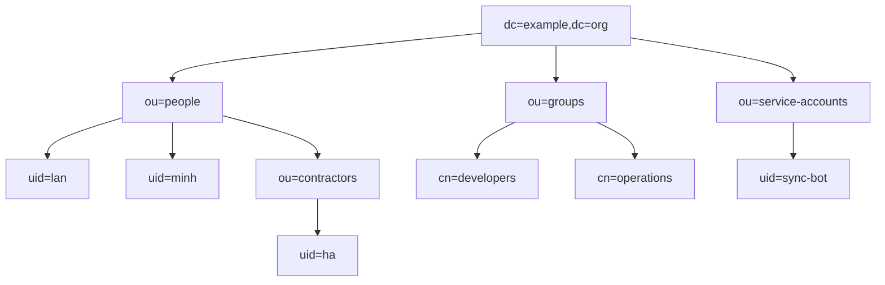
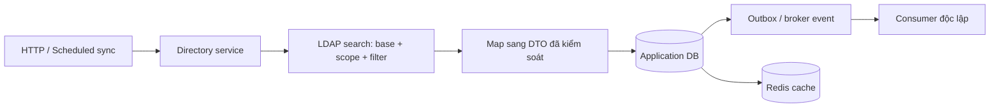

# Base DN, tên phân biệt và phạm vi truy vấn

Trong **SPRING_BOOT_INTEGRATION**, Spring Boot có thể lấy thông tin nhân sự, nhóm quyền hoặc cấu hình tổ chức từ **LDAP directory** rồi kết hợp với HTTP client, cơ sở dữ liệu, cache, broker và các adapter Spring Integration. Khi kết nối thành công nhưng tìm người dùng không thấy, nguyên nhân đôi khi không phải password hoặc kết nối: ứng dụng đã **chọn sai Base DN, hiểu nhầm Distinguished Name (DN), hoặc đặt sai search scope**.

Bài thuộc chương **LDAP và thư mục**, tập trung vào **Base DN, tên phân biệt và phạm vi truy vấn**. Ta sẽ dựng một cây thư mục, phân biệt tên/thuộc tính/vùng tìm kiếm, tính chính xác những entry được duyệt ở từng scope, rồi nối với Spring LDAP và Spring Boot. Các ví dụ đặt ra hợp đồng dữ liệu và biên bảo mật cụ thể, tránh tìm cả directory khi chỉ cần một nhánh; đồng thời xét timeout, referrals, phân trang, chống truy vấn sai và kiểm thử trong luồng tích hợp thực tế.

> Ví dụ hướng tới **Java 17+, Spring Boot 3.x, Spring LDAP 3.x** và giao thức LDAPv3. Cú pháp DN/filter dựa trên các nguyên tắc của LDAP/RFC 4512, RFC 4514 và RFC 4515. Một số hành vi như alias, referral, schema, phân quyền đọc, paging và cách tổ chức user/group phụ thuộc LDAP server (OpenLDAP, Active Directory, v.v.); không coi dữ liệu trong ví dụ là cấu trúc bắt buộc của mọi directory.

## 1. Mục tiêu học tập

Sau bài học, bạn có thể:

1. Đọc và dựng **Directory Information Tree (DIT)**; phân biệt entry, attribute, RDN, DN và suffix.
2. Giải thích ý nghĩa **Base DN** trên server và trong `spring.ldap.base` của Spring Boot, đặc biệt phân biệt **absolute DN** với **DN tương đối với context**.
3. Dự đoán tập entry mà **OBJECT/BASE**, **ONELEVEL** và **SUBTREE** search scope bao phủ.
4. Kết hợp đúng **search base + scope + LDAP filter**; hiểu vì sao thay đổi một thành phần làm kết quả khác dù filter không đổi.
5. Dùng `LdapTemplate`, `LdapQueryBuilder`, `SearchControls` và `LdapNameBuilder` để truy vấn an toàn, giới hạn dữ liệu và tránh LDAP injection.
6. Thiết kế truy vấn người dùng/nhóm cho nhiều tổ chức, nhiều OU, giới hạn phân quyền, referral và cấu trúc thư mục thực tế.
7. Kiểm thử search scope, DN đặc biệt, zero/multiple results, quyền truy cập, timeout và hiệu năng trước khi tích hợp thông tin LDAP với DB/cache/broker.

## 2. LDAP directory là cây entry có tên, không phải bảng quan hệ

LDAP (*Lightweight Directory Access Protocol*) cho phép truy cập **directory entries** có cấu trúc phân cấp. Mỗi entry có một **DN xác định vị trí trong cây** và một tập thuộc tính (*attributes*) theo schema. Thuộc tính có thể có một hoặc nhiều giá trị; việc một attribute có một giá trị không phải mặc định cho mọi object class.

Giả sử công ty tổ chức directory như sau:

```text
dc=example,dc=org
├── ou=people
│   ├── uid=lan
│   ├── uid=minh
│   └── ou=contractors
│       └── uid=ha
├── ou=groups
│   ├── cn=developers
│   └── cn=operations
└── ou=service-accounts
    └── uid=sync-bot
```

**Mỗi dòng trong cây là một entry được đặt tên theo RDN của nó**, không phải một đường dẫn thư mục trên filesystem. Ví dụ:

| Entry | DN đầy đủ (*absolute DN*) |
| --- | --- |
| Gốc dữ liệu ví dụ | `dc=example,dc=org` |
| Container chứa người | `ou=people,dc=example,dc=org` |
| User Lan | `uid=lan,ou=people,dc=example,dc=org` |
| Contractor Hà | `uid=ha,ou=contractors,ou=people,dc=example,dc=org` |
| Nhóm developers | `cn=developers,ou=groups,dc=example,dc=org` |
| Service account | `uid=sync-bot,ou=service-accounts,dc=example,dc=org` |

Một entry có thể có dữ liệu như:

```ldif
dn: uid=lan,ou=people,dc=example,dc=org
objectClass: inetOrgPerson
uid: lan
cn: Lan Nguyen
sn: Nguyen
mail: lan@example.org
```

Đây là **LDIF minh họa**. Trong hệ thống thực, entry có thể cần thêm object class/thuộc tính mà LDAP server yêu cầu, và DN có thể dùng `cn` hoặc định dạng tổ chức khác thay vì `uid`.

### 2.1. Các thành phần hay gặp

| Attribute trong tên | Diễn giải phổ biến | Ví dụ |
| --- | --- | --- |
| `dc` | Domain Component, thường dùng để hình thành suffix | `dc=example,dc=org` |
| `ou` | Organizational Unit, nhánh tổ chức | `ou=people`, `ou=groups` |
| `cn` | Common Name | `cn=developers` hoặc `cn=Lan Nguyen` |
| `uid` | User Identifier trong một số schema | `uid=lan` |
| `o` | Organization Name | `o=Example Corp` |
| `c` | Country Name, khi schema dùng | `c=VN` |

**Tên thuộc tính không quyết định vai trò một entry.** `cn` có thể là một phần DN của user, group hoặc object khác. Cần đọc `objectClass`/schema và quy ước của directory. Đừng suy ra tất cả tài khoản luôn ở `ou=people`, mọi group đều có `cn=...`, hay mọi DN đều kết thúc bằng `dc=...`.

## 3. Phân biệt RDN, DN, entry và attribute

**RDN (Relative Distinguished Name)** là phần tên phân biệt của một entry **so với parent của nó**. **DN (Distinguished Name)** là đường tên phân biệt hoàn chỉnh trong DIT, gồm RDN của entry rồi đến chuỗi RDN tổ tiên cho tới suffix phù hợp.

Lấy entry Lan:

```text
uid=lan,ou=people,dc=example,dc=org
└─┬─┘ └───┬───┘ └───────┬──────┘
  RDN      parent OU      domain suffix
```

| Thành phần | Ví dụ | Cách hiểu |
| --- | --- | --- |
| RDN của Lan | `uid=lan` | Định danh phân biệt Lan với những entry anh em trong cùng parent. |
| Parent DN | `ou=people,dc=example,dc=org` | Vị trí nhánh trực tiếp chứa Lan. |
| Full DN | `uid=lan,ou=people,dc=example,dc=org` | Tên phân biệt của entry trong directory. |
| `uid` attribute | `lan` | Giá trị thuộc tính; không tự có nghĩa duy nhất trên toàn directory. |
| `cn` attribute | `Lan Nguyen` | Tên hiển thị; không nhất thiết tham gia DN. |
| Base DN của một search | `ou=people,dc=example,dc=org` | Vùng bắt đầu tìm kiếm; không nhất thiết chính là DN của đối tượng cần tìm. |

**Một RDN không nhất thiết chỉ chứa một cặp attribute–value.** LDAP cho phép *multi-valued RDN* như `cn=Lan Nguyen+uid=lan` theo schema và quy tắc đặt tên phù hợp. Đừng tách DN theo dấu phẩy hoặc dấu cộng bằng `String.split(...)` rồi cho rằng các phần đều là dữ liệu nguyên vẹn, vì dấu phân cách có thể được escape.

### 3.1. DN không phải business ID bất biến

DN có thể đổi khi một entry được **rename** hoặc **move** sang OU khác:

```text
Trước: uid=lan,ou=contractors,ou=people,dc=example,dc=org
Sau:   uid=lan,ou=employees,ou=people,dc=example,dc=org
```

Nếu ứng dụng dùng DN làm foreign key chính trong PostgreSQL hoặc nhét DN vào sự kiện Kafka như ID vĩnh viễn, việc move có thể làm tham chiếu cũ sai. Một số directory cung cấp identifier ổn định hơn, chẳng hạn `entryUUID` theo schema/server, hoặc `objectGUID` ở Active Directory; phải xác định semantics và quyền truy cập theo nhà cung cấp, không coi DN là UUID.

Group membership đôi khi **lưu DN của thành viên**, chẳng hạn `member: uid=lan,ou=people,dc=example,dc=org`. Việc đổi DN có thể ảnh hưởng tham chiếu đó tùy server/overlay; không tự giả định directory nào cũng cập nhật mọi tham chiếu nhóm.

### 3.2. DN và giá trị chứa ký tự đặc biệt

Giả sử common name là **Doe, Jane**. Dấu phẩy nằm trong giá trị RDN phải được biểu diễn đúng:

```text
cn=Doe\, Jane,ou=people,dc=example,dc=org
```

RDN cũng có các quy tắc escape cho dấu cộng, dấu bằng, dấu gạch chéo ngược, dấu cách đầu/cuối và những ký tự đặc biệt khác. **Không nối chuỗi**:

```java
// SAI: dữ liệu đầu vào có thể làm thay đổi cấu trúc DN.
String dn = "cn=" + displayName + ",ou=people,dc=example,dc=org";
```

Dùng API DN-aware của JNDI/Spring LDAP để dựng và xử lý tên, sẽ được minh họa ở phần sau.

## 4. Base DN là mốc tìm kiếm, không phải filter

**Base DN (search base)** xác định entry bắt đầu của một LDAP search. Đây là **mốc hình học trong cây**, không phải một điều kiện về giá trị như SQL `WHERE`. Search base kết hợp với **scope** để xác định vùng entry nào có thể được xem xét, sau đó **filter** quyết định entry nào thỏa điều kiện.



| Search base | Điều gì nằm trong vùng con của base đó? | Điều gì bị loại từ đầu? |
| --- | --- | --- |
| `dc=example,dc=org` | Có thể đi qua tất cả nhánh people/groups/service-accounts nếu scope cho phép | Những suffix hoặc naming context khác. |
| `ou=people,dc=example,dc=org` | Người dùng Lan, Minh, nhánh contractors và Hà nếu scope phù hợp | Các group và service accounts bên ngoài nhánh people. |
| `ou=contractors,ou=people,dc=example,dc=org` | Chỉ nhánh contractors và con của nó | Lan và Minh ở nhánh people trực tiếp. |
| `uid=lan,ou=people,dc=example,dc=org` | Entry Lan và con nếu có | Các entry anh em như Minh. |

Nếu **Base DN không tồn tại hoặc bind account không được phép xem**, server có thể trả lỗi như `noSuchObject`/`insufficientAccessRights` hoặc kết quả quan sát được khác tùy chính sách truy cập. Không coi một danh sách rỗng là bằng chứng rằng user không tồn tại khi có khả năng sai base hay thiếu quyền.

### 4.1. Base DN server và base của Spring Boot không nhất thiết bằng nhau

Trong Spring Boot, `spring.ldap.base` thường là **base path cho LDAP context** do Spring tạo. Một truy vấn từ `LdapTemplate` có thể truyền tiếp một **base tương đối với context đó**.

Ví dụ:

```yaml
spring:
  ldap:
    urls: ldaps://ldap.example.org:636
    base: dc=example,dc=org
```

Với context base `dc=example,dc=org`, khi gọi:

```java
ldapTemplate.search("ou=people", filter, mapper);
```

thì search base logic là **`ou=people,dc=example,dc=org`**. Ngược lại, nếu truyền nguyên full DN `ou=people,dc=example,dc=org` vào tham số **tương đối** của template, một số cấu hình sẽ ghép lại thành path sai (ví dụ gắn suffix hai lần).

**Cần chọn một quy ước nhất quán:** hoặc cấu hình context base là suffix rồi truyền search base **tương đối**, hoặc context base rỗng và truyền DN đầy đủ. Các adapter, test fixture và câu lệnh quản trị ngoài Spring phải được phân biệt theo quy ước này.

### 4.2. DIT root, naming context và root DSE

LDAP server có thể phục vụ một hoặc nhiều **naming contexts**, ví dụ `dc=example,dc=org` và `dc=partner,dc=net`. **Root DSE** là entry đặc biệt dùng để công bố thông tin server (thường được đọc bằng base DN rỗng và object scope), như `namingContexts` khi server cung cấp.

DN rỗng khi hỏi Root DSE **không** có nghĩa có thể dùng subtree search từ root rỗng để quét toàn bộ directory không giới hạn. Quyền, referral, naming contexts và khả năng search từ root khác nhau theo server. Production nên dùng search base cụ thể và tối thiểu theo nghiệp vụ.

## 5. Ba phạm vi truy vấn: OBJECT, ONELEVEL và SUBTREE

LDAP Search có ba phạm vi cơ bản, không nên diễn giải chỉ bằng tên:

- **BASE/OBJECT scope**: chỉ xem xét **chính entry có DN bằng base**. Trong JNDI dùng `SearchControls.OBJECT_SCOPE`; nhiều công cụ CLI gọi là `base`.
- **ONELEVEL scope**: xem xét **các entry con trực tiếp** của base, **không** tính chính base và **không** đi vào cháu/chắt. Trong JNDI dùng `SearchControls.ONELEVEL_SCOPE`; CLI thường là `one`.
- **SUBTREE scope**: xem xét **base và toàn bộ descendants** nằm dưới nó (nếu server/quyền cho phép). Trong JNDI dùng `SearchControls.SUBTREE_SCOPE`; CLI thường là `sub`.

### 5.1. Ma trận minh họa chính xác

Giữ base `ou=people,dc=example,dc=org`:

| Scope | Entry trong vùng tìm kiếm **trước khi áp filter** | Có bao gồm chính `ou=people`? |
| --- | --- | --- |
| OBJECT / BASE | `ou=people` | **Có** |
| ONELEVEL | `uid=lan`, `uid=minh`, `ou=contractors` | **Không** |
| SUBTREE | `ou=people`, `uid=lan`, `uid=minh`, `ou=contractors`, `uid=ha` | **Có** |

Nếu filter là `(objectClass=inetOrgPerson)` và cả Lan, Minh, Hà đều mang class đó:

| Scope trên cùng base `ou=people` | Kết quả phù hợp filter | Vì sao? |
| --- | --- | --- |
| OBJECT | 0 | Chính OU không phải `inetOrgPerson`. |
| ONELEVEL | Lan, Minh | Hà nằm ở cấp **cháu** qua `ou=contractors`. |
| SUBTREE | Lan, Minh, Hà | Scope đi vào nhánh `ou=contractors`. |

Nếu đổi base thành `dc=example,dc=org` nhưng giữ filter/scope, tập kết quả lại khác. Đó là lý do bài toán “tìm không thấy user hợp lệ” phải xét đồng thời **base + scope + filter** thay vì chỉ sửa filter.

### 5.2. Minh họa bằng LDAP SearchControls

```java
import javax.naming.directory.SearchControls;

SearchControls oneLevel = new SearchControls();
oneLevel.setSearchScope(SearchControls.ONELEVEL_SCOPE);

SearchControls subtree = new SearchControls();
subtree.setSearchScope(SearchControls.SUBTREE_SCOPE);

SearchControls oneObject = new SearchControls();
oneObject.setSearchScope(SearchControls.OBJECT_SCOPE);
```

Đây là các lớp thuộc **JNDI** trong JDK, được Spring LDAP sử dụng khi gọi directory. Scope là tham số của **một truy vấn**, không phải thuộc tính gắn vĩnh viễn với OU hoặc entry.

### 5.3. Chọn scope theo nghiệp vụ

| Câu hỏi nghiệp vụ | Base đề xuất | Scope thường phù hợp |
| --- | --- | --- |
| “Xem thuộc tính của entry user đã biết DN” | DN đầy đủ hoặc relative DN của user | OBJECT/BASE |
| “Liệt kê OU/phòng ban trực tiếp dưới `ou=departments`” | `ou=departments` | ONELEVEL |
| “Tìm user trong mọi nhóm nhân sự con, gồm contractors” | `ou=people` | SUBTREE |
| “Tìm nhóm trực tiếp ở `ou=groups`” | `ou=groups` | ONELEVEL |
| “Đối chiếu một người trong đúng OU employees” | `ou=employees,ou=people` | ONELEVEL nếu không muốn OU con |
| “Tìm service account” | `ou=service-accounts` | ONELEVEL/SUBTREE tùy cấu trúc thực |

Không chọn SUBTREE chỉ vì “an toàn là tìm được nhiều hơn”: nó có thể quét rất rộng, tăng latency và trả cả entry không được phép xuất cho nghiệp vụ. Ngược lại, chọn ONELEVEL chỉ vì nhẹ hơn nhưng dữ liệu có các OU con sẽ tạo **false negative**.

## 6. Base, scope và filter: ba thành phần độc lập

Một LDAP search có thể được mô tả bằng:

```text
Search(
  base  = "ou=people,dc=example,dc=org",
  scope = SUBTREE,
  filter = "(&(objectClass=inetOrgPerson)(uid=lan))",
  attrs = ["uid", "cn", "mail"]
)
```

Ý nghĩa:

1. **Base**: bắt đầu từ entry `ou=people,dc=example,dc=org`.
2. **Scope**: chọn entry ở base và tất cả con/cháu có thể truy cập.
3. **Filter**: chỉ giữ entry vừa có `objectClass=inetOrgPerson` vừa có `uid=lan`.
4. **Returning attributes**: trong mỗi kết quả chỉ yêu cầu những thuộc tính thực sự cần.

**Filter không thay thế search scope.** Viết `(uid=ha)` không khiến một ONELEVEL search tự đi vào `ou=contractors`. Và đặt SUBTREE không có nghĩa mọi entry sẽ xuất hiện: filter, ACL, alias/referral và giới hạn server vẫn tác động.

### 6.1. Cú pháp filter LDAP

LDAP filter là biểu thức theo cú pháp riêng, không phải SQL WHERE:

| Filter | Ý nghĩa |
| --- | --- |
| `(uid=lan)` | Equality match của `uid`. |
| `(&(objectClass=inetOrgPerson)(uid=lan))` | AND: phải thỏa cả hai. |
| `(|(uid=lan)(uid=minh))` | OR: một trong hai UID. |
| `(!(accountStatus=disabled))` | NOT: không thỏa equality match (ngữ nghĩa còn phụ thuộc schema/presence). |
| `(mail=*)` | Presence: attribute `mail` có mặt. |
| `(cn=Lan*)` | Substring match, tên bắt đầu với `Lan` theo matching rule. |
| `(employeeNumber>=1000)` | Greater-or-equal matching theo schema/ordering rule của attribute. |

Lưu ý ký hiệu `|` trong filter OR là ký tự logic LDAP, không phải shell pipe. Equality và thứ tự so sánh phụ thuộc **matching rule của schema**; không tự giả định mọi attribute đều case-insensitive, mọi number là số học hay mọi server diễn giải Unicode theo cách ứng dụng Java làm.

### 6.2. Filter injection khác với DN injection

Ký tự đặc biệt cần escape trong **giá trị filter** có những quy tắc riêng của RFC 4515:

| Ký tự trong dữ liệu | Biểu diễn escape trong LDAP filter |
| --- | --- |
| `*` | `\2a` |
| `(` | `\28` |
| `)` | `\29` |
| `\` | `\5c` |
| NUL | `\00` |

Ví dụ dữ liệu do người dùng nhập:

```text
lan*)(|(uid=*)
```

Không được ghép trực tiếp:

```java
// NGUY HIỂM: giá trị người dùng có thể thay đổi cú pháp filter.
String filter = "(&(objectClass=inetOrgPerson)(uid=" + uid + "))";
```

Kẻ tấn công có thể cố ý đóng ngoặc và thêm logic OR để mở rộng kết quả. Dùng **`EqualsFilter`** hoặc **`LdapQueryBuilder`** để mã hóa giá trị theo đúng ngữ cảnh filter. **Escape DN và escape LDAP filter là hai bài toán khác nhau**: không dùng `Rdn.escapeValue` thay cho filter escaping và không dùng `EqualsFilter` để xây DN.

### 6.3. Tìm user bằng username không đồng nghĩa xác thực user

Một query `(uid=lan)` trả lại entry có thuộc tính phù hợp **không chứng minh người gọi biết password** hoặc có quyền của entry đó. LDAP bind/authentication là thao tác riêng. Trong Spring Security LDAP, một authentication flow có thể **tìm DN của user rồi bind với thông tin xác thực phù hợp**, tùy provider. Không “xác thực” bằng cách chỉ tìm thấy username hoặc so sánh một trường plaintext password.

Khi truy vấn directory để đồng bộ thông tin nhân sự sang DB hoặc cache, nên dùng **service bind account** có quyền **read-only tối thiểu**. Không dùng quyền admin rộng chỉ để chạy `search`, không đưa credential vào log hoặc event.

## 7. Absolute DN, relative DN và Spring LDAP context

Giả sử cấu hình Boot:

```yaml
spring:
  ldap:
    urls: ldaps://ldap.example.org:636
    base: dc=example,dc=org
    username: cn=directory-reader,ou=service-accounts,dc=example,dc=org
    password: ${LDAP_BIND_PASSWORD}
```

`username` ở đây là **DN dùng để bind**, còn `base` là **mốc LDAP context mặc định** cho ứng dụng. Chúng không có nghĩa giống nhau. Một service account có thể nằm ở nhánh khác hoặc có DN theo quy ước riêng, miễn directory chấp nhận việc bind.

| Giá trị | DN tương đối với `dc=example,dc=org`? | Dùng ở đâu? |
| --- | --- | --- |
| `ou=people` | **Có** | Search base truyền cho `LdapTemplate`. |
| `uid=lan,ou=people` | **Có** | DN của entry khi lookup/bind tương đối theo context phù hợp. |
| `uid=lan,ou=people,dc=example,dc=org` | **Không**, đây là full DN | Hữu ích cho log đã kiểm soát hoặc client quản trị không có context base. |
| `""` (chuỗi rỗng) | Chỉ chính context base | Object-scope lookup trên entry `dc=example,dc=org` nếu đang dùng context đó. |

Một quy ước thực tế: **mọi search base nội bộ của adapter đều tương đối với `spring.ldap.base`**. Ví dụ định nghĩa constant `PEOPLE_BASE = "ou=people"`, `GROUPS_BASE = "ou=groups"`; khi cần absolute DN để truyền cho hệ thống khác, dựng bằng API xử lý DN và thêm suffix đúng một lần.

### 7.1. Dựng DN an toàn bằng `LdapNameBuilder`

Spring LDAP cung cấp API xây DN mà không nối chuỗi:

```java
import javax.naming.ldap.LdapName;
import org.springframework.ldap.support.LdapNameBuilder;

public final class DirectoryNames {
    private DirectoryNames() {}

    public static LdapName userRelativeDn(String uid) {
        return LdapNameBuilder.newInstance("ou=people")
                .add("uid", uid)
                .build();
    }

    public static LdapName userAbsoluteDn(String uid) {
        return LdapNameBuilder
                .newInstance("dc=example,dc=org")
                .add("ou", "people")
                .add("uid", uid)
                .build();
    }
}
```

Kết quả logic:

```text
userRelativeDn("lan") -> uid=lan,ou=people
userAbsoluteDn("lan") -> uid=lan,ou=people,dc=example,dc=org
```

Nếu `uid` chứa dấu phẩy, dấu cộng hoặc ký tự đặc biệt, builder xử lý escape theo DN syntax thay vì biến chúng thành RDN mới. **Vẫn phải validate** giá trị UID theo quy tắc nghiệp vụ và directory schema: escape ngăn phá cú pháp nhưng không thay kiểm soát ai được tra cứu/ghi entry nào.

### 7.2. Không tách DN bằng `String.split(",")`

DN có escape, RDN nhiều giá trị và các dạng biểu diễn tương đương. Ví dụ:

```text
cn=Doe\, Jane,ou=people,dc=example,dc=org
```

Nếu gọi `split(",")`, bạn tách sai thành `cn=Doe\` và ` Jane`. Hãy dùng `javax.naming.ldap.LdapName`/`Rdn` hoặc helper của Spring LDAP, đồng thời phân biệt **giá trị dạng chuỗi để hiển thị** với **DN đã parse** để so sánh/ghép tên. Đừng cố chuẩn hóa DN bằng cách `toLowerCase()` toàn chuỗi; matching/normalization còn phụ thuộc schema và dạng giá trị.

## 8. Spring Boot và Spring LDAP: cấu hình context có kiểm soát

Với Spring Boot 3.x, cách thông dụng để dùng LDAP từ service tích hợp là thêm Spring Data LDAP starter, có phần hạ tầng Spring LDAP:

```xml
<dependency>
    <groupId>org.springframework.boot</groupId>
    <artifactId>spring-boot-starter-data-ldap</artifactId>
</dependency>
```

Ví dụ Gradle:

```groovy
dependencies {
    implementation 'org.springframework.boot:spring-boot-starter-data-ldap'
}
```

Application properties:

```yaml
spring:
  ldap:
    urls: ${LDAP_URLS:ldaps://ldap.example.org:636}
    base: dc=example,dc=org
    username: ${LDAP_BIND_DN}
    password: ${LDAP_BIND_PASSWORD}
```

Với classpath/điều kiện tương ứng, Boot có thể auto-configure `ContextSource` (ví dụ `LdapContextSource`), `LdapTemplate` và hỗ trợ Spring Data LDAP repositories. **Boot không tự biết OU nào chứa user, không tự xác thực người dùng, không tạo schema/index của directory và không tự quyết định query scope hay quyền truy cập của service account.**

| Thành phần | Mục đích | Ứng dụng cần xác định |
| --- | --- | --- |
| `spring.ldap.urls` | Server LDAP/LDAPS mà client kết nối | Host, port, TLS, failover, DNS và endpoint theo môi trường. |
| `spring.ldap.base` | Base path của LDAP context do Boot quản lý | Suffix tổ chức và quy tắc **relative DN** dùng trong code. |
| `spring.ldap.username`/`password` | Credential để service bind khi cần | Read-only identity, secret management, rotation, không log password. |
| `ContextSource` | Tạo directory contexts để LDAP operations dùng | Connection lifecycle, TLS/StartTLS, pooling, referral settings. |
| `LdapTemplate` | API thao tác tìm/lookup/sửa entry, xử lý một số tài nguyên JNDI | Base, filter, scope, returning attributes, limits, lỗi. |
| Spring Data LDAP repository | Trừu tượng thao tác entry dạng entity khi ứng dụng chọn dùng | Mapping, DN/rules, phạm vi query và unit test/integration test. |

### 8.1. Khi nào không nên hardcode LDAP suffix?

Một ứng dụng triển khai ở hai tổ chức có naming contexts khác nhau:

```text
Tenant A: dc=example,dc=org
Tenant B: o=example-partner,c=vn
```

Hardcode `dc=example,dc=org` trong mọi method khiến việc chuyển môi trường khó và có thể sai dữ liệu. Nên dùng configuration properties cho **LDAP context base** và các **relative search bases** theo từng chức năng (`ou=people`, `ou=groups`). Có thể cần nhiều `ContextSource` được cấu hình và inject theo qualifier nếu truy cập hai directory độc lập; không tự chia sẻ credential của directory A sang B.

Tuy nhiên, **không** cho HTTP client nhập một absolute DN bất kỳ rồi dùng nó làm search base không hạn chế. Cấu hình base/search scope phải đến từ policy server-side; người gọi chỉ cung cấp những input được phép như username hoặc nhóm đã được duyệt.

### 8.2. LDAP client ở Spring LDAP là blocking

`LdapTemplate` dựa trên JNDI theo cơ chế thông dụng và hoạt động **blocking**. Nếu ứng dụng dùng WebFlux, không gọi trực tiếp `LdapTemplate.search(...)` trên Reactor Netty event-loop. Có thể cô lập lời gọi:

```java
import reactor.core.publisher.Mono;
import reactor.core.scheduler.Schedulers;

public Mono<DirectoryPerson> findInReactiveFlow(
        DirectoryPersonLookup lookup, String uid) {
    return Mono.fromCallable(() -> lookup.findRequiredPerson(uid))
            .subscribeOn(Schedulers.boundedElastic());
}
```

Ví dụ này yêu cầu interface/class `DirectoryPersonLookup` được định nghĩa ở phần tiếp theo. `boundedElastic` giúp chuyển blocking work ra khỏi event loop nhưng **không biến LDAP thành non-blocking**; vẫn cần giới hạn concurrency, connect/read timeout, chính sách cancellation và không dùng retry vô hạn khi directory chậm. Với nhiều truy vấn LDAP đồng thời, cân đối connection resources và hạn mức của LDAP server.

## 9. `LdapTemplate.search`: cố định base/scope, escape dữ liệu tìm kiếm

Đây là ví dụ quan trọng nhất của bài: ứng dụng cần tìm user theo `uid` trong **toàn nhánh people**, có thể gồm contractor ở OU con, nhưng không được quét `ou=service-accounts` hoặc `ou=groups`. Ta dùng:

- Context base Boot: `dc=example,dc=org`.
- Relative search base của nghiệp vụ: `ou=people`.
- Scope: `SUBTREE`.
- Filter: `(&(objectClass=inetOrgPerson)(uid=<giá trị đã escape>))`.
- Attribute projection: chỉ `uid`, `cn`, `mail`.
- Giới hạn 2 kết quả để **phát hiện username không duy nhất** thay vì chọn ngẫu nhiên người đầu tiên.

### 9.1. DTO kết quả directory

```java
public record DirectoryPerson(
        String uid,
        String displayName,
        String email
) {}
```

DTO này **không** phải JPA entity, HTTP request hay group object của LDAP. Để công bố cho HTTP client hoặc Kafka, cần xác định thêm identifier ổn định, quyền thấy thông tin và schema version phù hợp. Không tự đưa `userPassword`, DN bind của service hoặc các attribute nhạy cảm vào payload.

### 9.2. Code hoàn chỉnh với `SearchControls`

```java
import java.util.List;
import javax.naming.NamingException;
import javax.naming.directory.Attribute;
import javax.naming.directory.Attributes;
import javax.naming.directory.SearchControls;
import org.springframework.ldap.core.AttributesMapper;
import org.springframework.ldap.core.LdapTemplate;
import org.springframework.ldap.filter.AndFilter;
import org.springframework.ldap.filter.EqualsFilter;
import org.springframework.stereotype.Component;

@Component
public class DirectoryPersonLookup {
    private static final String PEOPLE_BASE = "ou=people";
    private final LdapTemplate ldap;

    public DirectoryPersonLookup(LdapTemplate ldap) {
        this.ldap = ldap;
    }

    public DirectoryPerson findRequiredPerson(String uid) {
        if (uid == null || uid.isBlank() || uid.length() > 128) {
            throw new IllegalArgumentException("Invalid uid");
        }

        // Build filter as structured components: escape user input.
        AndFilter filter = new AndFilter();
        filter.and(new EqualsFilter("objectClass", "inetOrgPerson"));
        filter.and(new EqualsFilter("uid", uid));

        SearchControls controls = new SearchControls();
        controls.setSearchScope(SearchControls.SUBTREE_SCOPE);
        controls.setReturningAttributes(new String[] {
                "uid", "cn", "mail"
        });
        controls.setCountLimit(2L); // Detect non-unique uid in the subtree.
        controls.setTimeLimit(2000); // Search time limit in milliseconds.

        List<DirectoryPerson> found = ldap.search(
                PEOPLE_BASE,
                filter.encode(),
                controls,
                (AttributesMapper<DirectoryPerson>) attrs ->
                        new DirectoryPerson(
                                required(attrs, "uid"),
                                required(attrs, "cn"),
                                optional(attrs, "mail")));

        if (found.isEmpty()) {
            throw new DirectoryPersonNotFoundException(uid);
        }
        if (found.size() > 1) {
            throw new AmbiguousDirectoryPersonException(uid);
        }
        return found.get(0);
    }

    private static String required(Attributes attrs, String key)
            throws NamingException {
        Attribute attr = attrs.get(key);
        if (attr == null || attr.size() != 1) {
            throw new IllegalArgumentException(
                    "Missing or multi-valued attribute: " + key);
        }
        return String.valueOf(attr.get());
    }

    private static String optional(Attributes attrs, String key)
            throws NamingException {
        Attribute attr = attrs.get(key);
        return (attr == null || attr.size() == 0)
                ? null
                : String.valueOf(attr.get());
    }
}

class DirectoryPersonNotFoundException extends RuntimeException {
    DirectoryPersonNotFoundException(String uid) {
        super("Directory person not found");
    }
}

class AmbiguousDirectoryPersonException extends RuntimeException {
    AmbiguousDirectoryPersonException(String uid) {
        super("Directory uid is ambiguous");
    }
}
```

**Vì sao code này không ghép filter bằng `+`?** `EqualsFilter` mã hóa giá trị để những ký tự như `*`, `(` hoặc `)` trong input không biến thành logic LDAP ngoài ý muốn.

**Vì sao set scope rõ ràng?** Nếu người dùng Hà ở `ou=contractors,ou=people`, query ONELEVEL sẽ **không** thấy Hà. SUBTREE phù hợp vì hợp đồng cho phép tìm trong toàn people subtree.

**Vì sao chỉ trả ba attributes?** Directory có thể chứa nhiều attribute mà ứng dụng không cần hoặc không được phép xử lý. Projection giảm dữ liệu, chi phí mapping và rủi ro lộ thông tin; server vẫn áp ACL đối với từng attribute.

**Vì sao không tự động chọn `found.get(0)`?** Một `uid` có thể trùng giữa các OU nếu directory không đặt ràng buộc global uniqueness. Nếu hợp đồng yêu cầu định danh duy nhất, nên xác minh uniqueness ở directory/schema hoặc dùng một ID ổn định được quy định; một search thấy hai user không được âm thầm chọn người theo thứ tự trả về.

**Giới hạn:** `SearchControls.setCountLimit(2)` và `setTimeLimit(2000)` là yêu cầu giới hạn cho JNDI search, **không phải SLA toàn request**. LDAP server có thể áp thêm giới hạn và trả lỗi size/time limit; quyền/referral và network timeout vẫn phải được xử lý. Với query trọng yếu, phân biệt kết quả 0 entry với lỗi server/ACL/time limit thay vì coi cả hai là “không tìm thấy”.

### 9.3. Chọn ONELEVEL khi chỉ muốn user trực tiếp thuộc OU

Thay:

```java
controls.setSearchScope(SearchControls.ONELEVEL_SCOPE);
```

với cùng base `ou=people` và filter `inetOrgPerson`, kết quả chỉ có user là con trực tiếp của `ou=people`. Contractor ở `ou=contractors` không xuất hiện.

Nếu policy yêu cầu **không truy vấn contractors** để tránh lộ thông tin, ONELEVEL là một lớp thu hẹp hữu ích; nhưng bảo mật vẫn phải được thực thi bằng **LDAP ACL và authorization của service**, không tin duy nhất vào scope do code chọn.

### 9.4. Trường hợp OBJECT scope

Khi đã có DN chính xác của một entry, có thể dùng OBJECT_SCOPE để kiểm tra entry đó mà **không đi vào subtree**:

```java
SearchControls oneEntry = new SearchControls();
oneEntry.setSearchScope(SearchControls.OBJECT_SCOPE);
oneEntry.setReturningAttributes(new String[] { "uid", "cn" });

// Context base đã là dc=example,dc=org.
var result = ldap.search(
        "uid=lan,ou=people",
        "(objectClass=inetOrgPerson)",
        oneEntry,
        (AttributesMapper<String>) attrs ->
                String.valueOf(attrs.get("cn").get()));
```

Trong ví dụ này, DN phải tương ứng với entry tồn tại; **OBJECT scope không có nghĩa tìm hết subtree rồi lọc UID**. Nếu chỉ cần đọc trực tiếp một entry theo DN, `ldap.lookup(relativeDn, mapper)` cũng là API phù hợp theo overload/version của Spring LDAP.

## 10. `LdapQueryBuilder` giúp diễn đạt query mà không ghép chuỗi

Spring LDAP cung cấp DSL cho base, scope, attributes và filter, giúp giảm lỗi khi ứng dụng xây nhiều truy vấn:

```java
import java.util.List;
import org.springframework.ldap.core.AttributesMapper;
import org.springframework.ldap.core.LdapTemplate;
import org.springframework.ldap.query.LdapQuery;
import org.springframework.ldap.query.LdapQueryBuilder;
import org.springframework.ldap.query.SearchScope;

public final class DirectoryQueryService {
    private final LdapTemplate ldap;

    public DirectoryQueryService(LdapTemplate ldap) {
        this.ldap = ldap;
    }

    public List<String> findDisplayNames(String uid) {
        LdapQuery query = LdapQueryBuilder.query()
                .base("ou=people")
                .searchScope(SearchScope.SUBTREE)
                .attributes("cn")
                .where("objectClass").is("inetOrgPerson")
                .and("uid").is(uid);

        return ldap.search(query,
                (AttributesMapper<String>) attrs ->
                        String.valueOf(attrs.get("cn").get()));
    }
}
```

`LdapQueryBuilder` giúp mã hóa giá trị qua toán tử `is(uid)`; không tự tạo cơ chế xác thực hay giới hạn permissions. Nếu kết quả phải duy nhất, **vẫn** cần kiểm tra số lượng và xử lý xung đột theo hợp đồng. Có thể cấu hình các limit ở API query builder hoặc `SearchControls` tùy nhu cầu và version đang sử dụng.

**Khi nào dùng `SearchControls`?** Khi cần điều khiển chi tiết scope, projection, size/time limit và một số tùy chọn JNDI. **Khi nào dùng DSL?** Khi chủ yếu cần mô tả filter có cấu trúc, base, scope và thuộc tính đọc theo ngữ nghĩa Spring LDAP. Hai cách đều dựa trên cùng khái niệm **base + scope + filter**.

## 11. Tra cứu nhóm: DN của user khác filter ở nhánh groups

Một nhầm lẫn phổ biến là **tìm user ở `ou=people` xong tiếp tục tìm group với cùng search base**. Group có thể nằm ở `ou=groups`, không nằm dưới people nên một SUBTREE search trên people cũng không tìm được nhóm.

Giả sử directory dùng objectClass `groupOfNames`:

```ldif
dn: cn=developers,ou=groups,dc=example,dc=org
objectClass: top
objectClass: groupOfNames
cn: developers
member: uid=lan,ou=people,dc=example,dc=org
member: uid=ha,ou=contractors,ou=people,dc=example,dc=org
```

Theo schema này, `member` lưu **DN của người dùng**, không lưu `uid` hay tên hiển thị. Nếu cần biết người dùng có thuộc nhóm nào trực tiếp, có thể:

1. Tìm user ở base `ou=people` theo `uid`; đảm bảo chỉ nhận một entry hợp lệ.
2. Lấy hoặc dựng **DN đầy đủ hiện hành** của user theo contract directory.
3. Tìm group ở relative base `ou=groups`, filter `(&(objectClass=groupOfNames)(member=<user DN>))`, với scope theo cấu trúc OU nhóm.

Ví dụ function chỉ minh họa tầng tìm nhóm trực tiếp sau khi đã xác minh user DN:

```java
import java.util.List;
import javax.naming.directory.SearchControls;
import org.springframework.ldap.core.AttributesMapper;
import org.springframework.ldap.core.LdapTemplate;
import org.springframework.ldap.filter.AndFilter;
import org.springframework.ldap.filter.EqualsFilter;

public final class GroupMembershipLookup {
    private final LdapTemplate ldap;

    public GroupMembershipLookup(LdapTemplate ldap) {
        this.ldap = ldap;
    }

    public List<String> directGroupsForUserDn(String fullUserDn) {
        if (fullUserDn == null || fullUserDn.isBlank()) {
            throw new IllegalArgumentException("Missing user DN");
        }

        var filter = new AndFilter();
        filter.and(new EqualsFilter("objectClass", "groupOfNames"));
        filter.and(new EqualsFilter("member", fullUserDn));

        var controls = new SearchControls();
        controls.setSearchScope(SearchControls.SUBTREE_SCOPE);
        controls.setReturningAttributes(new String[] { "cn" });
        controls.setCountLimit(100);
        controls.setTimeLimit(2000);

        return ldap.search(
                "ou=groups",
                filter.encode(),
                controls,
                (AttributesMapper<String>) attrs ->
                        String.valueOf(attrs.get("cn").get()));
    }
}
```

**Lưu ý:** `fullUserDn` phải đến từ một bước lookup tin cậy hoặc một nguồn đã được xác minh; trước khi dùng làm giá trị `member`, cần bảo đảm nó biểu diễn đúng **entry DN hiện hành**. `EqualsFilter` escape theo **filter**; nó không thay cho việc parse/normalize DN và xác thực quyền truy cập. Nếu nhóm lồng nhóm, việc hỏi `member=userDn` thường chỉ trả membership **trực tiếp**; không tự tính transitive closure.

### 11.1. Active Directory và các schema khác

Active Directory thường có `distinguishedName`, `objectGUID`, `member`, `memberOf` và những thuộc tính/matching rules riêng. Một số ứng dụng tra `memberOf` trên user thay vì tìm `member` trong group; nhưng **membership trực tiếp, nested membership, primary group và quyền thực tế không phải luôn cùng một tập**. Đừng viết một filter tự cho là portable với mọi LDAP server.

Nếu cần nested groups/role mapping:

- Xác định schema/server và quy tắc nào được hỗ trợ.
- Định nghĩa rõ “direct group” hay “transitive group”.
- Kiểm soát vòng lặp, giới hạn số nhóm/depth và quyền truy cập.
- Khi map LDAP group sang application role, dùng allowlist được cấu hình; không biến mọi group bất kỳ thành quyền cao trong Spring Security.
- Kiểm thử di chuyển user sang OU khác, xóa/rename group và sự chậm trễ cập nhật thuộc tính membership nếu directory có replication.

### 11.2. Đừng thay DN của user bằng username trong group filter

Filter `(member=lan)` không tương đương `(member=uid=lan,ou=people,dc=example,dc=org)` đối với `groupOfNames`. Tương tự, dùng `(cn=developers)` ở base `ou=people` không tìm thấy group nếu group chỉ nằm dưới `ou=groups`. Đây là **lỗi mô hình dữ liệu và chọn base**, không phải lỗi Jackson hoặc pool HTTP.

## 12. Alias, referral và nhiều naming contexts

Phạm vi SUBTREE trả lời *đi tới bao nhiêu cấp trong cây dưới base*, nhưng LDAP còn có những cơ chế **alias** và **referral**:

- **Alias**: entry có thể đại diện cho một entry khác. LDAP search có tùy chọn dereference aliases; hành vi khi gặp alias phụ thuộc controls và server. Một alias trong subtree không đồng nghĩa mọi server đều tự đi theo nó.
- **Referral**: server có thể chỉ client sang LDAP server/naming context khác khi dữ liệu thuộc nơi quản lý khác. Referral thường cần client policy như follow/throw/ignore theo driver/JNDI/provider.
- **Nhiều naming contexts**: một LDAP endpoint có thể phục vụ nhiều suffix; một base thuộc suffix A không tự bao phủ suffix B.

Ví dụ tìm `uid=lan` trên `ou=people,dc=example,dc=org` không chứng minh rằng user không tồn tại ở `dc=partner,dc=net`. Chỉ mở rộng search base hoặc tự follow referral nếu **hợp đồng nghiệp vụ và chính sách bảo mật cho phép**.

### 12.1. Vì sao auto-follow referral cần được cân nhắc?

Giả sử service bind bằng một account có quyền đọc directory nội bộ. Nếu server trả referral đến host khác, client tự follow có thể tạo kết nối tới một địa chỉ mà ứng dụng chưa kiểm soát và có rủi ro tiết lộ credential hoặc thông tin truy vấn nếu cấu hình không phù hợp.

Hãy xác định:

1. Những LDAP hosts/naming contexts được phép.
2. Credential có được dùng khi follow referral không và giới hạn cấp quyền ra sao.
3. TLS hostname/certificate validation cho mọi host được chuyển tiếp.
4. Số hop/giới hạn recursion/time budget để tránh vòng referral.
5. Cách phân loại lỗi referral thất bại so với “user không có trong nhánh này”.

Với JNDI LDAP provider, cách xử lý referral chịu ảnh hưởng bởi environment property như `java.naming.referral`, nhưng semantics cụ thể còn phụ thuộc provider/server. **Không** coi referral là một tính năng giúp SUBTREE tự động tìm qua mọi tổ chức/forest.

### 12.2. Alias và kết quả trùng

Nếu search có dereference alias, cùng logical entry có thể xuất hiện qua những đường tên khác nhau tùy directory. Khi kết quả cần duy nhất, không dựa vào số dòng trả về mà bỏ qua định danh ổn định. Một directory có thể cấu hình alias, group và replication khác nhau; truy vấn và dedup phải dựa trên semantics đã được kiểm chứng.

## 13. Giới hạn phạm vi vì hiệu năng và khả năng quan sát

Một query LDAP có ba yếu tố chi phối lượng dữ liệu phải xét: **search base**, **scope**, và **filter**. Mỗi yếu tố đều quan trọng; `SUBTREE` trên directory root và filter yếu như `(objectClass=*)` có thể trả hàng chục nghìn entry, dẫn đến size-limit, time-limit hoặc quá tải.

| Kiểm soát | Tác dụng | Điều không được hiểu nhầm |
| --- | --- | --- |
| Chọn base OU cụ thể | Không quét nhánh không liên quan | Không thể cứu một filter sai hoặc OU thiếu quyền. |
| Dùng ONELEVEL khi phù hợp | Giảm số cấp cần duyệt | Không thấy entry trong OU con. |
| Chọn filter có độ chọn lọc | Chỉ lấy loại entry/UID cần thiết | Vẫn phụ thuộc schema/index và matching rule. |
| `setReturningAttributes` | Giảm dữ liệu attribute trả về | Không giới hạn số entry hoặc làm filter đúng hơn. |
| `setCountLimit` | Yêu cầu giới hạn số entry phía client/search | Không phải cách duy nhất để paging; server có thể áp size limit riêng. |
| `setTimeLimit` | Yêu cầu giới hạn thời gian LDAP search | Không đồng nghĩa overall deadline HTTP và network connect/read timeout. |
| Server-side paging | Lấy nhiều page khi server hỗ trợ control | Không phải mọi server đều hỗ trợ/cho phép cùng control; phải tiêu thụ cookie đúng. |
| LDAP server index | Tăng hiệu quả query theo attribute được tìm | Index policy do LDAP server vận hành, không tự tạo bởi Spring Boot. |
| Connection timeout/read timeout | Giới hạn một số pha network/JNDI | Không tự thay đổi quyền, scope hay số entry. |

### 13.1. Đếm hai kết quả để phát hiện ambiguity

Nếu nghiệp vụ khẳng định một `uid` chỉ có thể thuộc một người trong search base, query với `countLimit=2` rồi kiểm tra:

```text
0 kết quả  -> không tìm thấy trong vùng search đã chọn (chưa chắc user không tồn tại toàn LDAP)
1 kết quả -> có một entry match (sau đó còn cần kiểm tra quyền và trạng thái)
2 kết quả -> username mơ hồ; không chọn entry đầu tiên
```

Không dùng `countLimit=1` rồi kết luận “UID duy nhất” vì lúc đó bạn **đã loại bỏ khả năng phát hiện bản ghi thứ hai**. Nếu directory có index uniqueness thật, cần kiểm tra nó trên server và phạm vi uniqueness; đừng suy từ tên attribute.

### 13.2. Phân trang khác với giới hạn tổng

Đối với đồng bộ hàng chục nghìn user, `countLimit=100` chỉ lấy tối đa 100 entry theo semantics search; nó **không** tự cung cấp page tiếp theo. Nhiều LDAP server hỗ trợ **Simple Paged Results control** với cookie, nhưng client phải gửi cookie của page trước ở lần request tiếp theo, và phải hiểu giới hạn session/bộ nhớ/referral theo vendor.

Thiết kế batch sync nên có:

- Cơ chế paging/cookie có kiểm soát; không đọc tất cả vào một `List`.
- Số lượng entry/page và thời hạn toàn job.
- Checkpoint/resume khi job thất bại, kèm cân nhắc dữ liệu thay đổi giữa các page.
- Thứ tự/upsert/idempotency theo identifier ổn định, không dựa thứ tự mặc định server trả.
- Đối soát khi user bị rename, move, disable hoặc xóa khỏi directory.

**Đừng dùng “user không có trong page hiện tại” để kết luận tài khoản đã bị xóa**. Directory sync khác search điểm: nó cần hợp đồng độ đầy đủ của lần quét, phân biệt partial search vì size/time limit hoặc lỗi mạng, và phương án xóa mềm/đối soát thay vì delete hàng loạt.

### 13.3. Timeout của LDAP có nhiều lớp

Ví dụ service HTTP phải trả trong 2 giây nhưng LDAP search được cấu hình time limit 5 giây. Khi LDAP chậm, API có thể vượt SLA dù filter chính xác. Hãy cân đối **time budget của toàn request** và:

- thời gian TCP/TLS connect (có thể cấu hình theo JNDI provider);
- LDAP response/read timeout và search time limit;
- số kết quả và chi phí mapping;
- retry/backoff (không retry một search mãi);
- cache hit/miss và fallback policy.

Trong JNDI LDAP provider của JDK, các property như `com.sun.jndi.ldap.connect.timeout` và `com.sun.jndi.ldap.read.timeout` thường được dùng cho connect/read timeout theo mili giây. Chúng **phụ thuộc provider**, không phải LDAP protocol chung; nếu cấu hình qua Spring Boot `spring.ldap.base-environment`, phải kiểm tra đúng binding map và TLS behavior của version dự án.

## 14. Quyền truy cập và dữ liệu nhạy cảm: scope không phải cơ chế phân quyền

Thu hẹp query từ `dc=example,dc=org` xuống `ou=people` là một lựa chọn tốt để giảm phạm vi dữ liệu; nhưng **nó không thay thế Access Control List (ACL)** tại LDAP server.

Ví dụ service chỉ cần:

```text
Search base: ou=people,dc=example,dc=org
Scope: SUBTREE
Read attributes: uid, cn, mail, employeeStatus
No permission: userPassword, modify user/group, read private HR fields
```

Tài khoản bind nên được cấp quyền **tối thiểu** theo nhánh/thuộc tính. Nếu service code có bug đổi base thành `dc=example,dc=org`, ACL vẫn cần ngăn lộ service accounts hoặc private organizational data.

### 14.1. Không tin DN/filter do client gửi trực tiếp

Không thiết kế endpoint kiểu:

```text
GET /directory/search?base=dc=example,dc=org&filter=(objectClass=*)
```

rồi gửi thẳng hai tham số đó vào `LdapTemplate` với credential rộng. Đây là một dạng **directory query proxy** nguy hiểm: người dùng có thể mở rộng vùng tìm hoặc yêu cầu attribute nhạy cảm.

Thay vào đó, API nhận **điều kiện nghiệp vụ allowlisted**, ví dụ `GET /employees?uid=lan`, rồi service chọn **base cố định**, **scope theo policy**, filter được builder escape, projection tối thiểu và kiểm tra authorization trước khi trả DTO.

### 14.2. Phân biệt ẩn thông tin với xác thực

Khi LDAP được dùng cho login, lỗi không tìm thấy user, password sai, account bị khóa và LDAP unavailable có thể cần thông điệp HTTP giống nhau để tránh username enumeration, trong khi log/metric nội bộ vẫn phân biệt nguyên nhân an toàn.

Khi LDAP dùng **directory lookup** cho admin tooling, API có thể trả `404` nếu user không có trong nhánh được phép; nhưng nếu directory không sẵn sàng hoặc mất quyền search, **không** trả 404 như thể user chưa từng tồn tại. Sự khác nhau này ảnh hưởng việc đồng bộ tài khoản với DB và quyết định thu hồi quyền.

### 14.3. LDAPS, StartTLS và vòng đời connection

LDAP có thể dùng:

- `ldaps://`: TLS ngay từ lúc thiết lập kết nối;
- LDAP + **StartTLS**: nâng kết nối đang có lên TLS theo cơ chế được server/client hỗ trợ.

Hai mô hình cần cấu hình/kiểm chứng riêng về trust store, hostname verification, credential và connection pooling. Không gửi simple-bind password qua kênh plaintext không được bảo vệ. Không vô hiệu certificate verification để “sửa nhanh lỗi kết nối”.

Nếu certificate rotate, server failover hoặc DNS thay đổi, client có thể giữ connection cũ; cần xác định pooling/lifecycle và timeout đúng nhà cung cấp. Truy vấn LDAP sync trong Spring Boot có thể giữ thread khi chờ socket, nên giới hạn số search đồng thời để không làm cạn thread/connection của HTTP request hoặc consumer broker.

## 15. Thực hành xác minh bằng `ldapsearch`

Khi một Spring Boot service trả “không tìm thấy user”, công cụ `ldapsearch` từ bộ công cụ LDAP trên máy quản trị/CI có thể giúp **cô lập vấn đề**: server có dữ liệu không, bind account có quyền không, base/scope/filter có đúng không? Dưới đây là lệnh minh họa; chúng chỉ có ý nghĩa khi LDAP server, certificate, fixture và tài khoản tương ứng thật sự được thiết lập.

> Chỉ chạy những truy vấn này trên directory mà bạn được phép truy cập. `-W` yêu cầu nhập password tương tác, không đưa mật khẩu vào command line/history. Mẫu URL và DN là ví dụ, không phải endpoint thực của người dùng.

### 15.1. Kiểm tra chính base entry

```bash
ldapsearch -LLL -x \
  -H "ldaps://ldap.example.org:636" \
  -D "cn=directory-reader,ou=service-accounts,dc=example,dc=org" -W \
  -b "ou=people,dc=example,dc=org" \
  -s base "(objectClass=*)" dn ou objectClass
```

`-s base` chỉ tìm chính entry `ou=people`. Nếu OU có tồn tại và được phép đọc, truy vấn có thể trả lại DN cùng những attribute được yêu cầu. Nếu không có kết quả hoặc thấy lỗi, cần phân biệt:

- Base DN sai/entry chưa được tạo.
- Service account không có quyền đọc/search/visibility.
- Kết nối/TLS/bind gặp lỗi.
- Query/filter hoặc danh sách attribute không phù hợp server/schema.

### 15.2. ONELEVEL và SUBTREE trên cùng base

Hai truy vấn sau khác **chỉ ở scope**, nhằm tìm user `uid=ha` nằm trong `ou=contractors`:

```bash
# Không đi xuống ou=contractors: theo cây ví dụ sẽ không thấy Hà.
ldapsearch -LLL -x \
  -H "ldaps://ldap.example.org:636" \
  -D "cn=directory-reader,ou=service-accounts,dc=example,dc=org" -W \
  -b "ou=people,dc=example,dc=org" \
  -s one "(&(objectClass=inetOrgPerson)(uid=ha))" uid cn

# Đi xuống mọi OU con: tìm được Hà khi directory cho phép.
ldapsearch -LLL -x \
  -H "ldaps://ldap.example.org:636" \
  -D "cn=directory-reader,ou=service-accounts,dc=example,dc=org" -W \
  -b "ou=people,dc=example,dc=org" \
  -s sub "(&(objectClass=inetOrgPerson)(uid=ha))" uid cn
```

Với cây ví dụ, query ONELEVEL trả 0 entry, còn SUBTREE trả entry `uid=ha,ou=contractors,ou=people,dc=example,dc=org`. Đây là khác biệt do **phạm vi tìm kiếm**, không phải do `uid`, `objectClass` hay network.

### 15.3. Đối chiếu base sai và scope đúng

Nếu chạy:

```bash
ldapsearch -LLL -x \
  -H "ldaps://ldap.example.org:636" \
  -D "cn=directory-reader,ou=service-accounts,dc=example,dc=org" -W \
  -b "ou=groups,dc=example,dc=org" \
  -s sub "(&(objectClass=inetOrgPerson)(uid=lan))" dn uid
```

thì việc tăng scope từ ONELEVEL lên SUBTREE **không** khiến nhánh groups mở sang people. Nếu user Lan nằm ngoài groups subtree, kết quả vẫn rỗng. Phải sửa **base**, không chỉ sửa scope hay filter.

### 15.4. Câu lệnh kiểm tra Root DSE có chủ đích

```bash
ldapsearch -LLL -x \
  -H "ldaps://ldap.example.org:636" \
  -s base -b "" "(objectClass=*)" namingContexts
```

Đây là query **OBJECT/BASE trên Root DSE**, không phải tìm toàn bộ người dùng từ root. LDAP server có thể công bố `namingContexts` hoặc trả thông tin theo quyền/cấu hình riêng. Không cho ứng dụng HTTP chuyển sang base rỗng khi “không tìm thấy user” mà thiếu policy, vì có thể mở rộng vùng query ngoài ý định.

### 15.5. Đối chiếu CLI với Spring Boot

Trong công cụ `ldapsearch`, `-b` thường nhận **full search base**, ví dụ `ou=people,dc=example,dc=org`. Trong Spring Boot đã đặt `spring.ldap.base=dc=example,dc=org`, tham số `ldapTemplate.search("ou=people", ...)` lại là **relative search base**.

Khi so sánh hai môi trường, hãy ghi lại **effective absolute base** thay vì nhìn hai chuỗi khác nhau rồi coi là lỗi. Đồng thời so username bind, SSL settings, filter, scope, requested attributes và quyền ACL, vì các biến này ảnh hưởng kết quả.

## 16. Kiểm thử Base DN, DN escaping và scope

Một bài test unit chỉ kiểm tra `EqualsFilter.encode()` giúp phòng lỗi ghép chuỗi nhưng **không chứng minh server trả đúng OU hay có quyền đọc**. Cần hai lớp:

1. **Unit test** cho quy tắc tạo DN/filter và lựa chọn policy tìm kiếm.
2. **Integration test** với LDAP server thử nghiệm chứa cây/LDIF xác định, truy vấn thật qua Spring `LdapTemplate`.

### 16.1. Unit test parse/escape DN và filter

```java
import static org.junit.jupiter.api.Assertions.assertEquals;
import static org.junit.jupiter.api.Assertions.assertFalse;
import static org.junit.jupiter.api.Assertions.assertTrue;

import javax.naming.ldap.LdapName;
import org.junit.jupiter.api.Test;
import org.springframework.ldap.filter.EqualsFilter;

class DirectoryNameAndFilterTest {

    @Test
    void specialCharacterInUidStaysWithinOneRdn() {
        LdapName dn = DirectoryNames.userAbsoluteDn("Doe, Jane");

        assertEquals(4, dn.size());
        assertEquals("uid", dn.getRdn(dn.size() - 1).getType());
        assertEquals("Doe, Jane",
                dn.getRdn(dn.size() - 1).getValue());
    }

    @Test
    void filterEscapesUserInputInsteadOfChangingExpression() {
        String malicious = "lan*)(uid=*)";
        String encoded = new EqualsFilter("uid", malicious).encode();

        assertTrue(encoded.startsWith("(uid="));
        assertTrue(encoded.endsWith(")"));
        assertTrue(encoded.contains("\\2a")); // Escaped star.
        assertFalse(encoded.contains(")(uid=")); // Not a second filter.
    }
}
```

Mục tiêu của test đầu là kiểm tra **giá trị DN được giữ trong một RDN** và parse lại đúng, không phụ thuộc cách viết dấu backslash theo dạng byte cụ thể. Test thứ hai kiểm tra input không thể thêm một filter LDAP khác. Cả hai là test helper, chưa kiểm tra schema/ACL/search scope thực tế.

### 16.2. Fixture LDAP tối thiểu cho integration test

Tạo một server LDAP thử nghiệm (có thể dùng container OpenLDAP hoặc in-memory LDAP hỗ trợ những tính năng cần test) với DIT:

```text
dc=example,dc=org
├── ou=people
│   ├── uid=lan    [inetOrgPerson]
│   ├── uid=minh   [inetOrgPerson]
│   └── ou=contractors
│       └── uid=ha [inetOrgPerson]
└── ou=groups
    └── cn=developers [groupOfNames, member=DN của Lan]
```

Fixture phải tạo đủ parent entries, object classes và required attributes theo schema của LDAP server thử nghiệm. Test nên cấu hình context base `dc=example,dc=org` rồi thực hiện những query sau:

| Test | Base tương đối trong Spring | Scope | Filter | Kỳ vọng |
| --- | --- | --- | --- | --- |
| Tìm Lan ở people | `ou=people` | ONELEVEL | `(uid=lan)` + type `inetOrgPerson` | 1 entry Lan. |
| Tìm Hà ở people | `ou=people` | ONELEVEL | `(uid=ha)` + type `inetOrgPerson` | 0 entry. |
| Tìm Hà qua OU con | `ou=people` | SUBTREE | `(uid=ha)` + type `inetOrgPerson` | 1 entry Hà. |
| Chỉ đọc OU people | `ou=people` | OBJECT | `(objectClass=organizationalUnit)` | 1 entry people. |
| OBJECT scope không đi vào con | `ou=people` | OBJECT | `(uid=lan)` | 0 entry. |
| Groups không nằm dưới people | `ou=people` | SUBTREE | `(cn=developers)` + group type | 0 entry. |
| Tìm developers | `ou=groups` | ONELEVEL | `(cn=developers)` | 1 group. |
| Dùng full base sai quy ước | `ou=people,dc=example,dc=org` khi context đã có suffix | SUBTREE | `(uid=lan)` | Lỗi hoặc không tìm được theo effective DN đã bị ghép sai; không coi là kết quả nghiệp vụ. |
| Filter injection | `ou=people` | SUBTREE | UID chứa dấu `*`, `(`, `)` | Không nới filter; không trả user khác vì input độc hại. |
| UID trùng ở hai OU | `ou=people` | SUBTREE | `(uid=lan)` | Phát hiện ambiguous, không chọn entry đầu tiên. |

Không dựa vào thứ tự các entry được server trả nếu search không có sorting control/hợp đồng. Khi so sánh danh sách trong test, so bằng tập DN/UID hoặc sắp xếp test data có chủ đích.

### 16.3. Test quyền truy cập và lỗi khác dữ liệu rỗng

Một LDAP server in-memory có thể không mô phỏng đầy đủ ACL, referrals, paging, StartTLS hoặc Active Directory matching rules. Với những đặc tính phụ thuộc vendor, thêm integration test trong môi trường LDAP test đại diện:

- Service account chỉ được tìm dưới `ou=people`, không đọc secret attributes hoặc sửa user.
- Bind sai credential và TLS certificate không hợp lệ báo lỗi tương ứng, không trả về “user not found”.
- Search base không tồn tại, noSuchObject hoặc referral được phân loại đúng.
- Server áp `sizeLimitExceeded`, `timeLimitExceeded` hoặc connection/read timeout được ứng dụng xử lý có kiểm soát.
- DN của user có dấu phẩy/Unicode/multi-valued RDN được parse, lookup và truy vấn chính xác.
- User bị rename/move sang OU khác, lookup theo DN cũ thất bại hoặc được server xử lý theo chính sách; identifier ứng dụng vẫn đúng.
- Không leak password/bind DN, raw search payload hay dữ liệu nhạy cảm ra HTTP error và log.

Mục tiêu là kiểm tra cả **kết quả tìm kiếm** lẫn **lỗi đáng tin cậy**. Một test chỉ mock `LdapTemplate.search(...)` trả list không chứng minh base/scope được áp trên DIT thật.

## 17. LDAP trong luồng tích hợp: đồng bộ, cache và chống lỗi trùng

Trong hệ thống Spring Boot Integration, LDAP thường là **nguồn dữ liệu danh tính hoặc cấu trúc tổ chức**, không phải database giao dịch chính của đơn hàng. Một luồng thực tế:



### 17.1. Truy vấn “một user” khác “đồng bộ toàn OU”

| Trường hợp | Query phù hợp | Hậu quả nếu chọn sai |
| --- | --- | --- |
| HTTP cần tên hiển thị của UID cụ thể | Search base `ou=people`, scope đủ để bao vùng hợp lệ, filter có UID | Base quá rộng có thể thấy user không thuộc chức năng, filter yếu có thể tạo ambiguous. |
| Sync nhân sự hàng đêm | Paging/giới hạn và checkpoint trong people subtree | ONELEVEL bỏ sót user ở OU con; SUBTREE không paging có thể quá size limit. |
| Kiểm tra quyền nhóm | Search `ou=groups` theo `member=DN` hoặc schema nhóm phù hợp | Tìm group ở people subtree sẽ không thấy nhóm. |
| Chỉ kiểm tra entry đã có DN | OBJECT scope hoặc direct lookup | Dùng SUBTREE gây quét thêm các descendants không cần thiết. |
| Tạo cache lookup | Lưu key ổn định + attribute subset + TTL | Cache DN vĩnh viễn sẽ stale sau rename/move; TTL không phải authorization. |

### 17.2. Dùng identifier ổn định khi lưu sang database

Nếu job đồng bộ mỗi ngày upsert user theo **DN**, việc chuyển user từ `ou=contractors` sang `ou=employees` có thể tạo một bản ghi user mới trong database mặc dù đó vẫn là cùng một người. Nên xem xét identifier ổn định theo directory/vendor, có chính sách phát hiện đổi DN và hủy/khóa tài khoản.

Đặc biệt:

1. **LDAP entry hiện diện** không tự chứng minh người đó được phép đăng nhập ứng dụng.
2. **DN đổi** không nhất thiết là user mới; cần so identifier ổn định và metadata.
3. **Query không hoàn tất do lỗi** không được biến thành “mọi người đã bị xóa khỏi LDAP”.
4. **Redis cache miss** không chứng minh user không tồn tại; chỉ là không có bản ghi cache.
5. **Message broker gửi trùng** event đồng bộ nhân sự có thể làm consumer xử lý lặp, nên dùng event ID, unique key/inbox theo nghiệp vụ.

### 17.3. Transaction giữa LDAP và PostgreSQL không tự tồn tại

Giả sử service đọc LDAP rồi ghi PostgreSQL và phát Kafka event. Việc LDAP search thành công **không** mở một transaction phân tán bao cả LDAP, DB và Kafka. Hãy tách:

- LDAP search: thao tác đọc với base/scope/filter, timeout và quyền rõ.
- DB transaction: upsert user theo khóa ổn định; lưu trạng thái sync và outbox event khi cần.
- Outbox publisher: gửi event broker có thể retry.
- Consumer: xử lý trùng theo event ID và bảo vệ side effect bằng unique constraint/inbox.

Nếu ứng dụng vừa **ghi LDAP** vừa **ghi database** (ví dụ provision tài khoản rồi lưu metadata), đó là một workflow nhiều hệ thống. Cần compensation/reconciliation nếu một bước commit và bước khác thất bại; một annotation `@Transactional` ở JDBC service không rollback sửa đổi LDAP do client khác thực hiện.

### 17.4. Cache directory lookup: tăng tốc nhưng không che lỗi phân quyền

Một cache Redis theo `userStableId` hoặc `uid` có thể giảm tải LDAP, nhưng cần:

- TTL phù hợp với tần suất thay đổi user/group và yêu cầu thu hồi quyền.
- Key chứa tenant/directory scope nếu UID không duy nhất toàn hệ.
- Phân biệt negative cache (“không tìm thấy khi directory trả kết quả đầy đủ”) với lỗi LDAP timeout/referral/ACL; **không negative-cache lỗi hạ tầng như user không tồn tại**.
- Invalidation sau đồng bộ/rename/move theo chiến lược có thể thực hiện.
- Không dùng cache group membership đã quá cũ để cấp quyền cao mà thiếu chính sách freshness.

Với hệ thống xác thực/ủy quyền quan trọng, phải đánh giá trade-off giữa availability khi LDAP không sẵn sàng và rủi ro dùng dữ liệu quyền cũ. Không mặc định “nếu LDAP lỗi thì dùng role admin từ cache” hoặc fail-open ngoài hợp đồng bảo mật.

## 18. Chẩn đoán các lỗi Base DN và phạm vi tìm kiếm thường gặp

Một hệ thống LDAP có thể **bind thành công** nhưng query trả rỗng, hoặc query thành công khi chạy `ldapsearch` nhưng thất bại trong Spring Boot. Bảng sau giúp chọn đúng hướng điều tra:

| Triệu chứng | Nguyên nhân có thể | Cách kiểm tra |
| --- | --- | --- |
| Spring Boot không tìm được Lan, CLI tìm thấy | CLI dùng full base; `LdapTemplate` được truyền full DN dù context đã có suffix | In effective base và so `spring.ldap.base` với tham số search tương đối. |
| Tìm Minh thấy nhưng Hà không thấy | Search scope đang ONELEVEL, Hà nằm trong OU contractors bên dưới | Dùng cây fixture; đổi sang SUBTREE **nếu policy cho phép**. |
| Tìm user không thấy dù dùng SUBTREE | Search base nhầm `ou=groups`, user ở `ou=people` | Thay đúng base; SUBTREE không nhảy sang nhánh anh em. |
| Tìm tất cả trả quá nhiều entry | Base quá rộng, scope SUBTREE, filter `(objectClass=*)` | Thu hẹp base/attribute filter, projection, paging và index server. |
| Cùng UID trả hai người | User trùng UID ở hai OU, hợp đồng uniqueness sai | Kiểm tra số kết quả, xác định khóa/tenant/suffix; không chọn phần tử đầu tiên. |
| Search trả `NameNotFound`/`noSuchObject` | DN sai, OU không tồn tại hoặc visibility bị giới hạn | Kiểm tra Root DSE/naming context, quyền bind, effective base. |
| Kết quả rỗng nhưng user vẫn login được | Bind/auth khác đường search, có nhiều user bases hoặc alias/referral | So authentication lookup/base và business lookup; không đồng nhất hai luồng. |
| Group membership rỗng | Đã tìm `member` ở people thay vì groups, hoặc schema dùng attribute khác | Đọc objectClass của group, kiểm tra `member`/`memberOf` và nested rules. |
| Input có dấu phẩy tạo DN sai | Tự nối `"cn=" + name` hoặc tách DN bằng comma | Dùng `LdapNameBuilder`/`LdapName` để escape/parse DN. |
| Filter có thể trả mọi user khi input lạ | Ghép filter bằng chuỗi chưa escape | Dùng `EqualsFilter`/query builder; test LDAP injection. |
| Query lâu rồi timeout | Subtree quá rộng, không có index, referral loop, pool/network chậm | Giảm scope, filter chọn lọc, giới hạn kết quả/time, xem server logs. |
| LDAP password đúng nhưng bind thất bại | TLS, account lock, DN bind sai, directory policy | Kiểm tra security logs/response code; không chỉ tăng timeout. |
| User mới được đồng bộ hai lần | Sync dùng DN làm key nhưng entry đã move/rename | Dùng identifier ổn định, upsert idempotent và reconciliation. |
| App đọc thiếu email dù entry có mail | Service account không được phép đọc attribute hoặc projection thiếu `mail` | Kiểm tra returningAttributes và ACL attribute-level. |
| Production khác test | OpenLDAP, AD hoặc server in-memory có schema/ACL/referral khác | Có test đại diện vendor, query/base/scope/schema thật và dữ liệu chuyển tiếp. |

### 18.1. Quy trình khoanh vùng theo thứ tự

1. **Kiểm tra endpoint/TLS và bind account:** thành công hay không? Một lỗi xác thực không phải kết quả tìm kiếm rỗng.
2. **Xác định naming context và full DN:** entry thực nằm dưới suffix/OU nào? Đối chiếu với config `spring.ldap.base`.
3. **Tính effective search base:** tham số truyền cho `LdapTemplate` là relative hay absolute? Có bị nối suffix hai lần?
4. **Kiểm tra scope bằng cây:** entry ở chính base, con trực tiếp hay cháu? Dùng OBJECT/ONELEVEL/SUBTREE đúng nhu cầu.
5. **Kiểm tra filter/schema:** entry có `objectClass`/`uid`/`member` tương ứng không? Các giá trị người dùng đã được escape?
6. **Kiểm tra ACL và thuộc tính trả về:** bind account có quyền search/read trên nhánh và attribute?
7. **Kiểm tra giới hạn và performance:** size limit, time limit, index, referral, paging, network read timeout và connection resources.
8. **Kiểm tra ứng dụng sau LDAP:** DTO mapping, cache key/TTL, transaction DB, outbox, retry và cách phân loại “không tìm thấy” khác “LDAP unavailable”.

Quy trình này giúp tránh sửa sai thành phần. Ví dụ **tăng connection pool** không làm ONELEVEL search thấy một entry nằm ở cấp cháu; **đổi filter** không giúp tìm user thuộc suffix khác nếu base không bao phủ suffix đó.

## 19. Observability cho LDAP search

Một LDAP query cần được quan sát như một bước của luồng tích hợp, nhưng không được vô tình log password, token, thông tin cá nhân hoặc một filter chứa dữ liệu nhạy cảm.

| Tín hiệu | Ví dụ | Ý nghĩa |
| --- | --- | --- |
| Search base logic | `people` / `groups` theo tên policy | Cho biết nhánh nghiệp vụ được truy cập mà không cần ghi mọi DN cá nhân. |
| Search scope | `OBJECT`, `ONELEVEL`, `SUBTREE` | Nhận diện query có đang quét quá rộng hoặc bỏ sót OU con. |
| Operation type | `lookup_user`, `lookup_groups`, `sync_people` | Phân tích latency/throughput theo chức năng. |
| Latency p50/p95/p99 | Duration của LDAP search và total service call | Phân biệt directory chậm với DB/cache/broker sau đó. |
| Result count/ambiguity | 0, 1, multiple, size-limit | Phát hiện user không tìm thấy hoặc uniqueness assumption sai. |
| Error category | bind/auth, noSuchObject, insufficient access, referral, timeout | Khoanh vùng ACL/connection/config/scope. |
| Connection/retry state | Concurrent queries, retries, timeout | Tránh LDAP outage làm cạn HTTP worker threads. |
| Directory sync progress | Tổng entry/paging, checkpoint, last complete sync | Không coi một lần quét thất bại là “đã xóa hết tài khoản”. |
| Cache hit/miss/staleness | Tỷ lệ cache và tuổi thông tin nhóm | Xác định rủi ro dùng dữ liệu quyền cũ. |

**Không đặt `uid`, full DN, email hoặc business identifier làm metric tag** vì tạo số lượng time series rất lớn và rủi ro lộ dữ liệu. Có thể dùng correlation ID trong tracing/log đã kiểm soát để nối LDAP lookup với HTTP request, DB upsert và Kafka event; log chỉ các thông tin được phân loại an toàn.

### 19.1. Phân biệt ba kết quả quan sát

```text
FOUND:         search hoàn tất và một entry phù hợp được phép trả về.
NOT_FOUND:     search hoàn tất đúng base/scope/filter và không có entry phù hợp.
LOOKUP_FAILED: search không hoàn tất đáng tin cậy vì auth/ACL/timeout/referral/network.
```

Sự phân biệt này đặc biệt quan trọng cho **cache âm (negative cache)** và **directory synchronization**: nếu service tự map tất cả `LOOKUP_FAILED` thành `NOT_FOUND`, một sự cố LDAP có thể khiến hệ thống vô hiệu hóa tài khoản đang hoạt động hoặc xóa user record từ database.

Một chính sách vận hành tốt sẽ cảnh báo khi `LOOKUP_FAILED` tăng theo loại nguyên nhân; nếu chỉ số `NOT_FOUND` tăng sau khi đổi search base, cần kiểm tra cấu hình/rollout thay vì mặc định cho rằng hàng nghìn người dùng đã bị xóa khỏi directory.

## 20. Checklist trước khi triển khai Base DN và LDAP search

Khi đưa một chức năng directory lookup vào Spring Boot Integration, hãy kiểm tra:

1. **Naming context:** LDAP server phục vụ suffix nào? App đặt `spring.ldap.base` ở đâu và có thật sự khớp directory môi trường?
2. **DN/RDN:** entry được đặt tên bằng `uid`, `cn` hay schema khác? Có phải relative DN hay full DN; có xử lý dấu phẩy/ký tự đặc biệt bằng API đúng không?
3. **Search base:** mỗi use case chỉ tìm dưới nhánh phù hợp (`ou=people`, `ou=groups`, v.v.) thay vì quét toàn suffix tùy tiện?
4. **Scope:** OBJECT/BASE, ONELEVEL, SUBTREE có bao đúng entry cần tìm và loại các OU không liên quan?
5. **Filter:** chọn `objectClass` và attribute theo schema, mã hóa input bằng builder/filter API, không nối chuỗi tùy tiện?
6. **Uniqueness:** UID có duy nhất trong phạm vi đã chọn? Nếu có nhiều match, có báo ambiguity và không chọn ngẫu nhiên?
7. **Kết quả:** có giới hạn returning attributes, đếm/tổng số, timeout và paging khi sync dữ liệu lớn?
8. **LDAP server behavior:** alias, referral, Root DSE/naming contexts, matching rules và khác biệt Active Directory/OpenLDAP đã được kiểm thử?
9. **Security:** bind account read-only tối thiểu, TLS certificate validation, secret management, chống query proxy/filter injection và kiểm tra quyền của caller?
10. **Không đồng nhất lookup với auth:** tìm thấy user không có nghĩa người gọi đã được xác thực hay có role tương ứng?
11. **Directory sync:** ID ổn định không phụ thuộc DN đổi, checkpoint/paging/reconcile, không xóa người dùng dựa trên một search không hoàn chỉnh?
12. **Integration:** cache Redis, DB transaction, Kafka outbox/inbox và Spring Integration adapter có xử lý lỗi/chống trùng theo trách nhiệm từng hệ thống?
13. **Thread/time budget:** `LdapTemplate` blocking được gọi ở thread phù hợp; connect/read/search limits và overall deadline đã thống nhất?
14. **Testing:** có unit test DN/filter escaping, integration test trên tree fixture cho cả ba scope, ACL/referral/size limit/AD vendor và lỗi không thể kết luận not found?
15. **Observability:** ghi đúng tên policy base/scope/result/error/latency, không lộ password/full user DN trong metric tags hoặc HTTP error?

**Ghi nhớ:** **DN** xác định vị trí entry trong cây LDAP, **RDN** là tên tương đối của entry so với parent, còn **Base DN** là mốc bắt đầu một cuộc tìm kiếm. **OBJECT** chỉ xét chính base, **ONELEVEL** xét con trực tiếp, **SUBTREE** xét base cùng toàn bộ descendants trong phạm vi server cho phép. **Filter** tiếp tục chọn entry phù hợp *bên trong vùng đó*; nó không mở rộng search base. Trong Spring Boot, khi `spring.ldap.base` đã đặt suffix, các base truyền vào `LdapTemplate` thường phải là **DN tương đối**, và input phải được escape đúng ngữ cảnh DN/filter. Hiểu đúng ba thành phần **base + scope + filter** giúp truy vấn chính xác, hiệu quả và an toàn trước khi đưa thông tin directory vào HTTP API, database, cache hay luồng broker.
