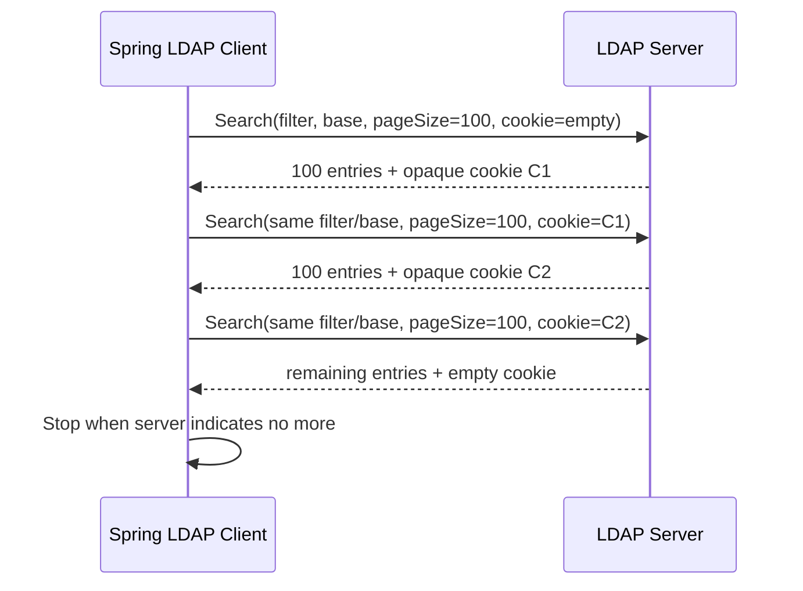
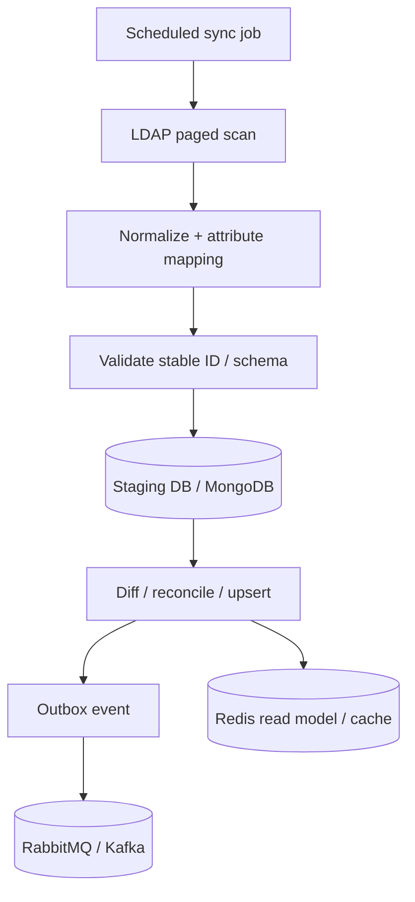
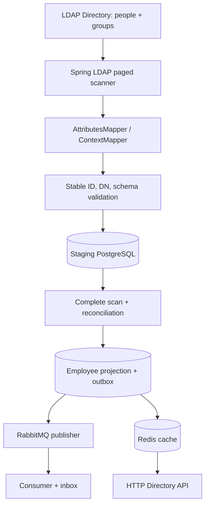

# Ánh xạ thuộc tính, bộ lọc tìm kiếm và phân trang

## 1. Vì sao ánh xạ và truy vấn LDAP là một hợp đồng tích hợp?

Trong mô-đun **SPRING_BOOT_INTEGRATION**, Spring Boot kết nối HTTP client, cơ sở dữ liệu, cache, broker và các adapter Spring Integration. **LDAP** (Lightweight Directory Access Protocol) thường xuất hiện khi service cần đọc tài khoản nhân viên, đơn vị tổ chức, nhóm quyền hoặc thông tin liên hệ từ Active Directory, OpenLDAP hay một hệ thống danh bạ doanh nghiệp. Một luồng tích hợp điển hình là:

```text
GET /api/directory/users?name=an&pageSize=50
          |
          v
DirectoryService
          |
          v
Spring LDAP / LdapTemplate
    - base DN
    - search scope
    - filter
    - returning attributes
    - size/time limit
          |
          v
LDAP server (AD / OpenLDAP)
          |
          v
AttributesMapper / ContextMapper
          |
          v
DirectoryUser DTO
          |
          +--> HTTP JSON response
          +--> Redis cache / local projection
          +--> broker event / sync job
```

Trên đường đi, có ba câu hỏi dễ bị đánh đồng:

1. **Ánh xạ thuộc tính:** Entry LDAP có `uid`, `cn`, `mail`, `memberOf`; Java DTO cần kiểu nào, lấy giá trị nào và giữ danh sách ra sao?
2. **Bộ lọc tìm kiếm:** Ghép `objectClass`, `uid`, `cn`, OU và điều kiện thuộc tính thế nào để server tìm đúng người mà không tạo lỗ hổng LDAP injection?
3. **Phân trang:** Làm sao đọc 10.000 entries qua nhiều request có giới hạn mà không tải tất cả vào bộ nhớ hoặc nhầm cookie LDAP với offset/token phân trang HTTP?

Bài tập trung vào chủ đề **“Ánh xạ thuộc tính, bộ lọc tìm kiếm và phân trang”** thuộc chương **LDAP và thư mục**. Ví dụ sử dụng **Spring Boot 3.x, Spring LDAP 3.x, Java 17+**, với LDAPv3. Một số class pagination của Spring LDAP ở nhánh phiên bản mới hơn có tên khác; bài dùng API `PagedResultsDirContextProcessor` được công bố trong Spring LDAP 3.3.x và yêu cầu kiểm tra API theo phiên bản dự án.

**Nguyên tắc xuyên suốt:** LDAP directory là nguồn dữ liệu có schema, quyền truy cập và giới hạn truy vấn riêng; `LdapTemplate.search` không tự mang ý nghĩa “đã xác thực user”, và không tạo ra một cơ chế offset pagination bền vững như SQL.

## 2. LDAP entry, DN, RDN, attribute và schema

LDAP lưu dữ liệu theo cây **Directory Information Tree (DIT)**. Mỗi entry có một **distinguished name (DN)** để xác định vị trí trong cây, cùng một tập thuộc tính tuân theo schema của server.

```text
dc=example,dc=org
├── ou=people
│   ├── uid=alice
│   └── uid=bob
└── ou=groups
    ├── cn=developers
    └── cn=operators
```

Một entry LDIF minh họa:

```ldif
dn: uid=alice,ou=people,dc=example,dc=org
objectClass: top
objectClass: person
objectClass: organizationalPerson
objectClass: inetOrgPerson
uid: alice
cn: Alice Nguyen
sn: Nguyen
givenName: Alice
mail: alice@example.org
mail: a.nguyen@example.org
departmentNumber: ENG-01
```

| Khái niệm | Ý nghĩa | Ví dụ |
| --- | --- | --- |
| DN | Tên đầy đủ của entry trong cây | `uid=alice,ou=people,dc=example,dc=org` |
| RDN | Phần tên tương đối của entry | `uid=alice` |
| Base DN | Gốc cho truy vấn/bind theo cấu hình | `dc=example,dc=org` |
| Search base | Node bắt đầu tìm kiếm | `ou=people` |
| Attribute | Trường thuộc schema | `cn`, `uid`, `mail` |
| Multi-valued attribute | Một thuộc tính có nhiều giá trị | Hai địa chỉ `mail` |
| Object class | Quy định loại entry và các thuộc tính có thể/bắt buộc | `inetOrgPerson` |
| Attribute syntax | Quy tắc kiểu/so sánh theo schema | Directory String, DN, Octet String |

**Không nhầm DN với ID bền vững tuyệt đối.** DN có thể thay đổi khi người dùng đổi OU hoặc bị rename; định danh ổn định cần chọn theo directory contract, ví dụ `entryUUID` trong một số OpenLDAP hoặc `objectGUID` dạng binary trong Active Directory. Những thuộc tính này **không tồn tại giống nhau trên mọi LDAP server**.

### 2.1. Directory schema khác JSON schema

LDAP attribute có thể là single-valued hoặc multi-valued, có matching rules cho case-insensitive/equality/substring và có thể bị hạn chế bởi ACL. Một entry thiếu `mail` có thể vì không được cấp quyền đọc, chưa được gán hoặc không thuộc object class mong đợi. Đừng luôn diễn dịch thiếu thuộc tính thành chuỗi rỗng.

Một trường `memberOf` thường là thuộc tính dẫn xuất/chuyên biệt trong Active Directory hoặc một số directory configurations; **không phải mọi LDAP server đều cung cấp nó**. Khi lập mô hình nhóm, cần xác định server lưu `member`, `uniqueMember`, `memberUid` hoặc computed memberships nào.

## 3. Khởi tạo Spring LDAP trong Spring Boot

Dependency Maven cho mô hình imperative:

```xml
<dependency>
    <groupId>org.springframework.boot</groupId>
    <artifactId>spring-boot-starter-data-ldap</artifactId>
</dependency>
```

Spring Boot starter hỗ trợ cấu hình và tích hợp Spring LDAP/Spring Data LDAP theo classpath. Nó **không tự vận hành LDAP server**, cũng không tự cấu hình authentication của ứng dụng. Nếu cần xác thực người dùng bằng LDAP, thiết kế Spring Security bind/search riêng thay vì dùng directory search làm bằng chứng đăng nhập.

Cấu hình minh họa:

```yaml
spring:
  ldap:
    urls:
      - ${LDAP_URL:ldaps://ldap.example.org:636}
    base: dc=example,dc=org
    username: ${LDAP_BIND_DN:cn=directory-reader,ou=service-accounts,dc=example,dc=org}
    password: ${LDAP_BIND_PASSWORD}
```

Tên property `spring.ldap.urls`, `base`, `username`, `password` là nhóm cấu hình thông dụng của Spring Boot 3.x. Cần kiểm tra environment variables, profile override và các bean `ContextSource`/`LdapTemplate` tùy chỉnh.

**Yêu cầu bảo mật production:** dùng LDAPS hoặc StartTLS được cấu hình và **xác minh chứng chỉ**, không dùng simple bind gửi mật khẩu qua LDAP plaintext. Bind account chỉ có quyền đọc các OU/attribute cần thiết, không dùng admin DN cho chức năng tìm người. Secret được cấp qua secret manager, không ghi vào code, URL log hay exception. Kết nối/tìm kiếm cần có timeout và giới hạn tải thích hợp.

### 3.1. Base DN và search base là hai phạm vi khác nhau

Với:

```yaml
spring:
  ldap:
    base: dc=example,dc=org
```

và lời gọi `search("ou=people", ...)`, search base được hiểu tương đối với configured base, hướng đến `ou=people,dc=example,dc=org` theo cơ chế `ContextSource`.

Nếu thêm toàn bộ suffix vào mọi search base khi context đã có base, có thể tạo DN bị lặp. Khi cấu hình nhiều LDAP directories/contexts, cần quyết định rõ base có tính tương đối hay tuyệt đối, viết test cho việc phân giải DN.

### 3.2. LDAP read account và LDAP authentication là hai nhiệm vụ khác nhau

- **Read/query:** ứng dụng dùng service bind account để đọc các attribute được phép.
- **Authentication:** xác minh credentials người dùng qua cơ chế được directory/Spring Security hỗ trợ và có chính sách account lockout, MFA/SSO.
- **Authorization:** ứng dụng dùng claims/role mapping đáng tin và kiểm tra group membership theo policy.

**Tìm thấy entry bằng `(uid=alice)` không chứng minh caller là Alice.** Không đọc hay so sánh mật khẩu từ attribute directory để tự viết cơ chế đăng nhập.

## 4. AttributesMapper: ánh xạ những thuộc tính được trả về

Spring LDAP `LdapTemplate` có thể nhận `AttributesMapper<T>` để chuyển mỗi `javax.naming.directory.Attributes` thành DTO.

Một DTO chỉ chứa thông tin cần cho API nội bộ:

```java
package example.integration.directory;

import java.util.List;

public record DirectoryUser(
    String uid,
    String displayName,
    String primaryMail,
    List<String> mailAddresses
) {}
```

Mapper có xử lý missing/multi-valued attributes:

```java
package example.integration.directory;

import java.util.ArrayList;
import java.util.List;
import javax.naming.NamingEnumeration;
import javax.naming.NamingException;
import javax.naming.directory.Attribute;
import javax.naming.directory.Attributes;

import org.springframework.ldap.core.AttributesMapper;

public class DirectoryUserAttributesMapper
        implements AttributesMapper<DirectoryUser> {

    @Override
    public DirectoryUser mapFromAttributes(Attributes attributes)
            throws NamingException {

        String uid = firstString(attributes, "uid");
        String cn = firstString(attributes, "cn");
        List<String> mails = stringValues(attributes, "mail");

        String primaryMail =
            mails.isEmpty() ? null : mails.get(0);

        return new DirectoryUser(
            uid, cn, primaryMail, mails
        );
    }

    private static String firstString(
            Attributes attributes, String name)
            throws NamingException {

        Attribute attribute = attributes.get(name);

        if (attribute == null || attribute.size() == 0) {
            return null;
        }

        Object value = attribute.get();

        return value instanceof String text ? text : null;
    }

    private static List<String> stringValues(
            Attributes attributes, String name)
            throws NamingException {

        Attribute attribute = attributes.get(name);

        if (attribute == null) {
            return List.of();
        }

        List<String> values = new ArrayList<>();
        NamingEnumeration<?> enumeration = attribute.getAll();

        try {
            while (enumeration.hasMore()) {
                Object value = enumeration.next();

                if (value instanceof String text) {
                    values.add(text);
                }
            }
        } finally {
            enumeration.close();
        }

        return List.copyOf(values);
    }
}
```

**Lưu ý về thứ tự:** LDAP multi-valued attributes nói chung **không cam kết một thứ tự nghiệp vụ ổn định**. Ở ví dụ trên, `primaryMail = mails.get(0)` chỉ là lựa chọn minh họa khi đọc, **không phải chính sách xác định email chính chính xác**. Nếu cần email chính, hợp đồng directory phải chỉ định thuộc tính hoặc quy tắc riêng; đừng dựa vào thứ tự `NamingEnumeration`.

### 4.1. Phân biệt missing, empty và access denied

`attributes.get("mail") == null` có thể do directory không có thuộc tính đó, ACL không cho đọc hoặc query đã yêu cầu chỉ một tập attributes không bao gồm `mail`. Mapper không tự biết nguyên nhân.

| Tình huống | Mapper thấy | Hành vi cần xác định |
| --- | --- | --- |
| Entry không có `mail` | Attribute null | Có thể trả optional hoặc báo business validation |
| Search không request `mail` | Attribute null | Sửa projection nếu cần |
| ACL che `mail` | Attribute null/khác tùy server | Kiểm tra quyền service account |
| `mail` có hai giá trị | Attribute với 2 values | Giữ List, không chọn ngẫu nhiên |
| Giá trị kiểu binary | `byte[]` hoặc kiểu không phải String | Converter riêng với giới hạn dữ liệu |
| Schema không cho phép attribute | Directory error khi ghi | Không tự thêm thuộc tính không hợp schema |

**Không log toàn bộ `Attributes`** khi mapping lỗi; chúng có thể chứa thông tin nhạy cảm như account status, email, số điện thoại hoặc identifiers nội bộ.

## 5. ContextMapper và DirContextAdapter: khi cần cả DN

`AttributesMapper` nhận attributes nhưng không cung cấp thuận tiện **DN đầy đủ** cho entry. Khi cần nhận diện, cache, audit hoặc liên kết nhóm bằng DN, dùng `ContextMapper<T>` với `DirContextOperations`/`DirContextAdapter`.

```java
package example.integration.directory;

import java.util.Arrays;
import java.util.List;

import org.springframework.ldap.core.ContextMapper;
import org.springframework.ldap.core.DirContextOperations;

public record DirectoryEntryView(
    String relativeDn,
    String uid,
    String commonName,
    List<String> mails
) {}

public class DirectoryEntryContextMapper
        implements ContextMapper<DirectoryEntryView> {

    @Override
    public DirectoryEntryView mapFromContext(Object object) {
        DirContextOperations context =
            (DirContextOperations) object;

        String[] mails =
            context.getStringAttributes("mail");

        return new DirectoryEntryView(
            context.getDn().toString(),
            context.getStringAttribute("uid"),
            context.getStringAttribute("cn"),
            mails == null
                ? List.of()
                : List.copyOf(Arrays.asList(mails))
        );
    }
}
```

**DN semantics quan trọng:** `context.getDn()` trong Spring LDAP thường là DN **tương đối với base path của context source**, không phải chuỗi DN tuyệt đối với toàn bộ `dc=...` suffix. Khi cần định danh toàn cục, dùng API phù hợp và xác định việc hợp nhất base một lần; đừng nối raw strings rồi vô tình nhân đôi suffix hoặc bỏ qua escaping.

### 5.1. DN không tương đương một HTTP-safe ID

DN có dấu phẩy, bằng, dấu cộng, khoảng trắng và ký tự cần escape theo **LDAP DN syntax (RFC 4514)**. Ví dụ một `cn` có dấu phẩy có thể cần escape trong DN. Đừng đưa trực tiếp DN vào path URL hoặc phân tách DN bằng `String.split(",")`; dùng `javax.naming.ldap.LdapName`, `Rdn` hoặc `LdapNameBuilder`.

```java
import javax.naming.Name;
import org.springframework.ldap.support.LdapNameBuilder;

Name relativeDn = LdapNameBuilder.newInstance()
    .add("ou", "people")
    .add("uid", "alice")
    .build();
```

Builder xử lý ngữ nghĩa DN tốt hơn nối chuỗi `"uid=" + value + ",ou=people"` khi value có ký tự đặc biệt. Tuy nhiên đây **không phải escape LDAP search filter**; filter và DN có những quy tắc khác nhau.

## 6. Object-Directory Mapping (ODM) với @Entry và @Attribute

Khi model directory ổn định, Spring LDAP ODM có thể ánh xạ entry vào class có annotation thay vì viết mapper thủ công cho từng query.

```java
package example.integration.directory;

import javax.naming.Name;

import org.springframework.ldap.odm.annotations.Attribute;
import org.springframework.ldap.odm.annotations.Entry;
import org.springframework.ldap.odm.annotations.Id;

@Entry(
    base = "ou=people",
    objectClasses = {
        "top",
        "person",
        "organizationalPerson",
        "inetOrgPerson"
    }
)
public class PersonEntry {

    @Id
    private Name dn;

    @Attribute(name = "uid")
    private String uid;

    @Attribute(name = "cn")
    private String commonName;

    @Attribute(name = "sn")
    private String surname;

    @Attribute(name = "mail")
    private String mail;

    protected PersonEntry() {}

    public Name getDn() { return dn; }
    public String getUid() { return uid; }
    public String getCommonName() { return commonName; }
    public String getSurname() { return surname; }
    public String getMail() { return mail; }
}
```

`@Entry` khai báo object classes/base; `@Id` biểu diễn entry DN với `Name`; `@Attribute` ánh xạ attribute name sang property. Nếu `mail` có nhiều giá trị, một String duy nhất có thể làm mất dữ liệu hoặc không đúng mapping; model phải phản ánh **schema thực của directory** và use case.

| Lựa chọn | Phù hợp | Giới hạn |
| --- | --- | --- |
| `AttributesMapper` | Projection nhỏ, đọc vài fields, query tùy biến | Không tự mang DN |
| `ContextMapper` | Cần DN và adapter methods | Vẫn có code ánh xạ |
| ODM `@Entry` | Directory schema ổn định, entity-like model | Có thể gắn chặt Java model với vendor/schema |
| Raw JNDI | Kiểm soát request controls/đặc thù server | Nhiều boilerplate và xử lý resource |
| Sync sang DB projection | Search/paging trong API tải lớn | Eventual consistency, migration và reconciliation |

**Đừng dùng ODM như lời hứa rằng LDAP có transaction/ORM semantics tương tự JPA.** Directory schema, DN, rename, multi-value modifications và server-specific controls có hành vi riêng.

### 6.1. Không đưa một directory entry thẳng ra JSON public

Directory entry có thể chứa dữ liệu nội bộ hoặc mở rộng schema ngoài dự tính. Nên ánh xạ sang **DirectoryUser DTO** có allowlist. Việc JSON serializer hiểu Java class không có nghĩa tất cả thuộc tính đó nên được công khai.

## 7. LDAP search: base, scope, filter và attributes

Một lời gọi tìm kiếm LDAP có nhiều tham số độc lập:

| Phần của search | Chức năng | Ví dụ |
| --- | --- | --- |
| Base DN | Bắt đầu từ subtree nào | `ou=people` |
| Scope | BASE, ONELEVEL, SUBTREE | `SearchScope.SUBTREE` |
| Filter | Điều kiện entry cần thỏa | `(&(objectClass=person)(uid=alice))` |
| Projection | Chỉ trả attributes cần thiết | `uid`, `cn`, `mail` |
| Count limit | Chặn số entries trong một search | 100 |
| Time limit | Giới hạn thời gian server search | 3.000 ms |
| Server controls | Thêm paging/sorting khi hỗ trợ | RFC 2696 paged results |

Ví dụ tìm user theo UID với Spring LDAP query builder:

```java
package example.integration.directory;

import java.util.List;

import org.springframework.ldap.core.LdapTemplate;
import org.springframework.ldap.query.LdapQuery;
import org.springframework.ldap.query.SearchScope;

import static org.springframework.ldap.query.LdapQueryBuilder.query;

public class DirectoryLookupService {

    private final LdapTemplate ldap;

    public DirectoryLookupService(LdapTemplate ldap) {
        this.ldap = ldap;
    }

    public List<DirectoryUser> findByUid(String uid) {
        if (uid == null || uid.isBlank()) {
            throw new IllegalArgumentException("uid is required");
        }

        LdapQuery search = query()
            .base("ou=people")
            .searchScope(SearchScope.SUBTREE)
            .attributes("uid", "cn", "mail")
            .countLimit(20)
            .timeLimit(3000)
            .where("objectClass").is("inetOrgPerson")
            .and("uid").is(uid);

        return ldap.search(
            search,
            new DirectoryUserAttributesMapper()
        );
    }
}
```

`SearchScope` thuộc Spring LDAP query API, còn `javax.naming.directory.SearchControls` có hằng số `OBJECT_SCOPE`, `ONELEVEL_SCOPE`, `SUBTREE_SCOPE`. Tránh trộn nhầm các enum/constants trong cùng signature.

### 7.1. Scope ảnh hưởng correctness và tải server

```text
ou=people,dc=example,dc=org
├── uid=alice
└── ou=contractors
    └── uid=bob
```

- **BASE:** tìm entry ngay tại search base nếu match filter.
- **ONELEVEL:** tìm các entry **con trực tiếp** dưới base, không đi xuống subtree sâu.
- **SUBTREE:** tìm cả base và mọi descendants theo quyền truy cập.

Nếu tìm trên `ou=people` với ONELEVEL, `uid=bob` dưới `ou=contractors` có thể không xuất hiện. Dùng SUBTREE cho toàn bộ company root dễ tốn tài nguyên và vô tình gom các OU ngoài phạm vi dữ liệu cần thiết.

### 7.2. Trả ít attributes để giảm rủi ro và chi phí

`attributes("uid","cn","mail")` giúp tránh nhận nguyên entry có thể rất lớn, gồm group memberships, certificates, binary photos và attributes nhạy cảm. Tuy nhiên attribute filtering không thay thế ACL trên server.

Một directory có thể giới hạn size/time bất kể client request; giá trị count limit lớn hơn server cap không có nghĩa server sẽ cho phép.

## 8. LDAP filter syntax theo RFC 4515

Filter LDAP sử dụng biểu thức có ngoặc, không phải SQL `WHERE` hay regex đầy đủ.

| Filter | Ý nghĩa |
| --- | --- |
| `(uid=alice)` | Equality trên `uid` |
| `(mail=*)` | Thuộc tính `mail` hiện diện |
| `(cn=Ali*)` | Substring prefix, tùy matching rule |
| `(&(objectClass=person)(uid=alice))` | AND |
| `(\|(uid=alice)(mail=alice@example.org))` | OR |
| `(!(accountStatus=disabled))` | NOT |
| `(employeeNumber>=1000)` | Greater-or-equal theo matching rule của attribute |

**Filter khớp thế nào còn phụ thuộc schema/matching rules**. LDAP equality trên `cn` có thể case-insensitive, nhưng không được mặc định mọi attribute giống nhau. Substring wildcard `*` không phải SQL `%`. Filter không tự join group tree hoặc giải quyết nested group membership.

### 8.1. Ký tự đặc biệt phải được escape ở filter value

RFC 4515 quy định các ký tự quan trọng:

| Ký tự trong dữ liệu | Escaped representation |
| --- | --- |
| `*` | `\2a` |
| `(` | `\28` |
| `)` | `\29` |
| Backslash `\` | `\5c` |
| NUL | `\00` |

Ví dụ user input:

```text
alice*)(|(uid=*))
```

Nếu nối thẳng vào:

```java
String unsafe = "(uid=" + userInput + ")";
```

filter thực tế có thể đổi cấu trúc tìm kiếm hoặc fail parser. **Không nối raw user input vào LDAP filter.** Dùng query builder, filter objects hoặc parameterized filter format của Spring LDAP, và vẫn giới hạn base/scope/size.

### 8.2. Escaping filter khác escaping DN

- RFC **4515**: encoding giá trị trong **search filter**.
- RFC **4514**: biểu diễn/escaping của **distinguished names**.
- URL percent-encoding: dành cho HTTP URI.

Áp một loại escape vào sai ngữ cảnh có thể tạo filter sai hoặc bypass validation. Dữ liệu từ HTTP query chưa phải DN hoặc filter; service phải chuyển qua API xây dựng phù hợp.

## 9. Xây filter an toàn với LdapQueryBuilder và Filter objects

Mẫu **khuyến nghị** cho user input là API builder:

```java
import org.springframework.ldap.query.LdapQuery;
import static org.springframework.ldap.query.LdapQueryBuilder.query;

LdapQuery search = query()
    .base("ou=people")
    .attributes("uid", "cn", "mail")
    .where("objectClass").is("inetOrgPerson")
    .and("uid").is(userInput);
```

`is(userInput)` là điều kiện equality; API builder xử lý encoding filter value theo hợp đồng của Spring LDAP. Cần đảm bảo **attribute name được chọn từ code/allowlist**, không để người dùng tự nhập `attributeName` rồi đưa vào `where(attributeName)`.

Khi biểu thức phức tạp, dùng `Filter` objects:

```java
import org.springframework.ldap.filter.AndFilter;
import org.springframework.ldap.filter.EqualsFilter;
import org.springframework.ldap.filter.Filter;

Filter filter = new AndFilter()
    .and(new EqualsFilter("objectClass", "inetOrgPerson"))
    .and(new EqualsFilter("uid", userInput));

String encodedFilter = filter.encode();
```

Trong code trên, `EqualsFilter` nhận giá trị dữ liệu và chịu trách nhiệm encoding đúng ngữ cảnh. Đừng tự encode `userInput` trước khi truyền vào API encoder rồi vô tình double-escape.

### 9.1. Parameterized filter cho trường hợp có cấu trúc cố định

```java
LdapQuery search = query()
    .base("ou=people")
    .filter(
        "(&(objectClass=inetOrgPerson)(uid={0}))",
        userInput
    );
```

Bản `filter(String format, Object... params)` có cơ chế encode parameters (Spring LDAP dùng filter encoding trước khi chèn theo format). **Không dùng `filter(String hardcodedFilter)` với chuỗi tự nối từ input chưa tin cậy** vì overload nhận raw filter không escape.

### 9.2. Search prefix và wildcard phải có chính sách rõ

Một UI có thể cần tìm tên bắt đầu bằng chữ “Al”. Dùng filter fixed template:

```java
LdapQuery search = query()
    .base("ou=people")
    .filter(
        "(&(objectClass=inetOrgPerson)(cn={0}*))",
        prefixFromUser
    );
```

Ở đây `*` là **wildcard do ứng dụng quyết định**, còn `{0}` là phần user input cần escape. Người dùng nhập `Al*` sẽ được xử lý như giá trị literal `Al*` ở phần parameter, không được tự mở rộng thành một pattern tùy ý. Hạn chế chiều dài prefix, độ rộng search base và số kết quả. Substring/prefix search có thể rất tốn tài nguyên nếu attribute không được index phù hợp hoặc directory matching rule không tối ưu.

Không cho caller gửi raw LDAP filter arbitrary trừ khi đây là API quản trị tin cậy được ủy quyền có kiểm soát chặt.

## 10. Kết hợp điều kiện và tránh biến search thành authorization

Các điều kiện dùng OR/AND/NOT có thể được kết hợp an toàn bằng Spring LDAP builder/filter objects. Một truy vấn thực tế:

```text
(&(objectClass=inetOrgPerson)
  (departmentNumber=ENG-01)
  (mail=*))
```

Giải thích:

- Chỉ user entries thuộc object class phù hợp.
- Thuộc phòng ban ENGINEERING.
- Có ít nhất một địa chỉ email.

**Không suy luận `departmentNumber=ENG-01` nghĩa là caller được phép đọc mọi người của phòng đó.** Server LDAP ACL và service authorization vẫn phải thực thi. Tương tự, từ một `memberOf` đọc được không suy ra mọi nested groups, deny policies hoặc role mapping đều đúng.

### 10.1. Lỗi kết hợp OR có thể làm search quá rộng

Sai về logic:

```text
(|(objectClass=inetOrgPerson)(uid=alice))
```

Filter này có thể trả **mọi** `inetOrgPerson`, không chỉ Alice. Nếu mục tiêu “là người và uid bằng Alice”, phải dùng AND:

```text
(&(objectClass=inetOrgPerson)(uid=alice))
```

Vì vậy phòng chống LDAP injection không chỉ là escape ký tự. Một biểu thức hardcoded sai cấu trúc cũng có thể làm lộ tập kết quả rộng ngoài ý định.

### 10.2. Thuộc tính email không nhất thiết duy nhất

Tìm `(mail=alice@example.org)` có thể trả nhiều entries nếu server không có uniqueness rule tương ứng hoặc directory đang chứa dữ liệu bẩn. Dùng `search(...)` và xử lý danh sách; nếu business yêu cầu đúng một người, kiểm tra `0`, `1`, `>1` rõ ràng, không lấy `list.get(0)` và giả định thứ tự/uniqueness.

## 11. Giới hạn truy vấn: SearchControls, scope, size và time

Với những truy vấn cần tuning ở mức JNDI, dùng `SearchControls`.

```java
import javax.naming.directory.SearchControls;

SearchControls controls = new SearchControls();
controls.setSearchScope(SearchControls.SUBTREE_SCOPE);
controls.setReturningAttributes(
    new String[] { "uid", "cn", "mail" }
);
controls.setCountLimit(250);
controls.setTimeLimit(3000);
```

Ý nghĩa:

- `setReturningAttributes`: projection chỉ các attributes cần.
- `setCountLimit(250)`: giới hạn entries của search operation theo JNDI/LDAP server semantics, **không phải page size** của RFC 2696.
- `setTimeLimit(3000)`: giới hạn thời gian search trong milliseconds theo API, **không phải deadline tổng của HTTP request cộng mọi retry**.
- `setSearchScope`: phạm vi BASE/ONELEVEL/SUBTREE.

Những giới hạn này có thể chịu thêm server-side size/time caps, ACL, referral policy và network latency. **Một search bị size limit không đồng nghĩa trả đầy đủ dữ liệu**. Ứng dụng cần phân biệt “không có kết quả”, “bị cắt vì limit” và “directory lỗi”.

### 11.1. Phân biệt timeout đường kết nối và search time limit

- Connect timeout: mở kết nối LDAP/LDAPS.
- Read/socket timeout: chờ I/O sau khi kết nối.
- Search time limit: giới hạn thực thi operation theo API/server.
- Business deadline: thời gian toàn bộ HTTP request/job đồng bộ với downstream.

Có thể cấu hình JNDI environment timeouts qua Spring LDAP `ContextSource` hoặc cấu hình driver/client phù hợp; **đừng chỉ đặt `timeLimit` rồi tin kết nối treo sẽ luôn được cắt đúng hạn**. Với batch/sync job, timeout còn cần xử lý cleanup và retry bounded.

## 12. Phân trang LDAP: RFC 2696 Simple Paged Results

Nhiều directory server có giới hạn số kết quả mặc định. Chẳng hạn một truy vấn trả hàng chục nghìn users có thể bị giới hạn số entries và làm đầy bộ nhớ application. **Simple Paged Results Control (RFC 2696)** cho phép client yêu cầu server trả kết quả theo từng trang.

Tương tác:



**Cookie là opaque state do LDAP server trả**, không phải số thứ tự trang hoặc offset mà ứng dụng tự tính. Client cần gửi lại cookie đúng nguyên vẹn trong một chuỗi truy vấn tương ứng. Không tự phân tích/đổi bytes cookie, không dùng cookie của truy vấn khác hoặc nhầm nó với idempotency token.

### 12.1. Các giới hạn quan trọng

| Điều thường bị hiểu sai | Thực tế |
| --- | --- |
| `pageSize=100` bảo đảm mỗi lần luôn đúng 100 | Server có thể trả ít hơn theo dữ liệu/limits |
| Page 3 tương đương `OFFSET 200` | LDAP cookie không phải SQL offset |
| Có thể tạo cursor cho page bất kỳ | RFC 2696 chủ yếu duyệt tuần tự bằng cookie |
| Cookie lưu được qua nhiều ngày | Không có bảo đảm như vậy |
| Cookie dùng được qua connection bất kỳ | Spring LDAP 3.x yêu cầu giữ cùng LDAP context/connection trong chuỗi calls |
| Paged results tự sort ổn định | Không; sort là control/cơ chế khác |
| Paged results là snapshot transaction | Không mặc nhiên; directory thay đổi có thể ảnh hưởng tập kết quả |
| Có cookie là có tổng số entries chính xác | Server có thể chỉ trả estimated total hoặc không trả |

### 12.2. Paged search khác countLimit

Đừng thay pagination bằng:

```java
controls.setCountLimit(100);
```

và gọi lại search 10 lần. Không có cookie/state, nhiều lần truy vấn sẽ thường nhận **cùng nhóm entry đầu** (hoặc tập không ổn định), không phải 10 trang tiếp nhau. `setCountLimit` là một rào cản kích thước/search; `PagedResultsDirContextProcessor` là cơ chế RFC 2696 server-side paging.

---

## 13. Phân trang bằng PagedResultsDirContextProcessor và SingleContextSource

Spring LDAP 3.x cung cấp `org.springframework.ldap.control.PagedResultsDirContextProcessor`, thực hiện pre/post-processing cho RFC 2696 search control. **Chi tiết rất quan trọng:** chuỗi requests dùng paged-results cookie cần giữ **cùng LDAP connection/context** theo cơ chế Spring LDAP. `LdapTemplate` thông thường lấy và đóng context theo từng operation, nên nếu gọi `ldapTemplate.search(...)` nhiều lần riêng rẽ qua pool, cookie có thể không hợp lệ.

Spring LDAP cung cấp `SingleContextSource.doWithSingleContext(...)` để dùng cùng context trong toàn bộ callback.

### 13.1. Ví dụ duyệt theo trang, không gom cả directory vào một List lớn

```java
package example.integration.directory;

import java.util.List;
import java.util.function.Consumer;
import javax.naming.directory.SearchControls;

import org.springframework.ldap.control.PagedResultsDirContextProcessor;
import org.springframework.ldap.core.ContextSource;
import org.springframework.ldap.core.support.SingleContextSource;
import org.springframework.stereotype.Service;

@Service
public class DirectoryPagedScanner {

    private static final int PAGE_SIZE = 100;
    private static final int MAX_PAGES = 100;

    private final ContextSource contextSource;
    private final DirectoryUserAttributesMapper mapper =
        new DirectoryUserAttributesMapper();

    public DirectoryPagedScanner(ContextSource contextSource) {
        this.contextSource = contextSource;
    }

    public record ScanSummary(int pages, long entries) {}

    public ScanSummary scan(
            Consumer<List<DirectoryUser>> onPage) {

        if (onPage == null) {
            throw new IllegalArgumentException(
                "onPage callback is required"
            );
        }

        return SingleContextSource.doWithSingleContext(
            contextSource,
            operations -> {

                SearchControls controls = new SearchControls();
                controls.setSearchScope(
                    SearchControls.SUBTREE_SCOPE
                );
                controls.setReturningAttributes(
                    new String[] { "uid", "cn", "mail" }
                );
                controls.setTimeLimit(3000);

                PagedResultsDirContextProcessor processor =
                    new PagedResultsDirContextProcessor(PAGE_SIZE);

                int pages = 0;
                long entries = 0;

                do {
                    if (pages >= MAX_PAGES) {
                        throw new IllegalStateException(
                            "LDAP paging safety limit reached"
                        );
                    }

                    List<DirectoryUser> page = operations.search(
                        "ou=people",
                        "(&(objectClass=inetOrgPerson)(uid=*))",
                        controls,
                        mapper,
                        processor
                    );

                    onPage.accept(List.copyOf(page));

                    pages++;
                    entries += page.size();
                } while (processor.hasMore());

                return new ScanSummary(pages, entries);
            }
        );
    }
}
```

**Ý nghĩa chính xác của ví dụ:**

- `PagedResultsDirContextProcessor` được **tạo riêng cho một chuỗi scan**, không dùng singleton chia sẻ giữa các requests/threads.
- `SingleContextSource` giữ **cùng context** qua các lần `operations.search` rồi giải phóng sau callback.
- `processor.hasMore()` dựa vào phản hồi/cookie, không đoán theo `page.size() == PAGE_SIZE`.
- `MAX_PAGES` là giới hạn an toàn của application; vượt giới hạn nghĩa là **scan chưa hoàn tất**, không được báo success hoặc xóa records chưa thấy.
- `onPage` nhận một batch để xử lý, tránh tích lũy toàn bộ entries trong memory.
- `SearchControls` giữ scope, projection, time limit. Không bật `countLimit` thấp hơn số entries cần để duyệt và lầm tưởng đó là page size.
- Nếu LDAP server không hỗ trợ paged control, yêu cầu có thể lỗi; **không tự fallback sang full search không giới hạn**.

Đây là một ví dụ kỹ thuật cho phiên bản Spring LDAP 3.x. Trong một dòng Spring LDAP mới hơn, tài liệu có thể giới thiệu class như `PagedResultsControlExchangeDirContextProcessor`; hãy dùng tên class phù hợp với dependency thực tế thay vì trộn API giữa major versions.

### 13.2. Hạn chế giữ connection trong suốt scan

Callback `onPage` đang chạy **bên trong** vòng đời của một LDAP context. Nếu mỗi page gọi 10 downstream APIs, ngủ 5 phút hoặc commit một DB transaction lớn, LDAP connection có thể bị giữ lâu và cookie hết hạn/bị server bỏ. Với nhiều scan đồng thời, connection pool bị cạn.

Các lựa chọn:

1. Giữ `onPage` ngắn, xử lý projection/ghi staging batch có timeout rõ.
2. Giới hạn số scan chạy đồng thời, số pages và tổng thời gian.
3. Tách scan (đọc directory) khỏi xử lý nghiệp vụ nặng qua hàng đợi nội bộ có capacity/backpressure.
4. Nếu cần resume sau crash nhiều giờ, **đừng lấy cookie làm durable checkpoint**; dùng job state và key/version từ một store được kiểm soát.

### 13.3. Cookie không được lưu như một khóa business

Một cookie nhận từ server có thể chứa opaque bytes, gắn với trạng thái tìm kiếm và kết nối hiện tại. Không lưu nó thành `lastProcessedUserId`, không gửi lên URL mà khách hàng có thể sửa, không log raw cookie và không dùng lại với filter/search base khác.

Nếu directory thay đổi trong lúc scan, một simple paged search **không tự đảm bảo snapshot isolation**. Cần dedupe bằng định danh ổn định và reconciliation, nhất là khi job được replay.

## 14. Paged search khác sorting, virtual lists và API page number

Nhiều API HTTP cho phép:

```http
GET /users?page=8&size=50&sort=name
```

Nhưng LDAP Simple Paged Results **không cung cấp offset/random access**. Một API phải nhảy thẳng đến page 8 cần thêm cơ chế khác:

- **Server-Side Sorting Control (RFC 2891):** server sắp xếp theo attribute hỗ trợ, nếu được enable/quyền cho phép.
- **Virtual List View (VLV):** đặc thù khả năng server/triển khai, không phải mọi LDAP directory đều hỗ trợ.
- **Ứng dụng materialize projection:** đồng bộ directory sang database/search index rồi phân trang bằng keyset/offset theo contract HTTP.
- **Cursor trong một scoped session:** khả thi ở một số kiến trúc nhưng cần connection affinity, lifecycle, giới hạn tài nguyên và bảo mật nghiêm ngặt.

**Không phát API nhận `page=8` rồi lặp tám lần paged LDAP search cho mọi request người dùng** nếu tải lớn, vì chi phí tăng theo page và không có snapshot ổn định.

### 14.1. Tại sao trả nguyên LDAP cookie trong HTTP nextToken thường nguy hiểm?

- Client có thể sử dụng token với filter/base khác.
- Một HTTP request sau có thể đến instance khác dùng LDAP connection khác.
- Base64 cookie **không phải mã hóa bảo mật**.
- Server có thể hết hạn cookie hoặc hủy trạng thái.
- Token có thể vô tình tiết lộ dữ liệu internal server-side control.
- Cursor không tự hạn chế khả năng liệt kê tài khoản (user enumeration).

Nếu buộc xây cursor API, cần một layer quản lý session an toàn, bind token với caller/filter/scope/expiry, không để caller điều khiển server cookie, có giới hạn rate/capacity và xử lý hết hạn. Với dashboard/user listing dài hạn, một projection DB với cache TTL/invalidation và data freshness indicator thường dễ vận hành hơn.

### 14.2. Sorting không tự mang snapshot isolation

Ngay cả khi server hỗ trợ sorting theo `cn`, nhiều entries có thể cùng `cn`, hoặc `cn` thay đổi khi người dùng đổi tên. Để phục vụ pagination ổn định, cần một **tie-breaker** theo stable ID và semantics rõ về dữ liệu thay đổi trong lúc xem. Đừng tin rằng sort by name + RFC 2696 tự bảo đảm không trùng/không thiếu.

## 15. Active Directory, OpenLDAP và các khác biệt quan trọng

Một LDAP API chung không làm hai vendor server có schema, ACL và controls giống hệt nhau.

| Chủ đề | OpenLDAP thường gặp | Active Directory thường gặp |
| --- | --- | --- |
| User identifier | `uid`/`entryUUID` tùy schema | `sAMAccountName`, `userPrincipalName`, `objectGUID` |
| Group membership | `member`/`uniqueMember`/`memberUid` tùy object class | `member` và có thể có `memberOf` |
| Stable ID | `entryUUID` ở cấu hình phù hợp | `objectGUID` binary |
| Change tracking | Sync/operational attributes tùy cấu hình | DirSync/USN-related semantics tùy quyền |
| Paged results | Cần xác nhận server control | Phổ biến nhưng vẫn có server limits |
| Multi-value large attribute | Phụ thuộc schema/server | Một số attributes cần range retrieval |
| Referral/forest | Tùy directory topology | Có thể có domain/forest referrals |

**`memberOf` không phải API phân quyền portable.** Một số hệ thống dùng nhóm lồng nhau (nested groups), dynamic groups, deny rules hoặc group memberships từ nguồn khác. Cần quy định group-to-role mapping có test cho thực tế directory.

### 15.1. AD range retrieval khác RFC 2696 paging

Active Directory có thể trả các tập lớn của thuộc tính multi-valued (như `member`) bằng dạng tên `member;range=0-1499`, rồi client phải yêu cầu range tiếp theo. Đây là **attribute value range retrieval**, khác việc duyệt nhiều **entries** bằng Simple Paged Results.

Ví dụ một group duy nhất có 10.000 members: dù paged search `pageSize=100` chỉ trả **một group entry**, giá trị `member` có thể vẫn bị chia range. Không kiểm tra hiện diện của attribute literal `"member"` rồi kết luận group không có members khi server trả `member;range=...`.

### 15.2. Binary identifiers

`objectGUID` của AD là binary. Trả raw bytes dưới dạng `new String(bytes, UTF_8)` có thể làm hỏng ID. Cần converter hiểu representation của vendor và kiểm thử round-trip với thư viện/encoding tương ứng. Khi xuất thành HTTP API, chọn một String/canonical ID representation đã chốt; đừng thay đổi nó theo từng phiên bản Java driver.

### 15.3. Referrals và partial results

Trong directory phân tán, một search có thể gặp referrals sang domain/partition khác. Một số cấu hình JNDI/Spring LDAP có tùy chọn ignore/chase referrals; lựa chọn nào cũng ảnh hưởng completeness và quyền.

Không bắt `PartialResultException` rồi trả một danh sách như thể đầy đủ. Nếu hệ thống chỉ cho phép truy vấn local domain, **công bố scope và trạng thái partial**. Nếu cần toàn forest, thiết kế explicit referral/trust/credential policy và giới hạn tải.

## 16. Không xem LDAP search là nguồn dữ liệu snapshot cho đồng bộ hàng loạt

Giả sử Spring Batch/Spring Integration poller cần đồng bộ nhân viên hằng đêm:



### 16.1. Nguồn ID bền vững

Đừng dùng DN làm primary key duy nhất nếu entry có thể move/rename. Chọn một attribute identity phù hợp server và chính sách bảo toàn ID trong lifecycle. Ví dụ `entryUUID` hoặc `objectGUID` khi có và quyền đọc cho phép. Nếu directory chỉ bảo đảm `uid` theo tổ chức, phải nêu rõ uniqueness và rename policy.

### 16.2. Upsert theo ID và version

Một job có thể chạy lại khi:

- LDAP page bị lỗi ở cuối.
- JVM crash sau khi ghi DB nhưng trước khi lưu checkpoint.
- Broker nhận event nhưng publisher mất confirm.
- Directory entry thay đổi trong lúc scan.

Dùng **idempotent upsert** vào projection table/collection theo stable ID; chỉ phát event khi phát hiện thay đổi thực với version/fingerprint rõ. Không tạo event ID mới tùy ý cho mỗi attempt nếu đó là retry cùng logical update.

### 16.3. Không xóa records chỉ vì chưa thấy trong một scan lỗi

Nếu LDAP server trả size limit, referral partial, cookie error hoặc timeout ở page cuối, số entries trả về có thể thiếu. Việc đồng bộ áp quy tắc “ai không xuất hiện thì xóa” lúc đó sẽ xóa nhầm hàng nghìn nhân viên.

Một chiến lược an toàn:

1. Đánh dấu scan ID và trạng thái `RUNNING`.
2. Lưu upserts vào staging với scan ID.
3. Chỉ khi **toàn bộ pages thành công và completeness được xác minh theo contract** mới đánh dấu `COMPLETED`.
4. Reconciliation so sánh snapshot/scan với data hiện tại, có ngưỡng cảnh báo xóa bất thường.
5. Phân biệt disabled/removed/moved trong directory, theo owner contract.

### 16.4. Incremental sync là vấn đề khác

RFC 2696 chỉ chia **full search** thành trang; không phải change-data-capture.

- `modifyTimestamp>=...` có thể hữu ích trong một số schema, nhưng dễ mắc lỗi trùng thời điểm, precision, rename/delete và clock semantics.
- LDAP Sync/DirSync/change tracking là extension cụ thể của server, cần quyền và state riêng.
- Nếu một entry bị xóa, full listing có thể phát hiện qua reconciliation; incremental query theo timestamp đơn thuần không tự báo tombstone.

Đừng biến paged-cookie thành checkpoint dài hạn của một incremental sync job. Thiết kế checkpoint theo protocol change-tracking được server hỗ trợ hoặc business snapshot.

## 17. Cache và HTTP API: bảo vệ dữ liệu danh bạ

Một HTTP endpoint tìm nhân sự có thể sử dụng LDAP trực tiếp:

```http
GET /api/directory/users?uid=alice HTTP/1.1
Authorization: Bearer <redacted>
```

Nhưng response cần có allowlist, ví dụ:

```json
{
  "uid": "alice",
  "displayName": "Alice Nguyen",
  "emails": [
    "alice@example.org"
  ]
}
```

Không bao gồm LDAP bind password, raw controls, account lock flags, private phone hoặc toàn bộ group memberships khi caller không được phép. Authenticated caller phải có authorization cụ thể để tra danh bạ; hạn chế tốc độ để chống **user enumeration**.

### 17.1. Cache key và invalidation

Nếu dùng Redis cache:

```text
directory:user:v1:stable-id-123
```

có thể ổn định hơn cache theo DN khi người dùng chuyển OU. Nhưng TTL và invalidation phải phản ánh yêu cầu consistency. Nếu group membership quyết định authorization, **không dùng profile cache quá cũ để cấp quyền nhạy cảm**. Cache identities và cache authorization có deadline/freshness policy khác nhau.

### 17.2. Dynamic search base là bề mặt nguy hiểm

Không cho input HTTP:

```text
?base=dc=example,dc=org&filter=(objectClass=*)
```

đi trực tiếp vào `LdapTemplate.search`. Thay vào đó cho client chọn **hành động được định nghĩa rõ**, như `department=ENGINEERING`, rồi backend ánh xạ tới một base/scope/filter hợp lệ từ allowlist. LDAP query builder chỉ escape **giá trị**, không tự định nghĩa authorization policy cho việc truy vấn.

## 18. Kiểm thử filter, mapper và phân trang

Một bài test chỉ mock `LdapTemplate` để trả `DirectoryUser` không kiểm tra escaping hay LDAP server controls. Cần nhiều lớp test:

### 18.1. Unit test AttributesMapper với BasicAttributes

```java
package example.integration.directory;

import static org.assertj.core.api.Assertions.assertThat;

import javax.naming.directory.BasicAttribute;
import javax.naming.directory.BasicAttributes;
import org.junit.jupiter.api.Test;

class DirectoryUserAttributesMapperTest {

    private final DirectoryUserAttributesMapper mapper =
        new DirectoryUserAttributesMapper();

    @Test
    void preservesMultipleMailValues() throws Exception {
        BasicAttributes attrs = new BasicAttributes(true);

        attrs.put("uid", "alice");
        attrs.put("cn", "Alice Nguyen");

        BasicAttribute mail = new BasicAttribute("mail");
        mail.add("alice@example.org");
        mail.add("a.nguyen@example.org");
        attrs.put(mail);

        DirectoryUser user =
            mapper.mapFromAttributes(attrs);

        assertThat(user.uid()).isEqualTo("alice");
        assertThat(user.displayName())
            .isEqualTo("Alice Nguyen");

        assertThat(user.mailAddresses())
            .containsExactlyInAnyOrder(
                "alice@example.org",
                "a.nguyen@example.org"
            );
    }

    @Test
    void handlesMissingMail() throws Exception {
        BasicAttributes attrs = new BasicAttributes(true);
        attrs.put("uid", "bob");
        attrs.put("cn", "Bob Nguyen");

        DirectoryUser user =
            mapper.mapFromAttributes(attrs);

        assertThat(user.primaryMail()).isNull();
        assertThat(user.mailAddresses()).isEmpty();
    }
}
```

Test đầu kiểm tra multi-valued attributes mà **không assert thứ tự**.

### 18.2. Unit test filter encoding chống LDAP injection

```java
package example.integration.directory;

import static org.assertj.core.api.Assertions.assertThat;

import org.junit.jupiter.api.Test;
import org.springframework.ldap.filter.EqualsFilter;

class DirectoryFilterTest {

    @Test
    void encodesSpecialCharactersAsData() {
        String malicious = "alice*)(|(uid=*))";

        String filter =
            new EqualsFilter("uid", malicious).encode();

        assertThat(filter).startsWith("(uid=");
        assertThat(filter).contains("\\2a");
        assertThat(filter).contains("\\28");
        assertThat(filter).contains("\\29");

        // Không coi chuỗi đầu vào là một OR filter mới.
        assertThat(filter).doesNotContain("(|(uid=*))");
    }
}
```

Đây là test kết quả encoding ở mức filter object. Ngoài test syntax, phải test server-side query **không mở rộng scope hoặc bypass authorization**. Cần test cả ký tự backslash và NUL.

### 18.3. Embedded LDAP với UnboundID để test integration

Spring Boot hỗ trợ embedded LDAP server UnboundID trong cấu hình test. Thêm dependency test:

```xml
<dependency>
    <groupId>com.unboundid</groupId>
    <artifactId>unboundid-ldapsdk</artifactId>
    <scope>test</scope>
</dependency>
```

Cấu hình profile test:

```yaml
spring:
  ldap:
    base: dc=example,dc=org
    embedded:
      base-dn: dc=example,dc=org
      ldif: classpath:test-directory.ldif
```

Ví dụ `src/test/resources/test-directory.ldif`, cần đảm bảo phù hợp root entry mà embedded server đã khởi tạo (không duplicate base DN):

```ldif
dn: ou=people,dc=example,dc=org
objectClass: top
objectClass: organizationalUnit
ou: people

dn: uid=alice,ou=people,dc=example,dc=org
objectClass: top
objectClass: person
objectClass: organizationalPerson
objectClass: inetOrgPerson
uid: alice
cn: Alice Nguyen
sn: Nguyen
mail: alice@example.org

dn: uid=bob,ou=people,dc=example,dc=org
objectClass: top
objectClass: person
objectClass: organizationalPerson
objectClass: inetOrgPerson
uid: bob
cn: Bob Nguyen
sn: Nguyen
mail: bob@example.org
```

Lưu ý: LDAP LDIF parser cần blank line giữa các entries, schema đúng và root/OU đã tồn tại theo test server. Với Active Directory, **UnboundID test không chứng minh AD-specific attributes/referrals/range retrieval hoạt động**; cần test AD staging hoặc fixture phù hợp.

Ví dụ integration test:

```java
package example.integration.directory;

import static org.assertj.core.api.Assertions.assertThat;

import java.util.List;

import org.junit.jupiter.api.Test;
import org.springframework.beans.factory.annotation.Autowired;
import org.springframework.boot.test.context.SpringBootTest;

@SpringBootTest(properties = {
    "spring.ldap.base=dc=example,dc=org",
    "spring.ldap.embedded.base-dn=dc=example,dc=org",
    "spring.ldap.embedded.ldif=classpath:test-directory.ldif"
})
class DirectoryLookupIntegrationTest {

    @Autowired
    DirectoryLookupService service;

    @Test
    void findsUserWithoutReturningEveryAttribute() {
        List<DirectoryUser> users =
            service.findByUid("alice");

        assertThat(users).hasSize(1);
        assertThat(users.get(0).uid()).isEqualTo("alice");
        assertThat(users.get(0).primaryMail())
            .isEqualTo("alice@example.org");
    }
}
```

Test giả định `DirectoryLookupService` là Spring bean (đăng ký bằng `@Service` hoặc `@Bean`), Spring Boot test context nhận cấu hình embedded LDAP và LDIF được load. Nếu ứng dụng dùng custom `ContextSource` hoặc environment profile đặc thù, cần kiểm tra cấu hình injection thật.

### 18.4. Kiểm thử pagination phải đi qua server hỗ trợ control

Test trên LDAP server thực/embedded có hỗ trợ RFC 2696:

1. Nạp nhiều entries hơn page size.
2. Gọi `DirectoryPagedScanner.scan(...)` với size nhỏ (ví dụ 2).
3. Xác minh nhiều pages được nhận và mỗi stable ID chỉ xuất hiện theo điều kiện dữ liệu tĩnh.
4. Xác minh vòng lặp dừng khi cookie kết thúc.
5. Tắt listener/kết nối giữa pages để đảm bảo failure **không báo scan completed**.
6. Thử filter/scope sai và server size/time limit.
7. Tạo case directory thay đổi trong lúc scan, xác định reconciliation behavior.
8. Đo memory, connection occupancy và tổng thời gian scan.
9. Xác minh việc thay đổi page size/cookie giữa những truy vấn không được client sử dụng bừa.

Không mock `hasMore()` rồi kết luận production AD pagination chắc chắn hoạt động; cần ít nhất một test với control thực và cấu hình kết nối phù hợp.

## 19. Quan sát và điều tra lỗi LDAP search

LDAP thường nằm trên đường critical của login/lookup/sync. Khi directory chậm, HTTP threads, executor workers và job pipelines có thể bị giữ lâu.

| Metric/telemetry | Ý nghĩa | Lưu ý |
| --- | --- | --- |
| `directory.search.duration` | Thời gian tìm LDAP | Phân biệt scope/filter family |
| `directory.search.results` | Số entries trong một search/page | Không xem như số user thực của tổ chức |
| `directory.search.errors` | Lỗi theo loại | Không tag raw filter/uid |
| `directory.paging.pages` | Pages trong một full scan | Có thể tăng khi directory phình |
| `directory.paging.failures` | Cookie/connection/control failures | Không báo full scan thành công |
| `directory.sync.oldest_pending_age` | Tuổi job sync chưa hoàn tất | Kết hợp DB job state |
| `directory.cache.hit_rate` | Cache phục vụ tra cứu | Phải cân đối staleness |
| `directory.referral.partial` | Truy vấn thiếu dữ liệu do referral/limit | Cần cảnh báo correctness |

**Không gắn `uid`, DN, `mail` hoặc nguyên search filter vào metric labels** vì cardinality và privacy. Có thể log sanitized correlation ID, operation name, search base đã được allowlist và exception category. Không log LDAP bind password hoặc toàn bộ directory entries.

### 19.1. Bảng lỗi phổ biến

| Triệu chứng | Nguyên nhân khả dĩ | Cách xác minh |
| --- | --- | --- |
| Không tìm thấy user tồn tại | Sai base DN/scope | Kiểm tra OU và effective DN |
| Kết quả bị giới hạn bất ngờ | Server size cap, thiếu paging | Xem controls và LDAP server logs |
| Paged results page 2 lỗi | Mất context/connection cookie | Dùng `SingleContextSource` |
| `sizeLimitExceeded` | Query rộng/không được paging | Thu hẹp filter/scope, bật control đúng |
| Timeout trên substring search | Attribute không index, base quá rộng | Directory query/index analysis |
| Tìm tất cả users khi truyền input đặc biệt | LDAP filter injection | Test `EqualsFilter`, builder escaping |
| Mapper lấy email bất ngờ | Multi-value không có thứ tự | Thiết kế primary-email contract |
| Chỉ có DN tương đối khi cần absolute | Nhầm `getDn()` với full DN | Xác định configured context base |
| Group có 0 members dù AD có dữ liệu | AD range retrieval | Kiểm tra `member;range=...` |
| User chưa nằm trong expected group | Nested groups/referrals/ACL | Xem policy của vendor |
| Result list rỗng trên một số domain | Referral không được chase hoặc quyền thiếu | Phân biệt empty và partial failure |
| Cookie có nhưng page vẫn trùng | Reused cookie/query sai hoặc DIT đổi | Xem controls, ổn định ID/dedupe |
| HTTP endpoint chậm khi tìm danh bạ | Kết nối/call bị block, payload quá rộng | Timeout + profiling |
| Sync xóa nhầm hàng nghìn người | Scan partial nhưng đánh dấu complete | Two-phase reconciliation và completeness gate |

### 19.2. Không nuốt exceptions để trả “không tìm thấy”

Sai:

```java
try {
    return directoryLookupService.findByUid(uid);
} catch (Exception ex) {
    return List.of();
}
```

Đoạn trên biến TLS/ACL/timeout/referral/cookie error thành **“user không tồn tại”**, có thể dẫn tới hành vi cấp quyền hoặc xóa dữ liệu sai. Tách `not found` khỏi `directory temporarily unavailable` và `partial scan`; phản hồi HTTP đúng nhóm lỗi, thử lại có giới hạn khi phù hợp.

## 20. Bảo mật, timeout, tải và quyền truy cập

### 20.1. LDAP injection không chỉ đến từ filter

- **Filter injection:** nối value chưa escape vào `(uid=...)`.
- **DN injection:** nối raw `cn`/`uid` vào DN không dùng `LdapNameBuilder`.
- **Search-scope abuse:** caller được phép chọn cả `dc=...` và lọc toàn bộ directory.
- **Resource exhaustion:** wildcard prefix quá ngắn, page size quá lớn, quá nhiều concurrent scans.
- **Enumeration/privacy:** mở API tìm kiếm tài khoản không có authorization/rate limits.

Bảo vệ bằng allowlist attributes, OU scopes, page size/time limits, filter builders, server ACL, authentication/authorization và audit.

### 20.2. Bảng phòng vệ nhiều lớp

| Lớp | Kiểm soát |
| --- | --- |
| HTTP ingress | Xác thực, phân quyền, input validation, rate limit |
| Search builder | Attributes/filters/base lấy từ allowlist |
| LDAP client | TLS cert validation, bind account ít quyền, timeouts |
| LDAP server | Schema, ACL, indexed attributes, size/time caps |
| Pagination loop | Max page size, total pages, total deadline, same context |
| Mapping | Projection tối thiểu, multi-value handling, binary conversion |
| Cache/projection | TTL, stale policy, dedupe, reconciliation |
| Metrics/logs | Không log credentials, PII, raw filter/cookie |

**Không bật referral chasing vô giới hạn** chỉ để “đọc mọi user” khi chưa có trust và timeout policy. Không tắt TLS certificate verification để làm một LDAP server cũ kết nối được trên production; hãy xử lý CA/truststore và endpoint chính xác.

### 20.3. Idempotency và retry trong luồng directory sync

Retry sau timeout có thể quét lại pages hoặc reprocess cùng entry. Một job update projection DB nên dùng stable directory ID, version/fingerprint và atomic upsert. Nếu phát event `DirectoryUserChanged`, có event ID có thể dedupe và outbox để không mất event giữa DB update và broker publish.

## 21. Tình huống tổng hợp: đồng bộ danh bạ sang ứng dụng nhân sự

Một tổ chức có LDAP directory chứa 50.000 employees, ứng dụng Spring Boot cần:

- Tra cứu người theo UID/ten/email cho HTTP API nội bộ.
- Đồng bộ danh sách nhân viên vào PostgreSQL mỗi đêm.
- Dùng Redis cache cho profile read.
- Phát `EmployeeDirectoryChanged` qua RabbitMQ để các dịch vụ đăng ký nhận cập nhật.
- Đảm bảo một đợt quét bị lỗi không xóa nhầm nhân viên.



### 21.1. Kịch bản thực thi

1. Scheduler khởi tạo `DirectorySyncRun` với `runId` và trạng thái `RUNNING`.
2. Scanner duyệt `ou=people` với `pageSize=100`; mỗi page giữ cùng LDAP context.
3. Mapper lấy `uid`, `cn`, `mail` và stable ID vendor-specific; không phụ thuộc thứ tự multi-value.
4. Ghi vào staging với unique key `runId + stableId` và business validation.
5. Nếu bất kỳ page nào lỗi, đánh dấu `FAILED/PARTIAL`; **không xóa đối tượng vắng mặt**.
6. Chỉ sau scan hoàn chỉnh mới chạy reconciliation giữa staging và current projection.
7. Cập nhật DB và outbox cùng transaction; publish event có ID/contract ổn định.
8. Consumer cập nhật cache/read model idempotently, có retry/DLQ nếu lỗi.
9. Dashboard theo dõi pages, scan duration, lag, partial errors và business completion.

### 21.2. Các tình huống phải kiểm chứng

| Failure window | Hệ quả | Biện pháp |
| --- | --- | --- |
| LDAP connection mất sau page 5 | Scan không đầy đủ | Fail run, retry theo policy, không xóa records |
| DN đổi vì chuyển OU | Identity thay đổi nếu key là DN | Stable directory ID + rename handling |
| Employee có hai mail values | Mapper chọn sai primary | Contract rõ, giữ List hoặc chuyên biệt |
| Server chỉ trả 1.000 entries | Dữ liệu bị cắt | RFC 2696 + completeness/limits |
| AD large group range | Mất members | Range retrieval riêng, không coi là paging |
| Directory entry thay đổi khi scan | Duplicates/missing | Idempotent upsert và reconciliation |
| Outbox commit nhưng broker down | Downstream chưa nhận event | Outbox retries |
| Broker redelivery | Cache/event xử lý trùng | Inbox/deduplication |
| HTTP client yêu cầu page 1000 | Scan lại rất đắt | Materialized projection + API paging |

### 21.3. Checklist trước khi merge

- [ ] Đã xác định LDAP server/vendor, schema, base DN và OU scopes?
- [ ] Mapping `uid`/`cn`/`mail` xử lý null và multi-valued đúng?
- [ ] Cần DN thì dùng `ContextMapper`, không chỉ `AttributesMapper`?
- [ ] Stable ID được định nghĩa độc lập với DN khi rename/move?
- [ ] `@Entry`/`@Attribute` chỉ dùng khi schema/ODM phù hợp?
- [ ] Filter input dùng builder/`EqualsFilter`/parameterized format, không nối chuỗi?
- [ ] Attribute names, base DN, sort và query scope được allowlist?
- [ ] Đã test đặc biệt `*`, `(`, `)`, backslash và NUL?
- [ ] `SearchControls` có projection, time/size limits rõ?
- [ ] RFC 2696 paging dùng cookie và cùng LDAP context, không giả offset?
- [ ] Page size và max pages/total duration có giới hạn?
- [ ] Không dùng cookie làm checkpoint bền vững hoặc gửi trực tiếp cho HTTP caller?
- [ ] AD `member;range=...`/nested group/referrals được kiểm thử nếu cần?
- [ ] LDAP ACL, TLS, bind account, secret handling và rate limits phù hợp?
- [ ] Embedded LDAP/integration test xác minh mapping và pagination?
- [ ] Batch sync không xóa records khi scan partial và có reconciliation?
- [ ] Logs/metrics loại bỏ password, PII, raw filter/cookie?
- [ ] Redis/outbox/broker có freshness, retry/idempotency và observability?

## 22. Tài liệu kỹ thuật để đối chiếu theo phiên bản

Tài liệu này tự chứa các nguyên tắc thiết kế; khi áp dụng vào project thật, nên đối chiếu API với phiên bản dependency đang dùng:

- [Spring Boot — LDAP and embedded LDAP](https://docs.spring.io/spring-boot/reference/data/nosql.html#data.nosql.ldap)
- [Spring LDAP — Advanced LDAP Queries](https://docs.spring.io/spring-ldap/reference/query-builder-advanced.html)
- [Spring LDAP 3.3 — PagedResultsDirContextProcessor Javadoc](https://docs.spring.io/spring-ldap/docs/3.3.x/api/org/springframework/ldap/control/PagedResultsDirContextProcessor.html)
- [Spring LDAP — Processing the DirContext and paged results](https://docs.spring.io/spring-ldap/reference/processing-the-dircontext.html)
- [Spring LDAP — Object-Directory Mapping](https://docs.spring.io/spring-ldap/reference/odm.html)
- [RFC 4515 — LDAP Search Filters](https://www.rfc-editor.org/rfc/rfc4515)
- [RFC 2696 — LDAP Simple Paged Results](https://www.rfc-editor.org/rfc/rfc2696)
- [RFC 4514 — LDAP Distinguished Names](https://www.rfc-editor.org/rfc/rfc4514)

**Kết luận:** Để tìm kiếm danh bạ đúng và an toàn trong Spring Boot Integration, cần coi **mapping thuộc tính**, **định nghĩa LDAP filter** và **phân trang** là ba phần của cùng một hợp đồng. `AttributesMapper` phù hợp projection nhỏ; `ContextMapper` hữu ích khi cần DN; ODM `@Entry` phục vụ mô hình schema ổn định. Query phải giới hạn base/scope/attributes và escape input bằng Spring LDAP builders, không nối filter bằng chuỗi. Với dữ liệu lớn, RFC 2696 paged results dùng opaque cookie và **cùng LDAP connection** trong chuỗi truy vấn; nó không thay thế sorting, random-access pagination, incremental sync hay transaction snapshot. Kết hợp giới hạn tài nguyên, bảo mật, stable ID, kiểm thử LDAP server thực, batch reconciliation, idempotency và observability để kết nối LDAP với HTTP, database, Redis và broker mà không làm mất hoặc rò dữ liệu.
