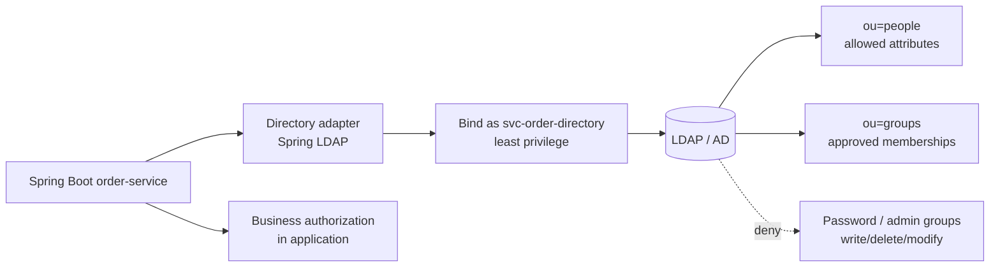
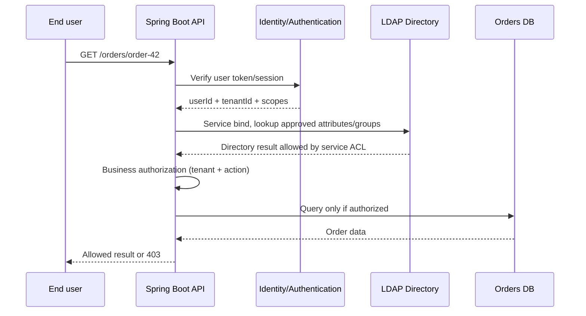
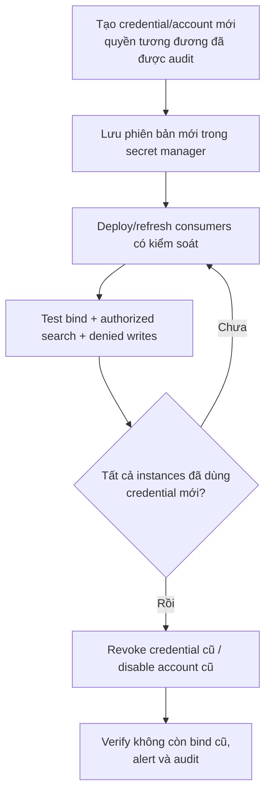
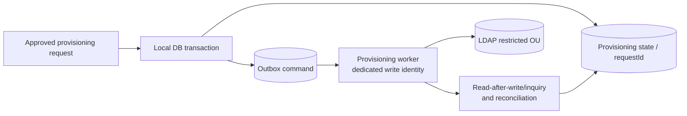

# Tài khoản truy cập dịch vụ và giới hạn quyền

## 1. Tình huống: ứng dụng cần đọc danh bạ nhưng không được làm quản trị viên

Một hệ thống Spring Boot cần kết nối LDAP hoặc Active Directory (AD) để tra cứu thông tin nhân viên, xác định trạng thái tài khoản và ánh xạ nhóm thành vai trò trong ứng dụng. Một cách làm nhanh nhưng nguy hiểm là cấu hình `spring.ldap.username` bằng tài khoản quản trị thư mục, cấp quyền đọc/ghi toàn bộ cây rồi dùng nó cho mọi lời gọi.

Khi thông tin đăng nhập của ứng dụng bị lộ, kẻ tấn công không chỉ truy vấn danh bạ mà còn có thể thay đổi nhóm, đặt lại mật khẩu hoặc sửa quyền nếu tài khoản bind được cấp quá mức. Thậm chí một lỗi code bình thường cũng có thể vô ý ghi sai dữ liệu vào thư mục dùng chung cho hàng nghìn người.

Giải pháp là tách **định danh dịch vụ** khỏi **định danh người dùng**, đặt một tài khoản bind riêng, giới hạn **DN subtree**, **attribute** và **LDAP operation**, rồi kiểm chứng quyền thực tế bằng các negative tests.



Bài thuộc chương **LDAP và thư mục** của module `SPRING_BOOT_INTEGRATION`. Module tập trung tích hợp hệ thống trong Spring Boot qua HTTP client, cơ sở dữ liệu, cache, broker thông điệp và adapter Spring Integration, đặc biệt là cấu hình, hợp đồng dữ liệu, giao dịch, xử lý lỗi, trùng lặp, kiểm thử và quan sát luồng thực tế. LDAP trong trường hợp này là một **hệ thống bên ngoài có bảo mật riêng**, không phải cơ sở dữ liệu nội bộ của ứng dụng.

**Sau bài học, bạn có thể:**

1. Giải thích service account/bind account khác gì người dùng đăng nhập và tài khoản quản trị LDAP.
2. Chọn service identity, bind method và phân quyền theo **least privilege**, **least scope** và **separation of duties**.
3. Thiết kế giới hạn theo cây DN, object class, attribute và phép toán; phân biệt OpenLDAP ACL với AD access control.
4. Cấu hình Spring Boot `spring.ldap.*` và sử dụng `LdapTemplate` cho tác vụ tra cứu chỉ đọc.
5. Xây LDAP filters và DNs an toàn để chống LDAP injection, tránh tìm kiếm toàn cây.
6. Bảo vệ thông tin bind bằng secret manager, LDAPS/StartTLS và quy trình rotation.
7. Phân biệt service bind, user bind authentication và business role authorization.
8. Xử lý timeout, unavailable directory, referrals, connection reuse, caching và eventual consistency.
9. Kiểm thử **quyền được cho phép** và **quyền bị từ chối** bằng thư mục thực, không chỉ mock LDAP client.
10. Thiết lập giám sát, cảnh báo, truy vết và runbook khi account bị khóa hoặc credential hết hạn.

> **Phạm vi phiên bản:** Ví dụ sử dụng Java 17+, Spring Boot 3.x, Spring LDAP 3.x, Spring Security 6.x (khi có authentication) và LDAPv3. LDAP server có thể là OpenLDAP, 389 Directory Server hoặc Microsoft Active Directory; tên thuộc tính, ACL, cơ chế bind và paging/referral **không hoàn toàn tương đương** giữa các sản phẩm. Khi dùng Boot 4.x/Spring 7.x, kiểm tra BOM, API và cấu hình được hỗ trợ trong bản triển khai.

## 2. Cơ sở LDAP cần biết trước khi cấp quyền

LDAP (Lightweight Directory Access Protocol) truy cập một **cây các entries**. Mỗi entry có **Distinguished Name (DN)** và tập attributes. DN không phải đường dẫn filesystem, không phải URL và không phải tên đăng nhập của hệ điều hành.

Ví dụ cấu trúc:

```text
dc=example,dc=org
├── ou=people
│   ├── uid=alice
│   └── uid=bob
├── ou=groups
│   ├── cn=order-viewers
│   └── cn=order-operators
├── ou=services
│   └── uid=svc-order-directory
└── ou=privileged
    └── cn=directory-admins
```

Các DN đầy đủ:

```text
uid=alice,ou=people,dc=example,dc=org
cn=order-viewers,ou=groups,dc=example,dc=org
uid=svc-order-directory,ou=services,dc=example,dc=org
```

Một số thuật ngữ:

| Khái niệm | Ý nghĩa | Liên quan đến bảo mật |
| --- | --- | --- |
| **DN** | Địa chỉ duy nhất của entry trong directory tree. | Dùng để xác định principal và vùng được truy cập. |
| **RDN** | Một thành phần của DN, ví dụ `uid=alice`. | Phải escape khi ghép từ dữ liệu chưa tin cậy. |
| **Base DN** | Điểm gốc cho tìm kiếm, ví dụ `dc=example,dc=org`. | Base rộng có thể quét dữ liệu nhạy cảm vượt nhu cầu. |
| **Search base** | Subtree tương đối, ví dụ `ou=people`. | Nên giới hạn theo use case. |
| **Search scope** | OBJECT, ONELEVEL hoặc SUBTREE. | SUBTREE rộng có thể truy cập nhiều organizational units. |
| **Object class** | Lược đồ phân loại entry/attributes. | Dùng trong filter để giảm ambiguity, không thay ACL. |
| **Bind** | Xác thực LDAP connection với một identity. | Quyền hiệu lực theo principal đã bind và directory ACL. |
| **ACL/ACI/AD DACL** | Quy tắc directory server đánh giá quyền. | Phải cấu hình tại server, không chỉ ở code client. |
| **Search filter** | Điều kiện chọn entries, ví dụ `(uid=alice)`. | User input phải được escape, filter không phải authorization boundary. |
| **Attribute projection** | Chỉ lấy attributes cần thiết. | Giảm dữ liệu lộ trong memory/logs nhưng không thay server ACL. |

### 2.1. LDIF mô tả mẫu dữ liệu

```ldif
dn: uid=alice,ou=people,dc=example,dc=org
objectClass: inetOrgPerson
uid: alice
cn: Alice Example
sn: Example
mail: alice@example.org

dn: cn=order-viewers,ou=groups,dc=example,dc=org
objectClass: groupOfNames
cn: order-viewers
member: uid=alice,ou=people,dc=example,dc=org
```

Đây là **fixture minh họa cho một LDAP schema kiểu OpenLDAP**. Không nhập nguyên mẫu vào directory đang vận hành; user entries/groups và attributes ở AD có thể dùng `user`, `sAMAccountName`, `userPrincipalName` hoặc `memberOf` theo semantics khác.

**Một giới hạn then chốt:** LDAP search filter chọn records theo cú pháp query, trong khi **ACL của server** mới quyết định principal có được đọc/ghi records đó không. Một tài khoản đã được cấp quyền rộng không trở nên ít quyền hơn chỉ vì ứng dụng thường truyền filter hẹp.

## 3. Service account là gì? Ba loại danh tính không được nhầm

Trong bài này, **service account** là định danh kỹ thuật được ứng dụng dùng để **bind/search** vào LDAP directory. Nó không phải user đang yêu cầu xem trang web và cũng không phải administrator.

| Vai trò | Principal minh họa | Quyền cần thiết |
| --- | --- | --- |
| **Directory administrator** | `cn=admin,dc=example,dc=org` hoặc AD privileged admin | Quản trị schema/ACL/identities theo quy trình độc lập; **không** dùng cho application read. |
| **Application bind service account** | `uid=svc-order-directory,ou=services,...` | Search/read tối thiểu để phục vụ nghiệp vụ. Không có quyền đổi password/quản trị. |
| **End-user account** | `uid=alice,ou=people,...` | Danh tính người đăng nhập; quyền directory của họ tách khỏi service bind. |
| **Provisioning service account** | `uid=svc-identity-provisioner,...` | Chỉ các write operations được duyệt, giới hạn subtree/attributes, tách riêng read account. |
| **Break-glass account** | Danh tính cấp cứu do quản trị viên quản lý | Không được đưa credential vào Spring Boot secrets của dịch vụ thường ngày. |

### 3.1. Service bind không phải user authentication

Luồng tra cứu:

```text
Application -> bind bằng svc-order-directory
            -> search uid=alice, attrs uid/cn/mail
            -> trả hồ sơ tối thiểu cho ứng dụng
```

Luồng đăng nhập người dùng LDAP có thể là:

```text
Application -> service bind để tìm DN user (nếu policy cho phép)
            -> thử bind riêng với credentials do user cung cấp
            -> xác thực thành công/thất bại
            -> đọc nhóm/roles được phép và áp dụng authorization tại app
```

Việc service bind **thành công** chỉ chứng minh service credential hợp lệ. Nó **không** chứng minh người dùng Alice đã nhập đúng mật khẩu. Và việc thấy `memberOf=order-operators` cũng **không tự quyết định** Alice có quyền hoàn tiền hay xem tenant khác trong business application.

### 3.2. Vì sao không dùng cùng một admin account cho mọi dịch vụ?

- Một secret bị lộ ảnh hưởng toàn bộ directory, không chỉ một application.
- Không phân biệt được audit trail giữa `order-service`, `warehouse-service` và `billing-service`.
- Rotation có thể làm gián đoạn đồng thời nhiều ứng dụng.
- Quyền ghi nhầm có thể xóa nhóm, khóa user hoặc đặt lại password.
- Khó thu hồi một consumer mà không làm hỏng consumers khác.
- Privileged account thường có chính sách bảo vệ/MFA/tương tác khác service-to-service authentication.

**Quy tắc đề xuất:** mỗi ứng dụng hoặc trust boundary có một service identity riêng, chỉ được cấp chức năng tối thiểu. Nếu cùng ứng dụng có cả tra cứu và provisioning, tách hai identities và hai credential sets.

### 3.3. Không dùng anonymous bind hoặc quyền công khai để lách credential

Một số directory cho phép anonymous bind/search tùy cấu hình. Không bật anonymous read trên các subtree chứa thông tin nhân viên chỉ để tránh quản lý service password. Nếu một ứng dụng thực sự cần đọc public directory data, phải có phân loại dữ liệu và policy riêng; thông tin nhân viên, nhóm bảo mật và email nội bộ không nên mặc nhiên là public.

## 4. Thiết kế quyền tối thiểu theo bốn chiều

Một bản thiết kế quyền cần chỉ rõ:

1. **Identity**: account nào được dùng để bind.
2. **Scope**: DN subtree nào có thể thấy.
3. **Attributes**: trường nào được phép đọc hoặc sửa.
4. **Operations**: search/read/compare/add/modify/delete/rename/bind được cấp theo đúng nhu cầu.

Mẫu quyền cho `order-service` chỉ tra cứu tên/email người tạo đơn:

| Tài nguyên | Search | Read attrs | Add | Modify | Delete | Rename |
| --- | --- | --- | --- | --- | --- | --- |
| `ou=people,dc=example,dc=org` | Chỉ phần cần tra cứu | `uid`, `cn`, `mail`, một identifier ổn định được duyệt | Deny | Deny | Deny | Deny |
| `ou=groups,dc=example,dc=org` | Chỉ các nhóm phục vụ authorization | `cn` và membership attribute cần dùng | Deny | Deny | Deny | Deny |
| `ou=services,...` | Chỉ quyền tối thiểu để bind chính account | Không đọc credentials của services khác | Deny | Deny | Deny | Deny |
| `ou=privileged,...` | Deny | Deny | Deny | Deny | Deny | Deny |
| Mật khẩu, recovery fields, security metadata | Deny (trừ quyền tự xác thực nội tại) | Deny | Deny | Deny | Deny | Deny |

**Quan trọng:** quyền **search** và quyền **read** có thể là hai quyền khác nhau trong directory implementation; thuộc tính dùng trong filter có thể cần quyền compare/search để truy vấn hoạt động. Thiết kế phải test cụ thể trên server thực, không chỉ dựa vào tên permissions.

### 4.1. Tránh “read all users” khi service chỉ cần một nhóm

Nếu `order-service` chỉ tra cứu nhân viên đang hoạt động trong `ou=staff` và group `order-viewers`, không cấp quyền đọc tất cả `dc=example,dc=org`. Dù code search `ou=staff`, ACL phải giới hạn server-side. Ở AD, authorization qua nhóm có thể được thiết lập theo security principal/group và đối tượng OU; ở OpenLDAP, có thể dùng ACL rules theo DN/subtree/attribute. Hai cách cấu hình **không tương đương 1:1**.

### 4.2. Attribute-level least privilege

Một user entry có thể chứa:

```text
uid, cn, sn, mail
telephoneNumber
manager, departmentNumber
employeeNumber
homeDirectory
memberOf
userPassword / unicodePwd / account controls
custom HR fields
```

Chỉ vì ứng dụng cần tên hiển thị không có nghĩa nó cần số nhân viên, điện thoại cá nhân, password hash, AD security descriptors hoặc thông tin nhân sự. Server ACL phải cấm các attributes không được phép; client projection là lớp phòng thủ bổ sung.

Đối với các trường có độ nhạy cao, kể cả “được đọc” cũng cần mục đích xử lý, retention và audit. Không log toàn bộ LDAP `Attributes` cho mục đích debug.

### 4.3. Write privilege luôn tách khỏi read privilege

Tài khoản chỉ dùng để tra cứu không cần `add`, `modify`, `delete`, `moddn/rename`. Nếu provisioning phải tạo account:

- Dùng service identity riêng và endpoint nghiệp vụ được phân quyền.
- Giới hạn đích tạo vào một OU cụ thể, không cho modify các nhóm admin.
- Giới hạn attributes có thể ghi và object classes được tạo.
- Thêm approval, maker-checker và audit trail cho hành động nhạy cảm.
- Không để request HTTP tự cung cấp arbitrary DN/attribute modifications.
- Test denial trên admin group, password reset, OU khác và thao tác delete.

### 4.4. ACL phải được đánh giá server-side

Mã Java:

```java
if (requestedAttribute.equals("mail")) {
    return ldapTemplate.lookup(dn);
}
```

không bảo vệ directory nếu account cũng có quyền sửa toàn bộ entries và credential bị chiếm đoạt. Guard trong ứng dụng hữu ích nhưng **không thay giới hạn cấp bởi directory server**. Khi đánh giá security, hãy thử bind trực tiếp bằng **service credential thật** từ một môi trường test cách ly và kiểm tra denied operations; không chỉ kiểm thử API endpoint của ứng dụng.

## 5. Cấu trúc OU và search base có ý nghĩa gì?

Giả sử Spring Boot cấu hình:

```yaml
spring:
  ldap:
    base: dc=example,dc=org
```

Sau đó service truy vấn base tương đối `ou=people`, nghĩa là tìm trong:

```text
ou=people,dc=example,dc=org
```

**Dấu hiệu rủi ro:**

- `searchBase=""` với scope subtree quét toàn doanh nghiệp.
- Dùng `(objectClass=*)` để quét mọi records khi chỉ cần `uid=...`.
- Cho user truyền tùy ý `baseDn`, `filter` hoặc `attributesToReturn`.
- Cho user phân biệt quá nhiều trạng thái “user tồn tại nhưng không được xem” từ error messages, tạo nguy cơ enumeration.
- Cross-tenant directory: một bind account có thể tìm ngoài tenant OU vì ACL quá rộng.

**Chính sách:** đặt search base trong cấu hình tin cậy hoặc code; dùng fixed query structure và escape giá trị. Với nhiều tenant, application phải xác thực tenant từ principal/token hợp lệ và ánh xạ sang một allowlist base DNs do server kiểm soát; **không** lấy nguyên tenant-provided base DN.

## 6. Spring Boot: dependency và kết nối bằng service account

Ví dụ cần một LDAP read client để tra cứu hồ sơ người dùng. Nếu ứng dụng đang dùng Spring Data LDAP repositories, `spring-boot-starter-data-ldap` là một lựa chọn thuận tiện; nếu chỉ cần `LdapTemplate`, có thể dùng `spring-ldap-core` cùng cấu hình Spring Boot phù hợp.

```xml
<!-- Spring Boot parent/BOM quản lý version Spring LDAP -->
<dependency>
    <groupId>org.springframework.boot</groupId>
    <artifactId>spring-boot-starter-data-ldap</artifactId>
</dependency>
<dependency>
    <groupId>org.springframework.boot</groupId>
    <artifactId>spring-boot-starter-validation</artifactId>
</dependency>
<dependency>
    <groupId>org.springframework.boot</groupId>
    <artifactId>spring-boot-starter-test</artifactId>
    <scope>test</scope>
</dependency>
```

Trong Spring Boot 3.x, `spring.ldap.*` là nhóm cấu hình được Boot hỗ trợ để tạo LDAP `ContextSource`/template khi các điều kiện auto-configuration phù hợp. Nếu tạo một bean `LdapContextSource` hoặc `LdapTemplate` thủ công, cần hiểu auto-configuration có thể **back off**; không để hai sources cùng default mà không rõ cái nào được inject.

### 6.1. Cấu hình dùng LDAPS

```yaml
# application.yml - các giá trị môi trường KHÔNG phải credentials thật
spring:
  ldap:
    urls: ${LDAP_URL:ldaps://ldap.example.org:636}
    base: dc=example,dc=org
    username: ${LDAP_BIND_DN}
    password: ${LDAP_BIND_PASSWORD}

app:
  directory:
    people-base: ou=people
    allowed-groups-base: ou=groups
    lookup-timeout: 2s
```

Ví dụ giá trị deployment:

```text
LDAP_URL=ldaps://ldap.example.org:636
LDAP_BIND_DN=uid=svc-order-directory,ou=services,dc=example,dc=org
LDAP_BIND_PASSWORD=<injected by secret manager, not printed>
```

Trong ví dụ, `LDAP_BIND_DN` là account được tạo/cấp quyền bởi đội directory operations. Password phải được injected bằng cơ chế secrets của môi trường (secret manager/Kubernetes Secret với controls phù hợp, workload identity broker/sidecar, vault injector), **không** ghi vào repository, Docker image, configmap công khai hoặc test snapshot.

**Đừng lấy user DN từ request làm `spring.ldap.username`.** Service account là identity của client connection; xác thực người dùng nếu cần phải có luồng bind riêng, không tự đổi credential dùng chung của một singleton `LdapTemplate` giữa requests.

### 6.2. LDAPS, StartTLS và TLS verification

Hai cơ chế phổ biến:

| Cách | Endpoint thường gặp | Ngữ nghĩa bảo mật |
| --- | --- | --- |
| **LDAPS** | `ldaps://ldap.example.org:636` | TLS ngay từ đầu kết nối. |
| **StartTLS** | `ldap://ldap.example.org:389` rồi StartTLS | Nâng cấp một kết nối LDAPv3 sang TLS trước khi gửi bind password. |

**Không gửi simple-bind password qua LDAP plaintext.** Nếu dùng StartTLS, chương trình phải **bắt buộc nâng cấp và xác minh TLS thành công trước khi bind**, đồng thời không được âm thầm fallback sang plaintext khi handshake lỗi.

JNDI LDAP provider thường sử dụng JVM trust configuration hoặc một socket factory/context được cấu hình phù hợp; SSL bundle cho HTTP clients của Spring Boot **không mặc nhiên** được dùng bởi JNDI LDAP. Với private CA, operator thường cần cấu hình JVM truststore hoặc tích hợp TLS context đúng cách:

```text
-Djavax.net.ssl.trustStore=/etc/app/trust/ldap-truststore.p12
-Djavax.net.ssl.trustStoreType=PKCS12
-Djavax.net.ssl.trustStorePassword=<injected securely>
```

Đây là tham số khởi động JVM minh họa; secret của truststore không đặt hardcode trong script checked-in hoặc log startup. Nếu ứng dụng đã có corporate truststore, chỉ thêm CA được duyệt, không tắt hostname verification. Hostname trong URL phải phù hợp SAN/certificate policy.

**Anti-pattern nghiêm trọng:**

```text
Trust-all SSLContext / insecure socket factory
Disable hostname verification
Use ldap://389 + simple bind without StartTLS
Fall back from TLS to plaintext when handshake fails
```

Không chấp nhận các workaround này để “chạy tạm trong production”. Chúng làm service password và dữ liệu directory có thể bị đánh cắp hoặc bị thay đổi giữa đường.

### 6.3. Mật khẩu service account và trạng thái account

Directory server có thể áp đặt expiry/lockout cho bind account. Dùng password rỗng, placeholder chưa được inject hoặc tên DN không chính xác có thể gây lỗi bind. Với LDAP simple bind, cần đánh giá cẩn thận kết quả khi password rỗng: một số server có anonymous/unauthenticated bind behavior, nên app phải **fail fast** trước khi tạo connection nếu credential bắt buộc chưa có.

Ở Spring Boot 3.x, một số cấu hình sẽ cho phép application khởi động dù chưa thực hiện LDAP request. Đừng coi `ApplicationStartedEvent` là bằng chứng service credential còn hợp lệ; health/readiness cho LDAP nên có kiểm tra có giới hạn theo capability và error budget, không gây bind storm.

## 7. Ví dụ service chỉ đọc với `LdapTemplate`

Giả sử tài khoản chỉ được đọc `uid`, `cn`, `mail` trong `ou=people`. Ta thiết kế một adapter nhỏ, không để phần business service thao tác raw directory DN hay filter.

### 7.1. DTO tối thiểu

```java
// DirectoryPerson.java
package com.example.integration.directory;

public record DirectoryPerson(
    String uid,
    String displayName,
    String email
) {}
```

DTO không chứa password, membership full tree hoặc arbitrary attributes. Nếu `mail` có thể bị thiếu theo directory schema, contract ứng dụng cần quy định trả null/Optional hoặc từ chối record; đừng tự điền email giả rồi gửi notification nhầm.

### 7.2. Adapter với query cố định

```java
// DirectoryPersonLookup.java
package com.example.integration.directory;

import java.util.List;
import javax.naming.NamingException;
import javax.naming.directory.Attribute;
import javax.naming.directory.Attributes;
import javax.naming.directory.SearchControls;
import org.springframework.ldap.core.AttributesMapper;
import org.springframework.ldap.core.LdapTemplate;
import org.springframework.ldap.query.LdapQuery;
import org.springframework.ldap.query.LdapQueryBuilder;
import org.springframework.stereotype.Repository;

@Repository
public class DirectoryPersonLookup {
    private final LdapTemplate ldap;

    public DirectoryPersonLookup(LdapTemplate ldap) {
        this.ldap = ldap;
    }

    public DirectoryPerson findByUid(String uid) {
        String normalized = normalizeUid(uid);

        LdapQuery query = LdapQueryBuilder.query()
            .base("ou=people")
            .searchScope(SearchControls.SUBTREE_SCOPE)
            .attributes("uid", "cn", "mail")
            .countLimit(2)
            .timeLimit(2_000)
            .where("objectClass").is("inetOrgPerson")
            .and("uid").is(normalized);

        List<DirectoryPerson> matches = ldap.search(
            query,
            (AttributesMapper<DirectoryPerson>) attrs ->
                new DirectoryPerson(
                    required(attrs, "uid"),
                    required(attrs, "cn"),
                    optional(attrs, "mail")
                )
        );

        if (matches.isEmpty()) {
            throw new DirectoryPersonNotFoundException(normalized);
        }
        if (matches.size() != 1) {
            throw new DirectoryAmbiguousPersonException(normalized);
        }
        return matches.get(0);
    }

    private static String normalizeUid(String input) {
        if (input == null
            || !input.matches("[a-zA-Z0-9._-]{1,80}")) {
            throw new IllegalArgumentException("Invalid uid format");
        }
        return input;
    }

    private static String required(
        Attributes attrs, String name
    ) throws NamingException {
        Attribute value = attrs.get(name);
        if (value == null || value.size() == 0
            || value.get() == null) {
            throw new InvalidDirectoryRecordException(
                "Missing required attribute: " + name
            );
        }
        return value.get().toString();
    }

    private static String optional(
        Attributes attrs, String name
    ) throws NamingException {
        Attribute value = attrs.get(name);
        return (value == null || value.size() == 0)
            ? null : String.valueOf(value.get());
    }
}
```

Các exception dưới đây là types của ứng dụng, **không phải classes có sẵn** trong Spring LDAP:

```java
// DirectoryPersonNotFoundException.java
package com.example.integration.directory;

public class DirectoryPersonNotFoundException
    extends RuntimeException {
    public DirectoryPersonNotFoundException(String uid) {
        super("Directory person not found for uid");
    }
}
```

```java
// DirectoryAmbiguousPersonException.java
package com.example.integration.directory;

public class DirectoryAmbiguousPersonException
    extends RuntimeException {
    public DirectoryAmbiguousPersonException(String uid) {
        super("Ambiguous directory uid");
    }
}
```

```java
// InvalidDirectoryRecordException.java
package com.example.integration.directory;

public class InvalidDirectoryRecordException
    extends RuntimeException {
    public InvalidDirectoryRecordException(String message) {
        super(message);
    }
}
```

**Điểm đúng của thiết kế:**

1. `base("ou=people")` giới hạn search base trong Spring-configured `dc=example,dc=org`.
2. `attributes("uid","cn","mail")` chỉ đưa về fields mà business contract cần.
3. `objectClass=inetOrgPerson` và `uid=...` giảm kết quả không liên quan.
4. `LdapQueryBuilder` xây filter từ **giá trị dữ liệu**, thay vì nối chuỗi unescaped.
5. `countLimit(2)` giúp phát hiện không duy nhất nếu server/schema/ACL cho phép; một thiết kế yêu cầu UID unique vẫn nên được enforce bởi directory policy.
6. `timeLimit(2000)` là LDAP search time limit trong query controls, **không nhất thiết là toàn bộ network/connect/read timeout**.
7. `LdapTemplate` được inject từ Spring, không tạo connection/bind lại bằng admin credentials ở mỗi method.

**Không được coi projection/validation trong Java thay server ACL.** Nếu account thực tế vẫn đọc được `userPassword` hoặc `ou=privileged` bằng một LDAP client khác, least privilege chưa được thiết lập.

### 7.3. Những chỗ cần điều chỉnh theo schema

Trong Active Directory, attribute account identifier phổ biến là `sAMAccountName` hoặc `userPrincipalName`, object class có thể là `user`; `uid` có thể trống hoặc không phải unique field. Với OpenLDAP, `inetOrgPerson`, `uid` và `groupOfNames` thường gặp nhưng schema thực tế vẫn do directory team quản lý.

Trước khi phát triển phải xác nhận:

- User identifier nào ổn định và unique?
- Base DN và OU có thay đổi do reorganization không?
- Email/username có được đổi không, có thể bị tái sử dụng không?
- Cần dùng immutable ID (AD `objectGUID`, provider-specific entry UUID) để nối với dữ liệu business không?
- Nếu entry bị rename/move, DN thay đổi sẽ ảnh hưởng cache và identity mapping thế nào?
- Group memberships là direct hay nested; directory có cho service đọc chính xác group attributes không?

Không dùng email làm primary business identity chỉ vì nó tiện hiển thị; email có thể thay đổi.

### 7.4. Return tối thiểu và privacy

Adapter có thể trả `DirectoryPerson` cho application service. Tuy nhiên API bên ngoài không nhất thiết được phép trả toàn bộ `mail` cho bất kỳ caller nào. **LDAP read permission** xác nhận application có thể đọc ở hạ tầng; **application authorization** tiếp tục quyết định user/token nào được thấy hồ sơ nào. Nếu caller có thể truy vấn arbitrary `uid`, cần rate limit và business access check để giảm user enumeration.

## 8. Chống LDAP injection: filter và DN là hai ngữ cảnh khác nhau

LDAP filter và Distinguished Name có **hai quy tắc escape khác nhau**. Một giá trị `uid` đưa vào search filter không được ghép kiểu SQL string; một RDN đưa vào DN cũng không được nối chuỗi nguyên xi.

### 8.1. Filter injection từ nối chuỗi

Không làm:

```java
// SAI: user-controlled input đi thẳng vào LDAP filter.
String filter = "(uid=" + userInput + ")";
ldapTemplate.search("ou=people", filter, mapper);
```

Input chứa ký tự filter đặc biệt có thể làm filter đổi ngữ nghĩa hoặc khiến câu truy vấn sai cú pháp. Không dựa vào blacklist tự chế; dùng `LdapQueryBuilder` với values hoặc công cụ escape filter thuộc thư viện chuẩn:

```java
LdapQuery query = LdapQueryBuilder.query()
    .base("ou=people")
    .where("uid").is(userInput);

List<DirectoryPerson> people =
    ldapTemplate.search(query, mapper);
```

Đoạn này minh họa API; `mapper` phải là `AttributesMapper<DirectoryPerson>` do service định nghĩa. Validation định dạng UID vẫn nên có nếu business contract chỉ chấp nhận alphabet/hyphen/dot/underscore. **Escaping giúp an toàn cú pháp; validation giúp đúng hợp đồng; ACL mới là quyền.**

### 8.2. DN injection từ ghép RDN

Không làm:

```java
// SAI: uid có dấu phẩy, dấu bằng hoặc ký tự DN special.
String dn = "uid=" + userInput
    + ",ou=people,dc=example,dc=org";
```

Thay bằng builder xử lý RDN escaping:

```java
import javax.naming.ldap.LdapName;
import org.springframework.ldap.support.LdapNameBuilder;

LdapName userDn = LdapNameBuilder
    .newInstance("dc=example,dc=org")
    .add("ou", "people")
    .add("uid", userInput)
    .build();
```

**Lưu ý:** Spring LDAP operations có thể dùng DN tương đối với `ContextSource.base`; nếu đã cấu hình `spring.ldap.base=dc=example,dc=org`, truyền **full DN** vào một operation đang kỳ vọng **relative DN** có thể tạo DN lặp base. Xác minh contract của từng API, dùng builder theo đúng scope và integration test với directory thật.

### 8.3. Đừng biến filter thành authorization

Một query:

```text
(&(objectClass=person)(uid=alice)(memberOf=cn=order-viewers,...))
```

không mặc nhiên bảo đảm user có quyền trong application. Ở AD, membership nested groups, primary group, token size, trust boundaries và disabled accounts có semantics riêng; ở OpenLDAP, groupOfNames/member fields khác `memberOf`. Authorization cần một policy explicit, default-deny, chỉ chấp nhận groups được allowlist và xem xét account state/tenant context.

### 8.4. Giới hạn truy vấn và kết quả

Ngoài escape:

- Không chấp nhận arbitrary filter từ HTTP request.
- Giới hạn search base, scope, attributes và size/time.
- Đặt read/connect timeout thật ở JNDI provider.
- Với danh sách lớn, dùng LDAP paged results theo server capability và ngưỡng tổng entries.
- Tránh gọi một search cho mọi item nếu đã có batch lookup an toàn.
- Không dùng subtree scan để kiểm tra nhóm trên mỗi HTTP request nếu có thể cache/ủy quyền chính xác hơn.

**Giới hạn phía client không thể thay ACL** nhưng có thể giảm nguy cơ DoS, memory pressure và tải lên directory.

## 9. ACL trên OpenLDAP và delegated access trên Active Directory

Không có một câu lệnh ACL duy nhất có thể copy-paste an toàn lên mọi LDAP implementation. **Quyền phải được triển khai bởi quản trị viên directory** trong hệ thống quản lý cấu hình, review thay đổi và kiểm thử không khóa mất các tài khoản quản trị.

### 9.1. Mô hình policy yêu cầu cho directory team

Ví dụ yêu cầu chính thức:

```text
Service principal:
  uid=svc-order-directory,ou=services,dc=example,dc=org

Allowed:
  search/read ONLY:
    base = ou=people,dc=example,dc=org
    filter fields = uid, objectClass
    returned fields = uid, cn, mail
  optional group lookup:
    base = ou=groups,dc=example,dc=org
    only approved order-viewers/order-operators groups
    read = cn, member

Denied:
  write / add / delete / rename / password reset
  read userPassword / password hashes / recovery attributes
  read privileged OU and unrelated HR/payroll attributes
  modify group membership, especially privileged groups

Operational controls:
  TLS required, credential rotation, audit logs, rate limits,
  dedicated credential per application/environment.
```

Đây là **policy request**, không phải ACL syntax thực thi. Directory team cần xác định server version, schema, ACL precedence và delegation mechanism, sau đó cấp quyền và chứng minh bằng positive/negative tests.

### 9.2. OpenLDAP: `olcAccess`/slapd ACL

OpenLDAP thường dùng rules theo thứ tự đối với `dn.subtree`, `attrs` và principal `by dn.exact`; các mức quyền gồm khái niệm `auth`, `search`, `read` và `write`. Một ý tưởng (cố tình viết dưới dạng **pseudocode không triển khai trực tiếp**) là:

```text
ALLOW principal = svc-order-directory
  SEARCH user entries under ou=people on uid/objectClass
  READ attributes uid/cn/mail of allowed entries

ALLOW principal = svc-order-directory
  SEARCH approved groups under ou=groups
  READ required group membership attributes

DENY principal = svc-order-directory
  all directory writes, privileged subtree, password attributes
```

Đối với OpenLDAP thực tế, thứ tự rules quyết định kết quả; một `olcAccess` sai hoặc thiếu permission để bind có thể **khóa cả ứng dụng hoặc quản trị viên**. Không ghi đè toàn bộ ACL hiện tại bằng một mẫu từ tài liệu học. Cần kiểm tra quyền `auth` phục vụ simple bind, rights để tìm entry và quyền đọc attributes của các truy vấn dự kiến. Nhận xét “by * none” ở cuối một rule cũng có thể ảnh hưởng identities khác nếu dùng sai phạm vi.

### 9.3. Active Directory: OU, ACL và nhóm security

AD dùng security principals và DACL/ACEs trên directory objects; có thể delegate quyền đọc các thuộc tính cụ thể hoặc một OU. Chính sách nên:

- Dùng **dedicated security principal** cho ứng dụng hoặc nhóm chứa các service principals cùng capability.
- Cho phép đọc đúng OU/properties cần thiết; đánh giá inheritance và quyền mặc định của Authenticated Users.
- Tránh Domain Admins/Account Operators/Directory Admins; không thêm account vào nhóm đặc quyền để sửa lỗi read.
- Tách quyền đọc và quyền ghi; không cấp `GenericAll`, `WriteDacl`, `WriteOwner`, password reset hay member-management.
- Nếu truy vấn groups, đánh giá nested membership, cross-domain groups, Global Catalog partial attribute set và trusts.
- Test thực tế bằng **service principal** và xác minh các inherited permissions, không chỉ xem một ACL ở OU gốc.

**Quan trọng:** Trong AD, nhiều objects có permissions thừa hưởng từ parent, và một số thuộc tính có kiểm soát đặc biệt. “Chỉ cấp một read permission” không tự đảm bảo account **không** thừa hưởng quyền rộng hơn từ group membership. Cần kiểm tra **effective access**.

### 9.4. OpenLDAP và AD không tương đương về schema/ACL

| Chủ đề | OpenLDAP kiểu phổ biến | Microsoft Active Directory |
| --- | --- | --- |
| Username field | `uid` | `sAMAccountName` / `userPrincipalName` |
| Person object class | `inetOrgPerson` | `user` (có schema riêng) |
| Group attributes | `member`, `uniqueMember`, tùy schema | `member`/`memberOf`, nested membership |
| Quyền | slapd ACL/`olcAccess` rules | Security descriptors, ACE/DACL, OU delegation |
| Account state | Provider/schema-specific | `userAccountControl` và policy fields |
| Global Catalog | Không có semantics tương đương mặc định | LDAP GC port 3268/3269, partial attribute set |
| Managed account | Tùy identity tooling riêng | Có gMSA trong môi trường được hỗ trợ |

Đừng chuyển raw LDAP filter từ OpenLDAP sang AD và cho rằng kết quả, thuộc tính hoặc permissions giống nhau. Nếu cần dùng AD Global Catalog, phải xác minh target attributes thực sự được replicates trong partial attribute set; không coi GC là endpoint thay thế hoàn toàn cho LDAP 389/636.

### 9.5. gMSA không tự giải quyết simple bind từ Java

AD group Managed Service Account (gMSA) có thể hỗ trợ quản lý secret trong môi trường Windows tích hợp phù hợp. Nhưng một ứng dụng Spring Boot chạy Linux container dùng JNDI **simple bind DN/password** không tự được hưởng passwordless gMSA chỉ vì account có kiểu gMSA. Cần một authentication strategy thực sự tương thích (ví dụ Kerberos/GSSAPI hoặc workload-specific integration), được kiểm thử cùng host/container/runtime. Không biến gMSA thành lời hứa “không cần credential rotation” cho mọi Java LDAP client.

## 10. Phân biệt quyền directory và quyền ứng dụng

Một directory service account có thể được phép đọc membership của user trong nhóm `order-operators`. Điều đó không đồng nghĩa người dùng đã được phép:

- xem đơn hàng của tenant khác,
- sửa thông tin thanh toán,
- tạo refund,
- đọc dữ liệu lương,
- thay đổi cấu hình Spring Integration flows.

**Directory authorization** áp dụng cho *principal đang bind vào LDAP*, còn **application authorization** áp dụng cho *người gọi API và hành động nghiệp vụ*. Một client có bind account chỉ đọc vẫn cần kiểm tra quyền tại controller/service boundary.

### 10.1. Phân rã ví dụ



Nếu directory lookup lỗi hoặc thiếu group:

- **Không** suy ra “không cần authorization vì LDAP unavailable”.
- **Không** cấp quyền mặc định cao để giữ availability.
- Có thể trả 503/degraded cho operation phụ thuộc nhóm hoặc dùng một authorization snapshot đã được duyệt với TTL, version/revocation semantics phù hợp.

### 10.2. Group mapping cần allowlist

Một policy:

```text
LDAP group DN:
  cn=order-viewers,ou=groups,dc=example,dc=org
    -> application role: ORDER_READ

LDAP group DN:
  cn=order-operators,ou=groups,dc=example,dc=org
    -> application role: ORDER_UPDATE

Any other group:
    -> no application privilege by default
```

Map theo **DN/immutable group ID đã tin cậy** và directory source phù hợp, không chỉ theo `cn` trùng giữa OU hoặc chuỗi người dùng gửi từ HTTP request. Khi group bị rename, phải cập nhật mapping có kiểm soát. Nested groups không nên được diễn giải tùy tiện bằng việc substring-match tên nhóm.

### 10.3. LDAP group lookup không phải authentication

Chỉ đọc LDAP entry của Alice rồi thấy nhóm phù hợp **không chứng minh request đến từ Alice**. Authentication của end user phải đến từ phương thức đáng tin cậy (LDAP bind theo đúng contract, OIDC/SAML/OAuth2 token/session được xác minh, v.v.) và ánh xạ với directory identity an toàn. Không chấp nhận request tự khai `uid=alice` rồi áp nhóm của Alice cho bất kỳ caller nào.

### 10.4. Cache quyền truy cập và revoke

Một ứng dụng có thể cache groups cho hiệu năng. Nhưng khi người dùng bị thu hồi quyền trong LDAP, cache vẫn có thể giữ role cũ:

```text
T0: LDAP group membership = ORDER_UPDATE
T1: application caches role for 30 minutes
T2: directory admin removes user from group
T3: user invokes refund before cache expiry
```

Thiết kế cần:

1. TTL ngắn phù hợp độ nhạy permission; không mặc định 24 giờ.
2. Invalidation/revocation events nếu directory/identity platform hỗ trợ.
3. Authorization source of truth hoặc token TTL/session lifetime policy rõ.
4. Cache key gồm tenant/source/immutable user identity và policy version.
5. Không cache quyền đặc biệt quá lâu chỉ vì LDAP latency cao.
6. Khi LDAP lỗi, không tự nới quyền; chọn fail closed hoặc degraded policy có ký duyệt.

**Cần phân biệt dữ liệu ít nhạy cảm** (display name) với **quyền truy cập nhạy cảm** (admin/finance group). Chúng có TTL/revocation yêu cầu khác nhau.

## 11. Simple bind bằng service account và user authentication

Service account thường dùng một **read-only bind** để search user/group entries. Nếu ứng dụng còn xác thực username/password người dùng qua LDAP, đó là một **luồng riêng** và đòi hỏi kiểm soát mạnh hơn.

### 11.1. Không làm password comparison theo cách tự chế

Không đọc `userPassword` hoặc password hash rồi so sánh trong Java service. Account chỉ đọc directory **không nên được cấp đọc password attribute**. Một số LDAP schemas/servers không cho phép đọc mật khẩu dù là hashed; việc tự so sánh cũng dễ sai do password encoding, hashing policy và server controls.

**Đúng nguyên tắc:** khi cần LDAP credential authentication, dùng cơ chế bind/identity provider đáng tin cậy, truyền credential trong transport TLS đã xác minh và không lưu password tại application.

### 11.2. Spring Security LDAP authentication — phác thảo

Nếu sản phẩm thực sự cần xác thực user bằng LDAP (thay vì OIDC/SAML IdP), Spring Security LDAP cung cấp cấu hình user search/bind. Ví dụ ý tưởng với Spring Security 6.x:

```java
// LDAP-specific authentication setup (đoạn minh họa).
import org.springframework.ldap.core.support.LdapContextSource;
import org.springframework.security.config.ldap.LdapBindAuthenticationManagerFactory;

LdapBindAuthenticationManagerFactory factory =
    new LdapBindAuthenticationManagerFactory(
        ldapContextSource
    );
factory.setUserSearchBase("ou=people");
factory.setUserSearchFilter("(uid={0})");
var authenticationManager =
    factory.createAuthenticationManager();
```

Đoạn này **không phải class import đầy đủ để compile nguyên khối**; mục đích là nêu API/hướng cấu hình. `ldapContextSource` là bean riêng được cấu hình dùng đúng service bind/search policy. Trong ứng dụng thực, cần SecurityFilterChain, authentication providers, exception handling, password transport/TLS và session protections. Dùng chuẩn Spring Security filter/value substitution; không nối raw username thành LDAP filter.

**Tránh lẫn:** user credentials được Spring Security sử dụng trong quá trình user bind; không lấy chúng để ghi đè `spring.ldap.password` của global service connection. Kết quả authentication phải gắn với user principal, không phải DN của `svc-order-directory`.

### 11.3. Có cần app quản lý mật khẩu người dùng?

Nếu tổ chức đã có identity provider hỗ trợ OIDC/SAML, application thường nên xác thực qua IdP rồi chỉ dùng LDAP cho dữ liệu/membership được cấp phép, thay vì trực tiếp chạm vào mật khẩu user. Quyết định phụ thuộc kiến trúc IAM, security policy và tài nguyên hiện có; không mặc định LDAP bind là lựa chọn tối ưu cho mọi hệ thống.

### 11.4. Mật khẩu sai và account enumeration

Không trả chi tiết “user tồn tại nhưng password sai”, “DN không tìm thấy”, “account disabled” cho client công khai nếu policy không cho phép; chúng có thể tiết lộ thông tin tài khoản. Ghi nguyên nhân nội bộ đã sanitize và đối chiếu audit events từ directory server, sau đó trả thông báo phù hợp (ví dụ authentication failed), áp rate limits/lockout policy đúng.

## 12. Giới hạn quyền ở cấp môi trường và nhiều directory

Trong thực tế có nhiều environments:

```text
dev    -> directory sandbox -> svc-order-directory-dev
staging-> directory staging -> svc-order-directory-stg
prod   -> directory prod    -> svc-order-directory-prod
```

**Không** cho dev/staging ứng dụng bind vào production LDAP bằng production service credential để tiện test. Một environment non-prod bị xâm nhập sẽ thành đường truy cập danh bạ thật.

### 12.1. Mỗi trust boundary một account

Nếu cùng một backend chạy cho nhiều business domains/tenants:

| Mô hình | Điểm mạnh | Nguy cơ cần kiểm soát |
| --- | --- | --- |
| Một account toàn công ty | Dễ vận hành ban đầu. | Blast radius lớn, audit khó, quyền thường quá rộng. |
| Một account mỗi microservice/environment | Quản lý quyền theo capability, rotation từng service. | Nhiều identities/secrets cần automation. |
| Một account mỗi tenant/trust boundary | Cô lập tốt hơn khi directory/ACL hỗ trợ. | Account lifecycle, pools, credential mapping phức tạp. |
| Service identity federation/delegation | Giảm shared secrets trong một số kiến trúc. | Cần hỗ trợ thực từ directory/Kerberos/IAM runtime. |

**Khuyến nghị:** ưu tiên một account mỗi service/environment và chia nhỏ thêm khi tenant boundary hoặc data sensitivity yêu cầu. Không tự quyết định tạo hàng nghìn accounts nếu directory team không có quy trình cấp phát/rotation hỗ trợ.

### 12.2. Khi có hai LDAP directories trong cùng Spring Boot

Ví dụ service đọc “employees” từ một directory và “contractors” từ directory khác. Mỗi directory cần:

- URLs/trust chains riêng.
- Bind service credentials riêng.
- ContextSource và LdapTemplate riêng.
- Base DN, search filter và schema mapping riêng.
- ACL và monitoring riêng.
- Tenant/source-scoped identity keys, tránh UID collision.

Đặt bean names như `employeeDirectoryContextSource`/`contractorDirectoryContextSource` và inject bằng `@Qualifier`; đừng để global `LdapTemplate` được autowire nhầm và truy vấn vào directory có quyền rộng hơn.

### 12.3. `@Qualifier` không thay server ACL

`@Qualifier("employeeLdapTemplate")` chỉ chọn client bean trong Spring container. Nó không giới hạn người sở hữu credential ở LDAP server và không phải authorization mechanism. Phải kết hợp credential scope/ACL ở server với business authorization tại application boundary.

## 13. Quản lý vòng đời tài khoản dịch vụ

Một service account thường tồn tại nhiều năm hơn bất kỳ instance nào của Spring Boot. Vì thế bảo mật phải có **owner, onboarding, rotation, audit và offboarding**, không chỉ một password mạnh.

### 13.1. Yêu cầu cấp account

Một phiếu yêu cầu service account tối thiểu nên có:

| Trường | Ví dụ | Mục đích |
| --- | --- | --- |
| Application owner | Nhóm vận hành order-service | Ai chịu trách nhiệm sử dụng/thu hồi? |
| Service account name | `svc-order-directory-prod` | Truy vết theo workload. |
| Environment | Production | Không tái sử dụng dev credential. |
| Directory endpoint | `ldap.example.org` | Ràng buộc network/trust. |
| Base DNs | `ou=people`, `ou=groups` | Giới hạn không gian truy vấn. |
| Allowed attributes | `uid`, `cn`, `mail` | Không đọc dữ liệu dư. |
| Allowed operations | Search/read/compare theo use case | Không có quyền add/modify/delete. |
| Runtime identity | Deployment/service account in Kubernetes hoặc host identity | Secret distribution policy. |
| Credential lifetime | Theo chính sách IAM | Lập lịch rotation trước expiry. |
| Audit retention | Theo chính sách tổ chức | Điều tra account compromise. |
| Offboarding trigger | Dừng service hoặc đổi kiến trúc | Xóa quyền/disable account kịp thời. |

Nếu ứng dụng yêu cầu ghi các thuộc tính LDAP, dùng ticket riêng có owner của directory team và risk approval; không tăng quyền read account tại chỗ chỉ vì một feature mới.

### 13.2. Secrets không nằm trong Git/CI logs

Không đặt:

```yaml
# SAI: credential thật trong code hoặc file đã commit.
spring:
  ldap:
    username: uid=svc-order-directory,ou=services,dc=example,dc=org
    password: SuperSecret123
```

Một biến môi trường được injected từ secret manager **tốt hơn hardcode**, nhưng vẫn có rủi ro lộ qua process environment, crash dumps, debug pages hoặc deployment tooling nếu quyền không đúng. Cần kiểm soát:

- ACL đọc secret theo workload identity/namespace/environment.
- KMS/encryption at rest và TLS khi phân phối.
- Không in ra effective config hoặc raw environment trên logging/health pages.
- Không include `spring.ldap.password` trong exception messages, build artifact hoặc diagnostic bundle.
- Không đưa secret vào stack trace hoặc test snapshots.
- Rotation/revocation và audit ai đã truy cập secret.
- Fail startup/recovery có kiểm soát nếu secret không tồn tại hoặc rỗng.

**Không** dùng `String.toString()` của object cấu hình chứa password trong logs. Nếu cần log identity, ghi alias `directory=corp-prod` và `credentialVersion=v7` do config quản lý, không ghi password.

### 13.3. Credential rotation không được phụ thuộc restart thủ công

Một quy trình rotation có kiểm soát:



**Chi tiết:** một số directory products chỉ cho một password hoạt động tại một thời điểm cho một account, nên đổi password ngay có thể làm tất cả instances dùng connection cũ/stale credential gặp lỗi. Để giảm downtime, cân nhắc **hai service accounts luân phiên** cùng policy hoặc cơ chế rotation/versioning được directory hỗ trợ. Chỉ duy trì tài khoản cũ trong cửa sổ chuyển đổi giới hạn và có monitoring.

**Không** thử nhiều passwords liên tục trong code để “tự tìm password đúng”; có thể kích hoạt lockout, che lỗi cấu hình và rò rỉ secrets. Khi credential đổi, connection pools/bind sessions cũ cần được đóng hoặc recycle theo behavior của ContextSource/LDAP provider.

### 13.4. Khi tài khoản bị khóa hoặc hết hạn

Một LDAP bind fail với invalid credentials có thể đến từ:

- Secret đã rotate ở server nhưng deployment chưa cập nhật.
- Account bị khóa do nhiều lần bind sai.
- Password expired hoặc security policy yêu cầu reset.
- DN không còn tồn tại sau khi rename/move OU.
- Endpoint thay đổi realm/domain và credentials không còn hợp lệ.

Không retry 100 lần/giây với cùng credential khi gặp lỗi authentication; đây thường không phải transient connection failure. Tạo alert có runbook để operator xác minh secret version, account state và directory-side audit, rồi sửa cấu hình/rotation.

### 13.5. Least privilege phải được tái xác minh định kỳ

Khi thêm feature, tài khoản dễ bị “permission creep”. Review định kỳ:

1. Những OU/attributes nào service thực sự đọc trong 30/90 ngày gần nhất?
2. Có ACL mới từ parent/group khiến effective access rộng hơn không?
3. Account có bị đưa vào nhóm đặc quyền do xử lý sự cố trước đó không?
4. Có credential cũ hoặc service deployment cũ vẫn bind không?
5. Có application khác dùng chung credential, phá giả định single owner không?
6. Có thư mục non-prod trỏ sang prod mà không được duyệt không?
7. Các negative tests còn từ chối thao tác write/password/privileged lookup không?

## 14. TLS, network và referrals là một phần của boundary

Service account ít quyền nhưng bind qua đường không an toàn vẫn có thể bị lộ. Bảo vệ directory transport cần:

- **TLS encryption:** dùng LDAPS hoặc StartTLS được enforce, không bind credential trên cleartext.
- **Certificate validation:** tin đúng CA, hostname/SAN phù hợp, tránh trust-all.
- **Network allowlist:** chỉ workload/namespace được phép gọi directory endpoints cần thiết.
- **Firewall egress:** hạn chế directory replication/admin endpoints, không mở toàn bộ Internet.
- **Referrals:** chỉ theo các targets/domains đã được tin cậy, tránh tự động gửi bind credentials sang host ngoài scope.
- **Timeouts:** mọi connect/read/search đều có giới hạn để không giữ thread vô hạn.
- **Logging:** không log password, full LDAP entries hoặc sensitive filters/values.

### 14.1. Referral có thể làm mở rộng phạm vi truy vấn

LDAP server có thể trả referral tới một server/partition khác. Nếu client tự follow referral mà không kiểm tra destination, application có thể:

- Truy vấn ngoài domain/tenant dự kiến.
- Phát sinh network egress bất thường.
- Lộ credential tùy cơ chế rebind/referral của client.
- Nhận attributes/quyền khác so với directory gốc.
- Gặp vòng lặp referrals hoặc latency lớn.

Chọn `throw/ignore/follow` theo server/client behavior, audit và **allowlist trusted referral destinations** ở kiến trúc. Với bài học này, ưu tiên fail closed khi referral đi ngoài scope; chỉ cho phép follow nếu thiết kế directory federation thật sự yêu cầu và đã được security review.

### 14.2. JNDI provider timeouts không giống search time limit

Với JNDI LDAP provider của JVM thường dùng:

```text
com.sun.jndi.ldap.connect.timeout = milliseconds
com.sun.jndi.ldap.read.timeout    = milliseconds
```

Đây là các properties **JNDI provider-specific**, không phải LDAPv3 standardized options dùng được trên mọi Java LDAP client. Chúng bổ sung cho `SearchControls.setTimeLimit(...)`; một search time limit không phải global deadline cho DNS/TLS/connect/bind/response handling và retry.

### 14.3. Alternative: cấu hình `LdapContextSource` tường minh

Nếu cần kiểm soát JNDI timeout/referral và không dùng Boot default `ContextSource`, có thể tạo cấu hình riêng:

```java
// DirectoryContextConfiguration.java - alternative to Boot defaults.
package com.example.integration.directory;

import java.util.Map;
import javax.naming.Context;
import org.springframework.beans.factory.annotation.Value;
import org.springframework.context.annotation.Bean;
import org.springframework.context.annotation.Configuration;
import org.springframework.ldap.core.LdapTemplate;
import org.springframework.ldap.core.support.LdapContextSource;

@Configuration(proxyBeanMethods = false)
public class DirectoryContextConfiguration {

    @Bean("directoryContextSource")
    LdapContextSource directoryContextSource(
        @Value("${app.directory.url}") String url,
        @Value("${app.directory.base}") String base,
        @Value("${app.directory.bind-dn}") String bindDn,
        @Value("${app.directory.bind-password}") String password
    ) {
        if (password == null || password.isBlank()) {
            throw new IllegalStateException(
                "Directory service password missing"
            );
        }

        LdapContextSource source = new LdapContextSource();
        source.setUrl(url);
        source.setBase(base);
        source.setUserDn(bindDn);
        source.setPassword(password);
        source.setPooled(false);
        source.setBaseEnvironmentProperties(Map.of(
            "com.sun.jndi.ldap.connect.timeout", "1500",
            "com.sun.jndi.ldap.read.timeout", "2500",
            Context.REFERRAL, "throw"
        ));
        source.afterPropertiesSet();
        return source;
    }

    @Bean("directoryLdapTemplate")
    LdapTemplate directoryLdapTemplate(
        LdapContextSource directoryContextSource
    ) {
        return new LdapTemplate(directoryContextSource);
    }
}
```

```yaml
# Alternative profile configuration for the custom beans above.
app:
  directory:
    url: ${LDAP_URL:ldaps://ldap.example.org:636}
    base: dc=example,dc=org
    bind-dn: ${LDAP_BIND_DN}
    bind-password: ${LDAP_BIND_PASSWORD}
```

**Không lắp đồng thời cả cấu hình custom này và cấu hình `spring.ldap.*` ở mục 6 rồi giả định cả hai independent clients đều dùng đúng properties.** Hãy chọn một cấu hình được kiểm soát. Khi có nhiều `LdapTemplate`, inject bằng `@Qualifier("directoryLdapTemplate")` ở adapter; khi chỉ một template của Boot, constructor injection theo type thường đủ.

Trong ví dụ:

- `source.setPooled(false)` tránh bật JNDI pooling tự động nếu chưa đánh giá behavior/StartTLS/credential rotation.
- Map timeouts là JNDI-specific; tên properties có thể khác nếu dùng provider khác.
- `Context.REFERRAL="throw"` giúp ứng dụng không tự silently follow referrals nhưng phải có handler/reporting nếu federation cần được hỗ trợ.
- Dùng LDAPS URL và JVM trust configuration phù hợp; `setUrl` không tự bypass certificate validation.
- `afterPropertiesSet()` khởi tạo source configuration; không có nghĩa đã bind thành công với account ở startup.

Nếu cần connection pooling chuyên dụng để giảm chi phí bind/search, có thể sử dụng ContextSource pooling theo thư viện Spring LDAP, nhưng phải kiểm tra pool size, idle validation, abandoned contexts, credential rotation, StartTLS compatibility và concurrency. **JNDI built-in pooling không được coi là lựa chọn mặc định an toàn cho StartTLS**; tránh lưu dùng lại credential cũ hoặc security contexts không đúng.

### 14.4. Failover nhiều LDAP URLs

Khi có nhiều directory replicas, có thể cấu hình danh sách URLs nếu ContextSource/provider hỗ trợ. Nhưng:

- Không trộn một LDAP directory của tenant A với tenant B như “failover”.
- Xác minh replicas cùng schema/ACL/credential policy và dữ liệu replication đủ mới.
- Search sau account disable có thể thấy trạng thái cũ trên replica chậm; authorization-sensitive decisions cần chính sách freshness.
- DNS failover và server referrals có thể làm địa chỉ kết nối không khớp TLS certificate.
- Một số operations ghi (nếu provisioning) cần write-master routing hoặc cơ chế replication consistency cụ thể.

Không retry vô hạn sang mọi host khi kết nối không được xác minh hoặc bind credential bị từ chối.

## 15. Phân loại lỗi LDAP để tránh nới quyền khi directory gặp sự cố

Khi `LdapTemplate` phát exception, đừng gom tất cả thành “user không tồn tại”. Sự cố network, thiếu quyền và query không có kết quả có ý nghĩa nghiệp vụ khác nhau.

| LDAP result / loại lỗi | Ý nghĩa thường gặp | Cách xử lý |
| --- | --- | --- |
| `49 invalidCredentials` | Service bind password sai, account expired/locked tùy server. | Fail closed; alert credential/lockout, không retry liên tục. |
| `50 insufficientAccessRights` | Server từ chối operation/attribute. | Coi là **policy violation/config bug**; không chuyển sang admin account. |
| `32 noSuchObject` | Base DN/entry không tồn tại hoặc bị ẩn theo implementation. | Xác minh base/schema/ACL; không suy luôn user không có. |
| `3 timeLimitExceeded` | Search vượt giới hạn thời gian server. | Giảm scope, index, backoff bounded; không retry vô hạn. |
| `4 sizeLimitExceeded` | Quá nhiều entries trả về. | Dùng filter hẹp, paging, tổng limit; không tự tăng quota toàn server. |
| `10 referral` | Tài nguyên nằm ở directory/server khác. | Chỉ follow nếu trusted referral policy cho phép. |
| `52 unavailable` | Server không đáp ứng xử lý. | Bounded retry/circuit breaker; fallback theo business contract. |
| Connect/read timeout | Network, TLS, overload hoặc server chậm. | Deadline, telemetry, không coi là authentication denied. |
| Malformed filter/invalid DN | Bug/input chưa escape hoặc sai schema. | Validation và sửa code, không retry. |
| Multiple results | UID không unique theo query/ACL/base. | Fail ambiguity, không tự chọn first entry. |

LDAP result codes có thể được Spring LDAP chuyển thành các types trong họ `org.springframework.ldap.*` (ví dụ authentication/communication/permission exceptions); mapping phụ thuộc provider và đường gọi. AD còn trả diagnostic subcodes cho account lock/expired, nhưng không nên expose raw diagnostic response cho người dùng cuối.

### 15.1. Không fallback từ account ít quyền sang admin khi gặp 50

```text
Directory lookup -> insufficientAccessRights
  WRONG: retry with directory-admin password
  RIGHT: deny / alert / review approved ACL change
```

Một lỗi `50` là tín hiệu ranh giới quyền đang hoạt động hoặc config sai, **không phải lý do tự nâng đặc quyền**. Nếu nghiệp vụ thiếu attribute để hoạt động, yêu cầu directory team review cụ thể attribute/subtree và cập nhật test. Không đưa admin secret như credential fallback trong application.

### 15.2. Không dùng “user missing” để che lỗi LDAP outage

```text
LDAP 0 results (query thành công): DirectoryPersonNotFound
LDAP connection timeout:          DirectoryUnavailable
LDAP invalid service credential:  DirectoryCredentialFailure
LDAP insufficient permission:     DirectoryAccessDenied
LDAP ambiguous match:             DirectoryDataContractViolation
```

Tại public API có thể giảm chi tiết error để tránh enumeration, nhưng nội bộ phải phân biệt chúng. Nếu directory outage bị coi như không có user, ứng dụng có thể xóa/disable account hoặc mất quyền truy cập sai. Nếu directory outage bị coi như “allow all”, rủi ro nghiêm trọng hơn.

### 15.3. Retry có giới hạn cho search-only

Chỉ retry khi:

- Operation thực sự là read/search không có side effect.
- Lỗi là transient (network timeout/52), không phải invalid credentials hay insufficient access.
- Retry budget và deadline còn thời gian.
- Đã đặt connection/read/search timeout và concurrency limit.
- Có jitter/backoff để tránh nhiều service replicas dồn tải.

Với LDAP modify/add/delete (nếu provisioning), read timeout sau gửi request có thể là **UNKNOWN_OUTCOME**: server có thể đã ghi nhưng response mất. Cần stable operation ID, inquiry qua entry/attribute state và idempotent reconcile, không retry mù hoặc chuyển sang quyền cao hơn.

### 15.4. Caching và directory outages

Nếu lookup `displayName` thất bại, có thể trả snapshot cache cũ với `asOf` nếu business cho phép. Nhưng nếu lookup được dùng để **cho phép một thao tác bảo mật**, cache stale có thể bỏ lỡ việc thu hồi nhóm/quyền. Chọn fail closed hoặc một session/token policy đã được chấp thuận; không dùng generic `onErrorReturn(admin=true)`.

## 16. Directory read không phải business transaction ACID chung

LDAP search thường là một read operation bên ngoài database transaction của ứng dụng:

```text
HTTP request
  -> LDAP lookup team membership
  -> PostgreSQL @Transactional UPDATE order
  -> Kafka publish OrderUpdated
```

`@Transactional("ordersTxManager")` chỉ quản lý JDBC resource tương ứng. Nó **không** biến LDAP bind/search/modify, Kafka send hoặc HTTP call thành một distributed transaction.

Các đặc điểm cần nhớ:

- LDAP entry có thể bị đổi giữa lookup và business DB commit (time-of-check/time-of-use).
- Directory replicas có thể cho dữ liệu hơi chậm so với authority, đặc biệt nhóm/disabled state.
- Một DB rollback không undo LDAP modify nếu service provisioning đã thành công.
- Kafka exactly-once transaction không bao LDAP ACL changes.
- User role cache có thể stale sau revocation; cần rõ consistency requirements.

Nếu một event phải kích hoạt directory provisioning, dùng durable workflow/outbox với command ID và reconcile được kết quả; không đặt LDAP modify bên trong DB transaction rồi nghĩ rằng `@Transactional` sẽ rollback cả hai.

### 16.1. Mô hình an toàn cho provisioning (nếu được phép)



Giới hạn write account cho OU/attrs cụ thể và bảo đảm audit trail. Một LDAP request timeout có thể đã thực hiện nên worker phải tra entry/business operation state trước khi retry. Cơ chế này không phải XA; nó là một **eventual, idempotent workflow** có khả năng phục hồi.

## 17. Kiểm thử quyền tối thiểu: positive và negative tests

**Cách duy nhất có đủ sức thuyết phục để xác minh ACL** là chạy các phép LDAP operation thật bằng chính service credential dự kiến, trên một directory test/staging được dựng với schema, group inheritance và policies đủ đại diện production.

Một unit test mock `LdapTemplate.search(...)` có thể kiểm tra query và mapping, nhưng nó **không chứng minh** LDAP server từ chối `modify/delete/read userPassword`. Đối với service bind least privilege, **negative tests quan trọng ngang positive tests**.

### 17.1. Test matrix bắt buộc

| ID | Principal đang bind | Phép thử | Kỳ vọng |
| --- | --- | --- | --- |
| P1 | `svc-order-directory` | Search Alice trong `ou=people` theo `uid`. | Thành công, đúng 1 entry được phép. |
| P2 | `svc-order-directory` | Read `uid`, `cn`, `mail`. | Trả đúng các attributes đã phê duyệt. |
| P3 | `svc-order-directory` | Read nhóm `order-viewers` theo DN cho phép. | Thành công nếu use case cần group read. |
| N1 | `svc-order-directory` | Read `userPassword` hoặc sensitive HR field. | Bị từ chối hoặc attribute không được trả theo ACL server. |
| N2 | `svc-order-directory` | Search `ou=privileged`. | Bị từ chối/không được thấy privileged entries theo policy. |
| N3 | `svc-order-directory` | Modify `description` của Alice. | **Permission denied**, không có thay đổi. |
| N4 | `svc-order-directory` | Add entry trong `ou=people`. | **Permission denied**, entry không được tạo. |
| N5 | `svc-order-directory` | Delete/rename Alice. | **Permission denied**, DN và entry nguyên vẹn. |
| N6 | `svc-order-directory` | Thêm mình vào `directory-admins`. | **Permission denied**, không thay đổi group membership. |
| N7 | `svc-order-directory` | Reset password của user khác. | **Permission denied**, account user không bị ảnh hưởng. |
| N8 | `svc-order-directory` | Search ngoài tenant/allowed subtree. | Không có dữ liệu ngoài quyền đã cấp. |
| N9 | `svc-order-directory` | Bind sai password. | Authentication fail, không fallback anonymous/admin. |
| N10 | Disabled/expired service identity | Search. | Fail closed, báo operational issue. |
| T1 | `svc-order-directory` | LDAPS certificate không hợp lệ. | TLS handshake fail, không fallback plaintext. |
| T2 | `svc-order-directory` | DNS/LDAP timeout. | Deadline bounded, error khác “user not found”. |
| R1 | New rotated account | Lặp toàn bộ P/N tests. | Cùng approved rights, không phát sinh quyền mới. |

**Điểm khó:** Một số LDAP server **ẩn** entry/attribute không được quyền đọc thay vì trả kết quả lỗi 50. Test N1/N2 phải chấp nhận chính sách “not visible” nhưng đồng thời đối chiếu bằng **privileged fixture setup** rằng entry/attribute thực sự tồn tại, tránh một test pass giả chỉ vì dữ liệu fixture thiếu.

### 17.2. Test fixture phải cho phép chứng minh ACL

Một directory test nên có:

```text
ou=people
  uid=alice:
    uid, cn, mail, description, userPassword (server-controlled)
  uid=bob

ou=privileged
  cn=directory-admins

ou=services
  uid=svc-order-directory:
    service credential, approved ACLs

Privileged setup identity:
  có thể tạo fixture và xác nhận dữ liệu tồn tại
  KHÔNG được dùng trong application runtime.
```

Đầu tiên dùng **admin fixture loader** tạo user và attribute hợp lệ; sau đó chạy tests bằng service account. Nếu test “write bị từ chối” nhưng target attribute vốn không được schema cho phép ghi, kết quả sai có thể là schema violation, không phải ACL denial. Cần thiết kế fixture sao cho admin có thể thực hiện cùng operation, service không thể, và xác minh LDAP result code.

### 17.3. Integration test: đọc được một entry

Ví dụ test dùng Spring Boot application context trỏ đến **directory test đã provision ACL**:

```java
// DirectoryLeastPrivilegeIntegrationTest.java
package com.example.integration.directory;

import static org.junit.jupiter.api.Assertions.*;
import org.junit.jupiter.api.Test;
import org.springframework.beans.factory.annotation.Autowired;
import org.springframework.boot.test.context.SpringBootTest;

@SpringBootTest
class DirectoryLeastPrivilegeIntegrationTest {

    @Autowired DirectoryPersonLookup lookup;

    @Test
    void canReadOnlyApprovedProfileFields() {
        DirectoryPerson person = lookup.findByUid("alice");

        assertEquals("alice", person.uid());
        assertNotNull(person.displayName());
        assertNotNull(person.email());
    }

    @Test
    void rejectsUntrustedUidSyntaxBeforeSearch() {
        assertThrows(IllegalArgumentException.class,
            () -> lookup.findByUid("*)(uid=*)")
        );
    }
}
```

**Giới hạn:** Test này xác minh API adapter và input validation, **chưa chứng minh server ACL deny**. Nó chỉ có giá trị khi Spring Boot context dùng service account trỏ đến test directory thật. Không nhầm mock `DirectoryPersonLookup` hoặc fixture in-memory không có ACL với integration test hiệu lực quyền.

### 17.4. Negative test: tài khoản read-only không được sửa user

Trong một directory test cô lập, khi ACL được provision:

```java
// Đặt trong test class có @Autowired LdapTemplate ldap
// và import JUnit assertions + JNDI classes.
import javax.naming.directory.BasicAttribute;
import javax.naming.directory.DirContext;
import javax.naming.directory.ModificationItem;
import org.springframework.ldap.InsufficientAccessRightsException;

ModificationItem[] changes = {
    new ModificationItem(
        DirContext.REPLACE_ATTRIBUTE,
        new BasicAttribute(
            "description", "must-not-be-written-by-service"
        )
    )
};

assertThrows(
    InsufficientAccessRightsException.class,
    () -> ldap.modifyAttributes(
        "uid=alice,ou=people",
        changes
    )
);
```

Đoạn này là **body của một test**, không phải source file hoàn chỉnh; `ldap` phải được inject theo service account, không phải admin fixture loader. Spring LDAP mapping của denial exception phụ thuộc provider và driver; trong một integration test thực, assert **LDAP result 50 / mapped insufficientAccessRights** và kiểm tra attribute của Alice không thay đổi. Nếu server trả schema violation thay vì permission denied, test **không đạt mục tiêu chứng minh ACL**, phải sửa fixture/ACL test.

**Tuyệt đối không chạy negative mutation tests trên production directory.** Chúng phải dùng users/groups/OU disposable riêng và có thao tác cleanup từ fixture identity được kiểm soát.

### 17.5. Negative test cho sensitive attributes

Một bind account chỉ đọc có thể được phép lookup entry Alice nhưng không được đọc `userPassword`. Hệ thống nên kiểm thử:

```text
Service bind -> lookup uid=alice
  attrs requested: uid, userPassword

Expected:
  uid = alice
  userPassword = absent/not visible
  OR server denies request according to ACL.
```

Phải xác minh rằng fixture provider thực sự có `userPassword`/restricted attribute hoặc kiểm tra một thuộc tính nhạy cảm khác có schema tương thích. Trong AD, password attributes có behavior đặc biệt (ví dụ `unicodePwd`), không dùng thử đọc password như một cách kiểm tra giá trị password; chỉ xác minh **không được cấp quyền truy cập dữ liệu nhạy cảm** theo server policy.

### 17.6. Negative test khi secret bị rotate/thu hồi

Trong staging:

1. Bind bằng credential version cũ, test quyền P1/N1/N3.
2. Cấp credential/account version mới cùng ACL đã duyệt.
3. Deploy test service mới, xác minh P1/N1/N3 vẫn đúng.
4. Thu hồi account/credential cũ.
5. Thử **fresh connection** với old credential: bind phải thất bại.
6. Xác minh connections đang pool không tiếp tục được dùng vượt policy thu hồi.
7. Quan sát metrics/logs không có password hoặc raw LDAP entry.

Nếu dùng hai tài khoản luân phiên, test cả hai trong cửa sổ chuyển đổi, rồi xác minh old account đã bị disable/revoke theo lịch.

## 18. Test concurrency, paging và search budgets

Các giới hạn quyền còn liên quan tới **availability**: một tài khoản search toàn cây với filter quá rộng có thể làm directory quá tải, nhất là khi hàng trăm replicas cùng khởi động.

### 18.1. Giới hạn số kết quả và total work

Search của `DirectoryPersonLookup` dùng `countLimit(2)` vì kỳ vọng một UID. Các use case khác như liệt kê thành viên nhóm lớn không nên dùng unlimited result list:

```text
Group membership lookup:
  search base    = approved group subtree
  filter         = fixed group ID / attribute
  max page size  = 100 or 500 (tùy server policy)
  max total      = bounded by business requirement
  timeout        = bounded
  concurrency    = bounded per service instance
```

LDAP paged results control có thể được hỗ trợ bởi server và Spring LDAP processor, nhưng triển khai khác nhau giữa AD/OpenLDAP. Việc page size 500 không tự có nghĩa có thể đọc 1 triệu entries an toàn; vẫn cần tổng item/time limit, indexing và cancel/cleanup cursor.

### 18.2. Thử tải nhưng không gây nguy hiểm directory production

Load test nên chạy trên directory staging hoặc một replica sandbox có giới hạn. Kiểm thử:

- 1, 10, 100 concurrent lookups theo workload thực.
- Lookup thành công, 0 matches, multiple matches.
- Server chậm/trả timeLimitExceeded.
- Network connect timeout, read timeout và TLS handshake errors.
- Invalid credential lặp lại không gây retry storm.
- LDAP connection pool saturated hoặc nhiều binds đồng thời.
- Group query lớn với paging và server-side size limit.
- Referrals tới domain không được tin cậy.

Không làm stress test trên production corporate directory mà chưa được quản trị viên đồng ý; một LDAP query xấu có thể ảnh hưởng login của nhiều hệ thống khác.

### 18.3. Search caching là một trade-off

| Loại dữ liệu | Khả năng cache | Nguy cơ stale |
| --- | --- | --- |
| Display name | Thường có thể cache TTL có giới hạn. | Hiển thị tên cũ. |
| Email | Có thể cache TTL ngắn/mục đích rõ. | Gửi thông báo sai sau đổi email. |
| Department | Tùy độ quan trọng. | Quy trình phê duyệt lệch. |
| Security group membership | Cần TTL/revocation policy nghiêm ngặt. | Quyền đã thu hồi còn được chấp nhận. |
| Disabled-account status | Thường rất nhạy cảm. | Tài khoản bị khóa vẫn được cho phép. |
| Service bind credentials | Không dùng application cache tự chế để lưu plaintext password. | Lộ secret/rotation khó. |

Nếu dùng Redis cho cache directory result, key phải phân biệt tenant/directory source/identity và có TTL rõ. Không dump full user attributes vào Redis hoặc message broker khi chúng không cần thiết; dữ liệu directory chịu privacy policy riêng.

### 18.4. Không để LDAP trở thành bottleneck đồng bộ

Một HTTP request cần gọi LDAP ba lần, database hai lần và payment một lần có độ trễ cộng dồn. Dùng bounded lookups, duplicate request coalescing khi phù hợp, và cache theo business safety. Nhưng **không** cache security group vô hạn hoặc bỏ qua LDAP failure bằng cách cấp quyền cao.

Nếu directory outage làm toàn bộ request threads chờ, cần connect/read timeout, circuit breaker/bulkhead đúng hạn mức, health signals và fallback behavior đã được phê duyệt. Một circuit breaker OPEN không đồng nghĩa được dùng account khác có quyền rộng hơn.

## 19. Observability và audit của service account

Một service account được cấp ít quyền vẫn có thể bị lạm dụng để scrape toàn bộ danh bạ mà nó có thể đọc. Vì vậy cần giám sát không chỉ **LDAP availability** mà cả **hành vi bind/search khác thường**.

### 19.1. Các metric/alert nên có

| Tín hiệu | Cách sử dụng | Cảnh báo/rủi ro |
| --- | --- | --- |
| Bind success/failure theo service alias | Phát hiện credential expiry/rotation lỗi. | Nhiều invalidCredentials có thể khóa account. |
| Search latency p50/p95/p99 | Nhìn tải từ LDAP hoặc client. | Tăng timeout và nghẽn HTTP threads. |
| Connect/read timeout rate | Phát hiện directory outage/TLS/network. | Không nhầm thành user không tồn tại. |
| LDAP result code category (49/50/52/4/3) | Phân biệt auth, ACL, unavailable, limits. | ACL error tăng sau deploy có thể do quyền thay đổi. |
| Directory queries/second theo operation | Phát hiện search storm. | Rủi ro quá tải directory/shared authentication. |
| Entries returned histogram | Phát hiện query broadening. | Query bất ngờ trả hàng nghìn users. |
| Referral encountered/blocked | Phát hiện cross-boundary lookup. | Referral trỏ sang host ngoài allowlist. |
| TLS certificate expiry/handshake failures | Giám sát trust and identity. | Failover có thể bind endpoint không đúng. |
| Credential age/next rotation date | Lập kế hoạch đổi secret. | Credential quá hạn gây outage. |
| Directory role-cache freshness | Xác định chậm thu hồi quyền. | Stale authorization vẫn được chấp nhận. |
| Denied write attempts ở directory audit | Phát hiện code sai/abuse. | Service read-only bỗng gọi modify/delete. |
| Staging ACL negative-test results | Phát hiện privilege creep. | Thay đổi AD delegation/OpenLDAP ACL không được review. |

Spring Boot Actuator/Micrometer có thể cung cấp JVM, HTTP và một số health indicators liên quan LDAP tùy dependency/autoconfiguration. Nhưng metrics như **LDAP result codes**, **effective ACL drift**, **credential age** và **unexpected denied writes** thường cần instrumentation từ adapter, directory server audit hoặc external monitoring. Không tự tuyên bố rằng chỉ bật `spring-boot-starter-actuator` là có đầy đủ các số liệu này.

### 19.2. Log theo loại lỗi, không log credential

Một structured log minh họa:

```json
{
  "service": "order-service",
  "directory": "corp-prod",
  "operation": "findPersonByUid",
  "bindIdentityAlias": "svc-order-directory-prod",
  "resultCategory": "LDAP_INSUFFICIENT_ACCESS",
  "ldapResultCode": 50,
  "durationMillis": 68,
  "correlationId": "trace-example"
}
```

Đây là schema tự thiết kế, **không phải log mặc định của Spring LDAP**. Không đưa `LDAP_BIND_PASSWORD`, credential versions kèm nội dung, full DN của user nếu có PII, toàn bộ search filter/raw response, phone, HR fields hoặc user password vào logs.

Đối với UID/tenant, nếu cần truy vết sự cố có thể log identifier đã được kiểm soát, hashed/tokenized hoặc lưu trong audit store có phân quyền và retention; **không** dùng từng user DN/UID làm metric label cardinality cao.

### 19.3. Health/readiness có thể tự tạo tải xấu

Nếu mỗi replica kiểm tra LDAP bằng một search toàn subtree mỗi 2 giây:

```text
100 pods × 1 request every 2 seconds = 50 searches/second
```

Chỉ riêng healthchecks có thể làm tăng tải directory. Một health probe nên có:

- Query rẻ/đã được duyệt, timeouts ngắn.
- Frequency và backoff phù hợp.
- Sự phân biệt **app alive** với **upstream dependency available**.
- Cách ứng dụng degrade khi LDAP unavailable mà không cho phép security bypass.
- Không gửi bind storm trong lúc tất cả pods restart.

Một service có thể vẫn đáp ứng các endpoints **không phụ thuộc LDAP** khi LDAP gặp sự cố; do đó không nhất thiết mọi LDAP timeout đều phải kill/restart mọi pods. Readiness policy phải bám theo semantics của service và SLO, tránh cascading restart loops.

### 19.4. Audit thuộc về directory server

Client logs chưa đủ để xác minh effective permissions. Directory-side audit cần có:

- Service identity đã bind vào node nào.
- Timestamp, nguồn IP/host/workload, TLS properties.
- Search/modify attempts theo categories và target subtree.
- Denied operations và authentication failures.
- Credential/account changes do directory operators thực hiện.
- Evidence của privilege membership/delegation changes.

Các sự kiện audit này cần giới hạn truy cập/retention để không vô tình tạo một kho dữ liệu nhân sự mới. Không lưu plain passwords trong audit logs.

## 20. Runbook: service LDAP bị khóa, hết quyền hoặc TLS lỗi

### 20.1. Khi thấy `invalidCredentials` hoặc lỗi bind

1. Kiểm tra deployment/secret version được ứng dụng sử dụng, **không in giá trị password**.
2. Kiểm tra DN/UPN có đúng với identity của service trên directory hiện hành không.
3. Tìm directory audit về account lockout, password expiry, disable hoặc rename.
4. Đánh giá có nhiều replicas retry quá mức đang làm account lockout tăng không; giảm/tạm dừng retries authentication.
5. Đối chiếu lịch rotation và rollout, nhất là connection pool có stale credentials.
6. Nếu cần khôi phục, dùng credential mới đã cấp/duyệt với **quyền tương đương hoặc hẹp hơn**, không dùng admin account.
7. Chạy positive và negative ACL tests trong staging hoặc kiểm tra approved rights theo quy trình vận hành.
8. Giám sát bind success, latency và 49 result code sau sửa.

**Không chữa lỗi bằng cách bỏ `spring.ldap.password` để anonymous bind.** Điều này có thể khiến ứng dụng không truy cập đúng dữ liệu hoặc tệ hơn, kết nối anonymous được cho phép quá rộng.

### 20.2. Khi thấy `insufficientAccessRights` sau deploy

1. Xác định operation, target DN base, attribute và service identity.
2. Xem change request: tính năng mới có yêu cầu attribute/OU khác không?
3. Kiểm tra ACL phía directory và group inherited rights; xác định có drift không.
4. Xác minh search base/client projection không vô tình mở rộng.
5. Nếu business thực sự cần permission mới, yêu cầu review least privilege, không chỉnh code dùng account admin.
6. Chạy negative tests cho password/write/admin subtree trước và sau thay đổi.
7. Quay lại old config nếu permission expansion không được phê duyệt.
8. Cập nhật policy documentation và audit trail.

Một lỗi 50 có thể phản ánh server đang **đúng** khi từ chối hành động mà ứng dụng không được phép. Đừng coi mọi denied operation là lý do tăng quyền.

### 20.3. Khi TLS handshake hoặc hostname verification fail

1. Kiểm tra URL/hostname/port dự kiến và record DNS.
2. Kiểm tra certificate SAN, expiry và CA chain.
3. Kiểm tra JVM truststore mà JNDI LDAP provider thực sự sử dụng.
4. Kiểm tra load balancer/failover có đưa client đến hostname không nằm trong certificate.
5. Khôi phục CA/certificate/hostname đúng, không thêm trust-all socket factory.
6. Xác minh plaintext bind không được phép nếu TLS fail.
7. Restart/recycle contexts/pools theo kế hoạch để áp trust changes.

Không chuyển `ldaps://636` thành `ldap://389` để bỏ TLS “tạm thời”. Nếu StartTLS được sử dụng, phải có handshake và downgrade prevention đúng.

### 20.4. Khi directory unavailable hoặc latency cao

1. Phân biệt DNS/TLS/connect/read timeout, server overload, LDAP result 52 và referral loops.
2. Xem số concurrent searches, connection pool, backoff/retry ở các layers.
3. Giảm search scope, count limits và request fanout nếu có query regression.
4. Kích hoạt circuit breaker/bulkhead cho operations được phép degrade; **không** bypass authorization.
5. Với display-name-only lookup, có thể sử dụng bounded stale cache theo policy.
6. Với group/disabled status dùng cấp quyền, áp fail-closed hoặc approved token/session policy.
7. Giám sát ảnh hưởng chéo đến login/LDAP clients khác trong tổ chức.
8. Sau khôi phục, kiểm tra role-cache freshness/revocation và data reconciliation.

### 20.5. Khi nghi service credential bị lộ

1. Kích hoạt incident response theo chính sách IAM/security.
2. Revoke/rotate credential bằng kênh an toàn; không công khai secret trong ticket/chat.
3. Kiểm tra directory audit cho read/search burst, privileged-OU access attempts và thay đổi dữ liệu.
4. Đánh giá quyền hiệu lực và blast radius từ ACL tại thời điểm bị lộ.
5. Kiểm tra secret storage, CI/CD logs, crash dumps, container images và version history chứa credential.
6. Thay cả password/identity khi cần, cập nhật consumers hợp lệ.
7. Chạy regression ACL tests, network egress audit và monitoring mới.
8. Nếu dữ liệu nhân viên có thể đã lộ, thực hiện privacy/compliance response phù hợp.

Đừng chỉ reset password rồi tuyên bố hết rủi ro mà chưa biết quyền trước đó có thể đọc gì và credential có bị chia sẻ cho nhiều services hay không.

## 21. Ma trận rủi ro và cách giảm thiểu

| Failure/attack surface | Kết quả có thể xảy ra | Kiểm soát ưu tiên |
| --- | --- | --- |
| Bind bằng directory admin | Bị compromise dẫn tới toàn quyền. | Dedicated least-privileged service account. |
| Quyền đọc cả cây | Rò rỉ dữ liệu nhân sự, enum users/groups. | Server ACL theo DN subtree/attributes. |
| Account có quyền ghi không cần thiết | Thay group/password hoặc xóa entries. | Separate read/provisioning accounts. |
| Full directory search từ HTTP input | DoS, PII leak, enumeration. | Fixed base/filter, escaped values, bounds. |
| Password/secret trong Git | Permanent credential exposure. | Secrets manager + rotation/audit. |
| LDAP plaintext bind | Credential bị sniffed/MITM. | LDAPS/StartTLS enforced + TLS verification. |
| Trust-all certificate | Impersonated LDAP server. | Proper CA trust/SAN checks. |
| Automatic untrusted referral | Lookup/credential ra ngoài boundary. | Referral policy và egress allowlist. |
| Connection pool dùng credential cũ | Rotation outage/lockout. | Context recreation/validation during rotation. |
| Authentication failures được retry nóng | Account lockout/overload. | Fail fast for 49, alert. |
| Quyền thiếu được fallback admin | Silent privilege escalation. | Fail closed, approved ACL change. |
| LDAP outage biến thành “user not found” | Disable/deprovision user sai. | Separate error types. |
| LDAP outage biến thành allow-all | Unauthorized business operations. | Default deny, bounded availability policy. |
| Group cache TTL quá dài | Revoked permission còn hiệu lực. | TTL/revocation/freshness policy. |
| UID/email tái sử dụng | Identity của người mới bị ghép người cũ. | Immutable ID và directory source. |
| Cross-tenant search | Lộ thông tin tenant khác. | Tenant-aware ACL/base mapping and app authorization. |
| Unsupported nested groups | Quyền bị thiếu hoặc thêm sai. | Directory-specific group resolution tests. |
| Non-idempotent directory modify retry | Tạo/sửa duplicate hoặc sai state. | Inquiry + durable workflow và giới hạn write account. |
| Healthcheck search quá thường xuyên | Bind/search storm và cascading outage. | Cheap probe, rate limit, backoff. |
| Only mock tests | ACL permission drift không bị phát hiện. | Staging directory positive/negative tests. |

## 22. Checklist review trước production

1. **Service identity:** có tài khoản riêng cho đúng ứng dụng/environment, không dùng admin hoặc shared root account.
2. **Owner/expiry:** có owner, ticket cấp quyền, vòng đời, lịch rotation và offboarding.
3. **ACL:** server-side effective access giới hạn DN subtree, search scope, attributes, operations và privileged groups.
4. **Negative rights:** service không thể add/modify/delete/rename, đọc sensitive attributes, reset password, tự đổi membership.
5. **Transport:** LDAPS hoặc enforced StartTLS, CA trust và hostname verification đúng; không fallback plaintext.
6. **Secrets:** secret manager, workload permission, redaction, không commit credentials hoặc lộ trong logs/config dumps.
7. **Spring config:** `ContextSource`/`LdapTemplate` được inject rõ, đúng bind DN/base/schema, không trộn multi-directory contexts.
8. **Queries:** fixed/approved search base, escape filter/DN, attribute projection và size/time/concurrency bounds.
9. **Referrals:** không tự động follow ngoài trusted domains/allowlist.
10. **Authentication/authorization:** service bind khác end-user auth; application roles/tenants phải default-deny.
11. **Cache/revocation:** role/group cache TTL, freshness và account-disabled behavior được ký duyệt.
12. **Failure handling:** LDAP 49/50/52/timeout/noSuchObject được phân biệt; không tự nâng quyền hoặc retry auth lỗi.
13. **Rotation:** có quy trình dual-account/rollout hoặc cơ chế tương thích, test old credential revoke.
14. **Observability:** bind errors, latency, LDAP result category, denied ops, credential age, directory audits.
15. **Tests:** positive + negative ACL, TLS failure, invalid credential, timeout, referral, query injection, concurrency và multi-tenant isolation.
16. **Recovery:** incident runbook khi account lockout, permission drift, TLS hết hạn hoặc secret compromise.

## 23. Bài tập thực hành

**Bài A — Thiết kế least-privilege policy**

Với directory `dc=example,dc=org`, ứng dụng chỉ cần tra cứu `uid/cn/mail` của người dùng thuộc `ou=people` và kiểm tra nhóm `order-viewers`. Viết policy request cho directory team, bao gồm bind DN, subtree, attributes, operations được phép và bị cấm. Giải thích vì sao application-level filter không đủ khi credential bị lộ.

**Bài B — Spring Boot read-only adapter**

Tạo cấu hình Spring Boot `spring.ldap.*` dùng một secret injected từ môi trường, xây `DirectoryPersonLookup.findByUid(...)` bằng `LdapQueryBuilder`. Kiểm thử:

- Một UID hợp lệ trả đúng `uid/cn/mail`.
- 0 matches trả not-found domain exception.
- Nhiều matches bị từ chối vì ambiguous identity.
- Input chứa filter metacharacters không thể biến thành query toàn cây.
- Search giới hạn base và thời gian.

**Bài C — ACL negative tests**

Trong một OpenLDAP/AD sandbox có ACL đại diện production:

1. Dùng admin fixture account tạo Alice và privileged group.
2. Bind bằng service account đã được duyệt.
3. Search/read `uid/cn/mail` thành công.
4. Thử modify `description`, delete Alice, add user và thay group membership.
5. Xác minh tất cả bị từ chối bằng ACL và dữ liệu không đổi.
6. Thử read sensitive attribute; xác minh bị deny/không visible theo policy.
7. Thu hồi credential cũ, thử bind fresh context phải fail.

**Bài D — Secret rotation không làm mất dịch vụ**

Thiết kế rotation từ credential/account A sang B với nhiều Spring Boot replicas. Kiểm tra khả năng thay đổi connection pools, active sessions, rollout, ACL equivalence và thu hồi account A sau chuyển đổi. Dùng staging để fault-inject một replica vẫn giữ credential cũ; xác định alert và rollback-safe recovery.

**Bài E — Group authorization và cache**

Cho phép user từ nhóm `order-operators` cập nhật đơn hàng của **tenant của họ**, không phải mọi tenant. Tạo một cache role TTL 5 phút và thử directory admin thu hồi group; đo khoảng thời gian quyền cũ còn hiệu lực, đề xuất giới hạn TTL/token session hoặc invalidation. Xác minh một LDAP outage không tạo role admin mặc định.

**Bài F — Directory outage và referrals**

Giả lập connect timeout, LDAP result 49/50/52, referral tới host không trusted và TLS certificate không hợp lệ. Ghi bảng quyết định **retry/degrade/fail closed/alert** cho từng trường hợp. Đảm bảo không có đường fallback dùng admin credential hoặc LDAP plaintext.

## 24. Câu hỏi tự kiểm tra

1. Service bind account khác LDAP end-user account và directory admin ở mục đích nào?
2. Vì sao một application chỉ cần đọc tên/email không được dùng `cn=admin`?
3. Quyền `search`, `read`, `compare`, `add`, `modify`, `delete` khác nhau về rủi ro thế nào?
4. Vì sao `LdapQueryBuilder.base("ou=people")` không thể thay thế server-side ACL?
5. Một service account nên có quyền đọc `userPassword` để xác thực người dùng không? Vì sao?
6. `spring.ldap.username` là account của application hay user đang gọi HTTP API?
7. Nếu Spring Boot dùng LDAP simple bind, có thể truyền password trên `ldap://389` mà không StartTLS không?
8. Vì sao trust-all TLS và tắt hostname verification nguy hiểm dù LDAP account chỉ được đọc?
9. Khi nào dùng `LdapTemplate`, khi nào nên sử dụng Spring Security LDAP authentication hoặc IdP?
10. Vì sao không nối chuỗi raw `uid` trực tiếp vào LDAP filter?
11. Filter escaping và DN/RDN escaping có phải cùng một phép biến đổi không?
12. Vì sao AD `sAMAccountName`/`userPrincipalName` và OpenLDAP `uid` không thể coi là hoàn toàn tương đương?
13. Khi user được chuyển OU hoặc rename DN, cache key/user identity có thể bị ảnh hưởng thế nào?
14. LDAP error 49 khác 50 và 52 ở hướng xử lý như thế nào?
15. Nếu LDAP trả 50, tại sao không retry bằng directory admin credential?
16. Tại sao LDAP timeout không được chuyển thành “user not found” trong toàn bộ luồng nghiệp vụ?
17. Một directory referral tới host khác có thể gây rủi ro nào?
18. `SearchControls.timeLimit` có thay thế connect/read timeout của JNDI không?
19. Vì sao credential rotation phải có kiểm soát đối với active sessions và connection pools?
20. Một gMSA của AD có tự tương thích với JNDI simple bind DN/password trong container Linux không?
21. Tại sao `@Qualifier` trên `LdapTemplate` không phải authorization?
22. Cần chứng minh điều gì trong test denied `modifyAttributes(...)` để biết lỗi đến từ ACL chứ không phải schema?
23. Vì sao mock `LdapTemplate` không đủ chứng minh least privilege?
24. Nếu LDAP server trả attribute rỗng thay vì error, một negative read test phải phân biệt thế nào với fixture thiếu dữ liệu?
25. Nếu user bị thu hồi khỏi nhóm quyền, cache group TTL 30 phút ảnh hưởng thế nào?
26. Tại sao một account read-only vẫn có thể gây rủi ro privacy khi bị lộ?
27. Nếu service có hai LDAP directories, có nên dùng một global credential/template cho cả hai không?
28. LDAP modify sau DB commit gặp read timeout có chắc chưa được server ghi không?
29. Vì sao một health check quét cả directory mỗi giây có thể gây cascading outage?
30. Những bằng chứng nào cho phép nói “service account chỉ đọc đúng dữ liệu cần thiết” sau khi deploy?

## 25. Tài liệu tham khảo

- [Spring Boot — LDAP](https://docs.spring.io/spring-boot/reference/data/nosql.html#data.nosql.ldap): Boot auto-configuration, `spring.ldap.*` và kết nối directory.
- [Spring LDAP — Reference](https://docs.spring.io/spring-ldap/reference/): `LdapTemplate`, ContextSource, querying, mapping và LDAP client configuration.
- [Spring LDAP — LdapTemplate Javadoc](https://docs.spring.io/spring-ldap/docs/current/api/org/springframework/ldap/core/LdapTemplate.html): search/lookup/modify operation contracts.
- [Spring LDAP — LdapQueryBuilder Javadoc](https://docs.spring.io/spring-ldap/docs/current/api/org/springframework/ldap/query/LdapQueryBuilder.html): query structure, search scope, count/time limits và value escaping.
- [Spring LDAP — LdapNameBuilder Javadoc](https://docs.spring.io/spring-ldap/docs/current/api/org/springframework/ldap/support/LdapNameBuilder.html): tạo DN/RDN với escaping đúng.
- [Spring Security — LDAP Authentication](https://docs.spring.io/spring-security/reference/servlet/authentication/passwords/ldap.html): bind authentication, user search và authorization integration.
- [Spring Framework — Externalized Configuration](https://docs.spring.io/spring-boot/reference/features/external-config.html): properties, environment và secret distribution patterns.
- [OpenLDAP — Administrator's Guide: Access Control](https://www.openldap.org/doc/admin24/access-control.html): slapd ACL, rules, evaluation và quyền theo directory tree/attributes.
- [OpenLDAP — Administrator's Guide: TLS](https://www.openldap.org/doc/admin24/tls.html): LDAPS/StartTLS, trust và certificate handling.
- [Microsoft Learn — Active Directory Domain Services](https://learn.microsoft.com/en-us/windows-server/identity/ad-ds/active-directory-domain-services): AD accounts, authorization và directory concepts.
- [Microsoft Learn — Security Groups](https://learn.microsoft.com/en-us/windows-server/identity/ad-ds/manage/understand-security-groups): AD security principals và group membership.
- [Microsoft Learn — Group Managed Service Accounts](https://learn.microsoft.com/en-us/windows-server/identity/ad-ds/manage/group-managed-service-accounts/group-managed-service-accounts-overview): gMSA requirements và lifecycle.
- [Oracle Java — JNDI LDAP Provider](https://docs.oracle.com/javase/jndi/tutorial/ldap/): LDAP connection, authentication, referrals, environment và naming APIs.
- [Oracle Java — LDAP Connection and Read Timeouts](https://docs.oracle.com/javase/jndi/tutorial/ldap/connect/config.html): provider-specific timeout configuration; kiểm tra tài liệu JDK đang dùng.
- [RFC 4511 — LDAP: The Protocol](https://www.rfc-editor.org/rfc/rfc4511): Bind, Search, Modify, result codes và LDAPv3 operations.
- [RFC 4514 — LDAP: Distinguished Names](https://www.rfc-editor.org/rfc/rfc4514): DN string representation và escaping.
- [RFC 4515 — LDAP: Search Filters](https://www.rfc-editor.org/rfc/rfc4515): filter grammar và escaping của giá trị.
- [RFC 4513 — LDAP Authentication Methods and Security Mechanisms](https://www.rfc-editor.org/rfc/rfc4513): authentication security considerations và TLS protection.
- [RFC 4516 — LDAP URLs](https://www.rfc-editor.org/rfc/rfc4516): cú pháp URL và scope/filter trong LDAP.
- [OWASP — LDAP Injection Prevention Cheat Sheet](https://cheatsheetseries.owasp.org/cheatsheets/LDAP_Injection_Prevention_Cheat_Sheet.html): defensive query construction và input handling.
- [OWASP — Secrets Management Cheat Sheet](https://cheatsheetseries.owasp.org/cheatsheets/Secrets_Management_Cheat_Sheet.html): secret storage, rotation, access control và operational audit.

**Ghi nhớ:** Tài khoản truy cập dịch vụ là một **ranh giới bảo mật được thực thi ở directory server**. Spring Boot phải dùng đúng identity, transport an toàn và query giới hạn, nhưng chỉ khi quyền thực tế đã được thu hẹp **và negative tests chứng minh được điều đó**, mới có thể gọi tích hợp LDAP là least privilege.
